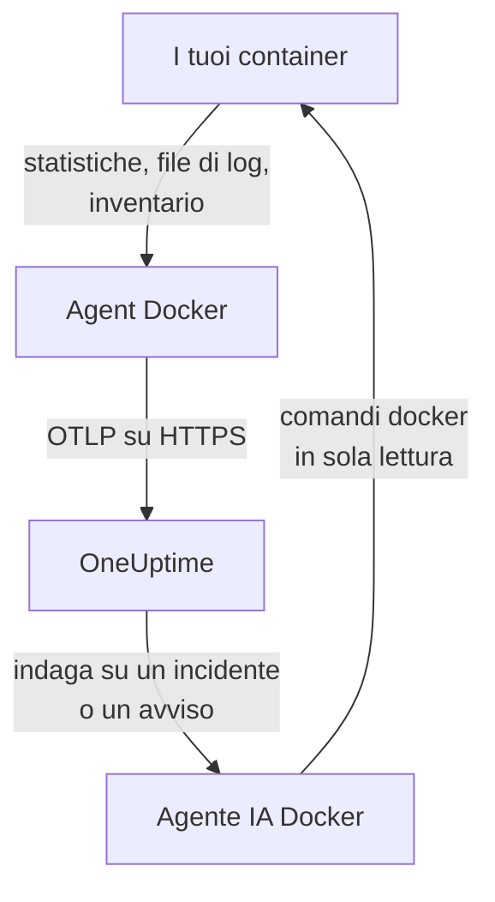

# Agent Docker

L'agent Docker di OneUptime è un container che esegui su un host Docker. Legge le statistiche e i file di log di ogni container dell'host e li invia a OneUptime, dove l'host compare con i suoi container, le metriche e i log. Un secondo container, l'agente IA Docker, permette a OneUptime AI di indagare sull'host. I [monitor Docker](/docs/monitor/docker-monitor) generano avvisi in base a ciò che l'agent invia.

:::cards
- [Installa l'agent](#installa-lagent): Due container, con `docker run` o Docker Compose.
- [Cosa raccoglie l'agent](#cosa-raccoglie-lagent): Metriche, log e un inventario di ogni container.
- [I log dei container richiedono json-file](#i-log-dei-container-richiedono-il-driver-json-file): Verificare e cambiare il driver di log di un container.
- [Risoluzione dei problemi](#risoluzione-dei-problemi): Riavvii in loop, metriche mancanti, log mancanti.
:::

## Come funziona

L'agent è un OpenTelemetry Collector con la configurazione di OneUptime integrata. Tramite il socket di Docker legge le statistiche di ogni container ogni 30 secondi ed elenca ogni container, immagine, rete e volume ogni 5 minuti. Segue i file di log dei container e invia tutto al tuo URL di OneUptime tramite OTLP, con la chiave di acquisizione che gli fornisci.



L'host si registra con i suoi primi dati, con il nome che gli dai in `DOCKER_HOST_NAME`. L'agente IA è opzionale: se lo ometti, il collector funziona allo stesso modo.

## Prima di iniziare

- Docker Engine 20.10 o successivo, e accesso root sull'host: l'agent legge `/var/run/docker.sock`.
- Docker Compose v2 (il comando `docker compose`), se installi con Docker Compose.
- Una chiave di acquisizione. Creane una in **Impostazioni del progetto → Telemetria e APM → Chiavi di acquisizione** e copiane il valore.
- HTTPS in uscita dall'host verso il tuo URL di OneUptime.
- Per i log dei container, container che usano il driver di log `json-file` di Docker, che è quello predefinito di Docker. Vedi [I log dei container richiedono il driver json-file](#i-log-dei-container-richiedono-il-driver-json-file).

## Installa l'agent

:::steps
### Avvia l'agent

Sostituisci `YOUR_ONEUPTIME_URL` con il tuo URL di OneUptime, `YOUR_TELEMETRY_INGESTION_TOKEN` con la chiave di acquisizione e `my-docker-host` con un nome per questo host, come `prod-docker-01`. Il nome è quello con cui l'host compare in OneUptime, quindi mantienilo stabile: un nome nuovo registra un nuovo host.

:::tabs
@tab Docker CLI
```bash
docker run -d \
  --name oneuptime-docker-agent \
  --user 0:0 \
  --restart unless-stopped \
  -v /var/run/docker.sock:/var/run/docker.sock:ro \
  -v /var/lib/docker/containers:/var/lib/docker/containers:ro \
  -e ONEUPTIME_URL="YOUR_ONEUPTIME_URL" \
  -e ONEUPTIME_SERVICE_TOKEN="YOUR_TELEMETRY_INGESTION_TOKEN" \
  -e DOCKER_HOST_NAME="my-docker-host" \
  oneuptime/docker-agent:release
```

Poi avvia accanto l'[agente IA](#agente-ia), con gli stessi valori. **Le indagini IA sono attive per impostazione predefinita**: mentre OneUptime AI indaga su un incidente o un avviso su questo host, esegue comandi `docker` in sola lettura tramite l'agente IA, e non modifica nulla a meno che tu non consenta le correzioni. Per installare senza indagini IA, salta questo comando.

```bash
docker run -d \
  --name oneuptime-docker-ai-agent \
  --user 0:0 \
  --restart unless-stopped \
  --read-only --tmpfs /tmp \
  -v /var/run/docker.sock:/var/run/docker.sock:ro \
  -e ONEUPTIME_URL="YOUR_ONEUPTIME_URL" \
  -e ONEUPTIME_SERVICE_TOKEN="YOUR_TELEMETRY_INGESTION_TOKEN" \
  -e ONEUPTIME_AI_AGENT_RESOURCE_TYPE=docker \
  -e DOCKER_HOST_NAME="my-docker-host" \
  oneuptime/resource-ai-agent:release
```
@tab Docker Compose
Salva questo file come `docker-compose.yml` in una cartella sull'host. Il secondo servizio è l'[agente IA](#agente-ia): omettilo per eseguire il collector senza indagini IA.

```yaml title="docker-compose.yml"
services:
  oneuptime-docker-agent:
    image: oneuptime/docker-agent:release
    container_name: oneuptime-docker-agent
    user: "0:0"
    restart: unless-stopped
    volumes:
      - /var/run/docker.sock:/var/run/docker.sock:ro
      - /var/lib/docker/containers:/var/lib/docker/containers:ro
    environment:
      - ONEUPTIME_URL=YOUR_ONEUPTIME_URL
      - ONEUPTIME_SERVICE_TOKEN=YOUR_TELEMETRY_INGESTION_TOKEN
      - DOCKER_HOST_NAME=my-docker-host
    logging:
      driver: json-file
      options:
        max-size: "10m"
        max-file: "3"
  oneuptime-docker-ai-agent:
    image: oneuptime/resource-ai-agent:release
    container_name: oneuptime-docker-ai-agent
    user: "0:0"
    restart: unless-stopped
    read_only: true
    tmpfs:
      - /tmp
    volumes:
      - /var/run/docker.sock:/var/run/docker.sock:ro
    environment:
      - ONEUPTIME_URL=YOUR_ONEUPTIME_URL
      - ONEUPTIME_SERVICE_TOKEN=YOUR_TELEMETRY_INGESTION_TOKEN
      - ONEUPTIME_AI_AGENT_RESOURCE_TYPE=docker
      - DOCKER_HOST_NAME=my-docker-host
```

Avvialo in quella cartella:

```bash
docker compose up -d
```
:::

### Verifica che l'agent sia in esecuzione

```bash
docker ps --filter name=oneuptime-docker-agent
docker logs -f oneuptime-docker-agent
```

I log dovrebbero mostrare questa riga una volta avviato il collector:

```text
Everything is ready. Begin running and processing data.
```

### Trova l'host in OneUptime

Apri **Prodotti → Infrastruttura → Docker → Tutti gli host**. L'host compare con il suo `DOCKER_HOST_NAME` entro un minuto circa, con i suoi container, le metriche e i log. L'agente IA risulta connesso nella pagina **Agente IA** dell'host e in fondo alla sua **Panoramica**.
:::

## Variabili d'ambiente

| Variabile | Obbligatoria | Descrizione |
| --- | --- | --- |
| `ONEUPTIME_URL` | Sì | Il tuo URL di OneUptime, come `https://oneuptime.com` o la tua istanza self-hosted. Usa `http://` e la sua porta se l'istanza usa solo HTTP. |
| `ONEUPTIME_SERVICE_TOKEN` | Sì | La chiave di acquisizione da **Impostazioni del progetto → Telemetria e APM → Chiavi di acquisizione**. |
| `DOCKER_HOST_NAME` | No | Il nome dell'host in OneUptime. Il valore predefinito è `docker-host`, quindi dai a ogni host il suo. |
| `DOCKER_API_VERSION` | No | La versione dell'API di Docker Engine che l'agent usa. Il valore predefinito è `1.44`. Abbassala con un daemon più vecchio, oppure impostala su un valore vuoto per negoziarla con il daemon (vedi [Risoluzione dei problemi](#risoluzione-dei-problemi)). |

Per cambiare un valore, rimuovi l'agent ed esegui di nuovo il suo comando (Docker CLI), oppure modifica `docker-compose.yml` ed esegui `docker compose up -d` (Docker Compose).

## Cosa raccoglie l'agent

| Dati | Cosa sono |
| --- | --- |
| Metriche dei container | CPU (utilizzo, percentuale, limitazione), memoria (utilizzo, limite, percentuale), I/O di rete e di blocco, uptime, riavvii e numero di processi, per container, ogni 30 secondi. |
| Log dei container | stdout e stderr di ogni container, dal suo file di log `json-file`. |
| Inventario | Ogni container in qualsiasi stato, e ogni immagine, rete e volume, ogni 5 minuti. |

Le metriche e i log di ogni container vengono archiviati sotto un servizio con il nome del container. Ogni riga di log riceve una severità in base al livello che indica, come `[ERROR]`, `level=warn` o `{"level":"info"}`; una riga che non ne indica nessuno prende quella del suo flusso: stderr è `ERROR`, stdout è `INFO`. Le righe che iniziano con uno spazio o una parentesi di chiusura vengono unite alla riga precedente, quindi uno stack trace arriva come un unico record. I log dell'agent stesso vengono esclusi.

[Monitor Docker](/docs/monitor/docker-monitor#metriche-raccolte) elenca ogni metrica e il suo significato.

## I log dei container richiedono il driver json-file

L'agent segue `/var/lib/docker/containers/*/*-json.log`, i file che scrive il driver di log `json-file` di Docker. Un container che usa un altro driver non lascia alcun file da leggere: `local` scrive file binari, e `journald`, `syslog`, `fluentd` e `gelf` inviano i log altrove. Le sue metriche arrivano comunque; i suoi log no.

Controlla il driver di log di un container e quello predefinito del daemon:

```bash
docker inspect <container> --format '{{.HostConfig.LogConfig.Type}}'
docker info --format '{{.LoggingDriver}}'
```

Passa un servizio Compose a `json-file`, con rotazione:

```yaml
services:
  my-app:
    image: my-app:latest
    logging:
      driver: "json-file"
      options:
        max-size: "100m"
        max-file: "5"
```

Oppure rendilo il predefinito per ogni container creato in seguito, in `/etc/docker/daemon.json`:

```json title="/etc/docker/daemon.json"
{
  "log-driver": "json-file",
  "log-opts": {
    "max-size": "100m",
    "max-file": "5"
  }
}
```

Poi riavvia Docker e ricrea i container. Un container mantiene il driver di log con cui è stato creato, quindi riavviarlo non basta.

## Aggiornare l'agent

Quando l'agent è più vecchio del tuo OneUptime, compare un segnale di avviso accanto a **Versione dell'agente** nella **Panoramica** dell'host. Selezionalo per vedere questi comandi.

:::tabs
@tab Docker CLI
```bash
docker pull oneuptime/docker-agent:release
docker pull oneuptime/resource-ai-agent:release
docker rm -f oneuptime-docker-agent oneuptime-docker-ai-agent
```

Poi esegui di nuovo entrambi i comandi `docker run` di [Avvia l'agent](#avvia-lagent).
@tab Docker Compose
```bash
docker compose pull
docker compose up -d
```
:::

Il tag `release` punta sempre alla release più recente. Per fissare una versione, usa `oneuptime/docker-agent:<version>`, come `oneuptime/docker-agent:10.0.31`. La stessa immagine si trova nel GitHub Container Registry come `ghcr.io/oneuptime/docker-agent:release`.

## Disinstallare l'agent

:::tabs
@tab Docker CLI
```bash
docker rm -f oneuptime-docker-agent
docker rm -f oneuptime-docker-ai-agent
```
@tab Docker Compose
```bash
docker compose down
```
:::

L'host resta in OneUptime con i dati che ha inviato. Se non ti serve più, eliminalo con **Elimina host** nel suo menu.

## Agente IA

I comandi e il file Compose qui sopra, l'`install.sh` dell'agent Docker e il `docker-compose.yml` nella sua [directory DockerAgent](https://github.com/OneUptime/oneuptime/tree/master/agents/DockerAgent) eseguono tutti l'**Agente IA Docker**: un secondo container, `oneuptime-docker-ai-agent` (immagine `oneuptime/resource-ai-agent:release`), che esegue i comandi `docker` in sola lettura richiesti da OneUptime AI mentre indaga su un incidente o un avviso su questo host — `docker ps -a`, `docker logs --tail 200 web`, `docker container inspect web`, `docker stats --no-stream` — e, solo se lo consenti, applica correzioni come il riavvio di un container specifico. Legge gli stessi `ONEUPTIME_URL`, `ONEUPTIME_SERVICE_TOKEN` e `DOCKER_HOST_NAME` del collector, quindi serve esattamente questo host, e compare nella pagina **Agente IA** dell'host in OneUptime.

- **Le indagini IA sono attive per impostazione predefinita.** Appena l'agent si connette, OneUptime AI lo usa per indagare sugli incidenti e sugli avvisi di questo host, e la **Panoramica** dell'host mostra lo stato dell'agent. Per fermarlo, imposta `ONEUPTIME_AI_INVESTIGATION=false` dove viene eseguito l'agent (**Cambia** sotto **Cosa può fare l'IA**, nella pagina dell'agente IA, mostra come), oppure ometti l'agent.
- È in sola lettura a meno che tu non lo avvii con `ONEUPTIME_AI_ALLOW_WRITES=true`; `ONEUPTIME_AI_WRITE_TARGETS` (per esempio `web-*,api-*`) limita i container che una correzione può toccare. Avvialo anche con `ONEUPTIME_AI_FIXES` per indicare come vengono eseguite le correzioni — `ask-for-approval` (una persona approva ciascuna), `automatic` o `bypass-approval` — e la pagina dell'agente IA lo mostra in sola lettura ([Cosa può fare l'IA, impostato dall'agent](/docs/ai/infrastructure-ai-agents#what-ai-may-do-set-by-the-agent)).
- Viene eseguito come root con il socket di Docker montato, perché il socket appartiene a root — e chi può usare il socket è root su questo host, `:ro` o no. Il limite è la policy dei comandi dell'agent: non esegue mai `exec`, `run`, `rm` o `prune`, e non modifica mai sé stesso, il collector o qualsiasi cosa in `ONEUPTIME_AI_PROTECTED_TARGETS` (glob di nomi di container). I valori d'ambiente nell'output di `docker inspect` vengono mascherati prima che qualcosa lasci l'host.
- `install.sh --no-ai-agent` lo omette; `docker rm -f oneuptime-docker-ai-agent` lo rimuove. Aggiornalo come il collector: `docker pull oneuptime/resource-ai-agent:release`, rimuovilo e avvialo di nuovo.

Cosa può eseguire, come funzionano le correzioni e come risolverne i problemi: [Infrastructure AI Agents](/docs/ai/infrastructure-ai-agents#docker-and-podman-hosts).

## Risoluzione dei problemi

:::details L'agent si riavvia con "client version is too new"
I log dell'agent mostrano:

```text
Error: cannot start pipelines: failed to start "docker_stats" receiver:
Error response from daemon: client version 1.44 is too new.
Maximum supported API version is 1.41
```

Un daemon rifiuta un client più recente del proprio massimo, quindi il receiver non parte mai e il collector termina con esso. Trova il massimo del daemon:

```bash
docker version --format '{{ .Server.APIVersion }}'
```

Poi aggiungi `-e DOCKER_API_VERSION=1.41` (o il valore che hai ottenuto) a `docker run`, oppure imposta `DOCKER_API_VERSION` in Compose. I daemon più recenti servono ancora le versioni più vecchie dell'API, quindi l'impostazione resta valida dopo un aggiornamento.

Preferisci non cercare il numero? Imposta `DOCKER_API_VERSION` sulla stringa vuota. L'agent negozia allora la versione con il daemon (un `HEAD /_ping`, poi il massimo del daemon stesso), il che funziona sia con daemon vecchi sia con daemon nuovi:

```bash
docker run -d ... -e DOCKER_API_VERSION= ...
```
:::

:::details Permesso negato sul socket di Docker
L'agent deve essere eseguito come root per leggere `/var/run/docker.sock`. Verifica che `--user 0:0` sia nel tuo comando `docker run`, oppure `user: "0:0"` in Compose.
:::

:::details L'host risulta disconnesso
1. Verifica che l'agent sia in esecuzione: `docker ps --filter name=oneuptime-docker-agent`
2. Cerca errori nei suoi log: `docker logs oneuptime-docker-agent 2>&1 | grep -i error`
3. Controlla `ONEUPTIME_URL` e `ONEUPTIME_SERVICE_TOKEN`: la chiave deve essere una chiave di acquisizione valida che non è stata disattivata.
4. Verifica che l'host raggiunga il tuo URL di OneUptime in rete.
:::

:::details Non compare nessuna metrica
1. Verifica che il socket di Docker sia montato nell'agent. La sua immagine non ha una shell, quindi guarda da un container usa e getta che ne condivide i mount: `docker run --rm --volumes-from oneuptime-docker-agent alpine:3.19 ls -la /var/run/docker.sock`
2. Cerca errori di esportazione nei suoi log: `docker logs oneuptime-docker-agent 2>&1 | tail -100`
3. Verifica che la chiave di acquisizione sia valida e non sia scaduta.
:::

:::details Le metriche arrivano, ma i log dei container no
Molto probabilmente i tuoi container usano un driver di log diverso da `json-file`. Controlla quali file osserva l'agent e quale driver usa un container:

```bash
docker logs oneuptime-docker-agent 2>&1 | grep -E "Started watching file|no files match"
docker inspect <container> --format '{{.HostConfig.LogConfig.Type}}'
```

Se l'agent segnala `no files match the configured criteria`, passa i container a `json-file` e ricreali, come mostra [I log dei container richiedono il driver json-file](#i-log-dei-container-richiedono-il-driver-json-file).
:::

:::details I log finiscono su un altro host, oppure l'host si chiama docker-host
Il nome dell'host viene da `DOCKER_HOST_NAME`. Un agent avviato senza di esso riporta `docker-host`, quindi ogni host configurato così sembra lo stesso; se cambi il nome in seguito, OneUptime registra un secondo host, che riceve i nuovi dati. Imposta `DOCKER_HOST_NAME` su un nome proprio per ogni host e ricrea l'agent. Per verificare il nome che riporta l'agent:

```bash
docker inspect oneuptime-docker-agent --format '{{range .Config.Env}}{{println .}}{{end}}' | grep DOCKER_HOST_NAME
```
:::

## Passaggi successivi

:::cards
- [Monitor Docker](/docs/monitor/docker-monitor): Ricevere avvisi su CPU, memoria e riavvii dei container.
- [Database](/docs/telemetry/databases): I container di database sull'host vengono rilevati e ottengono pagine proprie.
- [Agent Kubernetes](/docs/telemetry/kubernetes-agent): Monitorare invece un cluster Kubernetes.
- [Collector OpenTelemetry sull'host](/docs/telemetry/host-otel-collector): Monitorare la macchina stessa: CPU, dischi, processi e log.
:::
