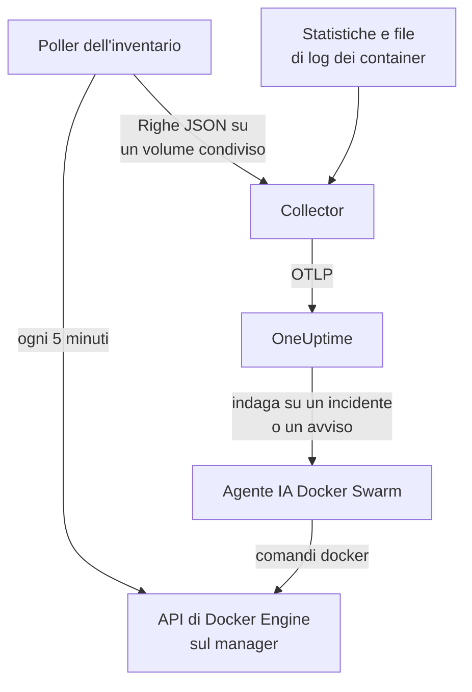

# Agent Docker Swarm

L'agent Docker Swarm di OneUptime monitora un cluster Docker Swarm: i suoi nodi, servizi, task, stack, reti overlay, secret, config e volumi, oltre alle metriche e ai log di ogni container. Lo esegui con Docker Compose su un nodo manager dello swarm, e il cluster compare in OneUptime con tutti questi elementi. I [monitor Docker Swarm](/docs/monitor/docker-swarm-monitor) inviano avvisi su ciò che arriva.

:::cards
- [Installare l'agent](#installa-lagent): Lo script di installazione o Docker Compose, su un nodo manager.
- [Cosa raccoglie l'agent](#cosa-raccoglie-lagent): L'inventario, i conteggi del cluster, e le metriche e i log dei container.
- [Agente IA](#agente-ia): Lascia che OneUptime AI legga lo swarm mentre indaga.
- [Risoluzione dei problemi](#risoluzione-dei-problemi): Uno script di diagnostica, e i problemi più comuni.
:::

## Come funziona

L'agent è composto da tre container, tutti definiti in un unico `docker-compose.yml`:

1. **Collector**: un OpenTelemetry Collector che legge `docker_stats` per le metriche di ogni container, segue i file di log dei container e segue il file con lo snapshot dell'inventario. Applica a tutto il nome del tuo cluster (`docker.swarm.cluster.name`), e alle metriche di ogni task il suo servizio e il suo nodo, poi invia tutto a OneUptime tramite OTLP.
2. **Poller dell'inventario**: un piccolo sidecar con `curl` e `jq` che ogni 5 minuti percorre l'API del manager dello swarm (`/nodes`, `/services`, `/tasks`, `/networks`, `/secrets`, `/configs`, `/volumes`) e ricava gli stack dall'etichetta di servizio `com.docker.stack.namespace`. Scrive una riga JSON per oggetto, che il collector inoltra.
3. **Agente IA**: `oneuptime-docker-swarm-ai-agent`, che esegue i comandi `docker` richiesti da OneUptime AI mentre indaga su un incidente o un avviso in questo cluster. È in sola lettura a meno che tu non consenta le correzioni (vedi [Agente IA](#agente-ia)).



Il cluster si registra con i suoi primi dati, con il nome di cluster che configuri.

## Prima di iniziare

- Un nodo **manager** dello swarm su cui eseguire l'agent: il poller dell'inventario e l'agente IA chiamano endpoint dell'API a cui rispondono solo i manager.
- Docker Engine 20.10 o successivo con il plugin Docker Compose v2.
- Una chiave di acquisizione. Creane una in **Impostazioni del progetto → Telemetria e APM → Chiavi di acquisizione** e copiane il valore.
- HTTPS in uscita dal nodo verso il tuo URL di OneUptime.

### Dove eseguire l'agent

Eseguilo su un nodo manager. Il collector riporta i container del nodo su cui gira, quindi per le metriche dei container di tutti i nodi esegui il collector su ogni nodo, tutti con lo stesso `DOCKER_SWARM_CLUSTER_NAME`; il poller dell'inventario e l'agente IA devono girare su un solo manager. `install.sh` omette l'agente IA su un nodo che non è un manager (e rimuove quello che vi aveva installato in precedenza). Un agente IA avviato comunque su un worker non si registra mai per il cluster: attende che il suo nodo diventi un manager, quindi non può scalzare l'agente IA del manager. Distribuisci l'agent come stack swarm invece che con Compose? Tieni il poller dell'inventario e l'agente IA sui manager con il vincolo `node.role == manager`.

## Installa l'agent

:::steps
### Installa e avvia l'agent

:::tabs
@tab install.sh
Scarica lo script di installazione ed eseguilo su un nodo manager:

```bash
curl -sSL https://raw.githubusercontent.com/OneUptime/oneuptime/master/agents/DockerSwarmAgent/install.sh -o install.sh
sh install.sh
```

Lo script chiede il tuo URL di OneUptime, la chiave di acquisizione e un nome per il cluster. Si installa in `/opt/oneuptime-docker-swarm-agent`, scrive un file `.env` leggibile solo dal suo proprietario, con l'hostname del nodo come `DOCKER_SWARM_NODE_NAME`, e avvia tutti e tre i container. Aggiungi `--no-ai-agent` per omettere l'agente IA.
@tab Docker Compose
Scarica `docker-compose.yml`, `otel-collector-config.yaml` e `inventory-snapshot.sh` dalla [directory DockerSwarmAgent](https://github.com/OneUptime/oneuptime/tree/master/agents/DockerSwarmAgent) in una nuova cartella su un nodo manager:

```bash
curl -fsSL https://raw.githubusercontent.com/OneUptime/oneuptime/master/agents/DockerSwarmAgent/docker-compose.yml -o docker-compose.yml
curl -fsSL https://raw.githubusercontent.com/OneUptime/oneuptime/master/agents/DockerSwarmAgent/otel-collector-config.yaml -o otel-collector-config.yaml
curl -fsSL https://raw.githubusercontent.com/OneUptime/oneuptime/master/agents/DockerSwarmAgent/inventory-snapshot.sh -o inventory-snapshot.sh
chmod +x inventory-snapshot.sh
```

Crea un file `.env` accanto a essi. Contiene la chiave di acquisizione, quindi tienilo privato con `chmod 600 .env`:

```bash title=".env"
ONEUPTIME_URL=https://oneuptime.com
ONEUPTIME_SERVICE_TOKEN=your-telemetry-ingestion-key
DOCKER_SWARM_CLUSTER_NAME=my-swarm
```

Aggiungi al file il nome del nodo. Il collector lo applica alle metriche dei container del nodo:

```bash
echo "DOCKER_SWARM_NODE_NAME=$(docker info --format '{{.Name}}')" >> .env
```

Avvia l'agent:

```bash
docker compose up -d
```
:::

### Verifica che l'agent sia in esecuzione

```bash
docker compose ps
docker compose logs --tail 50 oneuptime-docker-swarm-agent oneuptime-docker-swarm-inventory
```

`docker compose ps` elenca tre container: il collector (`oneuptime-docker-swarm-agent`), il poller dell'inventario (`oneuptime-docker-swarm-inventory`) e l'agente IA (`oneuptime-docker-swarm-ai-agent`).

### Trova il cluster in OneUptime

Apri **Prodotti → Infrastruttura → Docker Swarm → Tutti i cluster**. Il cluster compare entro pochi minuti, e le sue pagine **Nodi**, **Servizi**, **Attività**, **Stacks**, **Reti**, **Segreti**, **Configs** e **Volumi** si riempiono dopo il primo snapshot dell'inventario, entro 5 minuti. La pagina **Topologia** del cluster disegna i suoi stack, servizi, task e nodi su un'unica mappa: vedi [Topologia](/docs/telemetry/topology#aprire-la-mappa-di-una-risorsa).
:::

## Variabili d'ambiente

Lo script di installazione scrive le prime quattro in `/opt/oneuptime-docker-swarm-agent/.env`; un'installazione con Docker Compose le legge dal `.env` accanto a `docker-compose.yml`. Aggiungi o modifica lì una qualsiasi di esse, poi esegui `docker compose up -d` in quella cartella.

| Variabile | Obbligatoria | Descrizione |
| --- | --- | --- |
| `ONEUPTIME_URL` | Sì | Il tuo URL di OneUptime, come `https://oneuptime.com` o la tua istanza self-hosted. Usa `http://` e la sua porta se l'istanza usa solo HTTP. |
| `ONEUPTIME_SERVICE_TOKEN` | Sì | La chiave di acquisizione da **Impostazioni del progetto → Telemetria e APM → Chiavi di acquisizione**. |
| `DOCKER_SWARM_CLUSTER_NAME` | No | Il nome del cluster in OneUptime, e la chiave con cui si uniscono i dati di ogni nodo: applicato a tutto come attributo di risorsa `docker.swarm.cluster.name`. Mantienilo stabile: cambiarlo in seguito registra un secondo cluster. Il valore predefinito è `docker-swarm`. |
| `DOCKER_SWARM_NODE_NAME` | No | Il nome del nodo, applicato alle metriche e ai log dei suoi container come attributo di risorsa `docker.swarm.node.name`, in base al quale filtra un [monitor Docker Swarm](/docs/monitor/docker-swarm-monitor#impostazioni-del-monitor). Lo script di installazione lo imposta sull'hostname del nodo, come lo mostra `docker node ls`. Se è vuoto, non viene applicato alcun nome di nodo. |
| `DOCKER_INVENTORY_INTERVAL_SECONDS` | No | Ogni quanto il poller dell'inventario scatta uno snapshot, in secondi. Il valore predefinito è `300`. |
| `DOCKER_API_VERSION` | No | La versione dell'API di Docker Engine che parlano il collector e il poller dell'inventario. Vuota per impostazione predefinita: usano quella del daemon, quindi funziona con ogni Docker Engine dalla 20.10 in poi. Impostala solo per fissare una versione (vedi [Risoluzione dei problemi](#risoluzione-dei-problemi)). L'agente IA la negozia a meno che tu non ne imposti una. |

Le impostazioni proprie dell'agente IA sono in [Agente IA](#agente-ia).

## Cosa raccoglie l'agent

| Segnale | Origine | Dove compare |
| --- | --- | --- |
| I nodi, servizi, task, stack, reti, secret, config e volumi | Il poller dell'inventario, dall'API del manager dello swarm | Gli elenchi e le pagine di dettaglio del cluster |
| Conteggi del cluster (nodi pronti, task in esecuzione, servizi, stack, …) | Lo stesso snapshot | Le schede della panoramica e i badge del menu laterale |
| CPU, memoria, numero di processi e uptime dei container | Il receiver `docker_stats` | La pagina **Metriche** |
| Log stdout e stderr dei container | Il receiver `filelog` | La pagina **Registri** |

Le metriche di ogni task portano l'identità del suo container, che aggiunge il receiver `docker_stats` (`container.name`, `container.image.name`, `container.id` e `container.runtime=docker`), il suo servizio e l'ID del suo nodo, che il collector copia dalle etichette che Swarm mette sul task (`docker.swarm.service.name` e `docker.swarm.node.id`), e il nome del suo nodo da `DOCKER_SWARM_NODE_NAME` (`docker.swarm.node.name`). I [monitor Docker Swarm](/docs/monitor/docker-swarm-monitor#impostazioni-del-monitor) filtrano in base a questi attributi.

### In cosa differisce dall'agent Docker

L'[agent Docker](/docs/telemetry/docker-host) modella un singolo host e applica `host.name` a tutto. L'agent Docker Swarm applica `docker.swarm.cluster.name` e mai `host.name`, di proposito: così OneUptime archivia i dati sotto il cluster swarm, invece di registrare ogni nodo come un host a sé.

## Etichettare il cluster con le etichette di progetto

Un attributo di risorsa che inizia con `oneuptime.label.` diventa un'etichetta di progetto sul cluster: `oneuptime.label.<dimension>=<value>` è l'etichetta `<dimension>:<value>`. Aggiungi gli attributi al processor `resource` in `otel-collector-config.yaml`, accanto a `docker.swarm.cluster.name`:

```yaml
processors:
  resource:
    attributes:
      # ...existing attributes...
      - key: oneuptime.label.team
        value: platform
        action: upsert
      - key: oneuptime.label.env
        value: production
        action: upsert
```

Il collector legge la sua configurazione solo all'avvio: esegui `docker compose restart oneuptime-docker-swarm-agent`. Il cluster mostra quindi le etichette `team:platform` e `env:production`. Le etichette vengono confrontate senza distinguere maiuscole e minuscole, quindi un'etichetta `Production` esistente viene riutilizzata invece che duplicata, e l'agent non rimuove mai un'etichetta che qualcuno ha aggiunto in OneUptime.

## Eseguire come servizio systemd

Per avviare l'agent insieme al nodo e riavviarlo quando si blocca, installa la sua unità systemd. Presuppone che l'agent si trovi in `/opt/oneuptime-docker-swarm-agent`, dove lo mette lo script di installazione:

```bash
sudo curl -fsSL https://raw.githubusercontent.com/OneUptime/oneuptime/master/agents/DockerSwarmAgent/systemd/oneuptime-docker-swarm-agent.service -o /etc/systemd/system/oneuptime-docker-swarm-agent.service
sudo systemctl daemon-reload
sudo systemctl enable --now oneuptime-docker-swarm-agent
```

## Aggiornare l'agent

L'agent riporta la versione dei suoi file: la release del collector che eseguono, con l'ultimo numero che sale ogni volta che OneUptime cambia i file e non il collector. Quando è più vecchia della versione distribuita da questa release di OneUptime, accanto alla versione dell'agent compare un segnale di avviso nella pagina **Panoramica** del cluster. Selezionalo per vedere questi comandi.

Esegui di nuovo lo script di installazione sul nodo manager e rispondi alle sue domande con lo stesso URL, la stessa chiave e lo stesso nome di cluster. Scarica i file più recenti, scarica le immagini e riavvia l'agent:

```bash
curl -sSL https://raw.githubusercontent.com/OneUptime/oneuptime/master/agents/DockerSwarmAgent/install.sh -o install.sh
sh install.sh
```

Lo script riscrive `.env` a partire dalle tue risposte. Conserva solo gli elenchi di destinazioni dell'agente IA e ciò che l'IA può fare (`ONEUPTIME_AI_INVESTIGATION`, `ONEUPTIME_AI_FIXES`): aggiungi di nuovo qualsiasi variabile che avevi impostato tu, come `DOCKER_API_VERSION`. Avevi attivato le correzioni IA? Eseguilo come `ONEUPTIME_AI_ALLOW_WRITES=true sh install.sh` per mantenerle attive. Avevi omesso l'agente IA? Passa di nuovo `--no-ai-agent`.

Con Docker Compose, scarica di nuovo i tre file nella cartella dell'agent (poi rifai le eventuali modifiche apportate a `docker-compose.yml`), scarica le immagini e riavvia:

```bash
docker compose pull
docker compose up -d --force-recreate
```

La versione del collector è fissata nei file, quindi scaricare le immagini da solo non porta avanti l'agent.

## Disinstallare l'agent

```bash
cd /opt/oneuptime-docker-swarm-agent
docker compose down
```

## Agente IA

Il `docker-compose.yml` dello swarm (e `install.sh`) esegue anche l'**Agente IA Docker Swarm**: un terzo container, `oneuptime-docker-swarm-ai-agent` (immagine `oneuptime/resource-ai-agent:release`), che esegue i comandi `docker` in sola lettura richiesti da OneUptime AI mentre indaga su un incidente o un avviso in questo cluster — `docker node ls`, `docker service ps web --no-trunc`, `docker service logs --tail 200 web` — e, solo se lo consenti, applica correzioni come un riavvio progressivo di un servizio indicato per nome. Legge gli stessi `ONEUPTIME_URL`, `ONEUPTIME_SERVICE_TOKEN` e `DOCKER_SWARM_CLUSTER_NAME` del collector, quindi serve esattamente questo cluster, e compare nella pagina **IA → Agente IA** del cluster in OneUptime.

- **Le indagini IA sono attive per impostazione predefinita.** Appena l'agent si connette, OneUptime AI lo usa per indagare sugli incidenti e sugli avvisi di questo cluster, e la **Panoramica** del cluster mostra lo stato dell'agent. Per fermarlo, imposta `ONEUPTIME_AI_INVESTIGATION=false` dove viene eseguito l'agent (**Cambia** sotto **Cosa può fare l'IA**, nella pagina dell'agente IA, mostra come), oppure ometti l'agent.
- Come il poller dell'inventario, **deve girare su un nodo manager**: i comandi su nodi, servizi e task esistono solo sui manager. Su un worker non esegue nulla e non si registra per il cluster finché il nodo non diventa un manager (il suo `/status` dice perché). Eseguine uno per cluster.
- È in **sola lettura** a meno che tu non imposti `ONEUPTIME_AI_ALLOW_WRITES=true` in `.env` ed esegua `docker compose up -d` (oppure esegua `install.sh` con essa; l'installer scrive `ONEUPTIME_AI_ALLOW_WRITES`, `ONEUPTIME_AI_INVESTIGATION`, `ONEUPTIME_AI_FIXES`, `ONEUPTIME_AI_WRITE_TARGETS` e `ONEUPTIME_AI_PROTECTED_TARGETS` dal suo ambiente in `.env`, e una nuova esecuzione conserva ciò che `.env` contiene già per le ultime quattro, a meno che tu non passi quella variabile, anche vuota); `ONEUPTIME_AI_WRITE_TARGETS` (glob di nomi di servizi e nodi, per esempio `web_*,api_*`) limita ciò che una correzione può toccare. `ONEUPTIME_AI_FIXES` nello stesso `.env` indica come vengono eseguite le correzioni — `ask-for-approval` (una persona approva ciascuna), `automatic` o `bypass-approval` — e la pagina dell'agente IA lo mostra in sola lettura ([Cosa può fare l'IA, impostato dall'agent](/docs/ai/infrastructure-ai-agents#cosa-può-fare-lia-deciso-dallagente)). Svuotare un nodo richiede sempre l'approvazione di una persona, qualunque sia la modalità.
- Gira come root con il socket Docker montato, perché il socket appartiene a root — e su un manager chi può usare il socket controlla l'intero swarm, `:ro` o no. La policy dei comandi dell'agent è il limite: non crea né rimuove mai servizi o stack, non tocca mai secret o config, e non modifica mai sé stesso, il collector, il poller dell'inventario o qualsiasi cosa in `ONEUPTIME_AI_PROTECTED_TARGETS` (glob di nomi di servizi e nodi).
- `install.sh --no-ai-agent` lo omette; in alternativa, elimina il servizio `oneuptime-docker-swarm-ai-agent` da `docker-compose.yml`.

Cosa può eseguire, come funzionano le correzioni e come risolverne i problemi: [Infrastructure AI Agents](/docs/ai/infrastructure-ai-agents#cluster-docker-swarm).

## Risoluzione dei problemi

:::details Esegui prima lo script di diagnostica
L'agent include uno script, [`troubleshoot.sh`](https://github.com/OneUptime/oneuptime/blob/master/agents/DockerSwarmAgent/troubleshoot.sh), che controlla l'intera catena: i container, che il poller dell'inventario sia su un manager (`docker node ls`), il file dello snapshot, il nome del cluster applicato a tutto, la forma del token, le metriche proprie del collector, e se OneUptime accetta la chiave di acquisizione. Quest'ultimo controllo è il più importante. OneUptime rifiuta una chiave errata con `401` (`422` per una chiave disattivata o una chiave del browser), e il collector lo registra come una riga `Exporting failed` per batch, facile da non notare. Lo script interroga `GET <url>/otlp/v1/validate` per ottenere direttamente `200` (valida) o `401` (non valida). Eseguilo sul nodo manager:

```bash
curl -sSL https://raw.githubusercontent.com/OneUptime/oneuptime/master/agents/DockerSwarmAgent/troubleshoot.sh -o troubleshoot.sh
bash troubleshoot.sh    # add -d <dir> if you installed outside /opt/oneuptime-docker-swarm-agent
```
:::

:::details Il cluster non compare mai
Esegui prima lo script di diagnostica. Altrimenti leggi i log del collector (`docker compose logs oneuptime-docker-swarm-agent`), verifica che `ONEUPTIME_SERVICE_TOKEN` e `ONEUPTIME_URL` in `.env` siano corretti e che il nodo raggiunga il tuo URL di OneUptime.
:::

:::details Non compare alcun inventario
Verifica che il poller dell'inventario giri su un manager: `docker node ls` deve riuscire lì. Poi cerca righe `failed to emit ...` nei suoi log: `docker compose logs oneuptime-docker-swarm-inventory`.
:::

:::details Il cluster passa a disconnesso
Un cluster risulta disconnesso quando OneUptime non ha ricevuto nulla da esso per 15 minuti; OneUptime controlla ogni 5 minuti, e il tempo in cui era OneUptime stesso a non ricevere dati non conta. Assicurati che il container del collector resti attivo: `docker compose ps` lo mostra.
:::

:::details Il collector termina con "client version is too new"
I log del collector mostrano:

```text
Error: cannot start pipelines: failed to start "docker_stats" receiver:
Error response from daemon: client version 1.44 is too new.
Maximum supported API version is 1.41
```

La versione API più alta del daemon è inferiore a quella richiesta dal collector (Docker Engine 20.10 si ferma a `1.41`), quindi il receiver `docker_stats` non può avviarsi e il container si riavvia in loop. Il collector negozia la versione con il daemon a meno che `DOCKER_API_VERSION` non ne indichi una, e i file dell'agent precedenti alla versione 0.161.2 fissavano `1.44`. [Aggiorna l'agent](#aggiornare-lagent) e togli da `.env` qualsiasi `DOCKER_API_VERSION` con una versione (oppure lascialo vuoto, `DOCKER_API_VERSION=`), su ogni nodo su cui gira l'agent.

Per fissare comunque una versione, non superare la versione più alta del daemon:

```bash
docker version --format '{{ .Server.APIVersion }}'
```

Imposta `DOCKER_API_VERSION` su quel valore in `.env` ed esegui `docker compose up -d` su ogni nodo su cui gira l'agent. I daemon più recenti servono ancora le versioni API più vecchie, quindi l'impostazione continua a funzionare dopo l'aggiornamento di Docker.
:::

:::details Il cluster compare con il nome sbagliato
Il nome del cluster viene da `DOCKER_SWARM_CLUSTER_NAME`. Cambialo in `.env` ed esegui `docker compose up -d`: un nuovo nome registra un nuovo cluster invece di rinominare quello vecchio.
:::

:::details La CPU dei task è una linea piatta
Un `otel-collector-config.yaml` più vecchio invia il valore di CPU calcolato dal receiver `docker_stats` stesso. Dal collector 0.150.0 il receiver lo ricava da una sola lettura delle statistiche: tutta la CPU usata da un container dal suo avvio, divisa per tutta la CPU usata dal nodo dal suo boot. La linea si muove appena e non segue il carico, mentre `container.cpu.usage.total` sì. Un agent così riporta la versione 0.161.0 o precedente, quindi compare un segnale di avviso accanto alla sua versione: scarica di nuovo i file dell'agent come mostra [Aggiornare l'agent](#aggiornare-lagent). Dalla sua seconda lettura in poi il collector invia allora la CPU usata da ogni container in ogni intervallo di 30 secondi. Le letture già salvate restano com'erano.
:::

## Passaggi successivi

:::cards
- [Monitor Docker Swarm](/docs/monitor/docker-swarm-monitor): Avvisi su nodi, servizi, task e container.
- [Infrastructure AI Agents](/docs/ai/infrastructure-ai-agents): Cosa può eseguire l'agente IA Docker Swarm e come funzionano le correzioni.
- [Agent Docker](/docs/telemetry/docker-host): Monitora invece un singolo host Docker.
:::
