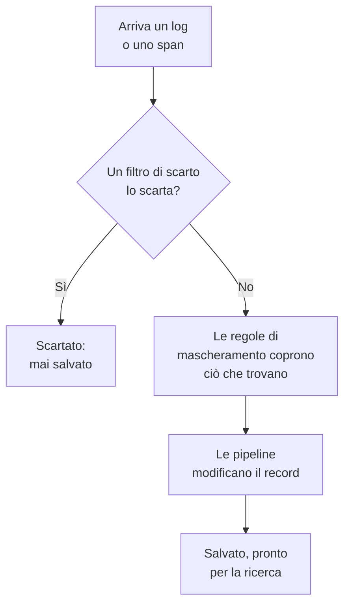

# Filtri di scarto e regole di mascheramento

I filtri di scarto e le regole di mascheramento agiscono sui vostri log e span mentre arrivano, prima che venga salvato qualsiasi cosa. Un filtro di scarto butta via i record che non vi servono mai, o ne conserva solo un campione. Una regola di mascheramento nasconde i dati personali e i segreti, come indirizzi email, numeri di carta e password, così non raggiungono mai il vostro archivio.

:::cards
- [Dove vengono eseguiti](#dove-vengono-eseguiti): Prima delle pipeline, prima del salvataggio.
- [Scartare o campionare i record](#scartare-o-campionare-i-record): Selezionare i record, poi scartarli o conservarne una parte.
- [Che cosa toglierebbe un filtro](#che-cosa-toglierebbe-un-filtro): Che cosa legge i record, prima di salvarlo.
- [Mascherare i dati sensibili](#mascherare-i-dati-sensibili): Oscurare, mascherare o sostituire con un hash ciò che un pattern trova.
- [Verificare che cosa ha scartato un filtro](#verificare-che-cosa-ha-scartato-un-filtro): Conteggi su ogni filtro.
:::

## Dove vengono eseguiti

I log hanno i loro in **Log → Impostazioni**, e gli span in **Tracce → Impostazioni**. Quando arriva un record, OneUptime li esegue in quest'ordine:



- **Agiscono solo sui nuovi record.** Una regola che create o modificate si applica ai record che arrivano circa un minuto dopo. I record già salvati non cambiano.
- **Un record scartato non esiste più.** Nessuna ricerca, grafico, monitor o regola di registrazione lo vede mai, e non se ne ricava alcuna eccezione. Su OneUptime Cloud non viene nemmeno fatturato.
- **Ogni elenco viene eseguito in ordine.** Trascinate le righe di un elenco per cambiare l'ordine. Vengono eseguiti solo i filtri e le regole abilitati.

I filtri di scarto e le regole di mascheramento dei log si applicano allo stesso modo ai log da OpenTelemetry, Syslog, Fluent Bit e Fluentd. [Pipeline dei log](/docs/telemetry/log-pipelines) spiega il passaggio che segue.

## Prima di iniziare

- **Log o span in arrivo.** Vedete [OpenTelemetry](/docs/telemetry/open-telemetry).
- **Un ruolo che modifica le impostazioni della telemetria.** Proprietario del progetto o Amministratore del progetto, oppure un ruolo personalizzato con il permesso per ciò che modificate, come Create Log Drop Filter o Create Trace Scrub Rule. I ruoli Telemetry possono vedere filtri e regole, ma non modificarli.

## Scartare o campionare i record

:::steps
### Aprire i filtri di scarto

Andate in **Log → Impostazioni → Filtri di scarto**, oppure in **Tracce → Impostazioni → Filtri di scarto** per gli span.

### Selezionare i record

Fate clic su **Crea: Log Scarto Filtro**, oppure su **Crea: Trace Scarto Filtro** per gli span. In **Corrispondenza**, date al filtro un **Nome**, poi costruite la sua **Query del filtro**: un campo, un operatore e un valore per ogni condizione, e se devono corrispondere **Tutte le condizioni** o **Almeno una condizione**. Fate clic su **Avanti**.

### Scegliere l'azione

In **Azione**, lasciate **Scarta** per buttare via ogni record corrispondente, oppure scegliete **Campione** e inserite la **Percentuale di campionamento** da conservare, da 1 a 99. Poi create il filtro.
:::

Il filtro inizia a scartare entro un minuto. Per salvarlo senza scartare ancora nulla, disattivate **Abilitato** in **Avanzato** prima di crearlo.

> [!WARNING]
> Un record scartato non si può recuperare. Tenete ristretta la query di un filtro, e controllate il suo conteggio **Scartati** dopo averlo creato.

Un filtro può verificare questi campi, e qualsiasi attributo con **Custom Attribute...**:

| Record | Campi |
| --- | --- |
| Log | **Gravità**, **Corpo del log**, **ID servizio** |
| Span | **Nome dello span**, **Tipo di span**, **Stato**, **Messaggio di stato**, **ID servizio**, **Ha eccezione**, **È span radice** |

| Operatore | Corrisponde a |
| --- | --- |
| **è uguale a** | Il valore esatto, con le sue maiuscole e minuscole: `Debug` corrisponde, `DEBUG` no. |
| **non è uguale a** | Qualsiasi cosa tranne il valore esatto. |
| **contiene** | Il valore in qualsiasi punto del campo, senza distinguere maiuscole e minuscole. Un `%` nel valore è un carattere jolly. |
| **è uno di** | Uno di un elenco di valori esatti, separati da virgole. |

**Preview query** mostra la query che formano le condizioni. Questa scarta le righe di debug di un controllo di integrità:

```text
severityText = 'Debug' AND body LIKE 'healthcheck'
```

Il campionamento decide record per record: con una **Percentuale di campionamento** di 10, viene conservato circa un record corrispondente su dieci. I filtri vengono eseguiti nell'ordine dell'elenco, e decide il primo che scarta un record; un record che un campione conserva passa al filtro successivo.

## Che cosa toglierebbe un filtro

Un record scartato non esiste più per tutto ciò che lo legge, quindi, mentre scrivete un filtro di scarto, il suo modulo dice che cosa toglierebbe, un attimo dopo che smettete di digitare: sotto la **Query del filtro** in **Corrispondenza**, e sotto l'azione in **Azione**. Una riga dice l'effetto più importante, e **Mostra dettagli** dice il resto:

- **Quanto seleziona.** Dei record salvati nell'ultimo giorno, quanti corrispondono: ciò che il filtro tiene fuori dal vostro archivio e dalla vostra fattura. Si conta su ciò che è stato salvato, dopo che le regole di mascheramento e le pipeline l'hanno modificato, e solo sui servizi di cui potete leggere i record. Un conteggio che dura più di 10 secondi viene interrotto, e il modulo lo dice.
- **Che cosa perderebbero gli Eventi di sicurezza.** Dove gli [Eventi di sicurezza](/docs/telemetry/security-events) leggono i vostri log con la scheda **I tuoi log**, o i vostri span, il modulo dice quanti dei record corrispondenti hanno letto: gli accessi, gli attacchi e i record del firewall che trasformano in eventi. Un filtro **Campione** nomina anche le regole che scattano a un conteggio, e che cosa succede loro se conserva solo la sua parte: al 10%, una regola che scatta a 10 accessi falliti in cinque minuti ne richiede circa 100, quindi scatta molto più di rado, o mai.
- **Che cos'altro legge gli stessi record.** I monitor, gli SLO, le dashboard con i loro widget, le regole di registrazione e le viste salvate le cui query possono includere un record che il filtro toglie. Una query li legge quando legge lo stesso tipo di record, da un servizio da cui il filtro può togliere, e nulla di ciò che fissa a un valore esatto esclude il filtro: un filtro dei log **Debug** lascia stare un monitor degli errori, e un filtro di un servizio lascia stare lo SLO di un altro servizio. Tutto ciò che il modulo non può escludere, come una ricerca nel corpo del log, conta come lettura. Ognuno è un link, e quelli che non potete aprire vengono contati, mai nominati.

Quando qualcosa legge ciò che un filtro toglie, creare il filtro, attivarlo o cambiare la query o l'azione di uno attivo vi chiede di confermare. Potete comunque salvare il filtro: la domanda c'è perché decidiate con cognizione di causa. Un filtro che nulla legge si salva senza domande.

Tramite l'API non viene chiesto nulla, perché uno script o Terraform non ha nessuno che risponda. Un filtro che l'API crea o modifica viene salvato, e quando toglie ciò che altri leggono, la risposta porta un'intestazione `X-OneUptime-Write-Warning` che lo dice in numeri, e che il provider Terraform mostra come avviso. Per chiedere prima, inviate `filterQuery`, `action` e `samplePercentage` del filtro a `POST /api/telemetry/logs/drop-filter-impact`, oppure a `/api/telemetry/traces/drop-filter-impact` per gli span: risponde con tutto ciò che mostra il modulo.

I filtri OpenStack che OneUptime aggiunge a un progetto conservano ogni riga che leggono gli Eventi di sicurezza, finché restano come OneUptime li ha creati. Modificatene uno, e scarta ciò che seleziona, come un vostro filtro.

## Mascherare i dati sensibili

:::steps
### Aprire le regole di mascheramento

Andate in **Log → Impostazioni → Regole di mascheramento**, oppure in **Tracce → Impostazioni → Regole di mascheramento** per gli span.

### Scegliere che cosa cercare

Fate clic su **Crea: Log Scrub Regola**, oppure su **Crea: Trace Scrub Regola** per gli span, e scegliete un **Tipo di pattern**. La regola prende il suo nome, ad esempio **Pulisci gli indirizzi email**, finché non ne digitate uno vostro. Per **Regex personalizzata**, inserite anche il **Pattern regex personalizzato**.

### Scegliere come mascherare

In **Avanzato**, scegliete l'**Azione di pulizia** e i **Campi da rimuovere**, oppure lasciateli come sono: una nuova regola sostituisce ogni corrispondenza con `[REDACTED]`, ovunque si trovi nel record. Poi create la regola.
:::

| Tipo di pattern | Che cosa trova |
| --- | --- |
| **Indirizzo email** | Indirizzi email, come `jane@example.com` |
| **Numero di carta di credito** | Sedici cifre in gruppi di quattro, come `4111 1111 1111 1111` |
| **SSN (numero di previdenza sociale USA)** | I numeri di previdenza sociale statunitensi, come `123-45-6789` |
| **Numero di telefono** | I numeri di telefono nordamericani, come `555-123-4567` |
| **Indirizzo IP** | Indirizzi IPv4 e IPv6 pubblici, come `203.0.113.7` o `2001:db8::1`, ma non quelli privati, di loopback o link-local |
| **Chiavi di attributi sensibili** | L'intero valore di qualsiasi attributo la cui chiave sembri segreta, come `password`, `token`, `api_key`, `authorization` o `cookie` |
| **Regex personalizzata** | La vostra espressione regolare, scritta senza barre né flag, e confrontata distinguendo maiuscole e minuscole |

| Azione di pulizia | Che cosa diventa una corrispondenza |
| --- | --- |
| **Oscura** | `[REDACTED]`, il valore predefinito |
| **Maschera** | Quasi del tutto nascosta: un indirizzo email conserva la prima lettera e la fine del dominio, un numero di carta, di telefono o di previdenza sociale le ultime quattro cifre, e una corrispondenza personalizzata o un valore segreto il primo e l'ultimo carattere. Un indirizzo IP viene nascosto completamente. |
| **Hash** | Un token unico del vostro progetto, sempre lo stesso per lo stesso valore, così le ripetizioni si possono ancora contare, ma nessuno può risalire al valore |

Ad esempio, una regola **Indirizzo email** salva questo corpo di log:

```text
Payment failed for jane@example.com
```

in una di queste forme, a seconda della sua **Azione di pulizia**:

```text
Redact: Payment failed for [REDACTED]
Mask:   Payment failed for j***@***.com
Hash:   Payment failed for [HASHED:5e29db14e508e09a]
```

**Campi da rimuovere** vale **Entrambi (corpo e attributi)** per una regola dei log, a meno che non scegliate **Solo corpo** o **Solo attributi**, e **Tutto (nome, attributi ed eventi)** per una regola degli span, a meno che non scegliate **Solo nome dello span**, **Solo attributi** o **Solo attributi dell'evento**. Gli attributi dei link di uno span vengono mascherati insieme agli attributi propri dello span, e **Tutto (nome, attributi ed eventi)** maschera anche il messaggio di stato di uno span e i nomi dei suoi eventi. Una regola **Chiavi di attributi sensibili** legge le chiavi, quindi maschera sempre i valori sotto di esse: negli attributi e nel corpo JSON di un log.

- **Una regola può valere per un solo servizio.** In **Avanzato**, scegli il servizio in **Solo per un servizio**: la regola maschera i record di quel servizio, e quelli degli altri servizi restano come sono. Se lo lasci vuoto, maschera i record di tutti i servizi. La colonna **Ambito** dell'elenco dice quale.
- **Il modulo dice cosa cambierebbe una regola per gli altri.** Prima che tu crei una regola, e quando ne attivi una, OneUptime elenca cosa legge i valori che nasconderebbe: monitor, dashboard, viste salvate, regole di registrazione e SLO, ciascuno come link, e cosa perderebbero gli [Eventi di sicurezza](/docs/telemetry/security-events). Un monitor che filtra su un valore nascosto smette di trovarlo. La regola viene salvata in ogni caso.
- **Una regola per gli indirizzi IP nasconde gli indirizzi che sono dati personali.** Sono gli indirizzi IPv4 e IPv6 pubblici, comunque siano scritti: abbreviati, come `2001:db8::1`, tra parentesi quadre con una porta, come `[2001:db8::1]:443`, che mantiene parentesi e porta, con una zona, come `2001:db8::2%eth0`, che mantiene la zona, oppure un indirizzo IPv4 scritto come IPv6, come `::ffff:203.0.113.7`, nascosto per intero. Mantiene gli indirizzi privati, di loopback e link-local, come `10.0.0.12`, `127.0.0.1` e `fe80::1`, e l'indirizzo dei metadati cloud `169.254.169.254` nell'URL di una richiesta, dove [Eventi di sicurezza](/docs/telemetry/security-events) cerca la falsificazione di richieste lato server. Per nascondere anche gli indirizzi interni, aggiungete per loro una regola **Regex personalizzata**, come `\b(?:\d{1,3}\.){3}\d{1,3}\b` per ogni indirizzo IPv4.
- **Un token di hash è del vostro progetto.** Viene creato con una chiave del vostro progetto, derivata dal `ENCRYPTION_SECRET` dell'installazione, così lo stesso valore ha un altro token in un altro progetto, e nessuno che legga un token può risalire al valore o calcolare l'hash di un'ipotesi per confrontarlo. Un indirizzo IP ha un solo token, comunque sia scritto: `::ffff:203.0.113.7` e `203.0.113.7` ne condividono uno. I record salvati prima che i token avessero una chiave ne contengono da 8 caratteri, come `[HASHED:8c87b489]`, diversi da quelli di oggi da 16 caratteri: finché quei record non raggiungono la fine della conservazione, cercate entrambi. Cambiare `ENCRYPTION_SECRET` cambia ogni token, e in un'installazione self-hosted i token sono segreti solo quanto lui.
- **Eventi di sicurezza può ancora nominare un indirizzo IP con hash.** Quando [Eventi di sicurezza](/docs/telemetry/security-events) legge i tuoi log o le tue tracce, una regola di indirizzo IP che applica l'hash conserva anche ogni indirizzo che nasconde accanto al suo token, in un archivio che leggono solo le scansioni di Eventi di sicurezza: nessuna pagina, ricerca, esportazione, API o strumento di IA può leggerlo. Così un attacco da un indirizzo che i tuoi log mostrano solo come token nomina comunque l'indirizzo, e il suo caso dice quale indirizzo bloccare. Ogni indirizzo viene conservato fino a 30 giorni dopo l'ultima volta in cui è stato visto. Una regola che cancella o maschera l'indirizzo non conserva nulla, e allora Eventi di sicurezza dice che una regola di mascheramento ha nascosto l'indirizzo, come fa per un token più vecchio di 30 giorni o creato prima che i token avessero una chiave.
- **Vengono lette anche le liste e i valori annidati.** Una regola legge ogni testo dentro una lista, una lista di liste o una lista chiave-valore, come i valori di un'intestazione HTTP, e mantiene la forma del valore: i numeri e i valori vero o falso restano come sono. Una regola **Chiavi di attributi sensibili** legge anche le chiavi dentro un valore, quindi viene nascosto anche il `password` dentro una lista chiave-valore. Il corpo di un log inviato come mappa o come lista viene salvato come il suo testo JSON, e una regola **Chiavi di attributi sensibili** legge le chiavi al suo interno, come in un corpo scritto in JSON. Una regola di pattern mantiene un corpo simile in JSON, e così anche un attributo scritto in JSON, come i messaggi di una chiamata di IA: legge il testo come lo ha scritto la vostra applicazione, con una sequenza di escape come `\n` letta come l'a capo che rappresenta, e sostituisce ciò che trova solo all'interno dei suoi testi e numeri.
- **Viene letto anche il JSON dentro un testo.** Un testo che è a sua volta JSON, come un attributo `http.request.body` che contiene `{"password":"hunter2"}`, o la riga `log` di un record di Fluentd dentro il corpo di un log, viene letto come JSON, fino a 4 livelli di JSON uno dentro l'altro, e oltre come testo. Una regola **Chiavi di attributi sensibili** nasconde i valori sotto le chiavi che sembrano segrete al suo interno, e nient'altro: i suoi numeri, gli spazi e gli altri testi restano come li ha scritti la vostra applicazione. Un testo che sembra soltanto JSON, come `{token}`, resta com'è.
- **Un valore troppo grande per essere letto elemento per elemento viene letto come testo.** Un valore annidato per più di 32 livelli, o uno che porterebbe un record oltre i 10.000 valori nelle sue liste e mappe, viene letto e salvato come il suo testo JSON. Una regola di pattern maschera ciò che trova in quel testo, e una regola **Chiavi di attributi sensibili** nasconde l'intero valore quando vi compare una parola come `password` o `token`. Nel corpo di un log, e nel JSON dentro un testo, solo la parte oltre questi limiti viene letta come testo: il resto viene ancora letto chiave per chiave.
- **Le eccezioni nascono dal record mascherato.** Un'eccezione trovata in un log viene creata dopo il mascheramento, e le regole che mascherano gli eventi degli span mascherano anche le eccezioni registrate su di essi. Ogni eccezione continua a essere raggruppata in base a ciò che diceva prima del mascheramento, quindi aggiungere una regola non trasforma mai un'eccezione che avete già in una nuova, né fa scattare di nuovo **Nuova eccezione** per essa. Quando una regola nasconde parte di ciò in base a cui si raggruppa una nuova eccezione, la sua impronta viene calcolata con una chiave del vostro progetto, come un token di hash, così nessuno può risalire a ciò che è stato nascosto.
- **Le copie grezze di una riga syslog nascondono ciò che le regole hanno nascosto nelle sue parti.** Syslog conserva i dati strutturati di una riga RFC 5424 così come sono arrivati in `syslog.structured.raw`, e il syslog inviato via HTTP conserva l'intera riga in `syslog.raw`. Ogni copia viene ricomposta da ciò che le regole hanno lasciato dei campi dell'intestazione, di ogni parametro dei dati strutturati e del messaggio, e poi le regole la leggono come leggono qualsiasi attributo. Così una password che una regola **Chiavi di attributi sensibili** nasconde in `syslog.structured.auth_1.password`, o un indirizzo che una regola **Solo corpo** nasconde nel messaggio, è nascosto anche nelle copie, scritto come RFC 5424 scrive un valore: `password="[REDACTED\]"`. Una riga in cui le regole non cambiano nulla conserva le sue copie così come è arrivata.
- **L'ID di sessione di un record viene mantenuto.** Una regola **Chiavi di attributi sensibili** nasconde una sessione di accesso, come un `session_id`, un `sessionid` o un cookie, ma mantiene `session.id` quando contiene la sessione a cui appartiene il log o lo span: l'ID casuale con cui [Session Replay](/docs/telemetry/session-replay) archivia il record, che il record mantiene comunque come sua sessione. L'ID di conversazione di una chiamata di IA viene mantenuto allo stesso modo. Non inviate il segreto di una sessione di accesso come `session.id`.
- **Anche le Session Replay vengono mascherate.** Le regole di mascheramento dei log valide per tutti i servizi vengono eseguite anche sulle registrazioni di Session Replay, oltre al mascheramento che il registratore fa nel browser.
- **Le regole vengono eseguite nell'ordine dell'elenco.** Ogni regola vede ciò che hanno lasciato le regole precedenti.
- **Un pattern personalizzato richiede un tempo in proporzione al record.** Mantiene la sintassi e le risposte di JavaScript, lookahead e lookbehind compresi, comunque sia scritto. Un riferimento all'indietro, come `\1`, non può essere eseguito così: una regola che ne contiene uno viene rifiutata al salvataggio, come un pattern troppo grande per essere eseguito. Se per trovare ogni corrispondenza si dovesse rileggere più volte un valore lungo, la regola maschera l'intero valore. I filtri di scarto, le regole di mascheramento e le pipeline di un progetto condividono anche una quota di lavoro per ogni lotto che invia, in proporzione alla dimensione del lotto e sufficiente perché decine di pattern personalizzati leggano ogni valore. Quando i loro pattern richiedono di più, una regola di mascheramento personalizzata maschera l'intero valore, e un filtro a cui non si può rispondere non si applica al record.

## Verificare che cosa ha scartato un filtro

L'elenco **Filtri di scarto** mostra per ogni filtro il conteggio **Scartati** e quando è avvenuto il suo **Last Dropped**. **Nothing dropped yet** significa che non ha mai trovato corrispondenze. La pagina di un filtro mostra lo stesso in **Attività**, aggiornato entro un minuto da uno scarto. La sua scheda **Condizioni di filtro** mostra che cosa seleziona, e lì potete cambiare le condizioni.

## Risoluzione dei problemi

:::details Un filtro di scarto non scarta nulla
**è uguale a**, **non è uguale a** ed **è uno di** confrontano il testo esatto, maiuscole e minuscole comprese. Le gravità si scrivono `Information` e `Warning`, non `INFO` o `WARN`. Verificate che il filtro sia abilitato, e attendete un minuto dopo una modifica.
:::

:::details Mancano dei log che mi aspettavo
Guardate il conteggio **Scartati** e l'ora del **Last Dropped** di ogni filtro di scarto. Disattivate **Abilitato** su quello che sospettate, e i log successivi tornano ad arrivare.
:::

:::details Una regola di mascheramento personalizzata indica Non pulisce nulla
Il suo pattern è vuoto, non è un'espressione regolare valida o non può essere eseguito, per esempio perché contiene un riferimento all'indietro come `\1`, quindi non maschera nulla. Modificate la regola e datele un pattern che corrisponda ad almeno un carattere.
:::

:::details I record vecchi mostrano ancora i dati che una nuova regola maschera
Le regole di mascheramento agiscono quando arrivano i record. I record salvati prima della regola conservano ciò che avevano finché non termina la loro conservazione. Vedete [Conservazione dei dati](/docs/telemetry/data-retention).
:::

## Passaggi successivi

:::cards
- [Pipeline dei log](/docs/telemetry/log-pipelines): Analizzate e arricchite i log che conservate.
- [Esploratore log](/docs/telemetry/logs-explorer): Cercate ciò che è stato salvato.
- [Esploratore tracce](/docs/telemetry/traces-explorer): Seguite gli span che conservate.
- [Conservazione dei dati](/docs/telemetry/data-retention): Decidete per quanto tempo vengono conservati.
:::
