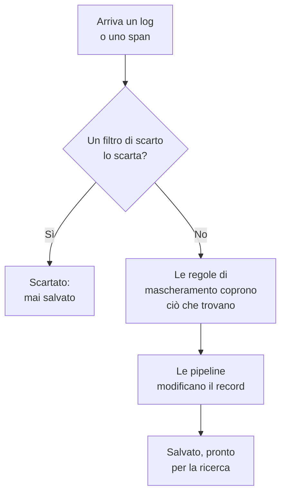

# Filtri di scarto e regole di mascheramento

I filtri di scarto e le regole di mascheramento agiscono sui vostri log e span mentre arrivano, prima che venga salvato qualsiasi cosa. Un filtro di scarto butta via i record che non vi servono mai, o ne conserva solo un campione. Una regola di mascheramento nasconde i dati personali e i segreti, come indirizzi email, numeri di carta e password, così non raggiungono mai il vostro archivio.

:::cards
- [Dove vengono eseguiti](#dove-vengono-eseguiti): Prima delle pipeline, prima del salvataggio.
- [Scartare o campionare i record](#scartare-o-campionare-i-record): Selezionare i record, poi scartarli o conservarne una parte.
- [Mascherare i dati sensibili](#mascherare-i-dati-sensibili): Oscurare, mascherare o sostituire con un hash ciò che un pattern trova.
- [Verificare che cosa ha scartato un filtro](#verificare-che-cosa-ha-scartato-un-filtro): Conteggi su ogni filtro.
:::

## Dove vengono eseguiti

I log hanno i loro in **Log → Impostazioni**, e gli span in **Tracce → Impostazioni**. Quando arriva un record, OneUptime li esegue in quest'ordine:



- **Agiscono solo sui nuovi record.** Una regola che create o modificate si applica ai record che arrivano circa un minuto dopo. I record già salvati non cambiano.
- **Un record scartato non esiste più.** Nessuna ricerca, grafico, monitor o regola di registrazione lo vede mai, e non se ne ricava alcuna eccezione. Su OneUptime Cloud non viene nemmeno fatturato.
- **Ogni elenco viene eseguito in ordine.** Trascinate le righe di un elenco per cambiare l'ordine. Vengono eseguiti solo i filtri e le regole abilitati.

I filtri di scarto e le regole di mascheramento dei log si applicano allo stesso modo ai log da OpenTelemetry, Syslog, Fluent Bit e Fluentd. [Pipeline dei log](/docs/telemetry/log-pipelines) spiega il passaggio che segue.

## Prima di iniziare

- **Log o span in arrivo.** Vedete [OpenTelemetry](/docs/telemetry/open-telemetry).
- **Un ruolo che modifica le impostazioni della telemetria.** Project Owner o Project Admin, oppure un ruolo personalizzato con il permesso per ciò che modificate, come Create Log Drop Filter o Create Trace Scrub Rule. I ruoli Telemetry possono vedere filtri e regole, ma non modificarli.

## Scartare o campionare i record

:::steps
### Aprire i filtri di scarto

Andate in **Log → Impostazioni → Filtri di scarto**, oppure in **Tracce → Impostazioni → Filtri di scarto** per gli span.

### Selezionare i record

Fate clic su **Crea: Log Scarto Filtro**, oppure su **Crea: Trace Scarto Filtro** per gli span. In **Corrispondenza**, date al filtro un **Nome**, poi costruite la sua **Query del filtro**: un campo, un operatore e un valore per ogni condizione, e se devono corrispondere **Tutte le condizioni** o **Almeno una condizione**. Fate clic su **Avanti**.

### Scegliere l'azione

In **Azione**, lasciate **Scarta** per buttare via ogni record corrispondente, oppure scegliete **Campione** e inserite la **Percentuale di campionamento** da conservare, da 1 a 99. Poi create il filtro.
:::

Il filtro inizia a scartare entro un minuto. Per salvarlo senza scartare ancora nulla, disattivate **Abilitato** in **Avanzato** prima di crearlo.

> [!WARNING]
> Un record scartato non si può recuperare. Tenete ristretta la query di un filtro, e controllate il suo conteggio **Dropped** dopo averlo creato.

Un filtro può verificare questi campi, e qualsiasi attributo con **Custom Attribute...**:

| Record | Campi |
| --- | --- |
| Log | **Gravità**, **Corpo del log**, **ID servizio** |
| Span | **Nome dello span**, **Tipo di span**, **Stato**, **Messaggio di stato**, **ID servizio**, **Ha eccezione**, **È span radice** |

| Operatore | Corrisponde a |
| --- | --- |
| **è uguale a** | Il valore esatto, con le sue maiuscole e minuscole: `Debug` corrisponde, `DEBUG` no. |
| **non è uguale a** | Qualsiasi cosa tranne il valore esatto. |
| **contiene** | Il valore in qualsiasi punto del campo, senza distinguere maiuscole e minuscole. Un `%` nel valore è un carattere jolly. |
| **è uno di** | Uno di un elenco di valori esatti, separati da virgole. |

**Preview query** mostra la query che formano le condizioni. Questa scarta le righe di debug di un controllo di integrità:

```text
severityText = 'Debug' AND body LIKE 'healthcheck'
```

Il campionamento decide record per record: con una **Percentuale di campionamento** di 10, viene conservato circa un record corrispondente su dieci. I filtri vengono eseguiti nell'ordine dell'elenco, e decide il primo che scarta un record; un record che un campione conserva passa al filtro successivo.

## Mascherare i dati sensibili

:::steps
### Aprire le regole di mascheramento

Andate in **Log → Impostazioni → Regole di mascheramento**, oppure in **Tracce → Impostazioni → Regole di mascheramento** per gli span.

### Scegliere che cosa cercare

Fate clic su **Crea: Log Scrub Regola**, oppure su **Crea: Trace Scrub Regola** per gli span, e scegliete un **Tipo di pattern**. La regola prende il suo nome, ad esempio **Pulisci gli indirizzi email**, finché non ne digitate uno vostro. Per **Regex personalizzata**, inserite anche il **Pattern regex personalizzato**.

### Scegliere come mascherare

In **Avanzato**, scegliete l'**Azione di pulizia** e i **Campi da rimuovere**, oppure lasciateli come sono: una nuova regola sostituisce ogni corrispondenza con `[REDACTED]`, ovunque si trovi nel record. Poi create la regola.
:::

| Tipo di pattern | Che cosa trova |
| --- | --- |
| **Indirizzo email** | Indirizzi email, come `jane@example.com` |
| **Numero di carta di credito** | Sedici cifre in gruppi di quattro, come `4111 1111 1111 1111` |
| **SSN (Social Security Number)** | I numeri di previdenza sociale statunitensi, come `123-45-6789` |
| **Numero di telefono** | I numeri di telefono nordamericani, come `555-123-4567` |
| **Indirizzo IP** | Indirizzi IPv4, come `192.168.1.1` |
| **Sensitive Attribute Keys** | L'intero valore di qualsiasi attributo la cui chiave sembri segreta, come `password`, `token`, `api_key`, `authorization` o `cookie` |
| **Regex personalizzata** | La vostra espressione regolare, scritta senza barre né flag, e confrontata distinguendo maiuscole e minuscole |

| Azione di pulizia | Che cosa diventa una corrispondenza |
| --- | --- |
| **Oscura** | `[REDACTED]`, il valore predefinito |
| **Maschera** | Quasi del tutto nascosta: un indirizzo email conserva la prima lettera e la fine del dominio, un numero di carta, di telefono o di previdenza sociale le ultime quattro cifre, e una corrispondenza personalizzata o un valore segreto il primo e l'ultimo carattere. Un indirizzo IP viene nascosto completamente. |
| **Hash** | Un breve hash del valore, sempre lo stesso per lo stesso valore, così le ripetizioni si possono ancora contare |

Ad esempio, una regola **Indirizzo email** salva questo corpo di log:

```text
Payment failed for jane@example.com
```

in una di queste forme, a seconda della sua **Azione di pulizia**:

```text
Redact: Payment failed for [REDACTED]
Mask:   Payment failed for j***@***.com
Hash:   Payment failed for [HASHED:8c87b489]
```

**Campi da rimuovere** vale **Entrambi (corpo e attributi)** per una regola dei log, a meno che non scegliate **Solo corpo** o **Solo attributi**, e **Tutto (nome, attributi ed eventi)** per una regola degli span, a meno che non scegliate **Solo nome dello span**, **Solo attributi** o **Solo attributi dell'evento**. Una regola **Sensitive Attribute Keys** maschera sempre i valori degli attributi, perché legge le chiavi degli attributi.

- **Le eccezioni nascono dal record mascherato.** Un'eccezione trovata in un log viene creata dopo il mascheramento, e le regole che mascherano gli eventi degli span mascherano anche le eccezioni registrate su di essi.
- **Anche le Session Replay vengono mascherate.** Le regole di mascheramento dei log vengono eseguite anche sulle registrazioni di Session Replay, oltre al mascheramento che il registratore fa nel browser.
- **Le regole vengono eseguite nell'ordine dell'elenco.** Ogni regola vede ciò che hanno lasciato le regole precedenti.
- **Un pattern personalizzato richiede un tempo in proporzione al record.** Mantiene la sintassi e le risposte di JavaScript, lookahead e lookbehind compresi, comunque sia scritto. Un riferimento all'indietro, come `\1`, non può essere eseguito così: una regola che ne contiene uno viene rifiutata al salvataggio, come un pattern troppo grande per essere eseguito. Se per trovare ogni corrispondenza si dovesse rileggere più volte un valore lungo, la regola maschera l'intero valore.

## Verificare che cosa ha scartato un filtro

L'elenco **Filtri di scarto** mostra per ogni filtro il conteggio **Dropped** e quando è avvenuto il suo **Last Dropped**. **Nothing dropped yet** significa che non ha mai trovato corrispondenze. La pagina di un filtro mostra lo stesso in **Attività**, aggiornato entro un minuto da uno scarto. La sua scheda **Condizioni di filtro** mostra che cosa seleziona, e lì potete cambiare le condizioni.

## Risoluzione dei problemi

:::details Un filtro di scarto non scarta nulla
**è uguale a**, **non è uguale a** ed **è uno di** confrontano il testo esatto, maiuscole e minuscole comprese. Le gravità si scrivono `Information` e `Warning`, non `INFO` o `WARN`. Verificate che il filtro sia abilitato, e attendete un minuto dopo una modifica.
:::

:::details Mancano dei log che mi aspettavo
Guardate il conteggio **Dropped** e l'ora del **Last Dropped** di ogni filtro di scarto. Disattivate **Abilitato** su quello che sospettate, e i log successivi tornano ad arrivare.
:::

:::details Una regola di mascheramento personalizzata indica Non pulisce nulla
Il suo pattern è vuoto, non è un'espressione regolare valida o non può essere eseguito, per esempio perché contiene un riferimento all'indietro come `\1`, quindi non maschera nulla. Modificate la regola e datele un pattern che corrisponda ad almeno un carattere.
:::

:::details I record vecchi mostrano ancora i dati che una nuova regola maschera
Le regole di mascheramento agiscono quando arrivano i record. I record salvati prima della regola conservano ciò che avevano finché non termina la loro conservazione. Vedete [Conservazione dei dati](/docs/telemetry/data-retention).
:::

## Passaggi successivi

:::cards
- [Pipeline dei log](/docs/telemetry/log-pipelines): Analizzate e arricchite i log che conservate.
- [Esploratore log](/docs/telemetry/logs-explorer): Cercate ciò che è stato salvato.
- [Esploratore tracce](/docs/telemetry/traces-explorer): Seguite gli span che conservate.
- [Conservazione dei dati](/docs/telemetry/data-retention): Decidete per quanto tempo vengono conservati.
:::
