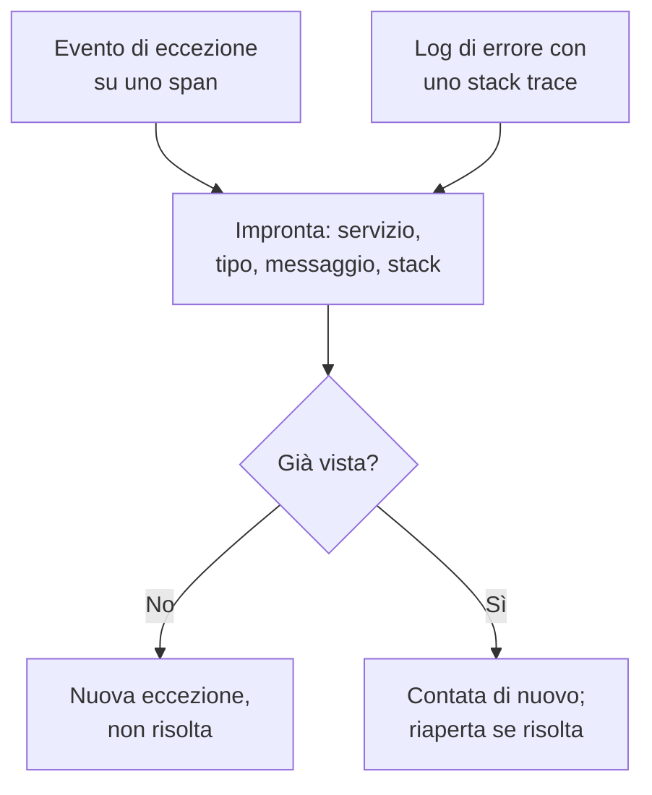

# Tracciamento delle eccezioni

Il tracciamento delle eccezioni raccoglie gli errori che il vostro codice solleva e raggruppa ogni occorrenza dello stesso errore in un'unica eccezione, con il suo stack trace, il suo andamento e le richieste in cui si è verificata. Smistatele come una lista di cose da fare: correggete, risolvete o archiviate il rumore, e lasciate che l'IA apra una pull request per quelle che sa correggere.

:::cards
- [Da dove arrivano le eccezioni](#da-dove-arrivano-le-eccezioni): Span e log che i vostri servizi inviano già.
- [Smistare l'elenco](#smistare-lelenco): Prima ciò che non è risolto, il rumore nascosto.
- [La pagina di un'eccezione](#la-pagina-di-uneccezione): Stack trace, occorrenze e contesto.
- [Correggerla con l'IA](#correggerla-con-lia): Una pull request con la correzione, o un test di regressione.
:::

## Da dove arrivano le eccezioni

Non inviate le eccezioni a parte. OneUptime le trova nella telemetria che i vostri servizi inviano già:

- un evento di eccezione su uno span, cioè ciò che scrive `recordException()` di OpenTelemetry;
- un log con gli attributi `exception.type`, `exception.message` o `exception.stacktrace`;
- un log con gravità Error o Fatal il cui messaggio contiene uno stack trace, quando il log non è stato scritto all'interno di uno span (lo span la segnala già).

Ogni occorrenza viene raggruppata con le precedenti dello stesso errore in un'unica eccezione:

- **Un'eccezione per servizio ed errore.** L'impronta viene calcolata dal servizio, dal tipo di eccezione, dal messaggio e dallo stack trace. Prima vengono tolti i valori che cambiano da una chiamata all'altra: UUID e altri identificativi, timestamp, indirizzi IP ed email, e numeri di sette o più cifre. Così `Order id=1042 not found` e `Order id=2077 not found` sono un'unica eccezione.
- **Una nuova occorrenza riapre un'eccezione risolta.** Se si ripresenta dopo che l'avete risolta, la correzione non ha retto.
- **Un'eccezione archiviata resta archiviata.** Le sue nuove occorrenze vengono ancora contate, ma smettono di generare notifiche.

> [!TIP]
> Per tenere un errore previsto fuori dal tracciamento delle eccezioni, come un input non valido che il vostro servizio ha rifiutato, impostate l'attributo `error.class` su `user-error` o `expected-denial` nell'evento di eccezione dello span. OneUptime allora non registra alcuna eccezione per esso.

## Prima di iniziare

- **Span o log in arrivo.** Strumentate i vostri servizi con [OpenTelemetry](/docs/telemetry/open-telemetry). La scheda **Guida alla configurazione** mostra il codice per il vostro linguaggio.
- **Un ruolo che può leggere la telemetria.** Project Owner, Project Admin, Project Member, Viewer, Telemetry Admin, Telemetry Member o Telemetry Viewer, oppure un ruolo personalizzato con il permesso Read Telemetry Service Exception. Risolvere e archiviare richiede Project Owner o Project Admin, oppure il permesso Edit Telemetry Service Exception.

## Smistare l'elenco

:::steps
### Aprire le eccezioni

Aprite **Prodotti → Osservabilità → Eccezioni**. Il badge sulla scheda **Eccezioni** conta i problemi non risolti, e l'elenco si apre sulle eccezioni **Non risolto**.

### Scegliere uno stato

Passate tra **Non risolto**, **Risolto**, **Archiviato** e **Tutti**. Il grafico sopra l'elenco mostra quante occorrenze sono state **Non gestito** e quante **Gestito** nel tempo.

### Scegliere che cosa conta come problema

**Problemi**, il predefinito, nasconde gli errori degli utenti e i rifiuti previsti, così l'elenco mostra ciò che richiede una correzione. **User errors** mostra solo quelli, e **Tutti** mostra ogni eccezione.

### Cercare e filtrare

Digitate una query come `type:TypeError env:production`, vedere [Sintassi di ricerca](/docs/telemetry/search-syntax#eccezioni), oppure fate clic su un valore nella barra laterale **Filtri**: un servizio, un host o un'altra risorsa, un **Tipo di eccezione**, un **Ambiente** o una **Error Class**.

### Aprire un'eccezione

Fate clic su una riga per aprire la pagina dell'eccezione.
:::

## La pagina di un'eccezione

Il menu laterale della pagina raggruppa ciò che fate con un'eccezione:

| Pagina | Cosa mostra |
| --- | --- |
| **Panoramica** | Il messaggio, il servizio, quante volte si è verificata e quando è stata vista la prima e l'ultima volta, il suo andamento nel tempo e la sua ultima occorrenza: release, ambiente, span, traccia e sessione utente. |
| **Stack trace** | I frame dello stack. Per il codice del browser, i file e le righe originali, una volta caricate le [Source map](/docs/telemetry/source-maps) per la release. |
| **Occurrences** | Ogni occorrenza, con l'ora, il messaggio e la traccia in cui si è verificata. |
| **Context** | Gli attributi dell'ultima occorrenza, la sua registrazione della sessione quando c'è, e i passaggi che hanno portato a essa. |
| **Registri** | I log scritti intorno all'ultima occorrenza. |
| **AI Assistance** | Attività di IA che correggono l'eccezione o la testano. |
| **Impostazioni** | Risolvere o archiviare l'eccezione. Si trova sotto **Manage**, inizialmente compresso. |

## Risolvere, riaprire e archiviare

I pulsanti in cima alla pagina dell'eccezione, e la sua pagina **Impostazioni**, ne cambiano lo stato:

| Azione | Quando usarla | Che cosa succede dopo |
| --- | --- | --- |
| **Risolvi** | Avete distribuito la correzione. | Lascia l'elenco **Non risolto**. Una nuova occorrenza la riapre. |
| **Reopen** | La correzione non ha funzionato. | È di nuovo non risolta. |
| **Archivia** | È rumore che non intendete correggere. | Lascia l'elenco. Le nuove occorrenze vengono contate ma smettono di generare notifiche. |
| **Annulla archiviazione** | Volete tornare a sentirne parlare. | Torna nell'elenco a cui appartiene. |

**Impostazioni** mostra chi ha risolto o archiviato l'eccezione per ultimo, e quando. I suoi pulsanti dicono **Segna come risolto** o **Segna come non risolto**, e **Archivia** o **Annulla archiviazione**.

## Classi di errore

Ogni eccezione ha una classe di errore, che dice di chi è il problema. OneUptime AI la imposta quando smista un insight sull'eccezione, come un'eccezione nuova o in forte aumento: vedere [AI SRE](/docs/ai/ai-sre#insight-rilevamento-proattivo). Un'eccezione che non ha smistato resta `unknown`.

| Classe | Che cosa significa | In **Problemi** |
| --- | --- | --- |
| `code-fault` | Un difetto nel codice. L'unica classe che l'IA corregge da sola. | Sì |
| `infrastructure` | Un timeout, una connessione interrotta o risorse esaurite. | Sì |
| `unknown` | Non ancora classificata. | Sì |
| `user-error` | La conseguenza di un input non valido di un utente. | No |
| `expected-denial` | Un controllo che fa il suo lavoro, come un accesso rifiutato. | No |

Con **Archivia le eccezioni previste** attivo, nelle impostazioni degli insight dell'IA, le eccezioni che lo smistamento riconosce come rifiuti previsti vengono archiviate per voi.

## Correggerla con l'IA

La pagina **AI Assistance** offre tre attività. Ognuna viene eseguita come attività di IA che apre una pull request nel vostro repository di codice:

| Attività | Che cosa fa la pull request |
| --- | --- |
| **Fix this exception with AI** | Corregge la causa principale. Avviatela con **Correggi con l'IA**. |
| **Generate Regression Test** | Aggiunge un test che fallisce finché il bug non viene corretto. |
| **Migliora la gestione degli errori** | Per gli errori previsti: convalida prima l'input, tiene i dati degli utenti fuori dai messaggi e segna l'errore come gestito. |

Prima l'IA ha bisogno di tre cose: un provider LLM, un repository collegato (su GitHub, GitLab, Forgejo o Gitea, o su qualsiasi server Git) e un agente IA online che esegua l'attività. La pagina controlla ciascuna e rimanda a ciò che manca. Le attività sono in pausa finché l'eccezione è risolta o archiviata. Vedere [Codice](/docs/ai/ai-agent).

## Informazioni sulle eccezioni

La scheda **Informazioni** conta le vostre eccezioni **Non risolto**, **Risolto** e **Archiviato** e il vostro tasso di risoluzione, ed elenca le eccezioni più frequenti, i servizi che colpiscono e quelle viste più di recente.

## Risoluzione dei problemi

:::details Un'eccezione appena sollevata non è nell'elenco
Controllate prima la vista: **Problemi** nasconde gli errori degli utenti e i rifiuti previsti, quindi scegliete **Tutti**. Poi ampliate l'intervallo di tempo e verificate che l'eccezione sia stata registrata su uno span, o in un log con uno stack trace.
:::

:::details Un errore compare come più eccezioni
L'impronta include il messaggio e lo stack trace. Quando differiscono, ad esempio quando un messaggio contiene un numero breve o un nome che cambia a ogni chiamata, ogni variante è un'eccezione a sé.
:::

:::details Un'eccezione risolta continua a tornare
Una nuova occorrenza riapre di proposito un'eccezione risolta: l'errore si verifica ancora. Verificate che la correzione abbia raggiunto la release che la segnala, oppure archiviate l'eccezione se non volete più sentirne parlare.
:::

## Passaggi successivi

:::cards
- [Monitor eccezioni](/docs/monitor/exceptions-monitor): Ricevere un avviso quando le eccezioni aumentano di colpo.
- [Source map](/docs/telemetry/source-maps): Stack trace leggibili per il codice del browser.
- [Codice](/docs/ai/ai-agent): Come l'IA corregge il codice e apre pull request.
- [Esploratore tracce](/docs/telemetry/traces-explorer): Vedere la richiesta in cui si è verificata un'eccezione.
:::
