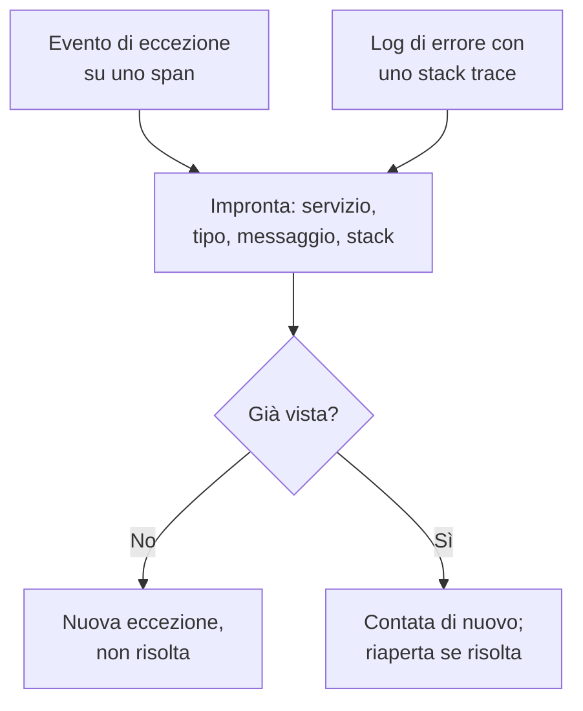

# Tracciamento delle eccezioni

Il tracciamento delle eccezioni raccoglie gli errori che il vostro codice solleva e raggruppa ogni occorrenza dello stesso errore in un'unica eccezione, con il suo stack trace, il suo andamento e le richieste in cui si è verificata. Smistatele come una lista di cose da fare: correggete, risolvete o archiviate il rumore, e lasciate che l'IA apra una pull request per quelle che sa correggere.

:::cards
- [Da dove arrivano le eccezioni](#da-dove-arrivano-le-eccezioni): Span e log che i vostri servizi inviano già.
- [Smistare l'elenco](#smistare-lelenco): Prima ciò che non è risolto, il rumore nascosto.
- [La pagina di un'eccezione](#la-pagina-di-uneccezione): Stack trace, occorrenze e contesto.
- [Correggerla con l'IA](#correggerla-con-lia): Una pull request con la correzione, o un test di regressione.
- [Trovare e correggere le eccezioni nuove e in aumento con l'IA](#trovare-e-correggere-le-eccezioni-nuove-e-in-aumento-con-lia): Pull request per le eccezioni che OneUptime trova.
:::

## Da dove arrivano le eccezioni

Non inviate le eccezioni a parte. OneUptime le trova nella telemetria che i vostri servizi inviano già:

- un evento di eccezione su uno span, cioè ciò che scrive `recordException()` di OpenTelemetry;
- un log con gli attributi `exception.type`, `exception.message` o `exception.stacktrace`;
- un log con gravità Error o Fatal il cui messaggio contiene uno stack trace, quando il log non è stato scritto all'interno di uno span (lo span la segnala già).

Ogni occorrenza viene raggruppata con le precedenti dello stesso errore in un'unica eccezione:

- **Un'eccezione per servizio ed errore.** L'impronta viene calcolata dal servizio, dal tipo di eccezione, dal messaggio e dallo stack trace. Prima vengono tolti i valori che cambiano da una chiamata all'altra: UUID e altri identificativi, timestamp, indirizzi IP ed email, e numeri di sette o più cifre. Così `Order id=1042 not found` e `Order id=2077 not found` sono un'unica eccezione. Una nuova eccezione viene invece raggruppata per tipo e per le funzioni e i file del vostro codice nel suo stack trace: numeri di riga, frame delle librerie e messaggio restano fuori, così le varianti lanciate dallo stesso codice sono un'unica eccezione. Senza stack trace la raggruppa il messaggio, come sopra. Le eccezioni registrate prima di questo raggruppamento mantengono il loro.
- **Una nuova occorrenza riapre un'eccezione risolta.** Se si ripresenta dopo che l'avete risolta, la correzione non ha retto, e l'eccezione viene segnata come **Regressione**. Un'occorrenza precedente alla risoluzione che arriva in ritardo a OneUptime non la riapre.
- **Un'eccezione archiviata resta archiviata.** Le sue nuove occorrenze vengono ancora contate, ma smettono di generare notifiche.

> [!TIP]
> Per tenere un errore previsto fuori dal tracciamento delle eccezioni, come un input non valido che il vostro servizio ha rifiutato, impostate l'attributo `error.class` su `user-error` o `expected-denial` nell'evento di eccezione dello span. OneUptime allora non registra alcuna eccezione per esso.

## Prima di iniziare

- **Span o log in arrivo.** Strumentate i vostri servizi con [OpenTelemetry](/docs/telemetry/open-telemetry). La scheda **Guida alla configurazione** mostra il codice per il vostro linguaggio.
- **Un ruolo che può leggere la telemetria.** Project Owner, Project Admin, Project Member, Viewer, Telemetry Admin, Telemetry Member o Telemetry Viewer, oppure un ruolo personalizzato con il permesso Read Telemetry Service Exception. Risolvere e archiviare richiede Project Owner o Project Admin, oppure il permesso Edit Telemetry Service Exception.

## Smistare l'elenco

:::steps
### Aprire le eccezioni

Aprite **Prodotti → Osservabilità → Eccezioni**. Il badge sulla scheda **Eccezioni** conta i problemi non risolti, e l'elenco si apre sulle eccezioni **Non risolto**.

### Scegliere uno stato

Passate tra **Non risolto**, **Risolto**, **Archiviato** e **Tutti**. Il grafico sopra l'elenco mostra quante occorrenze sono state **Non gestito** e quante **Gestito** nel tempo. Una riga segnata **Regressione** si è ripresentata dopo essere stata risolta, e una segnata **Nuovo** è stata vista per la prima volta nelle ultime 24 ore.

Ogni riga mostra anche quanti utenti l'eccezione ha colpito nell'intervallo scelto, e un piccolo grafico delle sue occorrenze in quell'intervallo. Un'occorrenza indica il suo utente con l'attributo `user.id`, `enduser.id` o `enduser.pseudo.id`, sull'evento dell'eccezione, sul suo span o record di log, o sulla sua risorsa; le occorrenze che non indicano alcun utente non vengono contate.

### Scegliere che cosa conta come problema

**Problemi**, il predefinito, nasconde gli errori degli utenti e i rifiuti previsti, così l'elenco mostra ciò che richiede una correzione. **User errors** mostra solo quelli, e **Tutti** mostra ogni eccezione.

### Cercare e filtrare

Digitate una query come `type:TypeError env:production`, vedere [Sintassi di ricerca](/docs/telemetry/search-syntax#eccezioni), oppure fate clic su un valore nella barra laterale **Filtri**: un servizio, un host o un'altra risorsa, un **Tipo di eccezione**, un **Ambiente** o una **Error Class**. **Assegnate a me** mostra solo le eccezioni assegnate a voi, e il menu di ordinamento ordina l'elenco per **Ultima volta visto**, **Visto per la prima volta** o **Più eventi**.

**Viste salvate** conserva l'elenco sotto un nome, per tutti nel progetto: la ricerca, i filtri, l'intervallo di tempo, lo stato, ciò che conta come problema, **Assegnate a me**, l'ordinamento e la dimensione della pagina. Una vista con **Assegnate a me** mostra a ciascuno le eccezioni assegnate a lui, e **Cancella vista** riporta l'elenco a come si apre la prima volta. L'indirizzo della pagina nomina la vista scelta, così un link che condividete la apre. Per il resto, le viste salvate funzionano come nell'[Esploratore log](/docs/telemetry/logs-explorer#salvare-una-vista).

### Aprire un'eccezione

Fate clic su una riga per aprire la pagina dell'eccezione.
:::

## La pagina di un'eccezione

Il menu laterale della pagina raggruppa ciò che fate con un'eccezione:

| Pagina | Cosa mostra |
| --- | --- |
| **Panoramica** | Il messaggio, il servizio, quante volte si è verificata e quando è stata vista la prima e l'ultima volta, il suo andamento nel tempo e la sua ultima occorrenza: release, ambiente, span, traccia e sessione utente. In cima, la spiegazione di OneUptime AI di cosa è successo, quando l'IA è attiva. |
| **Stack trace** | I frame dello stack. Per il codice del browser, i file e le righe originali, una volta caricate le [Source map](/docs/telemetry/source-maps) per la release. |
| **Occurrences** | Ogni occorrenza, con l'ora, il messaggio e la traccia in cui si è verificata. |
| **Context** | Gli attributi dell'ultima occorrenza, la sua registrazione della sessione quando c'è, e i passaggi che hanno portato a essa. |
| **Registri** | I log scritti intorno all'ultima occorrenza. |
| **AI Assistance** | Attività di IA che correggono l'eccezione o la testano. |
| **Impostazioni** | Risolvere o archiviare l'eccezione. Si trova sotto **Gestisci**, inizialmente compresso. |

## Risolvere, riaprire e archiviare

I pulsanti in cima alla pagina dell'eccezione, la sua pagina **Impostazioni** e il menu ⋯ della sua riga nell'elenco ne cambiano lo stato:

| Azione | Quando usarla | Che cosa succede dopo |
| --- | --- | --- |
| **Risolvi** | Avete distribuito la correzione. | Lascia l'elenco **Non risolto**. Una nuova occorrenza la riapre. |
| **Risolvi nella prossima release** | La correzione esce nella vostra prossima release. | Lascia l'elenco **Non risolto**. Le occorrenze della release in cui è stata vista per l'ultima volta non la riaprono, mentre una di qualsiasi altra release sì. |
| **Riapri** | La correzione non ha funzionato. | È di nuovo non risolta. |
| **Archivia** | È rumore che non intendete correggere. | Lascia l'elenco. Le nuove occorrenze vengono contate ma smettono di generare notifiche. |
| **Annulla archiviazione** | Volete tornare a sentirne parlare. | Torna nell'elenco a cui appartiene. |

**Risolvi nella prossima release** si trova nel menu accanto a **Risolvi**, nel menu ⋯ della riga, in **Azioni di massa** e in **Impostazioni**, finché le occorrenze dell'eccezione indicano la loro release: l'attributo di risorsa `service.version`.

**Impostazioni** mostra chi ha risolto o archiviato l'eccezione per ultimo, e quando. I suoi pulsanti dicono **Segna come risolto** o **Segna come non risolto**, e **Archivia** o **Annulla archiviazione**.

Per cambiarne diverse insieme, spuntate le loro righe nell'elenco, o la casella sopra le righe per tutte le eccezioni della pagina, e usate le stesse azioni in **Azioni di massa**. Il risultato dice quali eccezioni sono cambiate, quali sono rimaste com'erano e perché.

**Assegna** nell'intestazione dell'eccezione la affida a una persona o a un team, e togliere la scelta rimuove l'assegnazione. Ogni riga mostra a chi appartiene, il suo menu ⋯ offre **Assegna a me**, e **Assegna a…** in **Azioni di massa** ne assegna diverse insieme. La persona a cui è assegnata, o ciascun membro del team, riceve una notifica come indica la riga **Eccezione assegnata a me** delle sue [Impostazioni notifiche](/docs/notifications/notification-settings); chi l'ha assegnata non la riceve.

**Attività**, in fondo alla **Panoramica** dell'eccezione, dice chi l'ha modificata e quando, dalle più recenti: chi l'ha risolta, riaperta, archiviata o assegnata, vi ha unito un'altra eccezione o ne ha separata una, e quando si è ripresentata dopo essere stata risolta. Vi compare ogni modifica, fatta sulla pagina dell'eccezione, nell'elenco, in **Azioni di massa**, tramite l'API o da OneUptime stesso, e una modifica fatta con una chiave API porta il nome della chiave.

## Classi di errore

Ogni eccezione ha una classe di errore, che dice di chi è il problema. OneUptime AI la imposta quando smista un insight sull'eccezione, come un'eccezione nuova o in forte aumento: vedere [AI SRE](/docs/ai/ai-sre#insight-rilevamento-proattivo). Un'eccezione che non ha smistato resta `unknown`.

| Classe | Che cosa significa | In **Problemi** |
| --- | --- | --- |
| `code-fault` | Un difetto nel codice. L'unica classe che l'IA corregge da sola. | Sì |
| `infrastructure` | Un timeout, una connessione interrotta o risorse esaurite. | Sì |
| `unknown` | Non ancora classificata. | Sì |
| `user-error` | La conseguenza di un input non valido di un utente. | No |
| `expected-denial` | Un controllo che fa il suo lavoro, come un accesso rifiutato. | No |

Con **Archivia le eccezioni previste** attivo, nelle impostazioni degli insight dell'IA, le eccezioni che lo smistamento riconosce come rifiuti previsti vengono archiviate per voi.

## Spiegarla con l'IA

In cima alla **Panoramica** di un'eccezione, **Spiega con OneUptime AI** chiede a OneUptime AI cosa è andato storto. Legge lo stack trace, la traccia e i registri dell'ultima occorrenza e i deploy del servizio intorno al momento in cui l'eccezione è iniziata, e risponde nella scheda **Cosa è successo**:

| Parte | Cosa dice |
| --- | --- |
| **Cosa è successo** | Una o due frasi, quanto è sicura OneUptime AI e dove sta il guasto: il codice, una dipendenza, l'infrastruttura, un input non valido o la configurazione. |
| **Causa principale probabile** | La causa, e il frame, lo span, la riga di registro o il deploy che la mostra. |
| **Correzione suggerita** | Cosa cambiare. |
| **Dove guardare** | I frame dello stack trace da aprire per primi. |
| **Prossimi passi** | Al massimo tre passi per confermarla o correggerla. |

La spiegazione resta sull'eccezione, così la persona successiva che la apre la legge subito, e **Spiega di nuovo** ne chiede una nuova. **Apri una pull request con la correzione** apre la pagina **AI Assistance** dell'eccezione, e **Fai una domanda di approfondimento** apre Ask AI sull'eccezione.

ID, indirizzi email e IP e token vengono tolti da tutto ciò che viene inviato, e degli attributi di uno span ne vengono inviati solo alcuni, come la route e il codice di stato. La spiegazione usa il provider LLM e i crediti IA del progetto, e non viene offerta finché **Abilita IA** è disattivato. Chiunque possa leggere l'eccezione può chiederne una.

Sotto le schede, **Eccezioni simili** elenca fino a cinque altre eccezioni che somigliano a questa: lo **Stesso messaggio** una volta tolti i valori, la **Stessa posizione nel codice** del vostro codice, o un **Messaggio simile** con quasi tutte le stesse parole. Una stessa causa può finire in più eccezioni, quindi **Verifica con OneUptime AI** dice di ciascuna se è **Probabilmente lo stesso bug**, **Un bug correlato** o **Un bug diverso**, e perché. La verifica usa i crediti IA del progetto e non viene offerta finché **Abilita IA** è disattivato. La sua risposta viene conservata fino alla prossima occorrenza.

Unite a questa eccezione una che OneUptime AI definisce **Probabilmente lo stesso bug**, dello stesso servizio, con **Unisci** accanto: le sue occorrenze, quelle finora e ogni nuova, da allora contano su questa eccezione e compaiono nella sua pagina, ed esce dall'elenco. **Unite a questa eccezione**, sotto, elenca ciò che è stato unito, e **Separa** accanto a ciascuna, o nella pagina di un'eccezione unita, le restituisce il suo posto nell'elenco, con le sue occorrenze da allora. Unire e separare richiedono il permesso di modificare le eccezioni.

## Correggerla con l'IA

La pagina **AI Assistance** offre tre attività. Ognuna viene eseguita come attività di IA che apre una pull request nel vostro repository di codice:

| Attività | Che cosa fa la pull request |
| --- | --- |
| **Fix this exception with AI** | Corregge la causa principale. Avviatela con **Correggi con l'IA**. |
| **Generate Regression Test** | Aggiunge un test che fallisce finché il bug non viene corretto. |
| **Migliora la gestione degli errori** | Per gli errori previsti: convalida prima l'input, tiene i dati degli utenti fuori dai messaggi e segna l'errore come gestito. |

Prima l'IA ha bisogno di tre cose: un provider LLM, un repository collegato (su GitHub, GitLab, Forgejo o Gitea, o su qualsiasi server Git) e un agente IA online che esegua l'attività. La pagina controlla ciascuna e rimanda a ciò che manca. Le attività sono in pausa finché l'eccezione è risolta o archiviata. Vedere [Codice](/docs/ai/ai-agent). Avviare un'attività richiede il permesso di modificare il repository in cui lavora: chi può solo leggere l'eccezione ne vede le attività, ma non può avviarne.

## Trovare e correggere le eccezioni nuove e in aumento con l'IA

Ogni 15 minuti OneUptime esamina le vostre eccezioni alla ricerca di quelle nuove, di quelle che all'improvviso si verificano molto più spesso e dei servizi le cui eccezioni non hanno alcuno stack trace, e registra ciò che trova come insight IA, con le prove. Poi OneUptime AI analizza ciascuno e apre una pull request per quelli che può correggere. Non viene mai unito nulla: il vostro team revisiona ogni pull request.

| Rilevamento | Quando OneUptime lo registra | La pull request |
| --- | --- | --- |
| **Nuova eccezione** | Un'eccezione vista per la prima volta nelle ultime 24 ore che si è già verificata 3 volte o più. | Corregge l'eccezione, o la gestisce meglio. |
| **Picco di eccezioni** | Un'eccezione che si è verificata 10 volte o più nell'ultima ora, a 5 volte o più il suo ritmo orario delle 24 ore precedenti. | Corregge l'eccezione, o la gestisce meglio. |
| **Stack trace mancante** | Le eccezioni che un servizio ha registrato nell'ultimo giorno non hanno alcuno stack trace e, insieme, si sono verificate 20 volte o più. | Fa sì che il servizio registri uno stack trace con ogni eccezione. |

La pull request di un'eccezione nuova o in aumento è l'attività IA propria dell'eccezione, quella che avvia la sua pagina **AI Assistance**, e aspetta che OneUptime AI abbia analizzato il rilevamento. Se trova il codice responsabile (`code-fault`), la pull request lo corregge, come fa **Fix this exception with AI**. Se trova un errore previsto (`user-error` o `expected-denial`), la pull request gestisce meglio l'errore, come fa **Migliora la gestione degli errori**. Qualsiasi altro verdetto non apre da solo alcuna pull request. Con **Archivia le eccezioni previste** attivo, un rifiuto previsto viene invece archiviato e non riceve alcuna pull request.

OneUptime AI ne apre una da solo solo per un'eccezione sollevata nel vostro codice: una il cui stack trace contiene un frame del vostro codice, non solo frame di librerie o del runtime. Una pull request che qualcuno ha chiuso senza unirla mette in pausa quelle automatiche per quell'eccezione. Chiunque può comunque chiederne una qualsiasi con **Correggi con l'IA** sul rilevamento.

### Attivarlo

**Eccezioni → IA → Impostazioni** contiene l'interruttore **Trova e correggi le eccezioni nuove e in aumento**, attivo per i nuovi progetti. Finché è disattivato, le eccezioni nuove e in aumento restano agli insight IA, come prima: vedere [AI SRE](/docs/ai/ai-sre#insight-rilevamento-proattivo). Con **Abilita IA** disattivato, vengono ancora trovate, ma OneUptime AI non ne fa nulla. Per aprire pull request, OneUptime AI ha bisogno di un repository collegato in [Codice](/docs/ai/ai-agent): la pagina dice prima cosa manca. Il codice di ogni repository viene modificato sul Runner che il repository sceglie in Codice.

OneUptime AI apre da solo al massimo 5 pull request al giorno (UTC), una per rilevamento, e mai più del limite di pull request IA aperte di un repository.

### Regole IA

Senza regole, OneUptime AI analizza subito ogni eccezione che trova e apre una pull request per ciascuna che può correggere. Le **Regole IA** in **Altre impostazioni** lo restringono, in tre passaggi:

| Passaggio | Cosa decide |
| --- | --- |
| **Corrispondenza** | Quali servizi: quelli scelti, quelli con determinate etichette o quelli il cui nome corrisponde a un modello. |
| **Indagare** | **Subito**, oppure **Solo se ancora trovato dopo un'attesa**: un'eccezione che scompare durante l'attesa non viene analizzata. |
| **Correzione** | **Non correggere**, **Chiedi prima di correggere** o **Correggi senza chiedere**. Chiedere prima lascia la pull request a una persona: il rilevamento offre **Correggi con l'IA**. |

In **Altri campi** una regola sceglie i repository di codice, i server MCP e il provider LLM che OneUptime AI può usare per essa. Se non se ne sceglie nessuno, può usarli tutti, e il provider LLM predefinito del progetto.

### Vedere cosa ha fatto

- **Eccezioni → IA → Informazioni** elenca ciò che OneUptime ha trovato, ogni rilevamento con le sue prove, compresi i frame del vostro codice nel suo stack trace. **View Exception Group** apre l'eccezione e, sugli stack trace mancanti di un servizio, **Apri in Eccezioni** apre le sue eccezioni non risolte dell'ultimo giorno.
- **Eccezioni → IA → Registri** elenca ogni indagine e ogni pull request, dalla più recente, con lo stato di ciascuna e ciò che ogni indagine ha trovato.
- La pull request spiega perché è stata aperta, con un link al suo rilevamento. Quella di un'eccezione nuova o in aumento rimanda anche all'eccezione e compare sulla sua pagina **AI Assistance**. In Codice, la sua attività nomina l'eccezione che corregge, o il rilevamento da cui è nata.

## Informazioni sulle eccezioni

La scheda **Informazioni** conta le vostre eccezioni **Non risolto**, **Risolto** e **Archiviato** e il vostro tasso di risoluzione, ed elenca le eccezioni più frequenti, i servizi che colpiscono e quelle viste più di recente.

**Novità**, in cima alla scheda, chiede a OneUptime AI, con **Riepiloga con OneUptime AI**, di riassumere le eccezioni viste per la prima volta nelle ultime 24 ore e quelle tornate dopo essere state risolte: qualche frase su tutte, poi ciascuna in una riga, la più urgente per prima, con un link all'eccezione. Il riepilogo viene scritto quando lo chiedete e conservato fino alla prossima occorrenza, quindi chiederlo di nuovo non costa nulla; usa i crediti IA del progetto e non viene offerto finché **Abilita IA** è disattivato.

## Risoluzione dei problemi

:::details Un'eccezione appena sollevata non è nell'elenco
Controllate prima la vista: **Problemi** nasconde gli errori degli utenti e i rifiuti previsti, quindi scegliete **Tutti**. Poi ampliate l'intervallo di tempo e verificate che l'eccezione sia stata registrata su uno span, o in un log con uno stack trace.
:::

:::details Un errore compare come più eccezioni
L'impronta include il messaggio e lo stack trace. Quando differiscono, ad esempio quando un messaggio contiene un numero breve o un nome che cambia a ogni chiamata, ogni variante è un'eccezione a sé. Le nuove eccezioni vengono invece raggruppate per le funzioni del vostro codice, quindi questo riguarda soprattutto le eccezioni registrate prima; unitene due che sono lo stesso bug da **Eccezioni simili**.
:::

:::details Un'eccezione risolta continua a tornare
Una nuova occorrenza riapre di proposito un'eccezione risolta: l'errore si verifica ancora. Verificate che la correzione abbia raggiunto la release che la segnala, oppure archiviate l'eccezione se non volete più sentirne parlare. Se i vecchi pod della release continuano a segnalarla durante un rollout, usate invece **Risolvi nella prossima release**.
:::

## Passaggi successivi

:::cards
- [Monitor eccezioni](/docs/monitor/exceptions-monitor): Ricevere un avviso quando le eccezioni aumentano di colpo.
- [Source map](/docs/telemetry/source-maps): Stack trace leggibili per il codice del browser.
- [Codice](/docs/ai/ai-agent): Come l'IA corregge il codice e apre pull request.
- [Esploratore tracce](/docs/telemetry/traces-explorer): Vedere la richiesta in cui si è verificata un'eccezione.
:::
