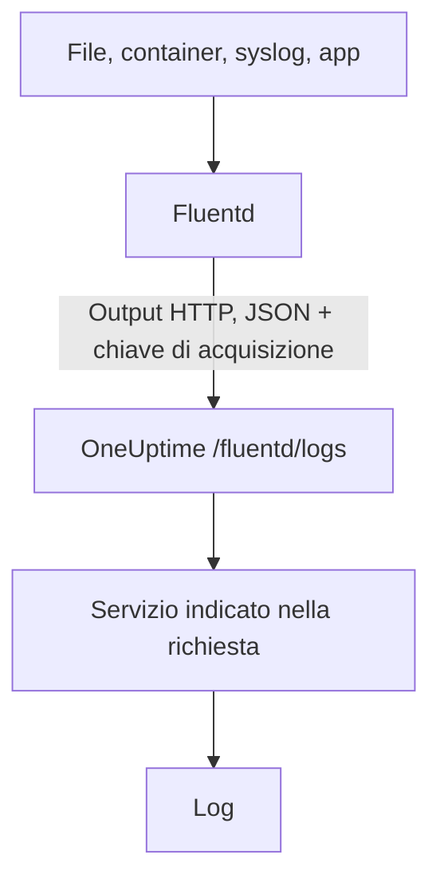

# Fluentd

[Fluentd](https://www.fluentd.org/) raccoglie log da file, container, syslog, applicazioni e [molte altre sorgenti](https://www.fluentd.org/datasources). Il suo [output HTTP](https://docs.fluentd.org/output/http) integrato li invia all'endpoint Fluentd di OneUptime, dove diventano ricercabili in **Prodotti → Log**.

:::cards
- [Configurare Fluentd](#configurare-fluentd): Aggiungi un output HTTP che punta a OneUptime.
- [Come vengono letti i record](#come-vengono-letti-i-record): Quali campi diventano il messaggio, la gravità e gli attributi.
- [OneUptime self-hosted](#oneuptime-self-hosted): Punta Fluentd alla tua istanza.
:::

## Come funziona



Fluentd invia i record a blocchi in JSON, con la tua chiave di acquisizione nell'header `x-oneuptime-token` e il nome del servizio in `x-oneuptime-service-name`. OneUptime trasforma ogni record in un log di quel servizio e crea il servizio la prima volta che invia.

## Prima di iniziare

- **Installare Fluentd**: vedi la [guida all'installazione](https://docs.fluentd.org/installation).
- **Un progetto OneUptime.** Su OneUptime Cloud la telemetria si paga per GB acquisito (vedi i [prezzi](https://oneuptime.com/pricing)) e un progetto con il piano Free ha bisogno di un metodo di pagamento prima di poter inviare telemetria.
- **Una chiave di acquisizione della telemetria.** Se non ne hai una:

:::steps
### Aprire le chiavi di acquisizione

Vai a **Prodotti → Impostazioni del progetto**, apri **Telemetria e APM** nel menu laterale e seleziona **Chiavi di acquisizione**.


### Creare una chiave

Fai clic su **Crea chiave di acquisizione**. La finestra ha già il nome della chiave compilato e **Server** scelto (il tipo di chiave con cui invia un'applicazione o un collector), quindi fai clic su **Crea chiave di acquisizione** per crearla, oppure rinominala prima.

### Copiare il segreto

La nuova chiave si apre nella sua pagina. Copia la sua **Chiave segreta**: è lo `YOUR_SERVICE_TOKEN` della configurazione qui sotto.


:::

## Configurare Fluentd

Il file di configurazione di Fluentd di solito è `/etc/fluent/fluentd.conf`, oppure `/etc/td-agent/td-agent.conf` per il vecchio pacchetto td-agent.

:::steps
### Aggiungere un output HTTP

Aggiungi una sezione `<match>` che invia i record a OneUptime. Sostituisci `YOUR_SERVICE_TOKEN` con la tua chiave di acquisizione e `YOUR_SERVICE_NAME` con il nome con cui devono comparire i log (un nome qualsiasi):

```text title="fluentd.conf"
# Send the time Fluentd gave each event: the HTTP output sends only the record
<filter **>
  @type record_transformer
  enable_ruby true
  <record>
    fluentd_time ${time.utc.strftime("%Y-%m-%dT%H:%M:%S.%NZ")}
  </record>
</filter>

# Match all patterns
<match **>
  @type http

  endpoint https://oneuptime.com/fluentd/logs
  open_timeout 2

  headers {"x-oneuptime-token":"YOUR_SERVICE_TOKEN", "x-oneuptime-service-name":"YOUR_SERVICE_NAME"}

  content_type application/json
  json_array true

  # Send a batch again when OneUptime is busy (429) or restarting (502, 503, 504)
  retryable_response_codes 429,502,503,504

  <format>
    @type json
  </format>
  <buffer>
    # Keep the batches on disk until OneUptime takes them: a restart of Fluentd loses none
    @type file
    path /var/log/fluent/buffer/oneuptime
    total_limit_size 512m
    flush_interval 10s
    chunk_limit_size 900k
    # Try again at least every 30 seconds, for up to 72 hours
    retry_max_interval 30s
    retry_timeout 72h
  </buffer>
</match>

# Keep Fluentd's own logs out of OneUptime
<label @FLUENT_LOG>
  <match **>
    @type null
  </match>
</label>
```

`json_array true` invia ogni blocco del buffer come un unico array JSON, e `flush_interval 10s` invia il buffer ogni 10 secondi. `chunk_limit_size 900k` mantiene ogni richiesta sotto 1 MB, il massimo che OneUptime accetta su questo endpoint.

Funziona anche l'impostazione predefinita di Fluentd: senza `content_type` e `json_array true`, Fluentd invia JSON delimitato da a capo, un record per riga, e OneUptime legge ogni riga come il record che è, con `compress gzip` o senza.

`@type file` tiene i batch ancora da inviare nella cartella indicata da `path`, così un riavvio di Fluentd non ne perde nessuno; un buffer in memoria, quello predefinito di Fluentd, perde ciò che contiene. L'utente di Fluentd deve poter scrivere in quella cartella: `/var/log/fluent` è quella di fluent-package, `/var/log/td-agent` quella di td-agent e `/fluentd/log` quella dell'immagine `fluent/fluentd`. `total_limit_size 512m` vi tiene al massimo 512 MB; quando è pieno, Fluentd non accetta altri record finché un batch non è stato inviato.

`retryable_response_codes 429,502,503,504` invia di nuovo un batch quando OneUptime è sovraccarico (`429`) o si sta riavviando (`502`, `503`, `504`); senza questa impostazione, Fluentd scarta un batch a ogni risposta che non sia `503`. `retry_max_interval 30s` aspetta al massimo 30 secondi tra un tentativo e l'altro, e `retry_timeout 72h` scarta un batch che dopo 72 ore non riesce ancora a inviare. Il filtro `record_transformer` aggiunge a ogni record l'ora che Fluentd gli ha dato, come `fluentd_time`: l'output HTTP invia solo il record, e OneUptime legge da lì l'ora di un log.

### Riavviare Fluentd

Riavvia il servizio Fluentd perché carichi il nuovo output.

### Verificare che i log arrivino

Pochi secondi dopo lo svuotamento successivo, i log compaiono in **Prodotti → Log**. Il servizio è elencato in **Prodotti → Servizi**: se non esisteva ancora, OneUptime lo crea.
:::

## Esempio completo

Questa configurazione riceve i record con il protocollo forward di Fluentd sulla porta `24224`, solo da questo host, e li invia tutti a OneUptime:

```text title="fluentd.conf"
####
## Source descriptions:
##

## built-in TCP input
## @see https://docs.fluentd.org/input/forward
<source>
  @type forward
  port 24224
  # This host alone: see "Take records from other hosts" to open it
  bind 127.0.0.1
</source>

# Send the time Fluentd gave each event: the HTTP output sends only the record
<filter **>
  @type record_transformer
  enable_ruby true
  <record>
    fluentd_time ${time.utc.strftime("%Y-%m-%dT%H:%M:%S.%NZ")}
  </record>
</filter>

<match **>
  @type http

  endpoint https://oneuptime.com/fluentd/logs
  open_timeout 2

  headers {"x-oneuptime-token":"YOUR_SERVICE_TOKEN", "x-oneuptime-service-name":"YOUR_SERVICE_NAME"}

  content_type application/json
  json_array true

  # Send a batch again when OneUptime is busy (429) or restarting (502, 503, 504)
  retryable_response_codes 429,502,503,504

  <format>
    @type json
  </format>
  <buffer>
    # Keep the batches on disk until OneUptime takes them: a restart of Fluentd loses none
    @type file
    path /var/log/fluent/buffer/oneuptime
    total_limit_size 512m
    flush_interval 10s
    chunk_limit_size 900k
    # Try again at least every 30 seconds, for up to 72 hours
    retry_max_interval 30s
    retry_timeout 72h
  </buffer>
</match>

# Keep Fluentd's own logs out of OneUptime
<label @FLUENT_LOG>
  <match **>
    @type null
  </match>
</label>
```

`bind 127.0.0.1` accetta record solo da questo host, come quelli del driver di log `fluentd` di Docker, che invia a `localhost:24224`. Per inviare sorgenti diverse come servizi diversi, usa una sezione `<match>` per tag, ognuna con il proprio `x-oneuptime-service-name` e il proprio `path` del buffer: Fluentd non si avvia con due buffer sullo stesso percorso.

## Ricevere record da altri host

Con `bind 0.0.0.0` e senza una sezione `<security>`, chiunque raggiunga la porta `24224` può inviare log a OneUptime con la tua chiave di acquisizione. Per ricevere record da Fluentd o Fluent Bit su altri host, ascolta su ogni indirizzo, chiedi a ogni mittente una chiave condivisa e usa TLS. Sostituisci la sezione `<source>` dell'esempio completo con:

```text title="fluentd.conf on this host"
<source>
  @type forward
  port 24224
  bind 0.0.0.0
  <transport tls>
    cert_path /etc/fluent/certs/fluentd.crt
    private_key_path /etc/fluent/certs/fluentd.key
  </transport>
  <security>
    self_hostname fluentd.example.com
    shared_key YOUR_SHARED_KEY
  </security>
</source>
```

`cert_path` e `private_key_path` sono un certificato per il nome di questo host, qui `fluentd.example.com`, e la sua chiave, che l'utente di Fluentd deve poter leggere. Fluentd avvisa quando la chiave non ha una passphrase; `private_key_passphrase` ne imposta una. Sostituisci `YOUR_SHARED_KEY` con un segreto lungo e casuale, per esempio uno di `openssl rand -base64 32`, e dai lo stesso a ogni mittente:

```text title="fluentd.conf on each sender"
<match **>
  @type forward
  transport tls
  # The certificate of the authority that signed this host's; not needed for a public one
  tls_cert_path /etc/fluent/certs/ca.crt
  <security>
    self_hostname app-1.example.com
    shared_key YOUR_SHARED_KEY
  </security>
  <server>
    host fluentd.example.com
    port 24224
  </server>
  <buffer>
    @type file
    path /var/log/fluent/buffer/forward
  </buffer>
</match>

# Keep Fluentd's own logs out of OneUptime
<label @FLUENT_LOG>
  <match **>
    @type null
  </match>
</label>
```

L'output `forward` di Fluent Bit accetta le stesse impostazioni: `Shared_Key`, `Self_Hostname`, `tls On` e `tls.ca_file`.

Un mittente senza la chiave, o senza TLS, viene rifiutato. La chiave non attraversa mai la rete: ciascun lato dimostra di averla. Senza TLS, chiunque sulla rete tra gli host può leggere i record. Apri la porta `24224` nel firewall dell'host solo agli host che inviano. Se Fluentd gira dal file Docker Compose della guida ai log, pubblica anche lì la porta su ogni indirizzo, `"24224:24224"`, e monta la cartella del certificato nel container.

## Come vengono letti i record

OneUptime legge questi campi da ogni record:

| Campo del log | Letto dal primo campo presente tra | Note |
| --- | --- | --- |
| Corpo | `message`, `log`, `msg`, `body`, `text` | La riga di log. Un record senza nessuno di questi campi viene salvato intero, come JSON. |
| Gravità | `level`, `severity`, `loglevel`, `log_level`, `priority`, `severityText`, `severity_text` | Nomi come `trace`, `debug`, `info`, `notice`, `warn`, `error`, `critical` e `fatal`, maiuscoli o minuscoli. Qualsiasi altro valore viene salvato come `Unspecified`. |
| ID traccia | `trace_id`, `traceId`, `traceid` | Collega il log alla sua traccia. |
| ID span | `span_id`, `spanId`, `spanid` | Collega il log al suo span. |
| Servizio | l'header `x-oneuptime-service-name` | `Fluentd` quando l'header non è impostato. |
| Ora | `time`, `timestamp`, `@timestamp`, `ts`, `fluentd_time` | Un'ora ISO 8601, come `2026-11-14T08:00:00.123Z`, oppure secondi, millisecondi, microsecondi o nanosecondi dall'epoch Unix; un'ora senza fuso orario è in UTC. Un'ora precedente al 2000, o avanti di più di un giorno, non viene letta. Il campo da cui si legge l'ora non viene conservato come attributo. Un record senza ora viene salvato all'ora in cui OneUptime lo riceve. |

Ogni altro campo diventa un attributo chiamato `fluentd.` seguito dal nome del campo, su cui puoi cercare e filtrare: un campo `container_name` è `@fluentd.container_name` nell'explorer dei log. Un oggetto annidato viene appiattito con i punti, come `fluentd.kubernetes.pod_name`, e una lista viene salvata come JSON.

I log di Fluentd passano dalle tue [pipeline dei log](/docs/telemetry/log-pipelines), dai filtri di scarto e dalle regole di mascheramento come qualsiasi altro log.

## OneUptime self-hosted

Sostituisci `https://oneuptime.com` in `endpoint` con l'URL della tua istanza OneUptime: `http(s)://YOUR_ONEUPTIME_HOST/fluentd/logs`.

## Risoluzione dei problemi

:::details Fluentd registra `401` dall'output HTTP
La chiave di acquisizione manca, è sconosciuta o è scaduta. Controlla il valore di `x-oneuptime-token` in `headers`.
:::

:::details Fluentd registra `402` o `422`
`402`: su OneUptime Cloud il progetto ha il piano Free e nessun metodo di pagamento. Aggiungine uno in **Impostazioni del progetto → Fatturazione e fatture → Fatturazione**. `422`: la chiave è disattivata, oppure è una chiave Browser. Riattiva **Abilitato** nelle impostazioni della chiave, oppure crea una chiave **Server**.
:::

:::details Fluentd registra `413`
La richiesta supera 1 MB, il massimo che OneUptime accetta su questo endpoint. Imposta `chunk_limit_size 900k` nella sezione `<buffer>`, come nella configurazione qui sopra.
:::

:::details Fluentd registra `429`, `502`, `503` o `504`
OneUptime è sovraccarico o si sta riavviando. Con `retryable_response_codes 429,502,503,504` nella sezione `<match>`, come nella configurazione qui sopra, Fluentd tiene il batch e lo invia di nuovo; senza questa impostazione, Fluentd scarta il batch. Con `@type file` nella sezione `<buffer>`, Fluentd tiene il batch anche quando si riavvia.
:::

:::details I log mostrano l'ora in cui OneUptime li ha ricevuti, non la propria
OneUptime legge l'ora di un log dal suo record, e l'output HTTP di Fluentd invia solo il record. Una sezione `<parse>` toglie il campo `time` dal record, come ora dell'evento: aggiungile `time_key fluentd_time`, così non legge l'ora di nessun record e lascia `time` com'è. Aggiungi anche il filtro `record_transformer` della configurazione qui sopra: aggiunge a ogni record l'ora che Fluentd gli ha dato, come `fluentd_time`.
:::

:::details Una riga JSON il cui `time` è `null`, `true`, una lista o un oggetto non arriva mai
Il parser `json` di Fluentd legge il campo `time` di una riga come ora dell'evento e scarta senza avviso una riga il cui `time` non è né testo né un numero. Aggiungi `time_key fluentd_time` alla sua sezione `<parse>`, come sopra: Fluentd lascia allora `time` nel record com'è. Con il filtro `record_transformer` qui sopra, OneUptime salva il log all'ora in cui Fluentd l'ha letto, `fluentd_time`; senza, all'ora in cui OneUptime lo riceve.
:::

:::details I log arrivano sotto il servizio `Fluentd`
Manca l'header `x-oneuptime-service-name`. Aggiungilo a `headers` in ogni sezione `<match>`.
:::

:::details Il corpo del log mostra l'intero record come JSON
OneUptime prende il corpo dal primo campo presente tra `message`, `log`, `msg`, `body` e `text`, e salva l'intero record quando non ne ha nessuno. Rinomina il campo che contiene la tua riga di log in uno di questi, ad esempio con il filtro `record_transformer` di Fluentd.
:::

Per qualsiasi domanda o se ti serve aiuto con la configurazione, scrivici a support@oneuptime.com.

## Passaggi successivi

:::cards
- [Pipeline dei log](/docs/telemetry/log-pipelines): Analizza e arricchisci i log che invia Fluentd.
- [Sintassi di ricerca](/docs/telemetry/search-syntax): Trova i log nell'explorer dei log.
- [Fluent Bit](/docs/telemetry/fluentbit): Un agente più leggero che invia tramite OpenTelemetry.
- [Monitor log](/docs/monitor/logs-monitor): Avvisa quando compaiono log corrispondenti.
:::
