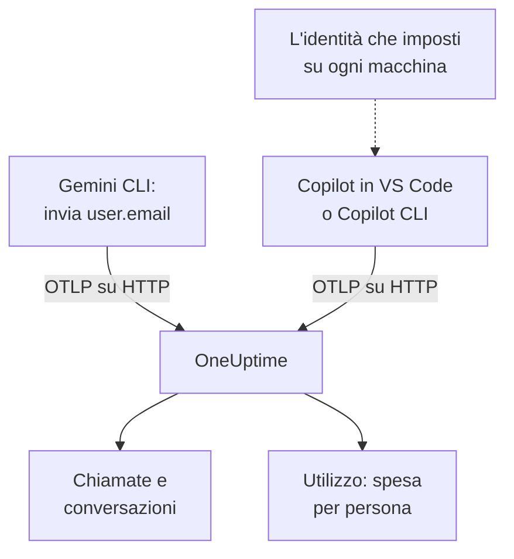

# Gemini CLI e GitHub Copilot

Gemini CLI e GitHub Copilot esportano entrambi OpenTelemetry da soli: puntali su OneUptime e le loro chiamate al modello, i token, i costi e le chiamate agli strumenti arrivano in [AI / LLM](/docs/telemetry/ai-llm-observability), accanto alle chiamate IA delle tue app. Si differenziano in ciò che conta di più per il riaddebito dei costi: Gemini CLI nomina la persona in ogni record, Copilot non nomina nessuno, quindi sei tu a nominare ogni sviluppatore.

:::cards
- [Gemini CLI](#configura-gemini-cli): Attiva la telemetria, con le tracce, e inviala direttamente a OneUptime.
- [GitHub Copilot](#configura-github-copilot): Esporta da VS Code o da Copilot CLI.
- [Nomina ogni sviluppatore](#nomina-ogni-sviluppatore): L'identità che Copilot tralascia.
- [Risoluzione dei problemi](#risoluzione-dei-problemi): Cosa controllare quando non arriva nulla.
:::

## Come funziona



| | Gemini CLI | GitHub Copilot |
| --- | --- | --- |
| Invia | Tracce, metriche e log | Tracce, metriche ed eventi, solo dalle sue superfici agente |
| Nomina la persona | `user.email`, con l'accesso effettuato | Nessuno: imposti tu `enduser.id` e `user.email` |
| Testo dei prompt | Inviato a meno che tu non disattivi `logPrompts` | Non inviato a meno che tu non attivi `captureContent` |
| Di serie invia a | `http://localhost:4317`, su gRPC | `http://localhost:4318`, su HTTP |

## Prima di iniziare

- Una chiave di ingestione: apri **Impostazioni del progetto → Telemetria e APM → Chiavi di acquisizione** e fai clic su **Crea chiave di ingestione**.
- Il tuo URL di base OTLP: `https://oneuptime.com/otlp`, oppure `https://YOUR-ONEUPTIME-HOST/otlp` se ospiti OneUptime tu stesso.
- La chiave viaggia nell'intestazione `x-oneuptime-token` di ogni richiesta di export.

## Configura Gemini CLI

Gemini CLI invia tracce, metriche ed eventi di log, e mette `user.email` in ogni record quando qualcuno ha effettuato l'accesso. OneUptime legge `user.email` come il dipendente, così la spesa di ogni persona compare senza tabelle di corrispondenza né configurazione per macchina.

:::steps
### Attiva la telemetria

Aggiungi un blocco `telemetry` al file delle impostazioni utente di ogni macchina, o a `.gemini/settings.json` in un repository:

```json title="~/.gemini/settings.json"
{
  "telemetry": {
    "enabled": true,
    "target": "local",
    "otlpEndpoint": "https://oneuptime.com/otlp",
    "otlpProtocol": "http",
    "otlpHeaders": {
      "x-oneuptime-token": "YOUR_INGESTION_TOKEN"
    },
    "traces": true,
    "logPrompts": false
  }
}
```

### Avvia una nuova sessione

Gemini CLI legge le impostazioni all'avvio, quindi riavvialo ed esegui un prompt.

### Verifica che i dati arrivino

Apri **Prodotti → AI / LLM → Chiamate**: le chiamate compaiono sotto il servizio `gemini-cli`, con il modello e i token.
:::

Tre impostazioni di quel blocco contano più delle altre:

- `otlpProtocol: "http"`. Se non gli si dice altro, Gemini CLI usa gRPC. Su HTTP aggiunge da sé `/v1/traces`, `/v1/metrics` e `/v1/logs` all'URL di base. OneUptime accetta anche gRPC sulla porta 443 (vedi [OTLP su gRPC](/docs/telemetry/open-telemetry#otlp-su-grpc)), ma HTTP è più semplice.
- `traces: true`. È disattivato per impostazione predefinita, e senza di esso gli span di Gemini CLI non portano né modello né conteggi dei token, quindi non si può prezzare nulla. Gemini CLI non invia nemmeno una metrica di costo: attiva le tracce per vedere quanto costano le sue chiamate.
- `logPrompts: false`. Leggi l'avvertenza qui sotto.

> [!WARNING]
> `logPrompts` è `true` per impostazione predefinita, quindi attivare la telemetria invia il testo che digitano i tuoi ingegneri: spesso codice sorgente, dati dei clienti e credenziali incollate. Impostalo su `false` nella stessa modifica che attiva la telemetria. Se vuoi i prompt per il debug, decidilo di proposito, e maschera ciò che serve con le regole di pulizia in **Tracce → Impostazioni**.

### Impostazioni per una flotta

Ogni impostazione ha una variabile d'ambiente, e le variabili prevalgono sul `.gemini/settings.json` di un repository, il che ne fa il posto giusto per una politica di flotta distribuita via MDM:

```bash
export GEMINI_TELEMETRY_ENABLED=true
export GEMINI_TELEMETRY_TARGET=local
export GEMINI_TELEMETRY_OTLP_ENDPOINT="https://oneuptime.com/otlp"
export GEMINI_TELEMETRY_OTLP_PROTOCOL=http
export GEMINI_TELEMETRY_OTLP_HEADERS="x-oneuptime-token=YOUR_INGESTION_TOKEN"
export GEMINI_TELEMETRY_TRACES_ENABLED=true
export GEMINI_TELEMETRY_LOG_PROMPTS=false
```

| Impostazione | Variabile | Predefinito | Cosa fa |
| --- | --- | --- | --- |
| `enabled` | `GEMINI_TELEMETRY_ENABLED` | `false` | Attiva la telemetria |
| `target` | `GEMINI_TELEMETRY_TARGET` | `local` | `local` invia all'endpoint che imposti; `gcp` invia a Google Cloud |
| `otlpEndpoint` | `GEMINI_TELEMETRY_OTLP_ENDPOINT` | `http://localhost:4317` | Dove va la telemetria |
| `otlpProtocol` | `GEMINI_TELEMETRY_OTLP_PROTOCOL` | `grpc` | `grpc` o `http` |
| `otlpHeaders` | `GEMINI_TELEMETRY_OTLP_HEADERS` | Nessuno | Intestazioni di ogni export: un oggetto nel file, coppie `key=value` o JSON nella variabile |
| `traces` | `GEMINI_TELEMETRY_TRACES_ENABLED` | `false` | Mette il modello, i token e i contenuti sugli span |
| `logPrompts` | `GEMINI_TELEMETRY_LOG_PROMPTS` | `true` | Mette il testo dei prompt negli eventi di log |
| `outfile` | `GEMINI_TELEMETRY_OUTFILE` | Nessuno | Scrive invece la telemetria in un file, per vedere cosa verrebbe inviato |

I flag della riga di comando prevalgono sulle variabili `GEMINI_TELEMETRY_*`, che prevalgono sulle variabili standard `OTEL_EXPORTER_OTLP_*`, che prevalgono su `settings.json`. Gemini CLI legge anche `OTEL_EXPORTER_OTLP_HEADERS`, quindi un'intestazione già impostata per altri strumenti gli arriva.

:::details Inviare invece tramite un OpenTelemetry Collector
Un collector su ogni macchina, o uno per team, può raggruppare, ritentare e instradare la telemetria prima che raggiunga OneUptime. Lascia Gemini CLI sui suoi valori predefiniti, che inviano gRPC a `http://localhost:4317`, e lascia che sia il collector ad aggiungere la chiave:

```yaml title="otel-collector-config.yaml"
receivers:
  otlp:
    protocols:
      grpc:
        endpoint: 0.0.0.0:4317
      http:
        endpoint: 0.0.0.0:4318

exporters:
  otlphttp:
    endpoint: "https://oneuptime.com/otlp"
    headers:
      "x-oneuptime-token": "YOUR_INGESTION_TOKEN"

service:
  pipelines:
    traces:
      receivers: [otlp]
      exporters: [otlphttp]
    metrics:
      receivers: [otlp]
      exporters: [otlphttp]
    logs:
      receivers: [otlp]
      exporters: [otlphttp]
```

Vedi [OpenTelemetry](/docs/telemetry/open-telemetry) per eseguire un collector.
:::

### Cosa invia Gemini CLI

| Metrica | Cosa porta |
| --- | --- |
| `gen_ai.client.token.usage` | Token di input e di output: la serie che OneUptime conta |
| `gemini_cli.token.usage` | Gli stessi token con il nome proprio di Gemini CLI, più i suoi token `thought`, `cache` e `tool`; non contata, così i token non vengono mai contati due volte |
| `gen_ai.client.operation.duration` | Quanto è durata ogni chiamata al modello |
| `gemini_cli.api.request.count` | Chiamate al modello |
| `gemini_cli.tool.call.count` | Chiamate agli strumenti |
| `gemini_cli.session.count` | Sessioni avviate |
| `gemini_cli.lines.changed` | Righe modificate dall'agente |

Tra i suoi eventi di log ci sono `gemini_cli.user_prompt`, `gemini_cli.api_request`, `gemini_cli.api_response`, `gemini_cli.api_error`, `gemini_cli.tool_call` e `gemini_cli.file_operation`. Ogni record porta `session.id`, `installation.id`, `active_approval_mode` e, quando qualcuno ha effettuato l'accesso, `user.email`. OneUptime legge `session.id` come ID di conversazione, quindi un'intera sessione di Gemini CLI compare come una sola conversazione in **Conversazioni**, per quante tracce abbia richiesto.

Le metriche sono normali metriche OpenTelemetry: rappresentane una qualsiasi su una dashboard, oppure crea un avviso su una di esse con un [monitor di metriche](/docs/monitor/metrics-monitor).

## Configura GitHub Copilot

GitHub documenta OpenTelemetry solo per le superfici agente di Copilot:

| Superficie | Invia OpenTelemetry |
| --- | --- |
| Copilot Chat e la modalità agente in VS Code | Sì |
| Copilot CLI | Sì |
| Copilot SDK | Sì |
| Flussi agente negli IDE JetBrains | Sì, impostato nelle impostazioni del plugin Copilot |
| Completamenti inline, Copilot su github.com, revisione del codice di Copilot | Non documentato |

Quindi un team che usa soprattutto i completamenti inline appare inattivo in OneUptime, comunque sia configurato l'export.

:::tabs
@tab VS Code
```json title="settings.json"
{
  "github.copilot.chat.otel.enabled": true,
  "github.copilot.chat.otel.exporterType": "otlp-http",
  "github.copilot.chat.otel.otlpEndpoint": "https://oneuptime.com/otlp",
  "github.copilot.chat.otel.captureContent": false
}
```
@tab Copilot CLI
```bash
export COPILOT_OTEL_ENABLED=true
export OTEL_EXPORTER_OTLP_ENDPOINT="https://oneuptime.com/otlp"
export OTEL_EXPORTER_OTLP_HEADERS="x-oneuptime-token=YOUR_INGESTION_TOKEN"
```
@tab Impostazioni gestite
```json
{
  "telemetry": {
    "enabled": true,
    "endpoint": "https://oneuptime.com/otlp",
    "protocol": "http/protobuf",
    "serviceName": "github-copilot",
    "captureContent": false,
    "lockCaptureContent": true,
    "headers": {
      "x-oneuptime-token": "YOUR_INGESTION_TOKEN"
    }
  }
}
```
:::

- Le impostazioni di VS Code non hanno una chiave per le intestazioni: imposta `OTEL_EXPORTER_OTLP_HEADERS` nell'ambiente da cui parte VS Code, come per Copilot CLI. Le variabili d'ambiente prevalgono sulle impostazioni di VS Code.
- Le impostazioni gestite, distribuite da un'azienda a VS Code e a Copilot CLI, portano la chiave in `headers` e prevalgono su ciò che imposta ogni sviluppatore. `lockCaptureContent` tiene disattivata per tutti la cattura dei prompt. `protocol` lì è il formato di trasmissione, `http/protobuf` o `http/json`.
- `captureContent` è disattivato per impostazione predefinita, quindi prompt e risposte non vengono inviati a meno che tu non lo attivi.

## Nomina ogni sviluppatore

Copilot non invia alcuna identità che OneUptime possa usare. La sua impostazione `captureIdentity` aggiunge `user.name`, e Copilot CLI può aggiungere `enduser.pseudo.id`, ma OneUptime non legge nessuno dei due come il dipendente. Senza identità, tutta la spesa di Copilot finisce in un'unica riga **Non attribuito** nella scheda **Utilizzo**.

Imposta l'identità su ogni macchina, nell'ambiente da cui partono VS Code e Copilot CLI: un profilo della shell, o uno script eseguito dal tuo MDM.

```bash
export OTEL_RESOURCE_ATTRIBUTES="enduser.id=alice@example.com,user.email=alice@example.com,team.id=platform,cost_center=eng-tools"
```

| Attributo | OneUptime lo legge come |
| --- | --- |
| `enduser.id` | L'ID del dipendente |
| `user.email` | L'email del dipendente: il nome che mostra la scheda **Utilizzo** |
| `team.id`, `team`, `cost_center`, `department` | Il team o il centro di costo |

Sono attributi di risorsa, quindi arrivano come `resource.enduser.id`, `resource.user.email` e così via: OneUptime legge ogni chiave di identità e di team con o senza il prefisso `resource.`. Gemini CLI invia già `user.email`; dagli `OTEL_RESOURCE_ATTRIBUTES` solo per il team.

- Imposta l'identità prima della prima chiamata: le chiamate arrivate senza identità non si possono attribuire dopo.
- Lascia `resourceAttributes` fuori dalle impostazioni gestite di Copilot: prevalgono su `OTEL_RESOURCE_ATTRIBUTES` e sostituirebbero l'identità che imposti su ogni macchina.
- Non usare `gen_ai.user` né `llm.user`. In un'app che serve clienti nominano il cliente, quindi OneUptime non li legge mai come il dipendente.

## Come sono i dati di Copilot

Copilot segue le convenzioni GenAI di OpenTelemetry, quindi le sue chiamate compaiono in **Chiamate**, **Conversazioni** e **Utilizzo** come quelle delle tue app.

| Span | Uno per |
| --- | --- |
| `invoke_agent` | Turno dell'agente |
| `chat` | Chiamata al modello |
| `execute_tool` | Chiamata a strumento |
| `execute_hook` | Esecuzione di hook |

I suoi span portano il modello, `gen_ai.usage.input_tokens`, `gen_ai.usage.output_tokens` e `gen_ai.conversation.id`, quindi un intero turno dell'agente compare come una sola conversazione. Entrambe le superfici inviano anche le metriche `gen_ai.client.token.usage` e `gen_ai.client.operation.duration`, ed eventi sul segnale dei log OTLP: tieni una pipeline `logs` in ogni collector che metti in mezzo.

OneUptime prezza ogni chiamata in base al modello e ai token, alle tariffe di **Prezzi**. È quanto costerebbero i token a prezzo di listino, non quanto GitHub ti fattura: Copilot si paga per licenza e per richiesta premium.

Licenze, attività delle licenze e fatturazione delle richieste premium non sono affatto in OpenTelemetry: stanno nella REST API di GitHub, che OneUptime non legge. Prendi da GitHub i numeri di licenze e fatturazione.

## Risoluzione dei problemi

:::details Da Gemini CLI non arriva nulla
La causa abituale è `otlpProtocol` lasciato sul valore predefinito `grpc` mentre l'endpoint è l'URL HTTP. Imposta `otlpProtocol` su `http`, e controlla che `otlpEndpoint` sia l'URL di base, che termina con `/otlp`, e che l'intestazione `x-oneuptime-token` sia impostata. Imposta per un momento `outfile` per vedere cosa invierebbe Gemini CLI.
:::

:::details Le chiamate di Gemini CLI arrivano senza modello, token o costo
`traces` è disattivato. Attivalo: senza di esso, gli span di Gemini CLI non portano né modello né conteggi dei token, e non invia alcuna metrica di costo.
:::

:::details La spesa di Copilot risulta non attribuita
L'identità non ha raggiunto l'exporter. Controlla che `OTEL_RESOURCE_ATTRIBUTES` sia impostata nell'ambiente da cui è partito VS Code o Copilot CLI, e che le impostazioni gestite di Copilot non impostino `resourceAttributes`, che la sostituirebbe.
:::

:::details Copilot non invia proprio nulla
Controlla che le persone che ti aspetti usino una superficie agente, non i completamenti inline, e che `OTEL_EXPORTER_OTLP_HEADERS` porti la chiave: le impostazioni proprie di VS Code non possono.
:::

:::details La chiave viene rifiutata
OneUptime risponde `401` a una chiave mancante, sconosciuta o scaduta, e `422` a una chiave disattivata o a una chiave del browser. Usa una chiave server, inviata in `x-oneuptime-token`.
:::

## Passaggi successivi

:::cards
- [Assistenti di codice IA](/docs/telemetry/ai-coding-assistants): Chi usa quale strumento, e quanto spende ogni persona e ogni team.
- [Osservabilità IA / LLM](/docs/telemetry/ai-llm-observability): Gli attributi che legge OneUptime, come si calcola il costo e i budget giornalieri.
- [Gateway IA](/docs/telemetry/ai-gateways): Gli strumenti senza export proprio, tramite un gateway.
:::
