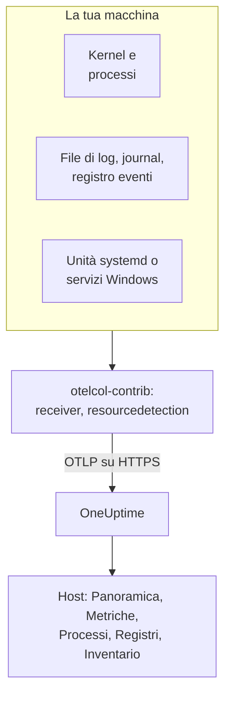

# Collector OpenTelemetry sull'host

Esegui l'OpenTelemetry Collector su una macchina Linux, macOS o Windows per inviare a OneUptime le sue metriche, i processi, i log e lo stato dei servizi. La macchina compare in **Prodotti → Infrastruttura → Host** con pagine proprie, senza alcun agent di OneUptime da installare: il collector è la release upstream `otelcol-contrib`. I [monitor host](/docs/monitor/host-monitor) generano avvisi in base a ciò che invia.

:::cards
- [Installa il collector](#installa-il-collector): Tre passaggi su Linux, macOS o Windows.
- [Scegli cosa raccogliere](#scegli-cosa-raccogliere): Metriche, log da file, il journal, i registri eventi e lo stato dei servizi.
- [Attributi di inventario](#attributi-di-inventario-ip-mac-numero-di-serie-produttore-modello-firmware): IP, MAC, numero di serie, produttore, modello e firmware per il tuo CMDB.
- [Invia meno](#ridurre-il-volume-dei-dati-raccolti): Meno righe di log, intervalli più lunghi, meno serie.
:::

## Come funziona

Il collector legge la macchina tramite i suoi receiver, applica a ogni record l'identità della macchina e lo invia a OneUptime tramite OTLP con la tua chiave di acquisizione. OneUptime registra l'host a partire dalle sue prime metriche e ne riempie le pagine man mano che arrivano i dati.



| Cosa vedi sull'host | Da dove viene |
| --- | --- |
| **Panoramica** e **Metriche** | Il receiver `hostmetrics`: CPU, memoria, dischi, file system, rete, carico, paginazione. |
| **Processi** | Lo scraper `process` di `hostmetrics`: un insieme di serie per processo. |
| **Registri** | I receiver `filelog`, `journald` e `windowseventlog`. |
| **Systemd Units** (Linux) | Il receiver `systemd`. |
| **Servizi** (Windows) | Il receiver `windows_service`. |
| L'elemento di inventario | Il processor `resourcedetection`, più gli [attributi che applichi](#attributi-di-inventario-ip-mac-numero-di-serie-produttore-modello-firmware). |
| **Versione dell'agente** | `oneuptime.agent.version` nel processor `resource`. |

Un host viene registrato quando un batch che porta `host.name` porta anche metriche `hostmetrics` o `process`, oppure un attributo `os.type`. Il processor `resourcedetection` li imposta tutti, ed è per questo che ogni configurazione lo mette per primo. `host.id` o `host.arch` da soli non registrano un host, e la telemetria che porta un'identità Kubernetes (`k8s.cluster.name`, `k8s.node.name`, `k8s.pod.name`) viene invece archiviata sotto il suo cluster: monitora i nodi Kubernetes con l'[agent Kubernetes](/docs/telemetry/kubernetes-agent).

## Prima di iniziare

- Una chiave di acquisizione. Creane una in **Impostazioni del progetto → Telemetria e APM → Chiavi di acquisizione** e copiane il valore. Il collector la invia come header `x-oneuptime-token`.
- Diritti di amministratore sulla macchina: `sudo` su Linux e macOS, un prompt di PowerShell con privilegi elevati su Windows.
- HTTPS in uscita dalla macchina verso il tuo URL di OneUptime.
- La distribuzione contrib del collector, `otelcol-contrib`. La build core `otelcol` non ha i receiver e i processor che usano queste configurazioni. Il receiver `systemd` (Linux) funziona dalla v0.143.0 e il receiver `windows_service` (Windows) dalla v0.155.0; i comandi qui sotto installano la v0.161.0, la release fissata da OneUptime.

## Installa il collector

:::steps
### Salva la configurazione

Salva questo file come `config.yaml` nella cartella da cui eseguirai i comandi di installazione e sostituisci `YOUR_TELEMETRY_INGESTION_TOKEN` con la tua chiave di acquisizione (e l'endpoint con il tuo URL, se usi l'hosting autonomo).

:::tabs
@tab Linux
```yaml title="config.yaml"
receivers:
  hostmetrics:
    collection_interval: 30s
    scrapers:
      cpu:
        metrics:
          system.cpu.utilization:
            enabled: true
          system.cpu.logical.count:
            enabled: true
      memory:
        metrics:
          system.memory.utilization:
            enabled: true
      disk:
      filesystem:
        metrics:
          system.filesystem.utilization:
            enabled: true
      load:
      network:
      paging:
      processes:
      process:
        mute_process_name_error: true
        mute_process_exe_error: true
        mute_process_io_error: true
        metrics:
          process.cpu.utilization:
            enabled: true
          process.memory.utilization:
            enabled: true

  # The systemd journal: every unit's logs, info and above.
  journald:
    directory: /var/log/journal
    priority: info

  # Powers the Systemd Units tab (otelcol-contrib v0.143.0+).
  systemd:
    collection_interval: 30s
    units: ["*.service"]
    metrics:
      systemd.service.cpu.time:
        enabled: false

processors:
  # Stamps host.name, host.id and os.type: this is how OneUptime attaches
  # telemetry to the host. Without it the host's pages stay empty.
  resourcedetection:
    detectors: [system, env]
    system:
      hostname_sources: [os]
      resource_attributes:
        host.name:
          enabled: true
        host.id:
          enabled: true
        host.arch:
          enabled: true
        host.ip:
          enabled: true
        host.mac:
          enabled: true
        os.type:
          enabled: true
        os.description:
          enabled: true
        os.version:
          enabled: true
  # The collector release this config is for: the host's Agent Version.
  resource:
    attributes:
      - key: oneuptime.agent.version
        value: "0.161.0"
        action: upsert
  batch:

exporters:
  otlphttp/oneuptime:
    endpoint: https://oneuptime.com/otlp
    headers:
      x-oneuptime-token: YOUR_TELEMETRY_INGESTION_TOKEN

service:
  pipelines:
    metrics:
      receivers: [hostmetrics, systemd]
      processors: [resourcedetection, resource, batch]
      exporters: [otlphttp/oneuptime]
    logs:
      receivers: [journald]
      processors: [resourcedetection, resource, batch]
      exporters: [otlphttp/oneuptime]
```
@tab macOS
```yaml title="config.yaml"
receivers:
  hostmetrics:
    collection_interval: 30s
    scrapers:
      cpu:
        metrics:
          system.cpu.utilization:
            enabled: true
          system.cpu.logical.count:
            enabled: true
      memory:
        metrics:
          system.memory.utilization:
            enabled: true
      disk:
      filesystem:
        metrics:
          system.filesystem.utilization:
            enabled: true
      load:
      network:
      paging:
      processes:
      process:
        mute_process_name_error: true
        mute_process_exe_error: true
        mute_process_io_error: true
        metrics:
          process.cpu.utilization:
            enabled: true
          process.memory.utilization:
            enabled: true

  filelog/system:
    include:
      - /var/log/install.log
      - /var/log/wifi.log
    start_at: end

processors:
  # Stamps host.name, host.id and os.type: this is how OneUptime attaches
  # telemetry to the host. Without it the host's pages stay empty.
  resourcedetection:
    detectors: [system, env]
    system:
      hostname_sources: [os]
      resource_attributes:
        host.name:
          enabled: true
        host.id:
          enabled: true
        host.arch:
          enabled: true
        host.ip:
          enabled: true
        host.mac:
          enabled: true
        os.type:
          enabled: true
        os.description:
          enabled: true
        os.version:
          enabled: true
  # The collector release this config is for: the host's Agent Version.
  resource:
    attributes:
      - key: oneuptime.agent.version
        value: "0.161.0"
        action: upsert
  batch:

exporters:
  otlphttp/oneuptime:
    endpoint: https://oneuptime.com/otlp
    headers:
      x-oneuptime-token: YOUR_TELEMETRY_INGESTION_TOKEN

service:
  pipelines:
    metrics:
      receivers: [hostmetrics]
      processors: [resourcedetection, resource, batch]
      exporters: [otlphttp/oneuptime]
    logs:
      receivers: [filelog/system]
      processors: [resourcedetection, resource, batch]
      exporters: [otlphttp/oneuptime]
```
@tab Windows
```yaml title="config.yaml"
receivers:
  hostmetrics:
    collection_interval: 30s
    scrapers:
      cpu:
        metrics:
          system.cpu.utilization:
            enabled: true
          system.cpu.logical.count:
            enabled: true
      memory:
        metrics:
          system.memory.utilization:
            enabled: true
      disk:
      filesystem:
        metrics:
          system.filesystem.utilization:
            enabled: true
      load:
      network:
      paging:
      processes:
      process:
        mute_process_name_error: true
        mute_process_exe_error: true
        mute_process_io_error: true
        metrics:
          process.cpu.utilization:
            enabled: true
          process.memory.utilization:
            enabled: true

  windowseventlog/system:
    channel: System
    start_at: end

  windowseventlog/application:
    channel: Application
    start_at: end

  windowseventlog/security:
    channel: Security
    start_at: end

  # Powers the Services tab (otelcol-contrib v0.155.0+).
  windows_service:
    collection_interval: 30s

processors:
  # Stamps host.name, host.id and os.type: this is how OneUptime attaches
  # telemetry to the host. Without it the host's pages stay empty.
  resourcedetection:
    detectors: [system, env]
    system:
      hostname_sources: [os]
      resource_attributes:
        host.name:
          enabled: true
        host.id:
          enabled: true
        host.arch:
          enabled: true
        host.ip:
          enabled: true
        host.mac:
          enabled: true
        os.type:
          enabled: true
        os.description:
          enabled: true
        os.version:
          enabled: true
  # The collector release this config is for: the host's Agent Version.
  resource:
    attributes:
      - key: oneuptime.agent.version
        value: "0.161.0"
        action: upsert
  batch:

exporters:
  otlphttp/oneuptime:
    endpoint: https://oneuptime.com/otlp
    headers:
      x-oneuptime-token: YOUR_TELEMETRY_INGESTION_TOKEN

service:
  pipelines:
    metrics:
      receivers: [hostmetrics, windows_service]
      processors: [resourcedetection, resource, batch]
      exporters: [otlphttp/oneuptime]
    logs:
      receivers:
        - windowseventlog/system
        - windowseventlog/application
        - windowseventlog/security
      processors: [resourcedetection, resource, batch]
      exporters: [otlphttp/oneuptime]
```
:::

Ogni configurazione è quella che il dashboard scrive in **Prodotti → Infrastruttura → Host → Documentazione**, con l'aggiunta di una pipeline di log: i suoi processor sono `resourcedetection`, `resource` e `batch`, e il suo exporter è `otlphttp/oneuptime`. Non imposta alcun `service.name`, quindi la telemetria dell'host appartiene all'host stesso, archiviata come `host/<hostname>`. Aggiungi un `service.name` al processor `resource` solo se vuoi che venga archiviata invece sotto un servizio di telemetria con quel nome.

### Installa e avvia il collector

:::tabs
@tab Linux
Su Debian o Ubuntu:

```bash
VERSION=0.161.0                      # the release OneUptime pins
ARCH=$(dpkg --print-architecture)   # amd64 or arm64

curl -fL -o /tmp/otelcol-contrib.deb \
  "https://github.com/open-telemetry/opentelemetry-collector-releases/releases/download/v${VERSION}/otelcol-contrib_${VERSION}_linux_${ARCH}.deb"
sudo dpkg -i /tmp/otelcol-contrib.deb
```

Su RHEL, CentOS, Fedora o Amazon Linux:

```bash
VERSION=0.161.0
ARCH=$(uname -m | sed 's/x86_64/amd64/;s/aarch64/arm64/')

curl -fL -o /tmp/otelcol-contrib.rpm \
  "https://github.com/open-telemetry/opentelemetry-collector-releases/releases/download/v${VERSION}/otelcol-contrib_${VERSION}_linux_${ARCH}.rpm"
sudo rpm -Uvh /tmp/otelcol-contrib.rpm
```

Il pacchetto installa `/usr/bin/otelcol-contrib` e un'unità systemd, e la avvia con una configurazione predefinita. Metti al suo posto la tua, consenti all'utente del collector di leggere il journal e riavvialo:

```bash
sudo install -m 0644 config.yaml /etc/otelcol-contrib/config.yaml
sudo usermod -aG systemd-journal otelcol-contrib
sudo systemctl enable otelcol-contrib
sudo systemctl restart otelcol-contrib
sudo systemctl status otelcol-contrib
```

L'unità del pacchetto esegue il collector come utente non privilegiato `otelcol-contrib`. Il gruppo `systemd-journal` gli permette di leggere il journal; per seguire file in `/var/log` (leggibili dal gruppo `adm` su Debian e Ubuntu), aggiungi anche quel gruppo. Perché lo scraper `process` veda i processi degli altri utenti, concedigli la capability `CAP_SYS_PTRACE`.
@tab macOS
```bash
VERSION=0.161.0
ARCH=$(uname -m | sed 's/x86_64/amd64/')   # arm64 on Apple silicon, amd64 on Intel

curl -fL -o /tmp/otelcol-contrib.tar.gz \
  "https://github.com/open-telemetry/opentelemetry-collector-releases/releases/download/v${VERSION}/otelcol-contrib_${VERSION}_darwin_${ARCH}.tar.gz"

sudo mkdir -p /usr/local/otelcol-contrib /usr/local/bin /etc/otelcol-contrib
sudo tar -xzf /tmp/otelcol-contrib.tar.gz -C /usr/local/otelcol-contrib
sudo ln -sf /usr/local/otelcol-contrib/otelcol-contrib /usr/local/bin/otelcol-contrib
sudo install -m 0644 config.yaml /etc/otelcol-contrib/config.yaml
```

Crea `/Library/LaunchDaemons/com.oneuptime.otelcol-contrib.plist`, così launchd avvia il collector insieme al Mac e lo riavvia se si ferma:

```xml title="/Library/LaunchDaemons/com.oneuptime.otelcol-contrib.plist"
<?xml version="1.0" encoding="UTF-8"?>
<!DOCTYPE plist PUBLIC "-//Apple//DTD PLIST 1.0//EN" "http://www.apple.com/DTDs/PropertyList-1.0.dtd">
<plist version="1.0">
<dict>
  <key>Label</key><string>com.oneuptime.otelcol-contrib</string>
  <key>ProgramArguments</key>
  <array>
    <string>/usr/local/bin/otelcol-contrib</string>
    <string>--config=/etc/otelcol-contrib/config.yaml</string>
  </array>
  <key>RunAtLoad</key><true/>
  <key>KeepAlive</key><true/>
  <key>StandardOutPath</key><string>/var/log/otelcol-contrib.out.log</string>
  <key>StandardErrorPath</key><string>/var/log/otelcol-contrib.err.log</string>
</dict>
</plist>
```

Caricalo:

```bash
sudo launchctl load -w /Library/LaunchDaemons/com.oneuptime.otelcol-contrib.plist
sudo launchctl list | grep otelcol-contrib
```

Usa questo tarball, non Homebrew: la formula di Homebrew è la build core, che si rifiuta di avviarsi con questa configurazione.
@tab Windows
Da un prompt di PowerShell con privilegi elevati, nella cartella che contiene `config.yaml`, esegui questo blocco per intero: ogni riga dipende dalle variabili definite sopra.

```powershell
$VERSION = "0.161.0"                          # the release OneUptime pins; v0.155.0+ has the Services tab
$ARCH    = "amd64"                            # use "arm64" on ARM hosts
$dest    = "C:\Program Files\otelcol-contrib"
$tar     = "$env:TEMP\otelcol-contrib.tar.gz"

# Note the "-contrib" in the asset name; otelcol_... is the wrong archive.
$url = "https://github.com/open-telemetry/opentelemetry-collector-releases/releases/download/v$VERSION/otelcol-contrib_${VERSION}_windows_${ARCH}.tar.gz"

New-Item -ItemType Directory -Force -Path $dest | Out-Null
Invoke-WebRequest -Uri $url -OutFile $tar
tar -xf $tar -C $dest                          # tar.exe ships with Windows 10 1803+ / Server 2019+
Get-ChildItem $dest                            # expect otelcol-contrib.exe, not otelcol.exe
Copy-Item config.yaml "$dest\config.yaml" -Force

# --% hands the rest of the line to sc.exe unchanged, so its quoting
# survives PowerShell — keep the command on one line.
sc.exe --% create "otelcol-contrib" binPath= "\"C:\Program Files\otelcol-contrib\otelcol-contrib.exe\" --config=\"C:\Program Files\otelcol-contrib\config.yaml\"" start= auto DisplayName= "OpenTelemetry Collector (OneUptime)"
sc.exe description "otelcol-contrib" "Collects host telemetry and forwards it to OneUptime over OTLP."
sc.exe start "otelcol-contrib"
sc.exe query "otelcol-contrib"
```

Il servizio viene eseguito come `LocalSystem`, che può leggere il registro eventi `Security` e ogni servizio Windows. Su Windows lo scraper `load` si limita a emulare un carico medio dal contatore *Processor Queue Length*, partendo da 0.

Il nome dell'asset deve iniziare con `otelcol-contrib_`. L'archivio core `otelcol_<version>_windows_amd64.tar.gz` estrae `otelcol.exe`, che non ha i receiver `windowseventlog` né `windows_service`; rinominarlo in `otelcol-contrib.exe` non li aggiunge. Preferisci un programma di installazione? La stessa [pagina delle release](https://github.com/open-telemetry/opentelemetry-collector-releases/releases) offre un `otelcol-contrib_<version>_windows_x64.msi` firmato, che registra il servizio per te: puntalo a questo `config.yaml` e mantieni il servizio su `LocalSystem`.
:::

### Verifica che l'host compaia

Apri **Prodotti → Infrastruttura → Host → Tutti gli host**. L'host compare con il suo nome host non appena arrivano le prime metriche, di solito entro 30 secondi, e le sue pagine **Panoramica**, **Metriche**, **Processi** e **Registri** si riempiono. Se non compare, leggi i log del collector stesso:

:::tabs
@tab Linux
```bash
sudo journalctl -u otelcol-contrib -f
```
@tab macOS
```bash
tail -f /var/log/otelcol-contrib.err.log
```
@tab Windows
```powershell
Get-WinEvent -LogName Application -MaxEvents 20 | Where-Object ProviderName -eq "otelcol-contrib"
```
:::
:::

Per generare una riga di log di prova, esegui `logger "hello from oneuptime"` (Linux, macOS) o `eventcreate /T INFORMATION /ID 999 /L APPLICATION /SO OneUptimeTest /D "hello from oneuptime"` (Windows, con privilegi elevati), poi guarda la pagina **Registri** dell'host.

## Scegli cosa raccogliere

Ogni configurazione segue la stessa forma: receiver per ciò che va letto, i processor `resourcedetection`, `resource` e `batch` e l'exporter `otlphttp/oneuptime`. Aggiungi i receiver qui sotto a `receivers:` e alla loro pipeline, poi riavvia il collector (`sudo systemctl restart otelcol-contrib`, `launchctl unload` e `load` su un Mac, `Restart-Service otelcol-contrib` su Windows). Unisci ogni frammento alle sezioni già presenti nella tua configurazione: una seconda chiave `processors:` o `service:` sostituisce la prima.

### Metriche dell'host

`hostmetrics` funziona su ogni sistema operativo. Legge dal kernel CPU, memoria, dischi, file system, rete, carico, paginazione e processi, a ogni `collection_interval`. Le metriche `*.utilization` e `system.cpu.logical.count` sono disattivate per impostazione predefinita nel receiver, e i grafici dell'host e i modelli di avviso Host le leggono, quindi mantienile attive come fanno le configurazioni qui sopra. Lo scraper `process` alimenta la pagina **Processi**; è anche la fonte di serie più grande (vedi [Invia meno](#ridurre-il-volume-dei-dati-raccolti)).

Su Linux il collector legge `/proc` e `/sys`. Un collector in un container deve montare quelli dell'host e impostare `HOST_PROC` e `HOST_SYS` (vedi [In un container Docker](#in-un-container-docker)); un'installazione nativa non ha bisogno di nulla.

### Log da file

Segui qualsiasi file di log sul disco con un receiver `filelog` e aggiungilo alla pipeline `logs`:

```yaml
receivers:
  filelog/app:
    include:
      - /var/log/myapp/*.log
    start_at: end
    multiline:
      # A new entry starts with a timestamp; continuation lines (the
      # "at ...", "File ...", "Caused by: ..." frames) are folded into it.
      line_start_pattern: '^\d{4}-\d{2}-\d{2}[ T]\d{2}:\d{2}:\d{2}'
```

`start_at: end` legge solo le righe nuove; usa `beginning` per leggere i file dall'inizio alla prima esecuzione. Il collector tiene traccia della sua posizione in ogni file, quindi riprende correttamente dopo un riavvio.

OneUptime cerca gli stack trace nelle righe di log di errore e fatali e li raggruppa in **Eccezioni**, sotto l'host. Per questo uno stack trace su più righe (Java, Python, .NET, Ruby) deve arrivare come un unico record, ed è ciò che fa `multiline`; senza, ogni frame è un log a sé. Se la tua applicazione può scrivere da sola gli attributi OpenTelemetry `exception.type`, `exception.message` e `exception.stacktrace`, è ancora più affidabile.

Su un host systemd, `/var/log/syslog` e `/var/log/messages` ripetono ciò che il journal contiene già, quindi leggi l'uno o l'altro.

### Journal di systemd

Su un host systemd, il receiver `journald` legge i log di tutte le unità in un unico posto, con i loro campi strutturati. La configurazione Linux qui sopra li legge tutti a partire da `info`; limitala ad alcune unità:

```yaml
receivers:
  journald:
    directory: /var/log/journal
    units:
      # Drop this list to ingest everything; restrict it to limit volume.
      - ssh.service
      - cron.service
      - nginx.service
    priority: info
```

Il receiver esegue `journalctl`, presente su ogni host systemd, e l'utente del collector deve far parte del gruppo `systemd-journal`.

### Servizi Linux (unità systemd, metriche)

La pagina **Systemd Units** dell'host elenca ogni unità e il suo stato, dal [`systemdreceiver`](https://github.com/open-telemetry/opentelemetry-collector-contrib/tree/main/receiver/systemdreceiver) (tipo di configurazione `systemd`), l'equivalente Linux della pagina **Servizi** su Windows. La configurazione Linux qui sopra lo attiva:

```yaml
receivers:
  systemd:
    collection_interval: 30s
    # The service manager to read: "system" (default) or "user".
    scope: system
    # Which units to scrape, as systemctl unit patterns. The default is
    # every service; widen it to include timers, sockets or mounts, or
    # narrow it to cut volume on hosts with hundreds of units:
    units: ["*.service"]
    # units: [nginx.service, postgresql.service, "*.timer"]
    metrics:
      # Per-service CPU time is on by default and doubles this receiver's
      # datapoint count. The Systemd Units tab does not use it, so turn it
      # off unless you chart it. On v0.142.0 the key is
      # systemd.unit.cpu.time — naming a metric the running build does not
      # have stops the collector at startup.
      systemd.service.cpu.time:
        enabled: false

service:
  pipelines:
    metrics:
      receivers: [hostmetrics, systemd]
      processors: [resourcedetection, resource, batch]
```

Il receiver è arrivato per la prima volta in `otelcol-contrib` v0.142.0, e la v0.143.0 è la prima release che vale la pena eseguire. Su qualsiasi versione precedente, aggiungere `systemd` fallisce all'avvio con `'receivers' unknown type: "systemd"`; solo la v0.142.0 chiama la sua metrica CPU `systemd.unit.cpu.time` e cerca statistiche cgroup su ogni unità, registrando un errore di scrape per ogni unità che non è un `.service`.

Emette `systemd.unit.state` come insieme di stati: a ogni scrape, ogni unità riceve un punto dati per ogni stato possibile (`active`, `reloading`, `inactive`, `failed`, `activating`, `deactivating`, `maintenance`, `refreshing`), `1` per lo stato in cui si trova e `0` per gli altri. Il nome dell'unità è l'attributo di risorsa `systemd.unit.name` e lo stato è l'attributo del punto dati `systemd.unit.active_state`. Poiché il nome dell'unità è un attributo di risorsa, `resourcedetection` deve restare nella pipeline delle metriche: applica `host.name` alla risorsa di ogni unità e, senza di esso, i campioni non vengono mai associati a un host.

Legge lo stato delle unità tramite il D-Bus di sistema, con le chiamate in sola lettura che effettua `systemctl list-units` e che systemd consente senza privilegi. Il servizio del pacchetto, che viene eseguito come utente `otelcol-contrib` e non come root, non ha quindi bisogno di diritti aggiuntivi. Ha però bisogno del bus: un collector in un container non ha `/run/dbus/system_bus_socket` a meno che non monti quello dell'host, quindi usa un'installazione nativa. Il receiver è in fase alpha e funziona solo su Linux.

> [!WARNING]
> L'insieme di stati costa otto punti dati per unità a ogni scrape, e `systemd.service.cpu.time`, attiva per impostazione predefinita, ne aggiunge altri due (`user` e `system`): 10 punti dati per unità a ogni scrape. Un host che segue 300 unità ogni 30 secondi invia circa 6.000 punti dati al minuto solo da questo receiver, o circa 4.800 con la metrica CPU disattivata. Limita `units:` ai servizi su cui generi avvisi, oppure aumenta `collection_interval`, prima di attivarlo su un'intera flotta.

### Apple Unified Log

macOS scrive i log di sistema nell'Apple Unified Log, letto con `log show` e `log stream`, invece che in `/var/log/system.log`. Per raccoglierlo, trasmettilo in un file con un piccolo script, `/usr/local/otelcol-contrib/log-stream.sh`:

```bash title="/usr/local/otelcol-contrib/log-stream.sh"
#!/bin/bash
exec /usr/bin/log stream --style ndjson --level info \
  --predicate 'subsystem != "com.apple.cfnetwork"' \
  >> /var/log/apple-unified.log
```

Rendilo eseguibile ed eseguilo con launchd (o con `nohup` per una prova veloce), poi punta un receiver `filelog` al file:

```yaml
receivers:
  filelog/apple-unified:
    include:
      - /var/log/apple-unified.log
    start_at: end
    operators:
      - type: json_parser
        timestamp:
          parse_from: attributes.timestamp
          layout: "%Y-%m-%d %H:%M:%S.%f%j"
```

Molti parchi di Mac se la cavano bene con le metriche dell'host e qualche log da file, senza il log unificato.

### Registri eventi di Windows

La configurazione Windows qui sopra si abbona ai canali `System`, `Application` e `Security`. Per limitare il canale `Security`, ad alto volume, ad alcuni ID evento:

```yaml
windowseventlog/security:
  channel: Security
  start_at: end
  query: "*[System[(EventID=4625 or EventID=4740)]]"
```

Per leggere un altro canale (qualsiasi voce sotto *Event Viewer → Applications and Services Logs*), usa il suo nome esatto:

```yaml
windowseventlog/iis:
  channel: Microsoft-IIS-Logging/Logs
  start_at: end
```

### Servizi Windows (metriche)

La pagina **Servizi** dell'host elenca ogni servizio Windows con il suo stato e il tipo di avvio, dal [`windowsservicereceiver`](https://github.com/open-telemetry/opentelemetry-collector-contrib/tree/main/receiver/windowsservicereceiver) (tipo di configurazione `windows_service`). È incluso in `otelcol-contrib` dalla v0.155.0: nelle release precedenti, aggiungere `windows_service` fallisce all'avvio con `'receivers' unknown type: "windows_service"`. La configurazione Windows qui sopra lo attiva:

```yaml
receivers:
  windows_service:
    collection_interval: 30s
    # Collect every service by default. To cut volume — and avoid the
    # "access denied" noise from services the collector can't open —
    # list just the ones you care about:
    # include_services: [Spooler, W3SVC, MSSQLSERVER]
    # Or collect everything except a few:
    # exclude_services: [TrustedInstaller]

service:
  pipelines:
    metrics:
      receivers: [hostmetrics, windows_service]
```

Emette un gauge `windows.service.status` per servizio, lo stato del servizio Win32 (`4` è in esecuzione, `1` è arrestato), con gli attributi `name` e `startup_mode`. Il collector legge ogni servizio come `LocalSystem` e salta quelli che non riesce ad aprire. Il receiver è in fase alpha e funziona solo su Windows; se un errore di scrape o un `access denied` su un servizio influisce sugli altri, restringilo con `include_services`.

`include_services` può solo restringere l'insieme. Se elenchi dei servizi e li vedi comunque tutti, la configurazione modificata non è arrivata al collector in esecuzione: riavvia il servizio, controlla che `include_services` sia una lista compilata con la stessa indentazione di `collection_interval`, e lascia alla pagina **Servizi** qualche minuto, finché i servizi segnalati prima della modifica non escono dalla sua finestra mobile. I nomi sono i nomi chiave esatti dei servizi, con distinzione tra maiuscole e minuscole (`Spooler`, `W3SVC`), che `Get-Service | Select-Object Name` elenca.

### Etichette

Qualsiasi attributo di risorsa che inizia con `oneuptime.label.` diventa un'etichetta di progetto sull'host: `oneuptime.label.<dimension>=<value>` è l'etichetta `<dimension>:<value>`. Aggiungi un processor per loro e indicalo nelle pipeline:

```yaml
processors:
  resource/oneuptime-labels:
    attributes:
      - key: oneuptime.label.team
        value: payments
        action: upsert
      - key: oneuptime.label.env
        value: production
        action: upsert

service:
  pipelines:
    metrics:
      processors: [resourcedetection, resource, resource/oneuptime-labels, batch]
```

Le etichette vengono confrontate senza distinzione tra maiuscole e minuscole, quindi un'etichetta `Production` esistente viene riutilizzata invece di essere duplicata, e il collector non rimuove mai le etichette aggiunte in OneUptime.

### Attributi di inventario (IP, MAC, numero di serie, produttore, modello, firmware)

Ogni host riceve anche un elemento di inventario: il record che legge un'esportazione verso un CMDB. I suoi dettagli vengono compilati direttamente dagli attributi di risorsa della telemetria che invii, quindi ciò che arriva è ciò che una sincronizzazione con il CMDB può recuperare.

| Cosa ti serve | Attributo | Da dove viene |
| --- | --- | --- |
| Indirizzi IP | `host.ip` | `resourcedetection`, separati da virgole quando la macchina ne ha più di uno |
| Indirizzi MAC | `host.mac` | `resourcedetection`, uno per interfaccia attiva, separati da virgole |
| Architettura | `host.arch` | `resourcedetection` |
| ID della macchina | `host.id` | `resourcedetection`: il GUID della macchina su Windows, `/etc/machine-id` su Linux |
| Sistema operativo | `os.type`, `os.description`, `os.version` | `resourcedetection` |
| Numero di serie | `host.serial_number` | Applicato da te, da WMI o DMI |
| Produttore | `device.manufacturer` | Applicato da te, da WMI o DMI |
| Modello | `device.model.name` | Applicato da te, da WMI o DMI |
| Versione del firmware (BIOS o UEFI) | `device.firmware.version` | Applicata da te, da WMI o DMI |

Le configurazioni qui sopra attivano ogni attributo rilevato: nel detector system solo `host.name` e `os.type` sono attivi per impostazione predefinita, ed è per questo che elencano gli altri sotto `resource_attributes`. Se crei una configurazione tua, mantieni quel blocco `resourcedetection`: senza di esso non c'è nessun `host.name`, quindi nessun host e nessun elemento di inventario.

#### Numero di serie, produttore, modello e versione del firmware non hanno un detector

Si trovano nel firmware della macchina, che il collector non legge. Su Linux non è un'impostazione che puoi cambiare: il collector del pacchetto viene eseguito come utente non privilegiato `otelcol-contrib`, e `/sys/class/dmi/id/product_serial` è leggibile solo da root. Quindi leggili una volta, quando la macchina viene predisposta, e applicali alla risorsa con un processor dedicato:

```yaml
processors:
  resource/oneuptime-hardware:
    attributes:
      - key: host.serial_number
        value: "7XYZ123"
        action: upsert
      - key: device.manufacturer
        value: "Dell Inc."
        action: upsert
      - key: device.model.name
        value: "OptiPlex 7090"
        action: upsert
      - key: device.firmware.version
        value: "1.21.0"
        action: upsert

service:
  pipelines:
    metrics:
      processors: [resourcedetection, resource, resource/oneuptime-hardware, batch]
```

Aggiungi `resource/oneuptime-hardware` all'elenco di processor che hai già, invece di incollare questa riga al suo posto: se togli `resource`, l'host perde la sua **Versione dell'agente**. In ogni caso mantieni `resourcedetection` per primo: è ciò che associa il batch all'host.

`host.manufacturer`, `host.model.name`, `host.firmware.version` e `host.bios.version` sono accettati come grafie alternative e salvati sotto le chiavi `device.*` qui sopra, quindi una configurazione scritta in uno dei due modi finisce nello stesso posto; quando ci sono entrambi, vince il valore `device.*`. Il numero di serie va nella direzione opposta: `device.serial_number` viene accettato e salvato come `host.serial_number`.

> [!NOTE]
> Su una risorsa senza identità di host, `device.manufacturer` significa "app mobile": è uno degli attributi che contrassegnano un batch come Real User Monitoring mobile. La risorsa di un host porta sempre `host.name` o `host.id`, quindi una configurazione del collector come quella qui sopra non viene mai scambiata per un telefono, ma non riutilizzare lo stesso blocco nella configurazione dell'SDK di un'app mobile.

#### Leggere i valori

Su Windows, da un prompt di PowerShell con privilegi elevati. Stampa il blocco YAML della macchina su cui lo esegui:

```powershell
$bios = Get-CimInstance -ClassName Win32_BIOS
$cs   = Get-CimInstance -ClassName Win32_ComputerSystem

# Quote for YAML: trim, escape any embedded quote, wrap in single quotes.
# The cast to string first is what keeps this working on machines whose
# firmware leaves a field empty — .Trim() on $null throws.
function Format-YamlValue($value) {
  "'" + ("$value".Trim() -replace "'", "''") + "'"
}

@"
  resource/oneuptime-hardware:
    attributes:
      - key: host.serial_number
        value: $(Format-YamlValue $bios.SerialNumber)
        action: upsert
      - key: device.manufacturer
        value: $(Format-YamlValue $cs.Manufacturer)
        action: upsert
      - key: device.model.name
        value: $(Format-YamlValue $cs.Model)
        action: upsert
      - key: device.firmware.version
        value: $(Format-YamlValue $bios.SMBIOSBIOSVersion)
        action: upsert
"@
```

Stampa una voce di processor, già indentata: aggiungila all'interno del blocco `processors:` che hai, non come una seconda chiave `processors:`. Usa `Get-CimInstance`, non il deprecato `Get-WmiObject`, che PowerShell 7 e versioni successive non hanno più. Un campo che il firmware lascia vuoto viene stampato come `''`: elimina quell'attributo invece di inviarne uno vuoto. Le macchine virtuali spesso non hanno alcun numero di serie.

Su Linux, come root:

```bash
cat /sys/class/dmi/id/product_serial   # host.serial_number
cat /sys/class/dmi/id/sys_vendor       # device.manufacturer
cat /sys/class/dmi/id/product_name     # device.model.name
cat /sys/class/dmi/id/bios_version     # device.firmware.version
```

`bios_version` è l'unico dei quattro che qualsiasi utente può leggere. Sulle macchine senza `/sys/class/dmi`, `dmidecode -s system-serial-number`, `-s system-manufacturer`, `-s system-product-name` e `-s bios-version` restituiscono gli stessi valori. Le macchine virtuali qui riportano il loro hypervisor (`QEMU`, `VMware, Inc.`, `Amazon EC2`), che di solito è ciò che vuoi in un CMDB.

Su un Mac:

```bash
ioreg -l | awk -F'"' '/IOPlatformSerialNumber/{print $4}'   # host.serial_number
sysctl -n hw.model                                          # device.model.name
system_profiler SPHardwareDataType | awk -F': ' '/System Firmware Version/{print $2}'   # device.firmware.version
```

Il produttore è `Apple Inc.` `hw.model` restituisce l'identificatore del modello, come `Mac14,7` o `MacBookPro18,3`, non il nome commerciale, che il Mac non riporta: mappa l'identificatore nel tuo CMDB se te ne serve uno. Mettilo comunque in `device.model.name`: `device.model.identifier` contrassegna un batch come app mobile qualunque altra cosa contenga, quindi un Mac con questo attributo viene archiviato come telefono e separato dal suo host.

#### Usare invece le variabili d'ambiente

Il detector `env` è attivo, quindi `OTEL_RESOURCE_ATTRIBUTES` funziona al posto del processor:

```text
OTEL_RESOURCE_ATTRIBUTES=host.serial_number=7XYZ123,device.manufacturer=Dell%20Inc.,device.model.name=OptiPlex%207090
```

Codifica ogni valore con il percent-encoding. La variabile viene letta come un elenco `key=value` di W3C Baggage, in cui `,` e `=` separano le voci e gli spazi non sono portabili tra le versioni del collector; le virgolette non aiutano, e `device.manufacturer="Dell Inc."` può arrivare con le virgolette nel valore. Su Windows, `[System.Uri]::EscapeDataString($value)` codifica un valore.

Impostala sul servizio del collector stesso, mai per l'intera macchina:

- **Linux:** `sudo systemctl edit otelcol-contrib`, poi una sezione `[Service]` con `Environment="OTEL_RESOURCE_ATTRIBUTES=…"`.
- **Windows:** il valore `Environment` (di tipo `REG_MULTI_SZ`) sotto `HKLM\SYSTEM\CurrentControlSet\Services\otelcol-contrib`. `sc.exe create` non può impostare variabili d'ambiente del servizio, e `setx` imposta una variabile che il servizio in esecuzione non rilegge mai.

> [!WARNING]
> Non impostarla per l'intera macchina (`setx /M`, `/etc/environment`). Ogni processo con un SDK OpenTelemetry sulla macchina eredita `OTEL_RESOURCE_ATTRIBUTES`, quindi le tue applicazioni riporterebbero il `device.manufacturer` della macchina come proprio, e una risorsa applicativa con `device.manufacturer` e senza `host.name` né `host.id` viene letta come app mobile, il che la separa dal suo servizio.

Il processor è più facile da configurare correttamente: per costruzione è limitato al collector, e i valori non cambiano mai per una data macchina. Preferiscilo, a meno che tu non generi già i file d'ambiente da modelli.

#### Un indirizzo MAC non è un valore applicato

`host.mac` proviene dal detector `system`, come `host.ip`: un indirizzo per ogni interfaccia di rete attiva, loopback escluso, nella forma IEEE specificata da OpenTelemetry (`AC-DE-48-23-45-67`). Una macchina che esegue Docker o Hyper-V riporta anche i suoi switch virtuali, ed è per questo che il valore è un elenco. Un'interfaccia che riporta il segnaposto tutto a zero (`00-00-00-00-00-00`) viene esclusa.

Niente sulla macchina riporta una versione del firmware disponibile come aggiornamento, quindi OneUptime registra la versione installata.

#### Verificare che abbia funzionato

Apri l'elemento dell'host in **Prodotti → Inventory** e guarda la sua scheda **Dettagli dell'asset**. I valori compaiono pochi minuti dopo il batch successivo; un dettaglio che il collector non ha riportato risulta sconosciuto, con un link a questa sezione. Poiché vengono applicati e non rilevati, non si aggiornano da soli: applicali di nuovo dopo una sostituzione della scheda madre, un aggiornamento del firmware o una reinstallazione.

## Altri modi di eseguire il collector

### In un container Docker

Esegui il collector in un container che vede i processi e i file system dell'host, dalla cartella che contiene `config.yaml`:

```bash
docker run -d \
  --name otel-collector \
  --restart unless-stopped \
  --network host \
  --pid host \
  -v $(pwd)/config.yaml:/etc/otelcol-contrib/config.yaml:ro \
  --volume /:/hostfs:ro,rslave \
  -e HOST_PROC=/hostfs/proc \
  -e HOST_SYS=/hostfs/sys \
  -e HOST_ETC=/hostfs/etc \
  -e HOST_VAR=/hostfs/var \
  -e HOST_RUN=/hostfs/run \
  -e HOST_DEV=/hostfs/dev \
  otel/opentelemetry-collector-contrib:0.161.0 \
  --config /etc/otelcol-contrib/config.yaml
```

`--network host`, `--pid host`, il mount `/hostfs` e le variabili `HOST_*` permettono a `hostmetrics` e `process` di leggere il kernel dell'host invece di quello del container. Usa solo la pipeline delle metriche della configurazione: l'immagine non ha `journalctl`, e il receiver `systemd` ha bisogno del D-Bus dell'host.

### Dal tarball della release

Dove i pacchetti non sono un'opzione, estrai il binario statico e dagli una sua unità systemd:

```bash
VERSION=0.161.0
ARCH=$(uname -m | sed 's/x86_64/amd64/;s/aarch64/arm64/')

curl -fL -o /tmp/otelcol.tar.gz \
  "https://github.com/open-telemetry/opentelemetry-collector-releases/releases/download/v${VERSION}/otelcol-contrib_${VERSION}_linux_${ARCH}.tar.gz"
sudo mkdir -p /opt/otelcol-contrib
sudo tar -xzf /tmp/otelcol.tar.gz -C /opt/otelcol-contrib
sudo install -m 0644 config.yaml /opt/otelcol-contrib/config.yaml
```

```ini title="/etc/systemd/system/otelcol-contrib.service"
[Unit]
Description=OpenTelemetry Collector
After=network.target

[Service]
ExecStart=/opt/otelcol-contrib/otelcol-contrib --config /opt/otelcol-contrib/config.yaml
Restart=on-failure
RestartSec=5s
User=root

[Install]
WantedBy=multi-user.target
```

```bash
sudo systemctl daemon-reload
sudo systemctl enable --now otelcol-contrib
```

`User=root` permette a questa unità di leggere ogni file di log e ogni processo; l'installazione da pacchetto qui sopra è l'alternativa non privilegiata.

### Sui nodi Kubernetes

I nodi Kubernetes non sono host in OneUptime: la loro telemetria porta un'identità Kubernetes e viene archiviata sotto il cluster. Installa l'[agent Kubernetes](/docs/telemetry/kubernetes-agent): ogni nodo compare nella pagina **Nodi** del suo cluster, accanto ai suoi pod.

## Aggiornare il collector

Ogni configurazione di questa pagina applica la release del collector a cui è destinata come `oneuptime.agent.version`, nel suo processor `resource`. OneUptime la mostra come **Versione dell'agente** nella **Panoramica** dell'host, con un segnale di avviso accanto quando OneUptime fissa una release più recente. Seleziona il segnale per vedere come aggiornare nel modo in cui hai installato.

Per aggiornare a mano, installa la nuova release nello stesso modo in cui hai installato questa, con la nuova `VERSION` (su Debian e Ubuntu, `sudo dpkg -i --force-confold` mantiene la tua configurazione senza chiedere), imposta `oneuptime.agent.version` in `config.yaml` sulla stessa versione e riavvia il collector. Un collector la cui configurazione non applica alcuna versione non ne mostra nessuna, e mai un segnale.

## Ridurre il volume dei dati raccolti

La configurazione è tua, quindi nulla lascia la macchina se non lo legge un receiver che hai aggiunto. Se un host invia più di quanto vuoi (il che si traduce in più acquisizione e, su OneUptime Cloud, in costi maggiori), riducilo qui. Le due leve più grandi sono quali log leggi e quanto spesso raccogli le metriche; un processor `filter` fa il resto. Cambia una leva alla volta e riavvia il collector dopo ogni modifica.

### Da dove viene il volume

| Segnale | Fattore principale | Riducilo con |
| --- | --- | --- |
| Log | Ogni riga di ogni file, unità del journal o canale di eventi | Meno receiver, un `units:` o `query:` più ristretto, un `filter` sulla severità |
| Metriche dell'host | La frequenza di raccolta, moltiplicata per il numero di serie | Un `collection_interval` più lungo, meno scraper |
| Cardinalità delle metriche | Metriche per processo: un insieme di serie per processo | Omettere o restringere lo scraper `process` |
| Unità systemd | 10 punti dati per unità a ogni scrape (insieme di stati e CPU) | Un `units:` più ristretto, la metrica CPU disattivata, un `collection_interval` più lungo |

### Leggi solo i log che ti servono

I log sono quasi sempre la quota maggiore, e il collector legge solo ciò che elenchi, quindi elenca meno:

- Punta `filelog` a file specifici, non a glob ampi: `/var/log/myapp/error.log` invece di `/var/log/**`.
- Limita `journald` alle unità che ti interessano e alza `priority` per scartare `info` e `debug` prima che lascino la macchina:

```yaml
receivers:
  journald:
    directory: /var/log/journal
    units:
      - ssh.service
      - nginx.service
    priority: warning # info and debug are dropped before export
```

- Limita il canale di eventi `Security`, ad alto volume, agli ID evento che controlli con una `query:` (come in [Registri eventi di Windows](#registri-eventi-di-windows)), oppure scarta il canale.

### Raccogli le metriche meno spesso

Il volume di `hostmetrics` cresce con `collection_interval`: se una risoluzione di 30 secondi è più di quanto ti serve, 60 secondi dimezzano i punti dati.

```yaml
receivers:
  hostmetrics:
    collection_interval: 60s
```

### Restringi lo scraper per processo

Lo scraper `process` emette un insieme di serie per ogni processo in esecuzione, quindi su una macchina carica è la fonte di serie più grande. Omettilo se non ti serve la pagina **Processi**, oppure limitalo ai processi che contano (mantieni comunque `processes`, una manciata di conteggi dei processi):

```yaml
receivers:
  hostmetrics:
    collection_interval: 60s
    scrapers:
      cpu:
      memory:
      disk:
      filesystem:
      network:
      load:
      paging:
      processes: # aggregate counts only — cheap
      process:
        mute_process_name_error: true
        mute_process_exe_error: true
        mute_process_io_error: true
        include:
          names: [nginx, postgres, node]
          match_type: strict
```

Questo riduce il receiver alle sue metriche predefinite: rimetti i blocchi `metrics:` delle configurazioni qui sopra sotto `cpu`, `memory`, `filesystem` e `process` se usi i grafici dell'host e i modelli di avviso Host.

### Restringi le unità systemd

Il receiver `systemd` invia a ogni scrape un punto dati per stato e per unità, otto per unità, più due per `systemd.service.cpu.time`, attiva per impostazione predefinita, quindi il suo volume dipende da quante unità corrispondono a `units:`. Il valore predefinito `["*.service"]` include le decine di unità una tantum che non cambiano mai stato. Elenca le unità su cui generi avvisi e disattiva la metrica CPU, a meno che tu non la mostri in un grafico:

```yaml
receivers:
  systemd:
    collection_interval: 60s
    units: [nginx.service, postgresql.service, ssh.service]
    metrics:
      # On otelcol-contrib v0.142.0 this key is systemd.unit.cpu.time.
      systemd.service.cpu.time:
        enabled: false
```

Insieme, queste modifiche portano un host con 300 unità da circa 6.000 punti dati al minuto a ben meno di 100. Le unità rimosse dall'elenco escono dalla pagina **Systemd Units** qualche minuto dopo, quando i loro ultimi campioni escono dalla sua finestra mobile.

### Scarta i record con un processor filter

Quando vuoi un receiver ma non tutto il suo output, aggiungi un processor [`filter`](https://github.com/open-telemetry/opentelemetry-collector-contrib/tree/main/processor/filterprocessor). Valuta una condizione [OTTL](https://github.com/open-telemetry/opentelemetry-collector-contrib/blob/main/pkg/ottl/README.md) e scarta ogni record che corrisponde, prima che venga inviato qualsiasi cosa.

Scarta i log al di sotto di una severità:

```yaml
processors:
  filter/drop-low-severity:
    error_mode: ignore
    logs:
      log_record:
        # Drop anything less severe than WARN (info, debug, trace).
        # The UNSPECIFIED guard is required — see the warning below.
        - "severity_number != SEVERITY_NUMBER_UNSPECIFIED and severity_number < SEVERITY_NUMBER_WARN"
```

> [!WARNING]
> Mantieni la protezione `UNSPECIFIED`. `SEVERITY_NUMBER_UNSPECIFIED` vale `0` e `SEVERITY_NUMBER_WARN` vale `13`, quindi un semplice `severity_number < SEVERITY_NUMBER_WARN` è vero per ogni record la cui severità non è mai stata analizzata. Un receiver `filelog` semplice non ricava alcuna severità dalla riga, quindi senza la protezione la condizione cancella in silenzio ogni riga che legge, senza alcun errore. Con la protezione, i record non analizzati vengono mantenuti e arrivano con severità `Unspecified`, il che ti dice che ti serve un parser della severità.

Per filtrare correttamente i log da file per severità, ricavala prima con un operatore [`severity_parser`](https://github.com/open-telemetry/opentelemetry-collector-contrib/blob/main/pkg/stanza/docs/operators/severity_parser.md) sul receiver:

```yaml
receivers:
  filelog/app:
    include:
      - /var/log/myapp/*.log
    start_at: end
    operators:
      # Pull a level out of lines like "2026-01-01 ERROR something broke".
      - type: regex_parser
        regex: '(?i)(?P<level>TRACE|DEBUG|INFO|WARN(?:ING)?|ERROR|FATAL)'
        parse_from: body
        # Lines with no recognisable level fall through unparsed rather
        # than being discarded, and are then kept by the guard above.
        on_error: send
      - type: severity_parser
        parse_from: attributes.level
        preset: default
        mapping:
          warn: warning
          error: err
          fatal: panic
```

Su un host systemd il journal non ha bisogno di niente di tutto questo: il `priority:` di `journald` filtra per livello direttamente in `journalctl`.

Scarta le metriche che non mostri nei grafici, per nome esatto o per pattern:

```yaml
processors:
  filter/drop-metrics:
    error_mode: ignore
    metrics:
      metric:
        # Exact metric name.
        - 'name == "system.paging.faults"'
        # Or a whole family. IsMatch is RE2 and UNANCHORED, so anchor it
        # yourself with ^ when you mean "starts with".
        - 'IsMatch(name, "^system\\.paging\\.")'
```

Per inviare solo un insieme fisso di metriche, inverti la condizione: `filter` scarta ciò che corrisponde, quindi `not (...)` scarta tutto ciò che non hai nominato. Tieni la condizione su una sola riga:

```yaml
processors:
  filter/allowlist:
    error_mode: ignore
    metrics:
      metric:
        - 'not (name == "system.cpu.utilization" or name == "system.memory.utilization" or name == "system.filesystem.utilization")'
```

Una allowlist è un martello pesante: tutto ciò che dimentichi di nominare sparisce, insieme ai monitor costruiti su di esso. Preferisci scartare le poche metriche che non vuoi, oppure omettere lo scraper che le produce: una metrica mai raccolta non costa nulla da filtrare.

Poi aggiungi il processor alla sua pipeline, prima di `batch`:

```yaml
service:
  pipelines:
    metrics:
      receivers: [hostmetrics]
      processors: [filter/drop-metrics, resourcedetection, resource, batch]
      exporters: [otlphttp/oneuptime]
    logs:
      receivers: [journald]
      processors: [filter/drop-low-severity, resourcedetection, resource, batch]
      exporters: [otlphttp/oneuptime]
```

Una pipeline che nomina un processor o un exporter non definito nella configurazione blocca il collector all'avvio. Mantieni `resourcedetection`, che associa la telemetria all'host, e `resource`, che riporta la versione del collector. `filter` è un processor contrib, quindi la build core rifiuta questa configurazione.

### Un punto di partenza snello

Un host con sole metriche, un intervallo ampio e nessuna serie per processo è l'impronta utile più piccola:

```yaml title="config.yaml"
receivers:
  hostmetrics:
    collection_interval: 60s
    scrapers:
      cpu:
        metrics:
          system.cpu.utilization:
            enabled: true
          system.cpu.logical.count:
            enabled: true
      memory:
        metrics:
          system.memory.utilization:
            enabled: true
      disk:
      filesystem:
        metrics:
          system.filesystem.utilization:
            enabled: true
      load:
      network:
      paging:
      processes:

processors:
  # Stamps host.name, host.id and os.type: this is how OneUptime attaches
  # telemetry to the host. Without it the host's pages stay empty.
  resourcedetection:
    detectors: [system, env]
    system:
      hostname_sources: [os]
      resource_attributes:
        host.name:
          enabled: true
        host.id:
          enabled: true
        host.arch:
          enabled: true
        host.ip:
          enabled: true
        host.mac:
          enabled: true
        os.type:
          enabled: true
        os.description:
          enabled: true
        os.version:
          enabled: true
  # The collector release this config is for: the host's Agent Version.
  resource:
    attributes:
      - key: oneuptime.agent.version
        value: "0.161.0"
        action: upsert
  batch:

exporters:
  otlphttp/oneuptime:
    endpoint: https://oneuptime.com/otlp
    headers:
      x-oneuptime-token: YOUR_TELEMETRY_INGESTION_TOKEN

service:
  pipelines:
    metrics:
      receivers: [hostmetrics]
      processors: [resourcedetection, resource, batch]
      exporters: [otlphttp/oneuptime]
```

Aggiungi di nuovo una pipeline `logs`, con un receiver `filelog` o `journald` ristretto, quando ti serve.

> [!CAUTION]
> Fai attenzione a ciò che tagli. Un monitor dei log ha bisogno che i suoi log arrivino, quindi filtrare una severità o un canale silenzia i monitor che lo osservano, e i modelli di avviso Host hanno bisogno delle metriche `*.utilization`. Taglia i dati su cui non agisci, non quelli che un monitor osserva, e verifica il calo in **Impostazioni del progetto → Cronologia utilizzo** un giorno o due dopo (l'utilizzo viene conteggiato per giorno) prima di agire sulla leva successiva.

## OneUptime self-hosted e proxy

Su un OneUptime self-hosted, punta l'exporter alla tua istanza; usa `http://` e la sua porta se usa solo HTTP:

```yaml
exporters:
  otlphttp/oneuptime:
    endpoint: https://your-oneuptime-host.example.com/otlp
    headers:
      x-oneuptime-token: YOUR_TELEMETRY_INGESTION_TOKEN
```

Dietro un proxy, il collector usa le variabili standard `HTTPS_PROXY`, `HTTP_PROXY` e `NO_PROXY`. Impostale sul suo servizio:

- **Linux:** un drop-in, `/etc/systemd/system/otelcol-contrib.service.d/proxy.conf`, con una sezione `[Service]` e `Environment="HTTPS_PROXY=http://proxy.example.com:3128"`; poi `sudo systemctl daemon-reload` e riavvia il collector.
- **macOS:** un dizionario `EnvironmentVariables` nel plist.
- **Windows:** il valore `Environment` sotto `HKLM\SYSTEM\CurrentControlSet\Services\otelcol-contrib`.

## Agente IA

Il collector invia ciò che un host riporta; l'**Agente IA per host** permette a OneUptime AI di interrogare l'host stesso mentre indaga su un incidente o un avviso che lo riguarda. Esegue comandi in sola lettura — `systemctl status nginx --no-pager -n 50`, `journalctl -u nginx -n 200 --no-pager`, `df -h`, `free -m`, `ps aux --sort=-%cpu`, `ss -tulpn` — e, solo se lo consenti, applica correzioni come il riavvio di una specifica unità systemd. È un container Linux (immagine `oneuptime/resource-ai-agent:release`) con un proprio programma di installazione, che richiede Docker (il motore di sistema, non Docker rootless) e il plugin Docker Compose:

```bash
curl -fsSL https://raw.githubusercontent.com/OneUptime/oneuptime/master/agents/HostAIAgent/install.sh -o install.sh
sudo bash install.sh
```

- **Le indagini IA sono attive per impostazione predefinita.** Appena l'agent si connette, OneUptime AI lo usa per indagare sugli incidenti e sugli avvisi di questo host, e la **Panoramica** dell'host mostra lo stato dell'agent. Per fermarlo, imposta `ONEUPTIME_AI_INVESTIGATION=false` dove viene eseguito l'agent (**Cambia** sotto **Cosa può fare l'IA**, nella pagina dell'agente IA, mostra come), oppure rimuovi l'agent.
- Si registra con `HOST_NAME`; lascialo vuoto per usare il nome host della macchina, che è ciò che questo collector riporta come `host.name` a meno che tu non imposti un altro nome. I due devono coincidere, così l'agent serve l'host che questo collector ha creato. Compare nella pagina **Agente IA** dell'host in OneUptime.
- Esegue i programmi dell'host stesso entrando nei namespace dell'host con `nsenter`, quindi viene eseguito con privilegi, come root, con `pid: host`: è root sull'host. Il limite è la policy dei comandi dell'agent: comandi in sola lettura a meno che tu non imposti `ONEUPTIME_AI_ALLOW_WRITES=true`, mai una shell, `sudo` o un programma fuori dal suo elenco, e mai sé stesso, l'unità di questo collector o qualsiasi cosa in `ONEUPTIME_AI_PROTECTED_TARGETS`.
- Con `ONEUPTIME_AI_ALLOW_WRITES=true`, `ONEUPTIME_AI_WRITE_TARGETS` (nomi di unità completi come `nginx.service,app-*`) limita le unità che una correzione può toccare. `ONEUPTIME_AI_FIXES` indica come vengono eseguite le correzioni — `ask-for-approval` (una persona approva ciascuna), `automatic` o `bypass-approval` — e la pagina dell'agente IA lo mostra in sola lettura; il programma di installazione scrive entrambi, dal suo ambiente, nel `.env` dell'agent ([Cosa può fare l'IA, impostato dall'agent](/docs/ai/infrastructure-ai-agents#what-ai-may-do-set-by-the-agent)).

Cosa può eseguire, come funzionano le correzioni e come risolverne i problemi: [Infrastructure AI Agents](/docs/ai/infrastructure-ai-agents#hosts).

## Risoluzione dei problemi

:::details Nessun host compare in OneUptime
1. Leggi i log del collector alla ricerca di errori di esportazione (vedi [Verifica che l'host compaia](#verifica-che-lhost-compaia)). Aggiungi `service.telemetry.logs.level: debug` alla configurazione per avere più dettagli.
2. Un HTTP `401` significa che la chiave di acquisizione manca, è errata o è scaduta; `422` significa che è stata disattivata, oppure che è una chiave del browser, che non può inviare telemetria dell'host. Crea una chiave in **Impostazioni del progetto → Telemetria e APM → Chiavi di acquisizione** e aggiorna `x-oneuptime-token`.
3. Verifica che la macchina raggiunga OneUptime: `curl -v https://oneuptime.com/otlp` (o il tuo URL self-hosted) dalla stessa macchina.
4. Mantieni `resourcedetection` nella pipeline delle metriche: imposta `host.name`, che è il modo in cui OneUptime riconosce l'host.
:::

:::details Il collector non riesce a leggere il journal o un file di log
Il collector del pacchetto viene eseguito come utente non privilegiato `otelcol-contrib`. Aggiungilo al gruppo che può leggere i log, poi riavvialo: `sudo usermod -aG systemd-journal otelcol-contrib` per il journal, e il gruppo `adm` per la maggior parte di `/var/log` su Debian e Ubuntu. Per `journald`, `journalctl` deve essere nel `PATH` del collector e `/var/log/journal` deve esistere (`sudo systemd-tmpfiles --create --prefix /var/log/journal` lo crea).
:::

:::details Il servizio Windows fallisce con Error 2: The system cannot find the file specified
Il Service Control Manager non trova il programma con cui il servizio è stato registrato. Esegui `sc.exe qc "otelcol-contrib"` e confronta `BINARY_PATH_NAME` con ciò che si trova in `C:\Program Files\otelcol-contrib`. Quasi sempre è stato scaricato l'archivio core `otelcol_<version>_windows_amd64.tar.gz`: estrae `otelcol.exe`, mentre il servizio indica `otelcol-contrib.exe`, che ha solo l'archivio `otelcol-contrib_<version>_...`. Scarica di nuovo l'asset contrib; non rinominare `otelcol.exe`, cosa che produce invece il `1064` qui sotto. L'altra causa è un `binPath=` senza virgolette: un percorso che passa per `C:\Program Files` viene spezzato in corrispondenza dello spazio, a meno che non sia tra virgolette esattamente come mostra il passaggio di installazione.
:::

:::details Il servizio Windows fallisce con Error 1064
Il gestore dei servizi ha avviato il programma, ma il collector è terminato durante l'avvio. Un `otelcol.exe` rinominato fa questo: la build core non ha i receiver `windowseventlog` né `windows_service`, quindi rifiuta la configurazione. Lo stesso fa un percorso `--config` senza virgolette, che viene spezzato in corrispondenza dello spazio di `Program Files`. Controlla cosa hai:

- `otelcol-contrib.exe --version` dovrebbe stampare `otelcol-contrib version ...`; `otelcol version ...` è la build core, rinominata.
- `otelcol-contrib.exe components` dovrebbe elencare `windowseventlog` e `windows_service` tra i receiver (non `hostmetrics`, che ha anche la build core).
- Eseguilo in primo piano per vedere l'errore reale: `& "C:\Program Files\otelcol-contrib\otelcol-contrib.exe" --config="C:\Program Files\otelcol-contrib\config.yaml"`.
- *Event Viewer → Windows Logs → Application*, origine `otelcol-contrib`, registra l'errore di avvio che il gestore dei servizi ha nascosto.
:::

:::details Il registro eventi Security restituisce accesso negato
Al servizio mancano i diritti. Eseguilo come `LocalSystem` (il valore predefinito di `sc.exe create`), oppure concedi al suo account il diritto utente *Manage auditing and security log*.
:::

:::details Il receiver systemd segnala un errore D-Bus, oppure la pagina Systemd Units è vuota
- Il collector non raggiunge il bus di sistema: verifica che `/run/dbus/system_bus_socket` esista e che l'utente del collector possa aprirlo; `systemctl list-units` eseguito come quell'utente è il controllo più rapido. Root non è necessario. Un collector in un container non vede alcun bus a meno che non monti il socket dell'host.
- La pagina è vuota mentre il receiver è in esecuzione: mantieni `resourcedetection` nella stessa pipeline delle metriche. Il receiver associa alla risorsa di ogni unità solo `systemd.unit.name`, quindi senza `resourcedetection` non c'è `host.name` e i campioni non vengono mai associati a un host.
- Un errore di scrape per unità, o un collector che si rifiuta di avviarsi per una metrica sconosciuta, dipende da un disallineamento di versione: la v0.142.0 legge le statistiche cgroup su ogni unità e chiama la sua metrica CPU `systemd.unit.cpu.time`; la v0.143.0 e successive leggono solo i servizi e la chiamano `systemd.service.cpu.time`. Usa la v0.143.0 o successiva e indica la chiave della tua build in ogni override di `metrics:`.
:::

:::details I grafici di CPU e memoria o i modelli di avviso Host non mostrano dati
Leggono `system.cpu.utilization`, `system.memory.utilization` e `system.filesystem.utilization`, che `hostmetrics` lascia disattivate a meno che tu non le attivi. Copia nella tua configurazione i blocchi `metrics:` sotto `cpu`, `memory` e `filesystem` delle configurazioni qui sopra e riavvia il collector.
:::

:::details Troppi dati, o una fattura alta
Vedi [Ridurre il volume dei dati raccolti](#ridurre-il-volume-dei-dati-raccolti): restringi i receiver (canali Windows, unità systemd, file di log), raccogli meno spesso, restringi lo scraper per processo, oppure scarta i record con un processor `filter` prima che vengano inviati.
:::

## Passaggi successivi

:::cards
- [Monitor host](/docs/monitor/host-monitor): Ricevere avvisi su CPU, memoria, disco e processi.
- [Monitor log](/docs/monitor/logs-monitor): Ricevere avvisi su pattern nei log, come gli accessi non riusciti in una finestra di 5 minuti.
- [Esportare in un CMDB](/docs/inventory/cmdb-sync): Inoltrare gli attributi di inventario al tuo CMDB.
- [Monitor server / VM](/docs/monitor/server-monitor): Controllare anche dall'esterno la raggiungibilità di un server.
:::
