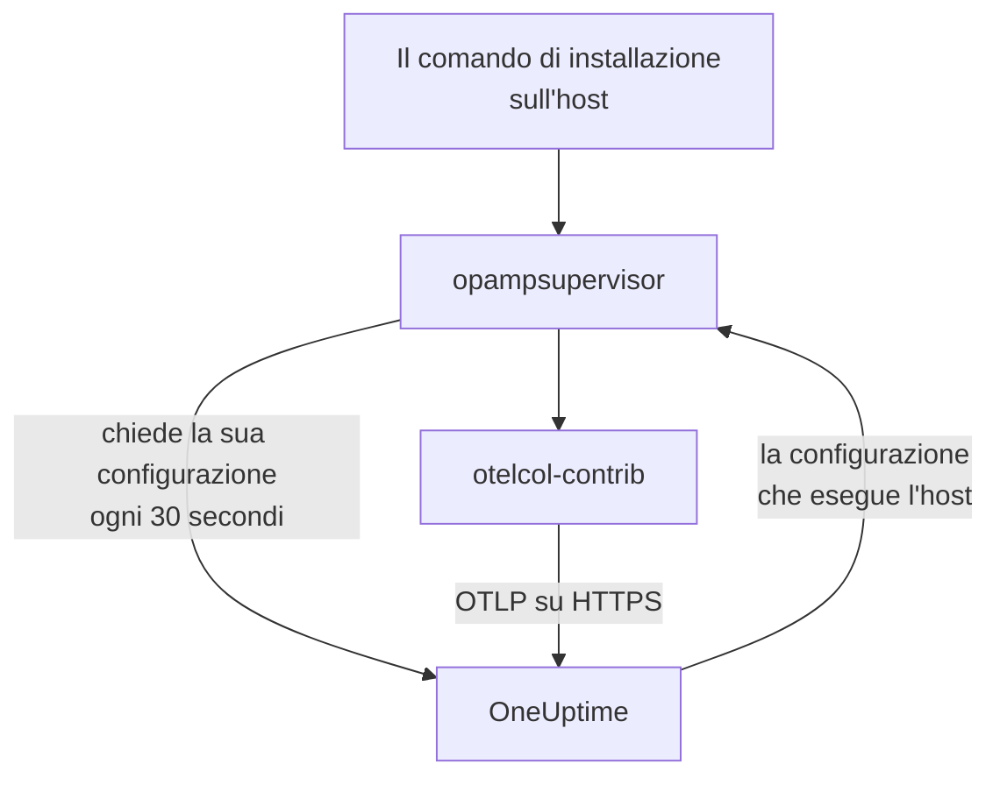

# Host

Aggiungi una macchina Linux, Windows o macOS a OneUptime con un solo comando. Il comando installa l'OpenTelemetry Collector sull'host, e OneUptime invia al collector la sua configurazione e la tiene aggiornata: nessun `config.yaml` da scrivere, copiare su ogni host o tenere allineato. Per cambiare ciò che raccolgono i tuoi host, modifica una configurazione del collector una volta sola, e ogni host a cui si applica riceve la modifica entro un minuto.

:::cards
- [Aggiungere un host](#aggiungere-un-host): Un comando su Linux, Windows o macOS.
- [Cambiare ciò che raccolgono gli host](#cambiare-ciò-che-raccolgono-gli-host): Configurazioni del collector per sistema ed etichetta, con ogni versione conservata.
- [Controllare il collector di un host](#controllare-il-collector-di-un-host): La configurazione che esegue, la sua versione e perché una configurazione non si è avviata.
- [Cosa può fare una configurazione](#cosa-può-fare-una-configurazione): Leggere l'host e inviare solo a questa istanza di OneUptime.
:::

## Come funziona

Il comando installa due programmi dalle release dell'OpenTelemetry Collector, ciascuno verificato con lo SHA-256 pubblicato dalla sua release: `otelcol-contrib`, il collector che legge l'host, e `opampsupervisor`, che esegue il collector e lo mantiene sulla configurazione che OneUptime invia tramite OpAMP, l'OpenTelemetry Agent Management Protocol. Entrambi girano come servizio `oneuptime-collector`.



Il supervisore chiede a OneUptime la configurazione dell'host circa ogni 30 secondi, con la tua chiave di acquisizione, e segnala quale configurazione esegue l'host e se si è avviata. L'host viene registrato in **Host** alla prima connessione del supervisore, con il nome della macchina, e le sue pagine si riempiono man mano che arrivano metriche e log.

Ogni host esegue una configurazione, scelta in questo ordine:

| L'host esegue | Quando |
| --- | --- |
| La configurazione scelta per lui nella sua pagina **Collector** | Qualcuno ne ha scelta una. |
| La prima delle **Configurazioni del collector** che si applica a lui | Una configurazione si applica quando è per il sistema dell'host e, se nomina etichette, l'host ne ha una. |
| La predefinita di OneUptime per il suo sistema | Nessuna configurazione si applica. |

La predefinita di OneUptime legge CPU, memoria, dischi, file system, rete e processi su ogni sistema; il journal e le unità systemd su Linux, dove l'host li ha; i registri eventi System, Application e Security e i servizi Windows su Windows; e i log di installazione e Wi-Fi in `/var/log` su macOS. Esclude i file system pieni per progettazione, come i pacchetti snap e il `/dev` di macOS, così non tengono mai attivo il modello High Filesystem Usage. Segue le release di OneUptime, quindi un host con la predefinita riceve i miglioramenti che OneUptime vi apporta.

## Prima di iniziare

- Una chiave di acquisizione. **Aggiungi host** ne crea una per te, oppure scegline una creata in **Impostazioni del progetto → Telemetria e APM → Chiavi di acquisizione**.
- Diritti di amministratore sull'host: `sudo` su Linux e macOS, PowerShell eseguito come amministratore su Windows.
- Linux con systemd, Windows 10 o Windows Server 2019 e successivi, oppure macOS su Apple Silicon o Intel.
- HTTPS in uscita dall'host verso il tuo URL di OneUptime, diretto o tramite un proxy.

## Aggiungere un host

:::steps
### Apri Aggiungi host

Apri **Prodotti → Infrastruttura → Host** e seleziona **Aggiungi host**. Scegli cosa esegue l'host: Linux, Windows o macOS. I nodi di un cluster Kubernetes sono invece monitorati dal [Kubernetes Agent](/docs/telemetry/kubernetes-agent).

### Scegli una chiave di acquisizione

Scegli una chiave, oppure creane una dalla finestra di dialogo. Il comando qui sotto la inserisce.

### Esegui il comando sull'host

Copia il comando dalla finestra di dialogo ed eseguilo sull'host. Richiede circa un minuto. Questi sono gli stessi comandi, con il tuo URL di OneUptime e la tua chiave al posto degli esempi:

:::tabs
@tab Linux
```bash
curl -fsSL https://oneuptime.com/docs/static/scripts/host-collector/install.sh | sudo sh -s -- --url https://oneuptime.com --key YOUR_INGESTION_KEY
```
@tab macOS
```bash
curl -fsSL https://oneuptime.com/docs/static/scripts/host-collector/install.sh | sudo sh -s -- --url https://oneuptime.com --key YOUR_INGESTION_KEY
```
@tab Windows
```powershell
[Net.ServicePointManager]::SecurityProtocol = [Net.ServicePointManager]::SecurityProtocol -bor [Net.SecurityProtocolType]::Tls12; & ([scriptblock]::Create((Invoke-RestMethod -Uri 'https://oneuptime.com/docs/static/scripts/host-collector/install.ps1'))) -Url 'https://oneuptime.com' -Key 'YOUR_INGESTION_KEY'
```
:::

Ogni istanza di OneUptime serve i propri programmi di installazione, quindi un'istanza self-hosted distribuisce il programma di installazione della propria release: sostituisci `https://oneuptime.com` con il tuo URL in entrambi i punti.

### Attendi l'host

L'ultimo passaggio della finestra di dialogo indica quando l'host si connette, con un link all'host. Nell'elenco appare come **In avvio** finché non arrivano le sue prime metriche, di solito entro un minuto, poi come connesso, con il collector **In esecuzione**. La pagina **Topologia** dell'host disegna su un'unica mappa ciò che gira su di esso, ciò che lo chiama e ciò che chiama: vedi [Topologia](/docs/telemetry/topology#aprire-la-mappa-di-una-risorsa).
:::

## Etichettare gli host

Aggiungi etichette al comando, e l'host le ha dal momento in cui si connette:

:::tabs
@tab Linux
```bash
curl -fsSL https://oneuptime.com/docs/static/scripts/host-collector/install.sh | sudo sh -s -- --url https://oneuptime.com --key YOUR_INGESTION_KEY --label env=production --label team=payments
```
@tab macOS
```bash
curl -fsSL https://oneuptime.com/docs/static/scripts/host-collector/install.sh | sudo sh -s -- --url https://oneuptime.com --key YOUR_INGESTION_KEY --label env=production --label team=payments
```
@tab Windows
```powershell
[Net.ServicePointManager]::SecurityProtocol = [Net.ServicePointManager]::SecurityProtocol -bor [Net.SecurityProtocolType]::Tls12; & ([scriptblock]::Create((Invoke-RestMethod -Uri 'https://oneuptime.com/docs/static/scripts/host-collector/install.ps1'))) -Url 'https://oneuptime.com' -Key 'YOUR_INGESTION_KEY' -Label 'env=production','team=payments'
```
:::

`env=production` diventa l'etichetta `env:production`. Le etichette si aggiungono e non vengono mai tolte: esegui di nuovo il comando con un'altra etichetta e l'host le ha entrambe. Puoi etichettare gli host anche nell'elenco **Host** o con le **Regole etichette**. Una configurazione del collector che nomina etichette vale solo per gli host che ne hanno una, quindi lo stesso comando con etichette diverse dà a ogni gruppo di host la sua configurazione.

## Cambiare ciò che raccolgono gli host

:::steps
### Crea una configurazione del collector

Apri **Prodotti → Infrastruttura → Host → Configurazioni del collector** e seleziona **Crea: Configurazione del collector**. Dalle un nome, il sistema degli host a cui è destinata e, per raggiungerne solo alcuni, le loro etichette. La sua configurazione parte dalla predefinita di OneUptime per quel sistema.

### Modifica il suo config.yaml

Nella pagina della configurazione, seleziona **Modifica configurazione**, cambia lo YAML e salva. OneUptime lo controlla prima e rifiuta, spiegando il motivo, una configurazione che non può inviare: vedi [Cosa può fare una configurazione](#cosa-può-fare-una-configurazione).

### Guardala raggiungere gli host

Ogni modifica salvata è una nuova versione, e gli host a cui si applica la ricevono entro un minuto. L'elenco **Host** della configurazione mostra ogni host, lo stato del suo collector e la versione che esegue.
:::

Un host esegue la prima configurazione dell'elenco che si applica a lui: trascina le righe in **Configurazioni del collector** per cambiare l'ordine. Metti prima le configurazioni più mirate, come una per i server web con `env:production`, e dopo quelle generali, come una per ogni host Linux. La scheda **Configurazioni predefinite di OneUptime** sotto l'elenco mostra cosa esegue un host quando nessuna configurazione si applica.

### Versioni e ripristino

L'elenco **Versioni** di una configurazione conserva ogni modifica salvata, dalla più recente, con chi l'ha salvata e quando. Seleziona **Visualizza** per leggere una versione e **Ripristina** per inviarla di nuovo agli host: viene salvata come nuova versione che indica quale ha ripristinato, così l'elenco dice sempre cosa ha ricevuto ogni host.

### Scegli una configurazione per un solo host

Nella pagina **Collector** di un host, seleziona **Cambia configurazione** e scegli una configurazione solo per questo host. Sono proposte le configurazioni per il sistema dell'host e quelle per qualsiasi sistema. Scegli Automatico per restituire l'host all'elenco. Un host la cui configurazione scelta viene eliminata torna da solo all'elenco.

### Quando una configurazione non si avvia

Il supervisore controlla una nuova configurazione con il collector prima di passarvi, e torna all'ultima configurazione funzionante quando una non si avvia. L'host continua a inviare per tutto il tempo. La sua pagina **Collector** mostra **Configurazione non riuscita** con il motivo dato dal collector, come un file di log che il collector non può leggere, e OneUptime non invia di nuovo quella configurazione all'host finché non cambia. Una volta risolta la causa sull'host, seleziona **Riprova** per inviarla ancora una volta.

## Cosa può fare una configurazione

Una configurazione inviata da OneUptime viene eseguita su ogni host a cui si applica, quindi OneUptime la controlla a ogni salvataggio e rifiuta quella che viola una regola:

| Regola | Perché |
| --- | --- |
| Solo receiver, processor, exporter, extension e connector presenti nell'elenco di OneUptime | Legge l'host e i servizi presenti. Un componente che esegue programmi o legge credenziali cloud o del cluster non è nell'elenco. |
| I dati lasciano l'host solo tramite l'exporter `otlp_http`, verso `${env:ONEUPTIME_URL}/otlp` con l'header `x-oneuptime-token: ${env:ONEUPTIME_INGESTION_KEY}` | Ogni host invia a questa istanza di OneUptime, con la chiave con cui è stato installato. Nessuna configurazione contiene una chiave. |
| `${env:NAME}` è l'unico `${...}` che può usare | Un `${file:...}` o `${https:...}` verrebbe letto su ogni host e potrebbe essere inoltrato. |
| Nessuna impostazione che esegue un programma o invia un file che legge, come `journalctl_path` di journald | Una configurazione non può spingersi oltre la lettura dell'host. |

Una configurazione può comunque essere una che un host non può eseguire, come un receiver per un altro sistema o un file di log che lì non esiste. Il collector di ogni host lo controlla prima di passarvi, come descrive [Quando una configurazione non si avvia](#quando-una-configurazione-non-si-avvia).

## Controllare il collector di un host

Apri l'host e la sua pagina **Collector**. Mostra lo stato del collector, la configurazione che esegue e **Perché questa configurazione**, la versione che esegue, il suo **Ultimo rapporto** e la sua **Release del collector**. In **Sull'host** ci sono i comandi per controllarlo da una shell sull'host: se il suo servizio è in esecuzione, il suo log e un riavvio.

:::tabs
@tab Linux
```bash
sudo systemctl status oneuptime-collector
sudo journalctl -u oneuptime-collector -n 50
sudo systemctl restart oneuptime-collector
```
@tab macOS
```bash
sudo launchctl print system/com.oneuptime.collector
sudo tail -n 50 /usr/local/oneuptime-collector/log/collector.log
sudo launchctl kickstart -k system/com.oneuptime.collector
```
@tab Windows
```powershell
Get-Service oneuptime-collector
Get-WinEvent -FilterHashtable @{ LogName = 'Application'; ProviderName = 'oneuptime-collector' } -MaxEvents 50 | Format-List TimeCreated, Message
Restart-Service oneuptime-collector
```
:::

Su Linux il collector gira come utente non privilegiato `oneuptime-collector`, nei gruppi `systemd-journal` e `adm` per poter leggere il journal e i log in `/var/log`. Su macOS gira come root, come i demoni launchd, e su Windows come LocalSystem, per poter leggere ogni registro eventi e ogni servizio Windows.

## Host configurati a mano

Un host il cui collector hai installato da solo, con la guida [OpenTelemetry Collector per host](/docs/telemetry/host-otel-collector), continua a inviare come prima, e OneUptime non gli invia alcuna configurazione. Per passarlo a OneUptime, apri la pagina **Collector** dell'host: il suo comando aggiunge `--replace-existing`, che arresta e disattiva il collector installato a mano (il servizio `otelcol-contrib`), così l'host non invia i dati due volte. L'host mantiene il suo nome, la sua cronologia e le sue etichette.

## Opzioni di installazione

Esegui di nuovo il comando per cambiare una di queste opzioni, o per passare a una release più recente: sostituisce ciò che ha installato e mantiene l'host così com'è in OneUptime.

| Linux e macOS | Windows | Cosa fa |
| --- | --- | --- |
| `--url URL` | `-Url URL` | Dove si trova OneUptime. |
| `--key KEY` | `-Key KEY` | Una chiave di acquisizione della telemetria del tuo progetto. |
| `--label KEY=VALUE` | `-Label KEY=VALUE` | Etichetta l'host. Ripetila per altre etichette; su Windows, elencale separate da virgole. |
| `--env NAME=VALUE` | `-EnvVar NAME=VALUE` | Dà al collector una variabile d'ambiente, per le configurazioni che leggono `${env:NAME}`. |
| `--version VERSION` | `-Version VERSION` | La release del collector da installare, 0.161.0 per impostazione predefinita. |
| `--download-url URL` | `-DownloadUrl URL` | Scarica le release da un mirror con la stessa struttura di cartelle di GitHub. |
| `--proxy URL` | `-Proxy URL` | Fa passare i download e tutto il traffico del collector per un proxy HTTP. |
| `--replace-existing` | `-ReplaceExisting` | Arresta e disattiva un collector installato a mano. |
| `--uninstall` | `-Uninstall` | Rimuove il collector e tutto ciò che il comando ha installato. |

## Disinstallare

:::tabs
@tab Linux
```bash
curl -fsSL https://oneuptime.com/docs/static/scripts/host-collector/install.sh | sudo sh -s -- --uninstall
```
@tab macOS
```bash
curl -fsSL https://oneuptime.com/docs/static/scripts/host-collector/install.sh | sudo sh -s -- --uninstall
```
@tab Windows
```powershell
& ([scriptblock]::Create((Invoke-RestMethod -Uri 'https://oneuptime.com/docs/static/scripts/host-collector/install.ps1'))) -Uninstall
```
:::

L'host resta in OneUptime con la sua cronologia: archivialo o eliminalo nell'elenco **Host**.

## Risoluzione dei problemi

:::details Il comando dice che OneUptime ha rifiutato la chiave
HTTP `401`: la chiave è errata, è scaduta o è stata eliminata. HTTP `422`: è disattivata, è una chiave per browser o è vincolata a un solo servizio. Scegli una chiave server attiva in **Aggiungi host** ed esegui di nuovo il comando: sostituisce la chiave sull'host.
:::

:::details L'host non compare
Controlla che l'host raggiunga il tuo URL di OneUptime tramite HTTPS, poi leggi il log del collector con il comando per il suo sistema in [Controllare il collector di un host](#controllare-il-collector-di-un-host).
:::

:::details L'host dice che la sua configurazione non è riuscita
La sua pagina **Collector** mostra perché la configurazione non si è avviata. L'host continua a eseguire l'ultima configurazione funzionante e riceve di nuovo quella non riuscita quando la configurazione cambia o quando selezioni **Riprova**.
:::

:::details L'host mostra «Non segnala»
OneUptime non ha notizie dal supervisore dell'host da più di 15 minuti. Controlla che il servizio `oneuptime-collector` sia in esecuzione e che l'host raggiunga ancora OneUptime.
:::

## Passi successivi

:::cards
- [OpenTelemetry Collector per host](/docs/telemetry/host-otel-collector): Installa il collector e scrivi tu la sua configurazione.
- [Monitor degli host](/docs/monitor/host-monitor): Ricevi avvisi su ciò che segnalano i tuoi host.
- [Chiavi di acquisizione](/docs/telemetry/ingestion-keys): Crea, limita e ruota le chiavi con cui inviano gli host.
- [Kubernetes Agent](/docs/telemetry/kubernetes-agent): Monitora i nodi e i workload di un cluster.
:::
