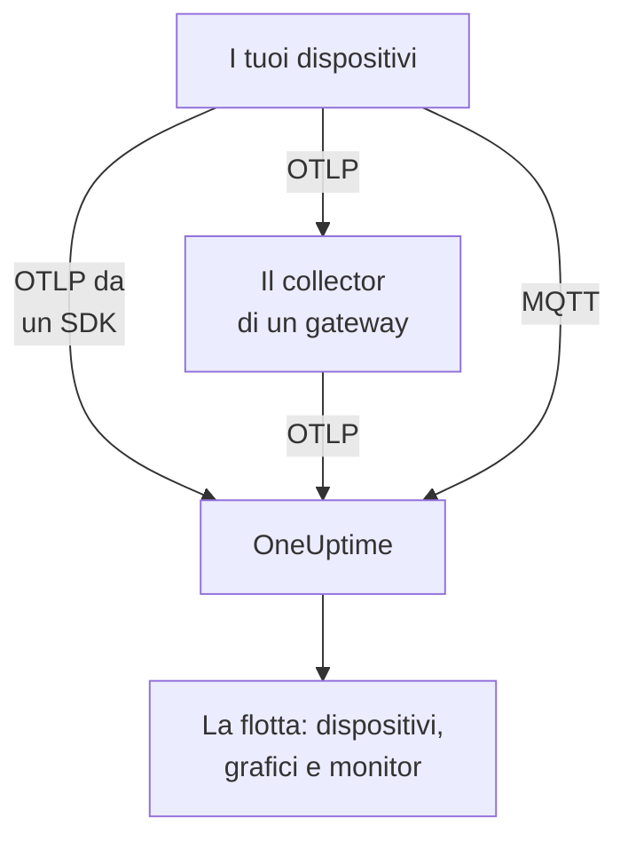

# Dispositivi IoT

OneUptime monitora flotte di dispositivi IoT — sensori, gateway, controller ed edge box — a partire da un piccolo insieme di metriche `iot_*` che inviano. Raggruppa i dispositivi in flotte, tiene un inventario dei dispositivi di ogni flotta e mostra nei grafici batteria, segnale, temperatura, CPU, memoria e disponibilità. Non c'è nessun agent di OneUptime da installare su un dispositivo: i dispositivi inviano OpenTelemetry standard, oppure pubblicano sull'endpoint MQTT di OneUptime. I [monitor dei dispositivi IoT](/docs/monitor/iot-device-monitor) generano avvisi in base a ciò che inviano.

:::cards
- [Scegli come inviare](#scegli-come-inviare): Un SDK OpenTelemetry, un collector su un gateway o MQTT.
- [Invio delle metriche tramite MQTT](#invio-delle-metriche-tramite-mqtt): Topic, credenziali per dispositivo e Last Will.
- [Convenzioni sulle metriche](#convenzioni-sulle-metriche): I nomi `iot_*` che OneUptime mostra nei grafici e su cui genera avvisi.
- [Risoluzione dei problemi](#risoluzione-dei-problemi): Flotte mancanti, dispositivi mancanti, passaggi a offline.
:::

## Come funziona

Ogni lettura appartiene a una flotta e a un dispositivo. OneUptime crea la flotta dalla sua prima lettura, aggiunge ogni nuovo dispositivo all'inventario della flotta e aggiorna i valori più recenti del dispositivo a ogni lettura successiva. Le letture inviate tramite OpenTelemetry e tramite MQTT alimentano le stesse flotte, lo stesso inventario, gli stessi grafici e monitor.



## Come OneUptime modella l'IoT

- **Flotta**: un gruppo di dispositivi, come `building-a-sensors` o `field-gateways`. Deriva dall'attributo di risorsa `iot.fleet.name` e compare in OneUptime come servizio di telemetria `iot/<fleet>`. Imposta anche `service.name=iot/<fleet>`, così log e metriche finiscono sotto lo stesso servizio.
- **Dispositivo**: un dispositivo di una flotta, identificato dall'attributo `device.id` su ogni punto dati. L'inventario della flotta è indicizzato su `device.id`.

| Attributo | Impostato su | Obbligatorio | Descrizione |
| --- | --- | --- | --- |
| `iot.fleet.name` | Risorsa | Sì | La flotta a cui appartiene il dispositivo. Diventa il servizio OneUptime `iot/<fleet>`. |
| `device.id` | Ogni punto dati | Sì | Un ID stabile per il dispositivo, univoco nella sua flotta. |
| `iot.device.kind` | Ogni punto dati | No | La classe del dispositivo, come `Device`, `Sensor` o `Gateway`. Il valore predefinito è `Device`. |
| `iot.device.type` | Ogni punto dati | No | Un tipo o modello più specifico per filtrare i monitor, come `temp-sensor`. |
| `iot.device.firmware` | Ogni punto dati | No | La versione del firmware che il dispositivo riporta. |

Con MQTT il topic imposta per te la flotta e il dispositivo.

## Scegli come inviare

| Modo | Usalo quando | Richiede |
| --- | --- | --- |
| [SDK OpenTelemetry](#invio-delle-metriche-tramite-lsdk-opentelemetry) | Il dispositivo esegue un SDK OpenTelemetry e raggiunge OneUptime da solo. | Una chiave di acquisizione sul dispositivo. |
| [OpenTelemetry Collector](#invio-delle-metriche-tramite-un-opentelemetry-collector) | Molti dispositivi inviano tramite un gateway. | Un gateway che esegue il collector. |
| [MQTT](#invio-delle-metriche-tramite-mqtt) | Il dispositivo parla già MQTT, o deve risultare offline nel momento in cui cade. | Qualsiasi client MQTT che si connette tramite WebSocket. |

## Prima di iniziare

- Una chiave di acquisizione. Creane una in **Impostazioni del progetto → Telemetria e APM → Chiavi di acquisizione** e copiane il valore. I dispositivi la inviano come header `x-oneuptime-token`, oppure come password MQTT.
- Accesso di rete dal dispositivo o dal gateway verso il tuo URL di OneUptime.
- Un nome di flotta per ogni gruppo di dispositivi e un ID stabile per ogni dispositivo.

## Invio delle metriche tramite l'SDK OpenTelemetry

:::steps
### Punta l'SDK a OneUptime

Imposta sul dispositivo le variabili d'ambiente standard di OpenTelemetry. Sostituisci la chiave, il nome della flotta e l'ID del dispositivo con i tuoi:

```bash
export OTEL_EXPORTER_OTLP_ENDPOINT=https://oneuptime.com/otlp
export OTEL_EXPORTER_OTLP_PROTOCOL=http/protobuf
export OTEL_EXPORTER_OTLP_HEADERS=x-oneuptime-token=YOUR_TELEMETRY_INGESTION_TOKEN
export OTEL_RESOURCE_ATTRIBUTES=iot.fleet.name=building-a-sensors,device.id=sensor-001,service.name=iot/building-a-sensors
```

Mantieni stabile `iot.fleet.name`: cambiarlo registra una nuova flotta.

### Registra le letture come metriche IoT

Emetti ogni lettura come metrica con uno dei [nomi convenzionali](#convenzioni-sulle-metriche), e dai a ogni punto dati un attributo `device.id`:

| Metrica | Valore | Attributo del punto dati |
| --- | --- | --- |
| `iot_device_up` | `1` | `device.id=sensor-001` |
| `iot_battery_percent` | `87` | `device.id=sensor-001` |
| `iot_temperature_celsius` | `21.5` | `device.id=sensor-001` |

L'inventario è indicizzato sul `device.id` del punto dati, non su quello della risorsa, quindi impostalo su ogni misurazione oltre che in `OTEL_RESOURCE_ATTRIBUTES`.
:::

Poi [verifica che la flotta compaia](#verifica-che-la-flotta-compaia).

## Invio delle metriche tramite un OpenTelemetry Collector

Quando molti dispositivi inviano tramite un gateway, esegui un OpenTelemetry Collector sul gateway. Riceve OTLP dai tuoi dispositivi, applica la flotta a ogni lettura e le inoltra a OneUptime.

:::steps
### Salva la configurazione del gateway

Salva questo file come `config.yaml` sul gateway:

```yaml title="config.yaml"
receivers:
  otlp:
    protocols:
      grpc:
        endpoint: 0.0.0.0:4317
      http:
        endpoint: 0.0.0.0:4318

processors:
  batch:
    send_batch_size: 512
    timeout: 5s
  resource:
    attributes:
      - key: iot.fleet.name
        value: field-gateways
        action: upsert
      - key: service.name
        value: iot/field-gateways
        action: upsert

exporters:
  otlphttp:
    endpoint: "https://oneuptime.com/otlp"
    headers:
      "x-oneuptime-token": "YOUR_TELEMETRY_INGESTION_TOKEN"

service:
  pipelines:
    metrics:
      receivers: [otlp]
      processors: [resource, batch]
      exporters: [otlphttp]
```

- `otlp` riceve dai tuoi dispositivi tramite gRPC (`4317`) e HTTP (`4318`). Ricevi le letture in qualsiasi altro modo supportato dal collector (un bridge MQTT, log da file) e inviale attraverso la stessa pipeline.
- `resource` applica la flotta a ogni lettura. Imposta `iot.fleet.name`, e il `service.name=iot/<fleet>` corrispondente, per ogni gateway, così i dispositivi di ciascun gateway finiscono nella loro flotta.
- Mantieni `device.id`, ed eventualmente `iot.device.kind`, `iot.device.type` e `iot.device.firmware`, su ogni punto dati, così OneUptime può distinguere i dispositivi della flotta.
- `otlphttp` invia a OneUptime tramite HTTPS con la chiave di acquisizione. Sono accettate sia la codifica protobuf predefinita sia `encoding: json`.

### Esegui il collector sul gateway

:::tabs
@tab Docker
Eseguilo dalla cartella che contiene `config.yaml`:

```bash
docker run -d \
  --name otel-collector \
  --restart unless-stopped \
  -p 4317:4317 \
  -p 4318:4318 \
  -v $(pwd)/config.yaml:/etc/otelcol-contrib/config.yaml:ro \
  otel/opentelemetry-collector-contrib:0.161.0 \
  --config /etc/otelcol-contrib/config.yaml
```
@tab otelcol-contrib
Se il gateway ha già `otelcol-contrib`, puntalo al file:

```bash
otelcol-contrib --config config.yaml
```
:::

I dispositivi inviano poi OTLP al gateway, per esempio con `OTEL_EXPORTER_OTLP_ENDPOINT=http://<gateway-host>:4318` nell'SDK di ogni dispositivo.
:::

Poi [verifica che la flotta compaia](#verifica-che-la-flotta-compaia).

## Invio delle metriche tramite MQTT

OneUptime ha un proprio endpoint MQTT, quindi i dispositivi che parlano MQTT vi pubblicano direttamente le letture, senza SDK, collector o bridge. Ciò che arriva tramite MQTT passa per la stessa pipeline di OTLP: le flotte vengono create, l'inventario si aggiorna e ogni monitor e modello di avviso IoT funziona allo stesso modo.

### Endpoint

| Trasporto | Indirizzo | Note |
| --- | --- | --- |
| MQTT su WebSocket | `wss://<your-host>/mqtt` | Funziona su ogni installazione, tramite la normale porta HTTPS. |
| MQTT su TCP | `<app-host>:1883` | Solo self-hosted, e interno alla rete del cluster o di Compose finché non lo esponi. La porta è `MQTT_INGEST_PORT`. |

### Autenticazione

- **Con la chiave di acquisizione**: inviala come password MQTT. Il nome utente viene ignorato; se il tuo client ha solo un campo per il nome utente, metti lì la chiave. È adatto a un gateway che pubblica per molti dispositivi.
- **Con credenziali per dispositivo**: consigliato per i dispositivi che si connettono direttamente. Apri la pagina **Device Registry** della flotta e registra il dispositivo, con il **Device ID** che usa come `device.id`. Il **MQTT Username** del dispositivo è il suo nome utente e la sua **MQTT Password (Secret)** la sua password.

Le credenziali di un dispositivo possono pubblicare solo sotto i suoi topic `oneuptime/<fleet>/<device>/`. Puoi revocare un dispositivo senza toccare il resto della flotta: disattiva il suo interruttore **Abilitato**, oppure eliminalo, e un dispositivo connesso viene disconnesso entro circa un minuto. Un dispositivo registrato che smette di inviare dati resta nell'inventario come offline, e il modello di avviso Device Offline scatta per esso, anche se si spegne senza un Last Will.

OneUptime rifiuta le credenziali errate al CONNECT con il codice di ritorno 4 (nome utente o password errati), quindi un dispositivo configurato male fallisce in modo evidente. Le chiavi del browser vengono rifiutate tramite MQTT.

### Topic e payload

Pubblica sotto il prefisso fisso `oneuptime/`. I segmenti di flotta e dispositivo non devono contenere `/`, `+` o `#`, non devono iniziare con `$` e sono lunghi al massimo 100 caratteri.

| Topic | Payload |
| --- | --- |
| `oneuptime/<fleet>/<device>/telemetry` | Un oggetto JSON di letture: `{"metrics":{"iot_temperature_celsius":21.5}}`, oppure un oggetto piatto i cui campi numerici sono le metriche. |
| `oneuptime/<fleet>/<device>/metrics/<metricName>` | Un valore: un numero semplice (`23.4`) o `{"value":23.4}`. |
| `oneuptime/<fleet>/<device>/status` | `online` o `offline` (anche `1` o `0`, `true` o `false`, `up` o `down`). Imposta `iot_device_up`. |

Un payload di telemetria può contenere anche `"attributes"`, una mappa di stringhe applicata a ogni punto dati (usala per `iot.device.kind`, `iot.device.type`, `iot.device.firmware` o le tue etichette), e `"timestamp"`, in ISO 8601 oppure in secondi o millisecondi Unix. Entrambi sono opzionali: senza un `timestamp`, viene usato l'orario in cui OneUptime riceve la lettura.

### Rilevamento dello stato offline con Last Will

Registra un Last Will MQTT su `oneuptime/<fleet>/<device>/status` con il payload `offline`. Se il dispositivo si spegne o esce dalla rete, OneUptime pubblica `iot_device_up = 0` per esso nel momento in cui termina la sua sessione, il che fa scattare il modello di avviso Device Offline incluso e segna il dispositivo come non attivo nell'inventario, senza polling. Pubblica `online` sullo stesso topic dopo la connessione, così il dispositivo risulta di nuovo attivo.

### Esempi

:::tabs
@tab mosquitto_pub
Tramite TCP semplice, su un'istanza self-hosted:

```bash
mosquitto_pub -h YOUR-ONEUPTIME-APP-HOST -p 1883 \
  -u oneuptime -P "YOUR_TELEMETRY_INGESTION_TOKEN" \
  -t "oneuptime/building-a-sensors/sensor-001/telemetry" \
  -m '{"metrics":{"iot_device_up":1,"iot_battery_percent":87,"iot_temperature_celsius":21.5},"attributes":{"iot.device.type":"temp-sensor","iot.device.firmware":"1.4.2"}}'
```
@tab Node.js
Con il pacchetto `mqtt`, tramite WebSocket, verso oneuptime.com o qualsiasi istanza self-hosted:

```javascript
const mqtt = require("mqtt");

const client = mqtt.connect("wss://oneuptime.com/mqtt", {
  username: "oneuptime", // ignored — the token below is what authenticates
  password: "YOUR_TELEMETRY_INGESTION_TOKEN",
  will: {
    topic: "oneuptime/building-a-sensors/sensor-001/status",
    payload: "offline",
  },
});

client.on("connect", () => {
  client.publish("oneuptime/building-a-sensors/sensor-001/status", "online");
  setInterval(() => {
    client.publish(
      "oneuptime/building-a-sensors/sensor-001/telemetry",
      JSON.stringify({
        metrics: {
          iot_device_up: 1,
          iot_battery_percent: readBattery(),
          iot_temperature_celsius: readTemperature(),
        },
      }),
    );
  }, 60 * 1000);
});
```
@tab Python
Con `paho-mqtt`, tramite WebSocket:

```python
import json
import paho.mqtt.client as mqtt

client = mqtt.Client(transport="websockets")
client.username_pw_set("oneuptime", "YOUR_TELEMETRY_INGESTION_TOKEN")
client.tls_set()
client.will_set("oneuptime/building-a-sensors/sensor-001/status", "offline")
client.ws_set_options(path="/mqtt")
client.connect("oneuptime.com", 443)

client.publish("oneuptime/building-a-sensors/sensor-001/status", "online")
client.publish(
    "oneuptime/building-a-sensors/sensor-001/telemetry",
    json.dumps({"metrics": {"iot_device_up": 1, "iot_temperature_celsius": 21.5}}),
)
```
:::

### Limiti e consegna

- L'endpoint accetta solo letture: le sottoscrizioni vengono rifiutate (un errore SUBACK) e i messaggi retained non vengono conservati.
- L'acquisizione è at-least-once. Usa QoS 1 perché OneUptime confermi ogni pubblicazione; un nuovo invio con QoS 1 o 2 dopo una conferma persa può produrre punti dati duplicati.
- Una pubblicazione oltre 128 KB, o con più di 100 metriche, viene scartata, e un pacchetto che ne dichiara di più chiude la connessione.
- Una pubblicazione al di fuori di questi topic, o con un payload malformato, viene accettata e scartata, perché MQTT 3.1.1 non ha errori per singolo messaggio. OneUptime registra un avviso con il motivo (`MQTT: dropped publish to …`).
- Sull'endpoint WebSocket, mantieni il keepalive MQTT sotto i 5 minuti. L'ingress chiude un WebSocket inattivo per 300 secondi, il che fa scattare il Last Will e un falso avviso Device Offline. I valori predefiniti delle librerie client (60 secondi per `mqtt` e `paho-mqtt`) vanno bene, e l'endpoint TCP non ha questo limite.

## Convenzioni sulle metriche

OneUptime riconosce questi nomi di metriche `iot_*`. Invia solo quelli che hanno senso per il tuo dispositivo: quelli mancanti semplicemente non compaiono nei grafici. Ogni punto dati porta il `device.id` del dispositivo (con MQTT, è il topic a indicare il dispositivo).

| Nome della metrica | Significato |
| --- | --- |
| `iot_device_up` | Disponibilità: `1` significa attivo e raggiungibile, `0` non attivo. La legge il monitor IoT Device. |
| `iot_device_info` | Solo identità. Porta `device.id`, la classe, il tipo e il firmware, così un dispositivo compare nell'inventario prima di riportare letture. |
| `iot_battery_percent` | Carica della batteria, da `0` a `100` (%). |
| `iot_signal_strength_dbm` | Intensità del segnale wireless in dBm, come l'RSSI Wi-Fi, LoRa o cellulare. |
| `iot_temperature_celsius` | Temperatura del dispositivo o del sensore in °C. |
| `iot_cpu_usage_ratio` | Utilizzo della CPU come rapporto da `0` a `1`. OneUptime lo memorizza e lo mostra come percentuale. |
| `iot_memory_usage_bytes` | Memoria in uso, in byte. |
| `iot_memory_size_bytes` | Memoria totale del dispositivo, in byte. |
| `iot_uptime_seconds` | Secondi dall'ultimo avvio del dispositivo. |

## Verifica che la flotta compaia

1. Verifica che il dispositivo, il collector del gateway o il client MQTT invii senza errori: cerca nei suoi log errori di esportazione e risposte HTTP `401` o `422`, oppure una connessione rifiutata con il codice di ritorno 4.
2. Apri **Prodotti → Infrastruttura → IoT → All Fleets**. La flotta compare come `iot/<fleet>` entro un minuto circa dalle sue prime letture.
3. Apri la pagina **Devices** della flotta. Ogni dispositivo che hai inviato dovrebbe comparire con i valori più recenti di batteria, segnale, temperatura, CPU, memoria e stato attivo o non attivo.
4. Apri la pagina **Metriche** della flotta per mostrare in un grafico qualsiasi serie `iot_*`.

## OneUptime self-hosted

Punta l'endpoint alla tua istanza:

```bash
export OTEL_EXPORTER_OTLP_ENDPOINT=https://your-oneuptime-host.example.com/otlp
```

Oppure, in un collector:

```yaml
exporters:
  otlphttp:
    endpoint: https://your-oneuptime-host.example.com/otlp
    headers:
      "x-oneuptime-token": "YOUR_TELEMETRY_INGESTION_TOKEN"
```

Per MQTT, connettiti a `wss://your-oneuptime-host.example.com/mqtt`, oppure esponi la porta TCP MQTT semplice del servizio app (`MQTT_INGEST_PORT`, `1883` per impostazione predefinita) per i dispositivi che non possono usare WebSocket. Imposta `MQTT_INGEST_ENABLED=false` sul servizio app per disattivare entrambi i listener MQTT. Se l'istanza usa solo HTTP, usa `http://` (e `ws://` per MQTT) e la sua porta.

## Risoluzione dei problemi

:::details La flotta non compare
1. Verifica che `iot.fleet.name` sia un attributo di risorsa (non un'etichetta del punto dati) e che `service.name` sia `iot/<fleet>`.
2. Verifica che l'endpoint sia `https://oneuptime.com/otlp` (o il tuo `…/otlp` self-hosted) e che l'header `x-oneuptime-token` contenga una chiave di acquisizione valida.
3. Con MQTT, verifica che il topic segua esattamente `oneuptime/<fleet>/<device>/…`: è il segmento della flotta nel topic a creare la flotta.
:::

:::details Mancano dispositivi nell'inventario
1. Dai a ogni punto dati un'etichetta `device.id`: i dispositivi sono indicizzati su di essa. Con MQTT, è il segmento del dispositivo nel topic.
2. Per un dispositivo che non ha ancora riportato letture, invia `iot_device_info` (oppure, con MQTT, un messaggio `status`) così compare nell'inventario.
3. Mantieni stabili i valori di `device.id`: un ID che cambia crea dispositivi duplicati.
:::

:::details HTTP 401 o 422 dall'exporter
`401` significa che la chiave di acquisizione manca, è errata o è scaduta; `422` significa che è stata disattivata, oppure che è una chiave del browser, che non può inviare telemetria dei dispositivi. Creane una nuova in **Impostazioni del progetto → Telemetria e APM → Chiavi di acquisizione** e aggiorna l'header `x-oneuptime-token`.
:::

:::details La connessione MQTT viene rifiutata con "bad username or password"
OneUptime rifiuta le credenziali errate al CONNECT con il codice di ritorno 4. Verifica che la password sia una chiave di acquisizione valida che non sia stata disattivata né sia scaduta, oppure, per un dispositivo registrato, il secret delle credenziali con il suo **MQTT Username** come nome utente. Le chiavi del browser vengono rifiutate tramite MQTT.
:::

:::details I dispositivi passano offline mentre sono in funzione
Sull'endpoint WebSocket, l'ingress chiude una connessione inattiva per 300 secondi, il che fa scattare il Last Will e un falso avviso Device Offline. Mantieni il keepalive MQTT sotto i 5 minuti: i valori predefiniti delle librerie client, di 60 secondi, vanno bene.
:::

:::details Le letture non compaiono nei grafici della flotta
1. Usa i nomi `iot_*` esatti di [Convenzioni sulle metriche](#convenzioni-sulle-metriche): gli altri nomi vengono memorizzati come metriche generiche e non riempiono i grafici IoT.
2. Invia `iot_cpu_usage_ratio` come rapporto da `0` a `1`; OneUptime lo mostra come percentuale.
3. Concedi fino a un minuto perché compaiano i primi punti dati dopo che un dispositivo inizia a inviarli.
:::

## Passaggi successivi

:::cards
- [Monitor dispositivi IoT](/docs/monitor/iot-device-monitor): Ricevere un avviso quando un dispositivo va offline, ha la batteria scarica o si surriscalda.
- [OpenTelemetry](/docs/telemetry/open-telemetry): Come OneUptime riceve OTLP da qualsiasi SDK o collector.
- [Collector OpenTelemetry sull'host](/docs/telemetry/host-otel-collector): Monitorare il gateway Linux, macOS o Windows stesso.
:::
