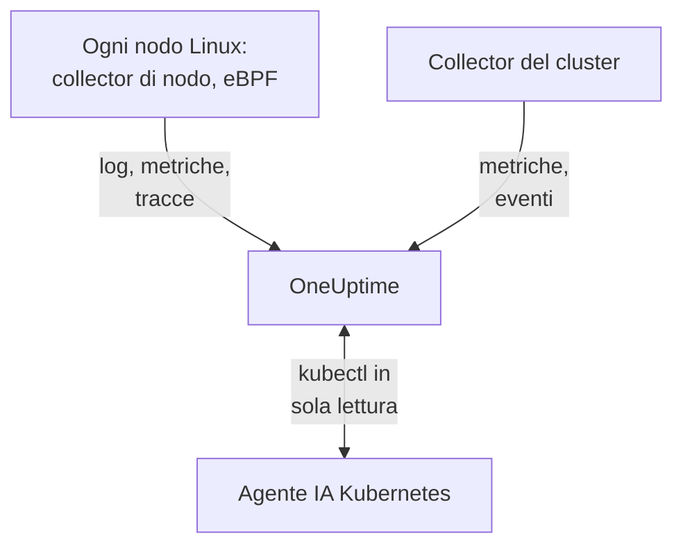

# Agent Kubernetes

L'agent Kubernetes di OneUptime è un chart Helm che raccoglie le metriche, gli eventi e i log dei pod del tuo cluster e, con eBPF, le tracce, le metriche delle richieste, il grafo dei servizi e i flussi di rete di ogni pod, senza modifiche al codice e senza SDK. Esegue anche l'[agente IA Kubernetes](#agente-ia-kubernetes), che permette a OneUptime AI di eseguire `kubectl` in sola lettura mentre indaga su un incidente o un avviso. Un solo `helm install` lo mette in funzione; i [monitor Kubernetes](/docs/monitor/kubernetes-monitor) generano avvisi in base a ciò che invia.

:::cards
- [Installa l'agent](#installa-lagent): Quattro passaggi con Helm.
- [Opzioni di configurazione](#opzioni-di-configurazione): Filtri, campionamento, piano di controllo, service mesh, costi ed etichette.
- [Agente IA Kubernetes](#agente-ia-kubernetes): `kubectl` in sola lettura per OneUptime AI, e correzioni quando le consenti.
- [Invia meno](#ridurre-il-volume-dei-dati-raccolti): Le leve, in ordine di impatto.
:::

## Come funziona

Il chart esegue alcuni carichi di lavoro nel proprio namespace. Ognuno invia ciò che raccoglie al tuo URL di OneUptime tramite OTLP, con la chiave di acquisizione che gli fornisci, e il cluster si registra con il nome che gli dai in `clusterName`.



| Carico di lavoro | Tipo | Cosa fa | In esecuzione |
| --- | --- | --- | --- |
| Collector del cluster | Deployment | Metriche del cluster, eventi Kubernetes e specifiche di pod, nodi e carichi di lavoro, dall'API di Kubernetes. | Sempre |
| Collector di nodo | DaemonSet | Log dei pod da `/var/log/pods`, metriche di kubelet e cAdvisor e metriche del sistema operativo del nodo. | Ovunque tranne EKS Fargate |
| Strumentazione eBPF (OBI) | DaemonSet | Tracce e metriche delle richieste HTTP, gRPC, SQL e Redis di ogni pod, e la mappa dei servizi. | Per impostazione predefinita, tranne su GKE Autopilot ed EKS Fargate |
| Agente IA Kubernetes | Deployment | `kubectl` in sola lettura per OneUptime AI mentre indaga su un incidente o un avviso. | Per impostazione predefinita |
| Lettore di log | Deployment | Log dei pod tramite l'API di Kubernetes, dove il collector di nodo non può leggerli. | Con i preset `gke-autopilot` ed `eks-fargate` |
| Motore dei costi e poller | Deployments | Spesa per namespace, carico di lavoro e pod. | Con `cost.enabled=true` |

Ogni immagine dell'agent è solo per Linux, quindi ogni carico di lavoro è vincolato ai nodi Linux.

## Prima di iniziare

- Un cluster Kubernetes con v1.23 o successiva, e `kubectl` configurato per raggiungerlo.
- Helm 3. Gli aggiornamenti usano `--reset-then-reuse-values`, che richiede Helm 3.14 o successivo.
- Una chiave di acquisizione. Creane una in **Impostazioni del progetto → Telemetria e APM → Chiavi di acquisizione**. L'agent la invia come header `x-oneuptime-token`, quindi una chiave API di progetto qui non funziona.
- Un nome per il cluster, univoco nel tuo progetto e stabile, come `prod-us-east-1`: il cluster compare in OneUptime con questo nome.
- HTTPS in uscita dal cluster verso il tuo URL di OneUptime.

## Installa l'agent

:::steps
### Aggiungi il repository Helm

```bash
helm repo add oneuptime https://helm-chart.oneuptime.com
helm repo update
```

### Installa il chart

Sostituisci `YOUR_ONEUPTIME_URL`, `YOUR_ONEUPTIME_API_KEY` (la chiave di acquisizione) e il nome del cluster con i tuoi valori, e scegli la scheda della tua piattaforma (vedi [Scegli un preset](#scegli-un-preset)).

:::tabs
@tab Standard
Cluster autogestiti, EKS on EC2, GKE Standard, AKS, minikube, kind e k3s:

```bash
helm install kubernetes-agent oneuptime/kubernetes-agent \
  --namespace oneuptime-agent \
  --create-namespace \
  --set oneuptime.url="YOUR_ONEUPTIME_URL" \
  --set oneuptime.apiKey="YOUR_ONEUPTIME_API_KEY" \
  --set clusterName="my-cluster" \
  --set aiAgent.enabled=true
```
@tab GKE Autopilot
```bash
helm install kubernetes-agent oneuptime/kubernetes-agent \
  --namespace oneuptime-agent \
  --create-namespace \
  --set oneuptime.url="YOUR_ONEUPTIME_URL" \
  --set oneuptime.apiKey="YOUR_ONEUPTIME_API_KEY" \
  --set clusterName="my-cluster" \
  --set aiAgent.enabled=true \
  --set preset=gke-autopilot
```
@tab EKS Fargate
```bash
helm install kubernetes-agent oneuptime/kubernetes-agent \
  --namespace oneuptime-agent \
  --create-namespace \
  --set oneuptime.url="YOUR_ONEUPTIME_URL" \
  --set oneuptime.apiKey="YOUR_ONEUPTIME_API_KEY" \
  --set clusterName="my-cluster" \
  --set aiAgent.enabled=true \
  --set preset=eks-fargate
```
:::

**Le indagini IA sono attive per impostazione predefinita.** `aiAgent.enabled=true` esegue l'[agente IA Kubernetes](#agente-ia-kubernetes) accanto al collector: quando su questo cluster si verifica un incidente o un avviso, OneUptime AI indaga con `kubectl` in sola lettura (`get`, `describe`, `logs`, `events`, `top`) e non modifica nulla. Le correzioni restano disattivate finché non le consenti. Per installare senza di esso, usa invece `--set aiAgent.enabled=false`.

### Verifica che i pod siano in esecuzione

```bash
kubectl get pods -n oneuptime-agent
```

Ogni pod dovrebbe arrivare a `Running` entro un minuto o due:

:::tabs
@tab Standard
Il collector del cluster, l'agente IA e, su ogni nodo, un collector di nodo e un pod eBPF:

```text
NAME                                          READY   STATUS    RESTARTS   AGE
kubernetes-agent-xxxxxxxxxx-xxxxx             1/1     Running   0          1m
kubernetes-agent-ai-agent-xxxxxxxxxx-xxxxx    1/1     Running   0          1m
kubernetes-agent-ebpf-xxxxx                   1/1     Running   0          1m
kubernetes-agent-logs-xxxxx                   1/1     Running   0          1m
```
@tab GKE Autopilot
Il collector di nodo viene comunque eseguito e legge le metriche di kubelet e cAdvisor senza `hostPath`, e un Deployment lettore di log legge i log dei pod tramite l'API di Kubernetes:

```text
NAME                                          READY   STATUS    RESTARTS   AGE
kubernetes-agent-xxxxxxxxxx-xxxxx             1/1     Running   0          1m
kubernetes-agent-ai-agent-xxxxxxxxxx-xxxxx    1/1     Running   0          1m
kubernetes-agent-logs-yyyyyyyyyy-yyyyy        1/1     Running   0          1m
kubernetes-agent-logs-xxxxx                   1/1     Running   0          1m
```
@tab EKS Fargate
Tre Deployment e nessun DaemonSet: Fargate assegna a ogni pod una propria micro-VM e non pianifica mai DaemonSet, quindi lì le metriche dei nodi non sono disponibili:

```text
NAME                                          READY   STATUS    RESTARTS   AGE
kubernetes-agent-xxxxxxxxxx-xxxxx             1/1     Running   0          1m
kubernetes-agent-ai-agent-xxxxxxxxxx-xxxxx    1/1     Running   0          1m
kubernetes-agent-logs-yyyyyyyyyy-yyyyy        1/1     Running   0          1m
```
:::

### Trova il cluster in OneUptime

Apri **Prodotti → Infrastruttura → Kubernetes → Tutti i cluster**. Il cluster compare con il suo `clusterName` entro pochi minuti, e i suoi nodi, pod e carichi di lavoro si riempiono. L'agente IA Kubernetes risulta connesso nella pagina **Agente** del cluster, sotto **IA**.
:::

## Scegli un preset

`preset` sceglie i valori predefiniti che funzionano sulla tua piattaforma: se i log dei pod vengono letti dal nodo tramite `hostPath` o tramite l'API di Kubernetes, e quali carichi di lavoro possono essere eseguiti con privilegi.

| `preset` | Da usare per | Log dei pod | Metriche dei nodi |
| --- | --- | --- | --- |
| `standard` (predefinito) | Cluster autogestiti, **EKS on EC2**, **GKE Standard**, **AKS**, minikube, kind, k3s | Il collector di nodo legge `/var/log/pods` tramite `hostPath` (overhead minimo) | Kubelet, cAdvisor e le metriche del sistema operativo del nodo |
| `gke-autopilot` | **GKE Autopilot** | Il lettore di log li legge tramite l'API di Kubernetes (niente `hostPath`, nessun accesso all'host) | Kubelet e cAdvisor, senza `hostPath` |
| `eks-fargate` | **EKS Fargate** | Il lettore di log li legge tramite l'API di Kubernetes (niente `hostPath`, nessun accesso all'host) | Nessuna: Fargate non esegue DaemonSet |

Se non sei sicuro, inizia con `standard`. Se l'installazione fallisce con un errore Pod Security che cita `hostPath`, reinstalla con `preset=gke-autopilot` (o `eks-fargate` su Fargate). GKE Autopilot ed EKS Fargate rifiutano anche i pod privilegiati, di cui hanno bisogno eBPF e il profiler, quindi questi due preset li omettono entrambi.

## Cosa viene raccolto

| Categoria | Dati |
| --- | --- |
| Metriche dei nodi | Utilizzo di CPU, memoria, file system e rete |
| Metriche dei pod | CPU, memoria, rete e riavvii |
| Metriche dei container | CPU e memoria per container |
| Metriche del cluster | Condizioni dei nodi, risorse allocabili, numero di pod |
| Eventi Kubernetes | Avvisi, errori ed eventi di pianificazione |
| Log dei pod | stdout e stderr di ogni container (tramite `hostPath` sui cluster standard, tramite l'API di Kubernetes su Autopilot e Fargate) |
| Tracce applicative (eBPF, attive per impostazione predefinita) | Span HTTP, gRPC, SQL e Redis di ogni pod, senza SDK né modifiche al codice |
| Metriche RED HTTP (eBPF) | `http.server.request.duration` e le dimensioni del corpo di richiesta e risposta, per servizio |
| Grafo dei servizi (eBPF) | Archi di frequenza delle richieste, latenza ed errori tra chiamante e chiamato, che disegnano la mappa dei servizi |
| Metriche dei flussi di rete (eBPF) | Contatori di byte e pacchetti TCP e UDP da pod a pod, con i metadati Kubernetes |
| Statistiche TCP (eBPF) | Contatori di tempo di andata e ritorno, connessioni fallite e ritrasmissioni per nodo |
| Costi dei carichi di lavoro (opzionale, `cost.enabled=true`) | Spesa per namespace, carico di lavoro e pod, con capacità inutilizzata ed efficienza, e costi orari di nodi e volumi: vedi [Osservabilità dei costi di Kubernetes](/docs/telemetry/kubernetes-cost) |

## Opzioni di configurazione

Ogni opzione qui sotto è un valore Helm. Impostala durante l'installazione, oppure su un agent già installato con `helm upgrade ... --reset-then-reuse-values --set <value>`.

### Filtro per namespace

`namespaceFilters.rules` applica pattern di namespace a quattro ambiti, ciascuno per conto proprio:

| Ambito | Dove filtra | Cosa riguarda |
| --- | --- | --- |
| `podLogs` | Nel receiver filelog di hostPath o nel lettore di log dell'API | Solo stdout e stderr dei pod; gli eventi Kubernetes e i log di audit non sono interessati |
| `ebpfDiscovery` | Nella scoperta dei processi di OBI | Sia le tracce eBPF sia le metriche eBPF dei carichi di lavoro corrispondenti |
| `metrics` | Nel collector, dopo l'aggiunta dei metadati Kubernetes | Serie di metriche con namespace; le serie di nodo e di cluster senza namespace vengono mantenute |
| `traces` | Nel collector, dopo l'aggiunta dei metadati Kubernetes | Sia gli span eBPF sia gli span che le applicazioni inviano tramite OTLP |

Un pattern corrisponde al nome completo del namespace e può usare `*` (`team-*`). Se un ambito ha una regola `include`, per quell'ambito vengono mantenuti solo i namespace corrispondenti, e le regole `exclude` hanno sempre la precedenza. La regola predefinita esclude `kube-system` solo da `podLogs` e `ebpfDiscovery`.

Per limitare i log dei pod e la scoperta eBPF ad alcuni namespace:

```bash
helm install kubernetes-agent oneuptime/kubernetes-agent \
  --namespace oneuptime-agent \
  --create-namespace \
  --set oneuptime.url="YOUR_ONEUPTIME_URL" \
  --set oneuptime.apiKey="YOUR_ONEUPTIME_API_KEY" \
  --set clusterName="my-cluster" \
  --set-json 'namespaceFilters.rules=[{"action":"include","namespaces":["default","production","staging"],"scopes":["podLogs","ebpfDiscovery"]}]'
```

Per fermare i log di un namespace rumoroso mantenendo le sue tracce eBPF, la mappa dei servizi e le metriche, limita l'esclusione a `podLogs`:

```bash
  --set-json 'namespaceFilters.rules=[{"action":"exclude","namespaces":["kube-system"],"scopes":["podLogs","ebpfDiscovery"]},{"action":"exclude","namespaces":["noisy-*"],"scopes":["podLogs"]}]'
```

Le regole `podLogs` ed `ebpfDiscovery` filtrano alla fonte: i file di log esclusi non vengono mai aperti e i carichi di lavoro esclusi non vengono mai strumentati. Le regole `metrics` e `traces` agiscono dopo, nel collector, una volta associato il namespace ai dati.

#### Filtrare metriche e tracce per namespace

Aggiungi questi ambiti a una regola per filtrare anche le metriche o gli span con namespace:

```bash
  --set-json 'namespaceFilters.rules=[{"action":"exclude","namespaces":["kube-system","noisy-*"],"scopes":["podLogs","ebpfDiscovery","metrics","traces"]}]'
```

> [!NOTE]
> Le metriche a livello di nodo e di cluster vengono sempre mantenute. Un namespace appartiene a un pod, non a un nodo, quindi serie come la CPU del nodo, la memoria del nodo e l'utilizzo del file system non hanno nulla con cui corrispondere e non vengono mai scartate: una regola limitata a `metrics` riduce le serie per pod senza nascondere un nodo che si sta guastando.

Gli eventi Kubernetes non si possono filtrare per namespace nell'agent: arrivano dal receiver `k8sobjects` senza un attributo `k8s.namespace.name` (il namespace è nel corpo dell'evento), quindi un filtro non ha nulla su cui corrispondere. Scartali invece in OneUptime, con **Registri → Impostazioni → Filtri di scarto**.

### Filtraggio per severità dei log

`filters.logs.minSeverity` scarta i record dei log dei pod al di sotto di una severità, nell'agent, prima che venga inviato qualsiasi cosa:

```bash
  --set filters.logs.minSeverity=WARN
```

Accetta `TRACE`, `DEBUG`, `INFO`, `WARN`, `ERROR` e `FATAL`. `WARN` mantiene WARN, ERROR e FATAL e scarta INFO, DEBUG e TRACE; il valore predefinito (`""`) mantiene tutto. Si applica in entrambe le modalità dei log (tramite il collector in modalità `daemonset`, dentro il lettore di log in modalità `api`), quindi un preset non lo disattiva mai a tua insaputa.

I runtime dei container non registrano alcuna severità, quindi l'agent la ricava dal testo stesso del log (`[ERROR]`, `WARN:`, `"level":"info"`, …). Cosa succede a una riga senza un livello riconoscibile dipende dalla modalità dei log, perché le due modalità sanno cose diverse:

| Modalità | Una riga senza livello | Perché |
| --- | --- | --- |
| `daemonset` | `stderr` conta come ERROR (mantenuta), `stdout` come INFO (scartata da una soglia WARN) | Il runtime dei container registra da quale flusso proviene ogni riga. |
| `api` | Sempre mantenuta | L'API `pods/log` di Kubernetes unisce stdout e stderr in un unico flusso senza indicazione per riga, quindi invece di tirare a indovinare l'agent mantiene la riga. |

La modalità `api` scarta quindi, di proposito, strettamente meno della modalità `daemonset`: un traceback di Python o un `npm ERR!` non contengono alcuna parola chiave di severità, e cancellarli in silenzio è proprio l'errore da cui una soglia dovrebbe proteggerti. In modalità ibrida (`logs.windowsPods.enabled`) valgono entrambe le righe, in base al sistema operativo del nodo: i pod Linux seguono `daemonset`, i pod Windows `api`.

In entrambe le modalità gli eventi su più righe vengono ricomposti prima del filtraggio, quindi uno stack trace Java viene giudicato in base alla sua prima riga e mantenuto o scartato per intero.

> [!IMPORTANT]
> Gli eventi Kubernetes e le specifiche delle risorse non vengono mai filtrati da questa impostazione. Arrivano dall'API di Kubernetes senza una severità propria, quindi una soglia cancellerebbe l'intero feed, compresi gli avvisi `FailedScheduling`, `BackOff` e `OOMKilling` che più ti servono. Sono pochi e preziosi, quindi l'agent li invia sempre; per sfoltirli, usa **Registri → Impostazioni → Filtri di scarto** in OneUptime.

### Includere o escludere metriche per nome

`filters.metrics` decide quali metriche lasciano il cluster, su tutti i receiver.

Scarta alcune metriche rumorose (una denylist, di solito ciò che vuoi):

```bash
  --set-json 'filters.metrics.exclude=["k8s.volume.available","k8s.volume.capacity"]'
```

Invia solo un insieme fisso (una allowlist: tutto il resto viene scartato):

```bash
  --set-json 'filters.metrics.include=["k8s.pod.cpu.utilization","k8s.pod.memory.usage"]'
```

Confronta per pattern invece che per nome esatto:

```bash
  --set filters.metrics.matchType=regexp \
  --set-json 'filters.metrics.exclude=["^container_network_"]'
```

| Chiave | Significato |
| --- | --- |
| `filters.metrics.exclude` | Nomi delle metriche da scartare. Applicata dopo `include`, quindi un'esclusione ha sempre la precedenza. |
| `filters.metrics.include` | Se non è vuota, vengono inviate solo queste metriche. |
| `filters.metrics.matchType` | `strict` (il nome esatto, il valore predefinito) o `regexp` (RE2, non ancorata). |

- `regexp` non è ancorata: `system.cpu` corrisponde anche a `system.cpu.time`. Ancorala (`^system\.cpu$`) quando intendi esattamente una metrica.
- RE2 non supporta il lookahead, quindi `^(?!container_)` non si compila. Esprimi "tutto tranne" con `include`, non con un pattern negativo.
- `include` vale per tutti i receiver insieme. Una allowlist che dimentica una metrica rimuove in silenzio i monitor costruiti su di essa, quindi preferisci `exclude`, a meno che tu non voglia un insieme chiuso.
- Usa `--set-json` (o un file di valori) per le liste: un semplice `--set` sostituisce una lista invece di aggiungervi elementi.

> [!WARNING]
> Prova un pattern prima di distribuirlo. Il collector compila i pattern all'avvio, quindi uno non valido non si comporta male in silenzio: il collector si rifiuta di partire e va in crash-loop, portandosi dietro i log di quel collector oltre alle sue metriche. Helm non sa compilare RE2, quindi `helm upgrade` accetta un pattern errato senza obiezioni.

### Campionamento delle tracce

I filtri qui sopra rimuovono una categoria di telemetria: un namespace, una severità, un nome di metrica. Il campionamento mantiene ogni categoria e invece dirada la popolazione. Imposta `sampling.traces.percentage` sulla quota di tracce da mantenere:

```bash
helm upgrade kubernetes-agent oneuptime/kubernetes-agent \
  --namespace oneuptime-agent --reset-then-reuse-values \
  --set sampling.traces.percentage=10
```

Così viene mantenuta una traccia su dieci e le altre nove vengono scartate nell'agent, prima che lascino il cluster.

- **Ottieni tracce intere, non frammenti.** La decisione è un hash dell'ID della traccia, non un lancio di moneta per ogni span, quindi tutti gli span di una traccia vengono mantenuti o scartati insieme, e le tracce che sopravvivono si leggono dall'inizio alla fine.
- **I monitor basati sulle metriche non cambiano.** OBI calcola le metriche RED eBPF (frequenza delle richieste, tasso di errore, durata) da ogni richiesta, e queste passano per la pipeline delle metriche, in cui il campionatore non si trova. Al 10% ottieni un decimo delle tracce e frequenza, errori e latenza esatti.
- **I monitor basati sugli span invece sì.** Tutto ciò che OneUptime conta a partire dagli span stessi cala insieme al tasso: vedi l'avvertenza qui sotto.

| Chiave | Significato |
| --- | --- |
| `sampling.traces.percentage` | La percentuale di tracce da mantenere, da 0 a 100. Predefinito `100` (mantieni tutto). |
| `sampling.traces.hashSeed` | Il seed dell'hash dell'ID della traccia. Predefinito `22`. |

- `0` non mantiene alcuna traccia. È un tasso, non un interruttore: cancella ogni traccia mentre il DaemonSet eBPF continua a girare e a costare. Per non avere tracce, usa `ebpf.enabled=false`; per non avere tracce ma avere le metriche RED e la mappa dei servizi, lascia eBPF attivo e imposta `0` di proposito.
- Si applica solo quando `ebpf.enabled` è attivo: altrimenti non c'è una pipeline delle tracce e il valore non ha effetto.
- Campiona solo le tracce. Di proposito non esistono `sampling.logs` né `sampling.metrics`: vedi la nota qui sotto.
- Le frazioni richiedono `--set-json` e hanno un limite minimo. `--set sampling.traces.percentage=0.5` fallisce, perché Helm legge `0.5` come stringa: usa `--set-json 'sampling.traces.percentage=0.5'` o un file di valori. Sotto circa `0.0061` il tasso viene arrotondato a zero e si comporta esattamente come `0`, senza errori; `0.01` (una su diecimila) è il valore più piccolo che fa quello che dice.
- Più cluster funzionano senza configurazione aggiuntiva. Due agent mantengono la stessa traccia solo se concordano sia su `hashSeed` sia su `percentage`, ed entrambi hanno gli stessi valori predefiniti ovunque, quindi una traccia che attraversa due cluster sopravvive intera. Cambia `hashSeed` solo per rendere indipendenti due livelli di campionamento: con lo stesso seed, un tasso più basso mantiene un sottoinsieme delle tracce del tasso più alto.
- I log dei pod non vengono mai campionati, quindi con `ebpf.logToTraceCorrelation: true` ogni record di log continua a portare un ID di traccia mentre esiste solo la quota mantenuta di quelle tracce. Circa il (100 − `percentage`)% dei record di log rimanda quindi a una traccia che non esiste; passare da una traccia ai suoi log non è interessato.

> [!WARNING]
> Ricalibra i monitor basati sugli span quando imposti questo valore. Il campionamento riduce gli span che raggiungono OneUptime, quindi tutto ciò che li conta conta di meno: un monitor **Tracce** su `Span Count` e un monitor **Eccezioni** su `Exception Count` vedono circa il `percentage`% del volume del giorno prima. Una soglia tarata sul traffico non campionato smette in silenzio di essere superata: il monitor non segnala errori, semplicemente tace. Dividi quelle soglie per lo stesso fattore; il tasso vale per tutto il cluster, quindi nessun servizio può esserne escluso. Il raggruppamento degli errori peggiora più che linearmente: un'eccezione frequente compare ancora, ma un caso raro e isolato è più probabile che sparisca del tutto piuttosto che comparire un decimo delle volte.

> [!NOTE]
> Perché non esiste il campionamento di log o metriche: il campionatore del collector non sa campionare le metriche. Sa campionare i log, ma ricava la sua casualità dall'ID della traccia, che i log dei pod non hanno, quindi ogni record di log produrrebbe lo stesso hash e un tasso per i log manterrebbe tutto o cancellerebbe tutto a seconda del seed. Invece di offrire un'impostazione che cancella in silenzio i tuoi log, il chart non ne offre nessuna. Sfoltisci i log con [Filtraggio per severità dei log](#filtraggio-per-severità-dei-log) e [Filtro per namespace](#filtro-per-namespace), che sono precisi su ciò che rimuovono.

### Disattivare la raccolta dei log

Se non ti servono i log dei pod:

```bash
helm install kubernetes-agent oneuptime/kubernetes-agent \
  --namespace oneuptime-agent \
  --create-namespace \
  --set oneuptime.url="YOUR_ONEUPTIME_URL" \
  --set oneuptime.apiKey="YOUR_ONEUPTIME_API_KEY" \
  --set clusterName="my-cluster" \
  --set logs.enabled=false
```

Le tue metriche non sono interessate: il collector di nodo continua a girare per le metriche di kubelet, cAdvisor e dell'host, e smette solo di leggere i log dei pod. Si fermano gli avvisi basati sui log, nient'altro.

### Forzare una modalità di raccolta dei log

`logs.mode` sostituisce la scelta del preset e ha sempre la precedenza:

- `logs.mode=daemonset`: il DaemonSet di hostPath (overhead minimo; richiede `hostPath`).
- `logs.mode=api`: il Deployment del lettore di log dell'API di Kubernetes (funziona su qualsiasi cluster).
- `logs.mode=disabled`: nessun log dei pod.

La modalità decide solo da dove provengono i log dei pod: le metriche dei nodi vengono raccolte in ogni caso, quindi `api` e `disabled` mantengono le metriche di kubelet, cAdvisor e dell'host. L'eccezione è la piattaforma: EKS Fargate non può pianificare alcun DaemonSet, quindi non ha un collector di nodo né metriche di nodi, pod o container. GKE Autopilot esegue il collector di nodo ma blocca `hostPath`, quindi raccoglie le metriche di kubelet e cAdvisor senza quelle di `hostmetrics` (I/O del disco, inode, errori delle schede di rete), che leggono `/proc` e `/sys` dell'host.

Sui cluster con pool di nodi Windows, la modalità `daemonset` copre solo i nodi Linux, perché ogni immagine dell'agent è solo per Linux. Aggiungi `--set logs.windowsPods.enabled=true` per eseguire accanto il lettore di log dell'API solo per i pod sui nodi Windows: i pod Linux mantengono la lettura dei file locale al nodo, e i due non inviano mai due volte la stessa riga. Serve un'immagine `kubernetes-log-tailer` almeno recente quanto il chart: un'immagine più vecchia ignora la restrizione e invia due volte i log Linux.

### Attivare il monitoraggio del piano di controllo

La pagina **Piano di controllo** del cluster mostra i grafici di etcd, dell'API server, dello scheduler e del controller manager. L'agent li raccoglie tutti e quattro quando `controlPlane.enabled` è `true`:

```bash
helm upgrade kubernetes-agent oneuptime/kubernetes-agent \
  --namespace oneuptime-agent \
  --reset-then-reuse-values \
  --set controlPlane.enabled=true
```

Ogni componente viene raccolto agli indirizzi della propria lista: `controlPlane.etcd.endpoints`, `controlPlane.apiServer.endpoints`, `controlPlane.scheduler.endpoints` e `controlPlane.controllerManager.endpoints`. La raccolta avviene nel pod dell'agent, che non ha la rete dell'host, quindi i valori predefiniti (`https://localhost:<port>/metrics`) puntano a quel pod stesso: imposta ogni lista su un indirizzo che il pod può raggiungere. In qualsiasi cluster, l'API server risponde su `https://kubernetes.default.svc:443/metrics`:

```bash
helm upgrade kubernetes-agent oneuptime/kubernetes-agent \
  --namespace oneuptime-agent \
  --reset-then-reuse-values \
  --set controlPlane.enabled=true \
  --set "controlPlane.apiServer.endpoints={https://kubernetes.default.svc:443/metrics}"
```

`controlPlane.enabled` attiva tutte e quattro le raccolte insieme. Dove un componente non è raggiungibile ai suoi endpoint (etcd, lo scheduler e il controller manager su un cluster gestito, o ai loro valori predefiniti `localhost`), la sua raccolta fallisce a ogni intervallo: il collector registra un errore di scrape e segnala il target come non raggiungibile, e nient'altro cambia.

L'agent raccoglie solo tramite HTTPS, con il token del service account e senza certificato client. Quindi:

- **etcd** ha bisogno di un indirizzo HTTPS per le metriche che non richieda un certificato client. Le porte delle metriche abituali di etcd sono fuori portata: l'HTTP semplice sulla `2381` (il `--listen-metrics-urls` di kubeadm) viene raccolto come HTTPS e fallisce, e la `2379` richiede certificati client.
- **Lo scheduler** (`10259`) e **il controller manager** (`10257`) servono HTTPS e accettano il token, ma kubeadm li vincola a `127.0.0.1` sui nodi del piano di controllo: serve un `--bind-address` che il pod dell'agent possa raggiungere.

I servizi Kubernetes gestiti (EKS, GKE, AKS) non espongono etcd, lo scheduler né il controller manager, quindi lì quelle schede restano vuote. Finché le metriche di una scheda non arrivano, la pagina **Piano di controllo** mostra al posto dei suoi grafici cosa impostare, con il comando da copiare.

### Attivare le metriche di CoreDNS

La scheda **CoreDNS** della pagina **Piano di controllo** mostra i grafici delle query DNS, della latenza, della cache e dell'inoltro. La loro raccolta è disattivata per impostazione predefinita:

```bash
helm upgrade kubernetes-agent oneuptime/kubernetes-agent \
  --namespace oneuptime-agent \
  --reset-then-reuse-values \
  --set coreDns.enabled=true
```

L'agent raccoglie la porta `9153` dei pod con l'etichetta `k8s-app=kube-dns` in `kube-system`, cioè il modo in cui CoreDNS gira sui cluster kubeadm, EKS e AKS. Se il tuo gira altrove, imposta anche `coreDns.namespace`, `coreDns.service` (l'etichetta `k8s-app`) e `coreDns.port`. GKE usa kube-dns (dnsmasq) o Cloud DNS invece di CoreDNS, quindi lì la scheda resta vuota.

### Attivare le metriche del service mesh

La pagina **Service Mesh** del cluster mostra i grafici di Istio e Linkerd. L'agent raccoglie un solo mesh, quello indicato da `serviceMesh.provider` (`istio` o `linkerd`):

```bash
helm upgrade kubernetes-agent oneuptime/kubernetes-agent \
  --namespace oneuptime-agent \
  --reset-then-reuse-values \
  --set serviceMesh.enabled=true \
  --set serviceMesh.provider=istio
```

Per Istio legge le statistiche Envoy di ogni sidecar `istio-proxy` (porta `15090`); per Linkerd, la porta di amministrazione di ogni `linkerd-proxy`. Il piano di controllo di nessuno dei due mesh viene raccolto: istiod (la scheda **Pilot**) e i componenti identity, destination e proxy-injector di Linkerd (la scheda **Piano di controllo**) servono le loro metriche su porte di amministrazione proprie, quindi quelle schede lo segnalano al posto dei grafici.

### Metriche che l'agent non raccoglie

Alcuni grafici mostrano metriche per cui l'agent non ha una raccolta: **kube-proxy** nella pagina **Piano di controllo**; **Cilium** (con Hubble) nella pagina **Service Mesh**; e, nelle schede Istio e Linkerd, i piani di controllo dei mesh stessi (**istiod** e i componenti identity, destination e proxy-injector di Linkerd). Si riempiono quando quelle metriche arrivano a OneUptime per un'altra strada, per esempio dal tuo [OpenTelemetry Collector](/docs/telemetry/open-telemetry) che le raccoglie, con l'attributo di risorsa `k8s.cluster.name` impostato sul nome del cluster (il `clusterName` dell'agent). I cluster che funzionano senza kube-proxy non hanno alcuna metrica di kube-proxy.

### Attivare l'osservabilità dei costi

Guarda nella pagina **Costs** del cluster quanto costa ogni namespace, carico di lavoro e pod, con la capacità inutilizzata e la quota di ogni richiesta effettivamente usata:

```bash
helm upgrade kubernetes-agent oneuptime/kubernetes-agent \
  --namespace oneuptime-agent \
  --reset-then-reuse-values \
  --set cost.enabled=true
```

Questo da solo è un'installazione completa: il chart include il motore open source [OpenCost](https://opencost.io) (con il piccolo Prometheus che gli serve) e calcola il prezzo dei tuoi nodi e volumi dai prezzi di listino pubblici del tuo provider cloud, senza credenziali. Aggiunge due piccoli pod, e i primi costi compaiono dopo la prima ora chiusa. Usi già Kubecost o OpenCost? Aggiungi invece `--set cost.engine.url=<its service URL>`, e non viene incluso nulla. I cluster on-premise possono impostare un listino prezzi con `cost.opencost.customPricing`. La guida completa, con i prezzi on-premise e la risoluzione dei problemi, è [Osservabilità dei costi di Kubernetes](/docs/telemetry/kubernetes-cost).

### Etichettatura automatica con le etichette di progetto

Ogni attributo di risorsa che inizia con `oneuptime.label.` diventa un'etichetta di progetto, associata al cluster e ai servizi e agli host che questo agent riporta: `oneuptime.label.<dimension>=<value>` è l'etichetta `<dimension>:<value>`. Passa le etichette durante l'installazione con `--set oneuptime.labels.<key>=<value>`:

```bash
helm install kubernetes-agent oneuptime/kubernetes-agent \
  --namespace oneuptime-agent \
  --create-namespace \
  --set oneuptime.url="YOUR_ONEUPTIME_URL" \
  --set oneuptime.apiKey="YOUR_ONEUPTIME_API_KEY" \
  --set clusterName="prod" \
  --set oneuptime.labels.team=payments \
  --set oneuptime.labels.env=production \
  --set oneuptime.labels.region=us-east-1
```

Oppure tienile in un file di valori:

```yaml title="values.yaml"
oneuptime:
  url: YOUR_ONEUPTIME_URL
  apiKey: YOUR_ONEUPTIME_API_KEY
  labels:
    team: payments
    env: production
    region: us-east-1
clusterName: prod
```

Le etichette vengono confrontate senza distinzione tra maiuscole e minuscole, quindi un'etichetta `Production` esistente creata a mano viene riutilizzata invece di essere duplicata, e l'agent non rimuove mai le etichette aggiunte in OneUptime.

## Tracce applicative e metriche HTTP tramite eBPF (attive per impostazione predefinita)

Il chart esegue su ogni nodo un DaemonSet con [OpenTelemetry eBPF Instrumentation (OBI)](https://opentelemetry.io/docs/zero-code/obi/). Carica programmi eBPF nel kernel e cattura il traffico HTTP e HTTPS, gRPC, SQL e Redis di ogni runtime supportato (Go, .NET, Java, Node.js, Python, Ruby, Rust), senza SDK e senza sidecar. Le tracce e le metriche delle richieste arrivano poi a OneUptime tramite il collector nel cluster.

Richiede il kernel Linux 5.8 o successivo con BTF (il predefinito su Debian 11+, Ubuntu 20.10+, Fedora 34+, RHEL e Stream 9+), e il suo DaemonSet viene eseguito con privilegi, perché caricare programmi eBPF lo richiede.

### Come sono le tracce eBPF

eBPF vede le chiamate di rete, non il tuo codice, quindi una traccia viene costruita dalle richieste che un servizio gestisce e dalle chiamate che fa mentre le gestisce:

- **Una richiesta e le sue chiamate formano una traccia.** La richiesta in ingresso a un servizio è lo span radice, chiamato `<METHOD> <route>`, e le chiamate HTTP, gRPC, SQL e Redis che il servizio fa mentre la gestisce sono i suoi figli. (Per Node.js questo si basa sull'agent Node.js di OBI, che il chart attiva con `ebpf.nodejs.enabled`.) Le chiamate che richieste concorrenti inviano su una connessione condivisa, tipiche dei client Redis, non sempre si possono distinguere, quindi alcune non finiscono nella traccia della loro richiesta.
- **Una chiamata a un servizio su un altro nodo avvia una nuova traccia**, a meno che qualcosa non porti con sé il contesto di traccia: un SDK OpenTelemetry, o la propagazione del contesto opzionale descritta più sotto. Quando entrambe le estremità girano sullo stesso nodo, OBI le vede entrambe e le collega da solo.
- **Il lavoro non avviato da una richiesta resta isolato.** Un worker di coda che interroga Redis, o un cron job, non ha alcuna richiesta a cui le sue chiamate possano appartenere.
- **I server di database di solito restano isolati.** I protocolli di rete dei database non trasportano alcun contesto di traccia, quindi, a meno che il chiamante non giri sullo stesso nodo, lo span che OBI registra dentro un server di database per ogni comando è una traccia di un solo span.

Queste chiamate isolate ai database arrivano come tracce di un solo span con il nome di un semplice comando (`set`, `evalsha`, `SELECT`), e su un cluster carico possono costituire la maggior parte di ciò che OBI cattura. Per impostazione predefinita l'agent le scarta prima che lascino il cluster: lo span proprio di un server di database, che duplica sempre quello del chiamante (`ebpf.dropDatabaseServerSpans=true`), e la chiamata di un'applicazione che non appartiene ad alcuna traccia (`ebpf.dropUnlinkedDatabaseCalls=true`). Le chiamate ai database di un'applicazione all'interno della traccia di una richiesta vengono mantenute, gli span che le tue applicazioni inviano dai propri SDK non vengono mai toccati, e le metriche dei database continuano a contare ogni comando.

Un compromesso: OneUptime scopre i database, e li disegna sulla mappa dei servizi, a partire dagli span client dei database. Un database con cui parla solo il lavoro in background (la coda di un worker, il data warehouse di un cron job) non viene più scoperto dalle tracce e compare sulla mappa dei servizi come endpoint remoto. Le sue metriche non sono interessate. Imposta `ebpf.dropUnlinkedDatabaseCalls=false` per mantenere quegli span.

Anche le chiamate HTTP e gRPC del lavoro in background (un worker che interroga ClickHouse via HTTP, un controller che rinnova il suo lease Kubernetes) arrivano come tracce di un solo span (`POST /`, `PUT /apis/*/...`). Imposta `ebpf.dropUnlinkedClientCalls=true` per scartare anche quelle, insieme alle chiamate che OBI non è riuscito a collocare nella traccia della loro richiesta e che hanno lo stesso aspetto; non scarta mai le chiamate a database, di messaggistica o GenAI (MCP compreso). È disattivato per impostazione predefinita perché costa dati: quando il servizio chiamato gira sullo stesso nodo, OBI collega la richiesta che ha gestito sotto la chiamata, quindi la chiamata è la radice di quella traccia, e scartarla lascia la traccia senza radice. Con `ebpf.contextPropagation` attivo, questo accade su qualsiasi nodo e anche con un servizio che ha un proprio SDK OpenTelemetry. Anche la mappa dei servizi legge queste chiamate: una dipendenza chiamata solo dal lavoro in background viene allora disegnata solo dalle metriche del grafo dei servizi di OBI, e un arco visto anche dentro le richieste conta solo quelle chiamate. La panoramica di un servizio conta i suoi span, quindi un worker o una sonda i cui span sono per lo più chiamate di questo tipo mostra molte meno richieste, con tasso di errore e latenza p95 calcolati sugli span rimasti. Le metriche delle richieste client di OBI continuano a contare ogni chiamata.

Su un OneUptime self-hosted, aggiorna il server prima dell'agent: il tracer eBPF eseguito da questo chart (OBI v0.14) assegna i nomi ai servizi chiamati e riporta gli span propri dei message broker in modi che i server OneUptime più vecchi non leggono.

I nomi derivano dal traffico. Gli span HTTP usano il template di route dell'applicazione quando OBI riesce a leggerlo, altrimenti un pattern ricavato dall'URL in cui i segmenti simili a ID sono sostituiti da `*`; imposta `ebpf.routes.patterns` per assegnarli tu. OBI legge i template di route delle applicazioni Go (net/http, Gorilla mux, Gin), Java (Spring, JAX-RS), Node.js (Express, Fastify, Koa, NestJS, Next.js), Python (Django, FastAPI, Flask), Ruby (Rails), .NET (route basate su attributi di ASP.NET Core) e PHP (Symfony, Laravel, Slim). I nomi a livello applicativo come `OrderService.charge` esistono solo nel codice e richiedono un SDK OpenTelemetry.

Se un'applicazione esporta già tracce con un SDK OpenTelemetry, OBI se ne accorge e smette di inviare tracce eBPF per essa, così non viene tracciata due volte (`ebpf.excludeOtelInstrumentedServices=true`, il valore predefinito di OBI). Impostalo su `false` se quell'SDK riporta a un altro progetto e vuoi tracce eBPF dell'applicazione anche in questo.

### Disattivare l'autostrumentazione eBPF

Disattiva eBPF quando:

- Installi su **GKE Autopilot** o **EKS Fargate**: queste piattaforme rifiutano i pod privilegiati, quindi `preset=gke-autopilot` e `preset=eks-fargate` omettono già eBPF per te, e il profiler insieme a esso.
- I nodi eseguono un kernel precedente alla 5.8 senza backport di BTF.
- Invii già tracce dagli SDK OpenTelemetry in ogni applicazione e non vuoi nemmeno le metriche eBPF. (Solo per le tracce non serve: OBI smette di inviare tracce eBPF per un'applicazione che vede esportare le proprie, come descritto sopra.)

```bash
helm install kubernetes-agent oneuptime/kubernetes-agent \
  --namespace oneuptime-agent \
  --create-namespace \
  --set oneuptime.url="YOUR_ONEUPTIME_URL" \
  --set oneuptime.apiKey="YOUR_ONEUPTIME_API_KEY" \
  --set clusterName="my-cluster" \
  --set ebpf.enabled=false
```

### Attivare o disattivare singole famiglie di segnali

Sono tutte attive per impostazione predefinita tranne una. Disattivane una qualsiasi con `--set ebpf.features.<name>=false`:

| `ebpf.features.*` | Predefinito | Cosa aggiunge |
| --- | --- | --- |
| `httpMetrics` | attivo | Metriche RED HTTP e gRPC (frequenza delle richieste, latenza, errori) per servizio |
| `spanMetrics` | attivo | Numero di chiamate e durata degli span (`traces.span.metrics.*`) |
| `serviceGraph` | attivo | Metriche degli archi tra chiamante e chiamato, che disegnano la mappa dei servizi |
| `networkMetrics` | attivo | Contatori dei flussi TCP e UDP da pod a pod |
| `networkInterZoneMetrics` | disattivo | La variante tra zone delle metriche di rete (ne raddoppia la cardinalità) |
| `tcpStats` | attivo | Contatori di tempo di andata e ritorno TCP, connessioni fallite e ritrasmissioni per nodo |

La propagazione del contesto di traccia tra servizi, in cui OBI inserisce un `traceparent` W3C affinché una richiesta che passa dal pod A al pod B compaia come un'unica traccia senza alcun SDK, è disattivata per impostazione predefinita. Attivala con `--set ebpf.contextPropagation=true`. Non richiede un kernel diverso da quello che serve al resto dell'agent, e nessuna versione del kernel la rende inefficace.

È disattivata perché inserire l'header significa riscrivere traffico già in transito: le richieste HTTP in chiaro vengono ampliate sul posto nel kernel, mentre a TLS e al TCP grezzo viene aggiunta un'opzione TCP da un hook di Traffic Control. Se il conteggio dei byte della connessione non viene corretto esattamente, il flusso perde la sincronia; il sintomo segnalato sono trasferimenti attraverso un proxy L7 come nginx che si bloccano a metà del corpo quando la risposta supera circa 64KB, mentre le richieste piccole continuano a funzionare. Non escluderlo in base all'età del kernel: sotto il kernel 5.17 OBI ripiega su programmi a scansione limitata e riscrive il traffico allo stesso modo. Tracce, metriche RED e mappa dei servizi non dipendono da essa; per collegare i servizi tra loro, un SDK OpenTelemetry propaga `traceparent` nello spazio utente, senza riscritture nel kernel, ed è la scelta più sicura.

## Agente IA Kubernetes

Quando su questo cluster si verifica un incidente o un avviso, OneUptime AI indaga. L'**Agente IA Kubernetes** del chart le fornisce un terminale: esegue `kubectl` in sola lettura come farebbe un ingegnere reperibile (descrive il pod in errore, legge i suoi eventi, segue i log del container che va in crash, controlla la capacità dei nodi) e cita ogni comando nella pagina dell'incidente.

L'agent è **attivo per impostazione predefinita** e **in sola lettura**: un piccolo Deployment (`kubernetes-agent-ai-agent`, etichetta del pod `component=ai-agent`, immagine `oneuptime/kubernetes-ai-agent`) il cui ServiceAccount può solo leggere. Si registra con gli stessi `oneuptime.apiKey` e `clusterName` usati dal collector, quindi non c'è nulla da configurare nel dashboard: la pagina **Agente IA** del cluster (Kubernetes → cluster → IA → Agente) lo mostra come connesso entro un minuto, e **Testa la connessione**, nel menu **⋯** accanto a quello stato, esegue `kubectl version` e `kubectl auth can-i --list` tramite l'agent. Tutto ciò che l'IA ha fatto con esso è nella pagina **Registri IA** del cluster (IA → Registri), e ciò che vale la pena sapere sul cluster — i problemi che continuano a ripresentarsi e perché, il nodo o il carico di lavoro dietro la maggior parte di essi, ciò che l'IA ha corretto — nella pagina **AI Insights** (IA → Insights). L'agent include un kubectl fissato (v1.36.4). Non è un Runner e non compare mai in Runbooks → Runners: OneUptime non gli consegna mai credenziali, non esegue mai runbook su di esso, e non viene mai accettato come Runner dei comandi di una regola di correzione automatica.

Su un agent installato prima che esistesse l'agente IA, aggiorna prima l'indice dei chart, poi esegui l'aggiornamento (su un OneUptime self-hosted, aggiorna prima OneUptime — vedi [Aggiornare l'agent](#aggiornare-lagent)):

```bash
helm repo update
helm upgrade kubernetes-agent oneuptime/kubernetes-agent \
  --namespace oneuptime-agent --reset-then-reuse-values \
  --set aiAgent.enabled=true
```

Usa il nome della release e il namespace con cui hai installato l'agent, se sono diversi (`helm list -A | grep kubernetes-agent` li mostra). Senza `helm repo update`, Helm potrebbe risolvere il chart da cui hai installato, che non conosce `aiAgent` e fallisce con `Additional property aiAgent is not allowed`. Le versioni pubblicate del chart seguono la versione di OneUptime, quindi se `helm show values oneuptime/kubernetes-agent | grep aiAgent` non stampa nulla, il tuo indice è ancora vecchio. Per eseguire il chart senza l'agente IA, passa `--set aiAgent.enabled=false`.

### Cosa può fare l'IA

Ciò che OneUptime AI può fare sul cluster si imposta nel chart, con due valori, e la pagina dell'agente IA del cluster li mostra sotto **Cosa può fare l'IA** senza possibilità di modificarli lì:

- `aiAgent.investigation` — `true`: l'IA esegue `kubectl` in sola lettura mentre indaga su un incidente o un avviso nel cluster. `false`: indaga comunque, con i dati di cui OneUptime dispone già.
- `aiAgent.fixes` — `off`, `ask-for-approval`, `automatic` o `bypass-approval` (vedi sotto). Ogni livello tranne `off` concede all'agente IA l'accesso in scrittura; `off` non ne concede alcuno, e in quel caso è l'agent stesso a rifiutare ogni scrittura.

L'agente IA riporta entrambi a OneUptime, che li applica al cluster e rifiuta una modifica fatta altrove — nella pagina dell'agente IA, tramite l'API o Terraform. **Cambia** in quella pagina mostra il comando per l'opzione che scegli. Nessuno dei due è impostato in `values.yaml`: una release che non imposta né l'uno né l'altro lascia che l'agent usi i propri valori predefiniti (indagine attiva, correzioni disattivate), e OneUptime li applica solo a un cluster le cui impostazioni nessuno ha scelto nella sua pagina dell'agente IA — le impostazioni scelte lì restano come sono, e la pagina mostra come trasferirle nel chart.

### Lasciare che l'IA corregga ciò che trova

Le correzioni sono disattivate finché non le attivi con `aiAgent.fixes` — un passaggio separato e opzionale che concede anche all'agente IA l'accesso in scrittura. La forma consigliata lo concede solo nei namespace in cui l'IA può correggere, con le operazioni sui nodi disattivate:

```bash
helm repo update
helm upgrade kubernetes-agent oneuptime/kubernetes-agent \
  --namespace oneuptime-agent --reset-then-reuse-values \
  --set aiAgent.enabled=true \
  --set aiAgent.investigation=true \
  --set aiAgent.fixes=ask-for-approval \
  --set "aiAgent.remediation.namespaces={web,api}" \
  --set aiAgent.remediation.nodeOperations=false
```

Oppure per tutto il cluster:

```bash
helm repo update
helm upgrade kubernetes-agent oneuptime/kubernetes-agent \
  --namespace oneuptime-agent --reset-then-reuse-values \
  --set aiAgent.enabled=true \
  --set aiAgent.investigation=true \
  --set aiAgent.fixes=ask-for-approval \
  --set-json 'aiAgent.remediation.namespaces=[]'
```

Ogni namespace che elenchi deve già esistere: il chart crea un RoleBinding in ciascuno e non crea mai un namespace, quindi uno mancante fa fallire l'intero aggiornamento — anche quello del collector — con `namespaces "api" not found`. Crealo prima, oppure toglilo dalla lista, e togli un namespace dalla lista prima di eliminarlo. Omettere l'opzione in un aggiornamento mantiene la lista salvata; `--set-json 'aiAgent.remediation.namespaces=[]'` (Helm 3.10+) torna a tutto il cluster — non `={}`, che Helm legge come un unico nome vuoto. `--set aiAgent.remediation.namespaces=null` non reimposta una lista salvata con `--reuse-values`: Helm mantiene la lista salvata. `aiAgent.remediation.nodeOperations=false` tiene le correzioni lontane dai nodi; impostalo su `true` per permettere all'IA di eseguire cordon, uncordon, drain e taint sui nodi.

`aiAgent.fixes` sceglie come vengono eseguite le correzioni; per disattivarle di nuovo, aggiorna con `--set aiAgent.fixes=off`, che rimuove anche l'accesso in scrittura:

- **ask-for-approval** — OneUptime AI compone il piano `kubectl` esatto e una persona lo approva con un clic sull'incidente;
- **automatic** — le modifiche sicure vengono eseguite da sole; una modifica più rischiosa mai. Quando il giro ha trovato solo correzioni più rischiose, termina proponendo esattamente quelle per l'approvazione con un clic; quando ha eseguito anche una correzione sicura, quella più rischiosa viene proposta solo se la verifica mostra che la correzione sicura non ha ripristinato il segnale (il giro successivo, che chiede);
- **bypass-approval** — l'IA non chiede: ogni modifica consentita dalla policy viene eseguita da sola, giri successivi compresi, salvo che un giro chiede quando scatta il circuit breaker orario, quando un altro giro non presidiato di OneUptime AI sta ancora modificando o verificando lo stesso cluster, o quando segue una correzione il cui rollback non è stato completato.

Qualunque sia la modalità, una scrittura in kube-system, kube-public o kube-node-lease richiede sempre una persona, e lo stesso vale per un `drain`, un `taint` e un `patch` di un nodo (un drain sfratta i pod di ogni namespace, compreso quello dell'agent, e lo stesso fa un taint `NoExecute`, che lo imposti `kubectl taint` o un `patch` del nodo); una risorsa personalizzata viene giudicata in base al suo namespace, anche se ha il nome di un tipo integrato; e l'agente IA non modifica mai nulla nel proprio namespace, al di fuori di `aiAgent.remediation.namespaces`, né su un nodo con `aiAgent.remediation.nodeOperations=false`. OneUptime legge questo ambito da ciò che riporta l'agente IA e rifiuta una tale correzione quando viene proposta o approvata, non solo nell'agent. In entrambe le modalità non presidiate, un giro propone il suo piano per l'approvazione invece di eseguirlo quando scatta il circuit breaker orario o un altro giro non presidiato detiene già il cluster. Vedi [AI SRE — Accesso al cluster](/docs/ai/ai-sre) per sapere cosa può eseguire ogni modalità e cosa la policy dei comandi rifiuta in assoluto.

**Cosa comporta l'accesso in scrittura.** Patch/update su carichi di lavoro, pod e CronJob, e create sui Job, in un namespace equivalgono a eseguire qualsiasi immagine come qualsiasi ServiceAccount di quel namespace e a leggerne i Secret — un template di pod può indicare qualsiasi immagine, ServiceAccount e volume Secret. Il RBAC del chart limita quindi *dove* l'agente IA può scrivere, non cosa può fare una scrittura: la policy dei comandi rifiuta le patch di sicurezza dei template di pod, le patch che sostituiscono la specifica del pod o un'intera lista `containers`, `set serviceaccount`, `create … --image`, `expose --overrides` (che può creare un Job o qualsiasi altro tipo di oggetto invece di un Service) e i corpi di patch che non sono JSON. Non rifiuta `set image` né la patch di un campo immagine: è una modifica più rischiosa — la nuova immagine viene eseguita come ServiceAccount del carico di lavoro stesso, con i suoi Secret — che approva una persona, a meno che il cluster non salti le approvazioni o la sua allowlist non indichi il comando. Con `aiAgent.remediation.namespaces` vuoto, il ruolo di scrittura viene associato a tutto il cluster, e il RBAC non può tenerlo fuori da kube-system, kube-public, kube-node-lease o dal namespace dell'agent stesso; lì sono la policy e l'agente IA a tenere la linea. Elenca dei namespace e il chart lo associa solo a quelli, e una scrittura altrove viene rifiutata quando viene proposta o approvata, e di nuovo dall'agente IA.

### Valori dell'agente IA

`aiAgent.remediation.*` e `aiAgent.extraEnv` non sono impostati in `values.yaml`, quindi un valore salvato sotto la vecchia chiave `aiAccess` continua ad applicarsi finché non li imposti (vedi [Aggiornare l'agent](#aggiornare-lagent)). I valori predefiniti che la tabella indica per loro valgono solo quando non è impostata né la chiave `aiAgent` né la chiave `aiAccess`. Anche `aiAgent.investigation` e `aiAgent.fixes` non sono impostati, quindi le impostazioni IA scelte nella pagina dell'agente IA di un cluster restano valide finché non ne imposti uno.

| Valore | Predefinito | Cosa fa |
| --- | --- | --- |
| `aiAgent.enabled` | `true` | Esegue l'agente IA Kubernetes con RBAC in sola lettura (su tutto il cluster). `false` lo rimuove. |
| `aiAgent.investigation` | non impostato (`true`) | Se OneUptime AI esegue `kubectl` in sola lettura mentre indaga. La pagina dell'agente IA del cluster lo mostra in sola lettura. |
| `aiAgent.fixes` | non impostato (`off`) | `off`, `ask-for-approval`, `automatic` o `bypass-approval`. Ogni livello tranne `off` concede i verbi di scrittura indicati sotto. La pagina dell'agente IA del cluster lo mostra in sola lettura. |
| `aiAgent.remediation.enabled` | `false` | Sostituito da `aiAgent.fixes`, e letto solo finché quest'ultimo non è impostato. Concede inoltre i verbi di scrittura usati dalle correzioni di OneUptime AI: patch/update su Deployment, StatefulSet, DaemonSet, ReplicaSet (e la loro sottorisorsa scale), Job, CronJob, Pod e HPA; create su Job e HPA; delete solo su Pod e Job. Non concede mai Secret, `exec`, `attach`, `port-forward`, CRD né scritture RBAC, quindi una modifica a qualsiasi altro tipo — eliminare un Deployment, etichettare un Service o una ConfigMap — fallisce con `Forbidden` anche se approvata. |
| `aiAgent.remediation.namespaces` | `[]` | Associa il ruolo di scrittura solo in questi namespace, con un RoleBinding per ciascuno; una scrittura altrove viene rifiutata quando viene proposta o approvata, e dall'agente IA. Ognuno deve già esistere, altrimenti l'aggiornamento fallisce. Vuoto lo associa a tutto il cluster; `--set-json 'aiAgent.remediation.namespaces=[]'` reimposta una lista salvata (`--set aiAgent.remediation.namespaces=null` non reimposta una lista salvata con `--reuse-values`). Il namespace dell'agent stesso non può essere elencato. |
| `aiAgent.remediation.nodeOperations` | `true` | Con `remediation.enabled`, concede inoltre cordon/uncordon/taint (patch sui nodi) e drain (sfratti dei pod), su tutto il cluster. Imposta `false` per tenere le correzioni lontane dai nodi: nessun RBAC sui nodi, le operazioni sui nodi vengono rifiutate quando vengono proposte o approvate, e l'agente IA le rifiuta (`ONEUPTIME_KUBECTL_ALLOW_NODE_OPERATIONS=false`). |
| `aiAgent.image.repository` | `oneuptime/kubernetes-ai-agent` | L'immagine dell'agent. Puntala al tuo mirror se i nodi non possono scaricare da Docker Hub. |
| `aiAgent.image.tag` | `release` | `release` segue ogni release di OneUptime; fissa una versione per bloccarla. |
| `aiAgent.image.pullPolicy` | `Always` per `release`, `IfNotPresent` per un tag fissato | Lascialo vuoto per quel valore predefinito, così l'agent in cache su un nodo non sopravvive mai a un aggiornamento. |
| `aiAgent.imagePullSecrets` | `[]` | Secret di pull per un registry privato o un mirror, come `[{name: <secret>}]`. |
| `aiAgent.resources` | Requests `50m` / `64Mi`, limits `500m` / `256Mi` | L'agent è inattivo tra un comando e l'altro. |
| `aiAgent.extraEnv` | `[]` | Oggetti `EnvVar` aggiuntivi per il container dell'agent — per es. `HTTPS_PROXY` / `NO_PROXY` dietro un proxy in uscita, che l'agent rispetta. I nomi che il chart imposta da sé (come `ONEUPTIME_KUBECTL_ALLOW_WRITES`, `ONEUPTIME_KUBECTL_WRITE_NAMESPACES`, `ONEUPTIME_KUBECTL_ALLOW_NODE_OPERATIONS` o `ONEUPTIME_KUBERNETES_CLUSTER_NAME`) fanno fallire il rendering invece di sostituire in silenzio il valore del chart. |

### Se l'agente IA non si connette

Se dopo un paio di minuti la pagina dell'agente IA indica ancora che l'agent non è connesso, leggi il suo log:

```bash
kubectl logs -n oneuptime-agent -l component=ai-agent --tail=100
```

- **"This OneUptime server does not have the Kubernetes AI agent API"** — il chart è più recente del tuo server OneUptime. Aggiorna OneUptime, oppure installa la versione del chart corrispondente al tuo server (`--version <your OneUptime version>`). L'agent riprova ogni 5 minuti.
- **Un rifiuto che si risolve da solo** — un pod precedente dell'agent che continua a segnalarsi (un pod sostituito senza un arresto pulito), oppure il vecchio Runner nel cluster che si sta ancora arrestando durante un aggiornamento. L'agent riprova dopo l'attesa indicata dal server.
- **Un rifiuto che richiede il tuo intervento** — un `clusterName` vuoto o troppo lungo, oppure un progetto che ha raggiunto il limite di agenti IA; il log indica cosa cambiare. Se un agent non si connette mai e il suo log riporta `Another Kubernetes AI agent for cluster "<name>" is online`, due installazioni condividono un `clusterName` (lo segnala anche la pagina dell'agente IA): quello già connesso lo mantiene finché è in esecuzione, quindi dai a ogni cluster un `clusterName` proprio oppure rimuovi la release in più. Una chiave di acquisizione con un **Pinned Service Name** non può registrare l'agent — fornisci al chart una chiave che non ce l'abbia.

**Reimposta l'agente**, nel menu **⋯** accanto allo stato dell'agent nella pagina dell'agente IA, fa dimenticare al server la chiave dell'agent una volta che confermi (può farlo un Project Owner, un Project Admin o **Edit Auto Remediation Rule**); il pod si riconnette da solo entro pochi minuti. La prontezza dell'agent non dipende da OneUptime, quindi un agente IA configurato male non fa mai fallire `helm upgrade --wait` — lo fa solo un pod che non riesce a scaricare la sua immagine.

## Aggiornare l'agent

Quando l'agent è più vecchio del tuo OneUptime, compare un segnale di avviso accanto a **Versione dell'agente** nei **Dettagli del cluster** del cluster. Selezionalo per vedere questo comando.

```bash
helm repo update
helm upgrade kubernetes-agent oneuptime/kubernetes-agent \
  --namespace oneuptime-agent \
  --reset-then-reuse-values
```

`--reset-then-reuse-values` (Helm 3.14+) mantiene i valori che hai impostato (preset, nome del cluster, filtri) e prende tutti gli altri valori dal nuovo chart; passa eventuali nuovi override `--set` in aggiunta. Con Helm 3.13 o precedente, aggiorna invece con i valori che hai impostato:

```bash
helm repo update
helm get values kubernetes-agent --namespace oneuptime-agent -o yaml > values.yaml && \
  helm upgrade kubernetes-agent oneuptime/kubernetes-agent \
  --namespace oneuptime-agent -f values.yaml
```

Non usare `--reuse-values`: mantiene anche i valori predefiniti del chart da cui aggiorni, quindi i valori predefiniti di un chart più recente (compresa la sua immagine eBPF) non si applicano mai. Quando una release gira con i valori predefiniti di un chart più vecchio, le note che Helm stampa dopo l'installazione o l'aggiornamento terminano con un avviso e il comando che risolve il problema.

Se l'aggiornamento fallisce con `namespaces "<name>" not found`, `aiAgent.remediation.namespaces` (o il vecchio `aiAccess.remediation.namespaces`) elenca un namespace che non esiste (o non esiste più): il chart mette un RoleBinding in ogni namespace elencato e non ne crea mai uno. Crea il namespace, oppure aggiorna con la lista senza quel namespace (`--set "aiAgent.remediation.namespaces={web}"`), oppure con `--set-json 'aiAgent.remediation.namespaces=[]'` per tornare all'associazione su tutto il cluster. `--set aiAgent.remediation.namespaces=null` non reimposta una lista salvata con `--reuse-values`, quindi fallisce con lo stesso errore.

> **Le metriche degli span eBPF hanno nuovi nomi.** `ebpf.features.spanMetrics` ora invia `traces.span.metrics.calls` e `traces.span.metrics.duration` (in secondi) invece di `traces_spanmetrics_calls_total` e `traces_spanmetrics_latency`: le stesse serie, con i nomi che OBI mantiene (ha deprecato quelli vecchi). Un dashboard, un grafico o un monitor delle metriche su un vecchio nome non riceve nuovi dati dopo l'aggiornamento, senza alcun errore — spostalo sul nuovo nome e aggiorna ogni voce `filters.metrics` che ne nomina uno vecchio.

### Passare all'agente IA Kubernetes

Il chart ora esegue per impostazione predefinita l'[agente IA Kubernetes](#agente-ia-kubernetes). Sostituisce il Runner nel cluster (`component=ai-runner`) installato da `aiAccess.enabled=true` nelle versioni precedenti. Prima di aggiornare:

- **OneUptime self-hosted: aggiorna prima il server OneUptime.** L'agente IA richiede un'API che i server più vecchi non hanno. Con uno di questi registra "This OneUptime server does not have the Kubernetes AI agent API" e riprova ogni 5 minuti — e l'aggiornamento ha già rimosso il vecchio Runner nel cluster, quindi OneUptime AI non ha accesso a kubectl finché il server non viene aggiornato. Se non puoi ancora aggiornare il server, installa la versione del chart che gli corrisponde (`--version <your OneUptime version>`).
- **L'aggiornamento aggiunge un pod che scarica `docker.io/oneuptime/kubernetes-ai-agent`.** Se i tuoi nodi scaricano tramite un mirror o una allowlist di immagini, e aggiorni con `--wait` o `--atomic`, con Terraform o con Flux (che attendono entrambi per impostazione predefinita), replica prima l'immagine e imposta `aiAgent.image.repository` (e `aiAgent.imagePullSecrets` per un registry privato) — oppure passa `--set aiAgent.enabled=false`. Altrimenti il pod non diventa mai pronto, l'aggiornamento va in timeout e `--atomic` annulla l'intera release, collector compreso.

Le tue impostazioni `aiAccess` vengono mantenute:

- L'accesso in scrittura (`aiAccess.enabled` con `aiAccess.remediation.enabled`), `aiAccess.remediation.namespaces`, `aiAccess.remediation.nodeOperations` e `aiAccess.extraEnv` continuano ad applicarsi finché non imposti il valore `aiAgent.*` corrispondente, che ha sempre la precedenza. Revoca l'accesso in scrittura con `--set aiAgent.fixes=off`, torna a tutto il cluster con `--set-json 'aiAgent.remediation.namespaces=[]'` e cancella un'impostazione del proxy salvata con `--set-json 'aiAgent.extraEnv=[]'`.
- `aiAccess.enabled=false` non disattiva l'agente IA; `--set aiAgent.enabled=false` sì.
- `aiAccess.image` e `aiAccess.resources` non vengono mantenuti: l'agente IA è un'immagine diversa, con i propri `aiAgent.image` e `aiAgent.resources`.
- In OneUptime ogni cluster mantiene le sue impostazioni IA, con due modifiche applicate durante l'aggiornamento del server: un cluster il cui Runner qualcuno aveva scollegato o eliminato (il Runner nel cluster o qualsiasi altro) parte con **Indaga con kubectl** e le correzioni disattivate (riattivale nella sua pagina dell'agente IA), e **Automatico** o **Salta l'approvazione** su un cluster il cui progetto non ha mai attivato **Enable AI Command Execution** diventa **Chiedi l'approvazione** — quell'interruttore prima tratteneva quelle correzioni, e le correzioni tramite l'agente IA non ne hanno più bisogno.

Per tornare indietro, usa `helm rollback kubernetes-agent <revision> --namespace oneuptime-agent` (`helm history` elenca le revisioni), non `helm upgrade --version <older version>`: lo schema di un chart più vecchio rifiuta i valori `aiAgent` salvati nella release. Entro una settimana dall'aggiornamento, il rollback riporta il Runner nel cluster, che si riconnette da solo non appena l'agente IA si è fermato. Dopo, OneUptime potrebbe aver rimosso il vecchio Runner (il **Feed** del cluster indica quando). Il Runner ripristinato allora si connette, ma non viene usato finché non lo associ di nuovo al cluster con l'API o Terraform (l'**AI Access Runner** del cluster; può farlo un Project Owner, un Project Admin o **Edit Auto Remediation Rule**), oppure finché non aggiorni di nuovo il chart.

L'agente IA Kubernetes non ha alcun legame con l'AI Agent ritirato in OneUptime 12.

## Disinstallare l'agent

```bash
helm uninstall kubernetes-agent --namespace oneuptime-agent
kubectl delete namespace oneuptime-agent
```

Il cluster resta in OneUptime con i dati che ha inviato, mostrato come disconnesso. Se non ti serve più, eliminalo con **Elimina cluster** nel suo menu.

## Ridurre il volume dei dati raccolti

Di serie l'agent è configurato per la copertura: invia metriche, log dei pod e tracce eBPF da tutto il cluster, così ogni dashboard e ogni monitor funziona dal primo giorno. Su un cluster grande o carico può essere più di quanto ti serve, il che si traduce in più acquisizione (e, su OneUptime Cloud, in costi maggiori). Niente di tutto questo è obbligatorio, ma se un cluster invia più di quanto vuoi, queste sono le impostazioni da cambiare, più o meno in ordine di impatto. Ognuna è un valore Helm: applicala con `--set` su `helm upgrade --reset-then-reuse-values` e annullala allo stesso modo.

### Da dove viene il volume

| Segnale | Fattore principale | Riducilo con |
| --- | --- | --- |
| Log dei pod | Ogni riga di ogni container, su tutto il cluster | `namespaceFilters`, `filters.logs.minSeverity`, `logs.enabled`, `logs.mode` |
| Tracce e metriche degli span eBPF | Una traccia per richiesta da ogni processo strumentato | `sampling.traces.percentage`, `ebpf.enabled`, `ebpf.features.*`, `ebpf.autoTargetExe`, `ebpf.excludeExePaths` |
| Punti dati delle metriche | La frequenza di raccolta dell'agent, moltiplicata per pod e container | `collectionInterval`, `hostMetrics.collectionInterval`, `cadvisor.scrapeInterval` |
| Cardinalità delle metriche | Il numero di serie distinte (per container, per PVC, …) | `filters.metrics.exclude`, `namespaceFilters.rules` con l'ambito `metrics`, `cadvisor.metricsAllowlist`, `kubeletstats.volumeMetrics` |
| Extra opzionali | Profiling, log di audit, il piano di controllo, metriche tra zone | Lasciarli disattivati, come sono per impostazione predefinita |

Ci sono tre modi per ridurre il volume, e conviene sapere quale stai usando:

- **Nel receiver**: i dati non vengono mai raccolti. `namespaceFilters` sui log dei pod, `cadvisor.metricsAllowlist`, un `collectionInterval` più lungo. Non costa nulla in esecuzione e fa risparmiare insieme CPU, traffico in uscita e acquisizione, quindi preferiscilo quando copre il tuo caso.
- **Nel processor filter**: i dati vengono raccolti e poi scartati prima dell'invio. `filters.logs.minSeverity`, `filters.metrics.*` e `namespaceFilters.rules` limitato a `metrics` o `traces`. Un po' più di CPU nel collector, ma funziona su tutti i receiver e può esprimere ciò che un receiver non può.
- **Nel campionatore**: i dati vengono raccolti e poi se ne mantiene una quota rappresentativa. `sampling.traces.percentage`. Gli altri due rimuovono un'intera categoria di telemetria; il campionamento mantiene ogni categoria e la dirada, quindi ciò che resta è ancora completo e rappresentativo.

Tutti e tre sono irreversibili: ciò che scarti non raggiunge mai OneUptime, e tutti e tre possono far tacere un monitor. I primi due fanno tacere un monitor rimuovendo ciò che osserva. Il campionamento è più circoscritto: le metriche RED eBPF vengono calcolate prima del campionatore, quindi i monitor delle metriche restano esatti, ma i monitor che contano gli span (**Tracce** su `Span Count`, **Eccezioni** su `Exception Count`) ne vedono proporzionalmente meno e richiedono soglie ricalibrate. Per decidere più avanti, scarta invece i dati in OneUptime (**Registri → Impostazioni → Filtri di scarto**, **Metriche → Impostazioni → Regole pipeline**): costa comunque traffico in uscita, ma lo modifichi senza un nuovo deploy.

### Riduci prima i log dei pod

I log dei container sono quasi sempre la quota maggiore dell'acquisizione: un record per riga, da ogni container del cluster.

- Vuoi solo i log di alcuni namespace? Usa una regola include per `podLogs`. Il confronto avviene alla fonte, quindi i namespace filtrati non vengono mai letti, e la telemetria eBPF non è interessata:

```bash
helm upgrade kubernetes-agent oneuptime/kubernetes-agent \
  --namespace oneuptime-agent --reset-then-reuse-values \
  --set-json 'namespaceFilters.rules=[{"action":"include","namespaces":["default","production"],"scopes":["podLogs"]}]'
```

- Per mantenere tutti i namespace tranne una famiglia di namespace rumorosi, usa una regola exclude con `"namespaces":["noisy-*"]` e `"scopes":["podLogs"]`.
- Ti interessano solo avvisi ed errori? `filters.logs.minSeverity` scarta il resto nell'agent. Su un cluster molto verboso è spesso il taglio singolo più grande, perché INFO e DEBUG sono la maggior parte di ciò che scrivono le applicazioni (vedi [Filtraggio per severità dei log](#filtraggio-per-severità-dei-log) per come viene letta la severità):

```bash
helm upgrade kubernetes-agent oneuptime/kubernetes-agent \
  --namespace oneuptime-agent --reset-then-reuse-values \
  --set filters.logs.minSeverity=WARN
```

- Non ti servono affatto i log dei pod in OneUptime? Disattivali:

```bash
helm upgrade kubernetes-agent oneuptime/kubernetes-agent \
  --namespace oneuptime-agent --reset-then-reuse-values \
  --set logs.enabled=false
```

Questo ferma solo i log dei pod. Le metriche di nodi, pod e container continuano ad arrivare, e i monitor costruiti su di esse (OOM kill, throttling della CPU, poco spazio su PVC) continuano a funzionare: il collector di nodo resta, smette solo di leggere `/var/log/pods`. Lo stesso vale per `logs.mode: api` e `logs.mode: disabled`.

### Snellisci l'autostrumentazione eBPF

eBPF ti dà tracce, metriche RED, la mappa dei servizi e metriche dei flussi di rete senza modifiche al codice, ma è anche la seconda fonte di dati per volume: uno span per richiesta e diverse famiglie di metriche per servizio.

- Invii già tracce dagli SDK OpenTelemetry, o non vuoi tracce automatiche? Disattiva eBPF:

```bash
helm upgrade kubernetes-agent oneuptime/kubernetes-agent \
  --namespace oneuptime-agent --reset-then-reuse-values \
  --set ebpf.enabled=false
```

- Mantieni le tracce e scarta le famiglie di metriche pesanti. La [tabella delle famiglie di segnali](#attivare-o-disattivare-singole-famiglie-di-segnali) elenca ogni flag `ebpf.features.*`; le metriche di rete e degli span sono le più grandi, e disattivarle mantiene le tracce, le metriche RED HTTP e la mappa dei servizi:

```bash
helm upgrade kubernetes-agent oneuptime/kubernetes-agent \
  --namespace oneuptime-agent --reset-then-reuse-values \
  --set ebpf.features.networkMetrics=false \
  --set ebpf.features.tcpStats=false \
  --set ebpf.features.spanMetrics=false
```

- Lascia `ebpf.features.networkInterZoneMetrics` disattivato, il suo valore predefinito: raddoppia le serie dei flussi di rete.
- Strumenta solo i runtime che ti interessano. Per impostazione predefinita OBI si aggancia a ogni processo che riconosce (`ebpf.autoTargetExe: "*"`); restringilo, oppure aggiungi binari alla lista di esclusione (`ebpf.excludeExePaths` nei valori del chart), per ridurre i servizi e le tracce che l'agent produce. `--set` divide sulle virgole, quindi esegui l'escape di quella tra i due pattern:

```bash
helm upgrade kubernetes-agent oneuptime/kubernetes-agent \
  --namespace oneuptime-agent --reset-then-reuse-values \
  --set 'ebpf.autoTargetExe=*/python\,*/java'
```

### Raccogli meno spesso

Il volume delle metriche è proporzionale alla frequenza con cui l'agent raccoglie. Raddoppiare un intervallo dimezza all'incirca i punti dati di quella metrica, con la stessa copertura e una risoluzione più grossolana. Se una risoluzione di 30 secondi è più di quanto ti serve, 60 o 120 secondi sono un taglio grande e sicuro:

```bash
helm upgrade kubernetes-agent oneuptime/kubernetes-agent \
  --namespace oneuptime-agent --reset-then-reuse-values \
  --set collectionInterval=60s \
  --set hostMetrics.collectionInterval=60s \
  --set cadvisor.scrapeInterval=60s
```

- `collectionInterval` (predefinito `30s`) governa le metriche di nodi, pod e container (`kubeletstats`) e le metriche di stato del cluster (`k8s_cluster`): la maggior parte del volume delle metriche.
- `hostMetrics.collectionInterval` e `cadvisor.scrapeInterval` coprono le metriche del sistema operativo dei nodi e i contatori di throttling e OOM.
- `resourceSpecs.interval` (predefinito `300s`) imposta ogni quanto vengono lette le specifiche complete delle risorse (etichette, annotazioni, stato): alzalo se le modifiche alle specifiche non devono comparire rapidamente.
- Le raccolte opzionali hanno i propri: `kubeStateMetrics.scrapeInterval`, `serviceMesh.*.scrapeInterval`, `coreDns.scrapeInterval`, `csi.scrapeInterval`.

### Mantieni limitata la cardinalità delle metriche

La cardinalità, cioè il numero di serie distinte, conta quanto la frequenza, perché ogni serie viene memorizzata e fatturata per conto proprio.

- cAdvisor usa di proposito una allowlist. Il receiver cAdvisor (attivo per impostazione predefinita) può emettere centinaia di metriche; il chart inoltra solo le poche che usano i monitor (`cadvisor.metricsAllowlist`). Tieni la lista corta: ogni voce viene mantenuta per container, quindi una metrica in più si moltiplica per il numero di container del cluster. kube-state-metrics è disattivato per impostazione predefinita; se lo attivi (`kubeStateMetrics.enabled=true`), la sua `kubeStateMetrics.metricsAllowlist` funziona allo stesso modo.
- Le metriche dei volumi per PVC (`kubeletstats.volumeMetrics.enabled`, attive per impostazione predefinita) emettono una serie per PVC per pod: va bene per la maggior parte dei cluster, ma è molto sui carichi di lavoro con stato (Kafka, database) con migliaia di PVC. Lì disattivale, se non controlli lo spazio su disco dei PVC, con `--set kubeletstats.volumeMetrics.enabled=false`.
- Le metriche di saturazione (`kubeletstats.utilizationMetrics.enabled`, attive per impostazione predefinita) aggiungono 8 famiglie derivate "% della request o del limit". Non costano raccolte aggiuntive, ma se non usi i monitor di CPU e memoria rispetto al limit, scartale con `--set kubeletstats.utilizationMetrics.enabled=false`.
- Scarta le metriche per nome con `filters.metrics.exclude`, che vale per tutti i receiver, per tutto ciò che le allowlist dei receiver non sanno esprimere (vedi [Includere o escludere metriche per nome](#includere-o-escludere-metriche-per-nome)):

```bash
helm upgrade kubernetes-agent oneuptime/kubernetes-agent \
  --namespace oneuptime-agent --reset-then-reuse-values \
  --set filters.metrics.matchType=regexp \
  --set-json 'filters.metrics.exclude=["^container_network_"]'
```

- Scarta le metriche di un intero namespace con una regola exclude limitata a `metrics`. Le serie per pod e per container vengono filtrate, e le serie di nodo e di cluster senza namespace vengono sempre mantenute:

```bash
helm upgrade kubernetes-agent oneuptime/kubernetes-agent \
  --namespace oneuptime-agent --reset-then-reuse-values \
  --set-json 'namespaceFilters.rules=[{"action":"exclude","namespaces":["noisy-*"],"scopes":["metrics"]}]'
```

### Lascia disattivate le funzioni opzionali pesanti

Sono disattivate per impostazione predefinita perché aggiungono carico. Attivane una solo quando usi ciò che offre, e disattivala di nuovo se la stavi solo provando:

| Valore | Aggiunge |
| --- | --- |
| `profiling.enabled` | Un DaemonSet di profiling continuo della CPU, più pesante delle tracce eBPF |
| `auditLogs.enabled` | Ogni richiesta all'API di Kubernetes come record di log (volume elevato) |
| `controlPlane.enabled` | Metriche di etcd, API server, scheduler e controller manager |
| `kubeStateMetrics.enabled` | Metriche su CrashLoop, ImagePull e motivi di pianificazione (aggiunge un Deployment kube-state-metrics e una raccolta) |
| `ebpf.features.networkInterZoneMetrics` | Raddoppia le serie dei flussi di rete |
| `serviceMesh.enabled` / `csi.enabled` / `coreDns.enabled` | Altri job di raccolta Prometheus |
| `cost.enabled` | Costi dei carichi di lavoro (include OpenCost e un piccolo Prometheus; righe di costo orarie e una raccolta di metriche con una allowlist rigorosa; acquisizione modesta, due pod in più) |

### Campiona le tracce invece di scartarle

Ogni impostazione qui sopra riduce il volume rinunciando a qualcosa: un namespace che smetti di osservare, una severità che smetti di mantenere, una famiglia di metriche che smetti di raccogliere. Il campionamento è l'eccezione, e su un cluster carico è spesso il taglio più grande con la perdita più piccola:

```bash
helm upgrade kubernetes-agent oneuptime/kubernetes-agent \
  --namespace oneuptime-agent --reset-then-reuse-values \
  --set sampling.traces.percentage=10
```

È un taglio del 90% del volume delle tracce, e le tracce che mantieni sono intere, mentre le tue metriche RED restano esatte. Ciò a cui rinunci sono soprattutto le tracce di esempio: quando un monitor scatta, ne hai un decimo da aprire. Su un cluster che gestisce migliaia di richieste identiche al secondo di solito è un buon compromesso; su uno tranquillo no, perché potresti non avere alcun esempio della richiesta rara che si è guastata. Controlla prima i monitor che contano gli span (vedi [Campionamento delle tracce](#campionamento-delle-tracce)), e preferisci disattivare funzioni eBPF quando vuoi smettere del tutto di strumentare qualcosa.

### Un punto di partenza snello

Per inviare meno mantenendo ogni monitor funzionante, questo profilo mantiene la copertura completa delle metriche e riduce le due cose che fanno il volume, le righe di log e gli span eBPF:

```yaml title="lean-values.yaml"
# lean-values.yaml
oneuptime:
  url: YOUR_ONEUPTIME_URL
  apiKey: YOUR_ONEUPTIME_API_KEY
clusterName: my-cluster

# Halve the metric data points. Coarser resolution, same coverage.
collectionInterval: 60s
hostMetrics:
  collectionInterval: 60s
cadvisor:
  scrapeInterval: 60s

# Keep pod logs, but only ship the ones worth alerting on. (Metrics do
# not depend on this — the node collector runs either way.)
logs:
  enabled: true
  mode: daemonset

filters:
  logs:
    minSeverity: WARN # drop INFO / DEBUG / TRACE at the agent

namespaceFilters:
  rules:
    - action: exclude
      namespaces: [kube-system]
      scopes: [podLogs, ebpfDiscovery]
    - action: exclude
      namespaces: [noisy-*]
      scopes: [podLogs]

ebpf:
  enabled: true
  features:
    networkMetrics: false # the heaviest eBPF families
    tcpStats: false
    spanMetrics: false
```

```bash
helm upgrade --install kubernetes-agent oneuptime/kubernetes-agent \
  --namespace oneuptime-agent --create-namespace \
  -f lean-values.yaml
```

Stringi ancora di più se serve: alza `minSeverity` a `ERROR`, aggiungi `metrics` agli ambiti di una regola di namespace, oppure imposta `ebpf.enabled=false` se invii già tracce dagli SDK OpenTelemetry.

> [!CAUTION]
> Fai attenzione a ciò che tagli. Alcuni monitor dipendono da segnali specifici: disattivare `cadvisor` rimuove i monitor di OOM kill e throttling della CPU, disattivare `kubeletstats.volumeMetrics` rimuove il monitor dello spazio su PVC in esaurimento, e disattivare i log rimuove gli avvisi basati sui log. `sampling.traces.percentage` non rimuove alcun monitor, ma ridimensiona quelli basati sugli span (**Tracce** su `Span Count`, **Eccezioni** su `Exception Count`), quindi ricalibra le loro soglie. Taglia i segnali su cui non agisci, non quelli che un monitor osserva.

### Misura l'effetto

L'utilizzo della telemetria viene conteggiato per giorno, quindi controlla l'andamento in **Impostazioni del progetto → Cronologia utilizzo** per un giorno o due: non cambia nel momento in cui applichi una modifica. Cambia un'impostazione alla volta (log disattivati, poi l'intervallo alzato, poi eBPF snellito) così da capire cosa ha fatto ciascuna, invece di ridurre tutto in una volta e perdere un monitor su cui contavi.

## Risoluzione dei problemi

Inizia con lo script di diagnostica. Controlla lo stato dei pod, decodifica e convalida la chiave di acquisizione, verifica che il cluster raggiunga OneUptime e chiede a OneUptime se accetta la tua chiave, poi stampa un verdetto che indica la causa più probabile:

```bash
curl -fsSL https://raw.githubusercontent.com/OneUptime/oneuptime/master/HelmChart/Public/kubernetes-agent/troubleshoot.sh \
  | bash -s -- -n oneuptime-agent
```

Si limita a leggere lo stato del cluster e a eseguire un paio di sonde; non modifica nulla. Per il test di uscita più accurato, installa prima con `--set debug.enabled=true`: aggiunge ai pod dell'agent un piccolo sidecar con strumenti di rete, così lo script verifica il percorso di uscita del collector stesso.

:::details L'installazione fallisce con "hostPath volumes are not allowed" o un errore Pod Security
Il tuo cluster rifiuta `hostPath`, come fanno GKE Autopilot ed EKS Fargate. Passa al preset in modalità API. Omette anche eBPF e il profiler, che richiedono pod privilegiati che quelle piattaforme rifiutano:

```bash
helm repo update
helm upgrade kubernetes-agent oneuptime/kubernetes-agent \
  --namespace oneuptime-agent \
  --reset-then-reuse-values \
  --set preset=gke-autopilot   # or eks-fargate
```
:::

:::details Il cluster risulta disconnesso
Lo stato di connessione di un cluster segue la telemetria che arriva: se non arrivano dati per circa 15 minuti, il cluster risulta disconnesso. Quindi "disconnesso" e "nessuna metrica" hanno quasi sempre la stessa causa: OneUptime non sta accettando la telemetria dell'agent.

Il motivo più comune, soprattutto dopo una reinstallazione, è una chiave di acquisizione errata o revocata. OneUptime rifiuta una chiave del genere: gli endpoint OTLP rispondono HTTP `401` per una chiave mancante, sconosciuta o scaduta e `422` per una chiave disattivata o una chiave del browser. Nessuna delle due viene ritentata, quindi il collector scarta ogni batch e registra un errore `Exporting failed. Dropping data.` per batch, mentre i pod restano Running e Ready, il che rende facile non notare la riga.

1. Verifica che i pod dell'agent siano in esecuzione: `kubectl get pods -n oneuptime-agent`
2. Controlla i log del collector delle metriche: `kubectl logs -n oneuptime-agent -l component=metrics-collector -c otel-collector` (una riga `Exporting failed` che riporta `HTTP Status Code 401` o `422` significa che la chiave è stata rifiutata)
3. Chiedi a OneUptime se la tua chiave viene accettata (`200` è valida, `401` sconosciuta o revocata):

```bash
curl -i -H "x-oneuptime-token: <YOUR_API_KEY>" https://oneuptime.com/otlp/v1/validate
```

4. Se risponde `401`, la chiave nella tua release è errata o è stata revocata. Copia una chiave attiva da **Impostazioni del progetto → Telemetria e APM → Chiavi di acquisizione** e distribuiscila:

```bash
helm upgrade kubernetes-agent oneuptime/kubernetes-agent \
  --namespace oneuptime-agent --reset-then-reuse-values \
  --set oneuptime.apiKey=<LIVE_KEY>
```

5. Verifica che `oneuptime.url` sia corretto e che il cluster lo raggiunga in rete.
6. Se hai cambiato `clusterName` durante una reinstallazione, l'agent compare come un nuovo cluster e quello vecchio resta disconnesso: è normale, è obsoleto.
:::

:::details Non compare nessuna metrica
1. Escludi prima una chiave di acquisizione rifiutata: è la causa più comune ed è difficile da vedere dal lato dell'agent. Vedi *Il cluster risulta disconnesso* più sopra, oppure esegui lo script di diagnostica.
2. Verifica che il **Nome del cluster (clusterName)** del cluster corrisponda al `clusterName` che hai passato. Si trova nella pagina **Impostazioni** del cluster, in **Dettagli del cluster**; per correggerlo, scegli **Modifica dettagli** e apri **Altri campi**.
3. Controlla i permessi RBAC: `kubectl get clusterrolebinding | grep kubernetes-agent`
4. Cerca errori di esportazione nei log del collector.
:::

:::details Non compare nessun log dei pod (modalità API)
1. Verifica che il pod del lettore di log sia Ready: `kubectl get pods -n oneuptime-agent -l component=log-collector`
2. Controlla il suo `/healthz`: il lettore di log risponde sulla porta `13133` con il numero di flussi attivi e l'ultimo errore di esportazione.
3. Leggi i suoi log: `kubectl logs -n oneuptime-agent deployment/kubernetes-agent-logs`
4. Su un cluster molto grande, una sola replica può diventare un collo di bottiglia: distribuisci i namespace su più release con regole include limitate a `podLogs` in `namespaceFilters.rules`.
:::

:::details I pod eBPF si riavviano in loop o non partono
Leggi i loro log:

```bash
kubectl logs -n oneuptime-agent -l component=ebpf-instrument --tail=200
```

- **Il kernel è troppo vecchio o non ha BTF.** OBI richiede Linux 5.8 o successivo con BTF; esegui `uname -r` su un nodo. Se non puoi aggiornare, disattiva eBPF con `--set ebpf.enabled=false`.
- **I pod privilegiati vengono rifiutati.** Su GKE Autopilot ed EKS Fargate i rispettivi preset omettono già eBPF; su altri cluster blindati, disattiva eBPF.
- **`debugfs` o `tracefs` non è montato sull'host.** La famiglia `tcpStats` si aggancia a tracepoint del kernel che ne hanno bisogno. Il chart li monta entrambi tramite `hostPath`; se i tuoi host non li hanno, disattiva solo quella famiglia con `--set ebpf.features.tcpStats=false`.
:::

:::details Non compare nessuna traccia applicativa
1. Verifica che il DaemonSet eBPF sia in salute: `kubectl get pods -n oneuptime-agent -l component=ebpf-instrument`
2. Attiva la stampa delle tracce di OBI per verificare che catturi traffico: `--set ebpf.printTraces=true --set ebpf.logLevel=debug`, poi leggi `kubectl logs -n oneuptime-agent -l component=ebpf-instrument --tail=200`.
3. Se OBI stampa span che il dashboard non mostra, il problema è l'esportazione dal collector a OneUptime: leggi i log del collector delle metriche.
:::

## Passaggi successivi

:::cards
- [Monitor Kubernetes](/docs/monitor/kubernetes-monitor): Ricevere avvisi su crash loop, OOM kill, throttling della CPU e dischi pieni.
- [Osservabilità dei costi di Kubernetes](/docs/telemetry/kubernetes-cost): Vedere quanto costa ogni carico di lavoro e quali richieste ridurre.
- [Database](/docs/telemetry/databases): I carichi di lavoro di database nel cluster vengono rilevati e ottengono pagine proprie.
- [Collector OpenTelemetry sull'host](/docs/telemetry/host-otel-collector): Monitorare macchine Linux, macOS e Windows fuori da Kubernetes.
:::
