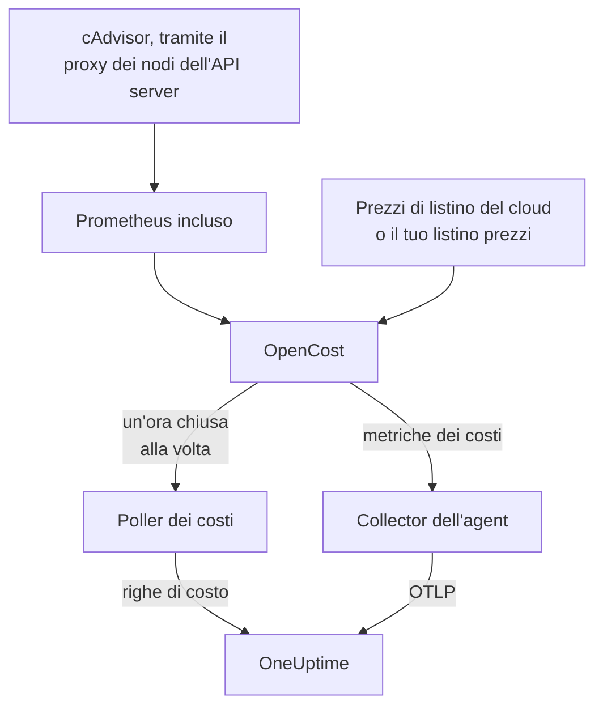

# Osservabilità dei costi di Kubernetes

Scopri quanto costa ogni carico di lavoro Kubernetes — la spesa per namespace, carico di lavoro e pod, la capacità inutilizzata e quanto di ogni richiesta viene usato — accanto alle metriche, ai log e alle tracce che l'[agent Kubernetes](/docs/telemetry/kubernetes-agent) raccoglie già. Un solo valore Helm lo attiva, senza credenziali cloud, e la pagina **Costs** del cluster ti dice poi quali richieste ridurre.

:::cards
- [Attivalo](#attivare-losservabilità-dei-costi): Un solo `helm upgrade`.
- [Usa il tuo motore](#usi-già-kubecost-o-opencost): Punta l'agent a Kubecost o OpenCost.
- [Right-sizing](#right-sizing): Le raccomandazioni sulle richieste, e come vengono calcolate.
- [Risoluzione dei problemi](#risoluzione-dei-problemi): Pagine vuote, raccomandazioni mancanti.
:::

## Come funziona

Con `cost.enabled=true` il chart esegue quattro componenti accanto all'agent:



1. **OpenCost**, il motore dei costi open source (Apache-2.0, CNCF; il [cost-model](https://github.com/kubecost/cost-model) su cui si basa anche Kubecost). Osserva il cluster, calcola il prezzo di nodi, volumi e load balancer, e determina quanto costa ogni carico di lavoro.
2. **Un piccolo Prometheus**, di cui OpenCost ha bisogno per la cronologia di utilizzo e prezzi. Gira con una sola replica, conserva 7 giorni di cronologia e raccoglie esattamente due target: cAdvisor tramite il proxy dei nodi dell'API server, e OpenCost stesso (che emette le proprie metriche sulle richieste di risorse, quindi kube-state-metrics non è coinvolto). Non viene mai esposto fuori dal cluster, e i suoi dati non lo lasciano mai.
3. **Il poller dei costi** (`cost.agent`). Una volta per ogni ora chiusa legge l'Allocation API di OpenCost e invia a OneUptime una riga di costo per carico di lavoro: CPU, memoria, GPU, volumi, rete, load balancer e capacità inutilizzata, con l'efficienza. Ogni ora viene inviata una sola volta; il server salta un'ora che ha già, quindi un riavvio non può contare due volte la spesa.
4. **Una raccolta delle metriche dei costi** (`cost.metrics`). Il collector dell'agent raccoglie le metriche dei costi di OpenCost e le invia insieme al resto delle metriche del cluster.

OpenCost calcola il prezzo dei nodi dai prezzi di listino pubblici del tuo provider cloud (AWS, Google Cloud, Azure), senza credenziali. I cluster senza un prezzo di listino cloud impostano invece un [listino prezzi](#prezzi-on-premise-e-bare-metal).

## Attivare l'osservabilità dei costi

:::steps
### Aggiorna l'agent con cost.enabled

```bash
helm upgrade kubernetes-agent oneuptime/kubernetes-agent \
  --namespace oneuptime-agent \
  --reset-then-reuse-values \
  --set cost.enabled=true
```

Questa è un'installazione completa: due piccoli pod in più, OpenCost e il suo Prometheus. Se hai installato l'agent con un altro nome di release o in un altro namespace, usa i tuoi (`helm list -A | grep kubernetes-agent` li mostra).

### Attendi la prima ora chiusa

I primi costi compaiono dopo la chiusura della prima ora completa, e OpenCost ha bisogno di qualche minuto dall'avvio per calcolare il prezzo della sua prima ora.

### Apri le pagine dei costi

- **Prodotti → Infrastruttura → Kubernetes → Costs** mostra la spesa di tutti i cluster del progetto.
- Su un cluster, **Costs** mostra l'andamento della sua spesa, **Spend by Namespace** con la ripartizione tra CPU, memoria e storage, **Spend by Workload**, la spesa inutilizzata, l'efficienza e la scheda **Right-Sizing**.
:::

Le metriche dei costi (`node_total_hourly_cost`, `pv_hourly_cost` e le altre) sono metriche normali: si trovano nell'esploratore delle metriche, nei dashboard personalizzati e nei monitor delle metriche. Per un dashboard già pronto, vai in **Prodotti → Dashboard**, seleziona **Crea: Dashboard** e scegli **Kubernetes Cost Dashboard**: l'andamento del costo orario dei nodi, i costi unitari di CPU e memoria, e la spesa per volumi e load balancer.

## Usi già Kubecost o OpenCost?

Punta invece l'agent al tuo motore, e non viene incluso nulla:

```bash
helm upgrade kubernetes-agent oneuptime/kubernetes-agent \
  --namespace oneuptime-agent \
  --reset-then-reuse-values \
  --set cost.enabled=true \
  --set cost.engine.url=http://kubecost-cost-analyzer.kubecost.svc.cluster.local:9090
```

| Motore | URL del servizio abituale |
| --- | --- |
| OpenCost | `http://opencost.opencost.svc.cluster.local:9003` |
| Kubecost | `http://kubecost-cost-analyzer.kubecost.svc.cluster.local:9090` |

Il percorso dell'Allocation API viene trovato da solo (`/model/allocation` per Kubecost, `/allocation/compute` o `/allocation` per OpenCost). Imposta `cost.engine.allocationPath` solo per un'installazione insolita. Per le raccomandazioni sulla memoria, imposta anche `cost.engine.prometheusUrl` (vedi [I dati alla base](#i-dati-alla-base)).

## Prezzi on-premise e bare metal

I cluster i cui nodi non hanno un prezzo di listino cloud pubblico possono impostare un listino prezzi. OpenCost calcola allora il prezzo di ogni risorsa a partire da queste cifre, tutte in USD per ora di risorsa:

```yaml title="values.yaml"
cost:
  enabled: true
  opencost:
    customPricing:
      enabled: true
      cpuPerCoreHour: "0.031611"       # ~$23 per core-month
      ramPerGiBHour: "0.004237"        # ~$3 per GiB-month
      storagePerGBHour: "0.00005479452" # ~$0.04 per GB-month
      gpuPerHour: "0.95"
```

## Impostazioni utili da conoscere

Tutte opzionali; il `values.yaml` del chart contiene l'elenco completo:

```yaml title="values.yaml"
cost:
  agent:
    windowSeconds: 3600   # allocation window length (hourly = native)
    includeIdle: true     # ship the engine's __idle__ allocation
    currency: USD         # currency code shown in the UI (informational)
  prometheus:
    retention: 7d         # bundled TSDB history; right-sizing reads peaks back over days
    persistence:
      enabled: false      # set true for a small PVC; emptyDir otherwise
  metrics:
    enabled: true         # cost metrics for dashboards / Metric Explorer
    scrapeInterval: 60s
```

## Right-sizing

La scheda **Right-Sizing** nella pagina **Costs** di un cluster consiglia una richiesta di CPU e una di memoria per ogni container di cui ha abbastanza cronologia, ordinate in base a quanto fa risparmiare ogni modifica al mese.

Una raccomandazione è la domanda osservata più un margine del 25%, arrotondata a un valore che puoi incollare in un manifest (10m di CPU, 16Mi di memoria):

- La CPU viene dimensionata dal 95° percentile dell'utilizzo medio orario: abbastanza alto da coprire il carico reale, abbastanza basso perché un singolo picco non gonfi la richiesta per un mese.
- La memoria viene dimensionata dal picco del working set, mai da una media (vedi [I dati alla base](#i-dati-alla-base)).

Vengono consigliate le richieste, non i limiti. Una richiesta è ciò che lo scheduler riserva e ciò su cui si calcola la fattura, quindi è il numero che fa muovere i costi. Un limite è una decisione su se un container che si comporta male debba essere limitato o terminato, e i dati di utilizzo non possono prenderla al posto tuo.

Ogni container viene confrontato con la sua richiesta attuale:

| Verdetto | Cosa significa |
| --- | --- |
| Sovradimensionato | Riserva chiaramente più di quanto usa. È da qui che vengono i risparmi. |
| Sottodimensionato | Riserva meno di quanto usa, quindi viene limitato o rischia un OOM kill. Correggerlo costa denaro, e la scheda lo mostra come un aumento. |
| Nessuna richiesta impostata | Non c'è nulla da ridurre, ma lo scheduler non può collocare il container in sicurezza, ed è il primo a essere sfrattato quando le risorse scarseggiano. |

Un container entro il 15% dalla sua raccomandazione è considerato dimensionato correttamente e viene escluso: nessuno dovrebbe modificare un manifest per togliere il 3% a una richiesta.

Due salvaguardie mantengono onesti i consigli. Un carico di lavoro ha bisogno di almeno 24 ore di finestre di costo prima di essere dimensionato, perché una finestra di quattro ore può cogliere a riposo un job batch notturno e consigliare di ridurlo a nulla. E i risparmi vengono proiettati dalla durata della finestra che stai guardando, non dal numero di righe, quindi il risparmio di un Deployment non viene moltiplicato per il suo numero di repliche. La stima presuppone che la spesa cresca con ciò che il motore ha allocato, cioè `max(request, usage)`; per un container sovradimensionato si tratta della richiesta, quindi la cifra del risparmio è esatta.

### I dati alla base

Oltre alla spesa, il poller raccoglie ciò che serve a una raccomandazione: le richieste, i limiti e l'utilizzo di CPU e memoria di ogni container.

La memoria richiede una fonte in più. L'Allocation API riporta solo una media su ogni finestra, e una media oraria nasconde il picco che provoca l'OOM kill di un container, quindi dimensionare la memoria a partire da essa sarebbe pericoloso. Il poller legge invece il picco di memoria di ogni container da Prometheus, unito su `(namespace, pod, container)`:

- Con il motore incluso (il predefinito), usa il Prometheus del chart stesso. Niente da impostare.
- Con il tuo motore (`cost.engine.url`), punta `cost.engine.prometheusUrl` a un Prometheus che raccoglie cAdvisor, e imposta `cost.engine.prometheusCadvisorJob` se il suo job di raccolta non si chiama `kubernetes-nodes-cadvisor`.
- Senza Prometheus, le raccomandazioni sulla CPU funzionano comunque, a partire dalle medie orarie memorizzate, e quelle sulla memoria vengono omesse invece di essere indovinate.

Un'interruzione di Prometheus non ferma mai la raccolta della spesa: i picchi sono un extra, e un'ora viene inviata senza di essi. La CPU di proposito non usa Prometheus: una richiesta di CPU troppo grande provoca solo una limitazione, dove una richiesta di memoria troppo piccola termina il container, quindi le medie orarie sono sicure per la CPU, e interrogare la frequenza della CPU di ogni container su un intero cluster è abbastanza pesante da mettere in ginocchio un piccolo Prometheus.

## Avvisi sui costi

Le metriche dei costi sono metriche normali, quindi un [monitor delle metriche](/docs/monitor/metrics-monitor) può generare avvisi su di esse come su qualsiasi altra cosa: per esempio quando la media di `node_total_hourly_cost` supera un budget, o quando compare `pv_hourly_cost` per una classe di volume che non dovrebbe esistere in un cluster.

## Modello dei dati e conservazione

Le righe di costo vengono memorizzate in ClickHouse, una per cluster, finestra, namespace, controller, pod e container. Seguono la conservazione della telemetria del cluster: il `retainTelemetryDataForDays` del cluster, oppure la conservazione dei dati del progetto quando non è impostato. La capacità inutilizzata e quella non allocata vengono memorizzate come righe normali sotto i namespace `__idle__` e `__unallocated__`, quindi si raggruppano e si filtrano come la spesa dei carichi di lavoro.

## Risoluzione dei problemi

:::details Le pagine dei costi sono vuote
Leggi i log del poller dei costi: `kubectl logs -n oneuptime-agent deploy/kubernetes-agent-cost`. (Il deployment si chiama `<release>-kubernetes-agent-cost` quando il nome della release non contiene `kubernetes-agent`; `kubectl get deploy -n oneuptime-agent` li elenca.) `HTTP 401` significa che OneUptime ha rifiutato la chiave di acquisizione. `did not answer any known allocation path` significa che il motore non è ancora attivo (l'OpenCost incluso ha bisogno di qualche minuto per calcolare il prezzo delle sue prime ore) oppure che `cost.engine.url` è errato.
:::

:::details L'OpenCost incluso non è pronto
Leggi i suoi log: `kubectl logs -n oneuptime-agent deploy/kubernetes-agent-opencost`. Indicano quale provider cloud ha rilevato e se i suoi dati sui prezzi sono stati caricati.
:::

:::details Il log di OpenCost riporta mkdir /var/configs: permission denied
Un chart più vecchio eseguiva OpenCost senza una directory di configurazione scrivibile, quindi `Error downloading default pricing data` lasciava la sua Allocation API incapace di rispondere e il poller bloccato, mentre il pod restava `Running`, `/healthz` restava verde e le metriche dei costi dei nodi continuavano a essere pubblicate. I chart attuali lo correggono: esegui `helm repo update`, poi aggiorna con `--reset-then-reuse-values`. Le righe di costo compaiono al poll successivo.
:::

:::details Il Kubernetes Cost Dashboard non mostra dati
Il modello legge le metriche dei costi raccolte: verifica che `cost.metrics.enabled` sia `true`.
:::

:::details La scheda Right-Sizing è vuota
O l'intervallo di tempo è più breve delle 24 ore che servono a una raccomandazione (allargalo), oppure ogni container è già entro il 15% dalla sua richiesta consigliata, cosa che la scheda indica.
:::

:::details Le raccomandazioni di memoria mostrano -, ma quelle di CPU funzionano
Nessun picco di memoria ha raggiunto OneUptime, quindi la memoria non è stata dimensionata invece di essere indovinata da una media. Con il tuo motore, imposta `cost.engine.prometheusUrl`. La scheda indica quanti container sono interessati.
:::

:::details I numeri differiscono dall'interfaccia del motore
OneUptime include le rettifiche di riconciliazione del motore in ogni componente del costo e invia ore intere e chiuse: la spesa dell'ora corrente compare dopo la sua chiusura.
:::

:::details Il Prometheus incluso è stato riavviato
Con lo storage `emptyDir` predefinito, un riavvio perde alcune ore di cronologia di utilizzo, quindi i costi di quelle ore possono risultare più bassi. Imposta `cost.prometheus.persistence.enabled=true` se per te è importante.
:::

## Passaggi successivi

:::cards
- [Agent Kubernetes](/docs/telemetry/kubernetes-agent): Installare l'agent, e tutto il resto che raccoglie.
- [Monitor metriche](/docs/monitor/metrics-monitor): Ricevere un avviso quando la spesa supera un budget.
- [Monitor Kubernetes](/docs/monitor/kubernetes-monitor): Ricevere avvisi anche sulla salute del cluster.
:::
