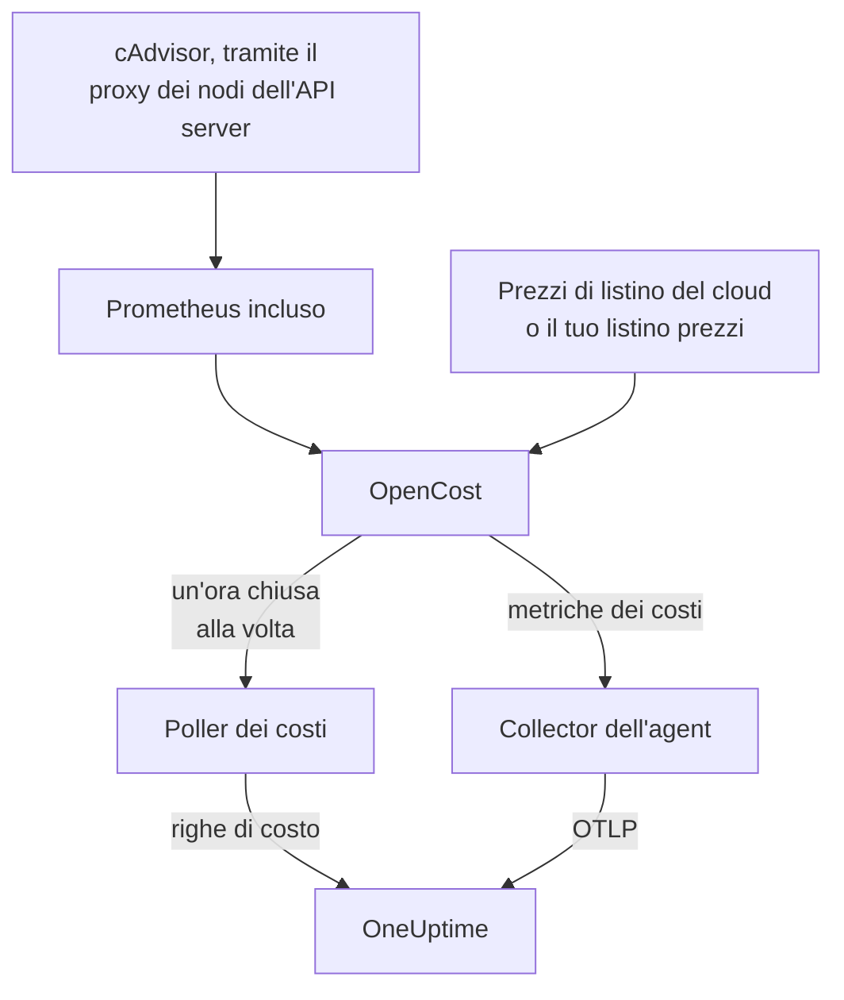

# Osservabilità dei costi di Kubernetes

Scopri quanto costa ogni carico di lavoro Kubernetes — la spesa per namespace, carico di lavoro e pod, la capacità inutilizzata e quanto di ogni richiesta viene usato — accanto alle metriche, ai log e alle tracce che l'[agent Kubernetes](/docs/telemetry/kubernetes-agent) raccoglie già. L'osservabilità dei costi è attiva per impostazione predefinita, senza credenziali cloud: la panoramica del cluster dice quanto costa, la sua pagina **Costi** ti dice quali richieste ridurre, e le metriche dei costi si possono rappresentare in grafici e usare per gli avvisi come tutte le altre.

:::cards
- [Attivalo](#attivare-losservabilità-dei-costi): Attivo per impostazione predefinita; un solo `helm upgrade` dove non lo è.
- [Avvisi sui costi](#avvisi-sui-costi): Il costo per cluster, namespace e carico di lavoro, come metriche.
- [Il tuo motore](#usi-già-kubecost-o-opencost): Il Kubecost o OpenCost che usi già viene rilevato e letto.
- [Right-sizing](#right-sizing): Le raccomandazioni sulle richieste, e come vengono calcolate.
- [Risoluzione dei problemi](#risoluzione-dei-problemi): Pagine vuote, raccomandazioni mancanti.
:::

## Come funziona

Con il monitoraggio dei costi attivo, come lo è per impostazione predefinita (`cost.enabled: auto`), il chart esegue quattro componenti accanto all'agent:



1. **OpenCost**, il motore dei costi open source (Apache-2.0, CNCF; il [cost-model](https://github.com/kubecost/cost-model) su cui si basa anche Kubecost). Osserva il cluster, calcola il prezzo di nodi, volumi e load balancer, e determina quanto costa ogni carico di lavoro.
2. **Un piccolo Prometheus**, di cui OpenCost ha bisogno per la cronologia di utilizzo e prezzi. Gira con una sola replica, conserva 7 giorni di cronologia e raccoglie esattamente due target: cAdvisor tramite il proxy dei nodi dell'API server, conservando solo le serie che OpenCost legge, e OpenCost stesso (che emette le proprie metriche sulle richieste di risorse, quindi kube-state-metrics non è coinvolto). Non viene mai esposto fuori dal cluster, e i suoi dati non lo lasciano mai.
3. **Il poller dei costi** (`cost.agent`). Una volta per ogni ora chiusa legge l'Allocation API di OpenCost e invia a OneUptime una riga di costo per carico di lavoro: CPU, memoria, GPU, volumi, rete, load balancer e capacità inutilizzata, con l'efficienza. Ogni ora viene inviata una sola volta; il server salta un'ora che ha già, quindi un riavvio non può contare due volte la spesa. OneUptime scrive anche le [metriche dei costi](#avvisi-sui-costi) a partire da queste righe.
4. **Una raccolta delle metriche dei costi** (`cost.metrics`). Il collector dell'agent raccoglie le metriche dei prezzi di OpenCost, cioè quanto costa all'ora ogni nodo, volume e load balancer, e le invia insieme al resto delle metriche del cluster.

OpenCost calcola il prezzo dei nodi dai prezzi di listino pubblici del tuo provider cloud (AWS, Google Cloud, Azure), senza credenziali. Altrove usa le sue tariffe predefinite, che un tuo [listino prezzi](#prezzi-on-premise-e-bare-metal) sostituisce.

I tre pod richiedono in tutto circa 150m di CPU e 450Mi di memoria. Il monitoraggio dei costi è disattivato per impostazione predefinita con i preset `gke-autopilot` ed `eks-fargate`: quelle piattaforme fatturano ogni pod in base a ciò che richiede, quindi i pod dei costi aumenterebbero la fattura che misurano, e OpenCost calcola il prezzo dei nodi, mentre nessuna delle due piattaforme fattura così.

## Attivare l'osservabilità dei costi

Una nuova installazione non richiede nulla: il monitoraggio dei costi è attivo per impostazione predefinita. Aggiorna un agent installato prima che lo fosse, oppure attivalo con il preset `gke-autopilot` o `eks-fargate`:

:::steps
### Aggiorna l'agent

```bash
helm upgrade kubernetes-agent oneuptime/kubernetes-agent \
  --namespace oneuptime-agent \
  --reset-then-reuse-values \
  --set cost.enabled=true
```

Questa è un'installazione completa: tre piccoli pod in più, OpenCost, il suo Prometheus e l'agent dei costi. Se hai installato l'agent con un altro nome di release o in un altro namespace, usa i tuoi (`helm list -A | grep kubernetes-agent` li mostra). Per disattivare il monitoraggio dei costi, imposta `--set cost.enabled=false` allo stesso modo.

### Attendi la prima ora chiusa

I primi costi compaiono dopo la chiusura della prima ora completa, e OpenCost ha bisogno di qualche minuto dall'avvio per calcolare il prezzo della sua prima ora.

### Apri le pagine dei costi

- **Prodotti → Infrastruttura → Kubernetes → Costi** mostra la spesa di tutti i cluster del progetto.
- Su un cluster, la panoramica mostra la sua spesa delle ultime 24 ore, una proiezione mensile, la spesa inutilizzata, l'efficienza e i suoi namespace e carichi di lavoro più costosi.
- Su un cluster, **Costi** mostra l'andamento della sua spesa, **Spend by Namespace** con la ripartizione tra CPU, memoria e storage, **Spend by Workload**, la spesa inutilizzata, l'efficienza e la scheda **Right-Sizing**.
:::

Le metriche dei costi (`node_total_hourly_cost`, `pv_hourly_cost` e le altre) sono metriche normali: si trovano nell'esploratore delle metriche, nei dashboard personalizzati e nei monitor delle metriche. Per un dashboard già pronto, vai in **Prodotti → Dashboard**, seleziona **Crea dashboard** e scegli **Kubernetes Cost Dashboard**: l'andamento del costo orario dei nodi, i costi unitari di CPU e memoria, e la spesa per volumi e load balancer.

Sotto le cifre, la panoramica e la pagina **Costi** indicano da dove vengono i loro prezzi: i prezzi di listino di un cloud, il tuo listino prezzi o le tariffe predefinite di OpenCost. L'efficienza è un'unica cifra ovunque, metrica dell'efficienza compresa: quanta parte della CPU e della memoria richieste è stata usata, con l'ora di ogni container ponderata per quanto costano la sua CPU e la sua memoria, così un job economico che non usa nulla non può trascinare in basso un cluster ben utilizzato, e la capacità inutilizzata non viene contata.

## Usi già Kubecost o OpenCost?

L'agent dei costi trova il tuo motore e lo legge al posto dell'OpenCost incluso, quindi il cluster ha i prezzi che hai configurato: il tuo listino prezzi, o la tua fattura cloud dietro Kubecost. All'avvio, e poi ogni ora, cerca tramite l'API di Kubernetes, in qualsiasi namespace, i Service creati dai chart dei motori stessi (`cost-analyzer` o `frontend` di Kubecost, quello del chart di OpenCost e il Service `opencost` creato dal suo manifest), prima Kubecost. Scarta un motore che non risponde, che richiede un accesso o che risponde per più cluster, e allora legge quello incluso.

La panoramica del cluster mostra allora il nome del tuo motore e dice che l'OpenCost incluso non serve. Smetti di eseguirlo:

```bash
helm upgrade kubernetes-agent oneuptime/kubernetes-agent \
  --namespace oneuptime-agent \
  --reset-then-reuse-values \
  --set cost.engine.url=auto
```

Con `cost.engine.url=auto` non viene incluso nulla, e l'agent legge il tuo motore ovunque giri; senza alcun motore installato, non viene calcolato alcun prezzo. Il chart non può cercare un motore da solo: il `lookup` di Helm non vede nulla con `helm template`, con Argo CD o in un'esecuzione di prova. Per tenere l'OpenCost incluso accanto al tuo motore, imposta `cost.engine.preferExisting=false`; per indicare il motore da leggere, imposta `cost.engine.url` sul suo Service:

| Motore | URL del servizio abituale |
| --- | --- |
| OpenCost | `http://opencost.opencost.svc.cluster.local:9003` |
| Kubecost 2 | `http://kubecost-cost-analyzer.kubecost.svc.cluster.local:9090` |
| Kubecost 3 | `http://kubecost-frontend.kubecost.svc.cluster.local:9090` |

Il percorso dell'Allocation API viene trovato da solo (`/model/allocation` per Kubecost, `/allocation/compute` o `/allocation` per OpenCost). Imposta `cost.engine.allocationPath` solo per un'installazione insolita. Con `auto` o un URL non viene incluso nulla, quindi per le raccomandazioni sulla memoria imposta anche `cost.engine.prometheusUrl` (vedi [I dati alla base](#i-dati-alla-base)). Le metriche dei prezzi si trovano allo stesso modo, qualunque Service del motore tu indichi: l'agent prova il suo `/metrics`, poi il `/model/metrics` che un frontend di Kubecost 2 o l'interfaccia di OpenCost passa al motore, poi l'agent FinOps di Kubecost 3, e il collector raccoglie il primo indirizzo che ha serie di prezzi. Per indicarle tu stesso, imposta `cost.metrics.endpoint`.

## Prezzi on-premise e bare metal

I cluster i cui nodi non hanno un prezzo di listino cloud pubblico possono impostare un listino prezzi. In sua assenza, OpenCost calcola il prezzo di questi nodi con le sue tariffe predefinite (on-premise, bare metal, kind, k3s), che possono essere molto lontane da quanto costa il tuo hardware, e la panoramica e la pagina **Costi** del cluster lo segnalano; su un cloud che riconosce, un nodo mantiene il suo prezzo di listino, e un listino prezzi dà un prezzo solo a ciò che manca al listino del cloud. Con un listino prezzi, OpenCost calcola allora il prezzo di ogni risorsa a partire da queste cifre, tutte in USD per ora di risorsa:

```yaml title="values.yaml"
cost:
  enabled: true
  opencost:
    customPricing:
      enabled: true
      cpuPerCoreHour: "0.031611"       # ~$23 per core-month
      ramPerGiBHour: "0.004237"        # ~$3 per GiB-month
      storagePerGBHour: "0.00005479452" # ~$0.04 per GB-month
      gpuPerHour: "0.95"
```

Queste sono le tariffe predefinite di OpenCost stesso: inserisci le tue cifre, altrimenti la pagina **Costi** continua a dire che il prezzo del cluster è calcolato con le tariffe predefinite di OpenCost.

## Impostazioni utili da conoscere

Tutte opzionali; il `values.yaml` del chart contiene l'elenco completo:

```yaml title="values.yaml"
cost:
  enabled: auto           # on, except with the gke-autopilot and eks-fargate presets
  agent:
    windowSeconds: 3600   # allocation window length (hourly = native)
    includeIdle: true     # ship the engine's __idle__ allocation
    currency: USD         # currency code shown in the UI (informational)
  prometheus:
    retention: 7d         # bundled TSDB history; right-sizing reads peaks back over days
    persistence:
      enabled: false      # set true for a small PVC; emptyDir otherwise
  metrics:
    enabled: true         # cost metrics for dashboards / Metric Explorer
    scrapeInterval: 60s
```

## Right-sizing

La scheda **Right-Sizing** nella pagina **Costi** di un cluster consiglia una richiesta di CPU e una di memoria per ogni container di cui ha abbastanza cronologia, ordinate in base a quanto fa risparmiare ogni modifica al mese.

Una raccomandazione è la domanda osservata più un margine del 25%, arrotondata a un valore che puoi incollare in un manifest (10m di CPU, 16Mi di memoria):

- La CPU viene dimensionata dal 95° percentile dell'utilizzo medio orario: abbastanza alto da coprire il carico reale, abbastanza basso perché un singolo picco non gonfi la richiesta per un mese.
- La memoria viene dimensionata dal picco del working set, mai da una media (vedi [I dati alla base](#i-dati-alla-base)).

Vengono consigliate le richieste, non i limiti. Una richiesta è ciò che lo scheduler riserva e ciò su cui si calcola la fattura, quindi è il numero che fa muovere i costi. Un limite è una decisione su se un container che si comporta male debba essere limitato o terminato, e i dati di utilizzo non possono prenderla al posto tuo.

Ogni container viene confrontato con la sua richiesta attuale:

| Verdetto | Cosa significa |
| --- | --- |
| Sovradimensionato | Riserva chiaramente più di quanto usa. È da qui che vengono i risparmi. |
| Sottodimensionato | Riserva meno di quanto usa, quindi viene limitato o rischia un OOM kill. Correggerlo costa denaro, e la scheda lo mostra come un aumento. |
| Nessuna richiesta impostata | Non c'è nulla da ridurre, ma lo scheduler non può collocare il container in sicurezza, ed è il primo a essere sfrattato quando le risorse scarseggiano. |

Un container entro il 15% dalla sua raccomandazione è considerato dimensionato correttamente e viene escluso: nessuno dovrebbe modificare un manifest per togliere il 3% a una richiesta.

Due salvaguardie mantengono onesti i consigli. Un carico di lavoro ha bisogno di almeno 24 ore di finestre di costo prima di essere dimensionato, perché una finestra di quattro ore può cogliere a riposo un job batch notturno e consigliare di ridurlo a nulla. E i risparmi vengono proiettati dalla durata della finestra che stai guardando, non dal numero di righe, quindi il risparmio di un Deployment non viene moltiplicato per il suo numero di repliche. La stima presuppone che la spesa cresca con ciò che il motore ha allocato, cioè `max(request, usage)`; per un container sovradimensionato si tratta della richiesta, quindi la cifra del risparmio è esatta.

### I dati alla base

Oltre alla spesa, il poller raccoglie ciò che serve a una raccomandazione: le richieste, i limiti e l'utilizzo di CPU e memoria di ogni container.

La memoria richiede una fonte in più. L'Allocation API riporta solo una media su ogni finestra, e una media oraria nasconde il picco che provoca l'OOM kill di un container, quindi dimensionare la memoria a partire da essa sarebbe pericoloso. Il poller legge invece il picco di memoria di ogni container da Prometheus, unito su `(namespace, pod, container)`:

- Con il motore incluso (il predefinito), usa il Prometheus del chart stesso. Niente da impostare.
- Con `cost.engine.url` impostato (`auto` o l'URL del tuo motore), punta `cost.engine.prometheusUrl` a un Prometheus che raccoglie cAdvisor, e imposta `cost.engine.prometheusCadvisorJob` se il suo job di raccolta non si chiama `kubernetes-nodes-cadvisor`.
- Senza Prometheus, le raccomandazioni sulla CPU funzionano comunque, a partire dalle medie orarie memorizzate, e quelle sulla memoria vengono omesse invece di essere indovinate.

Un'interruzione di Prometheus non ferma mai la raccolta della spesa: i picchi sono un extra, e un'ora viene inviata senza di essi. La CPU di proposito non usa Prometheus: una richiesta di CPU troppo grande provoca solo una limitazione, dove una richiesta di memoria troppo piccola termina il container, quindi le medie orarie sono sicure per la CPU, e interrogare la frequenza della CPU di ogni container su un intero cluster è abbastanza pesante da mettere in ginocchio un piccolo Prometheus.

## Avvisi sui costi

OneUptime scrive quattro metriche a partire dalle righe di costo di ogni ora, espresse in denaro e chiamate con il nome di ciò che sono, quindi il costo si può rappresentare in grafici, mettere in un dashboard e usare per gli avvisi in un [monitor Kubernetes](/docs/monitor/kubernetes-monitor) o in un [monitor delle metriche](/docs/monitor/metrics-monitor):

| Metrica | Cos'è | Attributi |
| --- | --- | --- |
| `oneuptime.kubernetes.cost.total` | Quanto è costato il cluster in ogni ora, capacità inutilizzata compresa | `k8s.cluster.name` |
| `oneuptime.kubernetes.cost.idle` | La parte che nessun carico di lavoro ha usato: capacità inutilizzata e non allocata | `k8s.cluster.name` |
| `oneuptime.kubernetes.cost.workload` | Quanto è costato ogni carico di lavoro in ogni ora; sommato per namespace, quanto è costato il namespace | `k8s.cluster.name`, `k8s.namespace.name` e il nome del carico di lavoro sotto il suo tipo, come `k8s.deployment.name` |
| `oneuptime.kubernetes.cost.efficiency` | Quanta parte della CPU e della memoria richieste ha usato ogni carico di lavoro, in percentuale, ponderata per costo | Quelli del carico di lavoro, come sopra |

Ogni punto è il costo di un'ora, nella valuta dell'agent (USD per impostazione predefinita), con il timestamp dell'inizio dell'ora e scritto circa un'ora dopo la sua fine: somma i punti su una finestra di ore, e quelli di un giorno danno il costo del giorno. Derivano da ciò che il cluster ha già inviato, quindi non vengono fatturati come metriche acquisite, e vengono conservati quanto le altre metriche del cluster.

Il monitor Kubernetes ha tre modelli per queste metriche: Cluster Daily Cost Over Budget, Namespace Daily Cost Over Budget e High Idle Spend, ognuno con un budget da adattare al tuo. Anche le metriche dei prezzi di OpenCost sono metriche normali: un monitor delle metriche può generare un avviso quando la media di `node_total_hourly_cost` supera un budget, o quando compare `pv_hourly_cost` per una classe di volume che non dovrebbe esistere in un cluster.

## Modello dei dati e conservazione

Le righe di costo vengono memorizzate in ClickHouse, una per cluster, finestra, namespace, controller, pod e container. Seguono la conservazione della telemetria del cluster: il `retainTelemetryDataForDays` del cluster, oppure la conservazione dei dati del progetto quando non è impostato. La capacità inutilizzata e quella non allocata vengono memorizzate come righe normali sotto i namespace `__idle__` e `__unallocated__`, quindi si raggruppano e si filtrano come la spesa dei carichi di lavoro.

## Risoluzione dei problemi

:::details Le pagine dei costi sono vuote
Con i preset `gke-autopilot` ed `eks-fargate` il monitoraggio dei costi è disattivato per impostazione predefinita: attivalo con `--set cost.enabled=true`. Altrimenti, leggi i log del poller dei costi: `kubectl logs -n oneuptime-agent deploy/kubernetes-agent-cost`. (Il deployment si chiama `<release>-kubernetes-agent-cost` quando il nome della release non contiene `kubernetes-agent`; `kubectl get deploy -n oneuptime-agent` li elenca.) `HTTP 401` significa che OneUptime ha rifiutato la chiave di acquisizione. `did not answer any known allocation path` significa che il motore non è ancora attivo (l'OpenCost incluso ha bisogno di qualche minuto per calcolare il prezzo delle sue prime ore) oppure che `cost.engine.url` è errato.
:::

:::details L'OpenCost incluso non è pronto
Leggi i suoi log: `kubectl logs -n oneuptime-agent deploy/kubernetes-agent-opencost`. Indicano quale provider cloud ha rilevato e se i suoi dati sui prezzi sono stati caricati.
:::

:::details La panoramica dice che l'OpenCost incluso non serve
Il cluster esegue un proprio Kubecost o OpenCost, e l'agent dei costi legge quello, quindi l'OpenCost e il Prometheus inclusi dal chart non calcolano alcun prezzo. Aggiorna con `--set cost.engine.url=auto` per smettere di eseguirli, oppure imposta `cost.engine.preferExisting=false` per leggere invece il motore incluso.
:::

:::details L'agent dei costi non legge il tuo motore
Il suo log indica quale motore legge e perché ha scartato gli altri: `kubectl logs -n oneuptime-agent deploy/kubernetes-agent-cost`. Scarta un motore che non risponde (per esempio per una NetworkPolicy tra i namespace), che richiede un accesso o che risponde per più cluster, come fa un Kubecost che ne federa altri. Indica il motore da leggere con `cost.engine.url`.
:::

:::details Il log di OpenCost riporta mkdir /var/configs: permission denied
Un chart più vecchio eseguiva OpenCost senza una directory di configurazione scrivibile, quindi `Error downloading default pricing data` lasciava la sua Allocation API incapace di rispondere e il poller bloccato, mentre il pod restava `Running`, `/healthz` restava verde e le metriche dei costi dei nodi continuavano a essere pubblicate. I chart attuali lo correggono: esegui `helm repo update`, poi aggiorna con `--reset-then-reuse-values`. Le righe di costo compaiono al poll successivo.
:::

:::details Il Kubernetes Cost Dashboard non mostra dati
Il modello legge le metriche dei costi raccolte: verifica che `cost.metrics.enabled` sia `true`. Con `cost.engine.url` impostato, l'agent dei costi trova dove il tuo motore le espone, e il suo log indica dove o quali indirizzi ha provato: `kubectl logs -n oneuptime-agent deploy/kubernetes-agent-cost`. Per indicarle tu stesso, imposta `cost.metrics.endpoint`.
:::

:::details La scheda Right-Sizing è vuota
O l'intervallo di tempo è più breve delle 24 ore che servono a una raccomandazione (allargalo), oppure ogni container è già entro il 15% dalla sua richiesta consigliata, cosa che la scheda indica.
:::

:::details Le raccomandazioni di memoria mostrano -, ma quelle di CPU funzionano
Nessun picco di memoria ha raggiunto OneUptime, quindi la memoria non è stata dimensionata invece di essere indovinata da una media. Con il tuo motore, imposta `cost.engine.prometheusUrl`. La scheda indica quanti container sono interessati.
:::

:::details I numeri differiscono dall'interfaccia del motore
OneUptime include le rettifiche di riconciliazione del motore in ogni componente del costo e invia ore intere e chiuse: la spesa dell'ora corrente compare dopo la sua chiusura.
:::

:::details Il Prometheus incluso è stato riavviato
Con lo storage `emptyDir` predefinito, un riavvio perde alcune ore di cronologia di utilizzo, quindi i costi di quelle ore possono risultare più bassi. Imposta `cost.prometheus.persistence.enabled=true` se per te è importante.
:::

## Passaggi successivi

:::cards
- [Agent Kubernetes](/docs/telemetry/kubernetes-agent): Installare l'agent, e tutto il resto che raccoglie.
- [Monitor metriche](/docs/monitor/metrics-monitor): Ricevere un avviso quando la spesa supera un budget.
- [Monitor Kubernetes](/docs/monitor/kubernetes-monitor): Ricevere avvisi anche sulla salute del cluster.
:::
