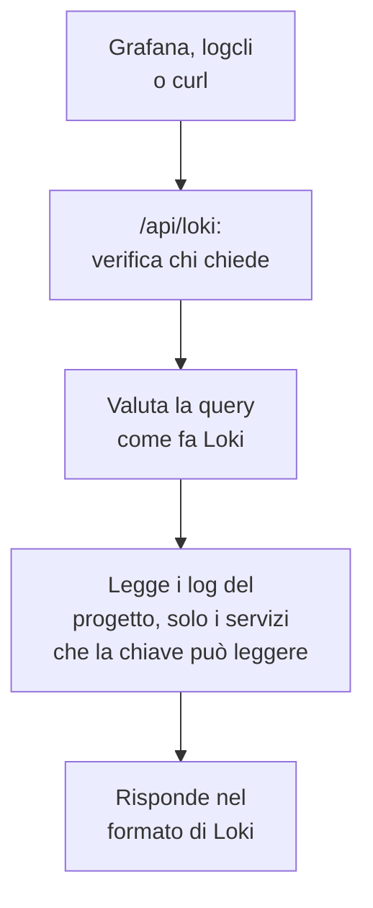

# Interrogare i log con LogQL

LogQL è il linguaggio di query di Grafana Loki. OneUptime risponde all'API di query di Loki sui log del tuo progetto, così la fonte di dati Loki di Grafana, logcli o qualsiasi client Loki li legge, e le dashboard e le query salvate che hai scritto per Loki continuano a funzionare.

:::cards
- [Collegare Grafana](#collegare-grafana): Aggiungere OneUptime come fonte di dati Loki.
- [Le etichette dei log](#le-etichette-dei-log): Cosa trova un selettore di stream.
- [Cosa copre LogQL](#cosa-copre-logql): Query di log, parser e query di metriche.
- [Limiti](#limiti): Cosa può leggere una query, e quanto spesso.
:::

## Come funziona

Grafana interroga OneUptime come interroga Loki. OneUptime verifica che la chiave API possa leggere i log del progetto, legge solo i servizi che può leggere e valuta la query come fa Loki.



## Prima di iniziare

- **Log in arrivo.** Inviali con [OpenTelemetry](/docs/telemetry/open-telemetry), oppure da Promtail, Grafana Alloy, Fluent Bit o Vector tramite [l'API push di Loki](/docs/telemetry/compatible-endpoints).
- **Una chiave API del progetto che legge i log**, con il ruolo Proprietario del progetto, Amministratore del progetto, Membro del progetto, Visualizzatore, Amministratore della telemetria, Membro della telemetria o Visualizzatore della telemetria, oppure il permesso Read Logs. Una chiave limitata ad alcuni servizi legge solo i loro log. Vedi [Creare una chiave API](/docs/api-reference/api-reference#creare-una-chiave-api). Su OneUptime Cloud, le chiavi API richiedono il piano **Growth**.
- **Non una chiave di acquisizione.** Una chiave di acquisizione invia telemetria e non ne legge, quindi Grafana non può accedere con una di esse.

## Collegare Grafana

:::steps
### Creare una chiave API

In OneUptime, apri **Impostazioni del progetto → Avanzato → Chiavi API** e fai clic su **Crea: Chiave API**. Dai alla chiave un ruolo che può leggere la telemetria, oppure il permesso Read Logs.

### Aggiungere una fonte di dati Loki

In Grafana, apri **Connections → Data sources → Add data source** e scegli **Loki**.

### Inserire l'URL

Imposta **URL** sul tuo indirizzo OneUptime seguito da `/api/loki`. Su OneUptime Cloud, è `https://oneuptime.com/api/loki`.

### Inviare la chiave API

In **HTTP headers**, aggiungi l'intestazione `Authorization` con il valore `Bearer` seguito da uno spazio e dalla tua chiave API. Funziona anche l'autenticazione di base: un nome utente qualsiasi, con la chiave API come password.

### Salvare e provare

Fai clic su **Save & test**. Grafana esegue una query e dice che la fonte di dati funziona.
:::

Explore, il volume dei log sopra le righe, i browser delle etichette e le dashboard leggono allora OneUptime come leggono Loki. logcli e qualsiasi altro client Loki funzionano allo stesso modo. Con curl:

```bash title="Query OneUptime's Loki API"
curl -G -H "Authorization: Bearer $ONEUPTIME_API_KEY" \
  "https://oneuptime.com/api/loki/loki/api/v1/query_range" \
  --data-urlencode 'query={service_name="checkout"} |= "error"'
```

## Le etichette dei log

Un selettore di stream trova gli attributi di un log, chiamati come Loki 3 chiama i log OpenTelemetry:

| In OneUptime | In LogQL |
| --- | --- |
| Un attributo di risorsa `service.name` | L'etichetta `service_name` |
| Un attributo di risorsa `k8s.pod.name` | L'etichetta `k8s_pod_name` |
| Un attributo `http.method` | L'etichetta `http_method` |
| Un'etichetta inviata da un client Loki, come `job` | L'etichetta `job` |
| La gravità del log | L'etichetta `detected_level`: `trace`, `debug`, `info`, `warn`, `error`, `fatal` o `unknown` |

- **Ogni attributo è un'etichetta.** Una query di log risponde con uno stream per insieme di etichette, quindi log con attributi diversi sono stream diversi, come Loki 3 risponde per i log con metadati strutturati.
- **L'attributo proprio di un log viene prima** quando la sua risorsa ne ha uno con lo stesso nome.
- **Un selettore nomina un valore**, come chiede Loki: almeno un selettore che un log senza l'etichetta non soddisfa, come `{service_name="checkout"}` o `{service_name=~"check.+"}`.

Alcune query per iniziare:

```text title="LogQL"
# The checkout service's lines that say error
{service_name="checkout"} |= "error"

# Requests slower than 250ms, read from JSON lines
{service_name="checkout"} | json | duration > 250ms

# Error logs per second, by service
sum by (service_name) (rate({detected_level="error"} [5m]))
```

## Cosa copre LogQL

- **Query di log**: selettori di stream con `=`, `!=`, `=~` e `!~`; filtri di riga `|=`, `!=`, `|~` e `!~`, con `or`; i parser `json` e `logfmt`; filtri di etichette su testo, numeri, durate e dimensioni, con `and`, `or` e `__error__`; `line_format` con `{{.label}}`; `drop`, `keep` e `decolorize`.
- **Query di metriche**: `count_over_time`, `rate`, `bytes_over_time`, `bytes_rate` e `absent_over_time`; su un'etichetta presa con `unwrap` (con `duration()` o `bytes()`), `rate`, `sum_over_time`, `avg_over_time`, `min_over_time`, `max_over_time`, `first_over_time`, `last_over_time`, `stddev_over_time`, `stdvar_over_time` e `quantile_over_time`; e `offset`.
- **Intorno a esse**: `sum`, `avg`, `min`, `max`, `count`, `stddev`, `stdvar`, `topk` e `bottomk`, con `by` o `without`; aritmetica, confronti (con `bool`), `and`, `or` e `unless`, con `on`, `ignoring`, `group_left` e `group_right`; `sort`, `sort_desc`, `label_replace` e `vector()`.

I parser `pattern`, `regexp` e `unpack`, `label_format`, `json` con campi con nome, i filtri `ip()` e i modelli di `line_format` oltre `{{.label}}` non sono ancora disponibili. Una query che ne usa uno viene rifiutata con un messaggio che lo nomina.

## L'API

L'API risponde alle route dell'API HTTP di Loki, con `GET` o `POST`, sotto `/api/loki`:

| Route | Cosa restituisce |
| --- | --- |
| `/loki/api/v1/query_range` | Le righe di una query di log da `start` a `end`, oppure una query di metriche a ogni `step`. |
| `/loki/api/v1/query` | Una query di metriche in un istante (`time`, per impostazione predefinita adesso). |
| `/loki/api/v1/labels` | I nomi delle etichette, dei log che `query` seleziona o di tutti i log. |
| `/loki/api/v1/label/<name>/values` | I valori di un'etichetta. |
| `/loki/api/v1/series` | Gli insiemi di etichette dei log che `match[]` seleziona. |

Gli istanti sono nanosecondi dal 1970, secondi Unix o RFC 3339, e un intervallo è l'ora prima di `end`, salvo diversa indicazione. Una query di log restituisce `limit` righe, 100 per impostazione predefinita, le più recenti prima salvo con `direction=forward`. Le risposte sono nel formato di Loki, e gli errori sono testo semplice, come li scrive Loki. `/loki/api/v1/status/buildinfo` risponde come un server Loki 3.

## Limiti

Ogni query ha dei limiti, così una dashboard con molti pannelli non può sovraccaricare OneUptime:

| Limite | Valore |
| --- | --- |
| Righe che una query di log restituisce | 5.000 |
| Log che una query di log legge, quando i filtri dopo i suoi parser ne scartano alcuni | 20.000 |
| Log che una query di metriche legge da sola, quando ClickHouse non può contarli | 100.000 |
| Serie che una query di metriche restituisce | 500 |
| Punti in una serie di una query di intervallo | 11.000 |
| Log che una lettura restituisce | 64 MB |
| Tempo che una lettura può richiedere | 30 secondi |
| Query che un progetto può inviare ogni minuto | 1.200 |

Una query di metriche la cui pipeline è fatta solo di filtri di riga, come `sum(count_over_time({service_name="checkout"} |= "error" [5m]))`, viene contata dove si trovano i log, quindi non legge nessuna riga.

## Risoluzione dei problemi

:::details Grafana dice che la fonte di dati non funziona
Controlla che l'URL termini con `/api/loki` e che l'intestazione `Authorization` contenga `Bearer`, uno spazio e la chiave API. Una chiave di acquisizione, o una chiave API senza un ruolo che legge i log, viene rifiutata: dai alla chiave un ruolo così in **Impostazioni del progetto → Avanzato → Chiavi API**.
:::

:::details "queries require at least one regexp or equality matcher that does not have an empty-compatible value"
Il selettore trova log senza nominare un valore, come `{service_name=~".*"}`. Aggiungi un selettore che ne nomini uno, come `{service_name="checkout"}`.
:::

:::details "This project sent more queries this minute than OneUptime answers."
Le dashboard e i client del progetto hanno inviato più di 1.200 query all'API in questo minuto. I pannelli si caricano di nuovo nel minuto successivo; aggiorna le dashboard meno spesso per restare sotto il limite.
:::

## Passaggi successivi

:::cards
- [Esploratore log](/docs/telemetry/logs-explorer): Cercare e filtrare i log senza scrivere una query.
- [PromQL](/docs/telemetry/promql): Interrogare le metriche con PromQL, anche dalla fonte di dati Prometheus di Grafana.
- [Monitor log](/docs/monitor/logs-monitor): Ricevere un avviso sul volume e sul contenuto dei log.
:::
