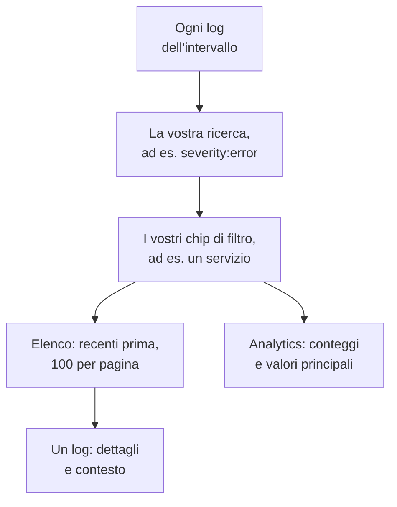

# Esploratore log

L'esploratore log è il luogo in cui cercate e leggete i log che i vostri servizi, host e agenti inviano a OneUptime. Riducete milioni di righe alle poche che contano, seguite quelle nuove man mano che arrivano, rappresentatele in grafici e salvate le viste a cui il vostro team torna.

:::cards
- [Trovare una riga di log](#trovare-una-riga-di-log): Un intervallo di tempo, una ricerca e qualche filtro.
- [Leggere un log](#leggere-un-log): I suoi attributi, la sua traccia e le righe intorno.
- [Seguire i log in diretta](#seguire-i-log-in-diretta): Nuove righe ogni 10 secondi.
- [Salvare una vista](#salvare-una-vista): Conservare una ricerca, i suoi filtri e le sue colonne per tutti.
- [Informazioni sui log](#informazioni-sui-log): Errori principali, gravità e chi registra cosa.
- [Trovare e correggere con l'IA i log di errore, mancanti o rumorosi](#trovare-e-correggere-con-lia-i-log-di-errore-mancanti-o-rumorosi): Pull request che correggono gli errori, registrano ciò che non viene registrato e attenuano le righe rumorose.
:::

## Come l'esploratore restringe i vostri log

Tutto nella scheda **Visualizzatore** lavora su un unico insieme di log: quelli dell'intervallo di tempo che corrispondono alla vostra ricerca e a ogni chip di filtro. Cambiatene uno e l'elenco, il grafico del volume e i conteggi nella barra laterale cambiano insieme.

L'esploratore ha cinque schede:

| Scheda | A cosa serve |
| --- | --- |
| **Visualizzatore** | Cercare, filtrare e leggere i log. Si apre sull'ultima ora, prima i più recenti, 100 log per pagina. |
| **Informazioni** | Che cosa hanno registrato i vostri servizi in un intervallo di tempo, e che cosa è andato storto. |
| **IA** | I log di errore, i log mancanti e i log rumorosi che OneUptime trova nei vostri log, e ciò che OneUptime AI ha fatto al riguardo. Vedete [Trovare e correggere con l'IA i log di errore, mancanti o rumorosi](#trovare-e-correggere-con-lia-i-log-di-errore-mancanti-o-rumorosi). |
| **Guida alla configurazione** | Come inviare log con OpenTelemetry, Fluent Bit o Fluentd, usando una delle vostre [chiavi di ingestione](/docs/telemetry/ingestion-keys). |
| **Impostazioni** | Che cosa succede ai log quando arrivano: **Pipeline**, **Filtri di scarto**, **Regole di mascheramento** e **Regole di registrazione**. |

## Prima di iniziare

- **Log in arrivo.** Inviateli con [OpenTelemetry](/docs/telemetry/open-telemetry), [Fluent Bit](/docs/telemetry/fluentbit), [Fluentd](/docs/telemetry/fluentd) o [Syslog](/docs/telemetry/syslog). La scheda **Guida alla configurazione** mostra la configurazione per il vostro linguaggio o collector.
- **Un ruolo che può leggere la telemetria.** Project Owner, Project Admin, Project Member, Viewer, Telemetry Admin, Telemetry Member o Telemetry Viewer, oppure un ruolo personalizzato con il permesso Read Telemetry Service Log. Il suo ambito decide di chi sono i log che vedete: vedere [Telemetria](/docs/permissions/index#telemetria).

## Trovare una riga di log

:::steps
### Aprire il Visualizzatore

Aprite **Prodotti → Osservabilità → Log**. Il **Visualizzatore** elenca i log dell'ultima ora, prima i più recenti, con **Ora**, **Servizio**, **Gravità** e **Messaggio**.

### Scegliere l'intervallo di tempo

Scegliete un intervallo nel selettore del tempo, oppure trascinate sul grafico del volume sopra l'elenco per ingrandire un picco. Fate doppio clic sul grafico per tornare indietro. Vedere [Ingrandire un intervallo di tempo](/docs/telemetry/charts-and-time-ranges).

### Cercare

Digitate una query nella casella di ricerca e premete Invio, ad esempio `severity:error service:checkout timeout`. Le parole semplici cercano nel messaggio, e `@key:value` cerca in un attributo. Vedere [Sintassi di ricerca](/docs/telemetry/search-syntax#log).

### Restringere con i filtri

Fate clic su un valore nella barra laterale **Filtri** per aggiungerlo come chip: una gravità, un servizio, oppure un host, un cluster o un'altra risorsa che ha inviato log. Ogni valore indica quanti log lo riportano. Su un telefono, toccate **Filtri** per aprire la barra laterale.

### Aprire un log

Fate clic su una riga. I suoi dettagli si aprono accanto all'elenco.
:::

La ricerca, i chip e l'intervallo di tempo restano nell'indirizzo della pagina, quindi un aggiornamento, un segnalibro o un link condiviso apre gli stessi log.

## Leggere un log

Il pannello dei dettagli ha due schede:

| Scheda | Cosa mostra |
| --- | --- |
| **Dettagli** | Il **Corpo del log**, il suo **ID traccia**, **ID span** e **Sessione** quando li ha, e i suoi **Attributi**, come elenco o come JSON. |
| **Context** | Il log tra i suoi vicini. **Nearby (service + time)** mostra le cinque righe prima e dopo dello stesso servizio, e **This trace** mostra fino a 100 log della sua traccia. |

- Fate clic sull'ID traccia per aprire l'intera richiesta nell'[Esploratore tracce](/docs/telemetry/traces-explorer).
- Puntate un attributo e fate clic sull'icona del filtro per cercare quel valore, oppure copiatelo. Potete copiare tutti gli attributi in una volta come JSON.
- **This trace** compare solo per un log scritto all'interno di una traccia.

## Seguire i log in diretta

Fate clic su **In diretta** sopra l'elenco. L'esploratore passa alla prima pagina, ordinata dal più recente, e cerca nuovi log ogni 10 secondi, così le righe compaiono man mano che i vostri servizi le scrivono.

La modalità in diretta si spegne da sola quando cambiate la ricerca, un filtro o l'intervallo di tempo, o passate a un'altra pagina di risultati: mostra solo i log più recenti. Fate di nuovo clic su **In diretta** per riprendere.

## Scegliere le colonne ed esportare

- **Colonne** sceglie che cosa mostra l'elenco. **Ora**, **Servizio**, **Gravità** e **Messaggio** vengono per primi; aggiungete **ID traccia**, **ID span** o qualsiasi attributo, spostate le colonne su e giù, oppure tornate ai valori predefiniti con **Reimposta**.
- **Esporta** scarica i log della pagina che state guardando. **Esporta come CSV** scrive le colonne mostrate; **Esporta come JSON** scrive ogni campo di ogni log, con tutti i suoi attributi.
- Puntate la riga delle intestazioni e trascinate il tratto alla fine del nome di una colonna per allargarla o restringerla, oppure fate doppio clic sul tratto per adattare la colonna al suo contenuto. L'elenco conserva le vostre larghezze in questo browser; **Reimposta larghezze**, alla fine della riga delle intestazioni, riporta ogni colonna alla sua larghezza.

## Salvare una vista

Una vista salvata conserva una ricerca, i suoi chip di filtro, l'intervallo di tempo, le colonne, l'ordinamento e la dimensione della pagina, sotto un nome.

:::steps
### Preparare la vista

Cercate, filtrate e scegliete le colonne che volete conservare.

### Salvarla

Aprite **Viste salvate** e fate clic su **+ Salva vista corrente**. Inserite un **Nome**, spuntate **Imposta come predefinito** se questa vista deve aprirsi ogni volta che qualcuno apre i log, e fate clic su **Salva vista**.

### Usarla

Scegliete la vista da **Viste salvate** per applicarla, e **Cancella vista** per tornare all'ultima ora senza filtri. Puntate una vista nell'elenco per **Modifica** o **Elimina**, oppure, mentre è applicata, per **Aggiorna** con le vostre modifiche.
:::

Le viste salvate appartengono al progetto, quindi tutti nel progetto vedono lo stesso elenco. Un intervallo mobile come l'ultima ora resta mobile: la vista mostra l'ora che precede la sua apertura, non l'ora in cui l'avete salvata. Finché il progetto non ha una vista predefinita, la prossima vista salvata lo diventa, e un progetto ha una sola predefinita alla volta.

## Rappresentare i log in grafici

Passate l'elenco ad **Analytics** per contare i log invece di leggerli. Scegliete una serie temporale, una classifica o una tabella; contate ogni log, o i valori univoci di un campo; e raggruppate per gravità, servizio, traccia, span o qualsiasi attributo, poi per un secondo campo. Una classifica o una tabella mostra i primi 5, 10, 25 o 50 gruppi.

Fate clic su **Elenco** per tornare alle righe stesse.

## Aprire tracce e metriche collegate

I pulsanti **Tracce** e **Metriche** accanto a **Viste salvate** aprono l'[Esploratore tracce](/docs/telemetry/traces-explorer) o l'[Esploratore metriche](/docs/telemetry/metrics-explorer) per la stessa finestra di tempo, con tutto il vostro filtraggio che quell'esploratore può usare. Puntate un pulsante per vedere che cosa non può riportare.

## Informazioni sui log

La scheda **Informazioni** mostra che cosa hanno registrato i vostri servizi in un intervallo di tempo, e che cosa è andato storto. Limitatela ad alcuni servizi, host o cluster con il menu a discesa accanto al selettore del tempo.

| Pannello | Cosa mostra |
| --- | --- |
| Schede di riepilogo | **Log totali**, **Errori**, **Distinct errors** e **Reporting sources**. |
| **Severity distribution** | Come si ripartiscono i log per gravità. |
| **Top errors** | I messaggi distinti registrati con gravità Error o Fatal, prima i più frequenti. |
| **Sources reporting logs** | Il volume e il segnale di errore di ogni servizio, host o altra sorgente. |

Selezionate un errore principale per vedere che cosa succedeva intorno: quando è accaduto, che cosa hanno in comune le sue occorrenze, dove si verifica, le tracce che lo riportano e le sue righe più recenti. **Open matching logs** li apre nel **Visualizzatore**, e **Spiega con l'IA** apre [Chiedi all'IA](/docs/ai/ask-ai) con l'errore e le sue prove come prompt modificabile.

## Trovare e correggere con l'IA i log di errore, mancanti o rumorosi

Ogni ora OneUptime esamina i log dell'ultima ora di ogni servizio alla ricerca di errori che registra più e più volte, fallimenti che non registra e righe che inondano i suoi log, e registra ciò che trova come insight IA, con le prove. Poi OneUptime AI analizza ciascuno e apre una pull request per correggerlo. Non viene mai unito nulla: il vostro team revisiona ogni pull request.

OneUptime registra tre tipi di rilevamento:

| Rilevamento | Quando OneUptime lo registra | La pull request |
| --- | --- | --- |
| **Log di errore** | Un servizio ha registrato uno stesso messaggio in Error o Fatal 20 volte o più nell'ora, un messaggio con parole proprie e senza eccezione. Un messaggio registrato con un'eccezione, o con uno stack trace al suo interno, viene invece seguito nel [Tracciamento delle eccezioni](/docs/telemetry/exceptions). | Corregge il motivo per cui l'errore viene registrato, o lo registra al livello che merita. |
| **Log mancanti** | Almeno 20 span di un'operazione sono falliti nell'ora, il 5% o più di essi, mentre almeno 100 log del servizio portano un ID di traccia, e nessuna delle 20 richieste fallite più recenti dell'operazione ha scritto una riga di log. Oppure un servizio ha inviato 500 log o più e 100 span o più nell'ora, e meno dell'1% dei suoi log porta un ID di traccia. | Registra il fallimento dove avviene, o fa sì che i log del servizio portino l'ID di traccia. |
| **Log rumoroso** | Un messaggio registrato sotto Error è il 25% o più delle righe di un servizio nell'ora, circa 10.000 righe o più. | Registra la riga meno spesso: in Debug, una volta per lotto o per niente. |

Un rilevamento conserva un messaggio come il suo schema: le parti che cambiano da una riga all'altra, come numeri e ID, sono mascherate. La pull request viene chiesta con quello schema, mai con una riga così come è stata registrata, e a OneUptime AI viene detto di non registrare mai segreti o dati personali, né di copiare righe di log nella pull request.

OneUptime AI apre da solo la pull request di un log di errore solo quando trova il codice responsabile. Un errore che viene da altrove, come una dipendenza non disponibile, non riceve alcuna pull request a meno che qualcuno non la chieda con **Correggi con l'IA**.

### Attivarlo

**Log → IA → Impostazioni** contiene l'interruttore **Trova e correggi i log di errore, mancanti o rumorosi**, attivo per i nuovi progetti. Con **Abilita IA** disattivato, i log di errore, mancanti o rumorosi vengono ancora trovati, ma OneUptime AI non ne fa nulla. Per aprire pull request, OneUptime AI ha bisogno di un repository collegato in [Codice](/docs/ai/ai-agent): la pagina dice prima cosa manca. Il codice di ogni repository viene modificato sul Runner che il repository sceglie in Codice.

OneUptime AI apre da solo al massimo 5 pull request al giorno (UTC), per tutta la telemetria che corregge, una per rilevamento, e mai più del limite di pull request IA aperte di un repository.

### Regole IA

Senza regole, OneUptime AI analizza subito ogni problema che trova nei vostri log e apre una pull request per ciascuno che può correggere. Le **Regole IA** in **Altre impostazioni** lo restringono, in tre passaggi:

| Passaggio | Cosa decide |
| --- | --- |
| **Corrispondenza** | Quali servizi: quelli scelti, quelli con determinate etichette o quelli il cui nome corrisponde a un modello. |
| **Indagare** | **Subito**, oppure **Solo se ancora trovato dopo un'attesa**: un problema che scompare durante l'attesa non viene analizzato. |
| **Correzione** | **Non correggere**, **Chiedi prima di correggere** o **Correggi senza chiedere**. Chiedere prima lascia la pull request a una persona: il rilevamento offre **Correggi con l'IA**. |

In **Altri campi** una regola sceglie i repository di codice, i server MCP e il provider LLM che OneUptime AI può usare per essa. Se non se ne sceglie nessuno, può usarli tutti, e il provider LLM predefinito del progetto.

### Vedere cosa ha fatto

- **Log → IA → Informazioni** elenca ciò che OneUptime ha trovato, ogni rilevamento con le sue prove e **Apri in Registri**, che apre le righe di cui si tratta, dell'ora in cui è stato trovato, nel **Visualizzatore**. Un fallimento che non scrive alcuna riga di log non ha righe da aprire: **Apri in Tracce** apre invece i suoi span falliti. Su un log di errore, **Crea monitor** imposta un monitor dei log che conta le righe del messaggio.
- **Log → IA → Attività** elenca ogni indagine e ogni pull request, dalla più recente, con lo stato di ciascuna. Un'indagine conclusa dice anche cosa ha trovato OneUptime AI, come la causa di un errore fuori dal codice, ed è per questo che quel log di errore non ha ricevuto da solo alcuna pull request.
- In Codice, l'attività indica che l'ha avviata OneUptime, con un link al suo rilevamento, e la pull request spiega perché è stata aperta.

## Che cosa succede ai log quando arrivano

La scheda **Impostazioni** contiene le regole che OneUptime applica a ogni log prima di memorizzarlo. Agiscono sui log che arrivano dopo, non su quelli già memorizzati. Anche per quanto tempo viene conservato ogni log si decide al suo arrivo: vedere [Conservazione dei dati](/docs/telemetry/data-retention).

| Regola | Cosa fa |
| --- | --- |
| **Filtri di scarto** | Scartare i log che non volete conservare, o conservarne solo un campione. Vedere [Scartare o campionare i record](/docs/telemetry/drop-filters-and-scrub-rules#scartare-o-campionare-i-record). |
| **Regole di mascheramento** | Mascherare i dati sensibili, come indirizzi email e numeri di carta. Vedere [Mascherare i dati sensibili](/docs/telemetry/drop-filters-and-scrub-rules#mascherare-i-dati-sensibili). |
| **Pipeline** | Estrarre campi dal messaggio, correggere la gravità, rinominare attributi. Vedere [Pipeline dei log](/docs/telemetry/log-pipelines). |
| **Regole di registrazione** | Trasformare i log corrispondenti in metriche. Vedere [Regole di registrazione dei log](/docs/telemetry/log-recording-rules). |

## Scorciatoie da tastiera

Premete `?` nel Visualizzatore per vederle.

| Tasto | Cosa fa |
| --- | --- |
| `j` / `k` | Passare al log successivo o precedente. |
| Enter | Aprire o chiudere il log selezionato. |
| Esc | Chiudere il pannello dei dettagli. |
| `/` | Andare alla casella di ricerca. |
| ⌘ + Enter o Ctrl + Enter | Applicare la ricerca. |
| `?` | Mostrare o nascondere le scorciatoie. |

## Risoluzione dei problemi

:::details Non compare nessun log
Ampliate prima l'intervallo di tempo: il Visualizzatore si apre sull'ultima ora. Se l'elenco resta vuoto, confrontate la vostra configurazione con la **Guida alla configurazione** e verificate che l'ambito del vostro ruolo copra il servizio che invia i log.
:::

:::details La ricerca dice di aver esaurito il tempo
Una ricerca che dura più di 45 secondi viene interrotta. Scegliete un intervallo di tempo più breve, oppure aggiungete un valore esatto come un servizio, così OneUptime può usare il suo indice. Vedere [Sintassi di ricerca](/docs/telemetry/search-syntax#da-sapere).
:::

:::details La modalità in diretta continua a spegnersi
La modalità in diretta segue solo i log più recenti, quindi cambiare la ricerca, un filtro, l'intervallo di tempo o la pagina la spegne. Fate di nuovo clic su **In diretta** quando i filtri sono pronti.
:::

## Passaggi successivi

:::cards
- [Sintassi di ricerca](/docs/telemetry/search-syntax): Ogni filtro che la casella di ricerca comprende.
- [Monitor log](/docs/monitor/logs-monitor): Ricevere un avviso quando compaiono i log che cercate.
- [Pipeline dei log](/docs/telemetry/log-pipelines): Trasformare parti di una riga di log in attributi filtrabili.
- [Esploratore tracce](/docs/telemetry/traces-explorer): Seguire la richiesta di un log attraverso i vostri servizi.
:::
