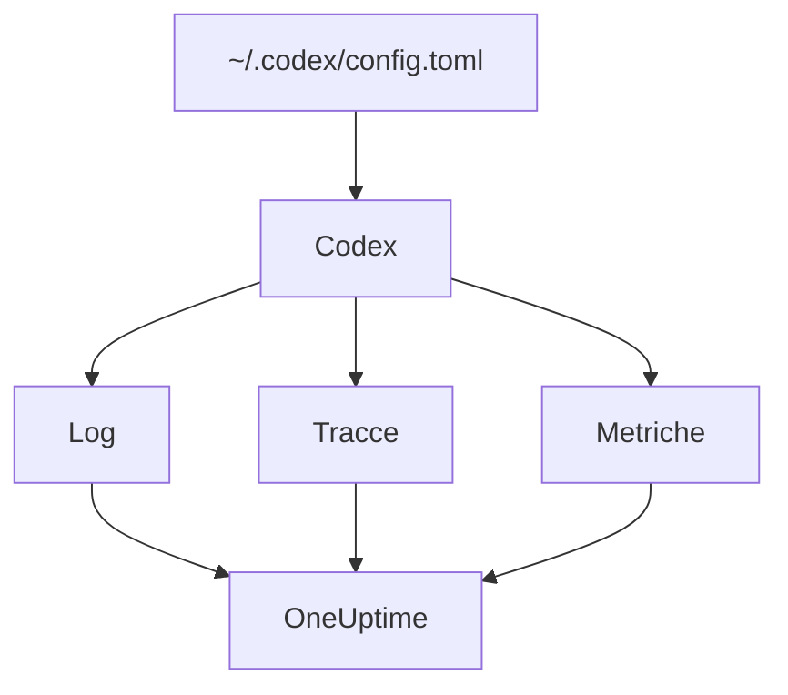

# OpenAI Codex

La CLI di Codex ha tre esportatori OpenTelemetry integrati, uno ciascuno per log, tracce e metriche. Puntali verso OneUptime in `~/.codex/config.toml` e ogni turno di Codex arriva con i suoi token e il suo costo, senza wrapper né proxy in mezzo.

:::cards
- [Configura Codex](#configura-codex): Un blocco `[otel]`, con un URL completo per segnale.
- [Attribuisci l'utilizzo a una persona](#attribuisci-lutilizzo-di-codex-a-una-persona): Codex non nomina nessuno su span o metriche, quindi lo fai tu.
- [Token e costi](#token-e-costi): Quale segnale legge OneUptime, e cosa mostra.
- [Risoluzione dei problemi](#risoluzione-dei-problemi): Cosa controllare quando non arriva nulla.
:::

## Come funziona

Ogni esportatore invia un segnale al proprio URL. Tracce e log sono disattivati finché non li configuri; le metriche no.



> [!WARNING]
> Codex invia le sue metriche a OpenAI a meno che tu non cambi questa impostazione. In una build di release, `metrics_exporter` vale `statsig` per impostazione predefinita, che le invia a `https://ab.chatgpt.com/otlp/v1/metrics`. Impostare `metrics_exporter` su un esportatore OTLP, come qui sotto, o su `none` lo ferma. Anche `[analytics]` con `enabled = false` ferma il valore predefinito Statsig, ma lascia funzionare un esportatore di metriche OTLP che hai configurato.

## Prima di iniziare

1. Crea una chiave di acquisizione della telemetria in **Impostazioni del progetto → Telemetria e APM → Chiavi di acquisizione**.
2. Il tuo endpoint OTLP è `https://oneuptime.com/otlp`, o `https://YOUR-ONEUPTIME-HOST/otlp` se ospiti OneUptime in proprio.
3. Ogni esportazione invia la chiave nell'header `x-oneuptime-token`.

## Configura Codex

:::steps
### Aggiungi il blocco otel

Metti questo in `~/.codex/config.toml`. Attiva tutti e tre i segnali, e intanto sostituisce il valore predefinito Statsig:

```toml title="~/.codex/config.toml"
[otel]
environment = "prod"
log_user_prompt = false

[otel.exporter.otlp-http]
endpoint = "https://oneuptime.com/otlp/v1/logs"
protocol = "binary"
headers = { "x-oneuptime-token" = "YOUR_INGESTION_TOKEN" }

[otel.trace_exporter.otlp-http]
endpoint = "https://oneuptime.com/otlp/v1/traces"
protocol = "binary"
headers = { "x-oneuptime-token" = "YOUR_INGESTION_TOKEN" }

[otel.metrics_exporter.otlp-http]
endpoint = "https://oneuptime.com/otlp/v1/metrics"
protocol = "binary"
headers = { "x-oneuptime-token" = "YOUR_INGESTION_TOKEN" }

[otel.span_attributes]
"user.id" = "dev@example.com"
"user.email" = "dev@example.com"
"team" = "platform"
```

### Dai a ogni esportatore il suo URL completo

Codex usa ogni `endpoint` esattamente come è scritto: non aggiunge `/v1/logs`, `/v1/traces` o `/v1/metrics` come fa la maggior parte degli SDK. Tre esportatori impostati sul semplice `https://oneuptime.com/otlp` non inviano nulla da nessuna parte, senza errori.

### Esegui un turno

Avvia una sessione interattiva di `codex`, chiedi qualcosa di piccolo e lascia finire il turno. Poi apri **Log** in OneUptime: gli eventi di Codex, come `codex.conversation_starts`, `codex.api_request` e `codex.turn_cost`, compaiono lì.
:::

> [!IMPORTANT]
> Codex ignora le chiavi che non conosce sotto `[otel]`, senza avvisare. Le sue chiavi sono in snake_case (`trace_exporter`, `metrics_exporter`, `span_attributes`), ma i nomi degli esportatori e i campi TLS sono in kebab-case (`otlp-http`, `ca-certificate`). Un `trace-exporter` disattiva le tracce senza alcun errore.

## Chiavi di configurazione

| Chiave | Predefinito | Cosa fa |
| --- | --- | --- |
| `environment` | `"dev"` | Imposta l'attributo di risorsa `env` |
| `log_user_prompt` | `false` | Invia il testo del prompt su `codex.user_prompt`; altrimenti dice `[REDACTED]` |
| `log_agent_responses` | `false` | Invia le risposte finali dell'agente all'esportatore dei log |
| `exporter` | `none` | L'esportatore dei log |
| `trace_exporter` | `none` | L'esportatore delle tracce |
| `metrics_exporter` | `statsig` | L'esportatore delle metriche: impostalo |
| `span_attributes` | — | Attributi aggiunti a ogni span esportato |
| `tracestate` | — | Membri `tracestate` del W3C |
| `tool_result` | `{ max_bytes = 2048 }` | Quanto del risultato di uno strumento conserva un record di log, in byte UTF-8 |

Un esportatore è `none`, `statsig`, `otlp-http` o `otlp-grpc`. `otlp-http` accetta `endpoint`, `headers`, `protocol` (`"binary"` o `"json"`, entrambi accettati da OneUptime) e `tls` (`ca-certificate`, `client-certificate`, `client-private-key`); `otlp-grpc` accetta lo stesso senza `protocol`.

## Attribuisci l'utilizzo di Codex a una persona

Codex nomina lo sviluppatore in un solo posto:

- **I record di log** portano `user.account_id` e `user.email`.
- **Gli span** no: Codex tiene entrambi fuori dalle sue tracce di proposito.
- **Le metriche** nemmeno: portano `auth_mode`, `session_source`, `originator`, `service_name`, `model` e `app.version`, e nessuna persona.

OneUptime legge le persone dagli span e dai punti dati delle metriche, mai dai record di log. Quindi metti tu l'identità su ogni span, in `[otel.span_attributes]`:

```toml title="~/.codex/config.toml"
[otel.span_attributes]
"user.id" = "dev@example.com"
"user.email" = "dev@example.com"
"team" = "platform"
"cost_center" = "eng-123"
```

`user.id` è la chiave che OneUptime preferisce, e `user.email` riempie la colonna dell'email. Codex non ha attributi di risorsa, quindi imposta qui anche le chiavi del team (`team.id`, `team`, `cost_center`, `department`). Questo blocco vive nel file di configurazione di ogni sviluppatore: distribuiscilo per sviluppatore, tramite i tuoi dotfile o un profilo MDM. Un unico file condiviso con una sola identità addebiterebbe la spesa di tutti a una persona.

## Token e costi

| Segnale | Cosa invia Codex | Cosa ne fa OneUptime |
| --- | --- | --- |
| Tracce | `gen_ai.usage.input_tokens`, `gen_ai.usage.output_tokens` e i token della cache, ma nessun modello | Conta i token per persona; non può dar loro un prezzo |
| Metriche | `codex.turn.token_usage` per `token_type`, e `codex.turn.cost_microusd`, in milionesimi di USD | Converte il costo in USD; legge le metriche solo dove gli span non riportano nulla |
| Log | `codex.turn_cost`, con `usage.estimated_usd` e la persona | Lo salva nell'esploratore dei **Log**; non lo collega alla spesa |

Con la configurazione qui sopra, nella scheda **Utilizzo** il risultato è questo:

- I token vengono dagli span, per persona, e `codex.turn.token_usage` non viene sommato in più: le due cose non vengono mai sommate ([perché](/docs/telemetry/ai-llm-observability#prima-gli-span-le-metriche-colmano-i-vuoti)).
- Gli span di Codex non nominano alcun modello, quindi OneUptime non può dar loro un prezzo, e il loro costo è 0. I totali dei costi prendono allora il costo di Codex da `codex.turn.cost_microusd`, convertito in USD per te.
- Le tabelle **Dipendente**, **Team** e **Modello** mostrano le righe degli span: token per persona, ma nessun costo per persona.
- Senza tracce, sono le metriche a riempire quelle tabelle, solo con il costo, tutto sotto **Non attribuito**, perché le metriche di Codex non nominano nessuno.

Il costo per turno più preciso, con la persona, è il record di log `codex.turn_cost`. OneUptime non collega ancora i record di log alla spesa, ma tieni attivo l'esportatore dei log: lo storico ci sarà quando lo farà.

## Codex in CI e come server MCP

`codex`, `codex exec` e `codex mcp-server` costruiscono tutti la loro telemetria dallo stesso blocco `[otel]`, con tutti e tre gli esportatori. Le esecuzioni di `codex exec` portano l'`originator` `codex_exec`, e `codex mcp-server` esporta come `codex_mcp_server`, così puoi distinguere le esecuzioni in CI e MCP dalle sessioni interattive in base a quei valori.

## Privacy

`log_user_prompt` e `log_agent_responses` valgono `false` per impostazione predefinita: lasciali disattivati. L'evento `codex.user_prompt` arriva comunque, con il prompt sostituito da `[REDACTED]`, così conservi il turno, i suoi token e il suo costo senza il testo del prompt. La persona (`user.email`, `user.account_id`) è sui record di log qualunque cosa dicano questi interruttori.

Se attivi il contenuto per un'indagine, le **Regole di mascheramento** e i **Filtri di scarto** delle tracce, in **Tracce → Impostazioni**, lo mascherano o lo scartano prima che venga salvato.

## Usare l'API di OpenAI invece di Codex

L'API della piattaforma OpenAI non invia OpenTelemetry da sé: ogni span viene dalla strumentazione del tuo client. Tre strumentazioni funzionano con OneUptime:

- **OpenTelemetry**: `opentelemetry-instrumentation-genai-openai` per Python, che sostituisce `opentelemetry-instrumentation-openai-v2`. `OTEL_INSTRUMENTATION_GENAI_CAPTURE_MESSAGE_CONTENT` decide se i messaggi vengono registrati.
- **OpenLLMetry** (Traceloop): `opentelemetry-instrumentation-openai`.
- **OpenInference** (Arize): `openinference-instrumentation-openai`.

Punta una qualsiasi di esse verso OneUptime come mostra [Osservabilità IA / LLM](/docs/telemetry/ai-llm-observability). Nessuna sa chi è il tuo dipendente: imposta tu `user.id`.

L'**OpenAI Agents SDK** invia le tracce all'endpoint di OpenAI, non via OTLP. Collegalo con `opentelemetry-instrumentation-openai-agents-v2` o `openinference-instrumentation-openai-agents`, che passano gli span dell'SDK a un esportatore OTLP.

## Risoluzione dei problemi

:::details Non arriva nulla
Controlla prima i tre valori di `endpoint`: ognuno deve finire con `/v1/logs`, `/v1/traces` o `/v1/metrics`. Poi controlla l'header `x-oneuptime-token`: OneUptime rifiuta una chiave sbagliata.
:::

:::details Le tracce non arrivano mai, ma i log sì
Cerca una chiave scritta male sotto `[otel]`: Codex la ignora in silenzio. `trace-exporter` al posto di `trace_exporter` è il caso più comune.
:::

:::details Il costo di Codex compare nei totali, ma ogni persona mostra 0 $
È previsto: gli span di Codex portano token ma nessun modello, quindi non si possono prezzare, e la metrica del costo non nomina nessuno. Vedi [Token e costi](#token-e-costi).
:::

:::details La spesa di tutti compare sotto una sola persona
La stessa identità di `[otel.span_attributes]` è su ogni macchina. Dai a ogni sviluppatore la sua.
:::

## Passaggi successivi

:::cards
- [Assistenti di programmazione IA](/docs/telemetry/ai-coding-assistants): Come viene attribuita la spesa per ogni assistente di programmazione.
- [Osservabilità IA / LLM](/docs/telemetry/ai-llm-observability): Conversazioni, avvisi, costi e budget per le tue chiamate di IA.
- [Gateway IA](/docs/telemetry/ai-gateways): Un gateway che traccia e prezza ogni chiamata ai modelli.
:::
