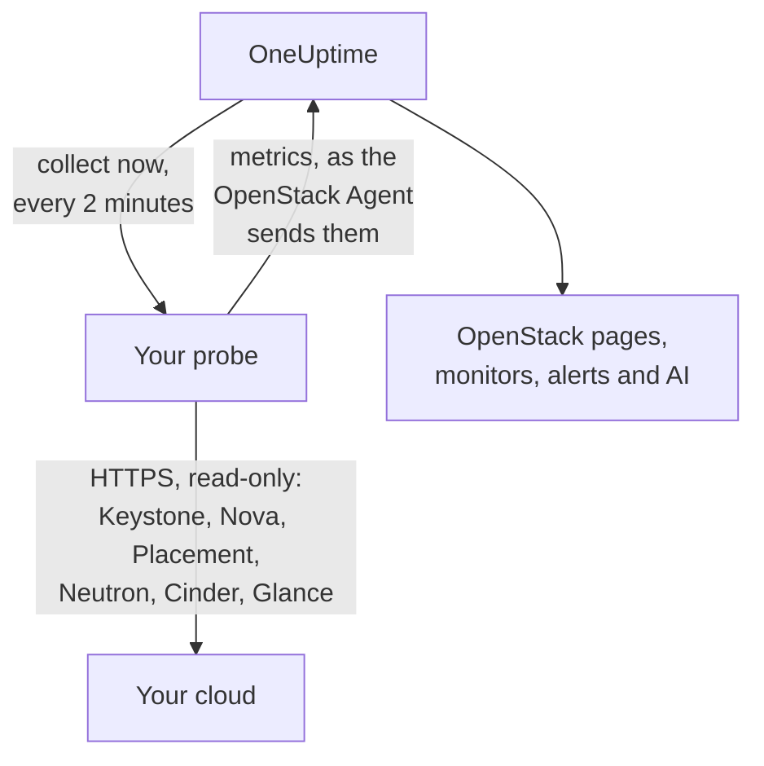

# OpenStack senza agent

Monitora un cloud OpenStack senza installare nulla: inserisci in OneUptime l'indirizzo di Keystone e una application credential, scegli la sonda che può raggiungere il cloud, e la sonda raccoglie gli stessi dati che raccoglierebbe l'[agente OpenStack](/docs/telemetry/openstack). Non c'è nessun agente da installare, aggiornare o mantenere in esecuzione, e nessuna macchina dedicata da predisporre.

> [!IMPORTANT]
> Una sonda parla con un cloud solo in HTTPS. Una credenziale o il suo token non viene mai inviato su HTTP in chiaro, e DevStack e Kolla-Ansible espongono per impostazione predefinita le loro API su HTTP in chiaro. Per un cloud di questo tipo, attiva TLS sulle sue API, oppure usa l'[agente OpenStack](/docs/telemetry/openstack), che gira accanto al cloud. Il test della connessione lo segnala quando trova un indirizzo HTTP in chiaro.

:::cards
- [Prima di iniziare](#prima-di-iniziare): una sonda che raggiunge le API e una credenziale.
- [Connetti un cloud](#connetti-un-cloud): l'indirizzo, una credenziale, un test e un nome.
- [Risoluzione dei problemi](#risoluzione-dei-problemi): cosa significa ogni messaggio e cosa lo risolve.
:::

## Come funziona



Ogni due minuti la sonda legge ogni servizio di ogni regione che hai scelto e invia a OneUptime ciò che ha trovato. I dati arrivano esattamente come quelli dell'agente OpenStack, quindi ogni pagina OpenStack, ogni [monitor OpenStack](/docs/monitor/openstack-monitor) e ogni modello di avviso li legge allo stesso modo.

Ogni servizio viene letto in modo indipendente e in parallelo agli altri. Un Neutron che fallisce o si blocca costa le serie di Neutron, e i dati di Nova arrivano come al solito, con una sola eccezione che Nova si crea da sé: chiede a Neutron di ogni istanza che elenca. Quindi, mentre Neutron è fermo, una sonda conserva le istanze lette l'ultima volta e chiede solo ciò che è cambiato. Se un'istanza è cambiata, o la sonda è appena partita, Nova non può rispondere nemmeno a quell'elenco: Nova risulta in errore, le sue altre serie continuano ad arrivare e ogni istanza resta nella sua pagina com'era l'ultima volta finché Neutron non torna disponibile.

Heat, Magnum, Manila, Trove, Gnocchi, Designate, Swift e Barbican vengono letti dove il catalogo di Keystone li indica. Un cloud che non ne esegue nessuno non paga nulla per essi, non ne sente parlare dal test della connessione e [non ne mostra traccia](/docs/telemetry/openstack#heat-e-magnum).

Su un cloud il cui catalogo include Octavia, una sonda legge i suoi bilanciatori di carico, pool, listener e anfore con un elenco ciascuno, poi i membri di ogni pool e i contatori di traffico di ogni bilanciatore di carico e listener `ACTIVE`, una richiesta ciascuno. Un cloud con 3 bilanciatori di carico, 1 pool e 1 listener costa 9 richieste a raccolta; un vero DevStack che abbiamo registrato è costato esattamente questo. In una raccolta vengono letti al massimo i membri di 25 pool e 50 contatori, partendo da quelli letti meno di recente, e gli altri riportano ciò che dicevano all'ultima lettura. I contatori di Octavia sono cumulativi, quindi una sonda conserva l'ultima lettura di ciascuno e disegna la differenza al secondo tra due letture: un grafico inizia alla seconda raccolta, e un contatore che scende (un listener ricostruito) non disegna nulla per quell'intervallo. Il provider OVN riporta 0 per ogni contatore, il che è una linea piatta e non un guasto.

Le anfore richiedono la regola di amministratore di Octavia per ogni lettura. Una credenziale inferiore ad admin vede i bilanciatori di carico, i pool, i listener e i membri del proprio progetto, e i propri contatori, e nessuna anfora: la pagina Load balancer lo dice, e nessun avviso lo segnala. Il ruolo di monitoraggio, su un progetto senza bilanciatori di carico, non ne vede nessuno. A `load-balancer_global_observer` veniva rifiutato tutto su `stable/2026.1`, la release su cui è stato registrato.

Un'API Octavia ferma è `up 0` per una sonda, cosa che l'exporter dell'agente non può dire.

## Sonda o agente?

| | Una sonda (questa pagina) | L'agente OpenStack |
|---|---|---|
| Cosa esegui | Una sonda che già esegui, o una nuova | L'agente, su una macchina dedicata |
| Dove è conservata la credenziale | Cifrata in OneUptime, inviata solo alla sonda | Nel file `clouds.yaml` dell'agente |
| Cosa deve raggiungere | Keystone e l'API di ogni servizio, in HTTPS | Keystone e l'API di ogni servizio |
| API su HTTP in chiaro | Non raccolte: un token non viene mai inviato non cifrato | Raccolte |
| Cloud più grande | Testato con [200.000 istanze](/docs/telemetry/openstack-very-large-clouds) su un cloud simulato, non reale, in un massimo di dieci caricamenti da 48 MiB | Non testato su larga scala: [la sua scrape va in timeout](/docs/telemetry/openstack-very-large-clouds#tramite-lagente) ben prima di allora |
| Log dei servizi e agente AI | Non inclusi | Inclusi |
| Ciò su cui poggia il cloud: RabbitMQ, MariaDB, Memcached, HAProxy, OVN, libvirt | Non incluso: una sonda legge le API del cloud | Incluso, con i suoi target indicati |
| CPU, memoria e disco reali di ogni istanza, da libvirt o Ceilometer | Non inclusi | Inclusi, con i loro exporter indicati |
| Login a Keystone | Uno per la durata di un token, di solito un'ora | Uno per ogni scrape |
| Un semplice `reader` su un progetto | Istanze, volumi e reti di quel progetto | Volumi e reti di quel progetto, e nessuna istanza |

Entrambi inviano le stesse serie, quindi le pagine e i monitor funzionano con l'uno o con l'altro. Una sonda invia anche ciò che solo un client nativo può leggere: gli indirizzi di un'istanza, lo stato del task e il messaggio di errore, l'immagine da cui è stata avviata, se un operatore ha forzato un servizio Nova come fermo, quali reti serve un agente DHCP, quale pool contiene un volume, quando un'istanza, un volume o un'immagine è cambiata l'ultima volta, e lo stato di ogni snapshot e backup dei volumi. Cinder dice quale pool contiene un volume solo a una credenziale che tratta come admin. Su un cloud che esegue [Heat o Magnum](/docs/telemetry/openstack#heat-e-magnum), invia anche perché uno stack o un cluster è fallito, quali istanze e volumi possiede uno stack, il progetto, il template e la versione di Kubernetes di ogni cluster, e se ciascun motore di Heat e ciascun conductor di Magnum è attivo.

Scegli l'agente per i log dei servizi, per l'agente AI, per ciò su cui poggia il cloud e l'utilizzo reale di ogni istanza, per un cloud le cui API parlano solo HTTP in chiaro, come fanno DevStack e Kolla-Ansible per impostazione predefinita, o per un cloud così grande da dover essere [letto dai suoi database](/docs/telemetry/openstack-very-large-clouds#il-percorso-dei-database). Scegli una sonda per tutto il resto: non c'è nulla da installare e legge di più di ciò che dicono Nova e Cinder. [OpenStack di dimensioni molto grandi](/docs/telemetry/openstack-very-large-clouds) dice cosa costa l'una o l'altra a qualsiasi dimensione.

Puoi passare un cloud dall'una all'altra in qualsiasi momento dalla sua pagina **Impostazioni**.

## Prima di iniziare

- **Una sonda che possa raggiungere Keystone e l'API di ogni servizio in HTTPS.** Di solito è una [sonda personalizzata](/docs/probe/custom-probe) nella rete del cloud. Il catalogo di Keystone indica dove risponde ogni servizio e la sonda si connette a quegli indirizzi, quindi ciascuno deve essere raggiungibile dalla sonda e ciascuno deve essere HTTPS. Su OneUptime Cloud, le sonde condivise non ricevono mai una credenziale OpenStack, quindi aggiungi una sonda tua. Su un'istanza self-hosted possono raccogliere anche le sonde dell'istanza stessa.
- **Una credenziale.** Una application credential è la scelta migliore, perché può essere limitata alla lettura e può scadere. Funzionano anche un nome utente e una password, che possono fare tutto ciò che può fare il loro account.

OpenStack non ha un ruolo globale di sola lettura, quindi quanto vede la sonda dipende dalla credenziale:

| Livello | Cosa serve | Cosa legge la sonda |
|---|---|---|
| Vista completa | Una application credential su un account con `admin` su un progetto dedicato, limitata dalle regole di accesso alla sola lettura | Tutto, tranne gli utenti e i gruppi di Keystone, che le regole escludono di proposito |
| Solo infrastruttura | I ruoli `oneuptime_monitoring` e `reader` su un progetto dedicato che non contiene nulla e ha quota zero, e i file di policy forniti con l'agente OpenStack | Hypervisor, servizi di Nova, agenti di Neutron, pool di indirizzi, Placement, l'elenco dei progetti e le istanze di ogni progetto. Volumi, reti e router solo dove il ruolo è assegnato. Non lo stato di `cinder-volume` e `cinder-scheduler` né i pool di archiviazione: il codice di Cinder chiede un admin |
| Vista di progetto | Un semplice `reader` su un progetto | Istanze, volumi e reti di quel progetto, e nessuna infrastruttura |

Il test della connessione dice a quale di questi livelli corrisponde una credenziale, e avverte quando il suo stesso progetto contiene qualcosa: dove Cinder ha `enforce_new_defaults` disattivato, che è il suo valore predefinito, qualsiasi ruolo su un progetto può creare i volumi di quel progetto, `reader` incluso.

> [!IMPORTANT]
> Una application credential limitata da regole di accesso viene rifiutata con un `401` da qualsiasi servizio il cui `keystonemiddleware` non abbia `service_type` impostato. Il test della connessione lo dice per ogni lettura. Impostalo nella configurazione di ogni servizio, poi riavvialo. [Crea la credenziale](/docs/telemetry/openstack#crea-la-credenziale) contiene le regole, i file di policy e le impostazioni per ogni servizio, e [cosa legge ogni livello](/docs/telemetry/openstack#cosa-legge-ogni-livello) è ciò che hanno risposto i cloud reali.

## Connetti un cloud

:::steps
### Apri i tuoi cloud
In OneUptime apri **OpenStack → Tutti i cloud** e fai clic su **Connetti cloud**.

### Inserisci l'indirizzo e la credenziale
Inserisci l'`auth_url` del tuo file `clouds.yaml` o `openrc`, ad esempio `https://keystone.example.com:5000/v3`, e l'ID e il secret della application credential. Scegli la sonda che raggiunge il cloud.

### Testa la connessione
Fai clic su **Testa la connessione**. La sonda effettua il login, prova ogni lettura che una raccolta esegue in ogni regione, ed esce. Indica quali regioni nomina il catalogo, cosa può leggere la credenziale, cosa le viene rifiutato, quali pagine restano senza dati e la riga che li sblocca. Una lettura fallita non interrompe il test.

### Considera attendibile il certificato del cloud
Un cloud con una propria autorità di certificazione presenta un certificato di cui la sonda non si fida. Il test mostra allora il certificato e l'host che lo ha presentato. Confronta la sua impronta con quella dell'API stessa, poi fai clic su **Considera attendibile questo certificato**. Un cloud con un host per servizio può avere un certificato per servizio, e puoi considerarne attendibili fino a 32.

### Scegli le regioni e connetti
Scegli le regioni da leggere, dai un nome al cloud e fai clic su **Connetti cloud**. Si apre la pagina del cloud.
:::

La **Panoramica** del cloud mostra una scheda **Raccolta dati**. Indica **Verifica in corso** fino alla prima raccolta, che parte entro un minuto, poi **In raccolta**, e le pagine si riempiono. Quando alcuni servizi sono stati letti e un altro no, dice quale. Se per 15 minuti nessuna sonda si occupa del cloud, perché è offline o troppo vecchia, indica **Nessuna raccolta** e lo dice, qualunque cosa abbia trovato l'ultima raccolta.

La scheda **Raccolta dati** nella pagina **Impostazioni** del cloud contiene ciò con cui l'hai connesso:


## Connetti un cloud dall'API o con Terraform

Le impostazioni di connessione di un cloud sono normali campi della [risorsa OpenStack Cloud](/reference/open-stack-cloud) nell'API, in `/api/openstack-cloud`, quindi un cloud può essere connesso senza alcuna dashboard. Con Terraform si usa `oneuptime_openstack_cloud`:

```hcl
resource "oneuptime_openstack_cloud" "prod_eu" {
  name                      = "prod-eu"
  collection_method         = "Probe"
  auth_url                  = "https://keystone.example.com:5000/v3"
  credential_kind           = "applicationCredential"
  application_credential_id = var.openstack_application_credential_id
  credential_secret         = var.openstack_application_credential_secret
  collection_probe_id       = oneuptime_probe.eu_west.id
  collection_regions        = jsonencode(["RegionOne"])

  # A cloud with its own certificate authority: the fingerprints it presents.
  trusted_certificate_fingerprints = jsonencode(["AB:CD:EF:..."])
}
```

Per un nome utente e una password, imposta `credential_kind` su `password`, con `keystone_username`, `project_name` e, quando non sono `Default`, `user_domain_name` e `project_domain_name`. `endpoint_interface`, `collection_interval_in_minutes` e `collection_options` sono ciò che il modulo raccoglie sotto **Altri campi**. Solo `name` è obbligatorio, perché un cloud inviato dall'agente non ha nessuno di questi.

`credential_secret` è solo in scrittura, quindi nessuna lettura lo restituisce e Terraform lo tiene fuori da piani e output. [Le regole per una credenziale salvata](#la-credenziale-salvata) valgono anche qui: cambiare l'indirizzo, la sonda o i certificati attendibili richiede il secret nella stessa richiesta. Ciò che riporta la sonda, come `collection_status`, `collection_error` e `presented_certificate`, può essere letto ma non impostato.

## Quanto costa al tuo cloud

Il monitoraggio non deve mai essere ciò che mette fuori uso un cloud, quindi una raccolta è delicata per costruzione:

- **Un solo login, mantenuto.** Il token viene usato fino a cinque minuti prima della scadenza. Un login è ciò che un Keystone in difficoltà può permettersi di meno.
- **Elenchi a pagine.** Ogni elenco viene letto mille righe alla volta, con `limit` e `marker`.
- **Istanze per modifica.** Tra una lettura completa e l'altra, ogni mezz'ora, la sonda chiede a Nova solo ciò che è cambiato dall'ultima lettura, con `changes-since`.
- **Gli inventari di un hypervisor una volta sola.** Placement sposta la generation di un provider ogni volta che cambiano, cosa che una sola chiamata di elenco dice per tutti, quindi vengono riletti solo in quel caso.
- **Un carico dichiarato.** Ciò che costa una chiamata per elemento procede a turni oltre 2.000 a raccolta, e oltre 250 progetti per i limiti. Ciò che non è stato letto questa volta viene inviato com'era all'ultima lettura, quindi nessuna serie ha buchi, e il carico smette di crescere con il cloud.
- **Solo i campi che legge.** Gli elenchi di Neutron nominano i propri campi, e per i security group vengono richiesti solo gli ID.
- **Mai sovrapposte.** Una raccolta che dura più del suo intervallo viene saltata, non eseguita accanto alla successiva.
- **Un budget di tempo.** Una raccolta dispone di nove decimi del suo intervallo, e al massimo dieci minuti. Ciò che è stato letto fino a quel momento viene inviato, e il servizio che ha esaurito il tempo lo dice.
- **Attesa prima di riprovare.** Quando le viene chiesto di attendere con un `429` o `Retry-After`, la sonda attende. Un servizio che risponde `429`, `503` o non risponde affatto viene lasciato in pace per un minuto, poi due, poi quattro, fino a mezz'ora, e le sue serie continuano a dire che è fermo mentre attende.
- **Rallentamento.** Una risposta tre volte più lenta di quanto quel servizio risponda di solito, e di almeno un secondo, o di cinque secondi qualunque sia il valore abituale, ritarda la richiesta successiva a quel servizio di altrettanto. La scheda **Raccolta dati** dice quando è successo.
- **Una credenziale rifiutata attende più a lungo.** Ripeterla è ciò che blocca un account, quindi attende cinque minuti, poi dieci, fino a un'ora. Una credenziale che hai corretto viene provata subito.

- **Meno dati di un cloud grande.** Oltre 5.000 istanze un cloud conserva i conteggi e le sue parti, e nessuna serie per istanza o per volume, a meno che tu non scelga diversamente sotto **Utilizzo reale per istanza** nella sua pagina **Impostazioni**. Ciò che è cambiato, ciò che hai scelto di conservare e ciò che un avviso sta osservando viene comunque inviato a ogni raccolta. Il resto procede a turni, e la scheda **Raccolta dati** dice quanto dura un turno.

A ogni raccolta, con i valori predefiniti, una regione costa 7 chiamate a Nova, 7 a Neutron e 5 a Cinder, una chiamata a Placement e altre due per hypervisor, fino a 4 in più per chiedere a Placement [quanti esemplari di ogni flavor ci stanno](/docs/telemetry/openstack#capacità) e, circa ogni cinque minuti, 5 a Keystone e 1 a Glance. L'inventario di un hypervisor viene letto una volta, e di nuovo solo quando Placement dice che è cambiato. Un elenco più lungo di mille righe richiede una chiamata ogni mille. Ogni istanza cambiata richiede una chiamata in più a Nova, per leggere ciò che ha attraversato, e in una raccolta ne vengono lette al massimo 25: un cloud tranquillo non ne fa nessuna. Su ML2/OVS, Neutron richiede una chiamata in più per router, per chiedere quali agenti L3 lo ospitano, e ogni dieci minuti una chiamata per agente DHCP, al massimo 20, per chiedere quali reti serve. Un cloud con più agenti DHCP li percorre a turni, un cloud oltre la dimensione di riepilogo omette questa lettura, e un Neutron lento non viene interrogato affatto. Un cloud su OVN non ne ha da interrogare. [OpenStack di dimensioni molto grandi](/docs/telemetry/openstack-very-large-clouds#il-carico-sul-tuo-piano-di-controllo) riporta a quante richieste al minuto equivale, a ogni dimensione.

Un cloud che esegue Manila paga, circa ogni cinque minuti, 2 chiamate a esso, uno che esegue Trove ne paga 1, Gnocchi 1 e Barbican 3. Designate ne richiede 2, e una in più per ogni zona che non è `ACTIVE`, al massimo 50 a raccolta. Swift ne richiede 1 per il progetto della credenziale, e con `ResellerAdmin` una in più per ogni altro progetto, al massimo 200 a raccolta. Un cloud che esegue Heat o Magnum paga, circa ogni cinque minuti, 2 chiamate a Heat e 3 a Magnum. Nessuno dei due elenchi dice tutto: quello di Magnum non dice di chi è un cluster né perché è fallito, e quello di Heat non dice cosa possiede uno stack. Quindi la sonda legge anche un cluster o uno stack singolarmente quando il suo stato si è spostato, al massimo 25 di ciascuno a raccolta. Un cloud con più elementi continua a completarsi nelle raccolte successive, e uno che resta fermo non viene mai letto due volte.

Tre cose sono disattivate a meno che tu non le attivi, sotto **Cosa legge oltre i valori predefiniti** nella scheda **Raccolta dati** della pagina **Impostazioni** del cloud, o sotto **Altri campi** mentre lo connetti, perché ciascuna costa di più al tuo cloud:

| Opzione | Cosa ottieni | Quanto costa |
|---|---|---|
| Porte | Una serie per porta, e quante non hanno indirizzo o hanno un bilanciatore di carico fermo | Un elenco paginato per ogni rete o progetto che indichi, o di tutte le porte se non ne indichi nessuno. Un elenco di porte senza filtro può saturare Neutron su un cloud grande |
| Limiti dei progetti | Quote e limiti per progetto | Quattro chiamate per progetto, al massimo 250 progetti a raccolta |
| Server di archiviazione di Swift | Se ciascuno risponde, la sua replica e se tutti hanno gli stessi ring, dove indichi la porta `/recon` di ogni server come `host:port`. Solo un cloud che esegue Swift offre questa opzione, nella sua pagina **Impostazioni** dopo che la prima raccolta ha letto Swift | 5 chiamate per server a ogni raccolta. Nessuna credenziale viene inviata a essi |

## Certificati

La sonda non salta mai la verifica del certificato. Ogni connessione completa un handshake TLS completo, e poi:

- senza certificati attendibili, il certificato di un'API deve provenire da un'autorità di cui si fida la macchina della sonda, per l'indirizzo su cui risponde;
- con certificati attendibili, un'API deve presentarne uno esattamente tra quelli, identificati dalle loro impronte SHA-256. Nient'altro viene accettato, nemmeno un certificato attendibile pubblicamente.

Per verificare un'impronta, esegui questo dalla macchina della sonda:

```bash
openssl s_client -connect keystone.example.com:5000 </dev/null | openssl x509 -noout -fingerprint -sha256
```

Quando un certificato viene rinnovato, la raccolta si interrompe con **Il certificato dell'API è cambiato** e viene mostrato il nuovo certificato. Non viene inviato nulla finché non lo consideri attendibile, nella pagina **Panoramica** o **Impostazioni** del cloud.

## La credenziale salvata

Il secret è cifrato e solo in scrittura: nessuno può rileggerlo e l'API non lo restituisce mai. Viene inviato solo alla sonda che raccoglie il cloud, che lo tiene in memoria.

Una credenziale salvata viene inviata solo all'indirizzo, tramite la sonda e ai certificati per cui è stata inserita. Cambiare l'indirizzo, la sonda o i certificati attendibili richiede di nuovo il secret, così nessuno che possa modificare il cloud può inviarlo altrove. Considerare attendibile il certificato che la sonda ha trovato all'indirizzo salvato lo mantiene, e così farne attendibili di meno.

Il catalogo è soggetto alle stesse regole dell'indirizzo che hai digitato, perché un token va ovunque esso indichi. La sonda non si connette a un indirizzo di loopback, link-local o dei metadati del cloud, sia che lo indichi il catalogo sia che un nome host vi si risolva, e si connette agli indirizzi che ha verificato, non a ciò che il DNS dice un istante dopo. Non segue i reindirizzamenti.

## Passare dall'agente a una sonda e viceversa

Apri la pagina **Impostazioni** del cloud. La sua scheda **Raccolta dati** offre **Raccogli con una sonda** per un cloud che l'agente invia, e **Usa l'agente OpenStack** per uno che una sonda raccoglie. Passare all'agente cancella la credenziale salvata.

> [!WARNING]
> Ferma l'agente OpenStack una volta che la prima raccolta della sonda ha successo. Finché girano entrambi, ogni metrica arriva due volte.

Oltre [5.000 istanze](/docs/telemetry/openstack-very-large-clouds#modalità-riepilogo), la prima raccolta di una sonda conosce l'intero cloud e ne invia una parte, quindi gli elenchi di un nuovo cloud si riempiono nel corso del primo ciclo, e la scheda **Raccolta dati** dice quando saranno tutti presenti.

## Bare metal

Su un cloud il cui catalogo include Ironic, una sonda legge i suoi nodi e chiede ogni campo per nome, quindi il `driver_info` di un nodo non viene mai letto in una raccolta. Aggiunge ciò che l'exporter dell'agente non ha: il driver di un nodo, il suo conductor, il suo guasto e il motivo per cui è fallito. Ironic può svuotare `last_error` in circa un minuto, quindi una pagina conserva l'ultimo visto da una raccolta e dice quando.

Una sonda legge prima il catalogo, quindi può dire che l'API di Ironic è ferma, cosa che l'exporter dell'agente non può. A un cloud senza Ironic non viene chiesto nulla al riguardo.

Ironic mostra a un progetto solo i nodi che possiede e gli rifiuta l'elenco dei conductor. Con la policy predefinita di Ironic solo una credenziale con scope di sistema li legge, e la credenziale di una sonda non può avere scope di sistema, perché con la stessa legge gli elenchi di Nova. Quindi, a meno che la policy del cloud non dia al suo ruolo `baremetal:node:list_all` e `baremetal:conductor:get`, una sonda vede i nodi che il suo progetto possiede e nessun conductor, e le pagine lo dicono. [Bare metal](/docs/telemetry/openstack#bare-metal) contiene il resto.

## Riferimento

| Impostazione | Predefinito | Note |
|---|---|---|
| Raccogli ogni | 2 minuti | Da 1 a 60 minuti. Raccogli meno spesso un cloud grande per risparmiarlo. Keystone e Glance vengono letti circa ogni cinque minuti, a prescindere da quanto spesso vengono letti gli altri. |
| Interfaccia dell'endpoint | public | Quale degli URL del catalogo usare: public, internal o admin. |
| Raccolte simultanee | 4 per sonda | Una raccolta più lenta del suo intervallo viene saltata, mai sovrapposta. |
| Caricamento massimo | 48 MiB | Una raccolta ne usa quanti ne servono, fino a dieci. Oltre [5.000 istanze](/docs/telemetry/openstack-very-large-clouds#modalità-riepilogo), ciò che non è cambiato procede a turni. |
| Richieste a ciascun servizio | Una alla volta | Le chiamate per provider di Placement procedono quattro alla volta. |
| Attesa di una risposta | 60 secondi | Provata tre volte in tutto quando è un `429` o un errore del server. |
| Test della connessione | 90 secondi per partire | Un test che nessuna sonda prende in carico in tempo, o che dura più di 3 minuti, riceve risposta di fallimento. In un progetto ne possono attendere o girare cinque alla volta. |

## Risoluzione dei problemi

:::details Il certificato dell'API non è attendibile
Il cloud presenta un certificato della propria autorità. Confronta l'impronta mostrata con il certificato dell'API, poi fai clic su **Considera attendibile questo certificato**.
:::

:::details Il certificato dell'API è cambiato
Il certificato è stato rinnovato, oppure qualcuno si è inserito nella comunicazione. Non viene inviato nulla finché non consideri attendibile il nuovo. Controlla la sua impronta, poi consideralo attendibile.
:::

:::details L'auth URL non è valido
Inserisci l'indirizzo di Keystone in HTTPS, ad esempio `https://keystone.example.com:5000/v3`. Un indirizzo su HTTP in chiaro viene rifiutato prima che venga inviato qualsiasi cosa. Per un cloud le cui API parlano solo HTTP in chiaro, attiva TLS oppure usa l'[agente OpenStack](/docs/telemetry/openstack).
:::

:::details Il catalogo indica un endpoint HTTP in chiaro
Il token di una credenziale non viene mai inviato non cifrato. Attiva TLS per quell'API, scegli un'altra interfaccia dell'endpoint oppure usa l'[agente OpenStack](/docs/telemetry/openstack) per questo cloud. Il test della connessione fallisce finché ogni API che legge non è su HTTPS. In una raccolta resta senza dati solo il servizio con quell'endpoint: gli altri vengono letti come al solito.
:::

:::details Keystone ha rifiutato la credenziale
L'ID, il secret o la password sono sbagliati, è scaduta o è stata eliminata, oppure il suo account ha perso il ruolo sul progetto. Creane una nuova e inseriscila con **Modifica connessione** nella pagina **Impostazioni** del cloud.
:::

:::details L'account non ha nessun ruolo su quel progetto
Un nome utente e una password hanno effettuato il login, ma non su quel progetto. Controlla il nome del progetto e i due domini. Una application credential evita questo problema: ha già il suo scope quando viene creata.
:::

:::details La credenziale non può leggere ciò che serve al monitoraggio
Il test elenca ogni lettura rifiutata, cosa resta senza dati e la riga che la sblocca. Un `401` su una credenziale con regole di accesso significa che non elencano quel percorso, oppure che il `keystonemiddleware` di quel servizio non ha `service_type` impostato e non è stato riavviato.
:::

:::details La sonda non riceve risposta dal cloud
La rete della sonda non può raggiungere quell'API. Consentila nel firewall, oppure scegli una sonda nella rete del cloud. L'indirizzo di ogni servizio è a sé: il messaggio nomina quello che non ha risposto.
:::

:::details Nulla risponde su quella porta
Controlla l'indirizzo e la porta. Keystone di solito risponde sulla 5000, o sulla 443 dietro un percorso come `/identity`.
:::

:::details La connessione sicura non è riuscita
L'indirizzo probabilmente punta a una porta che non parla HTTPS. Controllalo. Se le API del cloud parlano solo HTTP in chiaro, attiva TLS oppure usa l'agente OpenStack.
:::

:::details OneUptime non si connette a questo indirizzo
L'indirizzo, o qualcosa che il catalogo indica, è o si risolve in un indirizzo di loopback, link-local o dei metadati del cloud. Usa l'indirizzo su cui l'API risponde nella tua rete.
:::

:::details Questo indirizzo non è Keystone
Inserisci l'endpoint Identity del tuo file `clouds.yaml` o `openrc`: il suo `auth_url`.
:::

:::details Una regione non è nel catalogo
Scegli tra le regioni che il catalogo indica. Il test della connessione le elenca.
:::

:::details Keystone sta fallendo
Keystone ha risposto con un errore del server. La sonda attende più a lungo tra un login e l'altro finché non si riprende, e senza login non si può leggere nient'altro. Controlla il servizio Keystone e il database che ha dietro.
:::

:::details Un servizio è fermo o troppo occupato per rispondere
Ha continuato a rispondere `429` o con un errore del server, quindi la sonda attende più a lungo tra una raccolta e l'altra finché non si riprende. Verifica che sia in esecuzione, poi il suo carico. Raccogliere meno spesso aiuta un servizio occupato.
:::

:::details La raccolta ha richiesto troppo tempo
Il cloud ha risposto troppo lentamente per questo intervallo. Raccogli meno spesso, oppure controlla il suo carico.
:::

:::details La sonda non ha preso in carico questo cloud
La sonda è offline, oppure esegue una versione di OneUptime precedente alla raccolta OpenStack. Verifica che sia connessa nella pagina **Sonde** e aggiornala. Anche la scheda di un cloud lo dice quando una raccolta ha 15 minuti di ritardo, comunque sia andata l'ultima raccolta, e torna normale da sola quando torna la sonda.
:::

:::details Questo cloud è troppo grande per essere raccolto da una sonda
Le sue metriche superano ciò che una raccolta può inviare, e questo cloud è impostato per conservare le serie di ogni istanza. Lascia che conservi invece i conteggi, sotto **Utilizzo reale per istanza** nella sua pagina **Impostazioni**, oppure usa l'[agente OpenStack](/docs/telemetry/openstack). La [modalità riepilogo](/docs/telemetry/openstack-very-large-clouds#modalità-riepilogo) dice a cosa si rinuncia.
:::

## Passi successivi

:::cards
- [Monitor OpenStack](/docs/monitor/openstack-monitor): avvisa su servizi, hypervisor, istanze, reti e volumi.
- [Sonda personalizzata](/docs/probe/custom-probe): esegui una sonda nella rete del cloud.
- [Agente OpenStack](/docs/telemetry/openstack): raccogli invece un cloud con l'agente.
:::
