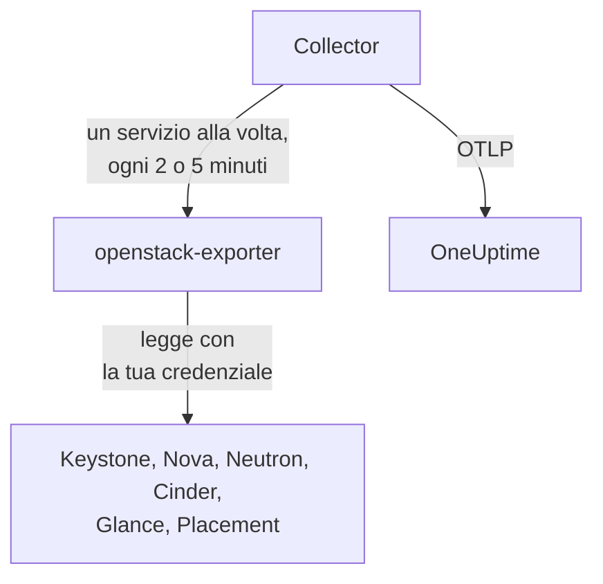

# Agent OpenStack

L'agente OpenStack di OneUptime monitora un cloud OpenStack: i suoi servizi e agenti, hypervisor, istanze, reti, router, volumi, pool di archiviazione, immagini e progetti, in ogni regione. Legge le API del cloud con una credenziale a tua scelta e invia ciò che trova a OneUptime, dove il cloud compare con le sue regioni, i suoi hypervisor e i suoi progetti. I [monitor OpenStack](/docs/monitor/openstack-monitor) generano avvisi su ciò che arriva, e una [probe](/docs/telemetry/openstack-agentless) può raccogliere i dati di un cloud senza installare nulla.

:::cards
- [Probe o agente?](/docs/telemetry/openstack-agentless#sonda-o-agente): Quale scegliere, per un cloud che potrebbe usare entrambi.
- [Scegli quanto vede](#scegli-quanto-vede-lagente): OpenStack non ha un ruolo globale di sola lettura, quindi i livelli sono tre.
- [Installa l'agente](#installa-lagente): Una credenziale, poi lo script di installazione, Docker Compose o nessun Docker.
- [Quanto costa al tuo cloud](#quanto-costa-al-tuo-cloud): Cosa legge ogni impostazione e come modificarla.
- [Capacità](#capacità): Quanti altri flavor di ciascun tipo ci stanno e quanti giorni mancano a riempire ogni risorsa.
- [Spesa](#spesa): Chi usa cosa, quanto costa ai tuoi prezzi o come lo ha valutato CloudKitty, e cosa si potrebbe recuperare.
- [Pagine di stato e avvisi ai progetti](#pagine-di-stato-e-avvisi-ai-progetti): Una pagina per regione in un solo passaggio, e avvisi solo ai progetti raggiunti da un guasto.
- [Log dei servizi](#log-dei-servizi): Analizzati, con una richiesta seguita attraverso i servizi.
- [Eventi del ciclo di vita](#eventi-del-ciclo-di-vita): Azioni sulle istanze nel feed e nei grafici, da notifiche o da una probe.
- [Chi ha fatto cosa](#chi-ha-fatto-cosa): Tracce di audit negli eventi di sicurezza.
- [Traccia una richiesta](#traccia-le-richieste-attraverso-il-piano-di-controllo): Una richiesta firmata, seguita attraverso il piano di controllo.
- [Verifica dall'esterno](#verifica-il-cloud-dallesterno): Se qualcuno riesce davvero ad avviare un'istanza, da una probe esterna al cloud.
- [Senza Internet](#senza-internet): Le quattro immagini dell'agente e come copiarle in un registry tuo.
- [Per strumento di deployment](/docs/telemetry/openstack-deployment-tools): Kolla-Ansible, OpenStack-Ansible, OpenStack-Helm, Atmosphere, Sunbeam, Red Hat e Mirantis.
- [Risoluzione dei problemi](#risoluzione-dei-problemi): Uno script diagnostico e i problemi più comuni.
:::

## Come funziona

L'agente è composto da due programmi upstream con versione fissata e dalla loro configurazione, su un'unica macchina: [openstack-exporter](https://github.com/openstack-exporter/openstack-exporter) legge le API del cloud e le trasforma in serie `openstack_*`, mentre un OpenTelemetry Collector gli chiede un servizio OpenStack alla volta, marca ogni serie con il cloud e la regione di provenienza e le invia a OneUptime. Nulla viene eseguito sui tuoi controller o nodi di calcolo, a meno che tu non aggiunga il [profilo log](#log-dei-servizi) opzionale, che ne legge i log.



Il cloud si registra da solo con i primi dati, con il nome che l'agente imposta su ogni metrica come `openstack.cloud.name`. Un agente controlla un solo cloud: un solo Keystone, con una o più regioni.

## Prima di iniziare

- Docker Engine 20.10 o successivo con il plugin Docker Compose v2 oppure, per eseguirlo senza Docker, una macchina Linux (x86_64 o arm64) con systemd 235 o successivo, glibc 2.34 o successiva (RHEL 9, Ubuntu 22.04, Debian 12) e root.
- Una route da quella macchina a Keystone e all'endpoint pubblico di ogni servizio.
- La riga di comando `openstack`, usata da qualcuno che possa creare la credenziale qui sotto.
- Una chiave di ingestione. Creane una in **Impostazioni del progetto → Telemetria e APM → Chiavi di acquisizione** e copiane il valore.
- HTTPS in uscita da quella macchina verso l'URL di OneUptime.

### Dove eseguire l'agente

Esegui l'agente fuori dal cloud che controlla: una piccola VM su hardware separato, un host di gestione, un altro cloud. Un agente dentro un cloud guasto tace insieme a lui, e il silenzio sembra un cloud sano che ha smesso di inviare dati.

## Scegli quanto vede l'agente

OpenStack non ha un ruolo globale di sola lettura, ed è la cosa più difficile del monitorarlo:

- `reader` ha come ambito un progetto ovunque tranne in Keystone e Ironic.
- Hypervisor, servizi, agenti, pool e Placement richiedono di default l'admin.
- Un override delle policy non può aprire gli elenchi di tutti i progetti in Neutron o Cinder, che li limitano con il contesto admin nel proprio codice.
- I servizi e i pool di archiviazione di Cinder rispondono con un `403` a chiunque non sia admin, dal codice di Cinder stesso, dopo che la policy è già passata. Nessun override apre nemmeno questi.
- Neutron e Cinder rispondono a un semplice reader con un `200` e solo il progetto di quel reader. Sembra aver funzionato, e non è così.
- Dove Cinder ha `enforce_new_defaults` disattivato, che è il default di Cinder stesso, qualsiasi ruolo su un progetto può creare i volumi di quel progetto, inclusi `reader` e `oneuptime_monitoring`. Su Epoxy, Flamingo e Gazpacho sia un semplice reader sia il ruolo su un progetto reale hanno creato un volume (`202`). Su Hibiscus entrambi sono stati rifiutati (`403`), perché DevStack attiva `enforce_new_defaults` solo lì. Un ruolo di sola lettura su un progetto reale non è di sola lettura.

Quindi i livelli sono tre, e ognuno ha un costo. Se puoi, parti dal primo.

| Livello | Cosa richiede | Cosa vede | Cosa resta escluso |
| --- | --- | --- | --- |
| **1. Vista completa** | Una credenziale applicativa su un account con `admin` su un progetto proprio, limitata da regole di accesso alla sola lettura, con `service_type` impostato su ogni servizio | Ogni lettura che fa l'agente, più lo stato di `cinder-volume` e `cinder-scheduler` e i pool di archiviazione, che solo questo livello vede | Utenti e gruppi di Keystone, di proposito. Non può scrivere: ogni scrittura ha risposto `401` |
| **2. Solo infrastruttura** | I ruoli `oneuptime_monitoring` e `reader` su un progetto proprio che non contiene nulla e ha quota zero, e gli override delle policy forniti con l'agente | Tutti i progetti, domini, servizi ed endpoint di Keystone, tutto Nova inclusi i server di ogni progetto, tutto Placement, e gli agenti e le IP availability di Neutron | Reti, subnet, router, floating IP e porte di Neutron, e volumi e snapshot di Cinder, sono solo quelli del proprio progetto, quindi su un progetto vuoto soltanto quelli condivisi ed esterni. Nessuno stato di `cinder-volume` o `cinder-scheduler` né pool di archiviazione. Non può scrivere: ogni scrittura ha risposto `403`, oppure `409` e `413` per la quota |
| **3. Vista progetto** | Un semplice `reader` su un progetto reale, per un team che controlla la propria parte di un cloud gestito da altri | I volumi, le reti e i router di quel progetto, da Cinder e Neutron | Tutta l'infrastruttura: niente hypervisor, servizi, agenti, pool o capacità. Tramite l'agente nemmeno le istanze, perché la lettura di tutti i progetti dell'exporter viene rifiutata. E su molti cloud `reader` può scrivere lì |

I template **Block Storage Service Down**, **Storage Pool Warning** e **Storage Pool Critical** richiedono il livello 1. **Compute Service Down**, **Network Agent Down** e i template di Placement e degli hypervisor richiedono il livello 1 o 2, e al livello 3 nulla legge un'istanza.

### Cosa legge ogni livello

Questo è ciò che hanno risposto cinque cloud reali, su Epoxy, Flamingo, Gazpacho (OVN e OVS) e Hibiscus. Ogni cella è scritta a partire da quelle registrazioni.

| Lettura | Livello 1: Vista completa | Livello 2: Solo infrastruttura | Livello 3: Vista progetto |
| --- | --- | --- | --- |
| Keystone: progetti | tutti | tutti | rifiutato |
| Keystone: domini | tutti | tutti | rifiutato |
| Keystone: regioni | tutte | ciò che vede chiunque | ciò che vede chiunque |
| Keystone: servizi | tutti | tutti | rifiutato |
| Keystone: endpoint | tutti | tutti | rifiutato |
| Nova: server, tutti i progetti | tutti | tutti | rifiutato |
| Nova: servizi | tutti | tutti | rifiutato |
| Nova: hypervisor | tutti | tutti | rifiutato |
| Nova: aggregati | tutti | tutti | rifiutato |
| Nova: zone di disponibilità, dettaglio | tutte | tutte | rifiutato |
| Nova: flavor | tutti | ciò che vede chiunque | ciò che vede chiunque |
| Nova: utilizzo per progetto | tutto | tutto | rifiutato |
| Placement: resource provider | tutti | tutti | rifiutato |
| Neutron: agenti | tutti | tutti | nulla |
| Neutron: reti | tutte | solo il proprio progetto | solo il proprio progetto |
| Neutron: subnet | tutte | solo il proprio progetto | solo il proprio progetto |
| Neutron: router | tutti | solo il proprio progetto | solo il proprio progetto |
| Neutron: floating IP | tutti | solo il proprio progetto | solo il proprio progetto |
| Neutron: IP availability | tutte | tutte | nulla |
| Neutron: security group | tutti | 409, previsto | solo il proprio progetto |
| Neutron: porte | tutte | solo il proprio progetto | solo il proprio progetto |
| Neutron: quote | tutte | rifiutato | rifiutato |
| Cinder: volumi, tutti i progetti | tutti | solo il proprio progetto | solo il proprio progetto |
| Cinder: servizi | tutti | rifiutato | rifiutato |
| Cinder: pool | tutti | rifiutato | rifiutato |
| Cinder: snapshot, tutti i progetti | tutti | solo il proprio progetto | solo il proprio progetto |
| Cinder: backup, tutti i progetti | tutti | nessuno registrato | nessuno registrato |
| Cinder: tipi di volume | tutti | ciò che vede chiunque | ciò che vede chiunque |
| Glance: immagini | tutte | ciò che vede chiunque | ciò che vede chiunque |

- **tutte le**: le stesse righe che ha visto un admin.
- **solo il proprio progetto**: le righe di quel progetto, e tutto ciò che è condiviso o esterno. Su un progetto che non contiene nulla, sono solo quelle condivise ed esterne.
- **rifiutato**: un `401` o un `403`.
- **ciò che vede chiunque**: ogni credenziale ha visto ogni riga, su cloud che contengono solo flavor, tipi di volume e immagini pubblici. Uno privato in un altro progetto richiede il livello 1.
- **nulla**: un `200` senza righe, su un progetto che ha anche delle reti. Sembra aver funzionato, e non è così.
- **nessuno registrato**: un `200` senza righe dove anche un admin non ne ha viste, quindi non c'era nulla da cui capire.
- **409, previsto**: Neutron prova a creare il security group predefinito del progetto quando li elenca, e la quota zero non glielo permette, quindi risponde `409 Quota exceeded`. È innocuo e non c'è nulla da correggere.

Octavia, Ironic, Heat, Magnum, Manila, Designate, Barbican, Swift, Trove e Gnocchi non compaiono qui perché quei cloud non li eseguono. Lo [script diagnostico](#risoluzione-dei-problemi) interroga anche questi, dove un cloud li ha, e legge ogni percorso con la tua credenziale reale dicendo cosa riesce a vedere.

Cosa ha ottenuto l'exporter dell'agente con ciascuno, in serie per servizio. I conteggi dipendono da ciò che contiene un cloud quando viene interrogato, quindi confrontali tra loro e non con i tuoi:

| Servizio dell'exporter | Admin | Livello 1: Vista completa | Livello 2: Solo infrastruttura | Livello 3: Vista progetto |
| --- | --- | --- | --- | --- |
| identity | 14 | 13 | 13 | 4 |
| compute | 33 | 33 | 33 | 15 |
| placement | 25 | 25 | 25 | 1 |
| network | da 36 a 40 | da 36 a 40 | da 24 a 26 | 14 |
| volume | 33 | da 33 a 41 | 23 | da 29 a 37 |
| image | 4 | 4 | 4 | 4 |

## Installa l'agente

Ogni OneUptime serve lo script di installazione e i file dell'agente per la propria release: i comandi qui sotto li scaricano da `https://oneuptime.com`, quindi su un OneUptime self-hosted sostituiscilo con il tuo URL. Lo script di installazione viene prima salvato come `install.sh`, così puoi leggerlo prima di eseguirlo.

:::steps
### Crea la credenziale

Scegli il livello che hai deciso. Ognuno crea una credenziale applicativa, che stampa un `id` e un `secret`: il secret viene mostrato una sola volta. Dalle una scadenza e mai `--unrestricted`, che le permetterebbe di creare altre credenziali.

:::tabs
@tab Level 1: Full view
Come admin, crea un progetto e un account per l'agente:

```bash
openstack project create --domain default oneuptime-monitoring
openstack user create --domain default --password-prompt oneuptime-monitoring
openstack role add --project oneuptime-monitoring --user oneuptime-monitoring admin
```

Poi, autenticato con quell'account su quel progetto, crea la credenziale. Le regole sono esattamente i percorsi `GET` che usa l'agente, adattati al tuo cloud:

```bash
curl -fsSLO https://oneuptime.com/install/openstack-agent/access/application-credential-access-rules.json
curl -fsSLO https://oneuptime.com/install/openstack-agent/access/access-rules-for-cloud.py
openstack catalog list -f json | python3 access-rules-for-cloud.py \
  application-credential-access-rules.json > access-rules-for-this-cloud.json
openstack application credential create oneuptime-agent \
  --role admin \
  --access-rules "$(cat access-rules-for-this-cloud.json)" \
  --expiration 2027-11-01T00:00:00
```

Una regola di accesso viene confrontata con il percorso che vede il servizio. Un servizio dietro un prefisso di percorso, come `https://cloud.example/compute/v2.1`, vede `/compute/v2.1/servers` e rifiuta con un `401` la regola fornita per `/v2.1/servers`. `access-rules-for-cloud.py` aggiunge di nuovo ogni regola sotto il prefisso del suo servizio, letto dal tuo catalogo.

Due letture dell'exporter richiedono regole facili da dimenticare a mano. Legge la root di Octavia prima di qualsiasi altra cosa e, dietro Apache, un servizio la vede come `/load-balancer//`, con due slash. Se rifiutata, l'exporter risponde con un `200` vuoto, quindi il cloud sembra non eseguire Octavia. E legge l'account di Swift con uno slash finale, che `/v1/*` non corrisponde. Se rifiutato, `openstack_object_store_up` vale `0`. Le regole adattate contengono entrambe. Le regole di una credenziale non si possono modificare, quindi se la tua è stata creata da una copia più vecchia, creane una nuova.

Le regole di accesso richiedono anche che `service_type` sia impostato per keystonemiddleware su ogni servizio, e un riavvio di quel servizio. Senza, il servizio rifiuta la credenziale con un `401`:

```ini title="nova.conf"
[keystone_authtoken]
service_type = compute
```

| File di configurazione | `service_type` |
| --- | --- |
| `nova.conf` | `compute` |
| `neutron.conf` | `network` |
| `cinder.conf` | `block-storage`. Le regole contengono anche `volume` e `volumev3`, per un Cinder configurato così |
| `glance-api.conf` | `image` |
| `placement.conf` | `placement` |
| `octavia.conf` | `load-balancer` |
| `ironic.conf` | `baremetal` |
| `heat.conf` | `orchestration` |
| `magnum.conf` | `container-infra` |
| `manila.conf` | `sharev2`. Le regole contengono anche `shared-file-system`, per un Manila configurato così |
| `designate.conf` | `dns` |
| `barbican.conf` | `key-manager` |
| `trove.conf` | `database` |
| `gnocchi.conf` | `metric` |
| `cloudkitty.conf` | `rating` |
| `proxy-server.conf`, sotto `[filter:authtoken]` | `object-store`, e `include_service_catalog = True` accanto. keystonemiddleware controlla le regole rispetto al catalogo del token, quindi con `False`, che è ciò che imposta DevStack, Swift risponde `500` alla credenziale |

Serve una riga solo per i servizi che il tuo cloud esegue.

Sui servizi che un cloud potrebbe non eseguire, ciò che ha ottenuto ogni livello su cloud reali differisce dalle tabelle sopra in quattro modi:

- **Ironic** risponde alla credenziale di un progetto, anche quella di un admin, solo con i nodi che quel progetto possiede, e rifiuta i suoi conductor. Solo lo scope di sistema legge ogni nodo e i conductor, e la credenziale dell'agente è su un progetto. Per leggere un nodo con essa, rendi il suo progetto il proprietario: `openstack baremetal node set --owner`.
- **Swift** elenca i container del progetto della credenziale e nessun altro. L'account di un altro progetto risponde `403` a meno che la credenziale non abbia `ResellerAdmin`.
- **Barbican** risponde a una credenziale solo sul suo progetto e rifiuta un semplice reader. OneUptime non legge alcun secret.
- **Gnocchi** permette a qualsiasi ruolo su un progetto di creare una metrica, quindi su un cloud che lo esegue, i livelli 2 e 3 possono scrivere lì.

Keystone non richiede nulla. Con le regole adattate, `service_type` impostato e le API riavviate, ogni lettura ha risposto `200` e ogni scrittura `401`, su ogni release che registriamo. L'exporter ottiene ciò che ottiene un admin, tranne utenti e gruppi di Keystone, di proposito. Vale anche per i servizi che un cloud potrebbe non eseguire: registrato su DevStack, il livello 1 ha ottenuto le stesse serie della credenziale di un admin da ciascuno di quelli che l'exporter legge, e ogni scrittura ha risposto `401`.

Se non vuoi fare questa modifica, crea la stessa credenziale senza `--access-rules`: una semplice credenziale applicativa admin. Funziona e può scrivere, quindi lo script diagnostico la etichetta come tale.
@tab Level 2: Infrastructure only
Come admin, crea il ruolo, un progetto che non contiene nulla e ha quota zero, e un account:

```bash
openstack role create oneuptime_monitoring
openstack project create --domain default --description "OneUptime monitoring: holds nothing" oneuptime-monitoring
openstack quota set --instances 0 --cores 0 --ram 0 --key-pairs 0 oneuptime-monitoring
openstack quota set --volumes 0 --gigabytes 0 --snapshots 0 --backups 0 --backup-gigabytes 0 oneuptime-monitoring
openstack quota set --networks 0 --subnets 0 --ports 0 --routers 0 --floating-ips 0 --secgroups 0 --secgroup-rules 0 oneuptime-monitoring
openstack user create --domain default --password-prompt oneuptime-monitoring
openstack role add --project oneuptime-monitoring --user oneuptime-monitoring oneuptime_monitoring
openstack role add --project oneuptime-monitoring --user oneuptime-monitoring reader
```

Il progetto non contiene nulla e ha quota zero di proposito. Dove Cinder ha `enforce_new_defaults` disattivato, qualsiasi ruolo su un progetto può creare i volumi di quel progetto. Senza nulla da toccare e senza quota con cui creare qualcosa, non c'è nulla da scrivere: su ogni release che registriamo, ogni scrittura ha risposto `403`, oppure `409` e `413` per la quota.

Scarica gli override delle policy e uniscili, uno per file, su ogni controller, nel file indicato da `[oslo_policy] policy_file` nella configurazione di quel servizio (`nova.conf`, `neutron.conf` e così via). Di norma è `/etc/nova/policy.yaml`, e così via, a meno che il tuo deployment non indichi altro: DevStack indica `policy.json`. Ogni regola mantiene il default del servizio e aggiunge il ruolo, e oslo.policy si accorge da solo di un file modificato, quindi non serve alcun riavvio.

```bash
curl -fsSLO https://oneuptime.com/install/openstack-agent/access/policy/nova.yaml
curl -fsSLO https://oneuptime.com/install/openstack-agent/access/policy/neutron.yaml
curl -fsSLO https://oneuptime.com/install/openstack-agent/access/policy/keystone.yaml
curl -fsSLO https://oneuptime.com/install/openstack-agent/access/policy/placement.yaml
```

Per Cinder non c'è alcun file. I suoi `os-services` e `scheduler-stats/get_pools` rispondono al ruolo con `403 User does not have admin privileges`, su tutti e cinque i cloud che registriamo. Deriva dal codice di Cinder stesso, che richiede un contesto admin, dopo che la policy è già passata, quindi nessun override può aprirli.

**Per rimuovere di nuovo gli override, svuota il file (`{}`) e non eliminarlo mai.** Su Flamingo (2025.2) ed Epoxy (2025.1), oslo.policy genera un errore a ogni controllo una volta che un file di policy già letto non esiste più, quindi quel servizio fallisce ogni richiesta. Quando il servizio è Keystone, smette di convalidare i token e l'intero cloud risponde `503`. Se è già successo, riavvia il servizio.

Poi, autenticato con quell'account su quel progetto, crea la credenziale:

```bash
openstack application credential create oneuptime-agent --expiration 2027-11-01T00:00:00
```

Dare il ruolo su un progetto reale per vederne i volumi e i router permette all'account anche di scrivere lì, su un cloud dove Cinder ha `enforce_new_defaults` disattivato. Lo script diagnostico avvisa quando il progetto della credenziale contiene delle risorse.
@tab Level 3: Project view
Assegna a un account il semplice ruolo `reader` sul progetto, poi, autenticato con quell'account su quel progetto, crea la credenziale:

```bash
openstack role add --project my-team --user my-monitoring-account reader
openstack application credential create oneuptime-agent --expiration 2027-11-01T00:00:00
```

L'agente vede le righe di quel progetto da Cinder e Neutron e nessuna infrastruttura. Tre cose da sapere prima di sceglierlo:

- **Tramite l'agente non mostra alcuna istanza.** L'exporter chiede a Nova i server di tutti i progetti, Nova rifiuta un semplice reader e quella lettura fallisce per intero. Solo una probe di OneUptime, che raccoglie senza questo agente, può elencare le istanze di un solo progetto.
- **Potrebbe poter scrivere.** Su un cloud dove Cinder ha `enforce_new_defaults` disattivato, anche un semplice `reader` può creare volumi nel suo progetto. Su Epoxy, Flamingo e Gazpacho è successo (`202`), mentre su Hibiscus è stato rifiutato (`403`), perché DevStack attiva `enforce_new_defaults` solo lì. Il default di Cinder è disattivato.
- **Placement risulta non rispondere.** Ogni chiamata che fa viene rifiutata, e l'exporter lo segnala come segnala un Placement fermo: `openstack_placement_up 0`, su tutti e cinque i cloud che registriamo. Le pagine lo capiscono, da ciò che altro è chiuso a questa credenziale, e lo dicono. Il template [Placement API Down](/docs/monitor/openstack-monitor#template-di-avviso-predefiniti) non può, quindi a questo livello lascialo fuori.
:::

### Installa e avvia l'agente

:::tabs
@tab install.sh
Scarica lo script di installazione ed eseguilo sulla macchina che ospiterà l'agente:

```bash
curl -fsSL https://oneuptime.com/install/openstack-agent -o install.sh
bash install.sh
```

Lo script chiede l'URL di OneUptime, la chiave di ingestione, un nome stabile per il cloud, l'URL di autenticazione di Keystone, i nomi delle regioni, la credenziale applicativa (nome utente e password se rispondi di no) e un file CA privato se il cloud ha una propria autorità di certificazione. Nulla di segreto viene mostrato a video né finisce su una riga di comando. Verifica la credenziale con Keystone prima di scrivere o avviare qualsiasi cosa, installa in `/opt/oneuptime-openstack-agent`, oppure in `oneuptime-openstack-agent` nella tua home se non hai diritti su `/opt` (serve solo il gruppo `docker`), scrive `.env` e `clouds.yaml` con modo `0600` e avvia l'agente con Docker Compose. Ogni risposta funziona anche come variabile d'ambiente, ed eseguendo di nuovo lo script queste vengono riusate invece di essere richieste ancora, ed è così che si [aggiorna l'agente](#aggiornare-lagente).
@tab Docker Compose
Scarica `docker-compose.yml` e `otel-collector-config.yaml` dal tuo OneUptime in una nuova cartella:

```bash
mkdir oneuptime-openstack-agent && cd oneuptime-openstack-agent
curl -fsSLO https://oneuptime.com/install/openstack-agent/docker-compose.yml
curl -fsSLO https://oneuptime.com/install/openstack-agent/otel-collector-config.yaml
```

Crea accanto a questi un `clouds.yaml`, con una voce per regione, **con il nome della regione**, perché le serie dell'exporter non dicono da quale regione provengono e il collector imposta su di esse il nome della voce come `openstack.region.name`:

```yaml title="clouds.yaml"
clouds:
  RegionOne:
    region_name: RegionOne
    identity_api_version: 3
    auth_type: v3applicationcredential
    auth:
      auth_url: https://keystone.example.com:5000/v3
      application_credential_id: your-credential-id
      application_credential_secret: your-credential-secret
```

Poi un file `.env`:

```bash title=".env"
ONEUPTIME_URL=YOUR_ONEUPTIME_URL
ONEUPTIME_TELEMETRY_INGESTION_KEY=YOUR_TELEMETRY_INGESTION_TOKEN
OPENSTACK_CLOUD_NAME=my-cloud
OPENSTACK_EXPORTER_CLOUDS=[RegionOne,RegionTwo]
COMPOSE_PROFILES=openstack-exporter,openstack-ai-agent
```

`OPENSTACK_EXPORTER_CLOUDS` elenca ogni regione, tra parentesi quadre, e `COMPOSE_PROFILES` avvia l'exporter incluso e l'[agente IA](#agente-ia). Entrambi i file contengono segreti. L'exporter viene eseguito come uid 65532 e deve essere l'unico account in grado di leggere `clouds.yaml`. Avvia l'agente:

```bash
chmod 600 .env
sudo chown 65532:65532 clouds.yaml
sudo chmod 600 clouds.yaml
docker compose up -d
```
@tab Without Docker
Su Linux (x86_64 o arm64) con systemd 235 o successivo e glibc 2.34 o successiva, lo script di installazione esegue come servizi systemd le release upstream degli stessi due programmi. RHEL 8 e derivate hanno una glibc più vecchia, su cui la release dell'exporter non può girare: lo script lo dice e non modifica nulla, quindi lì usa Docker.

```bash
curl -fsSL https://oneuptime.com/install/openstack-agent -o install.sh
sudo bash install.sh --without-docker
```

Le stesse domande, la stessa verifica con Keystone e gli stessi file. Ogni archivio di release è vincolato a uno sha256 fissato in `install.sh`, e un download che non corrisponde interrompe l'installazione prima che cambi qualsiasi cosa. Il collector gira come utente senza privilegi usa e getta che non vede mai la credenziale OpenStack, e l'exporter come utente di sistema `oneuptime-openstack`, l'unico account in grado di leggere `clouds.yaml`, in ascolto solo su `127.0.0.1:9180`.

Esegui un agente per cloud: se passi via da un'installazione Docker, esegui prima `docker compose down`, o ogni metrica arriva due volte.
:::

Esegui già openstack-exporter con `--multi-cloud`? Punta l'agente verso di esso e quello incluso non parte mai: `OPENSTACK_EXPORTER_ADDRESS=10.0.0.5:9180 bash install.sh`, oppure lascia `COMPOSE_PROFILES` fuori da `.env` e imposta lì `OPENSTACK_EXPORTER_ADDRESS`. Il suo `clouds.yaml` richiede una voce con il nome di ogni regione, e dovrebbe disattivare ciò che disattiva quello incluso: vedi [Quanto costa al tuo cloud](#quanto-costa-al-tuo-cloud). Usa un indirizzo raggiungibile dal container dell'agente: `localhost` è il container stesso.

L'exporter di Kolla-Ansible gira senza `--multi-cloud`, quindi non ha `/probe`, ed è fissato a una release che dice meno. [Usa l'exporter che già esegui](/docs/telemetry/openstack-deployment-tools#usa-lexporter-che-già-esegui) spiega come leggerlo e cosa manca esattamente alle pagine. [OpenStack per strumento di deployment](/docs/telemetry/openstack-deployment-tools) contiene il resto dei passaggi di ciascuno strumento.

### Verifica che l'agente sia in esecuzione

```bash
cd /opt/oneuptime-openstack-agent    # or the folder the script said it installed to
docker compose ps
docker logs oneuptime-openstack-agent
```

`docker compose ps` elenca il collector (`oneuptime-openstack-agent`), l'exporter incluso (`oneuptime-openstack-exporter`) e l'[agente IA](#agente-ia) (`oneuptime-openstack-ai-agent`). I log del collector dovrebbero mostrare questa riga una volta avviato:

```text
Everything is ready. Begin running and processing data.
```

Senza Docker, interroga `systemctl status oneuptime-openstack-agent oneuptime-openstack-exporter` e `journalctl -u oneuptime-openstack-agent`.

### Trova il cloud in OneUptime

Apri **Prodotti → Infrastruttura → OpenStack**. Il cloud compare con il suo `OPENSTACK_CLOUD_NAME` dopo la prima raccolta, entro pochi minuti. Compute, rete, volumi e Placement vengono letti ogni 2 minuti, identity e immagini ogni 5.
:::

La **Panoramica** del cloud dice se i suoi dati stanno arrivando a OneUptime, cosa richiede attenzione per prima e come sta andando ogni servizio:


**Hypervisor** dice cosa hanno promesso Nova e Placement su ogni host di calcolo:


**Istanze** elenca ogni istanza con il suo stato nelle parole di Nova, il suo progetto, flavor e hypervisor:


## Variabili d'ambiente

Lo script di installazione le scrive in `/opt/oneuptime-openstack-agent/.env`; un'installazione con Docker Compose le legge dal `.env` accanto a `docker-compose.yml`. Dopo averne modificata una, esegui `docker compose up -d` in quella cartella, oppure `sudo systemctl restart oneuptime-openstack-agent` senza Docker. Solo `clouds.yaml` contiene la credenziale.

| Variabile | Obbligatoria | Descrizione |
| --- | --- | --- |
| `ONEUPTIME_URL` | Sì | L'URL di OneUptime, come `https://oneuptime.com` o la tua istanza self-hosted. |
| `ONEUPTIME_TELEMETRY_INGESTION_KEY` | Sì | La chiave di ingestione da **Impostazioni del progetto → Telemetria e APM → Chiavi di acquisizione**. |
| `OPENSTACK_CLOUD_NAME` | Sì | Il nome del cloud in OneUptime, impostato su ogni metrica come attributo di risorsa `openstack.cloud.name`. Mantienilo stabile: cambiarlo registra un nuovo cloud. Il default è `openstack`. |
| `OPENSTACK_AUTH_URL` | Exporter incluso | Una risposta allo script di installazione: l'URL di autenticazione di Keystone. `/v3` viene aggiunto se manca. |
| `OPENSTACK_EXPORTER_CLOUDS` | Sì | Le regioni, tra parentesi quadre, come `[RegionOne,RegionTwo]`, ciascuna il nome di una voce di `clouds.yaml`. Il default è `[RegionOne]`. |
| `OPENSTACK_EXPORTER_ADDRESS` | No | `host:port`, senza schema, del tuo exporter. Omettilo per usare quello incluso. |
| `OPENSTACK_CA_FILE` | No | Un file PEM con l'autorità di certificazione di un cloud che ne ha una propria. Lo script di installazione ne conserva una copia come `ca.pem` accanto a `clouds.yaml`. |
| `OPENSTACK_EXPORTER_USER` | No | Lo `uid:gid` con cui gira il container dell'exporter, che deve essere proprietario di `clouds.yaml`. Il default è `65532:65532`. |
| `COMPOSE_PROFILES` | Exporter incluso | `openstack-exporter` avvia l'exporter incluso, e `openstack-ai-agent` l'[agente IA](#agente-ia). |
| `OPENSTACK_LIBVIRT_EXPORTER_TARGETS` | No | I nodi di calcolo da cui leggere l'[utilizzo reale](#utilizzo-reale) tramite `prometheus-libvirt-exporter`, tra parentesi quadre, come `[compute-01:9177,compute-02:9177]`. Il default è nessuno. |
| `OPENSTACK_CEILOMETER_EXPORTER_TARGETS` | No | Lo stesso tramite l'exporter di Ceilometer, come `[compute-01:9101]`. Il default è nessuno. |
| `OPENSTACK_SINGLE_CLOUD_EXPORTER_TARGETS` | No | Un exporter già in esecuzione senza `--multi-cloud`, come quello di Kolla-Ansible: `[10.0.0.254:9198]`. Vedi [Usa l'exporter che già esegui](/docs/telemetry/openstack-deployment-tools#usa-lexporter-che-già-esegui). |
| `OPENSTACK_RABBITMQ_TARGETS` | No | Il plugin Prometheus di RabbitMQ su ogni nodo, per [su cosa poggia il cloud](#su-cosa-poggia-il-cloud): `[10.0.0.11:15692,10.0.0.12:15692]`. Il default è nessuno. |
| `OPENSTACK_MARIADB_TARGETS` | No | mysqld_exporter accanto a ogni nodo MariaDB, di solito su `9104`. Il default è nessuno. |
| `OPENSTACK_MEMCACHED_TARGETS` | No | memcached_exporter accanto a ogni Memcached, di solito su `9150`. Il default è nessuno. |
| `OPENSTACK_HAPROXY_TARGETS` | No | L'exporter Prometheus di HAProxy. Il default è nessuno. |
| `OPENSTACK_NETWORK_EXPORTER_TARGETS` | No | openstack-network-exporter su ogni nodo, per OVN e Open vSwitch, di solito su `1981`. Il default è nessuno. |
| `OPENSTACK_LIBVIRT_HEALTH_TARGETS` | No | prometheus-libvirt-exporter su ogni nodo di calcolo, di solito su `9177`, per sapere se libvirt risponde e nulla per istanza. Il default è nessuno. |
| `OPENSTACK_CONTROL_PLANE_REGION` | No | La regione di un target qui sopra che non indica la propria. Un target può: `RegionTwo@10.1.0.11:15692`. Il default è la prima regione. |
| `OPENSTACK_AGENT_SERVICES` | No | Quali servizi legge questo agente, per [condividere un cloud tra più agenti](/docs/telemetry/openstack-very-large-clouds#condividere-un-cloud-tra-più-collector), come `compute\|placement`. Il default è tutti. |
| `OPENSTACK_AGENT_MEMORY_LIMIT_MIB` | No | Quanto il collector può tenere in memoria. La scrape di un cloud molto grande richiede più del default di `512`. |
| `OPENSTACK_DATABASE_EXPORTER_TARGETS` | No | `openstack_database_exporter`, per [il percorso del database](/docs/telemetry/openstack-very-large-clouds#il-percorso-dei-database): `[openstack-database-exporter:9180]`. Il default è nessuno. Le altre impostazioni di quel percorso sono elencate lì. |

Lo script di installazione legge la credenziale anche dall'ambiente, per saltare le sue domande: `OPENSTACK_APPLICATION_CREDENTIAL_ID` e `OPENSTACK_APPLICATION_CREDENTIAL_SECRET`, oppure `OPENSTACK_USERNAME`, `OPENSTACK_PASSWORD`, `OPENSTACK_PROJECT_NAME`, `OPENSTACK_USER_DOMAIN_NAME` e `OPENSTACK_PROJECT_DOMAIN_NAME`. Hanno nomi propri e non quelli `OS_*` che imposta un file openrc, così l'openrc di un admin caricato in shell non diventa mai la credenziale dell'agente senza che nessuno lo chieda. Una credenziale applicativa è meglio di un nome utente e una password: può essere limitata alla lettura e può scadere.

## Su cosa poggia il cloud

La maggior parte dei guasti di OpenStack comincia sotto di esso: un RabbitMQ sparito, un Galera senza quorum, un database OVN senza leader. L'agente può leggere ogni minuto gli exporter che questi già hanno, ed è disattivato finché non li indichi. Nulla qui scrive su alcuno di essi, e di ciascuno si conservano solo poche serie.

Indica ciascuno nel `.env` dell'agente, ogni membro di un cluster, poi esegui `docker compose up -d`:

```bash
OPENSTACK_RABBITMQ_TARGETS=[10.0.0.11:15692,10.0.0.12:15692,10.0.0.13:15692]
OPENSTACK_MARIADB_TARGETS=[10.0.0.11:9104,10.0.0.12:9104,10.0.0.13:9104]
OPENSTACK_MEMCACHED_TARGETS=[10.0.0.11:9150,10.0.0.12:9150]
OPENSTACK_HAPROXY_TARGETS=[10.0.0.11:9101,10.0.0.12:9101]
OPENSTACK_NETWORK_EXPORTER_TARGETS=[10.0.0.21:1981,10.0.0.22:1981,RegionTwo@10.1.0.21:1981]
OPENSTACK_LIBVIRT_HEALTH_TARGETS=[10.0.0.21:9177,10.0.0.22:9177]
OPENSTACK_CONTROL_PLANE_REGION=RegionOne
```

Un target può indicare in quale regione si trova, come fa l'ultimo di quell'elenco. Uno che non lo fa si trova in `OPENSTACK_CONTROL_PLANE_REGION`. Su Kolla-Ansible, il cui Prometheus li conosce già tutti, `control-plane-targets.py` stampa queste righe al posto tuo, e [OpenStack per strumento di deployment](/docs/telemetry/openstack-deployment-tools) dice dove si trova ogni exporter sugli altri.

Cosa legge ciascuno, e cosa serve all'agente da esso:

| Impostazione | Legge | Abilitalo con |
| --- | --- | --- |
| `OPENSTACK_RABBITMQ_TARGETS` | Il plugin di RabbitMQ stesso, `/metrics` e ogni coda da `/metrics/detailed` | `rabbitmq-plugins enable rabbitmq_prometheus` su ogni nodo |
| `OPENSTACK_MARIADB_TARGETS` | mysqld_exporter accanto a ogni nodo. I suoi default riportano già Galera | Nulla oltre all'exporter |
| `OPENSTACK_MEMCACHED_TARGETS` | memcached_exporter accanto a ogni Memcached | Nulla oltre all'exporter |
| `OPENSTACK_HAPROXY_TARGETS` | L'exporter di HAProxy stesso | `http-request use-service prometheus-exporter` su un `frontend` dedicato |
| `OPENSTACK_NETWORK_EXPORTER_TARGETS` | openstack-network-exporter su ogni macchina con Open vSwitch o i database di OVN | I suoi collector predefiniti. Una macchina riporta ciò che esegue |
| `OPENSTACK_LIBVIRT_HEALTH_TARGETS` | prometheus-libvirt-exporter su ogni nodo di calcolo, e solo se libvirt risponde | Nulla oltre all'exporter |

Poi la scheda **Piano di controllo** del cloud ha una riga per ciascuno, e una pagina per dipendenza con una riga per macchina. **Non monitorata** su quella scheda significa che non l'hai indicata: non risulta mai sana. I problemi lì vanno in **Richiede attenzione** del cloud. La pagina **Raccomandazioni** del cloud propone [i template di avviso](/docs/monitor/openstack-monitor#su-cosa-poggia-il-cloud), e `troubleshoot.sh` verifica che ogni target risponda e sia ciò che hai detto.

Per più dati su un RabbitMQ o un database di quanti ne servano alla salute di un cloud, i prodotti [Code](/docs/telemetry/queues) e [Database](/docs/telemetry/databases) li leggono tramite i propri agenti, che sono più dati di questi e con regole proprie. Le pagine del Piano di controllo rimandano a essi. Installarli è un'operazione a parte, perché quei prodotti leggono le serie di quegli agenti e non queste.

Due cose da sapere su openstack-network-exporter 0.3.0, la versione con cui sono state registrate:

- **Si connette una sola volta al database di Open vSwitch.** Dopo un riavvio di Open vSwitch, `ovs_build_info`, i suoi bridge, le sue interfacce e tutte le serie di ovn-controller restano assenti finché non si riavvia anche l'exporter, mentre le serie di Open vSwitch tornano subito. **Exporter Lost Open vSwitch's Database** segnala quando è successo.
- **Legge lo stato del cluster di un solo database OVN su una macchina.** È il Southbound dove una macchina ha entrambi i socket, come quelle di Kolla-Ansible. Quindi il leader del Northbound compare solo dove una macchina non ha un Southbound da leggere.

## Cosa raccoglie l'agente

Il collector crea un job di scrape per ogni servizio OpenStack, tramite `/probe?cloud=<region>&include_services=<service>` dell'exporter, così un Nova in errore lascia mancanti solo le serie di Nova:

| Job di scrape | Ogni | Timeout | Serie |
| --- | --- | --- | --- |
| `oneuptime-openstack-compute` | 2 minuti | 110 s | `openstack_nova_agent_state`, `openstack_nova_running_vms`, `openstack_nova_vcpus_used`, `openstack_nova_memory_used_bytes`, `openstack_nova_local_storage_used_bytes`, `openstack_nova_total_vms`, `openstack_nova_server_status`, `openstack_nova_flavors`, `openstack_nova_availability_zones` |
| `oneuptime-openstack-network` | 2 minuti | 110 s | `openstack_neutron_agent_state`, `openstack_neutron_networks`, `openstack_neutron_subnets`, `openstack_neutron_routers`, `openstack_neutron_router`, `openstack_neutron_l3_agent_of_router`, `openstack_neutron_floating_ips`, `openstack_neutron_security_groups`, `openstack_neutron_network_ip_availabilities_total`, `openstack_neutron_network_ip_availabilities_used` |
| `oneuptime-openstack-volume` | 2 minuti | 110 s | `openstack_cinder_agent_state`, `openstack_cinder_volumes`, `openstack_cinder_volume_gb`, `openstack_cinder_snapshots`, `openstack_cinder_pool_capacity_free_gb`, `openstack_cinder_pool_capacity_total_gb` |
| `oneuptime-openstack-placement` | 2 minuti | 110 s | `openstack_placement_resource_total`, `openstack_placement_resource_usage`, `openstack_placement_resource_allocation_ratio`, `openstack_placement_resource_reserved` |
| `oneuptime-openstack-identity` | 5 minuti | 120 s | `openstack_identity_projects`, `openstack_identity_project_info`, `openstack_identity_domains`, `openstack_identity_regions` |
| `oneuptime-openstack-image` | 5 minuti | 120 s | `openstack_glance_images`, `openstack_glance_image_bytes`, `openstack_glance_image_created_at` |
| `oneuptime-openstack-load-balancer` | 5 minuti | 120 s | `openstack_loadbalancer_total_loadbalancers`, `openstack_loadbalancer_loadbalancer_status`, `openstack_loadbalancer_total_amphorae`, `openstack_loadbalancer_amphora_status`, `openstack_loadbalancer_total_pools`, `openstack_loadbalancer_pool_status` |
| `oneuptime-openstack-baremetal` | 5 minuti | 120 s | `openstack_ironic_node`, `openstack_ironic_node_updated_at`, `openstack_ironic_node_provision_updated_at` |
| `oneuptime-openstack-orchestration` | 5 minuti | 120 s | `openstack_heat_stack_status`, `openstack_heat_stack_status_counter` |
| `oneuptime-openstack-container-infra` | 5 minuti | 120 s | `openstack_container_infra_total_clusters`, `openstack_container_infra_cluster_masters`, `openstack_container_infra_cluster_nodes`, `openstack_container_infra_cluster_status` |
| `oneuptime-openstack-sharev2` | 5 minuti | 120 s | `openstack_sharev2_shares_counter`, `openstack_sharev2_share_gb`, `openstack_sharev2_share_status`, `openstack_sharev2_share_status_counter` |
| `oneuptime-openstack-dns` | 5 minuti | 120 s | `openstack_designate_zones`, `openstack_designate_zone_status`, `openstack_designate_recordsets`, `openstack_designate_recordsets_status` |
| `oneuptime-openstack-object-store` | 5 minuti | 120 s | `openstack_object_store_objects`, `openstack_object_store_bytes` |
| `oneuptime-openstack-database` | 5 minuti | 120 s | `openstack_trove_total_instances`, `openstack_trove_instance_status`, `openstack_trove_instance_volume_size_gb`, `openstack_trove_instance_volume_used_gb` |
| `oneuptime-openstack-gnocchi` | 5 minuti | 120 s | `openstack_gnocchi_status_metricd_processors`, `openstack_gnocchi_status_metric_having_measures_to_process`, `openstack_gnocchi_status_measures_to_process` |

Gli ultimi nove sono servizi che un cloud potrebbe non eseguire. Interrogato su uno che non è nel suo catalogo, l'exporter si autentica a Keystone, registra una riga (`No suitable endpoint could be found in the service catalog`) e risponde con nulla, e quel cloud non mostra traccia del servizio. È un login ogni 5 minuti per servizio e regione, ed è per questo che tutti questi sono a 5 minuti. Per interrogare solo i servizi che esegui, imposta `OPENSTACK_AGENT_SERVICES`, come `identity|compute|placement|network|volume|image`.

Ogni servizio riporta anche `openstack_<service>_up`, come `openstack_nova_up`. Il [monitor OpenStack](/docs/monitor/openstack-monitor#metriche-raccolte) elenca ogni serie con il suo significato. Ogni serie porta:

| Attributo | Cosa dice |
| --- | --- |
| `openstack.cloud.name` | Il nome del cloud, un attributo di risorsa |
| `oneuptime.agent.version` | La versione dei file dell'agente, un attributo di risorsa: la versione del collector che fissano, con l'ultimo numero incrementato a ogni modifica dei file su quel collector |
| `openstack.region.name` | La regione, dal nome della voce di `clouds.yaml`, su ogni datapoint |
| `openstack_service` | Il servizio OpenStack del job (`compute`, `network`, ...), su ogni datapoint |

I filtri dei monitor confrontano per uguaglianza, quindi se personalizzi la configurazione mantieni il processor `transform/openstack-identity` e le due eliminazioni di `service.name` e `service.instance.id` nel processor `resource`: senza le eliminazioni i dati registrano un Service fantasma invece di raggiungere il cloud.

## Quanto costa al tuo cloud

Il monitoraggio non deve mai essere ciò che manda giù un cloud, quindi i default sono delicati. Ogni scrape si autentica di nuovo a Keystone e fa vere chiamate API. [Cloud OpenStack molto grandi](/docs/telemetry/openstack-very-large-clouds) spiega a quanto ammonta, in richieste al minuto e gigabyte al giorno, a ogni dimensione.

| Impostazione | Default | Attivarla o cambiarla ti dà | Quanto costa |
| --- | --- | --- | --- |
| Quote dei progetti | Disattivata | Quanto di ogni quota ha usato un progetto, nella sua pagina e in **Richiede attenzione**, e l'avviso Project Quota Nearly Reached | Quattro chiamate API per progetto, per regione, una volta all'ora (Nova una, Cinder due, Neutron una), da un exporter dedicato |
| Metriche lente | Disattivate | Gli elenchi di quote di Nova e l'utilizzo per server | Una chiamata per progetto per scrape, quindi cresce con il numero di progetti |
| Serie per porta | Disattivate | `openstack_neutron_port`, `openstack_neutron_ports`, `openstack_neutron_ports_no_ips`, `openstack_neutron_ports_lb_not_active` | Un elenco senza ambito di ogni porta. Su un cloud grande [può saturare Neutron e causare guasti a cascata](https://github.com/openstack-exporter/openstack-exporter/issues/540), quindi lasciala disattivata a meno che tu non sappia che il numero di porte è piccolo |
| Servizi che un cloud potrebbe non eseguire | Attivi | Load balancer, bare metal, stack, cluster, share, DNS, archiviazione a oggetti, database e Gnocchi, dove il cloud li ha | Un cloud che ne è privo paga un login ogni 5 minuti. Designate costa una chiamata per zona per scrape, quindi cresce con il numero di zone |
| Intervalli di scrape | 2 e 5 minuti | Dati più freschi, o meno carico | Il doppio delle volte sono il doppio delle chiamate API. Mantieni ogni `scrape_timeout` sotto il suo `scrape_interval`, così una scrape lenta non si somma a quella precedente |

**Quote dei progetti:** esegui di nuovo `install.sh` con `OPENSTACK_COLLECT_QUOTAS=true`. Con un'installazione Docker Compose, aggiungi `openstack-quotas` a `COMPOSE_PROFILES` in `.env` e imposta `OPENSTACK_QUOTA_CLOUDS` a ciò che dice `OPENSTACK_EXPORTER_CLOUDS`. In entrambi i casi si avvia un secondo exporter, `openstack-quota-exporter`, che non legge nient'altro, e il collector gli chiede una volta all'ora `openstack_nova_limits_*`, `openstack_neutron_quota_*`, `openstack_cinder_limits_*` e `openstack_cinder_volume_type_quota_gigabytes`. Cambiano lentamente, e un exporter legge le stesse cose a prescindere dal job che lo interroga, quindi leggerle meno spesso richiede un exporter dedicato. Il tuo exporter non ha nulla del genere: l'agente legge ciò che dice, a ogni scrape.

**Metriche lente:** elimina la riga `--disable-metric` per ciò che vuoi, dal `command` dell'exporter in `docker-compose.yml`, oppure da `ExecStart` in `oneuptime-openstack-exporter.service` senza Docker. Il costo è una chiamata per progetto per scrape.

| Elimina | Per raccogliere |
| --- | --- |
| `--disable-metric=nova-quota_cores` | `openstack_nova_quota_*` |
| `--disable-metric=nova-server_local_gb` | `openstack_nova_server_local_gb`, utilizzo per server. Questa è un unico report di utilizzo che scorre ogni server invece di una chiamata per progetto, ed è comunque lenta su un cloud grande |

Le tre righe che escludono da questo exporter le quote dei progetti (`--disable-metric=nova-limits_vcpus_max`, `--disable-metric=neutron-quota_network`, `--disable-metric=cinder-limits_volume_max_gb`) restano. Eliminarle le fa leggere anch'esse ogni due minuti.

Ogni flag nomina la serie che legge il resto della sua riga, ed è per questo che una sola riga le disattiva tutte. Non usare al suo posto `--disable-slow-metrics` dell'exporter: toglie anche `openstack_glance_image_*`, l'elenco di immagini che la pagina Immagini legge con una sola chiamata. L'elenco delle quote di Neutron è riservato all'admin a ogni livello tranne il livello 1, quindi `openstack_neutron_quota_*` richiede quel livello.

**Serie per porta:** elimina le quattro righe `--disable-metric=neutron-port*`, nello stesso posto.

**Intervalli:** cambia `scrape_interval` e `scrape_timeout` sotto un job in `otel-collector-config.yaml`.

Poi esegui `docker compose up -d --force-recreate`, oppure `sudo systemctl daemon-reload` e riavvia entrambi i servizi senza Docker. Un aggiornamento sostituisce questi file e conserva la tua copia come `<file>.bak.<timestamp>`, quindi rifai la modifica dopo.

Altre tre righe restano, perché non ti mancheranno. `--disable-metric=neutron-subnets_total` esclude molte serie che dicono ciò che dicono già i pool di indirizzi (`openstack_neutron_subnets_total`, `openstack_neutron_subnets_used`, `openstack_neutron_subnets_free`). `--disable-metric=nova-security_groups` esclude la lettura di una route che Nova non ha più, che riempirebbe soltanto il log dell'exporter. `--disable-metric=gnocchi-total_metrics` esclude la lettura di ogni metrica in Gnocchi, pagina per pagina, per un solo conteggio (`openstack_gnocchi_total_metrics`): un Gnocchi può contenerne milioni.

Per leggere gli endpoint interni invece di quelli pubblici, aggiungi `--endpoint-type=internal` nello stesso posto.

Tre issue upstream aperte determinano tutto questo, e il progetto ha anche [chiesto dei maintainer](https://github.com/openstack-exporter/openstack-exporter/issues/443):

- [Issue 660](https://github.com/openstack-exporter/openstack-exporter/issues/660): un solo servizio in errore svuota un'intera scrape. Perciò c'è un job di scrape per servizio. Non unirli.
- [Issue 540](https://github.com/openstack-exporter/openstack-exporter/issues/540): un elenco di porte senza ambito può saturare Neutron. Perciò le serie per porta sono disattivate, e lo script diagnostico chiede una sola piccola pagina di porte.
- [Issue 244](https://github.com/openstack-exporter/openstack-exporter/issues/244): le scrape vanno in timeout sui cloud più grandi. Perciò gli intervalli sono in minuti anziché in secondi, ciascuno con un timeout sotto. Se `openstack_*_up` manca per un servizio su un cloud grande, aumenta prima di tutto l'intervallo e il timeout di quel job.

## Bare metal

Se il tuo cloud esegue Ironic, ottiene una sezione **Bare Metal** con ogni nodo che Ironic mostra alla credenziale: a che punto è nella macchina a stati di Ironic, la sua alimentazione, se qualcuno l'ha messo in manutenzione e perché, la sua resource class e quando Ironic l'ha visto muoversi l'ultima volta. Un cloud senza Ironic non ha questa sezione, né avvisi al riguardo, né una riga in alcuna pagina.

Un nodo non è un hypervisor, anche se Nova e Placement lo elencano entrambi come tale con il suo UUID, quindi non viene contato come un posto dove eseguire una macchina virtuale. Quanti nodi di ciascuna resource class potrebbero accogliere un'istanza lo trovi nella pagina Bare Metal, per i nodi che Ironic mostra a questa credenziale, e nella pagina [Capacità](#capacità), per ogni nodo che Placement contiene.

Ciò che richiede qualcuno, alle stesse soglie dei [template di avviso](/docs/monitor/openstack-monitor#template-di-avviso-predefiniti):

| Legge | Significa |
| --- | --- |
| Uno stato di errore, come `clean failed` o `deploy failed`, oppure `error` | Resta in errore finché qualcuno non interviene: Ironic non ritenta nessuno di questi e non mette sempre il nodo in manutenzione |
| Lo stesso stato transitorio, come `wait call-back`, per 2 ore | Ironic rinuncia ad aspettare dopo 30 minuti per default, quindi qualcos'altro lo trattiene. Una lunga cancellazione del disco può davvero durare tanto: la pagina legge il tempo di Ironic stesso, che gli heartbeat di una cancellazione continuano a spostare, mentre un avviso legge soltanto la parola |
| In manutenzione da 7 giorni | Pianificato fino ad allora, come un servizio che qualcuno ha disabilitato, quindi nulla dice che richieda attenzione prima di quel momento |
| `active` con l'alimentazione spenta | Qualunque cosa vi giri si è fermata. Se il suo proprietario ha fermato l'istanza su di esso, la pagina del nodo dice che è pianificato. Un avviso legge una serie e non può distinguerlo |

### Cosa non riesce a vedere

Ognuno di questi casi è stato registrato su un vero DevStack, e ogni pagina lo dice dove conta:

- **Ironic mostra a un progetto solo i nodi che possiede.** Placement risponde a tutti, quindi dove contiene un nodo che Ironic non ha elencato, la pagina dice che l'elenco non è quello dell'intero cloud. Con la policy predefinita di Ironic solo una credenziale con scope di sistema legge ogni nodo, o una il cui ruolo ha `baremetal:node:list_all`.
- **L'exporter non riporta perché un nodo è fallito.** Ha un motivo di manutenzione e nessun `last_error`, e Ironic può comunque svuotare `last_error` entro circa un minuto, con il nodo ancora in errore: è successo per una clean fallita, e ha lasciato quello di un deploy fallito. Quindi guarda subito con `openstack baremetal node show <node> -c last_error`, oppure nel log del conductor. Una [probe](/docs/telemetry/openstack-agentless) legge `last_error` e conserva l'ultimo che ha visto.
- **L'exporter non ha i conductor.** Solo una probe li legge, e Ironic rifiuta l'elenco alla credenziale di un progetto a meno che la sua policy non dica altrimenti (`baremetal:conductor:get`).
- **Un Ironic fermo si legge come nessun Ironic.** Interrogato su uno fermo, l'exporter risponde con un 200 vuoto, come fa per un cloud che non l'ha mai avuto. Quindi una pagina dice solo che non ha avuto notizie da Ironic e che i nodi sono come li ha letti l'ultima volta. Non dice mai che è giù. Due settimane dopo l'ultima volta che il resto del cloud ha riportato senza di esso, quelle righe spariscono, e tornano se lui torna.

## Capacità

"Ci sta questo?" è la domanda che più spesso si fa a un operatore OpenStack, e i conteggi di libero di Nova non rispondono: rapporti di allocazione, riserve e frammentazione contano tutti, quindi un cloud può avere migliaia di vCPU libere e nessuno spazio per una grande istanza. La pagina **Capacità** di un cloud dice quanti altri flavor di ciascun tipo ci stanno e cosa scarseggia, il più presto prima. Legge un unico riepilogo, calcolato ogni due minuti, quindi ciò che carica non cresce con il numero di host. **Esporta CSV** sulla sua tabella dei flavor scarica tutto ciò che c'è nella pagina.

Tutto ciò che contiene è allocazione: quanto è stato promesso, non quanto è occupato. Un'istanza inattiva ne trattiene tutta.

**Cos'è la capacità.** Per ogni resource provider e resource class, la capacità è `(total - reserved) x allocation_ratio`, e l'allocato è ciò che Placement ha promesso. Si somma per zona, aggregato, regione e cloud. Un host il cui `nova-compute` è giù continua a riportare gli ultimi numeri, e uno disabilitato non accoglie altro, quindi nessuno dei due conta come spazio. Ciò che contengono c'è ancora, e una previsione lo conta.

**Bare metal.** Un nodo accoglie un'istanza per intero, quindi un cloud con Ironic ha una tabella propria, per resource class: quanti nodi, quanti potrebbero accogliere un'istanza, quanti sono in uso e quanti sono trattenuti, perché il driver Ironic di Nova non può usarli in questo momento. Sono numeri di Placement stesso, quindi sono quelli dell'intero cloud anche dove Ironic mostra a un progetto solo ciò che possiede, e non sono nelle vCPU e nella memoria qui sopra. Una probe legge quale classe richiede un flavor e lo conta rispetto a questi. L'exporter dell'agente non lo dice, quindi con l'agente un flavor bare metal conta come le sue vCPU, memoria e disco, sugli host.

**Quanti altri ci stanno.** Ogni flavor viene contato host per host, perché un'istanza ha bisogno di tutto ciò che chiede su un solo host. Accanto al conteggio c'è quello che sarebbe se tutto il libero fosse su un solo host, ed è così che si distingue un cloud pieno da uno frammentato. Un flavor che nessun host potrebbe contenere nemmeno vuoto dice **Troppo grande per ogni host**, e nulla genera mai un avviso su di esso. I conteggi sono per un'istanza avviata da un'immagine: una avviata da un volume non chiede alcun disco root.

La pagina dice da dove viene ogni conteggio:

| | Tramite una probe | Tramite l'agente |
| --- | --- | --- |
| **Conteggiato da** | `GET /allocation_candidates`, che è ciò che chiede lo scheduler di Nova, come fa [os-capacity di StackHPC](https://github.com/stackhpc/os-capacity). Gli inventari si riempiono finché non arriva il turno di un flavor | Le serie di Placement che l'exporter già invia: `openstack_placement_resource_{total,reserved,allocation_ratio,usage}` |
| **Vede trait e provider annidati** | Sì. Vengono richieste anche le extra spec di un flavor, quindi `trait:` e `resources:` contano | No: le serie dei flavor dell'exporter non hanno extra spec, quindi un flavor che richiede un trait conta ogni host, e la pagina lo dice |
| **`max_unit` di un host** | Quello di Placement | Considerato pari al totale dell'host, che è ciò che imposta Nova |

Una probe interroga con delicatezza, perché è l'unica lettura che fa lavorare Placement. Chiede di una sola forma di flavor alla volta, quindi i flavor che chiedono la stessa cosa sono una sola domanda, e al massimo 4 per raccolta, a turno, quanti che siano i flavor. Quindi un cloud di 40 flavor raccolto ogni 2 minuti costa 2 chiamate al minuto e fa il giro in 20 minuti. Ogni risposta è limitata a 1.000 host, che è il `max_placement_results` di Nova stesso: il lavoro di un solo avvio. Un conteggio da una risposta così lunga è un minimo, e la pagina dice **Almeno**. Non chiede nulla alla prima raccolta, nulla quando Placement è stato lento in quella raccolta, e per un'ora nulla dopo che una credenziale è stata rifiutata, perché il conteggio dagli inventari c'è comunque. Una credenziale applicativa o il ruolo `oneuptime_monitoring` richiede che `/allocation_candidates` sia consentito: si trova in `access/application-credential-access-rules.json` e `access/policy/placement.yaml`.

**Accanto a ciò che gli host usano davvero.** Dove l'[utilizzo reale](#utilizzo-reale) arriva a OneUptime, la pagina mette il rapporto che hai impostato accanto a ciò che gli host usano davvero al loro picco in un giorno, e il rapporto con cui raggiungerebbero la soglia del 90% tracciata da **Hypervisor CPU Saturated** e **Hypervisor Memory Pressure**. È una retta tracciata su un giorno di un unico carico di lavoro, quindi dice di quanto potrebbe muoversi un rapporto, non che dovresti muoverlo. Non dice nulla finché più della metà degli host di una zona non riporta.

**Quando le cose si riempiono.** Le resource class di ogni zona, gli indirizzi IPv4 di ogni rete esterna e ogni pool di archiviazione hanno una previsione: una retta tracciata su ciò che è stato allocato nell'ultima settimana, rispetto a ciò che c'è oggi. Un cloud nuovo dice **Cronologia insufficiente** finché non ne ha un giorno.

**Se una zona può perdere un host.** Ciò che è allocato nella zona, anche su un host perso, rispetto a ciò che gli altri suoi host potrebbero promettere senza il più grande, come chiede Host failure di VMware a un cluster. Confronta quantità e non dove finirebbe ogni istanza, quindi una zona che passa ha spazio per un'evacuazione, non la promessa che ogni istanza trovi un host: la tabella dei flavor mostra cosa è frammentato. Una zona con un solo host non ha nulla da dire, e nemmeno una con un host disabilitato da qualcuno, perché è lavoro pianificato.

**Allocazioni che nessuna istanza spiega.** Quando Placement trattiene su un host più di quanto sommino i flavor delle sue istanze, per oltre mezz'ora, la pagina nomina l'host. Di solito è un'[allocazione orfana](https://docs.openstack.org/nova/latest/admin/troubleshooting/orphaned-allocations.html), lasciata da un'eliminazione o da uno spostamento fallito a metà, e consuma capacità in silenzio. Confronta vCPU e memoria, perché un'istanza avviata da un volume non trattiene nulla del disco del suo flavor. Non dice nulla di un host con qualcosa in movimento su di esso, o di un'istanza di un flavor che il cloud non elenca più. Per vedere cosa sono, e per rimuoverle dopo aver controllato che nessuna sia davvero di un'istanza o di una migrazione:

```bash
nova-manage placement audit --verbose
nova-manage placement audit --verbose --delete
```

**Avvisi.** **Flavor Can No Longer Be Placed**, **Capacity Forecast Under 14 Days** e **Reserved Headroom Gone** leggono serie che OneUptime scrive dallo stesso riepilogo. Si trovano nei [template del monitor](/docs/monitor/openstack-monitor#template-di-avviso-predefiniti) e nella pagina **Raccomandazioni** del cloud.

**Quanto costa.** Nulla sull'agente. Una probe aggiunge le chiamate sopra. OneUptime scrive circa 2 serie per ogni resource class di zona, rete esterna e pool di archiviazione, e una per ogni flavor che le persone possono richiedere, ogni due minuti, fatturate come qualsiasi altra metrica.

## Spesa

I cloud privati costano comunque denaro, e a chi ne gestisce uno viene chiesto chi usa cosa e cosa si potrebbe recuperare. La pagina **Spesa** di un cloud risponde a entrambe le domande, e funziona senza alcuna configurazione. Mostra utilizzo e stime su cui pianificare. OneUptime non fattura nessuno, e nulla qui è un importo dovuto da un tenant.

**Questo mese rispetto al precedente** è in cima, poi chi sta crescendo, poi ogni progetto, dal più grande, con **Esporta CSV**. Sotto ci sono i domini e cosa è stato usato su quale flavor e tipo di volume. La pagina di un progetto mostra il suo mese riga per riga e i mesi precedenti.

### Come si calcola l'utilizzo

Ogni 15 minuti, un worker legge ciò che ogni progetto contiene nell'inventario del cloud e lo somma per il tempo trascorso dall'ultima lettura: ore di vCPU e ore di memoria per flavor, GB-ore di volume per tipo, ore di floating IP, e archiviazione di immagini e snapshot. Non si legge né si scrive alcuna serie per istanza, quindi non costa nulla all'archivio delle metriche né alla fattura della telemetria, e funziona allo stesso modo su un cloud in [modalità riepilogo](/docs/telemetry/openstack-very-large-clouds#modalità-riepilogo).

Cosa significa per i numeri:

- **Un ridimensionamento sposta le ore da un flavor all'altro**, e un'eliminazione le ferma. Una modifica viene contata dalla prima lettura che la mostra, quindi ognuna può sbagliare fino a 15 minuti. Un'istanza vissuta meno di così potrebbe non essere mai vista.
- **Una parte conta finché l'inventario non la lascia andare,** cioè fino a 15 minuti dopo che è sparita. Su un cloud grande letto a turni, una modifica impiega quanto il proprio turno per arrivare.
- **Un'istanza tiene il suo flavor da quando viene collocata fino a quando viene eliminata.** Una spenta conta comunque, su una riga propria, perché Nova tiene le sue vCPU e la sua memoria riservate sul suo host. Una che non ha mai raggiunto un host non conta, e nemmeno una shelved fuori dal suo host.
- **Un volume o snapshot in errore, o ancora in creazione, non conta,** perché non ha spazio dietro di sé nel complesso.
- **Le ore in cui OneUptime non leggeva non vengono indovinate.** Un buco più lungo di un'ora conta la sua ultima ora, e la pagina dice quante ore non sono state contate.
- **L'exporter dell'agente riporta quanti snapshot ci sono, non quali,** quindi l'archiviazione degli snapshot viene contata solo su un cloud [connesso senza agente](/docs/telemetry/openstack-agentless).

### Prezzi

I prezzi sono tuoi e sono facoltativi. Senza, la pagina mostra l'utilizzo. In **Prezzi**, imposta una valuta e un prezzo orario per una vCPU, un GB di memoria, un GB di volume, un floating IP, un GB di immagine e un GB di snapshot. **Avanzato** ha un prezzo per ora-istanza per flavor, che allora è l'intero prezzo di quel flavor, un prezzo per tipo di volume, e un interruttore per escludere le istanze spente. Un mese è circa 730 ore.

Un prezzo pari a zero significa nessun prezzo, non un cloud gratuito. Ciò che non ha prezzo viene dichiarato tale, e un progetto che ha usato qualcosa senza prezzo viene contato nella pagina, così un totale di ciò che ha prezzo non viene mai spacciato per il totale. I prezzi di oggi si applicano all'intero di ogni periodo mostrato, anche al mese scorso, quindi cambiare un prezzo non si legge come un movimento dell'utilizzo di un progetto. Un prezzo cambiato ora compare entro 15 minuti.

### CloudKitty

Se il cloud esegue [CloudKitty](https://github.com/openstack/cloudkitty), ciò che ha valutato sostituisce il calcolo, progetto per progetto, e la pagina dice quale ha usato. Una probe chiede una volta all'ora, per questo mese e il precedente, e lo chiede a `GET /v2/summary`, oppure a `GET /v1/report/summary` su un CloudKitty troppo vecchio per averlo. Sono al massimo due richieste ogni 1.000 progetti all'ora, più una richiesta della sua versione a ogni lettura.

- **Solo una [probe](/docs/telemetry/openstack-agentless) può leggerlo.** L'exporter dell'agente non ha serie per CloudKitty, quindi un cloud connesso tramite un agente calcola, e lo dice.
- **Ciò che vede è ciò che la credenziale può vedere.** La policy di CloudKitty stesso mostra a una credenziale admin ogni progetto, con regole di accesso o senza, e a qualsiasi cosa di meno solo il proprio. I progetti che non valuta continuano a essere calcolati dai tuoi prezzi.
- **Un CloudKitty per regione si somma.** Ognuno viene letto con i propri tempi, e la cifra di un progetto è ciò che hanno valutato tra tutti. Un CloudKitty che il catalogo elenca per più regioni viene interrogato una sola volta.
- **Le sue cifre sono l'unica parte di tutto questo che è telemetria.** Arrivano a OneUptime come `openstack_cloudkitty_rated`, un datapoint per progetto e mese, una volta all'ora: 20.000 all'ora con 10.000 progetti, che è quasi nulla accanto al resto di un cloud di quella dimensione.
- **Non indica una valuta.** Una tariffa è mostrata nella valuta del tuo listino se ne hai impostato uno, e come solo numero se no.
- **Se smette di rispondere,** ciò che ogni progetto aveva ottenuto resta dov'era, e la pagina dice quando è stato letto l'ultima volta. **Rating API Down** genera un avviso in questo caso.
- **Un vero CloudKitty ha risposto a questo,** su `stable/2026.1`, con InfluxDB dietro, valutando ciò che Ceilometer scriveva su Gnocchi. È l'unica configurazione su cui è stato letto. Senza alcuna regola abilitata valuta ogni progetto `0`, e senza nulla ancora valutato risponde senza righe. In entrambi i casi, quei progetti continuano a essere calcolati dai tuoi prezzi.

### Budget

Un budget dice a quanto può arrivare un progetto, o un intero cloud, in un mese, nella valuta dei tuoi prezzi. Come per [i budget di un cloud connesso](/docs/telemetry/cloud-costs), genera un avviso la prima volta in un mese che la stima supera ciascuna sua quota (80% e 100% se non indichi altro), e uno quando mantenere ciò che è mantenuto ora lo supererebbe prima della fine del mese. Un nuovo mese riparte da zero, e gli avvisi del mese scorso vengono risolti. Un budget genera solo avvisi: non ferma nulla. Senza prezzi né CloudKitty non c'è nulla da confrontare, quindi resta in silenzio e la sua riga dice che non è stato controllato.

### Cosa si potrebbe recuperare

La pagina **Raccomandazioni** del cloud elenca ciò che è rimasto inutilizzato, cosa libererebbe ciascuno e il comando che lo elenca, una volta all'ora. OneUptime non rimuove mai nulla, e ognuno di questi è una domanda per chi ne è il proprietario.

| Cosa | Quando viene nominato | Cosa libera | Il comando che li elenca |
|---|---|---|---|
| Hypervisor che si potrebbero svuotare | Il 20% o meno delle sue vCPU e della sua memoria è allocato, tutto ciò che c'è sopra entra negli altri host della sua zona e dei suoi aggregati, e la zona potrebbe comunque perdere un host dopo | L'intero host | `openstack hypervisor list --long` |
| Istanze spente da molto tempo | Spente da 30 giorni | Le loro vCPU, memoria e disco locale | `openstack server list --all-projects --status SHUTOFF --long` |
| Volumi collegati a nulla | Available da 30 giorni, collegati a nulla, e non uno dei volumi `image-<id>` di Cinder stesso, che il comando elenca comunque | La loro archiviazione | `openstack volume list --all-projects --status available --long` |
| Vecchi snapshot di volumi | Creati 90 giorni fa. Solo probe | La loro archiviazione | `openstack volume snapshot list --all-projects --long` |
| Immagini da cui non è stato avviato nulla | Private o condivise, vecchie di 30 giorni, non protette, e nessuna istanza o volume proviene da esse. Solo probe | La loro archiviazione | `openstack image list --long` |
| Floating IP che nessuno usa | Non associati da 7 giorni | Un indirizzo | `openstack floating ip list --status DOWN --long` |

Non viene mai nominato nulla che sia in uso. Da quanto tempo qualcosa è in quello stato viene dall'orologio del cloud stesso dove una probe ne riporta uno. Tramite un agente è da quanto tempo OneUptime lo vede così, quindi il giorno in cui colleghi un cloud nulla è ancora vecchio. Una regola che non può esserne certa lo dice invece di indovinare: l'agente non può dire da quale immagine è stata avviata un'istanza, quindi un'immagine in uso sembrerebbe inutilizzata, e non può elencare gli snapshot, quindi quelle due regole aspettano una probe. Un host è nominato per ciò che è allocato e non per quanto è occupato, non viene mai nominato in una zona con un host perso o disabilitato, e gli host sono presi dal più vuoto così che tutto ciò che viene nominato si possa fare. Non può vedere i trait né altro di cui un'istanza ha bisogno da un host.

### A ogni dimensione

Una lettura costa lo stesso a prescindere da quanto spesso cambiano le istanze, e il suo costo cresce con ciò che è nominato qui. Questi valori sono testati su Postgres, con le istruzioni contate esattamente e il tempo della dimensione maggiore mantenuto entro un budget.

| Hypervisor | Istanze | Progetti | Istruzioni a lettura | Righe conservate | Cosa legge la pagina |
|---|---|---|---|---|---|
| 10 | 100 | 10 | 13 | 750 | Una riga del cloud, una pagina di progetti |
| 500 | 20.000 | 1.000 | 14 | 75.000 | Una riga del cloud, una pagina di progetti |
| 5.000 | 200.000 | 10.000 | 37 | 750.000 | Una riga del cloud, una pagina di progetti |

Quando un cloud ha un mese scorso, una lettura legge anche quello, un'istruzione ogni 2.000 progetti. Le regole orarie leggono cinque elenchi di al massimo 5.000 righe, e scorrono la riga di ogni istanza una volta per vedere cosa è in uso.

Alla dimensione maggiore, ciò che ogni progetto contiene si legge in meno di 5 secondi, una lettura intera richiede meno di 30, e la riga che legge la pagina resta sotto i 2 MB. Le righe conservate sono una per progetto per ciascuno di 13 mesi, e una per progetto per ciascuno degli ultimi 62 giorni. Non dipendono da quante istanze ci sono, e nulla di tutto ciò conta come telemetria.

## Utilizzo reale

Nova e Placement dicono cosa è promesso su un hypervisor, non cosa è occupato: un'istanza inattiva trattiene tutte le sue vCPU. Quindi nulla in OneUptime chiama utilizzo quei numeri. Per vedere cosa è davvero occupato, punta l'agente verso quello fra questi che il tuo cloud già esegue. L'OpenTelemetry Collector non ha un receiver libvirt proprio.

| Fonte | Dove gira | Come attivarla |
| --- | --- | --- |
| [`prometheus-libvirt-exporter`](https://github.com/inovex/prometheus-libvirt-exporter) | Porta 9177 su ogni nodo di calcolo. Kolla-Ansible lo esegue quando Prometheus e KVM sono attivi. | Imposta `OPENSTACK_LIBVIRT_EXPORTER_TARGETS=[compute-01:9177,compute-02:9177]` |
| L'exporter di Ceilometer, dalla 2025.1 | Porta 9101 su ogni nodo di calcolo, accanto al suo agente di polling. | In `ceilometer.conf`, sotto `[polling]`, imposta `enable_prometheus_exporter = true`, `prometheus_listen_addresses` su un indirizzo raggiungibile dall'agente e `batch_size` più alto del massimo di istanze su un nodo. Poi imposta `OPENSTACK_CEILOMETER_EXPORTER_TARGETS=[compute-01:9101]` |

Dopo aver modificato uno dei due, esegui `docker compose up -d`. Ogni exporter parla per un solo nodo di calcolo, quindi nomina ogni nodo che vuoi leggere.

Ceilometer dice solo ciò che chiede il suo `polling.yaml`, e il file che fornisce ne lascia fuori una parte. Aggiungi questi meter per il quadro completo:

| Meter | Senza di esso |
| --- | --- |
| `vcpus` | La CPU di un'istanza viene misurata rispetto a ciò che dice il suo flavor. Epoxy non ha un meter simile. |
| `memory.resident` | Nulla dice cosa trattengono le istanze sul loro hypervisor, quindi niente **Hypervisor Memory Pressure** |
| `disk.device.read.latency`, `disk.device.write.latency` | Nessuna latenza del disco, quindi niente **Instance Disk Latency High** |

OneUptime trasforma entrambe le fonti in un unico insieme di serie man mano che arrivano, accanto alle originali: `openstack.instance.*` per ogni istanza, con il suo UUID, e `openstack.hypervisor.instances.*` per ciò che le istanze di un hypervisor sommano. Il [monitor OpenStack](/docs/monitor/openstack-monitor#metriche-raccolte) le elenca. Così pagine e avvisi significano la stessa cosa qualunque sia la fonte di un cloud:

| Cosa legge | libvirt | Ceilometer |
| --- | --- | --- |
| CPU in uso | Quanto tempo CPU è trascorso, rispetto al tempo fra due letture | La stessa cosa, da un numero cumulativo in nanosecondi |
| CPU in attesa, ciò che il guest chiama steal | `libvirt_domain_vcpu_delay_seconds_total` | `ceilometer_cpu_delay`, quando una release lo avrà. Nessun Ceilometer rilasciato lo ha ancora, da Epoxy a Hibiscus, quindi queste non mostrano alcuna lettura |
| Memoria in uso | Ciò che dice il balloon driver del guest: disponibile meno utilizzabile | `ceilometer_memory_usage`, che è la stessa somma. Senza un balloon driver nessuno dei due ce l'ha, e viene omessa invece di essere indovinata |
| Memoria sull'hypervisor | `libvirt_domain_memory_stats_rss_bytes` | `ceilometer_memory_resident`. Contiene più della dimensione del flavor, perché dentro c'è QEMU stesso |
| Disco e rete | Velocità per disco e interfaccia, e latenza come il tempo impiegato dalle richieste su quante erano | Lo stesso |

Le letture di Ceilometer cambiano solo una volta per ciclo di polling, cinque minuti per default, a prescindere da quanto spesso vengono lette. Una velocità viene calcolata fra i momenti in cui una lettura è cambiata, così non legge 0, 0, poi cinque volte il vero, e una lettura che non è cambiata non aggiunge dati. Il primo valore visto non dice nulla di quando è stato interrogato, quindi la prima velocità richiede due polling. Una volta che un polling ha spostato qualcosa di un'istanza, ciò che ha lasciato com'era legge 0, e una lettura su un'istanza dove nulla si muove legge 0 dopo 11 minuti. Un contatore che torna indietro è ripartito, dopo che un'istanza si è riavviata o spostata, e conta da zero. `libvirt_domain_info_memory_usage_bytes` non viene letto come utilizzo: è la dimensione del balloon, che su un'istanza inattiva è la memoria del suo flavor.

Un'istanza spenta non ha alcuna lettura da nessuna delle due fonti: libvirt riporta un tempo CPU di 0 e Ceilometer non dice nulla, e nessuno dei due è un'istanza che non fa nulla. Un config drive è un CD-ROM, che l'exporter di libvirt omette e Ceilometer no, quindi con Ceilometer un'istanza che ne ha uno mostra un disco in più, di solito `hda`, che non legge nulla.

La pagina di un'istanza mostra CPU, memoria, disco e rete accanto alla dimensione del suo flavor, con i loro grafici sotto **Utilizzo**. La pagina di un hypervisor mostra ciò che usano le sue istanze, misurato rispetto a ciò che ha prima di qualsiasi rapporto di allocazione, e nomina le più occupate accanto a ciò che ha ricevuto ciascuna, con i loro grafici sotto **Metriche**. Oltre una soglia dice quali istanze ne sono responsabili e quali vengono costrette ad aspettare. Senza una fonte ogni pagina lo dice, e cosa aggiungere. Dove l'[agente host](/docs/telemetry/hosts) di OneUptime gira su un hypervisor, la sua pagina legge da lì CPU, memoria, disco e rete di quella macchina, il che include i processi dell'host stesso, quindi può superare la soglia mentre le sue istanze no.

Lo script di troubleshooting dell'agente legge ogni exporter che hai nominato, dice quante istanze conosce e quali meter Ceilometer non sta interrogando, e quanto ti costa ciascuno.

Quattro [template di avviso](/docs/monitor/openstack-monitor#template-di-avviso-predefiniti) leggono questi dati: **Hypervisor CPU Saturated**, **Hypervisor Memory Pressure**, **Instance CPU Saturated** e **Instance Disk Latency High**. Senza una fonte restano in silenzio.

### Quanto costa

Le serie per istanza si moltiplicano in fretta, quindi conservarle è una scelta, nelle **Impostazioni** del cloud, in **Utilizzo reale per istanza**:

| Scelta | Cosa conserva |
| --- | --- |
| Automatica, il default | Ogni istanza finché il cloud ne ha 500 o meno, e nessuna oltre |
| Ogni istanza | Ogni istanza, a qualsiasi dimensione |
| Solo i progetti e gli aggregati che scelgo | Le istanze di quei progetti, e quelle sugli hypervisor di quegli aggregati |
| Nessuna | Nessuna serie di istanza |

Un'istanza non conservata perde anche le sue serie originali, quindi la scelta ferma tutto il costo, e conta comunque nei totali del suo hypervisor, che sono cinque serie per hypervisor qualunque cosa tu scelga. I job di scrape dell'agente conservano solo ciò che OneUptime legge di ciascun exporter. Oltre 5.000 istanze la stessa scelta decide anche chi conserva una [serie del proprio stato](/docs/telemetry/openstack-very-large-clouds#modalità-riepilogo).

Cosa costa una singola istanza, con due vCPU, un disco e un'interfaccia di rete:

| Fonte | Serie per istanza | Righe all'ora | Righe al mese, 100 istanze | Righe al mese, 1.000 istanze |
| --- | --- | --- | --- | --- |
| `prometheus-libvirt-exporter`, letto ogni minuto | 30 | 1.800 | 131.400.000 | 1.314.000.000 |
| L'exporter di Ceilometer, letto ogni minuto e interrogato ogni 5 | 24 | 864 | 63.072.000 | 630.720.000 |

Ogni disco in più aggiunge 12 serie a entrambi, e ogni interfaccia in più 4. Ogni vCPU in più ne aggiunge 1 con libvirt. Il collector dell'agente le tiene in memoria nel loro percorso in uscita, quindi un cloud grande potrebbe volere più dei suoi 512 MiB di default. Il calcolatore della guida, sotto **OpenStack → Documentazione**, mette un prezzo a queste per un cloud della tua dimensione.

## Progetti e domini

Un cloud contiene molti tenant, quindi OneUptime tiene traccia di chi è proprietario di ogni cosa.

- **Progetti** elenca ogni progetto con il suo dominio, ciò che esegue, ciò che richiede attenzione al suo interno e gli incidenti e avvisi aperti sulle sue parti. La pagina di un progetto dice lo stesso per intero e nomina ogni host che è giù al di sotto di esso.
- **Domini** dice quanti progetti contiene ogni dominio.
- **Ogni elenco di ciò che un progetto possiede** può essere ristretto a un progetto, e a un dominio su un cloud con più di uno. Entrambi vanno per ID, quindi rinominare un progetto o un dominio non rompe nulla.

### Invia gli avvisi di un progetto al suo team

Nella pagina di un progetto, aggiungi una regola in **Chi viene avvisato** o **Etichette su ciò che viene aperto a riguardo**. **Domini** ha le stesse due per un intero dominio. Da quel momento, ogni avviso e incidente che raggiunge quel progetto o dominio riceve quei proprietari o quelle etichette.

Una regola qui è una **Regola proprietario cloud OpenStack** o una **Regola etichetta cloud OpenStack** con l'ID del progetto o del dominio, quindi compare anche nelle impostazioni **Regole del proprietario** o **Regole etichette** del cloud, dove puoi scriverne una a mano in **Un progetto o dominio**. Una regola con uno dei due ID non aggiunge nulla al cloud stesso. Le condizioni sul cloud si applicano ancora, e una regola creata da **Domini** nomina il suo cloud, perché ogni cloud ha un dominio chiamato `default`. Se rinomini quel cloud, aggiorna la condizione sul nome della regola.

Un avviso o incidente su una parte del cloud raggiunge ogni progetto che ha qualcosa su quella parte, quanti che siano. Solo un monitor può dire cosa raggiunge, quindi una regola come questa non raggiunge un incidente dichiarato a mano. Le etichette vengono applicate all'apertura dell'avviso, e i proprietari subito dopo.

Le regole scritte in precedenza come coppia di regole per avvisi e incidenti, che corrispondono a ``OpenStack project `<id>` `` or ``OpenStack domain `<id>` `` nella descrizione, continuano a funzionare e sono elencate anch'esse qui. Una descrizione nomina al massimo 50 dei progetti che raggiunge, quindi una coppia così si ferma lì. Rimuovila e aggiungi di nuovo la regola per togliere questo limite.

### Quote

Con le quote attive, la pagina di un progetto mostra quanto di ciascuna ha usato: istanze, core, RAM, gigabyte di volumi, reti, porte e floating IP. Un progetto al 90% di una, o oltre, compare in **Richiede attenzione**. Un limite di -1 significa nessun limite, quindi non è mai a nulla. Vengono lette una volta all'ora. Una lettura più vecchia di tre ore viene mostrata ma non più giudicata, perché le quote potrebbero essere state disattivate.

Sono disattivate per default per via di quanto costano: vedi [Quanto costa al tuo cloud](#quanto-costa-al-tuo-cloud). La quota di OpenStack su quanti volumi un progetto può contenere non viene mostrata, perché l'exporter ne legge solo i gigabyte.

### Etichette dai metadati di Nova

Per vedere una chiave dei metadati di Nova come etichetta, aggiungi `--nova.metadata-extra-labels=team` al comando dell'exporter, con altre chiavi dopo una virgola. La pagina di un progetto mostra i valori che portano le sue istanze.

## Topologia e raggio d'impatto

La pagina **Topologia** di un cloud lo disegna regione per regione: zone di disponibilità, hypervisor e le istanze su di essi, pool di archiviazione e volumi, reti, router e floating IP, e le API e i servizi. Ogni parte è colorata con le stesse regole di **Richiede attenzione**, quindi un hypervisor il cui `nova-compute` si è fermato è rosso, con le sue istanze sotto.

Oltre 5.000 parti, la mappa legge ciò che è fallito e ciò che si porta dietro anziché tutto, si apre sugli host che sono falliti e dice cosa ha lasciato fuori. **Richiede attenzione** la restringe a tutto il resto. [Infrastruttura](/docs/telemetry/topology) disegna il cloud accanto ai tuoi host e cluster.

Con `nova-compute` fermo su un host, l'host diventa rosso con le sue istanze sotto, e la pagina conta l'incidente e l'avviso aperti:


Il raggio d'impatto di una parte è ciò che si porta dietro, per numero e per progetto:

| Quando questo fallisce | Raggiunge |
| --- | --- |
| Un hypervisor, o il suo `nova-compute` | Le sue istanze |
| Un pool di archiviazione | I suoi volumi, e le istanze a cui sono collegati |
| Un agente L3 | I router che nessun altro agente può rilevare, e i loro floating IP |
| L'API di una regione | Tutto ciò che quell'API serve nella regione, in ogni progetto |

La pagina di una parte lo mostra. Un avviso o incidente sulla parte lo dice nella sua descrizione, come "3 istanze in 2 progetti", con i loro nomi.

L'exporter non dice su quale rete si trova un'istanza, né quale pool contiene un volume, quindi nessuno dei due viene disegnato per un cloud che l'agente raccoglie. La mappa lo dice, e il raggio d'impatto di un pool di archiviazione dice di non poterlo stabilire invece di rispondere nessuno. Una [probe](/docs/telemetry/openstack-agentless) dice entrambi. La mappa allora collega un volume al suo pool, quando Cinder tratta la sua credenziale come admin, e il raggio d'impatto di un pool conta i suoi volumi e le istanze a cui sono collegati. Collega anche un'istanza a ogni rete su cui ha un indirizzo. Nova nomina quelle reti solo per nome, e Neutron ne ammette due con lo stesso nome, quindi la mappa ne cerca una nel progetto dell'istanza, poi una condivisa con esso, poi una qualsiasi con quel nome, e non disegna alcun collegamento quando due sono ugualmente probabili. Ciò che resta sconosciuto rimane nell'avviso della mappa.

## Pagine di stato e avvisi ai progetti

Molti cloud sono gestiti per altri. Quando un host si guasta, vogliono avvisare esattamente i progetti che riguarda, e pubblicare come sta andando ogni regione. Tutto qui è costruito a partire da ciò che OneUptime ha già, e ogni cosa che crea resta modificabile dove lo è sempre. Apri la pagina **Pagine di stato** di un cloud per iniziare.

### Una pagina di stato in un passaggio

**Crea pagina di stato** mostra prima cosa creerà, monitor per monitor, e non crea nulla finché non lo dici. Ogni regione è un gruppo, e ogni servizio che la regione esegue è una riga: Compute, Networking, Block Storage, Images, Identity e Load Balancing, ciascuno supportato dai monitor che dicono se funziona. Un servizio che il tuo cloud non esegue non ha una riga.

Un monitor che già controlla una riga viene usato così com'è, quindi un guasto apre comunque un solo incidente. Su un cloud con più regioni, un monitor che hai creato per l'intero cloud non può essere la riga di una regione, perché un guasto altrove la farebbe diventare rossa. Quella riga ottiene un monitor proprio, che dice solo come si legge la riga, e il tuo continua ad aprire l'incidente.

La pagina è privata finché non dici altrimenti. È una normale pagina di stato: i suoi gruppi, le righe e chi può leggerla sono tutti nelle sue pagine.

**Crea obiettivi** crea un obiettivo per riga, negli [Service Level Objective](/docs/slo/introduction): 99,9% degli ultimi 30 giorni, dall'uptime dei suoi monitor e, dove una [verifica dall'esterno](#verifica-il-cloud-dallesterno) è attiva, anche il monitor di quella verifica. Eseguilo di nuovo e lascia stare quelli che ha già creato.

### Chi nomina un incidente

Un incidente su una parte del cloud prende il suo [raggio d'impatto](#topologia-e-raggio-dimpatto) e, tramite le [regole del proprietario su un progetto](#invia-gli-avvisi-di-un-progetto-al-suo-team), aggiunge i team che possiedono i progetti coinvolti. Un hypervisor in errore dice "42 istanze in 7 progetti", e le nomina.

Tutto questo sta sotto la riga **In questo cloud** nella descrizione dell'incidente, ed è sempre e solo per il tuo team. Una pagina di stato e i suoi iscritti leggono la descrizione fino a quella riga, quindi il nome di un cliente non raggiunge mai la pagina di un altro.

### Avvisare un progetto

Una **notifica di progetto** è un indirizzo email o un webhook che viene informato quando una parte che riguarda quel progetto ha un incidente o una manutenzione pianificata. Aggiungine una nella pagina **Pagine di stato** del cloud o nella pagina di un progetto.

Una notifica parte disattivata. Attivarla avviene sempre dalla sua anteprima, che mostra chi avvisa, il progetto a cui si riferisce e cosa direbbe un guasto. Cambia l'indirizzo e torna disattivata, perché non è più la persona che hai visto.

Ciò che viene comunicato riguarda solo quel progetto: ciò che contiene sulla parte, con le nostre parole. Una notifica non dice mai il nome di un host, che OpenStack stesso tiene nascosto a un progetto, e non dice mai nulla di un altro progetto. Ogni parola proveniente dal tuo cloud è trattata come testo, quindi un progetto con un nome strano non fa nulla in un client di posta né a ciò che legge un webhook, e un'email non carica nulla dall'esterno.

| Riga | Chi viene avvisato |
| --- | --- |
| Tre progetti su un host, uno attivato | Quello, con ciò che contiene lì |
| Un progetto con le notifiche disattivate | Nessuno, e il feed dell'incidente lo dice |
| Una parte che raggiunge 500 progetti | Ognuno di quelli attivati, oltre i 50 che nomina la descrizione di un incidente |
| Un'istanza senza progetto | Nessuno. Conta nel totale, e l'anteprima lo dice |
| Un progetto eliminato, con un'istanza rimasta | Nessuno, comunque sia impostata la sua notifica |
| Un secondo incidente su una parte già notificata | Nessuno, finché entrambi non sono finiti. Poi viene avvisato una volta che è finita |
| Una notifica disattivata nel minuto prima dell'invio | Nessuno, e **Cosa è stato inviato** dice perché |
| Un host disabilitato da qualcuno, senza evento di manutenzione | Nessuno. Avvisa il tuo team, e ciò che un progetto esegue lì prosegue |

Ogni notifica parte al massimo una volta. Se un worker si ferma a metà dell'invio, quella notifica non viene inviata di nuovo, e **Cosa è stato inviato** dice che potrebbe essere partita o no. Un webhook è una POST di JSON con un `id` che non cambia, e solo una risposta che dice che non è stato accettato (`429` o un `5xx`) viene ritentata.

### La pagina privata di un progetto

**Crea pagina privata**, nella pagina di un progetto, crea una pagina di stato privata per le persone che usano quel progetto: una riga per ogni servizio che usa, in ogni regione in cui si trova. Una riga diventa rossa solo quando un guasto raggiunge quel progetto, e un annuncio dice cosa è successo, con le stesse parole che usa una notifica.

Nessuno può leggerla finché non lo aggiungi in **Utenti privati**, e una sessione sulla pagina di un progetto non legge quella di nessun altro. La pagina elenca solo monitor propri, su cui non c'è mai alcun incidente, quindi nulla di un altro progetto può essere letto attraverso di essa, né sulla pagina né tramite la sua API.

### Lavori pianificati su un host o una zona

**Pianifica manutenzione**, nella pagina di un hypervisor o di una zona di disponibilità, crea un evento di manutenzione solo su quello. Mostra prima chi avviserebbe. Quando viene creato, il suo feed nomina i progetti che raggiunge, e chi ha chiesto di essere informato su quei progetti viene avvisato. Finché è attivo, ciò che dicono quell'host o gli host di quella zona resta silenzioso, anche sulla riga di una pagina di stato, e ogni altra parte continua a inviare avvisi.

Un evento collegato al cloud senza host o zone nominati riguarda l'intero cloud.

`openstack compute service set --disable` è previsto durante un evento su quell'host, e la pagina dell'hypervisor lo dice. Fuori da uno, nessuno ha detto perché, quindi il template **Compute Service Disabled** invia un avviso. Aggiungi quel monitor se vuoi essere informato di un host disabilitato a mano. Avvisa te e non informa alcun progetto, perché ciò che un progetto già esegue lì prosegue. Un `nova-compute` che si è disabilitato da solo perché libvirt è caduto è un solo guasto e un solo incidente: lo dice **libvirt Service Down**, e questo resta silenzioso finché quello è aperto.

## Integrato con il resto di OneUptime

Un incidente raramente resta in OpenStack. Un pod è lento perché l'istanza del suo nodo sta su un hypervisor pieno i cui volumi stanno su un pool Ceph degradato. Ognuno di questi riporta a OneUptime per conto proprio, e questi sono i collegamenti.

Nessun collegamento viene fatto per ipotesi. Un nome che corrisponde a due parti non collega nessuna delle due, da qualunque estremo lo si legga: un host chiamato `compute-01` accanto a due hypervisor chiamati `compute-01.east.example` e `compute-01.west.example` non è nessuno dei due, e un hypervisor che potrebbe essere due host non ha alcun host. Lo stesso UUID in due cloud, come una copia ripristinata, non collega nessuno dei due, a meno che uno non sia archiviato.

| Cosa | Si collega a | Come |
| --- | --- | --- |
| Un [host](/docs/telemetry/hosts) che esegue l'agente di OneUptime su un nodo di calcolo | Il suo hypervisor | Per nome, dove corrispondono esattamente un host e un hypervisor. Un nome breve corrisponde a uno completo, e due nomi completi in domini diversi sono due macchine |
| Un host dentro un guest | La sua istanza | Il suo `host.id` è l'UUID dell'istanza, che il resource detector `nova` del collector riporta. Mettilo per primo, così prevale su `system`: `detectors: [nova, system, env]`. Lascia `host.name` a `system` con `nova: { resource_attributes: { host.name: { enabled: false } } }`, o il nome dell'host diventa quello dell'istanza |
| Un nodo Kubernetes | La sua istanza | Il suo `spec.providerID`, `openstack:///<uuid>` o `openstack://<region>/<uuid>`, che imposta `openstack-cloud-controller-manager` |
| Un servizio | L'istanza o l'hypervisor su cui gira | L'host che nomina la sua telemetria, o il nodo Kubernetes su cui stanno i suoi pod |
| Un pool di archiviazione Cinder | Il suo cluster Ceph | Vedi sotto |

Ogni pagina rimanda alla successiva: un host, un nodo Kubernetes e un servizio dicono dove girano, un'istanza dice cos'altro è, e [Infrastruttura](/docs/telemetry/topology) disegna i servizi di un host collegato sotto la loro istanza. Il collegamento di un host viene creato una volta e lasciato stare. Viene controllato ogni cinque minuti finché non si può creare, e non viene mai sovrascritto. Quando più di un cloud potrebbe essere quello giusto, scegline uno in **Cloud OpenStack** nella pagina Impostazioni dell'host.

Le pagine RabbitMQ e MariaDB sotto **Su cosa poggia** portano a [Code](/docs/telemetry/queues) e [Database](/docs/telemetry/databases), che vanno più a fondo una volta che il loro agente le legge.

Quando un hypervisor si guasta, il suo raggio d'impatto prosegue oltre il cloud, e la descrizione di un avviso e OneUptime AI leggono la stessa risposta: le sue istanze, la macchina stessa, gli host e i nodi Kubernetes che sono le sue istanze, i cluster in cui si trovano, e i servizi su quegli host e nodi. Un'indagine che parte da un servizio lento può scendere fino al suo hypervisor.

### Un pool di archiviazione e Ceph

Ciò che ogni fonte dice di un pool decide come si collega:

| Fonte | Cosa dice | Cosa succede |
| --- | --- | --- |
| Una [probe](/docs/telemetry/openstack-agentless) al livello Vista completa | Il driver RBD di Cinder nomina in `location_info` l'fsid e il pool del cluster Ceph | Si collega da solo, quando un [cluster Ceph](/docs/telemetry/ceph) qui riporta quell'fsid. Un cluster Ceph lo riporta solo con `ceph.cluster.fsid` impostato nella configurazione del suo agente |
| L'exporter dell'agente | Il nome del pool, il nome del suo backend e il suo vendor, che per LVM e RBD indica entrambi `Open Source` | Nulla dice che sia su Ceph. Un pool Ceph con lo stesso nome in esattamente un cluster viene proposto, perché qualcuno lo confermi una volta nella pagina del pool, a meno che anche un altro pool Cinder abbia quel nome. Senza tale corrispondenza si può scegliere un cluster, o dire che non è su Ceph |

Una volta collegato, la pagina del pool dice come si legge il suo cluster, e `HEALTH_WARN` o `HEALTH_ERR` compare in **Richiede attenzione** del cloud. Un suggerimento che nessuno ha confermato non genera nulla. Una risposta data da qualcuno può essere cambiata nella pagina del pool. Solo la credenziale Vista completa può vedere i pool: vedi [Scegli quanto vede l'agente](#scegli-quanto-vede-lagente).

## Heat e Magnum

Se il tuo cloud esegue Heat o Magnum, compaiono da soli: non c'è nulla da attivare. Un cloud che non esegue né l'uno né l'altro non mostra traccia di essi, senza voci di menu, schede in **Servizi** né avvisi tra cui scegliere. Ciò che lo stabilisce è la risposta del cloud stesso, mai un'impostazione: l'agente chiede di ciascuno a ogni raccolta, e un servizio che il catalogo di Keystone non nomina risponde con nulla.

Un cloud con Heat ottiene **Stacks** sotto **Orchestration**, e uno con Magnum ottiene **Cluster Kubernetes**. Ciascuno elenca ogni stack o cluster con il suo stato nella parola del servizio, e ognuno ha una pagina. Uno stack o cluster in stato di errore arriva in **Richiede attenzione** per nome, e così anche uno ancora in corso dopo due ore, che è il doppio di quanto ne dà uno dei due servizi di sua iniziativa. Magnum costruisce un cluster con uno stack Heat, quindi un cluster in errore e il suo stack in errore si leggono come una sola riga, con il nome del cluster, e ogni pagina rimanda all'altra.

### Cosa vede ogni modo di raccolta

L'exporter dice meno su questi servizi di quanto faccia una lettura delle loro API, e nessuno dei due servizi mostra l'intero cloud a nessuno se non a un admin. Quindi ogni pagina dice ciò che il collector del tuo cloud non riesce a vedere.

| Cosa | Agente, Vista completa | Probe, Vista completa | Qualsiasi cosa meno |
| --- | --- | --- | --- |
| Gli stack di ogni progetto e il loro stato | Sì | Sì | Al massimo quelli del proprio progetto, senza progetto su di essi, e nessun errore lo dice |
| Di chi è uno stack | Sì | Sì | No |
| Perché uno stack è fallito | No. Esegui `openstack stack failures list` | Sì | No |
| I cluster Kubernetes di ogni progetto e il loro stato | Sì | Sì | Nessuno di quelli di altri progetti, e nessun errore lo dice |
| Di chi è un cluster | Dal suo stack Heat | Da Magnum | No |
| Perché un cluster è fallito, il suo template e la sua versione di Kubernetes | No. Esegui `openstack coe cluster show` | Sì | No |
| Gli engine di Heat e i conductor di Magnum in **Servizi** | No | Sì | No |
| Quali istanze e volumi possiede uno stack | No | Sì | Al massimo quelli del proprio progetto |

Due guasti si leggono in modo diverso, ed entrambi sono ciò che fa un vero cloud:

- **Un `heat-engine` fermo** si legge come **Orchestration API Down**, con entrambi i collector. L'API di Heat chiede a un engine i suoi elenchi, quindi senza nessuno non può rispondere, dopo un minuto di attesa per un timeout RPC. Uno stack che un engine ha lasciato in corso può restare in corso dopo che l'engine torna, e si legge **Stack Stuck In Progress** una volta trascorse due ore.
- **Un `magnum-conductor` fermo** non viene mostrato da nessuna parte su un cloud che l'agente raccoglie, perché l'API di Magnum continua a rispondere senza di esso e l'exporter non legge i conductor. I suoi cluster semplicemente smettono di muoversi. Una probe con una credenziale Vista completa li legge, ed è l'unico modo di vederlo, oppure esegui `openstack coe service list`.

Quali istanze e volumi possiede uno stack sta in un'ulteriore lettura di quello stack, che l'exporter dell'agente non fa. Su un cloud che una probe raccoglie, la pagina di uno stack li elenca, e la pagina di un'istanza o di un volume e gli avvisi nominano lo stack. A una credenziale Vista completa si risponde su gli stack di ogni progetto. A qualsiasi cosa di meno viene rifiutato quello di un altro progetto, e la pagina di uno stack dice quando nulla l'ha letto. Su un cloud che l'agente raccoglie, esegui `openstack stack resource list`.

### Un cluster con l'agente Kubernetes

Installa l'[agente Kubernetes](/docs/telemetry/kubernetes-agent) su un cluster costruito da Magnum e i due si collegano in entrambe le direzioni, senza nulla da impostare: la pagina del cluster Magnum nomina il cluster Kubernetes, e la pagina del cluster Kubernetes nomina il cluster Magnum e il cloud in cui si trova. La pagina di ogni nodo dice già quale istanza e hypervisor è.

Ciò che crea il collegamento è che lo `spec.providerID` dei nodi nomina delle istanze, e i nomi di quelle istanze sono ciò che il driver Heat di Magnum dà ai server dello stack di quel cluster: `<stack>-master-0`, `<stack>-node-0`. Servono quindi tre cose, e senza una qualsiasi di esse non c'è collegamento né errore:

- Il cloud provider OpenStack sul cluster, che è ciò che imposta `spec.providerID`, e che Magnum attiva per default.
- Una credenziale che possa leggere Heat, perché il nome dello stack viene da lì.
- Un cluster costruito con il driver Heat. Un driver che non costruisce alcuno stack Heat non ha nulla a cui agganciarsi.

Un collegamento non è mai un'ipotesi. Un agente installato due volte con due nomi, o un cluster che contiene server di due cluster Magnum, non collega nessuno dei due. Una macchina che hai aggiunto al cluster a mano, o un node group con uno stack proprio, non dice nulla in nessuno dei due sensi.

Un server di un cluster Magnum nomina il suo cluster nella propria pagina e in ogni avviso che lo riguarda, e **Cosa trascina con sé** di un hypervisor nomina ogni cluster Magnum che ha un server su di esso.

Se un servizio esce dal catalogo di Keystone, le sue righe spariscono circa 15 minuti dopo che l'exporter comincia a rispondere con nulla su di esso, purché il resto del cloud risponda ancora. Una raccolta fallita, o un Keystone a cui nessuno riesce ad autenticarsi, non toglie nulla. Un incidente che un monitor aveva aperto su di esso resta aperto finché qualcuno non lo risolve, perché il silenzio non chiude mai un incidente.

## Manila

Se il tuo cloud esegue Manila, un cloud ottiene da solo **Share** sotto **Archiviazione**, e uno che non lo esegue non mostra traccia di esso. Ogni share ha il suo stato nella parola di Manila, la capacità che prevede, il suo protocollo e di chi è, e una pagina propria. Uno share in stato di errore arriva in **Richiede attenzione** per nome, e così anche uno ancora in corso dopo un'ora: Manila non ha un timeout proprio per un backend lento, quindi uno bloccato si legge come uno lento fino ad allora. Uno share in migrazione o in backup viene lasciato stare, perché durano quanto serve a copiare i suoi dati.

| Cosa | Agente, Vista completa | Probe, Vista completa | Qualsiasi cosa meno |
| --- | --- | --- | --- |
| Gli share di ogni progetto e il loro stato | Sì | Sì | Al massimo quelli del proprio progetto, e il ruolo di monitoraggio nessuno, e nessun errore lo dice |
| Quale backend contiene uno share, e se le sue regole di accesso sono in vigore | No. Esegui `openstack share show` | Sì | No |
| Perché uno share è fallito | No. Esegui `openstack share message list` | No. Esegui lo stesso | No |
| Quanto di uno share è usato | No: lo sa solo il suo backend | No | No |
| `manila-share`, `manila-scheduler` e `manila-data` in **Servizi** | No. Esegui `openstack share service list` | Sì | No |

L'API di Manila continua a rispondere senza i suoi altri servizi, quindi su un cloud che l'agente raccoglie un `manila-share` fermo non viene mostrato da nessuna parte: i suoi share semplicemente smettono di cambiare, ed è **Share Stuck** a dirlo alla fine. Una probe con una credenziale Vista completa li legge, e **Manila Service Down** allora lo dice. Manila indica `stopped` per un servizio che si è spento in modo pulito, e `down` solo per uno morto, quando il suo heartbeat è diventato vecchio.

Un cloud senza Manila non costa nulla per esso: l'exporter risponde con nulla, e questo non crea alcuna riga. Se Manila esce dal catalogo di Keystone, le sue righe spariscono circa 15 minuti dopo che ciò inizia, [come quelle di Heat e Magnum](#heat-e-magnum).

## Octavia

Se il tuo cloud esegue Octavia, un cloud ottiene da solo **Load balancer** sotto **Rete**, e uno che non lo esegue non mostra traccia di esso. Ogni load balancer ha il suo stato di provisioning e il suo stato operativo nelle parole di Octavia, il suo provider (`amphora` o `ovn`), il suo IP virtuale e di chi è. Pool e amphorae hanno pagine proprie, e un'amphora si collega all'istanza in cui gira.

Un load balancer in `ERROR`, uno bloccato in `PENDING_UPDATE` o `PENDING_CREATE` per un'ora, un pool con ogni membro che fallisce il suo health check, un'amphora in `ERROR`, una coppia active-standby con due master, e un'amphora il cui certificato ha meno di 14 giorni arrivano tutti in **Richiede attenzione** per nome. Il certificato di un'amphora dura esattamente 30 giorni dal giorno in cui viene costruita (registrato), e l'housekeeping di Octavia ne rinnova uno con 14 giorni rimasti per default, quindi una soglia a 30 giorni scatterebbe su ogni amphora per tutta la sua vita.

| Cosa | Agente, Vista completa | Qualsiasi cosa meno |
| --- | --- | --- |
| I load balancer e i pool di ogni progetto, con entrambi gli stati | Sì | Al massimo quelli del proprio progetto, e il ruolo di monitoraggio nessuno |
| Le amphorae, il loro ruolo, la loro istanza e il loro certificato | Sì | No: Octavia permette solo a un admin di elencarle |
| Listener e membri | No: l'exporter non ha serie per essi. Una [probe](/docs/telemetry/openstack-agentless) li legge | Una probe: quelli del proprio progetto |
| Traffico: connessioni, byte, errori di richiesta | No: l'exporter non ha serie `stats_*`, e l'API di Octavia è l'unico posto che lo dice. Una probe lo legge e traccia la velocità fra due letture | Una probe: quelli del proprio progetto |
| I worker di Octavia stessa in **Servizi** | No: nulla di ciò che l'agente legge li elenca | No |

Un pool i cui membri falliscono tutti il health check è `ERROR` nello stato operativo mentre esso e il suo load balancer restano `ACTIVE` nel provisioning, registrato, quindi una pagina che leggesse solo il provisioning non mostrerebbe nulla di sbagliato. Un load balancer in provisioning `ERROR` legge operativo `OFFLINE`. Il provider OVN riporta 0 per ogni contatore di traffico, il che non è un guasto.

Un'API Octavia ferma dà all'exporter una risposta vuota anziché `openstack_loadbalancer_up 0`, come per un cloud senza Octavia. Quindi su un cloud che l'agente raccoglie, il template Load Balancers API Down resta silenzioso e le pagine dicono quando si è avuto notizia di Octavia l'ultima volta. Se Octavia esce dal catalogo di Keystone, le sue righe spariscono dopo molto più tempo di quelle di Heat, perché una risposta vuota non distingue un servizio uscito da uno fermo.

## Designate

Un cloud che esegue Designate ottiene da solo **Zone DNS** sotto **Rete**, e uno che non lo esegue non mostra traccia di esso. Ogni zona ha il suo stato nella parola di Designate, quanti recordset contiene e di chi è, e una pagina propria, che elenca ogni suo recordset che non è `ACTIVE`. Solo quelli hanno righe: una zona può contenere qualsiasi numero di recordset, e la domanda è quali siano andati storti. Uno esce dall'elenco quando torna a leggersi `ACTIVE`, al successivo passaggio dell'inventario.

Una zona in `ERROR` arriva in **Richiede attenzione** per nome, e così anche una `PENDING` dopo mezz'ora. Il worker di Designate rinuncia da solo molto prima, quindi ciò che resta `PENDING` non ha nulla che ci lavori. Gli `SOA` e `NS` di una zona si leggono `ERROR` con essa, quindi questo viene detto una volta, dalla zona.

| Cosa | Agente, Vista completa | Probe, Vista completa | Qualsiasi cosa meno |
| --- | --- | --- | --- |
| Le zone di ogni progetto e il loro stato | Sì | Sì | Nulla: vedi sotto |
| Recordset che non sono `ACTIVE` | Sì | Sì, di fino a 50 zone per raccolta | No |
| Quanti recordset contiene ogni zona | Sì | Solo di una zona che non è `ACTIVE` | No |
| Perché una zona è fallita | No: controlla il log di `designate-worker` | No | No |
| I servizi di Designate | No. Esegui `openstack dns service list` | Sì | No |

Due cose si leggono in modo diverso da ogni altro servizio qui, entrambe registrate:

- **Un'API Designate ferma non dice proprio nulla.** L'exporter legge prima le sue versioni, non ottiene risposta e risponde con un `200` vuoto, esattamente come per un cloud senza Designate. Quindi nulla dell'exporter può distinguere i due casi, e OneUptime non finge di poterlo fare. Un cloud che aveva Designate si legge come diventato silenzioso dopo 20 minuti, in **Servizi** e in **Richiede attenzione**. Le sue righe spariscono dopo due settimane così, e tornano se lui torna. Nessun avviso può dirlo su un cloud che l'agente raccoglie. Una probe legge da sé il catalogo di Keystone, quindi **DNS API Down** può.
- **`openstack_designate_up` che legge 0 significa un rifiuto.** L'exporter chiede le zone di ogni progetto, cosa che solo un admin può fare. Quindi a una credenziale che non le ha mai lette viene detto questo, anziché che Designate è giù, e non le vengono proposti gli avvisi di Designate.

Un `designate-worker` fermo lascia l'API di Designate che risponde e il suo elenco che legge `UP` per un po', perché va a heartbeat. Le modifiche vengono accettate e non eseguite, ed è **DNS Zone Stuck Pending** a dirlo.

## Trove

Un cloud che esegue Trove ottiene da solo **Database**, e uno che non lo esegue non mostra traccia di esso. Ogni database ha il suo stato nella parola di Trove, ciò che esegue, il suo volume e di chi è, e una pagina propria. Uno in stato di errore arriva in **Richiede attenzione** per nome, e così anche uno ancora in corso dopo un'ora, o uno oltre l'85% del suo volume.

| Cosa | Agente, Vista completa | Probe, Vista completa | Qualsiasi cosa meno |
| --- | --- | --- | --- |
| I database di ogni progetto e il loro stato | Sì | Sì | Proprio nulla: vedi sotto |
| Quanto è pieno il volume di un database in esecuzione | Sì | Sì | No |
| Perché un database è fallito, e cosa stava facendo | No. Esegui `openstack database instance show` | Sì | No |
| `trove-taskmanager` e `trove-conductor` | No: Trove non ha un elenco di essi | No | No |

L'exporter legge l'API mgmt di Trove, che solo un admin può usare. Trove rifiuta qualsiasi cosa di meno, e l'exporter legge un rifiuto proprio come legge Trove fermo: `openstack_trove_up` legge 0 e nient'altro viene detto. Quindi a una credenziale che non ha mai letto Trove una sola volta viene detto questo, anziché che Trove è giù, e non le vengono proposti gli avvisi di Trove. Una probe legge lo stesso elenco e distingue i due casi: Trove ha risposto, quindi la sua API si legge come attiva, e il test di connessione dice che è stata rifiutata. Dopo aver letto Trove, uno 0 si legge come giù, che è anche come si legge una credenziale che nel frattempo ha perso il suo accesso.

Un `trove-taskmanager` fermo non viene mostrato da nessuna parte, perché gli elenchi di Trove rispondono senza di esso e non c'è un elenco di worker: ciò su cui stava lavorando semplicemente smette di muoversi, ed è **Database Instance Stuck** a dirlo. Trove rinuncia da solo a un guest molto prima di quell'ora.

Non è stato registrato nulla di un database che raggiunge `ACTIVE`, perché Nova ha rifiutato il guest a ogni esecuzione di test, quindi quanto è pieno un volume è stato verificato solo su numeri inventati. Un'istanza che non è in esecuzione legge 0 usato, e questo si legge come nulla anziché come vuoto.

## Gnocchi

Un cloud che esegue Gnocchi ottiene da solo la sua API in **Servizi**, e uno che non lo esegue non mostra traccia di esso. Gnocchi non ha parti che qualcuno apra una per una, quindi ciò che dice va nella pagina della sua API: quante misure e metriche sono in attesa, e quanti processori ha.

Nessun processore arriva in **Richiede attenzione**, e così anche un arretrato oltre le 10.000 misure. L'API di Gnocchi continua a rispondere e ad accettare misure con `gnocchi-metricd` fermo, registrato, quindi i suoi processori sono l'unico posto che lo mostra. Nulla va perso finché dura, ma nulla di più recente può essere letto.

| Cosa | Agente, Vista completa | Probe, Vista completa | Qualsiasi cosa meno |
| --- | --- | --- | --- |
| Se la sua API risponde | Sì | Sì | Nulla: vedi sotto |
| Quante misure e metriche sono in attesa, e quanti processori ha | Sì | Sì | No |

L'exporter legge lo status di Gnocchi, che solo un admin può usare. Gnocchi rifiuta qualsiasi cosa di meno, e l'exporter legge un rifiuto proprio come legge Gnocchi fermo: `openstack_gnocchi_up` legge 0. Quindi a una credenziale che non ha mai letto Gnocchi una sola volta viene detto questo, anziché che Gnocchi è giù, e non le vengono proposti i suoi avvisi. Una probe distingue i due casi: Gnocchi ha risposto, quindi la sua API si legge come attiva, e il test di connessione dice che è stata rifiutata.

**Gnocchi Backlog Growing** legge una retta sulle ultime due ore. L'arretrato di un cloud occupato non legge mai 0, quindi uno grande che sta scendendo va bene, e uno che non sta scendendo è ciò che dice. I nostri cloud di prova hanno raggiunto al massimo un arretrato di 10 misure, quindi la sua soglia è stata verificata solo su numeri inventati.

## Swift

Un cloud che esegue Swift ottiene da solo **Object Storage** sotto **Archiviazione**, e uno che non lo esegue non mostra traccia di esso. Elenca i container del progetto proprio della credenziale, quanto contiene ciascuno e quanti oggetti, e ognuno ha una pagina propria.

| Cosa | Agente, Vista completa | Probe, Vista completa | Probe, con `ResellerAdmin` | Qualsiasi cosa meno |
| --- | --- | --- | --- | --- |
| I container del progetto proprio di questa credenziale, e quanto contiene ciascuno | Sì, senza progetto | Sì | Sì | Nulla: vedi sotto |
| Se il suo proxy risponde | Sì | Sì | Sì | No |
| I container di un altro progetto | No | No | Sì, fino a 200 progetti per raccolta | No |
| Un object, container o account server fermo | No | No | No | No |

Swift tiene l'account di ogni progetto lontano dalle credenziali di ogni altro, registrato, quindi senza `ResellerAdmin` questo elenco non è mai quello dell'intero cloud. L'exporter chiede in entrambi i casi solo il proprio account. Una probe la cui credenziale ha quel ruolo legge a turno quello di ogni progetto, una lettura per account, e dice di chi è ogni container.

Una credenziale che Swift rifiuta legge `openstack_object_store_up` 0, proprio come un proxy fermo. Quindi a una credenziale che non ha mai letto Swift una sola volta viene detto questo, anziché che Swift è giù, e non le vengono proposti i suoi avvisi. Una probe distingue i due casi: Swift ha risposto, quindi la sua API si legge come attiva, e il test di connessione dice che è stata rifiutata. Una credenziale applicativa con regole di accesso richiede anche `include_service_catalog = True` in `proxy-server.conf`.

Un object server fermo non cambia nulla di ciò che dice l'exporter, registrato: gli elenchi di Swift vengono dai suoi account e container server, e il suo proxy continua a rispondere. Lo dice solo ciò che ogni storage server dice tramite il proprio `/recon`, e quello non è nel catalogo di Keystone.

Quindi una probe lo legge dove li nomini: in **Cosa legge oltre i valori predefiniti** nella scheda **Raccolta dati**, elenca la porta `/recon` di ogni storage server come `host:port`. Richiede 5 chiamate per server a ogni raccolta, e nessuna credenziale va a loro. Ottieni allora **Swift Storage Server Not Answering**, **Swift Rings Differ** e **Swift Replication Stale**, e ciò che sommano nella pagina di Swift stessa. Una registrazione aveva un solo server da leggere, quindi i ring che differiscono sono stati verificati solo su numeri inventati. Lo stesso vale per la replica diventata obsoleta, che su un cloud di prova finisce ogni pochi minuti.

**Object Container Growth Forecast** legge una retta sull'ultima settimana di ogni container, e guarda una settimana avanti. Swift qui non dice nulla di quanto spazio abbia un cloud, quindi la sua soglia di 1 TiB è una di cui essere informati più che una a cui qualcosa si rompe. Cambiala per adattarla al tuo cloud. Nessun cloud di prova contiene una settimana di crescita, quindi è stata verificata solo su numeri inventati.

## Barbican

L'exporter non ha un reader per Barbican: chiedergli `key-manager` dà un `400`, registrato. Quindi un cloud che l'agente raccoglie non mostra traccia di esso, che lo esegua o no, e solo una [probe](/docs/telemetry/openstack-agentless) dice qualcosa.

Una probe legge Barbican dove lo nomina il catalogo di Keystone, e lo mette in **Servizi**: se la sua API risponde, e quanti secret, order e container contiene il progetto proprio di questa credenziale. Barbican risponde su un progetto alla volta, anche a un admin, quindi quelli non sono mai quelli del cloud. OneUptime non legge alcun secret: un elenco dice solo che ne esiste uno, e chiede la sola riga che serve per ottenere il totale.

Barbican rifiuta un semplice reader, e questo si legge per ciò che è: la sua API ha risposto, quindi si legge come attiva, e i conteggi non dicono nulla.

## Log dei servizi

L'agente qui sopra legge dall'esterno le API di un cloud. Il motivo per cui un'istanza non è stata creata sta altrove: in `nova-api`, `nova-conductor`, `nova-scheduler`, `nova-compute`, Neutron e Cinder, su più macchine. Un profilo log opzionale invia quelle righe a OneUptime, analizzate, con uno stack trace come un unico record. A differenza dell'agente, gira sui controller e sui nodi di calcolo del cloud stesso, e legge soltanto.

:::cards
- [Installa il profilo log](#installa-il-profilo-log): Un comando per macchina, o un valore del chart.
- [Segui una richiesta](#segui-una-richiesta): Dalla pagina di un'istanza alla riga del suo scheduler in due clic.
- [Avvisi sui log](#avvisi-sui-log): I guasti che ogni operatore riconosce dalle loro parole.
- [Cosa conserva e quanto costa](#cosa-conserva-e-quanto-costa): I filtri con cui parte e cosa risparmiano.
- [Segreti](#segreti-nei-log): Cosa non viene mai memorizzato e come si fa.
:::

### Installa il profilo log

Dove loggano i servizi di un cloud dipende da cosa lo ha distribuito:

| Distribuito con | Dove loggano i suoi servizi | Cosa eseguire |
| --- | --- | --- |
| Kolla-Ansible | File in `/var/log/kolla`, nel volume Docker `kolla_logs` | `install-logs.sh files` su ogni nodo. Un container che può leggere quei file e nient'altro |
| OpenStack-Ansible | Il journal, quello dei suoi container passato all'host | `install-logs.sh journald` su ogni host. Un servizio systemd nel gruppo `systemd-journal` |
| DevStack | Il journal, sotto le unit `devstack@*` | `install-logs.sh journald` |
| OpenStack-Helm, Atmosphere, la distribuzione di Red Hat | Pod | L'[agente Kubernetes](/docs/telemetry/kubernetes-agent), con i valori del chart qui sotto |

```bash
curl -fsSLO https://oneuptime.com/install/openstack-agent/install-logs.sh
sudo bash install-logs.sh
```

Senza argomento lo script guarda la macchina, e chiede se non riesce a capirlo. Chiede l'URL di OneUptime, la chiave di ingestione, il nome del cloud, che deve essere il nome che il cloud ha in OneUptime, e la regione servita da questa macchina. Ogni risposta funziona anche come variabile d'ambiente, quindi un'esecuzione su una flotta non chiede nulla: `ONEUPTIME_URL`, `ONEUPTIME_TELEMETRY_INGESTION_KEY`, `OPENSTACK_CLOUD_NAME`, `OPENSTACK_REGION_NAME`, `OPENSTACK_NODE_NAME` e `OPENSTACK_LOGS_PROFILE`. Eseguirlo di nuovo è l'aggiornamento, e mantiene ogni risposta.

| Variabile | A cosa serve |
| --- | --- |
| `OPENSTACK_REGION_NAME` | La regione servita da questa macchina, per cui la pagina Registri del cloud filtra. Il default è `RegionOne`. Una macchina configurata prima di questo non indica alcuna regione, quindi i suoi log compaiono solo in **Tutte le regioni** finché non esegui di nuovo lo script |
| `OPENSTACK_NODE_NAME` | Il nome di questa macchina, per cui le pagine di un hypervisor e di un servizio leggono i log. Il default è quello della macchina stessa |
| `OPENSTACK_LOGS_DIRECTORY` | Dove sono i log di Kolla-Ansible, se non nel suo solito volume Docker |
| `OPENSTACK_LOGS_TIMEZONE` | Il fuso in cui oslo.log scrive i suoi orari. Il default è `UTC` |
| `OPENSTACK_LOGS_UNITS` | Le unit del journal da leggere, tra parentesi quadre. Il default sono quelle di ogni servizio OpenStack |

Il profilo files legge i servizi di OpenStack per nome, quindi RabbitMQ, MariaDB, HAProxy e libvirt nella stessa cartella vengono lasciati stare. Un collector riavviato in seguito prosegue dalla riga che aveva raggiunto.

Su un cluster, nomina il cloud nei valori dell'agente Kubernetes, con i namespace in cui girano i suoi servizi. I pod in quei namespace hanno allora i loro stack trace uniti, e i loro log vanno sotto il cloud oltre che sotto il cluster. Questo richiede la modalità di log DaemonSet dell'agente: il log tailer che usano i preset ristretti non lo legge.

```yaml title="values.yaml"
logs:
  openStack:
    cloudName: my-cloud
    namespaces:
      - openstack
```

### Segui una richiesta

Ogni riga che OneUptime legge ha livello, servizio, macchina, richiesta, utente, progetto e istanza come attributi, comunque sia configurato il servizio: il formato predefinito di oslo.log, il formato journal di DevStack, `use_json` e `use_journal` vengono letti tutti come la stessa cosa. Quindi:

- La scheda **Registri** di un'istanza mostra ciò che nomina il suo UUID, a partire dalle richieste a cui appartengono quelle righe, prima quelle fallite. Quella di un hypervisor mostra ciò che è venuto da quella macchina, e quella di un servizio il suo.
- Qualsiasi riga che ha un ID di richiesta dice **Segui la richiesta**, che apre quella richiesta nella pagina Registri del cloud: ogni riga che contiene il suo ID o il suo ID globale, in ogni servizio, in ordine di tempo.

I servizi si uniscono quando quello che li chiama invia un ID di richiesta globale. Nova ne invia uno a Neutron, Cinder e Glance, e qualcosa che hai scritto tu potrebbe non farlo. Quindi la pagina dice quali servizi si sono uniti, e nomina quelli che hanno scritto righe di altre richieste negli stessi istanti, per i quali OneUptime non può dire se abbiano partecipato o no.

### Avvisi sui log

La pagina **Raccomandazioni** del cloud propone questi accanto agli altri [template di avviso](/docs/monitor/openstack-monitor#cosa-dicono-i-servizi):

| Avviso | Scatta su |
| --- | --- |
| **No Valid Host** | `No valid host was found` |
| **RabbitMQ Connection Lost** | `AMQP server on <host> is unreachable`, oppure `MessagingTimeout` |
| **Database Connection Lost** | `DBConnectionError`, oppure `Lost connection` e `Can't connect` di MySQL |
| **Too Many Errors from a Service** | Un servizio su una macchina che scrive molte righe `ERROR` |
| **Token Validation Failing** | Un servizio che dice `Authorization failed for token`, oppure Keystone `not a recognized Fernet token`: come appare un controller le cui chiavi Fernet differiscono dagli altri |

### Cosa conserva e quanto costa

Un cloud scrive moltissimo che nessuno legge. La prima volta che arrivano i log OpenStack di un progetto, ottiene questi come [filtri di scarto](/docs/telemetry/drop-filters-and-scrub-rules), dove si possono contare, modificare o disattivare. Se disattivati, restano disattivati, e così anche uno che elimini mentre uno degli altri è rimasto. Elimina tutti e tre e i log successivi riportano tutti e tre, quindi disattiva ciò che non vuoi.

| Filtro | Cosa scarta | Cosa risparmia | Quanto ti costa |
| --- | --- | --- | --- |
| **OpenStack: DEBUG lines** | Ogni riga `DEBUG`. È dove sono trapelati i segreti di un cloud | Con `debug = True`, la maggior parte di ciò che un cloud scrive: dall'85 all'87% delle righe e dal 70 al 76% dei byte sui nostri cloud di test, su tre release. Nulla con `debug = False` | Il dettaglio che attivi `debug` per leggere. Disattiva questo mentre fai il debug di un servizio |
| **OpenStack: health checks** | Un load balancer che chiede a ogni API `/` o `/healthcheck`: una riga ogni pochi secondi, per API, per controller | A un controllo ogni 2 secondi, 43.200 righe al giorno per ogni API su ogni controller. Con i 220-490 byte che queste righe avevano sui nostri cloud di test, sono 10-21 MB al giorno. È aritmetica dalla dimensione di una riga: i nostri cloud di test non hanno un load balancer | Nulla che una persona legga. La stessa riga da una persona appare uguale |
| **OpenStack: routine notifications** | `metrics.update`, e ogni `*.exists` e `*.usage`. Vedi [Eventi del ciclo di vita](#eventi-del-ciclo-di-vita) | Non misurato: le nostre registrazioni sono troppo brevi per contenerne molte. Cresce con il numero di istanze | Nulla che dica che qualcosa è cambiato. Disattiva questo per conservare ogni notifica |

Questi filtri corrispondono solo a ciò che OneUptime ha letto dai log di un cloud, quindi nient'altro in un progetto viene toccato.

### Segreti nei log

I log di debug di OpenStack hanno fatto trapelare token e password, e un token Fernet in un log è un accesso. Prima che la riga di un cloud venga memorizzata, qualunque regola abbia impostato un progetto, OneUptime rimuove i token Fernet, JWS e PKI in base alla loro forma, il valore di tutto ciò che è nominato come segreto (`password`, `token`, `X-Auth-Token`, `adminPass` e simili), la password in un URL come un `transport_url`, e le chiavi private. Una riga troppo lunga per essere conservata intera viene prima tagliata, e va via anche un segreto in cui è caduto il taglio. Nulla disattiva questo comportamento. Quattro [regole di scrub](/docs/telemetry/drop-filters-and-scrub-rules) coprono le stesse forme sugli altri log di un progetto, come quelli di un pod senza alcun cloud nominato. Quelle puoi modificarle tu.

oslo.log maschera di suo una buona parte, ma non tutto: il Cinder dei nostri cloud di test ha scritto `connection_info` in chiaro, password CHAP inclusa. OneUptime rimuove anche quello, anche se chiunque possa leggere il log del servizio stesso può comunque leggerlo lì.

## Eventi del ciclo di vita

"Cosa è cambiato subito prima di questo?" è la prima domanda in qualsiasi incidente, e OpenStack lo dice tramite le sue notifiche: istanze migrate, un hypervisor disabilitato, un volume scollegato. Vanno a un bus di messaggi che nessuno legge, e collegare un consumer a un RabbitMQ di produzione è un rischio che gli operatori giustamente rifiutano. Quindi OneUptime non chiede alcun consumer. Il driver `log` di oslo.messaging scrive ogni notifica come JSON, con le password mascherate, nel log del servizio stesso, e il [profilo log](#installa-il-profilo-log) lo trasporta.

Ognuna diventa:

- Una riga nel **Feed** della parte, e in quello del cloud.
- Un marcatore nei grafici della parte, e un sospetto quando OneUptime AI indaga su un incidente su di essa.
- Il momento reale in cui lo stato di una parte è cambiato, anziché quando la raccolta successiva se n'è accorta.
- Per ciò che è fallito, avvisi **Instance Action Failed** e **Scheduling Failed**, ciascuno con il motivo che dà.

### Attiva le notifiche

Ogni servizio accetta la stessa impostazione, e Nova una in più, perché il suo default è `unversioned`:

```ini title="nova.conf"
[oslo_messaging_notifications]
driver = log

[notifications]
notification_format = versioned
```

Imposta `driver = log` anche in `neutron.conf`, `cinder.conf` e `glance-api.conf`. Ogni servizio richiede un riavvio per leggerlo, e ciò che serve dipende da cosa lo ha distribuito:

| Distribuito con | Dove va | Cosa lo riavvia |
| --- | --- | --- |
| Kolla-Ansible | `/etc/kolla/config/global.conf` per ogni servizio, e `/etc/kolla/config/nova.conf` per quello di Nova | `kolla-ansible reconfigure -i <inventory> -t nova,neutron,cinder,glance` |
| OpenStack-Ansible | `nova_nova_conf_overrides`, `neutron_neutron_conf_overrides`, `cinder_cinder_conf_overrides` e `glance_glance_api_conf_overrides` in `user_variables.yml` | `openstack-ansible openstack.osa.nova`, e lo stesso per ogni servizio. Una release più vecchia chiama i suoi playbook `os-nova-install.yml` |
| OpenStack-Helm | `conf.nova.oslo_messaging_notifications.driver` e `conf.nova.notifications.notification_format` nei values del chart, e lo stesso per il chart di ogni servizio | `helm upgrade`, che riavvia i pod la cui configurazione è cambiata |
| La distribuzione di Red Hat | `customServiceConfig` per ogni servizio nella risorsa `OpenStackControlPlane`. Viene dalla documentazione di Red Hat: non l'abbiamo eseguito | I suoi operator, quando la risorsa cambia |
| DevStack | Il file di ogni servizio in `/etc`. Lo fa `iniset` | `sudo systemctl restart "devstack@n-*" "devstack@q-*" "devstack@c-*" "devstack@g-*"` |

Un cloud che le invia anche a Ceilometer ne può nominare due: `driver` può essere impostato più di una volta. Se quel Ceilometer legge la forma più vecchia di Nova, usa `notification_format = both`. OneUptime legge quella versioned di ciascuna coppia, quindi nulla compare due volte.

Lascia `notify_on_state_change` com'è. Aggiunge solo righe `instance.update`, che sono [passaggi intermedi](#cosa-viene-conservato), e gli altri eventi di Nova dicono già quando lo stato di una parte è cambiato.

### Senza notifiche

Un cloud la cui configurazione non puoi modificare può comunque avere azioni fallite. Una [probe](/docs/telemetry/openstack-agentless) legge `os-instance-actions` per le istanze cambiate dall'ultima volta che ha guardato, e dice ogni cosa come la notifica che Nova avrebbe inviato, con il motivo che Nova dà. Costa una chiamata per istanza cambiata, poche a raccolta al massimo, e un cloud tranquillo nessuna. Resta in silenzio una volta che arrivano le notifiche del cloud stesso, quindi nulla viene detto due volte.

Nova le conserva solo per istanza, e senza un record che cambia nulla ne fa emergere una. Un attach di volume fallito può lasciare la sua istanza com'era, quindi una probe non può vederlo. Le notifiche sì.

Nova può anche dare per perso un build senza nulla sulla sua azione: sui nostri cloud di test, un build fallito sul suo host di calcolo ha lasciato l'azione apparentemente a posto e il motivo nel fault dell'istanza. Quindi l'azione più recente di un'istanza in `ERROR` conta come fallita, con quel fault come motivo.

### Cosa viene conservato

Tre livelli di evento, come li legge il [filtro di scarto](#cosa-conserva-e-quanto-costa):

| Livello | Cosa | Dove va |
| --- | --- | --- |
| Routine | `metrics.update`, `*.exists` e `*.usage`, che dicono che non è successo nulla | Scartati, a un'impostazione dall'essere conservati. Se conservati, sono log e non vanno altrove |
| Traccia | Passaggi intermedi: `*.start`, una porta aggiornata mentre un'istanza si avvia, `instance.update` | Log, per seguire una richiesta |
| Modifica | È successo qualcosa | Log, il feed, marcatori nei grafici e OneUptime AI |

## Chi ha fatto cosa

I team di sicurezza devono sapere chi ha cambiato cosa in un cloud: assegnazioni di ruoli, login falliti e azioni di admin. OpenStack può scrivere tutto questo, e segue la stessa strada di tutto il resto qui sopra: nei log, senza bus. OneUptime lo legge come fonte di [Eventi di sicurezza](/docs/telemetry/security-events).

Qualunque cosa attivi, OneUptime la legge una volta attivato **Trova eventi di sicurezza nei tuoi log**, in **Eventi di sicurezza → Connessioni**. [La guida di ogni strumento](/docs/telemetry/openstack-deployment-tools) dice dove vanno su di esso queste impostazioni.

### Attiva l'audit trail di Keystone

```ini title="keystone.conf"
[DEFAULT]
notification_format = cadf
notification_opt_out = identity.authenticate.pending

[oslo_messaging_notifications]
driver = log
```

Nomina tu stesso `notification_opt_out`. La documentazione di Keystone dice che ogni login è escluso per default. Su Epoxy, Flamingo e Hibiscus il suo default invia i login falliti ed esclude quelli riusciti: 24 login errati hanno inviato 24 notifiche, che l'utente esistesse o no, e i login corretti non ne hanno inviata nessuna. Nominare solo `pending` invia una riga per ogni login, fallito o no. **OpenStack admin credential used from a new address** legge quelli riusciti. Per inviare solo i login falliti, aggiungi `identity.authenticate.success`, e quel rilevamento allora legge ciò che ha visto il filtro di audit.

### Attiva il filtro di audit

Le notifiche di Keystone coprono l'identità. Per sapere chi ha fatto cosa tramite Nova, Neutron, Cinder e Glance, il filtro di audit di keystonemiddleware registra ogni chiamata. Va nel file paste del servizio, con un file map di pyCADF, in `etc/pycadf` nell'ambiente Python in cui gira il servizio:

```ini title="api-paste.ini"
[filter:audit]
paste.filter_factory = keystonemiddleware.audit:filter_factory
audit_map_file = /path/to/venv/etc/pycadf/nova_api_audit_map.conf
```

```ini title="nova.conf"
[audit_middleware_notifications]
driver = log
```

In ogni pipeline, `audit` va subito dopo `authtoken` e il filtro di contesto che lo segue. Non alla fine: il filtro `extensions` di Neutron risponde per i suoi router e security group, e un filtro dopo di esso non li vede mai.

Il filtro scrive due righe per ogni chiamata, e la maggior parte delle chiamate sono letture. Una lettura non dice nulla a meno che non sia stata rifiutata, quindi OneUptime conserva ciò che ha cambiato qualcosa, e ciò che è stato rifiutato, che è come appare qualcuno che sonda un cloud. `ignore_req_list = GET, HEAD` nella sezione del filtro esclude le letture anche dai log, e con esse le letture rifiutate.

### Cosa arriva negli Eventi di sicurezza

| Cosa | Chi, cosa e su cosa |
| --- | --- |
| Un login, fallito o no | Chi, da quale indirizzo, contro Keystone |
| Un ruolo assegnato o tolto | Chi, quale ruolo, a chi, su quale progetto o dominio |
| Una modifica ai record di Keystone | Chi, quale modifica, e quale progetto, utente o credenziale applicativa |
| Una chiamata attraverso il filtro di audit | Chi, quale azione, su quale parte, e se è stata rifiutata |
| Un security group aperto al mondo | Chi, quale gruppo, quale progetto, e la porta sensibile che ha aperto |
| Un'immagine resa pubblica | Chi, quale immagine, e di chi era |

Keystone non invia nulla per un ruolo assegnato sul sistema, quindi nulla qui ne vede uno. Quando un utente entra in un gruppo dice solo che il gruppo è cambiato, e non chi è entrato. Un login per un utente che non esiste nomina ciò che è stato digitato, in cui qualcuno può aver sbagliato a inserire una password. Per tenerlo fuori, aggiungi una [regola di scrub](/docs/telemetry/drop-filters-and-scrub-rules) per lo `user_name` in quelle righe.

Un progetto e una parte vengono nominati dall'inventario del cloud dove OneUptime li conosce, quindi un caso si legge `project payments` e `instance web-1` e non i loro ID. Il progetto di una parte è quello che dice la sua riga, qualunque sia il progetto del token che l'ha toccata. Gli utenti di Keystone non sono nell'inventario, perché l'accesso che l'agente chiede li esclude di proposito. Un utente viene nominato una volta che un evento del cloud ne ha detto il nome, e per ID fino ad allora. Un ruolo viene nominato per ID, perché nessun evento ne dice il nome.

La pagina del cloud dice cosa hanno trovato gli Eventi di sicurezza su di esso, un caso nomina il cloud, e la pagina di ogni parte ha **Chi lo ha modificato**: chi ha fatto cosa attorno al momento in cui il suo stato è cambiato l'ultima volta. Legge l'audit trail, e l'attore della notifica stessa senza di esso, e non c'è quando nessuno dei due dice qualcosa.

Questi sei [rilevamenti](/docs/telemetry/security-events) vengono dalla libreria di regole:

| Rilevamento | Cosa dice |
| --- | --- |
| **OpenStack failed logins burst** | Dieci o più accessi falliti da un indirizzo in cinque minuti |
| **OpenStack role granted on a protected project** | Un ruolo dato su `admin` o `service`. Aggiungi i tuoi progetti all'elenco della regola. Legge il nome di un progetto, quindi richiede l'inventario del cloud |
| **OpenStack admin credential used from a new address** | L'account `admin` usato da un indirizzo che non usava da trenta giorni: un accesso, una modifica o una chiamata attraverso il filtro di audit. Dietro un load balancer che non inoltra l'indirizzo del client, ogni indirizzo è quello del load balancer |
| **OpenStack application credential created** | Ne è stata creata una. La notifica di Keystone si legge allo stesso modo per una senza restrizioni, quindi scatta per ognuna e lo dice. `openstack application credential show` dice quale era |
| **OpenStack security group opened to the world** | `0.0.0.0/0`, `::/0` o nessun indirizzo, in ingresso, su una porta sensibile o su ogni porta |
| **OpenStack public image published** | Un'immagine vista pubblica per la prima volta in trenta giorni. Una modifica a una già nota resta silenziosa, perché Glance dice cos'è un'immagine e non cos'era. Quindi una resa privata e di nuovo pubblica entro quei trenta giorni non viene detta due volte |

### Cosa non viene mai memorizzato

Un evento CADF può contenere ciò che non dovrebbe essere conservato: la credenziale del suo initiator contiene parte di un token, l'allegato di una password non valida contiene parte del suo hash, e una richiesta API può contenere qualsiasi cosa. OneUptime tiene un elenco di campi nominati, e nient'altro di un evento, quindi ciò che aggiunge una nuova release resta fuori finché qualcuno non lo legge e lo aggiunge. Un percorso di richiesta non conserva alcuna query string. I corpi delle richieste e delle risposte restano esclusi: il filtro di audit non li scrive, e non verrebbero conservati se lo facesse. I record di audit mantengono la retention propria degli [Eventi di sicurezza](/docs/telemetry/security-events), e una riga passa attraverso le regole di scrub dei log di un progetto prima di essere letta.

## Traccia le richieste attraverso il piano di controllo

"Perché avviare un'istanza richiede quattro minuti?" attraversa Nova, Neutron, Keystone e Glance, e i log mostrano solo i pezzi. Una traccia mostra dove è andato il tempo. Il modo di OpenStack per crearne una è [OSProfiler](https://docs.openstack.org/osprofiler/latest/), e OneUptime mostra ciò che invia in [Tracce](/docs/telemetry/traces-explorer), unito alle parti del cloud e ai suoi log. Su 2026.2 c'è anche il [tracciamento di OpenStack stesso](#il-tracciamento-di-openstack-stesso), che non richiede nulla di firmato.

Sii chiaro su cosa stai attivando:

- **È disattivato finché non lo chiedi, ed è per richiesta.** Uno span esiste solo per una richiesta [firmata con una chiave HMAC](https://docs.openstack.org/osprofiler/latest/user/integration.html) che i tuoi servizi possiedono. Senza nulla di firmato non viene inviato nulla, quindi questo non è mai un feed sempre attivo.
- **Il suo [driver OTLP](https://github.com/openstack/osprofiler/blob/master/osprofiler/drivers/otlp.py) è marcato come sperimentale** da OpenStack, quindi provalo prima su un cloud che può permetterselo.
- **Può inviare solo HTTP semplice**, ed è per questo che un collector su ogni macchina ne raccoglie gli span e li inoltra a OneUptime via TLS.
- **Richiede `opentelemetry-sdk` e `opentelemetry-exporter-otlp` in ogni servizio**, che le immagini di nessuno strumento di deployment contengono.

> [!WARNING]
> Resta sotto la versione 1.44 dell'SDK di OpenTelemetry. Quella versione blocca un servizio quando avvia un sottoprocesso ([il suo bug](https://github.com/open-telemetry/opentelemetry-python/issues/5789)). Sul nostro cloud di test 2026.2, i cui pin nominano 1.44.0, ha lasciato l'API di Neutron senza mai rispondere, e cinder-volume ha smesso di funzionare. I comandi qui chiedono meno di 1.44, e questo ha retto sullo stesso cloud: con 1.43.0 ogni servizio è tornato con il driver attivo, e Neutron è nella traccia. Il file dei vincoli di 2026.2 nomina 1.44.0, quindi le rifiuta: lascialo fuori da questa installazione.

:::cards
- [Cosa mostra una traccia](#cosa-mostra-una-traccia): Cosa viene tracciato, e cosa no, su un cloud standard.
- [Attiva le tracce](#attiva-le-tracce): Il collector, le librerie e la configurazione.
- [Traccia una richiesta](#traccia-una-richiesta): Il comando per il tuo cloud, e dove si trova la sua traccia.
- [Quanto costa il tracciamento](#quanto-costa-il-tracciamento): Cosa è stato contato, e cosa nessuno ha misurato.
- [Il tracciamento di OpenStack stesso](#il-tracciamento-di-openstack-stesso): Ogni richiesta API senza nulla di firmato, su 2026.2.
:::

### Cosa mostra una traccia

Tutto qui è stato letto da ciò che il driver ha davvero inviato per un avvio firmato su DevStack, su OpenStack 2025.2 e 2026.2, non dalla sua documentazione. Una richiesta è una traccia, qualunque servizio attraversi, e il suo Trace ID è quello stampato dal client. Ogni servizio è nominato come lo conosci, e unito alla sua pagina. Una traccia è anche legata a ciò che le sue richieste hanno nominato: un avvio all'istanza che ha creato, alla sua immagine e alla sua rete.

| Servizio | Su un cloud standard | Cosa puoi fare |
| --- | --- | --- |
| `nova-api`, `nova-compute`, `neutron-server`, `keystone`, `glance-api`, `cinder-api`, `cinder-scheduler` | Nella traccia | |
| Placement | Non invia nulla. Tiene una configurazione propria senza `[profiler_otlp]`, quindi il driver si ferma all'avvio, con `no such option profiler_otlp` nel suo log | [Una riga](#placement-una-riga) del suo codice. Con `trace_requests` attivo, `nova-compute` mostra senza di essa le proprie chiamate a Placement |
| `nova-conductor`, `nova-scheduler` | Su 2025.2 non inviano nulla finché eseguono più di un worker: creano il driver e poi fanno fork su eventlet, e nulla di ciò che ha creato un worker forkato è arrivato. Su 2026.2 girano su thread e sono nella traccia | Su 2025.2, [un worker ciascuno](#conductor-e-scheduler-di-nova-un-worker-ciascuno) |
| `cinder-volume` | Non invia nulla: esegue sempre ogni backend in un worker forkato, anche su 2026.2 | Nulla da impostare |
| Il server RPC di Neutron | Non invia nulla. Non dice mai di aver avviato OSProfiler, mentre l'API di Neutron sì | Nulla da impostare |

Quindi su un cloud 2025.2 standard, uno span che uno di quelli ha chiamato arriva con un genitore che non arriva mai. `build_and_run_instance` di `nova-compute` è chiamato da `nova-conductor`, quindi tutto ciò che `nova-compute` ha fatto per un avvio sta sotto uno span il cui genitore manca. Per il resto la traccia è completa, dice **Non in questa traccia** sopra il waterfall, e le righe di quei servizi sono comunque nei [log di quella richiesta](#da-una-traccia-ai-suoi-log).

Su 2026.2 una traccia può anche contenere ciò che non è della sua richiesta, e perdere ciò che lo è. I worker di Nova lì tengono il contesto di una richiesta firmata sui loro thread, quindi la parte di `nova-compute` nel collegare un volume è arrivata sotto l'avvio precedente, più di un minuto dopo quell'avvio, e non sotto l'attach. Gli span del conductor di un avvio fallito hanno fatto lo stesso. Leggi i tempi di una traccia oltre ai suoi servizi.

### Attiva le tracce

Apri la pagina **Tracce** del tuo cloud. Ha questi passaggi per qualunque strumento abbia distribuito il tuo cloud, con i suoi percorsi e le sue variabili. Nessuna guida di quegli strumenti è stata seguita su un vero deployment di quello strumento: ciò che è stato eseguito è la stessa configurazione su DevStack, e ogni guida lo dice.

:::steps
#### Esegui il collector su ogni macchina

Su ogni controller e nodo di calcolo di cui vuoi tracciare i servizi. Ascolta solo su questa macchina, rimuove ciò che una chiamata ha ricevuto, dice da quale cloud e macchina proviene uno span, e inoltra il resto via TLS.

```bash
curl -fsSLO https://oneuptime.com/install/openstack-agent/install-traces.sh
sudo -E bash install-traces.sh
```

#### Dai a ogni servizio le librerie

Nell'ambiente da cui gira ogni servizio. Senza di esse un servizio lo dice nel suo log e prosegue, non tracciato. Su 2026.2, lascia fuori il suo file dei vincoli da questa installazione, perché nomina 1.44.0.

```bash
pip install 'opentelemetry-sdk<1.44' 'opentelemetry-exporter-otlp<1.44'
```

#### Attiva OSProfiler

Crea una chiave con `openssl rand -hex 32` e dà a ogni servizio la stessa chiave. Chiunque la possieda può far tracciare qualsiasi richiesta, quindi trattala come una password. Lascia `hmac_keys` non impostato e OSProfiler usa il valore letterale `SECRET_KEY`. Aggiungi questo a `nova.conf`, `neutron.conf`, `cinder.conf`, `glance-api.conf` e `keystone.conf`, e riavviali.

```ini
[profiler]
enabled = True
hmac_keys = <your key>
connection_string = otlp://127.0.0.1:4318
trace_sqlalchemy = False
```

#### Verifica che ogni servizio l'abbia avviato

Il log di ogni servizio dovrebbe contenere questa riga all'avvio, e nessun `Could not initialize driver`:

```text
osprofiler is enabled with connection string: otlp://127.0.0.1:4318
```
:::

### Placement, una riga

Senza questo, una richiesta firmata raggiunge comunque Placement e funziona, e la parte di Placement non è nella traccia. Con esso, un avvio attraversa Placement, `allocation_candidates` e le allocazioni dell'istanza incluse: è stato eseguito su 2025.2 e su 2026.2. È una modifica al codice di OpenStack sulle tue macchine, quindi sta a te mantenerla attraverso gli aggiornamenti. Eseguilo con il Python nell'ambiente di Placement, aggiungi la stessa sezione `[profiler]` a `placement.conf` e riavvialo:

```bash
sed -i '/profiler\.set_defaults(config)/a\        config.register_opts(profiler._OTLP_OPTS, group="profiler_otlp")' "$(python3 -c 'import placement.wsgi as module; print(module.__file__)')"
```

### Conductor e scheduler di Nova, un worker ciascuno

Su 2026.2 questi girano su thread e inviano span così come sono, quindi questo vale per 2025.2. Con un worker ciascuno girano nel processo che ha creato il driver. È stato eseguito su 2025.2: con anche la riga di Placement, la traccia di un avvio non aveva alcuno span privo del genitore, da `nova-api` attraverso entrambi fino a `nova-compute`, e uno scheduling fallito si mostrava come uno span fallito, `No valid host was found`. Un worker è anche tutta la capacità che ciascuno di quei processi ha allora, quindi questo è per un cloud di test, o per un'ora tranquilla di indagine su qualcosa, e non per un cloud occupato su cui lavorare.

```ini title="nova.conf"
[conductor]
workers = 1

[scheduler]
workers = 1
```

Il chart Nova di OpenStack-Helm li imposta già entrambi a 1 e scala per pod.

### Traccia una richiesta


**Traccia una richiesta**, nella pagina **Tracce** del tuo cloud, ha i comandi per questo cloud. Chiedono la tua chiave senza mostrarla a video, il che la tiene fuori dalla cronologia della tua shell e dall'elenco dei processi della macchina:

```bash
read -rs OS_PROFILE && export OS_PROFILE
openstack server list
openstack server create --wait --flavor <flavor> --image <image> --network <network> oneuptime-trace-test
openstack server delete --wait oneuptime-trace-test
unset OS_PROFILE
```

`openstack --os-profile <key> server create ...` fa lo stesso, con la chiave nella tua cronologia. Ogni comando stampa `Trace ID: ...`, che sia stato tracciato qualcosa o no, quindi incollalo nella pagina per aprire quella traccia. Dagli qualche secondo, perché gli span vengono inviati a gruppi. Su 2025.2 gli span di un'API possono aspettare la richiesta successiva di quel worker: 15 secondi dopo un `server list` firmato, quelli di `nova-api` non erano arrivati sul nostro cloud di test, e sono arrivati con la richiesta successiva.

Un `server list` firmato attraversa `nova-api`, `keystone`, `neutron-server` e `glance-api`. Un avvio firmato aggiunge `nova-compute`, legato all'istanza che ha creato. Se quelli ci sono, funziona.

| Cosa vedi | Cosa significa |
| --- | --- |
| Nessuna riga `Trace ID` | Il client non ha OSProfiler, e senza di esso ignora la tua chiave. `pip install osprofiler` dove esegui `openstack` |
| Un `Trace ID`, e nessuna traccia | Una chiave sbagliata non è un errore: la richiesta semplicemente non viene tracciata. Controlla la chiave, che il servizio sia stato riavviato, il suo log, e che il collector risponda a `curl -i -X POST http://127.0.0.1:4318/v1/traces` |
| Uno span privo del genitore | È stato chiamato da un servizio che non invia nulla. Vedi [Cosa mostra una traccia](#cosa-mostra-una-traccia) |
| Un servizio si blocca o non risponde dopo un riavvio | `pip list \| grep opentelemetry-sdk` dove gira. La versione 1.44 lo blocca appena esegue un comando. Installa sotto di essa, o togli `[profiler]` da quel servizio. `py-spy dump --pid <worker>` lo mostra bloccato in `TracerProvider._handle_fork`. Se si era già bloccato, riavvia di nuovo dopo aver installato sotto di essa: sul nostro cloud di test il primo riavvio ancora non rispondeva, perché l'API di Nova aspettava i worker bloccati di Neutron, e il successivo sì. Ciò che si è bloccato può anche restare dopo un riavvio, quindi termina ciò che resta |

Le tue tracce sono nella pagina **Tracce** del cloud, quelle di un'istanza, di un volume e di una rete sono nella sua scheda **Tracce**, e quelle di un servizio e di un'API nelle loro. Un'istanza creata da una richiesta si trova dalle richieste che l'hanno nominata: la `POST` di un avvio non può nominarla, e ciò che segue sì.

### Il piano di controllo

La pagina **Tracce** del cloud disegna il piano di controllo dalle tue tracce più recenti: quale servizio ha chiamato quale, quanto spesso e quanto è durato. È ciò che quelle richieste hanno attraversato e nulla di più, quindi un servizio che nessuna richiesta tracciata ha raggiunto non c'è, e una chiamata da un servizio che non invia nulla non viene disegnata.

### Da una traccia ai suoi log

Nessuno span contiene un ID di richiesta, e nessuna riga di log contiene quello di una traccia, perché OSProfiler e oslo.log non si conoscono. Con il [profilo log](#log-dei-servizi) attivo, la scheda sopra una traccia trova le sue richieste da ciò che le due hanno in comune, e dice quanto è sicura ciascuna:

| Dice | Che significa |
| --- | --- |
| Le sue righe nominano un'istanza che questa traccia ha toccato | Buona quanto un ID: su un vero avvio, dà l'ID di richiesta che danno le azioni sulle istanze di Nova stessa |
| Un'API ha registrato la stessa chiamata nello stesso momento | Sicura, a meno che qualcun altro non abbia fatto la stessa chiamata in quel momento |
| Solo gli stessi servizi nello stesso momento | Su un cloud tranquillo quella è la richiesta, e su uno occupato potrebbe non esserlo |

Ognuna apre [quella richiesta](#segui-una-richiesta), attraverso ogni servizio, il che include quelli che non inviano span.

### Quanto costa il tracciamento

Con OSProfiler da solo, nulla finché una richiesta non viene firmata. Con OSProfiler attivo e nulla di firmato, una richiesta costa un solo controllo fallito di un header. OpenStack [non dà alcuna cifra](https://docs.openstack.org/osprofiler/latest/user/integration.html) per quanto costi una firmata, e nemmeno noi, perché nessuno l'ha misurato. Una richiesta firmata fa più lavoro in ogni servizio che attraversa, invia ogni span via HTTP da ciascuno di essi, e porta la tua chiave sul bus di messaggi nel proprio contesto. Firma ciò che stai indagando, non il traffico.

Ciò che è stato contato è quanto invia un avvio firmato, sul DevStack di una sola macchina:

| Impostazioni | Su 2025.2: span, e ciò che il collector inoltra | Su 2026.2: span, e ciò che il collector inoltra |
| --- | --- | --- |
| I default sopra | Circa 100, 50 KB | Circa 180, 80 KB |
| `trace_requests = True` | Circa 150, 90 KB | Circa 320, 170 KB |
| `trace_sqlalchemy = True` | Circa 900, 1 MB | Circa 1.000, 1 MB |

Su 2026.2 invia anche `nova-conductor`, e il lavoro successivo finisce nella traccia, quindi di quei 180 circa 130 erano arrivati 15 secondi dopo l'avvio.

Con il collector fermo, un avvio firmato ha funzionato comunque e i suoi span sono andati persi, quindi il tracciamento non ha intralciato la richiesta.

Su 2026.2 `cinder-volume`, che gira ancora su eventlet, a volte ha occupato un intero core dopo un riavvio, per lo più con il driver di OSProfiler attivo e una volta con il driver disattivato. Un altro riavvio l'ha risolto. Non sappiamo perché, quindi guarda prima lì se una macchina scalda troppo.

### Cosa contiene uno span

Il driver di OSProfiler copia nel suo span ciò che una chiamata tracciata ha ricevuto, scritto come lo stamperebbe Python: la password admin e gli user data di un'istanza, e le connection info di un volume. Il collector rimuove `args`, `kwargs`, `result` e `db.params` prima che lascino la macchina, e OneUptime li rimuove all'arrivo per uno span giunto in altro modo. Nulla disattiva questo comportamento. Un'istruzione da `trace_sqlalchemy` viene conservata con i suoi segnaposto, e i suoi valori no.

La tua chiave non è in nessuno dei due. Viaggia invece tra le parti di un servizio, nel contesto di ogni messaggio sul tuo bus di messaggi, finché dura una richiesta firmata.

### Tracce pianificate

Con OSProfiler da solo, una traccia esiste solo quando una richiesta è firmata, quindi nulla qui traccia un cloud da solo. [Il controllo del ciclo di vita](#il-controllo-del-ciclo-di-vita) firma le proprie scritture quando gli viene data la chiave, ogni passaggio in una traccia propria, quindi un avvio lento che vede ha una traccia. La chiave è l'unico posto in cui OneUptime ne conserva una: cifrata, in sola scrittura, e solo per quel controllo.

### Il tracciamento di OpenStack stesso

Su 2026.2, oslo.messaging 18.3.1 e oslo.middleware 8.2.0 tracciano ogni richiesta API senza nulla di firmato. Le versioni precedenti non li hanno. Mantieni [i passaggi sopra](#attiva-le-tracce): il driver di OSProfiler è ciò che dà a ogni servizio un tracer attraverso cui inviare, e senza di esso oslo.messaging fallisce a ogni chiamata con `has no attribute 'trace_exporter'`.

Aggiungi questo alla configurazione di ogni servizio, accanto a `[profiler]`:

```ini
[oslo_messaging_tracing]
tracing_enabled = True
```

Aggiungi questo a `nova.conf`, `neutron.conf`, `cinder.conf` e `glance-api.conf`, con `service_name` il nome proprio di quell'API e `otlp_endpoint` il collector che `connection_string` indica:

```ini
[oslo_middleware_tracing]
enabled = True
otlp_endpoint = http://127.0.0.1:4318
service_name = nova-api
```

Aggiungi questo filtro al file paste di ciascuna di quelle API, e `otel_tracing` a ogni pipeline, subito prima di `osprofiler`. Poi riavviale:

```ini
[filter:otel_tracing]
paste.filter_factory = oslo_middleware:TracingMiddleware.factory
```

Ora una traccia segue una richiesta via RPC: un avvio è una sola traccia da `nova-api` attraverso `nova-conductor` e `nova-scheduler` fino a `nova-compute`, e quegli span contengono l'ID di richiesta che contengono i suoi log, quindi i suoi [log](#da-una-traccia-ai-suoi-log) non richiedono congetture. Non attraversa una chiamata HTTP, quindi Nova che interroga Neutron è una traccia a sé. `keystone` e Placement non hanno una pipeline a cui aggiungere il filtro, nemmeno `cinder-volume` invia nulla qui, e la pagina **Tracce** dice quale dei due sta inviando un cloud.

Per portare una traccia attraverso le chiamate HTTP, aggiungi una riga a keystoneauth dove gira ogni servizio. È una modifica al codice di OpenStack sulle tue macchine, quindi sta a te mantenerla a ogni aggiornamento:

```bash
sed -i '/headers\.update(osprofiler_web\.get_trace_id_headers())/a\        if "opentelemetry.propagate" in sys.modules: sys.modules["opentelemetry.propagate"].inject(headers)' "$(python3 -c 'import keystoneauth1.session as module; print(module.__file__)')"
```

La traccia di un avvio attraversa allora anche Neutron e Glance, per ciò che `nova-api` chiede loro. `nova-compute` costruisce un'istanza su un thread proprio, che avvia nuove tracce sotto lo stesso ID di richiesta, quindi ciò che chiede a Neutron resta fuori dalla traccia dell'avvio.

Quanto è costato sul DevStack di una sola macchina, con un nodo compute e un lettore. Non è un cloud trafficato, e tre API non hanno risposto più lentamente, per quanto riusciamo a distinguere dal rumore:

| Letto 40 volte, o misurato | Off | On |
| --- | --- | --- |
| `GET /servers`, metà risposte entro | 48 ms | 32 ms |
| `GET /v2.0/networks`, metà risposte entro | 16 ms | 18 ms |
| `GET /v2/images`, metà risposte entro | 5 ms | 8 ms |
| CPU in due minuti di quiete, tutti i servizi insieme | 3,0 s | 3,9 s |

Un avvio crea circa 220 span, e il collector ne inoltra circa 110, circa 75 KB. Un minuto di inattività ne crea circa 33, e ne inoltra circa 2, perché scarta `nova-compute` che chiede al suo conductor di leggere o salvare un oggetto, a meno che non sia fallito. Sono la maggior parte degli span RPC di un avvio e quasi tutti quelli di un cloud inattivo. Togli `filter/nova-object-calls` dalla pipeline del collector per tenerli.

Questo è stato eseguito su DevStack con 2026.2, da un avvio reale fino a un OneUptime in funzione, e in nessun altro posto.

## Verifica il cloud dall'esterno

Ogni servizio può riportarsi sano mentre nessuno riesce ad avviare un'istanza, quindi il test più veritiero è fare ciò che fanno gli utenti, da dove sono. Una probe lo fa dall'esterno del cloud, perché un controllo dentro un cloud guasto non dice nulla. Esegui questi su [una probe tua](/docs/probe/custom-probe), in un posto che raggiunge gli endpoint pubblici del cloud come fanno i tuoi utenti. Su OneUptime Cloud, le probe condivise non ricevono mai credenziali OpenStack.

Entrambi sono nella pagina **Controlli** del cloud. [I template del monitor OpenStack](/docs/monitor/openstack-monitor#controlli-dallesterno) trasformano ciò che trovano in incidenti.

### Controlli API

Ogni minuto per default, e di sola lettura. Keystone emette un token, ogni servizio del catalogo risponde a una lettura autenticata di una riga, e il certificato di ogni endpoint viene letto per sapere quando scade. Viene interrogato ciò che nomina il catalogo, quindi non c'è un elenco da mantenere.

Un cloud che una probe già raccoglie richiede un clic: **Attiva i controlli API** usa la stessa probe, lo stesso indirizzo e la stessa credenziale. Un cloud che raccoglie l'agente non ha nulla di tutto questo su una probe, quindi li chiede. Va bene qualsiasi credenziale che possa autenticarsi, perché un servizio che la rifiuta ha comunque risposto.

Costa un login e una piccola lettura per servizio per regione, ogni minuto, senza ritentativi. Una credenziale che Keystone rifiuta viene richiesta più tardi anziché ogni minuto, perché ripeterla è ciò che blocca un account.

### Il controllo del ciclo di vita

Ogni 30 minuti per default, e solo se lo scegli. In un progetto che ha tutto per sé, con una credenziale propria, crea un server, aspetta `ACTIVE`, facoltativamente collega un floating IP e lo pinga, facoltativamente crea e collega un volume, poi elimina tutto. La durata di ogni passaggio è una serie, e un'esecuzione fallita nomina il suo passaggio e il fault dato da Nova o Cinder.

:::warning
Questo controllo scrive sul tuo cloud. Tutto ciò che segue è ciò che lo limita a un solo progetto, e viene verificato prima di ogni esecuzione.
:::

Crea il progetto, con spazio per tre esecuzioni contemporanee, perché ciò che un'esecuzione morta ha lasciato conta contro la quota finché il janitor non lo rimuove:

```bash
openstack project create --domain default --description "OneUptime lifecycle check" oneuptime-checks
openstack quota set --instances 3 --cores 3 --ram 2048 --volumes 3 --gigabytes 3 \
  --floating-ips 3 --secgroups 6 --secgroup-rules 20 --ports 8 oneuptime-checks
openstack user create --domain default --password-prompt oneuptime-check
openstack role add --project oneuptime-checks --user oneuptime-check member
```

Dai al progetto una rete su cui avviare, come quell'utente su quel progetto. Il router serve solo per la parte del floating IP:

```bash
openstack network create oneuptime-check-net
openstack subnet create --network oneuptime-check-net --subnet-range 192.168.250.0/24 oneuptime-check-subnet
openstack router create oneuptime-check-router
openstack router set --external-gateway public oneuptime-check-router
openstack router add subnet oneuptime-check-router oneuptime-check-subnet
```

Poi crea la sua credenziale, sempre come quell'utente:

```bash
openstack application credential create --role member oneuptime-check
```

Nella pagina **Controlli**, scegli **Attiva il controllo del ciclo di vita**, nomina il progetto e incolla l'ID e il secret della credenziale. Lascia vuoti flavor, immagine e rete e ogni esecuzione li sceglie: la piccola immagine di test se ce n'è una, il flavor più piccolo che la contiene, e l'unica rete del progetto. Se non riesce a capire quale intendi, lo dice anziché indovinare.

#### Cosa crea

Ogni cosa ha un nome esattamente di questa forma, nel progetto del controllo, e nient'altro viene mai creato:

```text
oneuptime-check-<key>-<when>-<random>-<part>
```

`<key>` è fatto di dodici caratteri esadecimali di un hash di questo controllo, così due controlli che condividono un progetto non toccano mai le cose l'uno dell'altro. `<when>` è quando l'esecuzione è iniziata, in UTC. `<part>` dice cos'è:

| Parte | Cos'è | Quando |
| --- | --- | --- |
| `server` | Un server, del flavor più piccolo che lo contiene | Ogni esecuzione |
| `sg` | Un security group, che fa entrare ICMP da ovunque | Con la parte del floating IP |
| `fip` | Un floating IP. Un floating IP non ha nome, quindi questa è la sua descrizione | Con la parte del floating IP |
| `volume` | Un volume, 1 GiB se non indichi altro | Con la parte del volume |

Nova crea anche la porta del server, e la elimina con il server.

#### Cosa può toccare

Elimina ciò che un'esecuzione ha appena creato, e ciò che il janitor trova. Il janitor elimina qualcosa solo se tutto questo è vero, e nulla che si limiti ad assomigliare lo è:

- Il suo nome è esattamente della forma sopra, per la chiave di questo controllo, e per ciò che è: `oneuptime-check-web`, una copia chiamata `...-server-old` o un volume con il nome di un server vengono tutti lasciati stare.
- Non nomina nessun altro progetto.
- È più vecchio di due intervalli, sia per ciò che dice il suo nome sia per ciò che dice il servizio. Un'esecuzione ancora in corso è più giovane di uno.
- Per un volume, non è collegato a nulla che questo controllo non abbia creato.

Ogni esecuzione inizia con il janitor, quindi ciò che un crash ha lasciato indietro sparisce entro due intervalli e un'esecuzione. Fino ad allora un'esecuzione si salta da sola se qualcosa che porta il nome del controllo è più giovane di quanto possa durare un'esecuzione, perché un'esecuzione potrebbe essere ancora in corso, e un'esecuzione non parte mai mentre ce n'è una.

#### Cosa rifiuta

Prima di ogni esecuzione, e di nuovo prima di ogni scrittura, si rifiuta di proseguire con una credenziale che potrebbe arrivare oltre il progetto che le è stato dato. Un'esecuzione rifiutata non scrive nulla, e la pagina dice perché.

- Il suo token non ha come ambito un progetto, oppure ha come ambito un altro. Dopo la prima esecuzione l'ID del progetto viene fissato, quindi viene rifiutato anche un nuovo progetto con lo stesso nome.
- Uno dei suoi ruoli ha `admin` o `service` nel nome, o Keystone lo chiama il suo progetto admin.
- È una credenziale applicativa creata con `--unrestricted`, che potrebbe creare altre credenziali.
- Può leggere ciò che solo un admin può: ogni progetto, ogni hypervisor o ogni agente di rete. Un ruolo può chiamarsi in qualsiasi modo, quindi lo si chiede oltre ai nomi.

Una credenziale applicativa qui è meglio di una password, perché non può avere come ambito nessun altro progetto.

#### Traccia un avvio lento

Salva la tua chiave [OSProfiler](#traccia-le-richieste-attraverso-il-piano-di-controllo) nella pagina **Controlli** e le scritture di ogni passaggio vengono firmate, ogni passaggio una traccia propria, così un avvio lento ha una traccia che contiene l'avvio e nient'altro. Le attese non sono firmate, perché una richiesta firmata fa più lavoro in ogni servizio che attraversa. La chiave è cifrata e in sola scrittura, come la credenziale: va a questa probe e in ogni firma, e non torna da nessuna parte.

#### Disattivarlo

Disattiva il controllo e non partono più esecuzioni. Finché non resta nulla che porti il suo nome, la probe continua a eseguire il solo janitor, ed è per questo che la credenziale viene conservata così a lungo. Poi OneUptime dimentica la credenziale e la chiave, e puoi eliminare il progetto. Eliminare il cloud in OneUptime le dimentica subito e non ripulisce nulla, quindi disattiva prima il controllo e aspetta che la pagina smetta di dire che sta ripulendo. Se la credenziale è sparita prima, trova ciò che resta per nome:

```bash
openstack server list --name '^oneuptime-check-'
openstack volume list --name 'oneuptime-check-'
```

## Agente IA

Il `docker-compose.yml` dell'agente esegue anche l'**Agente IA OpenStack**, `oneuptime-openstack-ai-agent` (immagine `oneuptime/resource-ai-agent:release`). Mentre OneUptime AI indaga su un incidente o un avviso su questo cloud, esegue tramite esso comandi `openstack` di sola lettura — `openstack compute service list --host compute-01`, `openstack server list --all-projects --limit 50 --host compute-01`, `openstack server event list ID`, `openstack network agent list`, `openstack volume service list` — e cita ciò che ha eseguito. Nell'agente non c'è alcun binario `openstack` né una shell: ogni comando diventa una `GET` al servizio che risponde, con la credenziale dell'agente stesso. L'agente si registra con lo stesso `OPENSTACK_CLOUD_NAME` che riporta il collector, quindi serve questo cloud.

- **Le indagini IA sono attive per default.** Una volta connesso l'agente, OneUptime AI indaga con esso su incidenti e avvisi di questo cloud, e la **Panoramica** del cloud mostra lo stato dell'agente. Per fermarle, imposta `ONEUPTIME_AI_INVESTIGATION=false` dove gira l'agente. **IA → Agente IA** ha lo stato dell'agente, **Testa la connessione**, **Reimposta l'agente** e le istruzioni di installazione, **IA → Informazioni** ciò che ha fatto, e **IA → Registri** i comandi che ha eseguito.
- **Legge, finché non dici altrimenti.** Le correzioni sono disattivate finché non le scegli due volte, e usano una credenziale propria: vedi [Correzioni](#correzioni). Utenti, credenziali e assegnazioni di ruoli di Keystone, console, ciò che un guest ha stampato e i secret di Barbican sono off-limits per esso, da leggere o da modificare.
- **La credenziale è il limite rigido.** Usa la credenziale in `clouds.yaml` che legge l'exporter, quindi vede ciò che il livello che hai scelto in [Scegli quanto vede l'agente](#scegli-quanto-vede-lagente) gli permette di vedere. Se hai creato quella credenziale con regole di accesso, creane una nuova dalle [regole](https://oneuptime.com/install/openstack-agent/access/application-credential-access-rules.json) attuali: hanno acquisito alcuni percorsi `GET` per l'agente (le azioni di un'istanza, una rete, subnet, router, floating IP, porta o immagine), e le vecchie funzionano ancora per tutto il resto. Per usare una credenziale propria, imposta `ONEUPTIME_AI_OPENSTACK_APPLICATION_CREDENTIAL_ID`, `ONEUPTIME_AI_OPENSTACK_APPLICATION_CREDENTIAL_SECRET` e `OPENSTACK_AUTH_URL`, e `OPENSTACK_AI_CLOUDS_FILE=/dev/null` se non c'è un `clouds.yaml` accanto all'agente, come con il tuo exporter.
- **I segreti restano fuori.** Lo `user_data` di un'istanza, la sua password admin, il `direct_url` di un'immagine e il `provider_auth` di un volume, e i segreti generici che ogni agente IA maschera, vengono rimossi dall'output prima che raggiunga il modello o un log.
- `install.sh` lo avvia con l'exporter che include (il profilo Compose `openstack-ai-agent`). Con il tuo exporter non c'è un `clouds.yaml` accanto, quindi serve una credenziale propria e parte quando aggiungi quel profilo a `COMPOSE_PROFILES` in `.env`. `install.sh --without-docker` non lo esegue: usa l'installazione Docker se vuoi che OneUptime AI legga questo cloud.
- Gira come proprietario di `clouds.yaml`, senza capability e con un filesystem root in sola lettura. Elimina il servizio `oneuptime-openstack-ai-agent` da `docker-compose.yml` se non usi OneUptime AI. Rieseguire `install.sh` lo rimette e conserva il tuo file modificato come `docker-compose.yml.bak.<timestamp>`, quindi eliminalo di nuovo dopo un [aggiornamento](#aggiornare-lagente).

Cosa può eseguire e come risolvere i suoi problemi: [Agenti IA per l'infrastruttura](/docs/ai/infrastructure-ai-agents#cloud-openstack). Le indagini di OneUptime AI leggono anche Richiede attenzione di questo cloud, il raggio d'impatto, i log dei servizi e gli eventi del ciclo di vita, dove li hai attivati.

### Correzioni

OneUptime AI può fare dieci modifiche su un cloud, e solo dieci. Non elimina mai nulla, e non tocca mai Keystone, le quote né i security group.

| Livello | La modifica |
| --- | --- |
| Sicura | `openstack server start SERVER-ID`, `openstack server reboot --soft SERVER-ID`, `openstack compute service set --enable HOST nova-compute`, `openstack network agent set --enable AGENT-ID` |
| Più rischiosa | `openstack server reboot --hard SERVER-ID`, `openstack server migrate SERVER-ID [--host HOST]`, `openstack server migrate live SERVER-ID [--host HOST]`, `openstack compute service set --disable --disable-reason "REASON" HOST nova-compute`, `openstack network agent set --disable AGENT-ID` |
| Chiede sempre a una persona | `openstack server evacuate SERVER-ID... [--host HOST]`, in ogni modalità, qualunque cosa dica l'allowlist. Il numero di istanze che un'evacuazione può toccare senza chiedere è zero: Nova ne accetta una solo quando l'host è giù, quindi ogni evacuazione che può partire riguarda un hypervisor morto |
| Negata, chiunque la approvi | Qualsiasi cosa che elimini (`server delete`, `volume delete`, `project delete`...), qualsiasi cosa in Keystone, quote, security group, `--state` e `--down`, e ogni comando non presente in questa tabella |

Ogni modifica ha un'unica grafia, in quell'ordine: un altro ordine dei flag, un'abbreviazione o un flag che accetta anche il client vero vengono rifiutati. Quindi ciò che una persona approva, ciò che nomina una voce dell'allowlist e ciò che gira sono le stesse parole. Un `server migrate` a freddo lascia l'istanza in `VERIFY_RESIZE` finché una persona non conferma, cosa che OneUptime AI non fa mai.

**Le correzioni sono disattivate finché non le scegli due volte.** Sull'agente, `ONEUPTIME_AI_ALLOW_WRITES=true` e una credenziale per le modifiche. Sul cloud, **Cosa può fare l'IA** diverso da Off, oppure `ONEUPTIME_AI_FIXES` sull'agente. Una prima connessione le lascia disattivate, a differenza degli altri tipi di risorsa.

**Prima che una persona approvi una modifica,** l'agente legge ciò che tocca, e la scheda dice quante istanze e progetti, e quali. La scheda di un'evacuazione dice anche in che stato è l'host, e cos'altro contiene che il piano non nomina. Un'evacuazione che l'agente non può leggere per intero non viene proposta. Ogni correzione è un evento di modifica nel feed di ogni parte che ha toccato, e in quello del cloud, con chi l'ha approvata.

**Dove può atterrare una modifica.** Entrambe le impostazioni accettano `project:ID`, `host:NAME` e `instance:ID`, separati da virgole, ciascuno dei quali può contenere un `*`. Un progetto e un'istanza vanno per ID, perché un nome può essere riusato: una voce che ne nomina uno in altro modo mantiene l'agente in sola lettura finché non viene corretta.

- `ONEUPTIME_AI_PROTECTED_TARGETS` è ciò che non viene mai toccato. Prevale su ogni altra impostazione, compreso un target di scrittura che nomina la stessa cosa e l'approvazione di una persona. Mettici l'istanza su cui gira questo agente, se gira su questo cloud.
- `ONEUPTIME_AI_WRITE_TARGETS` limita dove possono atterrare le modifiche. Uno spostamento che non nomina alcun `--host` viene rifiutato quando un host è elencato in uno dei due: lo scheduler potrebbe collocarlo ovunque.

L'agente legge in quale progetto e host si trova un'istanza subito prima di modificarla, con la sua credenziale di lettura. Ciò che non può leggere, non lo modifica.

#### La credenziale per le modifiche

Le modifiche usano una credenziale propria, e mai quella con cui legge l'agente: l'agente rifiuta di partire con la stessa in entrambi i posti.

Nova consegna l'istanza di un altro progetto solo a un contesto admin, nel proprio codice dopo che la policy è passata, quindi nessun ruolo più ristretto può riavviare un'istanza nel progetto di qualcun altro. Perciò il ruolo di questa credenziale è `admin`, e ciò che la limita è tutto ciò che circonda quel ruolo:

1. **Un account proprio, su un progetto vuoto senza quota.** Lì non c'è nulla da toccare, né quota con cui creare qualcosa.

   ```bash
   openstack role create oneuptime_remediation
   openstack project create --domain default --description "OneUptime fixes: holds nothing" oneuptime-remediation
   openstack quota set --instances 0 --cores 0 --ram 0 --key-pairs 0 oneuptime-remediation
   openstack quota set --volumes 0 --gigabytes 0 --snapshots 0 --backups 0 --backup-gigabytes 0 oneuptime-remediation
   openstack quota set --networks 0 --subnets 0 --ports 0 --routers 0 --floating-ips 0 --secgroups 0 --secgroup-rules 0 oneuptime-remediation
   openstack user create --domain default --password-prompt oneuptime-remediation
   openstack role add --project oneuptime-remediation --user oneuptime-remediation admin
   openstack role add --project oneuptime-remediation --user oneuptime-remediation oneuptime_remediation
   ```

2. **Regole di accesso: quattro percorsi, e nient'altro.** Autenticato come quell'account su quel progetto, adattate al tuo cloud:

   ```bash
   curl -fsSLO https://oneuptime.com/install/openstack-agent/access/write-application-credential-access-rules.json
   curl -fsSLO https://oneuptime.com/install/openstack-agent/access/access-rules-for-cloud.py
   openstack catalog list -f json | python3 access-rules-for-cloud.py \
     write-application-credential-access-rules.json > write-access-rules-for-this-cloud.json
   openstack application credential create oneuptime-agent-fixes \
     --role admin --role oneuptime_remediation \
     --access-rules "$(cat write-access-rules-for-this-cloud.json)" \
     --expiration 2027-11-01T00:00:00
   ```

   Le regole di accesso richiedono che `service_type` sia impostato per keystonemiddleware su Nova (`compute`) e Neutron (`network`), e un riavvio di ciascuno.

3. **Un file di policy, per ciò che le regole di accesso non possono vedere.** `POST /servers/{id}/action` è un solo percorso sia per uno start sia per un'eliminazione forzata. `https://oneuptime.com/install/openstack-agent/access/policy/write-nova.yaml` toglie al ruolo `oneuptime_remediation` ogni azione su quel percorso che l'agente non fa mai, e lascia i default di tutti gli altri com'erano. Una credenziale rubata allora avvia, riavvia, sposta ed evacua, e nient'altro.

Poi metti il suo ID e secret nel `.env` dell'agente ed esegui `docker compose up -d`:

```bash
ONEUPTIME_AI_ALLOW_WRITES=true
ONEUPTIME_AI_OPENSTACK_WRITE_APPLICATION_CREDENTIAL_ID=...
ONEUPTIME_AI_OPENSTACK_WRITE_APPLICATION_CREDENTIAL_SECRET=...
```

Dove ogni modo di distribuire un cloud tiene quelle due impostazioni. Solo la prima riga è stata eseguita, su un vero DevStack, dove questa credenziale ha riattivato un vero `nova-compute` e Nova ha accettato l'evacuazione delle istanze di un host morto, e tutto il resto che ha provato è stato rifiutato: letture e altri servizi con un 401, e altre azioni su un server con un 403. Le altre dicono ciò che dice la documentazione di ciascuno strumento, e non sono state seguite su un vero deployment:

| Deployment | `service_type` | Il file di policy |
| --- | --- | --- |
| A mano, pacchetti, o DevStack | `[keystone_authtoken] service_type` in `/etc/nova/nova.conf` e `/etc/neutron/neutron.conf`, poi riavvia le loro API | Unisci in `/etc/nova/policy.yaml` |
| Kolla-Ansible | La stessa sezione in `/etc/kolla/config/nova.conf` e `/etc/kolla/config/neutron.conf`, poi `kolla-ansible reconfigure -t nova,neutron` | `/etc/kolla/config/nova/policy.yaml`, con lo stesso `reconfigure` |
| OpenStack-Ansible | `nova_nova_conf_overrides` e `neutron_neutron_conf_overrides` in `user_variables.yml`, poi esegui il playbook di ogni servizio | `nova_policy_overrides` in `user_variables.yml` |
| OpenStack-Helm | `conf.nova.keystone_authtoken.service_type` e `conf.neutron.keystone_authtoken.service_type` nei values di ogni chart, poi `helm upgrade` | `conf.policy` nei values di Nova |
| Atmosphere | Gli stessi values, tramite `openstack_helm_nova_values` e `openstack_helm_neutron_values` | `conf.policy`, tramite `openstack_helm_nova_values` |
| Canonical Sunbeam | Non offerto dai charm, quindi nemmeno le regole di accesso: questa è la credenziale semplice qui sotto | Non offerto dai charm |
| Red Hat OpenStack on OpenShift | `customServiceConfig` dei template API di Nova e Neutron nell'`OpenStackControlPlane` | `defaultConfigOverwrite` del template API di Nova, come `policy.yaml` |
| Mirantis MOSK | I values `services` per Nova e Neutron nell'`OpenStackDeployment` | `features.policies` nell'`OpenStackDeployment` |

Un cloud dove non fai nessuna di queste modifiche può comunque usare una credenziale applicativa su quell'account senza `--access-rules`. Funziona, e può fare tutto ciò che può fare un admin, con nient'altro che la policy dell'agente stesso fra essa e quello. Tienilo a mente quando decidi chi può leggere il `.env` dell'agente.

### Runbook per i guasti più comuni

La pagina **Agente IA** del cloud propone un runbook per ciascuno di questi, da aggiungere e fare proprio per il tuo team: cosa controllare, con la lettura per verificarlo, e a quale correzione può arrivare e di che livello è. Ognuno è una sequenza di passaggi manuali, da spuntare da parte di una persona. Nulla in uno di essi gira da solo, perché una modifica al cloud passa per una correzione e la sua policy.

| Guasto | La correzione a cui può arrivare |
| --- | --- |
| Servizio compute giù | Sicura: abilitarlo. Più rischiosa: disabilitarlo. Chiede sempre a una persona: evacuare ciò che conteneva |
| Istanza bloccata | Sicura: avviarla, o riavviarla in modo soft. Più rischiosa: riavviarla in modo hard, o spostarla |
| Volume bloccato | A mano: nulla qui modifica un volume, e reimpostarne lo stato è per una persona che ha letto i log |
| Router senza agente | Sicura: abilitare l'agente. Più rischiosa: disabilitarlo |
| Partizione RabbitMQ | A mano, sulle macchine: RabbitMQ sta sotto OpenStack, e nessun comando di OneUptime AI lo raggiunge |
| Galera ha perso il quorum | A mano, sulle macchine, dal nodo con il `wsrep_last_committed` più alto |

### Correzioni da un workflow

Un workflow può partire da un avviso OpenStack e proporre una correzione: il passaggio **Propose an OpenStack fix** prende l'avviso o l'incidente, e il comando. Passa per la stessa policy, lo stesso scope di scrittura e la stessa lettura di ciò che una modifica tocca di una correzione proposta da OneUptime AI, non richiede alcun modello IA, e una persona la approva sull'avviso. Un workflow non può fare la modifica da sé né approvare ciò che propone, qualunque sia la modalità di correzione del cloud. Il template **Propose taking a failing OpenStack compute service out of scheduling** è un punto di partenza.

## Esegui come servizio systemd

Per avviare l'agente con la macchina e riavviarlo quando fallisce, installa la sua unit systemd. Presuppone che l'agente si trovi in `/opt/oneuptime-openstack-agent`, dove lo mette lo script di installazione. Un'installazione senza Docker è già un servizio systemd.

```bash
sudo curl -fsSL https://oneuptime.com/install/openstack-agent/systemd/oneuptime-openstack-agent.service -o /etc/systemd/system/oneuptime-openstack-agent.service
sudo systemctl daemon-reload
sudo systemctl enable --now oneuptime-openstack-agent
```

## Aggiornare l'agente

L'agente riporta la versione dei suoi file come **Versione dell'agente**: la versione del collector che fissano, con l'ultimo numero incrementato a ogni modifica dei file su quel collector. Quando è più vecchia della versione fissata da questa release di OneUptime, accanto compare un segnale di avviso. Selezionalo per vedere questi comandi.

L'immagine del collector è fissata in `docker-compose.yml` e la sua configurazione è un file accanto, quindi il solo pull non fa avanzare l'agente. Esegui di nuovo `install.sh`, con `sudo` se hai installato senza Docker: riusa ogni valore del tuo `.env` esistente e la credenziale in `clouds.yaml` (nulla viene chiesto di nuovo), verifica la credenziale con Keystone, aggiorna i file dell'agente (un file che hai modificato viene conservato come `<file>.bak.<timestamp>`), scarica le immagini e ricrea l'agente così che il collector legga la sua nuova configurazione.

```bash
curl -fsSL https://oneuptime.com/install/openstack-agent -o install.sh
bash install.sh
```

Lo hai installato invece con Docker Compose? Nella cartella dell'agente, scarica di nuovo entrambi i file (e rifai ogni modifica che avevi fatto), poi scarica le immagini e ricrea l'agente:

```bash
curl -fsSLO https://oneuptime.com/install/openstack-agent/docker-compose.yml
curl -fsSLO https://oneuptime.com/install/openstack-agent/otel-collector-config.yaml
docker compose pull
docker compose up -d --force-recreate
```

Per cambiare ciò che c'è in `clouds.yaml`, sposta il file da parte ed esegui di nuovo lo script, che chiede solo la credenziale. Oppure esporta ciò che cambia, come `OPENSTACK_EXPORTER_CLOUDS=RegionOne,RegionTwo` per aggiungere una regione. Il vecchio file viene conservato come `clouds.yaml.bak.<timestamp>`, privato com'era. Contiene la vecchia credenziale, quindi eliminalo quando l'agente riporta con la nuova. Per sostituire una credenziale, creane una seconda prima di eliminare la prima, così l'agente non resta mai senza.

## Disinstallare l'agente

```bash
cd /opt/oneuptime-openstack-agent
docker compose down
cd /
sudo rm -r /opt/oneuptime-openstack-agent
```

Se è stato installato nella tua home, usa `~/oneuptime-openstack-agent` in quei comandi, senza `sudo`. Se lo [esegui come servizio systemd](#esegui-come-servizio-systemd), togli prima l'unit:

```bash
sudo systemctl disable --now oneuptime-openstack-agent
sudo rm -f /etc/systemd/system/oneuptime-openstack-agent.service
sudo systemctl daemon-reload
```

Senza Docker:

```bash
sudo systemctl disable --now oneuptime-openstack-agent oneuptime-openstack-exporter
sudo rm -f /etc/systemd/system/oneuptime-openstack-agent.service /etc/systemd/system/oneuptime-openstack-exporter.service
sudo systemctl daemon-reload
sudo rm -r /opt/oneuptime-openstack-agent
sudo userdel oneuptime-openstack
```

Poi elimina la credenziale: `openstack application credential delete oneuptime-agent`. Se hai usato gli override delle policy, toglili dal file di ogni servizio, oppure svuota il file (`{}`). Non eliminare mai il file.

## Senza Internet

Un agente dietro un air gap ha bisogno di due cose dall'esterno: lo script di installazione e i suoi file, che serve il tuo OneUptime, e le immagini che esegue il suo `docker-compose.yml`, che copi in un registry dalla tua parte. L'agente invia sempre e solo all'URL del tuo OneUptime e legge il tuo cloud.

Le immagini sono fissate in `docker-compose.yml`, quindi ciò che copi è esattamente ciò che l'agente esegue:

| Immagine | Da dove viene | A cosa serve |
| --- | --- | --- |
| `otel/opentelemetry-collector-contrib:0.161.0` | Docker Hub | Il collector. Sempre, e i profili [log](#log-dei-servizi) e [tracce](#traccia-le-richieste-attraverso-il-piano-di-controllo) eseguono lo stesso |
| `ghcr.io/openstack-exporter/openstack-exporter:2.0.0-alpha@sha256:2a864f41db28a1656a5034e8a17831fb37986e8856fd3f5361586a05f928950a` | GitHub Container Registry | L'exporter incluso, e quello che legge le quote dei progetti. Non serve se [esegui il tuo exporter](#installa-e-avvia-lagente) |
| `oneuptime/resource-ai-agent:release` | Docker Hub | L'[agente IA](#agente-ia). Non serve se togli il suo servizio da `docker-compose.yml`. Il tag `release` si sposta a ogni release di OneUptime, quindi copialo di nuovo quando aggiorni |
| `ghcr.io/vexxhost/openstack-database-exporter:v1.2.0@sha256:cae2c794f14f84f697d802a60b866ce69a99ebcffade7dd5e6e0e46f44457508` | GitHub Container Registry | Solo il [percorso del database](/docs/telemetry/openstack-very-large-clouds#il-percorso-dei-database) |

Le due che nominano un digest vengono copiate per digest, quindi un mirror che mantiene il digest contiene gli stessi byte. Su una macchina che raggiunge Internet e il tuo registry, `crane copy` lo mantiene (lo fa anche `skopeo copy --all --preserve-digests`). Oppure salvale in un file con `docker save`, portalo dall'altra parte e fai `docker load` sulla macchina dell'agente.

```bash
crane copy otel/opentelemetry-collector-contrib:0.161.0 registry.example.com/otel/opentelemetry-collector-contrib:0.161.0
crane copy ghcr.io/openstack-exporter/openstack-exporter:2.0.0-alpha@sha256:2a864f41db28a1656a5034e8a17831fb37986e8856fd3f5361586a05f928950a registry.example.com/openstack-exporter/openstack-exporter:2.0.0-alpha
crane copy oneuptime/resource-ai-agent:release registry.example.com/oneuptime/resource-ai-agent:release
```

Poi, sulla macchina dell'agente, esegui [lo script di installazione](#installa-e-avvia-lagente) come di consueto, dal tuo OneUptime. Prova a scaricare le immagini, lo dice quando non ci riesce, e parte con quelle che la macchina ha. Con un registry, cambia ogni `image:` in `docker-compose.yml` con la tua copia ed esegui `docker compose up -d`. `install.sh` sostituisce `docker-compose.yml` a ogni esecuzione e conserva il tuo modificato come `docker-compose.yml.bak.<timestamp>`, quindi rifai la modifica dopo un [aggiornamento](#aggiornare-lagente).

Non usare `--without-docker` dietro un air gap. Scarica gli archivi di release del collector e dell'exporter da GitHub, senza alcuna opzione per scaricarli invece da un mirror.

Le immagini di OneUptime stesso attraversano il gap in un altro modo: [Installazione air-gapped](/docs/installation/air-gapped) copre quelle della piattaforma, e non quelle dell'agente. Le immagini dell'agente non sono in quel bundle.

## Risoluzione dei problemi

:::details Esegui prima lo script diagnostico
L'agente include uno script, [`troubleshoot.sh`](https://oneuptime.com/install/openstack-agent/troubleshoot.sh), che controlla l'intera catena sul percorso di rete usato dall'agente: i container o i servizi, `clouds.yaml`, l'exporter, DNS, TLS, Keystone, ogni servizio del catalogo, il nome del cloud, e se OneUptime accetta la chiave di ingestione. OneUptime rifiuta una chiave errata con `401` (`422` per una chiave disabilitata o una chiave del browser), e il collector scarta ogni batch rifiutato con una sola riga di log `Exporting failed` facile da perdere.

```bash
curl -fsSL https://oneuptime.com/install/openstack-agent/troubleshoot.sh -o troubleshoot.sh
sudo bash troubleshoot.sh    # add -d <dir> if you installed outside /opt/oneuptime-openstack-agent
```

Legge ogni percorso di cui l'agente ha bisogno con la credenziale reale, una piccola pagina alla volta, e riporta ciascuno come **legge tutto**, **può essere solo del proprio progetto**, **rifiutato** o **non distribuito**, con quali pagine e avvisi ne restano privi e cosa fare. Poi dice a quale livello corrispondono le risposte, avvisa quando il progetto della credenziale contiene delle risorse, e termina con un verdetto che nomina la causa più probabile.
:::

:::details Nessun cloud compare in OneUptime
1. Leggi i log del collector: `docker logs oneuptime-openstack-agent`, oppure `journalctl -u oneuptime-openstack-agent` senza Docker. Un `401` sull'esportazione indica una chiave di ingestione errata; connection refused indica un `ONEUPTIME_URL` sbagliato.
2. Verifica che l'exporter risponda. L'exporter incluso non pubblica la sua porta sull'host, quindi chiedi dall'interno della sua rete: `docker run --rm --network container:oneuptime-openstack-exporter curlimages/curl -s "http://localhost:9180/probe?cloud=RegionOne&include_services=identity" | head` dovrebbe stampare righe `openstack_identity_*`.
3. Dagli un intervallo di scrape: 2 minuti per compute, 5 per identity.
:::

:::details L'exporter continua a riavviarsi, o dice di non riuscire a leggere la sua configurazione
L'exporter deve essere il proprietario di `clouds.yaml`. La sua immagine gira come uid 65532. Eseguito come root, `install.sh` dà il file a quell'utente; eseguito da chiunque altro, esegue invece l'exporter come quell'utente, e lo dice in `OPENSTACK_EXPORTER_USER`. Riesegui `install.sh` per sistemarlo, oppure `sudo chown 65532:65532 clouds.yaml` quando la variabile non è impostata.
:::

:::details Errori x509 o TLS da Keystone
L'immagine dell'exporter si fida delle autorità di certificazione pubbliche, non di quelle della tua macchina. Dagli quella del cloud: `OPENSTACK_CA_FILE=/path/to/ca.pem bash install.sh`.
:::

:::details Ogni lettura risponde 401 con una credenziale con regole di accesso
Un servizio dietro un prefisso di percorso rifiuta le regole fornite: adattale al tuo cloud con `access-rules-for-cloud.py`. Ogni servizio richiede anche `service_type` impostato per keystonemiddleware, e un riavvio. Entrambi sono in [Crea la credenziale](#installa-lagente), al livello 1.
:::

:::details Hypervisor o servizi sono vuoti
Una credenziale di livello 3 non può leggerli, e nemmeno un ruolo senza gli override delle policy. Usa il livello 1, o il livello 2 con i file di policy uniti nel file che `[oslo_policy] policy_file` indica. Un file che il servizio non legge non cambia nulla: lo script diagnostico dice quali letture sono state rifiutate.
:::

:::details I servizi o i pool di archiviazione di Cinder sono vuoti
Solo il livello 1 vede lo stato di `cinder-volume` e `cinder-scheduler` e i pool di archiviazione. Il codice di Cinder stesso risponde a qualsiasi altra cosa con `403 User does not have admin privileges`, dopo che la policy è già passata, quindi nessun override li apre.
:::

:::details I security group rispondono 409 Quota exceeded
È previsto al livello 2, e innocuo. Neutron prova a creare il security group predefinito di un progetto quando li elenca, e un progetto con quota zero non può contenerne uno. Non c'è nulla da correggere.
:::

:::details Volumi e router mostrano un solo progetto
Neutron e Cinder rispondono a chiunque non sia admin con un `200` e solo il suo progetto, il che sembra aver funzionato. Vedere ogni progetto richiede il livello 1. Un ruolo su un progetto reale mostra quel progetto, e su molti cloud permette all'account di scrivere lì.
:::

:::details Nessuna istanza al livello 3
L'exporter chiede a Nova i server di tutti i progetti, Nova rifiuta un semplice reader e quella lettura fallisce per intero. Usa il livello 1 o 2, oppure una [probe](/docs/telemetry/openstack-agentless), che può elencare le istanze di un solo progetto.
:::

:::details Mancano i dati di un servizio
È il progetto che funziona: gli altri continuano a riportare. Lo script diagnostico dice se il servizio risponde. Poi leggi il log dell'exporter: `docker logs oneuptime-openstack-exporter`, oppure `journalctl -u oneuptime-openstack-exporter` senza Docker. Una credenziale con regole di accesso creata da una copia più vecchia delle regole fa questo su Swift, e su Octavia dietro un percorso, anche se le letture dello script passano: creane una nuova.
:::

:::details Ogni servizio OpenStack fallisce dopo aver tolto un file di policy
Su Flamingo ed Epoxy, oslo.policy genera un errore a ogni controllo una volta che un file di policy già letto non esiste più, e quando il servizio è Keystone l'intero cloud risponde `503`. Riavvia il servizio. Per togliere gli override, svuota il file (`{}`) e non eliminarlo mai.
:::

:::details I log dei servizi di un cloud non arrivano
Leggi il log del collector: `docker logs oneuptime-openstack-logs` per il profilo files, oppure `journalctl -u oneuptime-openstack-logs` per quello del journal. Un `401` indica una chiave di ingestione errata. Se le righe arrivano senza alcun cloud, `OPENSTACK_CLOUD_NAME` non è il nome che il cloud ha in OneUptime: riesegui `install-logs.sh` con quello giusto.
:::

:::details Le righe arrivano senza livello, richiesta o servizio
OneUptime legge i formati propri di oslo.log. Un cloud che ha cambiato `logging_context_format_string` o `logging_default_format_string` scrive qualcos'altro, e quelle righe vengono conservate così come sono, senza che ne venga letto nulla. Rimetti il formato, oppure attiva `use_json`, che si legge allo stesso modo qualunque cosa dica il formato.
:::

:::details Il Feed resta vuoto
Ogni servizio richiede `driver = log` e un riavvio, e Nova anche `notification_format = versioned`: vedi [Attiva le notifiche](#attiva-le-notifiche). Per controllare un servizio, fai grep nel suo log per `oslo.messaging.notification`. Se non c'è nulla, guarda `default_log_levels`: un livello superiore a `INFO` per `oslo.messaging` ne silenzia la maggior parte. Un cloud la cui configurazione non puoi modificare può usare una [probe](#senza-notifiche).
:::

## Passaggi successivi

:::cards
- [Monitor OpenStack](/docs/monitor/openstack-monitor): Avvisi su servizi, hypervisor, istanze, reti e pool di archiviazione.
- [OpenStack senza agente](/docs/telemetry/openstack-agentless): Raccogli un cloud da una probe, senza nulla da installare.
- [OpenTelemetry Collector sull'host](/docs/telemetry/host-otel-collector): La vista a livello di sistema operativo di ogni controller e hypervisor.
:::
