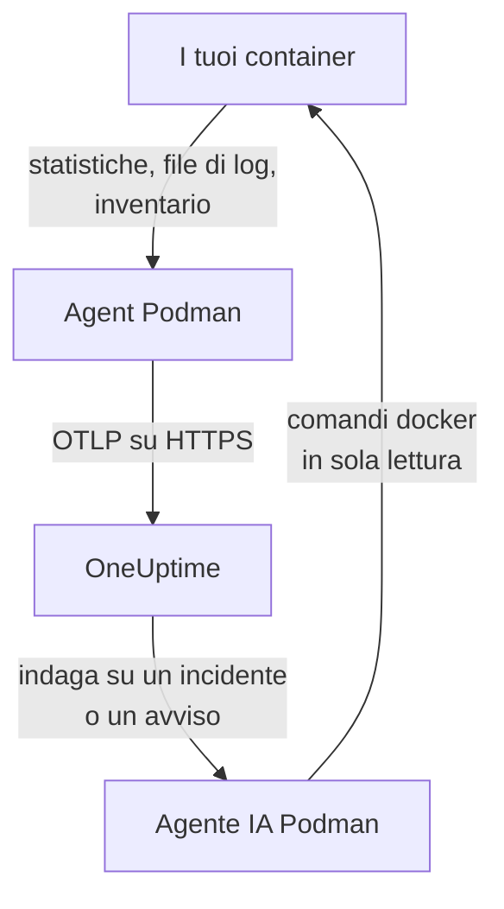

# Agent Podman

L'agent Podman di OneUptime è un container che esegui su un host Podman. Legge le statistiche e i file di log di ogni container dell'host e li invia a OneUptime, dove l'host compare con i suoi container, le metriche e i log. Un secondo container, l'agente IA Podman, permette a OneUptime AI di indagare sull'host. I [monitor Podman](/docs/monitor/podman-monitor) generano avvisi in base a ciò che l'agent invia.

:::cards
- [Installa l'agent](#installa-lagent): Due container, con `podman run` o Podman Compose.
- [Cosa raccoglie l'agent](#cosa-raccoglie-lagent): Metriche, log e un inventario di ogni container.
- [I log dei container richiedono k8s-file](#i-log-dei-container-richiedono-il-driver-k8s-file): Podman scrive i log in journald a meno che tu non cambi driver.
- [Risoluzione dei problemi](#risoluzione-dei-problemi): Riavvii in loop, metriche mancanti, log mancanti.
:::

## Come funziona

L'agent è un OpenTelemetry Collector con la configurazione di OneUptime integrata. Tramite il socket dell'API compatibile con Docker di Podman legge le statistiche di ogni container ogni 30 secondi ed elenca ogni container, immagine, rete e volume ogni 5 minuti. Segue i file di log dei container e invia tutto al tuo URL di OneUptime tramite OTLP, con la chiave di acquisizione che gli fornisci.



L'host si registra con i suoi primi dati, con il nome che gli dai in `PODMAN_HOST_NAME`. L'agente IA è opzionale: se lo ometti, il collector funziona allo stesso modo.

## Prima di iniziare

- Podman 4.0 o successivo, e accesso root sull'host.
- Il socket dell'API di Podman in `/run/podman/podman.sock`. Attivalo con `sudo systemctl enable --now podman.socket`.
- Una chiave di acquisizione. Creane una in **Impostazioni del progetto → Telemetria e APM → Chiavi di acquisizione** e copiane il valore.
- HTTPS in uscita dall'host verso il tuo URL di OneUptime.
- Per i log dei container, container che usano il driver di log `k8s-file`. Podman in modalità rootful scrive i log in `journald` per impostazione predefinita, che l'agent non può leggere. Vedi [I log dei container richiedono il driver k8s-file](#i-log-dei-container-richiedono-il-driver-k8s-file).

## Installa l'agent

:::steps
### Avvia l'agent

Sostituisci `YOUR_ONEUPTIME_URL` con il tuo URL di OneUptime, `YOUR_TELEMETRY_INGESTION_TOKEN` con la chiave di acquisizione e `my-podman-host` con un nome per questo host, come `prod-podman-01`. Il nome è quello con cui l'host compare in OneUptime, quindi mantienilo stabile: un nome nuovo registra un nuovo host.

:::tabs
@tab Podman CLI
```bash
podman run -d \
  --name oneuptime-podman-agent \
  --user 0:0 \
  --restart unless-stopped \
  -v /run/podman/podman.sock:/run/podman/podman.sock:ro \
  -v /var/lib/containers/storage:/var/lib/containers/storage:ro \
  -e ONEUPTIME_URL="YOUR_ONEUPTIME_URL" \
  -e ONEUPTIME_SERVICE_TOKEN="YOUR_TELEMETRY_INGESTION_TOKEN" \
  -e PODMAN_HOST_NAME="my-podman-host" \
  oneuptime/podman-agent:release
```

Poi avvia accanto l'[agente IA](#agente-ia), con gli stessi valori. **Le indagini IA sono attive per impostazione predefinita**: mentre OneUptime AI indaga su un incidente o un avviso su questo host, esegue comandi `docker` in sola lettura tramite l'agente IA, sull'API compatibile con Docker di Podman, e non modifica nulla a meno che tu non consenta le correzioni. Per installare senza indagini IA, salta questo comando.

```bash
podman run -d \
  --name oneuptime-podman-ai-agent \
  --user 0:0 \
  --restart unless-stopped \
  --read-only --tmpfs /tmp \
  -v /run/podman/podman.sock:/run/podman/podman.sock:ro \
  -e ONEUPTIME_URL="YOUR_ONEUPTIME_URL" \
  -e ONEUPTIME_SERVICE_TOKEN="YOUR_TELEMETRY_INGESTION_TOKEN" \
  -e ONEUPTIME_AI_AGENT_RESOURCE_TYPE=podman \
  -e PODMAN_HOST_NAME="my-podman-host" \
  oneuptime/resource-ai-agent:release
```
@tab Podman Compose
Salva questo file come `docker-compose.yml` in una cartella sull'host. Il secondo servizio è l'[agente IA](#agente-ia): omettilo per eseguire il collector senza indagini IA.

```yaml title="docker-compose.yml"
services:
  oneuptime-podman-agent:
    image: oneuptime/podman-agent:release
    container_name: oneuptime-podman-agent
    user: "0:0"
    restart: unless-stopped
    volumes:
      - /run/podman/podman.sock:/run/podman/podman.sock:ro
      - /var/lib/containers/storage:/var/lib/containers/storage:ro
    environment:
      - ONEUPTIME_URL=YOUR_ONEUPTIME_URL
      - ONEUPTIME_SERVICE_TOKEN=YOUR_TELEMETRY_INGESTION_TOKEN
      - PODMAN_HOST_NAME=my-podman-host
    logging:
      driver: json-file
      options:
        max-size: "10m"
        max-file: "3"
  oneuptime-podman-ai-agent:
    image: oneuptime/resource-ai-agent:release
    container_name: oneuptime-podman-ai-agent
    user: "0:0"
    restart: unless-stopped
    read_only: true
    tmpfs:
      - /tmp
    volumes:
      - /run/podman/podman.sock:/run/podman/podman.sock:ro
    environment:
      - ONEUPTIME_URL=YOUR_ONEUPTIME_URL
      - ONEUPTIME_SERVICE_TOKEN=YOUR_TELEMETRY_INGESTION_TOKEN
      - ONEUPTIME_AI_AGENT_RESOURCE_TYPE=podman
      - PODMAN_HOST_NAME=my-podman-host
```

Avvialo in quella cartella:

```bash
podman compose up -d
```
:::

### Verifica che l'agent sia in esecuzione

```bash
podman ps --filter name=oneuptime-podman-agent
podman logs -f oneuptime-podman-agent
```

I log dovrebbero mostrare questa riga una volta avviato il collector:

```text
Everything is ready. Begin running and processing data.
```

### Trova l'host in OneUptime

Apri **Prodotti → Infrastruttura → Podman → Tutti gli host**. L'host compare con il suo `PODMAN_HOST_NAME` entro un minuto circa, con i suoi container, le metriche e i log. L'agente IA risulta connesso nella pagina **Agente IA** dell'host e in fondo alla sua **Panoramica**.
:::

## Variabili d'ambiente

| Variabile | Obbligatoria | Descrizione |
| --- | --- | --- |
| `ONEUPTIME_URL` | Sì | Il tuo URL di OneUptime, come `https://oneuptime.com` o la tua istanza self-hosted. Usa `http://` e la sua porta se l'istanza usa solo HTTP. |
| `ONEUPTIME_SERVICE_TOKEN` | Sì | La chiave di acquisizione da **Impostazioni del progetto → Telemetria e APM → Chiavi di acquisizione**. |
| `PODMAN_HOST_NAME` | No | Il nome dell'host in OneUptime. Il valore predefinito è `podman-host`, quindi dai a ogni host il suo. |
| `DOCKER_API_VERSION` | No | La versione dell'API di Docker che l'agent usa con il socket di Podman. Il valore predefinito è `1.44`. Abbassala se il socket riporta un massimo più vecchio, oppure impostala su un valore vuoto per negoziarla (vedi [Risoluzione dei problemi](#risoluzione-dei-problemi)). |

Per cambiare un valore, rimuovi l'agent ed esegui di nuovo il suo comando (Podman CLI), oppure modifica `docker-compose.yml` ed esegui `podman compose up -d` (Podman Compose).

## Cosa raccoglie l'agent

| Dati | Cosa sono |
| --- | --- |
| Metriche dei container | CPU (utilizzo, percentuale, limitazione), memoria (utilizzo, limite, percentuale), I/O di rete e di blocco, uptime, riavvii e numero di processi, per container, ogni 30 secondi. |
| Log dei container | stdout e stderr di ogni container, dal file `ctr.log` che scrive il driver di log `k8s-file`. |
| Inventario | Ogni container in qualsiasi stato, e ogni immagine, rete e volume, ogni 5 minuti. |

Le metriche e i log di ogni container vengono archiviati sotto un servizio con il nome del container. Ogni riga di log riceve una severità in base al livello che indica, come `[ERROR]`, `level=warn` o `{"level":"info"}`; una riga che non ne indica nessuno prende quella del suo flusso: stderr è `ERROR`, stdout è `INFO`. Le righe che iniziano con uno spazio o una parentesi di chiusura vengono unite alla riga precedente, quindi uno stack trace arriva come un unico record. I log dell'agent stesso vengono esclusi.

[Monitor Podman](/docs/monitor/podman-monitor#metriche-raccolte) elenca ogni metrica e il suo significato.

## I log dei container richiedono il driver k8s-file

L'agent segue `/var/lib/containers/storage/overlay-containers/*/userdata/ctr.log`, i file che scrive il driver di log `k8s-file` di Podman (`json-file` è lo stesso driver in Podman). Il driver predefinito di Podman in modalità rootful è `journald`, che non lascia alcun file da leggere, e lo stesso vale per un driver remoto come `syslog`. Le metriche di un container del genere arrivano comunque; i suoi log no.

Controlla il driver di log di un container e quello predefinito di Podman:

```bash
podman inspect <container> --format '{{.HostConfig.LogConfig.Type}}'
podman info --format '{{.Host.LogDriver}}'
```

Esegui un container con `k8s-file`, oppure passa a esso un servizio Compose:

```bash
podman run --log-driver k8s-file --log-opt max-size=100m ... <image>
```

```yaml
services:
  my-app:
    image: my-app:latest
    logging:
      driver: "k8s-file"
      options:
        max-size: "100m"
```

Oppure rendilo il predefinito per ogni container creato in seguito, in `containers.conf` (`/etc/containers/containers.conf` in modalità rootful, `~/.config/containers/containers.conf` in modalità rootless):

```toml title="containers.conf"
[containers]
log_driver = "k8s-file"
log_size_max = 104857600
```

Poi ricrea i container. Un container mantiene il driver di log con cui è stato creato, quindi riavviarlo non basta.

## Aggiornare l'agent

Quando l'agent è più vecchio del tuo OneUptime, compare un segnale di avviso accanto a **Versione dell'agente** nella **Panoramica** dell'host. Selezionalo per vedere questi comandi.

:::tabs
@tab Podman CLI
```bash
podman pull oneuptime/podman-agent:release
podman pull oneuptime/resource-ai-agent:release
podman rm -f oneuptime-podman-agent oneuptime-podman-ai-agent
```

Poi esegui di nuovo entrambi i comandi `podman run` di [Avvia l'agent](#avvia-lagent).
@tab Podman Compose
```bash
podman compose pull
podman compose up -d
```
:::

Il tag `release` punta sempre alla release più recente. Per fissare una versione, usa `oneuptime/podman-agent:<version>`, come `oneuptime/podman-agent:10.0.31`. La stessa immagine si trova nel GitHub Container Registry come `ghcr.io/oneuptime/podman-agent:release`.

## Disinstallare l'agent

:::tabs
@tab Podman CLI
```bash
podman rm -f oneuptime-podman-agent
podman rm -f oneuptime-podman-ai-agent
```
@tab Podman Compose
```bash
podman compose down
```
:::

L'host resta in OneUptime con i dati che ha inviato. Se non ti serve più, eliminalo con **Elimina host** nel suo menu.

## Agente IA

I comandi e il file Compose qui sopra, l'`install.sh` dell'agent Podman e il `docker-compose.yml` nella sua [directory PodmanAgent](https://github.com/OneUptime/oneuptime/tree/master/agents/PodmanAgent) eseguono tutti l'**Agente IA Podman**: un secondo container, `oneuptime-podman-ai-agent` (immagine `oneuptime/resource-ai-agent:release`), che esegue i comandi in sola lettura richiesti da OneUptime AI mentre indaga su un incidente o un avviso su questo host — tramite l'API compatibile con Docker di Podman, con la CLI `docker`: `docker ps -a`, `docker logs --tail 200 web`, `docker container inspect web` — e, solo se lo consenti, applica correzioni come il riavvio di un container specifico. Legge gli stessi `ONEUPTIME_URL`, `ONEUPTIME_SERVICE_TOKEN` e `PODMAN_HOST_NAME` del collector, quindi serve esattamente questo host, e compare nella pagina **Agente IA** dell'host in OneUptime.

- **Le indagini IA sono attive per impostazione predefinita.** Appena l'agent si connette, OneUptime AI lo usa per indagare sugli incidenti e sugli avvisi di questo host, e la **Panoramica** dell'host mostra lo stato dell'agent. Per fermarlo, imposta `ONEUPTIME_AI_INVESTIGATION=false` dove viene eseguito l'agent (**Cambia** sotto **Cosa può fare l'IA**, nella pagina dell'agente IA, mostra come), oppure ometti l'agent.
- È in sola lettura a meno che tu non lo avvii con `ONEUPTIME_AI_ALLOW_WRITES=true`; `ONEUPTIME_AI_WRITE_TARGETS` (per esempio `web-*,api-*`) limita i container che una correzione può toccare. Avvialo anche con `ONEUPTIME_AI_FIXES` per indicare come vengono eseguite le correzioni — `ask-for-approval` (una persona approva ciascuna), `automatic` o `bypass-approval` — e la pagina dell'agente IA lo mostra in sola lettura ([Cosa può fare l'IA, impostato dall'agent](/docs/ai/infrastructure-ai-agents#what-ai-may-do-set-by-the-agent)).
- Richiede lo stesso socket del collector e viene eseguito come root con il socket montato, perché il socket appartiene a root — e per Podman in modalità rootful chi può usare il socket è root su questo host, `:ro` o no. Il limite è la policy dei comandi dell'agent: non esegue mai `exec`, `run`, `rm` o `prune`, e non modifica mai sé stesso, il collector o qualsiasi cosa in `ONEUPTIME_AI_PROTECTED_TARGETS` (glob di nomi di container).
- `install.sh --no-ai-agent` lo omette; `podman rm -f oneuptime-podman-ai-agent` lo rimuove. Aggiornalo come il collector: `podman pull oneuptime/resource-ai-agent:release`, rimuovilo e avvialo di nuovo.

Cosa può eseguire, come funzionano le correzioni e come risolverne i problemi: [Infrastructure AI Agents](/docs/ai/infrastructure-ai-agents#docker-and-podman-hosts).

## Risoluzione dei problemi

:::details L'agent si riavvia con "client version is too new"
I log dell'agent mostrano:

```text
Error: cannot start pipelines: failed to start "docker_stats" receiver:
Error response from daemon: client version 1.44 is too new.
Maximum supported API version is 1.41
```

Un server dell'API di Docker che impone una versione massima del client ne rifiuta una più recente, quindi il receiver non parte mai e il collector termina con esso. Controlla la versione dell'API che riporta il socket di Podman:

```bash
curl -s -o /dev/null -D - --unix-socket /run/podman/podman.sock http://localhost/_ping | grep -i '^api-version'
```

Poi aggiungi `-e DOCKER_API_VERSION=1.41` (o il valore che hai ottenuto) a `podman run`, oppure imposta `DOCKER_API_VERSION` in Compose. I server più recenti servono ancora le versioni più vecchie dell'API, quindi l'impostazione resta valida dopo un aggiornamento.

Preferisci non cercare il numero? Imposta `DOCKER_API_VERSION` sulla stringa vuota. L'agent negozia allora la versione con il socket (un `HEAD /_ping`, poi il massimo che riporta il socket) invece di fissarne una:

```bash
podman run -d ... -e DOCKER_API_VERSION= ...
```
:::

:::details Permesso negato sul socket di Podman, oppure nessun socket
L'agent deve essere eseguito come root per leggere `/run/podman/podman.sock`. Verifica che `--user 0:0` sia nel tuo comando `podman run`, oppure `user: "0:0"` in Compose, e che il socket sia attivo: `sudo systemctl enable --now podman.socket`. Podman in modalità rootless ha invece il socket in `/run/user/<uid>/podman/podman.sock` (`systemctl --user enable --now podman.socket`): monta quel percorso al posto di `/run/podman/podman.sock`.
:::

:::details L'host risulta disconnesso
1. Verifica che l'agent sia in esecuzione: `podman ps --filter name=oneuptime-podman-agent`
2. Cerca errori nei suoi log: `podman logs oneuptime-podman-agent 2>&1 | grep -i error`
3. Controlla `ONEUPTIME_URL` e `ONEUPTIME_SERVICE_TOKEN`: la chiave deve essere una chiave di acquisizione valida che non è stata disattivata.
4. Verifica che l'host raggiunga il tuo URL di OneUptime in rete.
:::

:::details Non compare nessuna metrica
1. Verifica che il socket di Podman sia montato nell'agent. La sua immagine non ha una shell, quindi guarda da un container usa e getta che ne condivide i mount: `podman run --rm --volumes-from oneuptime-podman-agent alpine:3.19 ls -la /run/podman/podman.sock`
2. Cerca errori di esportazione nei suoi log: `podman logs oneuptime-podman-agent 2>&1 | tail -100`
3. Verifica che la chiave di acquisizione sia valida e non sia scaduta.
:::

:::details Le metriche arrivano, ma i log dei container no
Molto probabilmente i tuoi container usano `journald`, il driver di log predefinito di Podman. Controlla quali file osserva l'agent e quale driver usa un container:

```bash
podman logs oneuptime-podman-agent 2>&1 | grep -E "Started watching file|no files match"
podman inspect <container> --format '{{.HostConfig.LogConfig.Type}}'
```

Se l'agent segnala `no files match the configured criteria`, passa i container a `k8s-file` e ricreali, come mostra [I log dei container richiedono il driver k8s-file](#i-log-dei-container-richiedono-il-driver-k8s-file).
:::

:::details I log finiscono su un altro host, oppure l'host si chiama podman-host
Il nome dell'host viene da `PODMAN_HOST_NAME`. Un agent avviato senza di esso riporta `podman-host`, quindi ogni host configurato così sembra lo stesso; se cambi il nome in seguito, OneUptime registra un secondo host, che riceve i nuovi dati. Imposta `PODMAN_HOST_NAME` su un nome proprio per ogni host e ricrea l'agent. Per verificare il nome che riporta l'agent:

```bash
podman inspect oneuptime-podman-agent --format '{{range .Config.Env}}{{println .}}{{end}}' | grep PODMAN_HOST_NAME
```
:::

## Passaggi successivi

:::cards
- [Monitor Podman](/docs/monitor/podman-monitor): Ricevere avvisi su CPU, memoria e riavvii dei container.
- [Database](/docs/telemetry/databases): I container di database sull'host vengono rilevati e ottengono pagine proprie.
- [Agent Kubernetes](/docs/telemetry/kubernetes-agent): Monitorare invece un cluster Kubernetes.
- [Collector OpenTelemetry sull'host](/docs/telemetry/host-otel-collector): Monitorare la macchina stessa: CPU, dischi, processi e log.
:::
