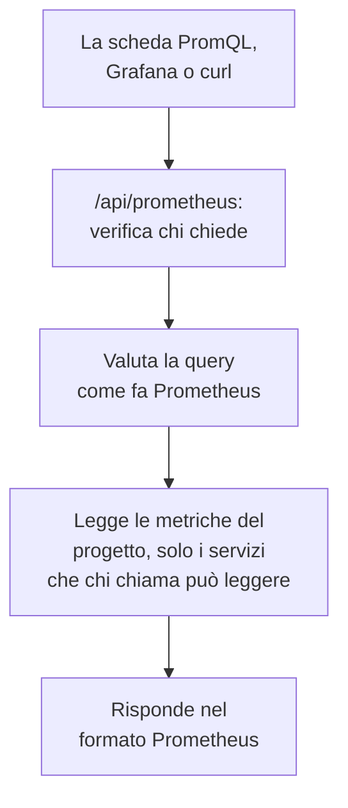

# Interrogare le metriche con PromQL

PromQL è il linguaggio di query di Prometheus, quello che già conosce la maggior parte di chi crea grafici di metriche. OneUptime lo usa per leggere le metriche del tuo progetto: nella scheda **PromQL** della pagina Metriche, e tramite un'API compatibile con Prometheus a cui può puntare Grafana, o qualsiasi strumento con una fonte di dati Prometheus.

:::cards
- [Scrivere una query](#scrivere-una-query): Eseguire PromQL nella pagina Metriche e vedere un grafico o una tabella.
- [Come si chiamano le metriche](#come-si-chiamano-le-metriche): Come si leggono in PromQL i nomi e gli attributi di OpenTelemetry.
- [Collegare Grafana](#collegare-grafana): Aggiungere OneUptime come fonte di dati Prometheus.
- [Limiti](#limiti): Cosa può leggere una query, e per quanto tempo.
:::

## Come funziona

La scheda PromQL e Grafana interrogano la stessa API. OneUptime verifica che chi chiama possa leggere le metriche del progetto, legge solo i servizi che può leggere, e valuta la query come fa Prometheus.



## Prima di iniziare

- **Metriche in arrivo.** Inviale con [OpenTelemetry](/docs/telemetry/open-telemetry), oppure da un agente come il [Collector OpenTelemetry sull'host](/docs/telemetry/host-otel-collector).
- **Un ruolo che può leggere le metriche.** Project Owner, Project Admin, Project Member, Viewer, Telemetry Admin, Telemetry Member o Telemetry Viewer, oppure un ruolo personalizzato con il permesso Read Metrics. Un ruolo limitato ad alcuni servizi legge solo le loro metriche.
- **Per Grafana o uno script: una chiave API del progetto** con uno di questi ruoli o il permesso Read Metrics. Vedi [Creare una chiave API](/docs/api-reference/api-reference#creare-una-chiave-api). Su OneUptime Cloud, le chiavi API richiedono il piano **Growth**.

## Scrivere una query

:::steps
### Aprire PromQL

Apri **Metriche** e fai clic sulla scheda **PromQL**.

### Scrivere la query

Scrivila nell'editor, scegli un esempio in **Esempi**, oppure parti da **Aggiungi il nome di una metrica**, che elenca le metriche del tuo progetto con i nomi che dà loro PromQL.

### Eseguirla

Fai clic su **Esegui query**, oppure premi Ctrl+Invio (⌘+Invio su un Mac). **Grafico** disegna la query sull'intervallo di tempo; **Tabella** mostra il valore di ogni serie alla fine dell'intervallo.
:::

Alcune query da cui partire:

```text title="PromQL"
# Requests per second, by service
sum by (job) (rate(http_requests_total[5m]))

# The 95th percentile of a latency histogram
histogram_quantile(0.95, sum by (le) (rate(http_server_request_duration_bucket[5m])))

# The five hosts using the most memory
topk(5, system_memory_usage)
```

Per una query che non viene eseguita, l'editor mostra che cosa è andato storto, e dove: `rate(http_requests_total)`, ad esempio, dice che la funzione ha bisogno di un intervallo come `[5m]`.

## Come si chiamano le metriche

OneUptime memorizza le metriche alla maniera di OpenTelemetry. PromQL le legge con i nomi che dà loro il supporto a OpenTelemetry integrato in Prometheus, così una query scritta per Prometheus funziona anche qui:

| In OneUptime | In PromQL |
| --- | --- |
| Un gauge `system.cpu.utilization` | `system_cpu_utilization` |
| Un contatore `http.requests` | `http_requests`, oppure `http_requests_total` |
| Un istogramma `http.server.request.duration` | `http_server_request_duration_bucket` (con `le`), `_count` e `_sum` |
| Un summary `rpc.latency` | `rpc_latency` (con `quantile`), `_count` e `_sum` |
| Un attributo `http.route` | L'etichetta `http_route` |
| Un attributo di risorsa `service.name` | L'etichetta `resource_service_name`, e `job` |
| Un attributo di risorsa `service.instance.id` | L'etichetta `resource_service_instance_id`, e `instance` |

- **Punti e trattini diventano trattini bassi** nei nomi di metriche ed etichette. Per indicare una metrica o un'etichetta esattamente come è memorizzata, metti il suo nome tra virgolette, come fa Prometheus 3: `{"http.server.request.duration", "http.route"="/checkout"}`.
- **I contatori delta vengono sommati** a partire dall'inizio dell'intervallo di tempo della query, così `rate()` e `increase()` li leggono come qualsiasi altro contatore.
- **Gli istogrammi esponenziali** hanno `_count` e `_sum`, ma nessun bucket.

## Collegare Grafana

:::steps
### Creare una chiave API

In OneUptime, apri **Impostazioni del progetto → Avanzato → Chiavi API** e fai clic su **Crea: Chiave API**. Dai alla chiave un ruolo che può leggere la telemetria, oppure il permesso Read Metrics.

### Aggiungere una fonte di dati Prometheus

In Grafana, apri **Connections → Data sources → Add data source** e scegli **Prometheus**.

### Inserire l'URL del server

Imposta **Prometheus server URL** sul tuo indirizzo OneUptime seguito da `/api/prometheus`. Su OneUptime Cloud, è `https://oneuptime.com/api/prometheus`. La scheda **PromQL** mostra l'indirizzo del tuo server, con un pulsante per copiarlo.

### Inviare la chiave API

In **HTTP headers**, aggiungi l'intestazione `Authorization` con il valore `Bearer` seguito da uno spazio e dalla tua chiave API. Funziona anche l'autenticazione di base: un nome utente qualsiasi, con la chiave API come password.

### Salvare e provare

Fai clic su **Save & test**. Grafana esegue una query e dice che la fonte di dati funziona.
:::

Qualsiasi altro client Prometheus funziona allo stesso modo. Con curl:

```bash title="Query OneUptime's Prometheus API"
curl -H "Authorization: Bearer $ONEUPTIME_API_KEY" \
  "https://oneuptime.com/api/prometheus/api/v1/query?query=up"
```

## L'API

L'API risponde ai percorsi dell'API HTTP di Prometheus, con `GET` o `POST`, sotto `/api/prometheus`:

| Percorso | Cosa restituisce |
| --- | --- |
| `/api/v1/query` | Una query in un istante (`time`, per impostazione predefinita adesso). |
| `/api/v1/query_range` | Una query a ogni `step` da `start` a `end`. |
| `/api/v1/series` | Le serie che `match[]` seleziona. |
| `/api/v1/labels` | I nomi delle etichette, delle serie che `match[]` seleziona o di tutte le metriche. |
| `/api/v1/label/<name>/values` | I valori di un'etichetta. `__name__` elenca i nomi delle metriche. |
| `/api/v1/metadata` | Il tipo, il testo di aiuto e l'unità di ogni metrica. |

Gli istanti sono in secondi Unix o in RFC 3339, le durate in secondi o come una durata del tipo `15s`, e le risposte sono nel formato di Prometheus. `/api/v1/status/buildinfo` risponde come un server Prometheus 3; regole e avvisi sono vuoti, perché OneUptime invia gli avvisi tramite i [monitor](/docs/monitor/metrics-monitor).

## Cosa copre PromQL

- **Selettori** con ogni matcher (`=`, `!=`, `=~`, `!~`), intervalli, `offset`, `@` (con `start()` e `end()`) e subquery.
- **Operatori**: aritmetici, di confronto (con `bool`), `and`, `or`, `unless`, e corrispondenza tra vettori con `on`, `ignoring`, `group_left` e `group_right`.
- **Aggregazioni**: `sum`, `avg`, `min`, `max`, `count`, `group`, `stddev`, `stdvar`, `topk`, `bottomk`, `quantile` e `count_values`, con `by` o `without`.
- **Funzioni**: `rate`, `irate`, `increase`, `delta`, `idelta`, `deriv`, `predict_linear`, `histogram_quantile`, ogni funzione `*_over_time`, `changes`, `resets`, `absent`, `label_replace`, `label_join`, `sort`, `clamp`, `round`, le funzioni matematiche e di data, e altro ancora.

Le funzioni per gli istogrammi nativi di Prometheus, come `histogram_count()`, non sono disponibili: OneUptime memorizza gli istogrammi con bucket, che vengono letti da `histogram_quantile()` e dalle serie `_count` e `_sum`.

## Limiti

Ogni query ha dei limiti, così che una dashboard con molti pannelli non possa sovraccaricare OneUptime:

| Limite | Valore |
| --- | --- |
| Punti in una serie di una query di intervallo | 11.000 |
| Campioni che una query può leggere e tenere in memoria | 5.000.000 |
| Punti di metrica che un selettore può leggere | 1.000.000 |
| Tempo che può richiedere una lettura | 30 secondi |
| Tempo che può richiedere la valutazione | 30 secondi |
| Quanto indietro guarda un selettore per trovare l'ultimo campione di una serie | 5 minuti |
| Il passo di una subquery, quando la query lo omette | 1 minuto |

## Risoluzione dei problemi

:::details Grafana dice che la fonte di dati non funziona
Controlla che l'URL finisca con `/api/prometheus` e che l'intestazione `Authorization` contenga `Bearer`, uno spazio e la chiave API. Una chiave senza un ruolo che può leggere le metriche viene rifiutata: dagliene uno in **Impostazioni del progetto → Avanzato → Chiavi API**.
:::

:::details Una metrica dell'esploratore non restituisce nulla
Il suo nome PromQL ha trattini bassi dove il nome memorizzato ha punti, e un istogramma si legge tramite `_bucket`, `_count` o `_sum`. **Aggiungi il nome di una metrica** nella scheda PromQL elenca ogni nome come lo scrive PromQL.
:::

:::details "The query reads more than 1,000,000 metric points"
La query chiede più di quanto una lettura possa contenere. Aggiungi matcher sulle etichette, accorcia l'intervallo di tempo o usa un passo più ampio.
:::

## Passaggi successivi

:::cards
- [Esploratore metriche](/docs/telemetry/metrics-explorer): Rappresentare le metriche in grafici senza scrivere una query.
- [Monitor metriche](/docs/monitor/metrics-monitor): Ricevere un avviso quando una metrica supera una soglia.
- [Fonti di dati esterne](/docs/dashboards/data-sources): Rappresentare un Prometheus esterno nelle tue dashboard.
:::
