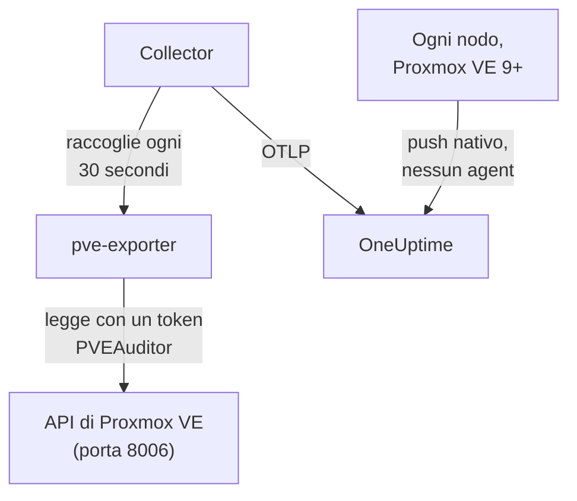

# Agent Proxmox

L'agent Proxmox di OneUptime monitora un cluster Proxmox VE: i suoi nodi, le VM QEMU, i container LXC, lo storage, lo stato HA, la copertura dei backup e la replica. Legge il cluster tramite l'API di Proxmox VE con un token in sola lettura e invia ciò che trova a OneUptime, dove il cluster compare con i suoi nodi, guest e storage. Su Proxmox VE 9 e successivi i nodi possono anche inviare da soli le proprie metriche, senza nulla da installare. I [monitor Proxmox](/docs/monitor/proxmox-monitor) generano avvisi in base a ciò che arriva.

:::cards
- [Scegli come connetterti](#scegli-come-connetterti): L'agent, o il push integrato di Proxmox VE 9.
- [Installa l'agent](#installa-lagent): Un token API, poi lo script di installazione o Docker Compose.
- [Push nativo](#alternativa-senza-installazione-push-opentelemetry-nativo-di-proxmox-ve-9): Proxmox VE 9 invia da solo le sue metriche.
- [Risoluzione dei problemi](#risoluzione-dei-problemi): Uno script di diagnostica, e i problemi più comuni.
:::

## Come funziona

L'agent è un insieme di container che esegui con Docker Compose su una macchina: [prometheus-pve-exporter](https://github.com/prometheus-pve/prometheus-pve-exporter) legge l'API di Proxmox VE sulla porta 8006, un OpenTelemetry Collector raccoglie l'exporter ogni 30 secondi e applica a ogni metrica il nome del tuo cluster, e l'agente IA Proxmox permette a OneUptime AI di leggere il cluster mentre indaga. Il push nativo di Proxmox VE 9 invia invece le metriche di ogni nodo direttamente a OneUptime.



Il cluster si registra con i suoi primi dati, con il nome che l'agent applica a ogni metrica come `proxmox.cluster.name`.

## Scegli come connetterti

| | L'agent | Push nativo |
| --- | --- | --- |
| Proxmox VE | Qualsiasi versione supportata | 9.0 o successiva |
| Da installare | Docker Compose su una macchina | Nulla: un server delle metriche nell'interfaccia web di Proxmox |
| Nodi, guest e storage | Sì | Sì |
| Stato HA, avvio al boot, copertura dei backup e replica | Sì | No |
| Agente IA Proxmox | Sì | No |

I modelli **HA Resource in Error State**, **Guest Down**, **Guest Not Backed Up** e **Replication Failing** richiedono l'agent. Usa l'uno o l'altro per un cluster: eseguirli entrambi riporta ogni risorsa due volte.

## Prima di iniziare

- Docker Engine 20.10 o successivo con il plugin Docker Compose v2, su una macchina che raggiunge l'API di Proxmox VE sulla porta 8006.
- Una shell root su qualsiasi nodo Proxmox VE, oppure l'interfaccia web di Proxmox, per creare un token API.
- Una chiave di acquisizione. Creane una in **Impostazioni del progetto → Telemetria e APM → Chiavi di acquisizione** e copiane il valore.
- HTTPS in uscita da quella macchina verso il tuo URL di OneUptime.

### Dove eseguire l'agent

L'agent interroga l'API di Proxmox VE in rete, quindi non deve risiedere su un nodo del cluster, e non dovrebbe: eseguilo su una macchina che sopravvive al guasto di un nodo (una piccola VM di monitoraggio su hardware separato, un host di gestione), oppure punta `PVE_HOST` a un IP virtuale o a un nome DNS round-robin invece che all'indirizzo di un singolo nodo. Se il target API dell'agent è il nodo appena caduto, il tuo monitoraggio cade con esso. L'unica eccezione è la pipeline opzionale dei log di journald, che deve girare su un nodo Proxmox VE (vedi [Inviare i log dei servizi Proxmox](#opzionale-inviare-i-log-dei-servizi-proxmox)).

## Installa l'agent

:::steps
### Crea un token API in sola lettura

L'agent legge il cluster con un token API che ha il ruolo **PVEAuditor**, che può leggere e nient'altro.

:::tabs
@tab Shell
Come root su qualsiasi nodo Proxmox VE:

```bash
pveum user add monitoring@pam
pveum acl modify / --roles PVEAuditor --users monitoring@pam
pveum user token add monitoring@pam oneuptime --privsep 1
pveum acl modify / --roles PVEAuditor --tokens 'monitoring@pam!oneuptime'
```

Il primo comando fallisce, senza conseguenze, solo se `monitoring@pam` esiste già: i token API hanno un proprio secret, quindi l'utente non ha bisogno di password né di account di sistema. `pveum user token add` stampa il secret del token una sola volta; l'ID del token è `monitoring@pam!oneuptime`.
@tab Proxmox web UI
1. Vai su *Datacenter → Permissions → API Tokens* e fai clic su **Add**.
2. Scegli (o crea) un utente, assegna al token un ID come `oneuptime` e lascia selezionato **Privilege Separation**.
3. Copia l'ID del token (`user@realm!tokenname`) e il secret: il secret viene mostrato una sola volta.
4. In *Datacenter → Permissions*, aggiungi due volte il ruolo **PVEAuditor** sul percorso `/`: una come **API Token Permission** per il token, una come **User Permission** per il suo utente.
:::

Il ruolo va sull'utente oltre che sul token, perché un token con separazione dei privilegi ottiene solo i permessi che ha anche il suo utente. Deve stare sul percorso radice `/`, perché l'exporter legge ogni oggetto di nodo, guest e storage: un percorso più ristretto nasconde il resto del cluster e fallisce con `401`/`403 Permission check failed (/, Sys.Audit)`.

### Installa e avvia l'agent

:::tabs
@tab install.sh
Scarica lo script di installazione ed eseguilo sulla macchina che ospiterà l'agent:

```bash
curl -sSL https://raw.githubusercontent.com/OneUptime/oneuptime/master/agents/ProxmoxAgent/install.sh -o install.sh
bash install.sh
```

Lo script chiede il tuo URL di OneUptime, la chiave di acquisizione, un nome per il cluster, l'host dell'API di Proxmox VE, se eseguire l'exporter incluso, e l'ID e il secret del token — e se l'[agente IA](#agente-ia) può applicare correzioni e, in caso affermativo, un token proprio e i guest che non deve mai modificare. Si installa in `/opt/oneuptime-proxmox-agent`, scrive un file `.env` con permessi `0600` e avvia l'agent con Docker Compose. Eseguire di nuovo lo script riutilizza tutto ciò che c'è in quel `.env` invece di chiedere di nuovo, ed è così che [aggiorni l'agent](#aggiornare-lagent).
@tab Docker Compose
Scarica `docker-compose.yml` e `otel-collector-config.yaml` dalla [directory ProxmoxAgent](https://github.com/OneUptime/oneuptime/tree/master/agents/ProxmoxAgent) in una nuova cartella:

```bash
mkdir oneuptime-proxmox-agent && cd oneuptime-proxmox-agent
curl -fsSLO https://raw.githubusercontent.com/OneUptime/oneuptime/master/agents/ProxmoxAgent/docker-compose.yml
curl -fsSLO https://raw.githubusercontent.com/OneUptime/oneuptime/master/agents/ProxmoxAgent/otel-collector-config.yaml
```

Crea un file `.env` accanto a essi. Contiene il secret del token, quindi mantienilo privato con `chmod 600 .env`:

```bash title=".env"
ONEUPTIME_URL=YOUR_ONEUPTIME_URL
ONEUPTIME_TELEMETRY_INGESTION_KEY=YOUR_TELEMETRY_INGESTION_TOKEN
PROXMOX_CLUSTER_NAME=my-proxmox-cluster
PVE_HOST=192.168.1.10
PVE_API_TOKEN_ID=monitoring@pam!oneuptime
PVE_API_TOKEN_SECRET=your-token-secret
COMPOSE_PROFILES=pve-exporter
```

`COMPOSE_PROFILES=pve-exporter` avvia anche l'exporter incluso. Avvia l'agent:

```bash
docker compose up -d
```
:::

Usi già prometheus-pve-exporter? Rispondi **n** quando lo script chiede se eseguire quello incluso, oppure rimuovi `COMPOSE_PROFILES` da `.env`, e punta l'agent al tuo (`host:port`, senza schema, un indirizzo che il container dell'agent può raggiungere: `localhost` è il container stesso). Mantieni `PVE_API_TOKEN_ID` e `PVE_API_TOKEN_SECRET` se usi l'[agente IA](#agente-ia), che chiama l'API con quel token:

```bash
PVE_EXPORTER_URL=your-exporter-host:9221
```

### Verifica che l'agent sia in esecuzione

```bash
docker compose ps
docker logs -f oneuptime-proxmox-agent
```

`docker compose ps` elenca il collector (`oneuptime-proxmox-agent`), l'exporter incluso (`oneuptime-pve-exporter`, a meno che tu non usi il tuo) e l'agente IA (`oneuptime-proxmox-ai-agent`). I log del collector dovrebbero mostrare questa riga una volta avviato:

```text
Everything is ready. Begin running and processing data.
```

### Trova il cluster in OneUptime

Apri **Prodotti → Infrastruttura → Proxmox → Tutti i cluster**. Il cluster compare con il suo `PROXMOX_CLUSTER_NAME` circa un minuto dopo la prima raccolta, con i suoi nodi, guest e storage.
:::

## Variabili d'ambiente

Lo script di installazione le scrive in `/opt/oneuptime-proxmox-agent/.env`; un'installazione con Docker Compose le legge dal `.env` accanto a `docker-compose.yml`. Dopo averne cambiata una, esegui `docker compose up -d` in quella cartella.

| Variabile | Obbligatoria | Descrizione |
| --- | --- | --- |
| `ONEUPTIME_URL` | Sì | Il tuo URL di OneUptime, come `https://oneuptime.com` o la tua istanza self-hosted. Usa `http://` e la sua porta se l'istanza usa solo HTTP. |
| `ONEUPTIME_TELEMETRY_INGESTION_KEY` | Sì | La chiave di acquisizione da **Impostazioni del progetto → Telemetria e APM → Chiavi di acquisizione**. |
| `PROXMOX_CLUSTER_NAME` | Sì | Il nome del cluster in OneUptime, applicato a ogni metrica come attributo di risorsa `proxmox.cluster.name`. Mantienilo stabile: cambiarlo in seguito registra un secondo cluster. Il valore predefinito è `proxmox-cluster`. |
| `PVE_HOST` | Sì | L'host dell'API di Proxmox VE (qualsiasi nodo del cluster) interrogato dall'exporter e dall'agente IA, come `192.168.1.10`. |
| `PVE_EXPORTER_URL` | No | L'indirizzo (`host:port`, senza schema) di prometheus-pve-exporter. Il valore predefinito è l'exporter incluso, `pve-exporter:9221`. |
| `PVE_API_TOKEN_ID` | Exporter incluso o agente IA | L'ID completo del token API di Proxmox, come `monitoring@pam!oneuptime`. L'agente IA legge l'API con esso, a meno che non abbia un token proprio (`ONEUPTIME_AI_PVE_API_TOKEN_ID` / `ONEUPTIME_AI_PVE_API_TOKEN_SECRET`). |
| `PVE_API_TOKEN_SECRET` | Exporter incluso o agente IA | Il secret del token API di Proxmox. |
| `PVE_VERIFY_SSL` | No | Verifica il certificato TLS dell'API di Proxmox (l'exporter e l'agente IA). Il valore predefinito è `false`, perché Proxmox viene fornito con certificati autofirmati. |
| `COMPOSE_PROFILES` | No | Impostalo su `pve-exporter` per avviare il container dell'exporter incluso. |

## Cosa raccoglie l'agent

Il collector raccoglie l'exporter ogni 30 secondi con i suoi collector di cluster e di nodo attivi, il che copre anche i collector `backup-info` (a livello di cluster) e `replication` (a livello di nodo) dell'exporter, attivi per impostazione predefinita. Ogni serie porta un'etichetta `id` che identifica la risorsa: `node/<name>`, `qemu/<vmid>`, `lxc/<vmid>` o `storage/<node>/<storage>`.

| Categoria | Metriche |
| --- | --- |
| Disponibilità | `pve_up`, `pve_uptime_seconds` |
| Nodo | `pve_node_info`, `pve_cpu_usage_ratio`, `pve_cpu_usage_limit`, `pve_memory_usage_bytes`, `pve_memory_size_bytes` |
| Guest (VM o LXC) | `pve_guest_info`, e serie di CPU, memoria e rete sugli ID `qemu/*` e `lxc/*` (`pve_network_receive_bytes`, `pve_network_transmit_bytes`) |
| Storage | `pve_disk_usage_bytes`, `pve_disk_size_bytes`, `pve_storage_info` |
| HA | `pve_ha_state` |
| Copertura dei backup | `pve_not_backed_up_total` (i guest che nessun job di backup copre; una sola serie a livello di cluster, senza etichetta `id`) e `pve_not_backed_up_info` (una serie per ogni guest non coperto, con il suo `id`). Coperto significa che almeno un job seleziona il guest: se i backup siano stati eseguiti di recente o siano riusciti, l'exporter non lo espone. |
| Replica | `pve_replication_failed_syncs`, `pve_replication_duration_seconds`, `pve_replication_last_sync_timestamp_seconds`, `pve_replication_last_try_timestamp_seconds`, `pve_replication_next_sync_timestamp_seconds`, `pve_replication_info`, per job di replica dello storage. La loro etichetta `id` è l'ID del job (come `100-0`), non una risorsa. |

I criteri dei monitor e i filtri sugli attributi confrontano per uguaglianza, non per prefisso, quindi il processor `transform/pve-identity` del collector suddivide anche `id` in tre attributi. I modelli di avviso Proxmox integrati filtrano su di essi, quindi mantieni il processor se personalizzi la configurazione:

| Attributo | Valori | Per `qemu/100` |
| --- | --- | --- |
| `pve.scope` | `node`, `guest`, `storage`, `cluster` (`qemu` e `lxc` sono entrambi `guest`) | `guest` |
| `pve.type` | `node`, `qemu`, `lxc`, `storage` | `qemu` |
| `pve.id` | Tutto ciò che segue il primo `/` di `id` (`pve1`, `100`, `pve1/local`) | `100` |

L'etichetta `id` originale viene mantenuta così com'è.

## Opzionale — Inviare i log dei servizi Proxmox

Per impostazione predefinita l'agent invia solo metriche, quindi la pagina **Registri** del cluster resta vuota. I servizi di Proxmox VE scrivono i log nel journal di systemd con otto unità: `pveproxy`, `pvedaemon`, `pve-firewall`, `pve-ha-crm`, `pve-ha-lrm`, `pvescheduler`, `pvestatd` e `qmeventd`. Il `otel-collector-config.yaml` incluso contiene un receiver `journald` commentato proprio per queste unità, collegato a una pipeline `logs` commentata che applica `proxmox.cluster.name`, così i log finiscono sul tuo cluster.

:::steps
### Esegui l'agent su un nodo

Il journal è specifico di ogni host, quindi un agent remoto non può leggerlo. È l'unica configurazione che va contro [Dove eseguire l'agent](#dove-eseguire-lagent): per tenere l'agent delle metriche fuori dal cluster, esegui invece sul nodo un secondo collector dedicato ai soli log (copia la configurazione, poi elimina il receiver `prometheus` e la pipeline `metrics`).

### Attiva il receiver

Togli il commento al receiver `journald` e alla pipeline `logs` in `otel-collector-config.yaml`, e ai volumi del journal in `docker-compose.yml`, così il container può leggere il journal dell'host:

```yaml
- /var/log/journal:/var/log/journal:ro
- /etc/machine-id:/etc/machine-id:ro
```

### Sostituisci l'immagine del collector

L'immagine standard `otel/opentelemetry-collector-contrib` è costruita `FROM scratch`: non ha `journalctl`, che il receiver journald esegue, e gira come un utente che non può leggere il journal. Costruisci questo wrapper e punta a esso `image:` in `docker-compose.yml`:

```dockerfile title="Dockerfile"
FROM otel/opentelemetry-collector-contrib:0.161.0 AS otelcol
FROM debian:stable-slim
RUN apt-get update \
    && apt-get install -y --no-install-recommends systemd \
    && rm -rf /var/lib/apt/lists/*
COPY --from=otelcol /otelcol-contrib /otelcol-contrib
ENTRYPOINT ["/otelcol-contrib"]
CMD ["--config", "/etc/otelcol-contrib/config.yaml"]
```

Il pacchetto `systemd` c'è solo per `journalctl`, e questa immagine gira come root, che è chi può leggere il journal. Oppure fai a meno di Docker per i log ed esegui il `.deb` della release di `otelcol-contrib` sul nodo stesso, dove `journalctl` è già presente.
:::

Ogni nodo invia solo il proprio journal: per i log dei servizi di tutti i nodi, esegui il collector dei soli log su ogni nodo.

### Alternativa senza immagine personalizzata: filelog su /var/log/syslog

Per mantenere l'immagine standard, segui invece syslog. Installa rsyslog sul nodo (`apt install rsyslog`; Debian 12 e Proxmox VE 8 e successivi non lo includono più), monta la directory `/var/log` nel container (`- /var/log:/var/log:ro`; la directory, non il file, così la rotazione dei log non blocca un file obsoleto) e usa un receiver `filelog` al posto di quello journald:

```yaml
receivers:
  filelog:
    include:
      - /var/log/syslog
    start_at: end
```

Perdi il filtro per unità (syslog contiene tutto, non solo gli otto servizi), e l'utente dell'immagine standard deve poter leggere il file. Collegalo alla stessa pipeline `logs` commentata (`receivers: [filelog]`).

## Alternativa senza installazione: push OpenTelemetry nativo di Proxmox VE 9+

Proxmox VE 9.0 e successivi includono un server delle metriche OpenTelemetry che invia le metriche di nodi, guest e storage a qualsiasi endpoint OTLP/HTTP, senza agent né exporter da installare. Nell'interfaccia web di Proxmox, vai su *Datacenter → Metric Server → Add → OpenTelemetry* e compila:

| Campo | Valore |
| --- | --- |
| Server | Il tuo host OneUptime, come `oneuptime.com`, o il tuo host self-hosted |
| Port | `443` |
| Protocol | `https` |
| Path | `/otlp/v1/metrics` |
| Headers | `{"x-oneuptime-token": "YOUR_TELEMETRY_INGESTION_TOKEN"}` |

Aggiungilo una volta: ogni nodo del cluster invia le proprie metriche. OneUptime riconosce il push e lo traduce nelle stesse serie `pve_*` che invia l'agent, quindi:

- il cluster si registra con il nome del tuo cluster Proxmox (un nodo autonomo con il suo nome di nodo), e un `proxmox.cluster.name` impostato in *Resource Attributes* continua invece a essere usato;
- le pagine Nodi, Guest e Storage, i grafici della panoramica, il catalogo delle metriche e i modelli di avviso su CPU, memoria e storage funzionano come con l'agent;
- le serie originali `proxmox_node_*`, `proxmox_vm_*` e `proxmox_storage_*` restano in [Metrics Explorer](/docs/monitor/metrics-monitor) per tutto ciò che Proxmox VE riporta in più (carico medio, swap, pressure stall, traffico per scheda di rete).

### Quando un nodo smette di inviare dati

Ogni nodo invia solo il proprio stato, quindi un nodo che cade non può dirlo da sé. Sono i nodi ancora attivi a segnalarlo al suo posto:

- Circa 2 minuti dopo il suo ultimo invio, il nodo risulta **Offline** nella pagina Nodi. **Visto l'ultima volta**, nella pagina del nodo stesso, mantiene l'orario del suo ultimo invio.
- Dopo circa 5 minuti, **Node Offline** scatta per esso. Anche **Cluster Quorum at Risk** lo conta come offline; poiché quel modello richiede una finestra completa di 5 minuti di invii, scatta circa 7–9 minuti dopo che il nodo ha smesso di inviare.
- Con il suo invio successivo torna **Online** e il suo avviso si risolve.

Offline qui significa che il nodo ha smesso di inviare dati, non necessariamente che sia spento. Un nodo acceso il cui `pvestatd` è bloccato o terminato, il cui file system del cluster (`pmxcfs`) non è attivo o la cui rete verso OneUptime è interrotta viene segnalato allo stesso modo.

Cosa non può coprire:

- Un host autonomo, o un intero cluster che smette di inviare dati tutto insieme: non resta nessuno a segnalarlo, quindi non scatta alcun avviso per nodo. Il cluster passa invece a **Disconnesso**, come quando l'agent si ferma.
- Un nodo silenzioso da più di 7 giorni non viene più segnalato: il suo avviso si risolve ed esce dalla pagina Nodi. Un OneUptime self-hosted cambia i 7 giorni con `PVE_SILENT_NODE_RETENTION_HOURS`.
- Un nodo che togli dal cluster appare uguale a uno guasto. Usa **Remove Node** nella sua pagina: scompare e il suo avviso si risolve. Altrimenti resta Offline fino a 7 giorni.
- I guest e lo storage del nodo: solo il nodo stesso viene mantenuto come Offline. Le sue VM, i container e lo storage escono dalle loro pagine circa 15 minuti dopo il suo ultimo invio, e i guest che HA riavvia su un altro nodo ricompaiono sotto quel nodo.

Dopo un'interruzione dell'acquisizione di OneUptime, un nodo che ha smesso di recente di inviare dati viene segnalato solo dopo che uno degli altri ha inviato di nuovo per 2 minuti, quindi l'interruzione stessa non genera mai avvisi per ogni nodo. Un nodo che era già Offline resta Offline durante una breve interruzione e mantiene il suo avviso; dopo un'interruzione di oltre 5 minuti viene segnalato di nuovo quando gli altri hanno inviato per 2 minuti.

In [Metrics Explorer](/docs/monitor/metrics-monitor) queste segnalazioni sono i punti `pve_up` = 0 con l'etichetta `oneuptime.proxmox.inferred` = `not-reporting`, così puoi sempre distinguerle da ciò che un nodo ha detto di sé.

### Cosa non può fare il push nativo

Il push nativo invia solo ciò che ogni nodo sa di sé, quindi una parte di ciò che l'agent raccoglie non ha un equivalente nativo:

| Richiede l'agent | Perché |
| --- | --- |
| Stato HA | Non inviato: il modello **HA Resource in Error State** richiede l'agent. |
| Flag di avvio al boot | Non inviato: **Guest Down**, che genera avvisi solo per i guest impostati per avviarsi al boot, richiede l'agent. |
| Copertura dei backup e replica | Non inviate: **Guest Not Backed Up** e **Replication Failing** richiedono l'agent. |

Se ti servono, esegui invece l'agent e rimuovi il server delle metriche: eseguirli entrambi riporta ogni risorsa due volte.

## Eseguire come servizio systemd

Per avviare l'agent insieme alla macchina e riavviarlo quando si blocca, installa la sua unità systemd. Presuppone che l'agent si trovi in `/opt/oneuptime-proxmox-agent`, dove lo mette lo script di installazione:

```bash
sudo cp systemd/oneuptime-proxmox-agent.service /etc/systemd/system/
sudo systemctl daemon-reload
sudo systemctl enable --now oneuptime-proxmox-agent
```

## Aggiornare l'agent

L'agent riporta come sua **Versione dell'agente** la versione del collector fissata dai suoi file. Quando è più vecchia della versione fissata da questa release di OneUptime, compare un segnale di avviso accanto a essa nella **Panoramica** del cluster. Selezionalo per vedere questi comandi. Un agent installato prima che i suoi file riportassero una versione non ne mostra nessuna finché non viene aggiornato in questo modo.

L'immagine del collector è fissata in `docker-compose.yml` e la sua configurazione è un file accanto, quindi scaricare le immagini da solo non porta avanti l'agent. Esegui di nuovo `install.sh`: riutilizza ogni valore del tuo `.env` esistente (non viene chiesto nulla di nuovo), aggiorna `docker-compose.yml` e `otel-collector-config.yaml` (un file che hai modificato viene conservato come `<file>.bak.<timestamp>`), scarica le immagini e ricrea l'agent così che il collector legga la sua nuova configurazione.

```bash
curl -sSL https://raw.githubusercontent.com/OneUptime/oneuptime/master/agents/ProxmoxAgent/install.sh -o install.sh
bash install.sh
```

L'hai installato invece con Docker Compose? Nella cartella dell'agent, scarica di nuovo entrambi i file (e rifai le eventuali modifiche che ci avevi apportato), poi scarica le immagini e ricrea l'agent:

```bash
curl -fsSLO https://raw.githubusercontent.com/OneUptime/oneuptime/master/agents/ProxmoxAgent/docker-compose.yml
curl -fsSLO https://raw.githubusercontent.com/OneUptime/oneuptime/master/agents/ProxmoxAgent/otel-collector-config.yaml
docker compose pull
docker compose up -d --force-recreate
```

## Disinstallare l'agent

```bash
cd /opt/oneuptime-proxmox-agent
docker compose down
```

Poi elimina il token API in *Datacenter → Permissions → API Tokens* se non ti serve più.

## Agente IA

Il `docker-compose.yml` dell'agent esegue anche l'**Agente IA Proxmox**, `oneuptime-proxmox-ai-agent` (immagine `oneuptime/resource-ai-agent:release`). Mentre OneUptime AI indaga su un incidente o un avviso su questo cluster, esegue tramite esso comandi `pvesh` in sola lettura — `pvesh get /cluster/status`, `pvesh get /nodes/pve1/qemu/101/status/current`, `pvesh get /nodes/pve1/tasks --errors 1 --limit 20` — e, solo se lo consenti, applica correzioni come l'avvio o il riavvio di un guest. Non contiene alcun binario `pvesh`: ogni comando diventa esattamente una chiamata all'API di Proxmox VE su `PVE_HOST`, con un token dello stesso `.env`. Si registra come il cluster chiamato `PROXMOX_CLUSTER_NAME`, come il collector, e compare nella pagina **Agente IA** del cluster in OneUptime.

- **Le indagini IA sono attive per impostazione predefinita.** Appena l'agent si connette, OneUptime AI lo usa per indagare sugli incidenti e sugli avvisi di questo cluster, e la **Panoramica** del cluster mostra lo stato dell'agent. Per fermarlo, imposta `ONEUPTIME_AI_INVESTIGATION=false` dove viene eseguito l'agent (**Cambia** sotto **Cosa può fare l'IA**, nella pagina dell'agente IA, mostra come), oppure ometti l'agent.
- Il token API è il limite invalicabile. Le indagini usano il token PVEAuditor del collector (`PVE_API_TOKEN_ID` / `PVE_API_TOKEN_SECRET`), che può leggere e nient'altro; se usi un tuo exporter e non hai alcun token in `.env`, aggiungine uno. Le correzioni richiedono un token proprio dell'agente IA che possa accendere e spegnere i guest (`VM.PowerMgmt`, per esempio il ruolo `PVEVMUser` su `/vms` o su un pool), impostato come `ONEUPTIME_AI_PVE_API_TOKEN_ID` / `ONEUPTIME_AI_PVE_API_TOKEN_SECRET`.
- È in sola lettura a meno che tu non imposti `ONEUPTIME_AI_ALLOW_WRITES=true`; `ONEUPTIME_AI_WRITE_TARGETS` (VMID come `100,101`, e `<node>/<service>` per i servizi dei nodi) limita ciò che una correzione può toccare. Se l'agent gira in un guest di questo cluster, metti il VMID di quel guest in `ONEUPTIME_AI_PROTECTED_TARGETS`. `ONEUPTIME_AI_FIXES` nello stesso `.env` indica come vengono eseguite le correzioni — `ask-for-approval` (una persona approva ciascuna), `automatic` o `bypass-approval` — e la pagina dell'agente IA lo mostra in sola lettura ([Cosa può fare l'IA, impostato dall'agent](/docs/ai/infrastructure-ai-agents#what-ai-may-do-set-by-the-agent)).
- Come l'exporter, non verifica il certificato autofirmato dell'API a meno che tu non imposti `PVE_VERIFY_SSL=true` o punti `PVE_CA_FILE` alla CA del cluster (`/etc/pve/pve-root-ca.pem`, montata nel container).
- Gira come UID 1000 senza capability e con un file system radice in sola lettura, e non legge mai `/access`, non apre mai una console e non modifica mai la configurazione. Elimina il servizio `oneuptime-proxmox-ai-agent` da `docker-compose.yml` se non usi OneUptime AI.

Cosa può eseguire, come funzionano le correzioni e come risolverne i problemi: [Infrastructure AI Agents](/docs/ai/infrastructure-ai-agents#proxmox-clusters). Il README dell'agent riporta i comandi `pveum` esatti per un token per le correzioni.

## Risoluzione dei problemi

:::details Esegui prima lo script di diagnostica
L'agent include uno script, [`troubleshoot.sh`](https://github.com/OneUptime/oneuptime/blob/master/agents/ProxmoxAgent/troubleshoot.sh), che controlla l'intera catena: il runtime dei container, la raccolta dell'exporter, il nome del cluster applicato a ogni metrica, la forma del token, le metriche proprie del collector, e se OneUptime accetta la chiave di acquisizione. Quest'ultimo controllo è il più importante. OneUptime rifiuta una chiave errata con `401` (`422` per una chiave disattivata o una chiave del browser), e il collector tratta entrambi come definitivi: scarta il batch e registra un unico errore `Exporting failed`, facile da non notare mentre il container resta in salute. Lo script interroga `GET <url>/otlp/v1/validate` dall'interno della rete dell'agent per ottenere direttamente `200` (valida) o `401` (non valida), e sui server più vecchi ripiega su `POST /fluentd/v1/logs`.

```bash
curl -sSL https://raw.githubusercontent.com/OneUptime/oneuptime/master/agents/ProxmoxAgent/troubleshoot.sh -o troubleshoot.sh
bash troubleshoot.sh    # add -d <dir> if you installed outside /opt/oneuptime-proxmox-agent
```

Termina con un verdetto che indica la causa più probabile.
:::

:::details Nessun cluster compare in OneUptime
1. Leggi i log del collector: `docker logs oneuptime-proxmox-agent`. Un `401` in esportazione indica una chiave di acquisizione errata; una connessione rifiutata indica un `ONEUPTIME_URL` errato.
2. Verifica che l'exporter risponda. L'exporter incluso non pubblica la sua porta sull'host, quindi interrogalo dall'interno della sua rete: `docker run --rm --network container:oneuptime-pve-exporter curlimages/curl -s "http://localhost:9221/pve?target=YOUR_PVE_HOST" | head` dovrebbe stampare righe `pve_*`. Per un tuo exporter, interroga direttamente il suo `host:9221`.
3. Verifica che `PROXMOX_CLUSTER_NAME` sia impostato: il cluster viene individuato tramite il suo attributo di risorsa `proxmox.cluster.name`.
:::

:::details L'exporter restituisce errori 401 o 595
Il token API è errato o non ha i permessi necessari. Controlla il formato dell'ID del token (`user@realm!tokenname`), il secret e che il ruolo **PVEAuditor** sia sul percorso `/` per il token e per il suo utente. I log dell'exporter stesso mostrano la risposta dell'API: `docker logs oneuptime-pve-exporter`.
:::

:::details Solo metriche dei nodi, nessuna metrica dei guest
Le serie dei guest (ID `qemu/*` e `lxc/*`) provengono dal collector di cluster dell'exporter, che la configurazione inclusa attiva con il parametro di raccolta `cluster=1`. Se hai personalizzato `otel-collector-config.yaml`, rimetti il parametro `cluster: ["1"]`.
:::

:::details Le metriche finiscono nel cluster sbagliato
OneUptime registra un cluster Proxmox in base al suo `proxmox.cluster.name`, che l'agent prende da `PROXMOX_CLUSTER_NAME`. Cambiarlo dopo i primi dati crea un secondo cluster invece di rinominare il primo.
:::

:::details Con il push nativo, un nodo risulta Offline
Ha smesso di inviare dati: un nodo spento, un `pvestatd` bloccato, un `pmxcfs` fermo o una rete verso OneUptime interrotta appaiono allo stesso modo. Il suo invio successivo lo riporta. Se hai tolto il nodo dal cluster, usa **Remove Node** nella sua pagina; altrimenti resta Offline fino a 7 giorni. Vedi [Quando un nodo smette di inviare dati](#quando-un-nodo-smette-di-inviare-dati).
:::

:::details Con il push nativo, gli avvisi Guest Down, HA o di backup non scattano mai
Il push nativo non invia lo stato HA, l'avvio al boot, la copertura dei backup né la replica. [Installa l'agent](#installa-lagent) per averli, e rimuovi il server delle metriche: eseguirli entrambi riporta ogni risorsa due volte.
:::

## Passaggi successivi

:::cards
- [Monitor Proxmox](/docs/monitor/proxmox-monitor): Ricevere avvisi su nodi, guest, storage, HA, backup e replica.
- [Agent Ceph](/docs/telemetry/ceph): Monitorare lo storage Ceph sotto il tuo cluster Proxmox.
- [Infrastructure AI Agents](/docs/ai/infrastructure-ai-agents): Cosa può eseguire l'agente IA Proxmox e come funzionano le correzioni.
- [Collector OpenTelemetry sull'host](/docs/telemetry/host-otel-collector): La vista a livello di sistema operativo di ogni nodo.
:::
