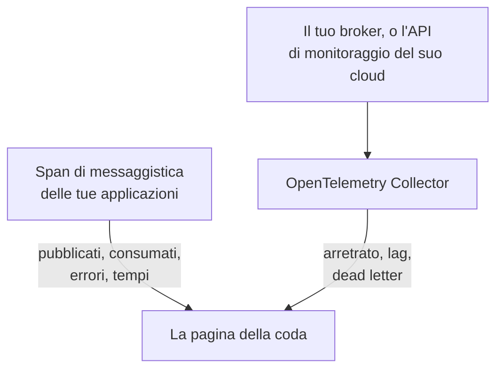

# Code

**Queues** dà a ogni coda di messaggi, topic e sottoscrizione che le tue applicazioni usano una pagina propria: quali servizi vi pubblicano e quali ne consumano, quanti messaggi passano, quanti falliscono e quanto dura l'elaborazione, le sue tracce e metriche e, non appena le metriche del broker raggiungono OneUptime, il suo arretrato, il lag dei consumer, i dead letter e la limitazione. Le code hanno etichette, proprietari, regole di etichette e di proprietari e archiviazione, come ogni altra risorsa. Aprile da **Prodotti → Risorse → Code**.

:::cards
- [Strumentare le applicazioni](#strumentare-le-applicazioni): Gli span di messaggistica che la tua strumentazione OpenTelemetry invia già.
- [Metriche di salute del broker](#metriche-di-salute-del-broker): Arretrato, lag e dead letter dal tuo broker, sistema per sistema.
- [Avvisi](#avvisi): Modelli pronti all'uso, e metriche in ritardo o contate.
- [Risoluzione dei problemi](#risoluzione-dei-problemi): Una coda che non è stata creata, o una salute del broker che resta vuota.
:::

## Come funziona

Funziona allo stesso modo per ogni broker (Apache Kafka, RabbitMQ, Apache ActiveMQ e altri broker JMS, Amazon SQS e SNS, Google Cloud Pub/Sub, Azure Service Bus, Event Hubs ed Event Grid, Apache Pulsar, Apache RocketMQ, NATS e BullMQ; vedi [Sistemi di messaggistica supportati](#sistemi-di-messaggistica-supportati)) e per qualsiasi altro broker che i tuoi span indicano in `messaging.system`. La maggior parte delle code compare da sola, da due fonti:

| Fonte | Cosa ti serve | Cosa aggiunge alla pagina della coda |
| --- | --- | --- |
| **Tracce delle applicazioni** | Applicazioni strumentate (OpenTelemetry); vedi [Strumentare le applicazioni](#strumentare-le-applicazioni) | Messaggi pubblicati e consumati, errori e tempo di elaborazione, i servizi da ciascun lato e le tracce stesse |
| **Metriche del broker** (un OpenTelemetry Collector) | Il receiver del collector o lo scraping per il tuo broker; vedi [Metriche di salute del broker](#metriche-di-salute-del-broker) | **Broker health**: arretrato, lag dei consumer, dead letter, età del messaggio più vecchio, limitazione e le frequenze dei messaggi del broker stesso |



Le tracce dicono a OneUptime che una coda esiste e come le applicazioni la usano, ma non quanto è piena. Questo viene dal broker stesso o dall'API di monitoraggio del suo provider cloud oppure, per [BullMQ](#bullmq), che tiene i suoi job in Redis e non ha un broker da interrogare, da un gauge che l'applicazione segnala.

Puoi anche aggiungere una coda a mano: **Queues → Crea: Queue**, con il suo sistema di messaggistica e il nome della destinazione e, per Azure Service Bus ed Event Hubs, il suo namespace. Il modulo li chiede nel primo passaggio, **Sistema di messaggistica**, poi un nome e una descrizione facoltativi, con le etichette sotto **Altri campi** (**Informazioni sulla coda**). Lascia vuoto il namespace solo per una coda che le tue applicazioni raggiungono tramite un emulatore o un nome di dominio personalizzato: i loro span non indicano alcun namespace, e le metriche di Azure Monitor non raggiungono mai una coda del genere (vedi [Limitazioni](#limitazioni)).

## Per iniziare

:::steps
### Invia le tracce delle tue applicazioni

Strumenta le applicazioni che pubblicano e consumano, e invia le loro tracce a OneUptime (vedi [Strumentare le applicazioni](#strumentare-le-applicazioni)). Non serve nulla di specifico di OneUptime: gli span di messaggistica che la tua strumentazione già produce indicano le code.

### Invia le metriche del tuo broker

Trova il tuo sistema di messaggistica in [Metriche di salute del broker](#metriche-di-salute-del-broker) ed esegui la sua configurazione del collector con la tua chiave di acquisizione. La scheda **Documentazione** di ogni coda contiene la configurazione per quella coda, pronta da copiare.

### Apri la coda

Apri **Prodotti → Risorse → Code**. Il rilevamento viene eseguito ogni 10 minuti: una coda compare non appena almeno 3 dei suoi span sono arrivati entro 15 minuti, oppure una metrica del broker l'ha indicata.
:::

## Sistemi di messaggistica supportati

OneUptime conosce per nome i sistemi di messaggistica qui sotto. Normalizza ciò che le strumentazioni mettono in `messaging.system` al valore della seconda colonna (il valore noto di OpenTelemetry, dove ce n'è uno) senza distinguere maiuscole e minuscole, quindi `AmazonSQS`, `aws.sqs` e `aws_sqs` sono un unico sistema. `nats` e `bullmq` non sono valori noti di OpenTelemetry: `nats` è ciò che segnala la strumentazione NATS dell'agent Java, e `bullmq` è il valore da impostare per BullMQ (vedi [BullMQ](#bullmq)).

Un sistema che OneUptime non conosce funziona comunque: un valore ben formato (`ibmmq`, `solace`, `mqtt`: lettere minuscole, cifre, `.`, `_` e `-`, fino a 64 caratteri) viene mantenuto così com'è arrivato, quindi le code di quel broker vengono rilevate e mostrate con quel nome; solo le metriche del broker stesso richiedono un sistema di questa tabella. `spring_integration` viene ignorato: i canali di Spring Integration sono chiamate di metodo all'interno di un processo, non un broker.

**Metriche del broker** indica da dove arrivano le metriche di salute di un sistema: un receiver di collector-contrib, un endpoint Prometheus (`:port/path`, raccolto con il receiver `prometheus` del collector), l'API di monitoraggio del provider cloud o un programma esterno al collector che le invia via OTLP. Ogni sistema rimanda qui sotto alla sua configurazione, e la scheda **Documentazione** di ogni coda la trasforma in una configurazione per quella coda.

| Sistema | `messaging.system` | Accettati anche | Metriche del broker |
| --- | --- | --- | --- |
| [Amazon SNS](#amazon-sns) | `aws.sns` | `aws_sns`, `amazonsns`, `sns` | receiver `aws_cloudwatch` o `awsfirehose` (monitoraggio cloud) |
| [Amazon SQS](#amazon-sqs) | `aws_sqs` | `aws.sqs`, `amazonsqs`, `sqs` | receiver `aws_cloudwatch` o `awsfirehose` (monitoraggio cloud) |
| [Apache ActiveMQ](#apache-activemq) | `activemq` | `artemis`, `activemq_artemis` | OpenTelemetry JMX Scraper (invia via OTLP) |
| [Apache Kafka](#apache-kafka) | `kafka` | — | receiver `kafka_metrics` |
| [Apache Pulsar](#apache-pulsar) | `pulsar` | `apache_pulsar` | Prometheus (broker Pulsar), `:8080/metrics/` |
| [Apache RocketMQ](#apache-rocketmq) | `rocketmq` | — | Prometheus (broker RocketMQ), `:5557/metrics` |
| [Azure Event Grid](#azure-event-grid) | `eventgrid` | `azure_eventgrid`, `azure.eventgrid`, `microsoft.eventgrid` | receiver `azure_monitor` (monitoraggio cloud) |
| [Azure Event Hubs](#azure-event-hubs) | `eventhubs` | `azure_eventhubs`, `azure.eventhubs`, `microsoft.eventhub` | receiver `azure_monitor` (monitoraggio cloud) |
| [Azure Service Bus](#azure-service-bus) | `servicebus` | `azure_servicebus`, `azure.servicebus`, `microsoft.servicebus` | receiver `azure_monitor` (monitoraggio cloud) |
| [BullMQ](#bullmq) | `bullmq` | — | Niente di integrato |
| [Google Cloud Pub/Sub](#google-cloud-pubsub) | `gcp_pubsub` | `gcp.pubsub`, `pubsub`, `google_pubsub` | receiver `googlecloudmonitoring` (monitoraggio cloud) |
| [JMS](#jms) | `jms` | — | Niente di integrato |
| [NATS](#nats) | `nats` | `jetstream` | Prometheus (prometheus-nats-exporter), `:7777/metrics` |
| [RabbitMQ](#rabbitmq) | `rabbitmq` | — | receiver `rabbitmq` |

Una coda è una destinazione di un sistema. Per **Azure Service Bus** e **Azure Event Hubs** ne fa parte anche il namespace, poiché due namespace possono contenere ciascuno una coda chiamata `orders`. **JMS** e **Apache ActiveMQ** condividono le loro code: le applicazioni Java raggiungono ActiveMQ tramite l'API JMS, i cui span dicono `jms` qualunque sia il broker, mentre le metriche del broker stesso possono dire solo `activemq`, quindi entrambi finiscono su un'unica coda (vedi [Cosa rende due avvistamenti un'unica coda](#cosa-rende-due-avvistamenti-ununica-coda)).

## Come vengono rilevate le code

Ogni coda registra se l'hanno creata le tracce, le metriche del broker o una persona. Tutto ciò che in seguito indica la stessa coda si aggiunge a essa invece di crearne un'altra (vedi [Cosa rende due avvistamenti un'unica coda](#cosa-rende-due-avvistamenti-ununica-coda)).

### Dalle tracce delle applicazioni

Ogni 10 minuti OneUptime riassume gli span che le tue applicazioni hanno inviato negli ultimi 15 minuti e che hanno una delle chiavi `messaging.system`, `messaging.destination.name`, `messaging.destination`, `message_bus.destination`, `az.namespace`, `azure.resource_provider.namespace`, `aws.sqs.queue.url`, `aws.queue_url` o `aws.sns.topic.arn`. Conta ogni span tranne uno SERVER: span PRODUCER, CONSUMER, CLIENT e INTERNAL, e span a cui il **Rimappatore del tipo di span** di una pipeline di tracce ha dato un altro tipo (come Unspecified) o nessuno; uno span SERVER non indica mai una coda.

Anche gli span propri di un broker sono span SERVER. Il tracer eBPF dell'[agent Kubernetes](/docs/telemetry/kubernetes-agent#come-sono-le-tracce-ebpf) registra il lato di un broker Kafka, MQTT o NATS in ogni scambio (un messaggio che riceve, un messaggio che consegna) e invia la maggior parte di essi come PRODUCER o CONSUMER; OneUptime li memorizza come SERVER, quindi un broker non compare tra i producer o i consumer dei topic che trasporta. Un broker MQTT che inoltra un messaggio a un sottoscrittore scrive lo stesso PUBLISH di un client, e il tracer li segnala allo stesso modo, perciò per le pubblicazioni MQTT e NATS OneUptime si basa sulla porta dell'altro capo della connessione: dalla porta 32768 in su (dove i sistemi operativi scelgono la porta di un client che si connette; l'intervallo predefinito di Linux inizia lì; Windows e macOS usano 49152–65535) è quella di un sottoscrittore, e lo span è del broker. Un'applicazione che pubblica verso un broker MQTT o NATS che a sua volta è in ascolto su una porta dalla 32768 in su, come una porta Docker pubblicata a caso, non compare quindi come producer dei suoi topic, e un topic che solo applicazioni del genere usano potrebbe non essere rilevato affatto dagli span del tracer. Un sottoscrittore che si connette a un broker da una porta inferiore a 32768 (un intervallo di porte ristretto, o una porta riscritta da un NAT) vede comunque il broker indicato come producer dei topic che gli vengono consegnati.

Ogni attributo di messaggistica in OpenTelemetry è ancora contrassegnato come in sviluppo, perciò le applicazioni di uno stesso progetto segnalano le stesse cose con fino a cinque generazioni di nomi. OneUptime li legge tutti, dai più recenti, e non analizza mai i nomi degli span, il cui formato è cambiato con le convenzioni semantiche 1.27 e che i fornitori scelgono liberamente:

- **Il sistema**: `messaging.system`, normalizzato come in [Sistemi di messaggistica supportati](#sistemi-di-messaggistica-supportati). In sua assenza, `az.namespace` o `azure.resource_provider.namespace` degli SDK di Azure (`Microsoft.ServiceBus`, `Microsoft.EventHub`), la vecchia chiave `component` dell'SDK di Azure, uno span dell'SDK AWS (`rpc.system` = `aws-api`) che chiama SQS o SNS (gli span SNS dell'agent Java non hanno `messaging.system`), oppure una chiave con l'URL di una coda SQS o l'ARN di un topic SNS.
- **La destinazione**: la prima delle chiavi `messaging.destination.template`, `messaging.destination.name`, `messaging.source.template`, `messaging.source.name`, `messaging.destination` e `message_bus.destination` presente nello span. Uno span che non ne ha nessuna ricorre alle chiavi proprie del suo sistema: l'URL della coda SQS (`aws.sqs.queue.url`, `aws.queue_url`, o l'URL di una coda in `messaging.url`, `server.address` o `net.peer.name`), l'ARN del topic SNS (`aws.sns.topic.arn`) e, per RabbitMQ, la routing key (`messaging.rabbitmq.destination.routing_key` o `messaging.rabbitmq.routing_key`), che è il nome della coda quando un messaggio passa per l'exchange predefinito.
- **La direzione**: prima `messaging.operation.type`, poi il tipo di span (PRODUCER pubblica, CONSUMER consuma), poi il vecchio `messaging.operation`, poi `messaging.operation.name` e, per SQS e SNS, l'operazione dell'SDK AWS in `rpc.method` (`SendMessage`, `ReceiveMessage`, …). Il tipo ha la precedenza sulle chiavi più vecchie perché alcune strumentazioni le compilavano in modo sbagliato: confluent-kafka per Python scriveva `receive` sui suoi span di producer.

Una coda viene **creata** dalle tracce non appena i suoi span nella finestra di 15 minuti che un'esecuzione esamina sono almeno 3 (`MESSAGE_QUEUE_MIN_SPANS`), così uno script occasionale non ne crea una, e solo finché il progetto è sotto il suo [limite di creazione automatica](#il-budget-di-creazione-automatica). Gli span che non creano una coda contano comunque per una coda esistente.

Ogni span di messaggistica viene anche contrassegnato con la sua coda al momento dell'acquisizione, quindi la scheda **Tracce** della coda mostra ogni span che la indica, compresi gli span inviati prima che la coda fosse creata.

### Dalle metriche del broker

Una metrica del broker presente negli elenchi in [Metriche di salute del broker](#metriche-di-salute-del-broker) indica la sua coda nell'attributo proprio del broker (`topic` di Kafka, `rabbitmq.queue.name` di RabbitMQ, la dimensione `EntityName` di Azure Monitor, `QueueName` di CloudWatch), e OneUptime la associa a quella coda al momento dell'acquisizione. Le metriche del broker non hanno `messaging.system`: ciascuna viene riconosciuta dal suo nome (`kafka.consumer_group.lag_sum`) e, dove due sistemi ne condividono uno (Azure Monitor chiama allo stesso modo le metriche di Service Bus e quelle di Event Hubs), dal tipo di risorsa che il punto dati riporta.

L'esecuzione di rilevamento successiva crea la coda se non esiste ancora: basta una metrica del broker, entro il [limite di creazione automatica](#il-budget-di-creazione-automatica). Così una coda che nessuna applicazione strumentata tocca compare comunque non appena il suo broker la segnala.

Le API di monitoraggio cloud (CloudWatch, Azure Monitor e Cloud Monitoring) pubblicano ogni valore minuti dopo l'istante che misura, e viene memorizzato con quell'istante. Perciò ogni esecuzione legge le loro metriche dell'ultima ora, anziché degli ultimi 15 minuti da cui legge gli span e le altre metriche: un punto dati che arriva in ritardo avvista comunque la sua coda, o la crea.

### Dalle metriche dei client di messaggistica

Anche i client strumentati possono segnalare metriche: le metriche dei client di messaggistica di OpenTelemetry `messaging.client.sent.messages`, `messaging.client.consumed.messages`, `messaging.client.operation.duration` e `messaging.process.duration`, i loro nomi precedenti `messaging.publish.duration`, `messaging.receive.duration`, `messaging.publish.messages`, `messaging.receive.messages`, `messaging.process.messages` e `messaging.client.published.messages`, e quelle dell'SDK di Azure per Java `messaging.servicebus.messages.sent`, `messaging.servicebus.receiver.lag`, `messaging.servicebus.settlement.request.duration` e `messaging.servicebus.settlement.sequence_number`. Ogni punto dati indica il suo sistema e la sua destinazione come fa uno span (le metriche di Service Bus dell'SDK di Azure non indicano alcun sistema, quindi il loro nome ne fa le veci) e viene associato a quella coda al momento dell'acquisizione, così compare nella scheda **Metriche** della coda. Lo stesso vale per qualsiasi tua metrica che abbia `messaging.system` e `messaging.destination.name` su ogni punto dati (non sulla risorsa, dove non vengono letti), come un gauge della profondità della coda (vedi [BullMQ](#bullmq)).

Le metriche dei client di messaggistica non creano mai una coda: lo fanno le tracce, le metriche del broker o una persona. Una metrica di client che indica una coda esistente ne mantiene aggiornato il **Last seen**, come fanno i suoi span. Una tua metrica non fa né l'una né l'altra cosa: compare solo nella scheda **Metriche** della coda.

### Cosa rende due avvistamenti un'unica coda

L'identità di una coda è il suo **sistema** e la sua **destinazione**, confrontati senza distinguere maiuscole e minuscole: `Orders` e `orders` sono un'unica coda, mostrata con il nome così come è stato visto per primo. Per Azure Service Bus ed Event Hubs l'identità comprende anche il **namespace**:

- su uno span, la prima etichetta DNS dell'host a cui l'SDK si è connesso, presa da `server.address`, `net.peer.name`, `peer.address` o `network.peer.address` in quest'ordine, quando quell'host è un host di namespace: `<namespace>.servicebus.windows.net`, oppure `.servicebus.usgovcloudapi.net`, `.servicebus.chinacloudapi.cn` o `.servicebus.cloudapi.de` di un cloud sovrano. Event Hubs condivide il dominio di Service Bus;
- su una metrica di Azure Monitor, il `name` del namespace di cui riferisce.

Nient'altro ne fa parte, quindi nessuno di questi elementi divide mai una coda: l'indirizzo del broker (i client Kafka ne segnalano raramente uno, e un namespace di Azure risponde su molti), il gruppo di consumer o la sottoscrizione (i consumer di un topic non sono code separate), la partizione e una sottocoda di dead letter. Di questi, una coda conserva solo l'indirizzo del broker, per la visualizzazione.

**JMS e ActiveMQ sono un'unica famiglia.** Ogni span JMS dice `jms` qualunque sia il broker dietro, e le metriche del broker stesso (l'[OpenTelemetry JMX Scraper](#apache-activemq)) possono dire solo `activemq`, perciò OneUptime identifica una coda ActiveMQ tramite la sua famiglia JMS: gli span e le metriche del broker di `orders` finiscono su un'unica coda. Viene mostrata come JMS finché non arrivano le metriche del broker, e da quel momento come Apache ActiveMQ, mai il contrario. Una coda che crei a mano come Apache ActiveMQ è la stessa coda.

### Come vengono letti i nomi delle destinazioni

Le strumentazioni indicano una stessa coda in molti modi, e OneUptime riduce ciò che segnalano al nome proprio della coda:

| Sistema | Segnalato come | Coda |
| --- | --- | --- |
| Amazon SQS | `https://sqs.us-east-1.amazonaws.com/123456789012/orders`, l'URL di una coda (`otelaws` per Go lo mette in `server.address`) | `orders` |
| Amazon SNS | `arn:aws:sns:us-east-1:123456789012:order-events`, l'ARN di un topic | `order-events` |
| Google Cloud Pub/Sub | `projects/shop/topics/orders`, un nome di risorsa | `orders` |
| Azure Service Bus | `orders/Subscriptions/billing`, il percorso dell'entità della sottoscrizione `billing` del topic | `orders` |
| Azure Service Bus | `orders/$DeadLetterQueue`, il percorso dell'entità della sottocoda di dead letter della coda | `orders` |
| Azure Event Hubs | `telemetry/ConsumerGroups/$Default/Partitions/3`, il percorso dell'entità di un ricevitore, per il gruppo di consumer `$Default` | `telemetry` |
| Apache Pulsar | `orders-partition-3`, una partizione di un topic con nome breve | `persistent://public/default/orders` |
| Apache Pulsar | `acme/shop/orders`, un topic senza il suo dominio | `persistent://acme/shop/orders` |
| JMS | `queue://orders`, con il suo prefisso di tipo di destinazione | `orders` |
| RabbitMQ | `shop:new-order:orders`, exchange, routing key e coda su un consumer (convenzioni semantiche 1.30 e successive) | `orders` |
| RabbitMQ | `amq.default`, l'exchange predefinito, con la routing key `orders` | `orders` |
| RabbitMQ | `,orders`, il `{exchange},{routing key}` di aio-pika tramite l'exchange predefinito | `orders` |
| RabbitMQ | `shop,new-order`, il `{exchange},{routing key}` di aio-pika | `shop` |

Una partizione Pulsar confluisce nel suo topic, e un nome senza dominio viene completato come lo completa Pulsar stesso (un nome breve, nel namespace `public/default`), così i nomi dell'agent Java si uniscono alle etichette delle metriche completamente qualificate dei broker. Uno span RabbitMQ di solito indica l'exchange attraverso cui è passato un messaggio, sia sul lato che pubblica sia su quello che consuma; l'exchange predefinito (`amq.default`, `<default>` o un nome vuoto) sta per la sua routing key, che è il nome della coda. Le convenzioni semantiche 1.30 uniscono exchange, routing key e coda con `:` (i nomi opt-in dell'agent Java), e OneUptime prende la coda dal nome unito di un consumer e l'exchange da quello di un publisher. aio-pika unisce exchange e routing key con una virgola sul lato che pubblica, e OneUptime li separa allo stesso modo.

### Cosa viene ignorato

OneUptime preferisce sbagliare dalla parte di nessuna coda: un nome inventato per richiesta o per consumer creerebbe altrimenti, per ogni messaggio, una coda che non appartiene a nessuno. Questi non diventano mai code:

- **Span SERVER**, e span il cui `messaging.system` è `spring_integration`.
- **Destinazioni contrassegnate come temporanee o anonime**: `messaging.destination.temporary`, `messaging.destination.anonymous`, `messaging.source.temporary` o `messaging.source.anonymous` impostato a `true`. Il vecchio `messaging.temp_destination` non è affidabile: le strumentazioni pika e aio-pika per Python lo impostano a ogni pubblicazione.
- **Segnaposto che le strumentazioni segnalano al posto di un nome**: `(temporary)`, `(anonymous)`, `<generated>`, `unknown` (un batch Kafka su più topic), `aws:sqs` (gli eventi SQS di Lambda dell'agent Java), `-NamespaceOnlyMetric-` di Azure Monitor e un valore che la pulizia dei dati di OneUptime ha sostituito per intero (`[REDACTED]`).
- **Destinazioni generate e di risposta**: le code con nome assegnato dal server di RabbitMQ in stile `amq.gen-JzTY20BRgKO-HjmUJj0wLg`, le code `spring.gen-…` di Spring e le code `<destination>.anonymous.<id>` di Spring Cloud Stream dei consumer senza gruppo, e il direct reply-to (`amq.rabbitmq.reply-to…`); le destinazioni temporanee JMS (`temp-queue://…`, `temp-topic://…`) e `$TMP$…` di TIBCO; i topic advisory di ActiveMQ (`ActiveMQ.Advisory.…`); le inbox NATS (`_INBOX.…`) e i subject di conferma di JetStream (`$JS.ACK.…`); i topic di sistema di Pulsar (`__change_events`, `__transaction_…` e tutto ciò che sta sotto un segmento `/__`); e una destinazione che non è altro che un UUID.
- **Messaggi di testo e notifiche push mobili di SNS**: un numero di telefono (`+15555550123`, o `phone_number:**` di botocore) o l'ARN di un endpoint di piattaforma (`arn:aws:sns:us-east-1:123456789012:endpoint/GCM/shop-app/1234`) è un dispositivo, non un topic.
- **Nomi che non possono essere un'unica coda**: un elenco di destinazioni da un batch (`["orders","payments"]`), un nome che contiene un carattere di controllo e un nome più lungo di 255 caratteri.

**Gli UUID diventano un modello.** Ogni UUID all'interno di una destinazione viene sostituito con `{uuid}`, così nomi per richiesta come `reply-7f1c2a9e-4b1d-4c3e-9f1a-2b3c4d5e6f70` diventano un'unica coda, `reply-{uuid}`, invece di una coda ciascuno.

### Il budget di creazione automatica

Le tracce e le metriche del broker creano code da sole solo finché il progetto ha meno di 500 code rilevate attive e non archiviate (`MESSAGE_QUEUE_AUTO_CREATE_BUDGET`, vedi [Regolazione per installazioni self-hosted](#regolazioni-per-linstallazione-self-hosted)). Le code che crei a mano non contano mai e non vengono mai bloccate; le code archiviate non contano, quindi l'[archiviazione automatica](#ciclo-di-vita-e-archiviazione) libera spazio nel limite; e le code già esistenti continuano a essere associate e aggiornate.

### Ciclo di vita e archiviazione

- **Last seen** è il momento in cui il rilevamento ha visto la coda per l'ultima volta, nelle tracce, nelle metriche dei client di messaggistica o nelle metriche del broker.
- **Archivia per eliminare.** Eliminare una coda rilevata la rimuove solo finché non viene vista di nuovo: il suo avvistamento successivo la riporta come una nuova coda. Per eliminarne una definitivamente, **archiviala**. Una coda archiviata mantiene la sua identità, quindi tutto ciò che la indica resta associato alla coda archiviata invece di crearne una nuova.
- **Archiviazione automatica.** Una coda rilevata che non è stata vista per 7 giorni (`MESSAGE_QUEUE_AUTO_ARCHIVE_DAYS`) viene archiviata automaticamente, a meno che una persona non l'abbia rinominata, descritta, etichettata o le abbia dato dei proprietari. Le etichette e i proprietari che le regole di etichette o di proprietari hanno aggiunto da sole non contano.
- **Ripristino.** Una coda archiviata automaticamente viene ripristinata automaticamente quando viene vista di nuovo. Le code che hai creato a mano, e le code che una persona ha archiviato, non vengono mai archiviate né ripristinate dal rilevamento. Una coda che una persona ripristina resta ripristinata per 30 giorni (o per la finestra di archiviazione, se è più lunga) anche se nulla la vede; dal suo avvistamento successivo si applica di nuovo la regola dei 7 giorni.

## Strumentare le applicazioni

Le code nascono dagli span di messaggistica che la tua strumentazione OpenTelemetry produce già; non serve nulla di specifico di OneUptime. Invia le tracce a OneUptime come descritto in [OpenTelemetry](/docs/telemetry/open-telemetry), poi consulta l'elenco per il tuo linguaggio.

:::tabs
@tab Java
L'agent Java di OpenTelemetry traccia i client Kafka, RabbitMQ, JMS (ActiveMQ, Artemis, IBM MQ e ogni altro broker JMS), Amazon SQS e SNS, Pulsar, RocketMQ e NATS senza modifiche al codice. OneUptime legge sia i nomi degli attributi che emette per impostazione predefinita sia quelli più recenti che emette con `OTEL_SEMCONV_STABILITY_OPT_IN=messaging` (agent 2.31.0 e successivi). Gli span JMS dicono `jms` qualunque sia il broker dietro (vedi [JMS](#jms)).

- **Azure Service Bus ed Event Hubs**: l'SDK di Azure per Java si traccia da solo, e l'agent Java collega quel tracciamento a OpenTelemetry.
- **Google Cloud Pub/Sub**: il client si traccia da solo non appena i suoi builder `Publisher` e `Subscriber` ricevono un'istanza di OpenTelemetry e l'interruttore di tracciamento: `setOpenTelemetry(GlobalOpenTelemetry.get())` e `setEnableOpenTelemetryTracing(true)`. Una sola delle due chiamate non traccia nulla.
@tab .NET
- **Azure Service Bus ed Event Hubs** (`Azure.Messaging.ServiceBus`, `Azure.Messaging.EventHubs`): i loro span OpenTelemetry sono sperimentali nell'SDK di Azure. Attivali con la variabile d'ambiente `AZURE_EXPERIMENTAL_ENABLE_ACTIVITY_SOURCE=true` (o con l'interruttore `Azure.Experimental.EnableActivitySource` qui sotto) e sottoscrivi le sorgenti `Azure.*`.
- **RabbitMQ.Client** 7 si traccia da solo: sottoscrivi `RabbitMQ.Client.*`.
- **MassTransit** si traccia da solo: sottoscrivi `MassTransit` (vedi [Limitazioni](#limitazioni) per ciò che i suoi span tralasciano).
- **Confluent.Kafka**: il pacchetto `OpenTelemetry.Instrumentation.ConfluentKafka`.
- **Amazon SQS e SNS**: il pacchetto `OpenTelemetry.Instrumentation.AWS`, con `.AddAWSInstrumentation(opt => opt.SemanticConventionVersion = SemanticConventionVersion.Latest)`. Il suo set di attributi predefinito (`V1_28_0`) indica una coda SQS solo tramite il suo URL (`aws.queue_url`, che OneUptime legge) e non indica affatto un topic SNS.

```csharp
// Before any Azure client is created; or set AZURE_EXPERIMENTAL_ENABLE_ACTIVITY_SOURCE=true.
AppContext.SetSwitch("Azure.Experimental.EnableActivitySource", true);

builder.Services.AddOpenTelemetry()
    .WithTracing(tracing => tracing
        .AddSource("Azure.*")
        .AddSource("RabbitMQ.Client.*")
        .AddSource("MassTransit")
        .AddOtlpExporter());
```
@tab Node.js
- `@opentelemetry/auto-instrumentations-node` traccia `amqplib` (RabbitMQ), `kafkajs` e l'SDK AWS (SQS e SNS).
- **Azure Service Bus ed Event Hubs**: registra `createAzureSdkInstrumentation()` da `@azure/opentelemetry-instrumentation-azure-sdk`.
- **Google Cloud Pub/Sub**: `new PubSub({ enableOpenTelemetryTracing: true })`.
- **BullMQ**: vedi [BullMQ](#bullmq); la sua telemetria richiede l'aggiunta di due attributi.
@tab Python
- Kafka: `opentelemetry-instrumentation-kafka-python`, `opentelemetry-instrumentation-confluent-kafka` o `opentelemetry-instrumentation-aiokafka`. RabbitMQ: `opentelemetry-instrumentation-pika` o `opentelemetry-instrumentation-aio-pika`. SQS e SNS: `opentelemetry-instrumentation-botocore`, oppure `opentelemetry-instrumentation-boto3sqs` per SQS. `opentelemetry-bootstrap -a install` sceglie quelle che servono alle librerie installate.
- **Azure Service Bus ed Event Hubs**: installa `azure-core-tracing-opentelemetry` e imposta `settings.tracing_implementation = "opentelemetry"` (da `azure.core.settings`).
- **Google Cloud Pub/Sub**: `PublisherOptions(enable_open_telemetry_tracing=True)` e `SubscriberOptions(enable_open_telemetry_tracing=True)`.
- Gli span di Celery non hanno `messaging.system` e non indicano alcun broker, quindi non creano code.
@tab Go
- **Amazon SQS e SNS**: `otelaws` (`go.opentelemetry.io/contrib/instrumentation/github.com/aws/aws-sdk-go-v2/otelaws`), aggiunto con `otelaws.AppendMiddlewares(&cfg.APIOptions)`. I suoi span SQS riportano l'URL della coda in `server.address`, che OneUptime legge come la coda.
- **Google Cloud Pub/Sub**: `pubsub.ClientConfig{EnableOpenTelemetryTracing: true}`.
- **Kafka** con `segmentio/kafka-go`: la strumentazione automatica di OpenTelemetry per Go (`go.opentelemetry.io/auto`, eBPF, su Linux) traccia i suoi producer e consumer senza modifiche al codice.
- Le librerie contrib Go di OpenTelemetry non hanno strumentazione per Kafka, RabbitMQ o NATS. Per gli altri client, usa il supporto OpenTelemetry proprio della libreria client, oppure imposta `messaging.system`, `messaging.destination.name` e il tipo di span sugli span attorno ai tuoi invii e ai tuoi handler.
:::

## Metriche di salute del broker

Un broker sa ciò che nessuna applicazione può vedere: quanti messaggi sono in attesa, quanto è indietro ogni gruppo di consumer, cosa è finito in una coda di dead letter. Ogni sezione qui sotto contiene la configurazione del collector per un sistema: una configurazione completa di OpenTelemetry Collector che termina con l'exporter OTLP che invia a OneUptime. Inserisci una chiave di acquisizione della telemetria (**Impostazioni del progetto → Telemetria e APM → Chiavi di acquisizione**) in `x-oneuptime-token`, sostituisci `https://oneuptime.com` con il tuo host se usi il self-hosting, ed eseguila con `otel/opentelemetry-collector-contrib` 0.161.0 o successivo (ogni configurazione qui è convalidata con 0.161.0). I collector recenti registrano nel log che `otlphttp` è deprecato a favore di `otlp_http`; entrambi i nomi indicano lo stesso exporter. Per raccogliere più sistemi, unisci i loro receiver in un unico collector.

La sezione **Broker health** di ogni coda mostra le metriche elencate per il suo sistema (un gauge come valore, un conteggio per periodo sommato per intervallo, un contatore come frequenza al secondo) combinando le serie di una coda come richiede ogni metrica (i messaggi pronti e non confermati di una coda RabbitMQ si sommano; il gruppo di consumer più indietro è il lag). Tutto ciò che il collector invia è anche nell'esploratore **Metriche**. Finché per una coda non è arrivata nessuna metrica elencata, la sezione mostra da dove arrivano le metriche di quel sistema, con un link alla sua sezione qui.

### Amazon SNS

Leggi le metriche CloudWatch dei topic con il receiver `aws_cloudwatch` del collector, oppure trasmettile tramite un CloudWatch Metric Stream e Amazon Data Firehose al suo receiver `awsfirehose`.

Il receiver `aws_cloudwatch` interroga l'API `GetMetricData` di CloudWatch, un namespace per receiver, quindi SNS ha una propria istanza accanto a quella di [Amazon SQS](#amazon-sqs). Usa le credenziali predefinite dell'SDK AWS (ambiente, profilo condiviso o ruolo dell'istanza), che richiedono `cloudwatch:ListMetrics` e `cloudwatch:GetMetricData`:

```yaml
receivers:
  aws_cloudwatch/sns:
    region: us-east-1
    metrics:
      collection_interval: 5m
      period: 1m
      delay: 10m
      discovery:
        filters:
          namespace: AWS/SNS
        limit: 500

processors:
  batch: {}

exporters:
  otlphttp:
    endpoint: https://oneuptime.com/otlp
    headers:
      x-oneuptime-token: YOUR_TELEMETRY_INGESTION_TOKEN

service:
  pipelines:
    metrics:
      receivers: [aws_cloudwatch/sns]
      processors: [batch]
      exporters: [otlphttp]
```

Lascia `stats` non impostato, come per [Amazon SQS](#amazon-sqs). Un Metric Stream trasporta SNS e SQS insieme: aggiungi `AWS/SNS` ai namespace dello stream nella configurazione di [Amazon SQS](#amazon-sqs).

Un topic viene chiamato allo stesso modo da entrambi i lati: gli span segnalano il suo ARN o il suo nome, e OneUptime mantiene il nome che segue l'ultimo `:` dell'ARN.

| Metrica | Mostrata come | Tipo |
| --- | --- | --- |
| `amazonaws.com/aws/sns/numberofmessagespublished` (stream JSON: `numberofmessagespublished`) | Messages published | Conteggio per periodo |
| `amazonaws.com/aws/sns/numberofnotificationsdelivered` (stream JSON: `numberofnotificationsdelivered`) | Notifications delivered | Conteggio per periodo |
| `amazonaws.com/aws/sns/numberofnotificationsfailed` (stream JSON: `numberofnotificationsfailed`) | Notifications failed | Conteggio per periodo |
| `amazonaws.com/aws/sns/numberofnotificationsredriventodlq` (stream JSON: `numberofnotificationsredriventodlq`) | Redriven to dead-letter queue | Conteggio per periodo |

### Amazon SQS

Leggi le metriche CloudWatch delle code con il receiver `aws_cloudwatch` del collector, oppure trasmettile tramite un CloudWatch Metric Stream e Amazon Data Firehose al suo receiver `awsfirehose`.

**Interrogare CloudWatch** non richiede nulla lato AWS oltre alle credenziali. Il receiver usa le credenziali predefinite dell'SDK AWS (ambiente, profilo condiviso o ruolo dell'istanza), che richiedono `cloudwatch:ListMetrics` e `cloudwatch:GetMetricData`:

```yaml
receivers:
  aws_cloudwatch/sqs:
    region: us-east-1
    metrics:
      collection_interval: 5m
      period: 1m
      delay: 10m
      discovery:
        filters:
          namespace: AWS/SQS
        # Metrics per scrape: about nine per queue. Must be set.
        limit: 500

processors:
  batch: {}

exporters:
  otlphttp:
    endpoint: https://oneuptime.com/otlp
    headers:
      x-oneuptime-token: YOUR_TELEMETRY_INGESTION_TOKEN

service:
  pipelines:
    metrics:
      receivers: [aws_cloudwatch/sqs]
      processors: [batch]
      exporters: [otlphttp]
```

- **Lascia `stats` non impostato.** Senza, ogni metrica arriva come un riepilogo per periodo, ed è ciò che OneUptime legge; con esso, ogni statistica diventa una serie a sé e i grafici le mescolano.
- `discovery.limit` deve essere impostato, e limita le metriche lette per raccolta: circa nove per coda. Ognuna costa quattro sottoquery `GetMetricData` per raccolta, che AWS addebita.
- `delay` attende che CloudWatch pubblichi un periodo (richiede qualche minuto), quindi con questa configurazione le metriche del broker di una coda arrivano con 11-17 minuti di ritardo: un monitor su di esse ha bisogno di una finestra più lunga (vedi **Metriche in ritardo** in [Avvisi](#avvisi)).
- Un receiver legge una regione e un namespace: aggiungi un'istanza per regione.

**Lo streaming** invia le metriche man mano che CloudWatch le pubblica. Crea un CloudWatch Metric Stream per i namespace `AWS/SQS` (e `AWS/SNS`) con il formato di output **OpenTelemetry 1.0**, che consegni a uno stream Amazon Data Firehose la cui destinazione è un endpoint HTTP: il tuo collector, con una chiave di accesso. Firehose consegna solo a `https://` sulla porta 443, quindi il collector ha bisogno di un certificato e di una porta 443 pubblica (ad esempio dietro un load balancer):

```yaml
extensions:
  awscloudwatchmetricstreams_encoding:
    format: opentelemetry1.0

receivers:
  awsfirehose:
    # Firehose delivers to HTTPS on port 443 only: expose this port as 443,
    # for example behind a load balancer.
    endpoint: 0.0.0.0:4433
    encoding: awscloudwatchmetricstreams_encoding
    access_key: ${env:FIREHOSE_ACCESS_KEY}
    tls:
      cert_file: /etc/otelcol/tls/server.crt
      key_file: /etc/otelcol/tls/server.key

processors:
  batch: {}

exporters:
  otlphttp:
    endpoint: https://oneuptime.com/otlp
    headers:
      x-oneuptime-token: YOUR_TELEMETRY_INGESTION_TOKEN

service:
  extensions: [awscloudwatchmetricstreams_encoding]
  pipelines:
    metrics:
      receivers: [awsfirehose]
      processors: [batch]
      exporters: [otlphttp]
```

Funziona anche uno stream nel formato di output **JSON** (`format: json`): invia ogni metrica con il suo nome nudo, e OneUptime distingue quelle di SQS da quelle di SNS tramite il `service.name` che lo stream applica (`SQS`, `SNS`).

Una coda di dead letter è una normale coda SQS con metriche proprie, quindi in OneUptime è una coda a sé. Le code sono identificate solo dal loro nome, non dall'account o dalla regione (vedi [Limitazioni](#limitazioni)).

| Metrica | Mostrata come | Tipo |
| --- | --- | --- |
| `amazonaws.com/aws/sqs/approximatenumberofmessagesvisible` (stream JSON: `approximatenumberofmessagesvisible`) | Messages visible | Gauge |
| `amazonaws.com/aws/sqs/approximateageofoldestmessage` (stream JSON: `approximateageofoldestmessage`) | Oldest message age | Gauge |
| `amazonaws.com/aws/sqs/approximatenumberofmessagesnotvisible` (stream JSON: `approximatenumberofmessagesnotvisible`) | Messages in flight | Gauge |
| `amazonaws.com/aws/sqs/numberofmessagessent` (stream JSON: `numberofmessagessent`) | Messages sent | Conteggio per periodo |
| `amazonaws.com/aws/sqs/numberofmessagesreceived` (stream JSON: `numberofmessagesreceived`) | Messages received | Conteggio per periodo |
| `amazonaws.com/aws/sqs/numberofmessagesdeleted` (stream JSON: `numberofmessagesdeleted`) | Messages deleted | Conteggio per periodo |

### Apache ActiveMQ

Il collector non ha un receiver JMX, quindi esegui l'OpenTelemetry JMX Scraper con `OTEL_JMX_TARGET_SYSTEM=activemq` accanto a un broker ActiveMQ Classic; invia le metriche delle destinazioni del broker via OTLP.

1. Fai accettare al broker le connessioni JMX. Con l'immagine `apache/activemq-classic` o lo script `bin/activemq`, imposta `ACTIVEMQ_SUNJMX_START` prima di avviarlo. Questo esempio disattiva l'autenticazione: tieni la porta su una rete privata, oppure attiva `jmxremote.authenticate` con un file di password e dai allo scraper `OTEL_JMX_USERNAME` e `OTEL_JMX_PASSWORD`.

```bash
ACTIVEMQ_SUNJMX_START="-Dcom.sun.management.jmxremote.port=1099 -Dcom.sun.management.jmxremote.rmi.port=1099 -Dcom.sun.management.jmxremote.authenticate=false -Dcom.sun.management.jmxremote.ssl=false -Djava.rmi.server.hostname=activemq"
```

2. Esegui lo scraper dove può raggiungere quella porta, con un runtime Java. Invia direttamente a OneUptime; per farlo passare invece dal tuo collector, punta `OTEL_EXPORTER_OTLP_ENDPOINT` al receiver OTLP del collector.

```bash
curl -fsSLo opentelemetry-jmx-scraper.jar https://github.com/open-telemetry/opentelemetry-java-contrib/releases/latest/download/opentelemetry-jmx-scraper.jar

export OTEL_JMX_SERVICE_URL=service:jmx:rmi:///jndi/rmi://activemq:1099/jmxrmi
export OTEL_JMX_TARGET_SYSTEM=activemq
export OTEL_JMX_TARGET_SOURCE=instrumentation
export OTEL_METRIC_EXPORT_INTERVAL=30000
export OTEL_SERVICE_NAME=activemq-prod
export OTEL_EXPORTER_OTLP_PROTOCOL=http/protobuf
export OTEL_EXPORTER_OTLP_ENDPOINT=https://oneuptime.com/otlp
export OTEL_EXPORTER_OTLP_HEADERS=x-oneuptime-token=YOUR_TELEMETRY_INGESTION_TOKEN
java -jar opentelemetry-jmx-scraper.jar
```

`OTEL_JMX_TARGET_SOURCE=instrumentation` mantiene i nomi delle metriche che lo scraper usa dalla 1.53.0-alpha (`activemq.message.queue.size`, con la destinazione in `messaging.destination.name`). OneUptime legge anche i nomi degli scraper precedenti e di `OTEL_JMX_TARGET_SOURCE=legacy` (`activemq.message.current`, con la destinazione in `destination`).

Le metriche del broker si uniscono alla coda che gli span dei suoi client JMS hanno creato e, da quel momento, la coda viene mostrata come Apache ActiveMQ (vedi [Cosa rende due avvistamenti un'unica coda](#cosa-rende-due-avvistamenti-ununica-coda)). Lo scraper segnala ogni destinazione: OneUptime ignora i topic advisory, mentre le code di dead letter (`ActiveMQ.DLQ`, o `DLQ.<destination>` con una strategia di dead letter individuale) sono code a sé. ActiveMQ Artemis ha MBean diversi, che queste regole non leggono: le code Artemis nascono comunque dai loro span JMS, senza salute del broker.

| Metrica | Mostrata come | Tipo |
| --- | --- | --- |
| `activemq.message.queue.size` | Queue size | Gauge |
| `activemq.message.current` | Queue size (legacy names) | Gauge |
| `activemq.message.enqueued` | Enqueued | Contatore, mostrato al secondo |
| `activemq.message.dequeued` | Dequeued | Contatore, mostrato al secondo |
| `activemq.message.expired` | Expired | Contatore, mostrato al secondo |
| `activemq.consumer.count` | Consumers | Gauge |
| `activemq.message.enqueue.average_duration` | Average time in queue | Gauge |
| `activemq.message.wait_time.avg` | Average time in queue (legacy names) | Gauge |

### Apache Kafka

Il receiver `kafka_metrics` del collector legge dai broker il lag dei gruppi di consumer e gli offset delle partizioni; attiva i suoi scraper `topics` e `consumers`.

```yaml
receivers:
  kafka_metrics:
    brokers: ["kafka-1:9092", "kafka-2:9092"]
    # topics: each partition's log-end offset; consumers: each group's
    # committed offsets and lag. brokers: the broker count.
    scrapers: [brokers, topics, consumers]
    collection_interval: 30s
    # auth:
    #   sasl:
    #     mechanism: SCRAM-SHA-512
    #     username: ${env:KAFKA_USERNAME}
    #     password: ${env:KAFKA_PASSWORD}
    # tls:
    #   ca_file: /etc/kafka/ca.pem

processors:
  batch: {}

exporters:
  otlphttp:
    endpoint: https://oneuptime.com/otlp
    headers:
      x-oneuptime-token: YOUR_TELEMETRY_INGESTION_TOKEN

service:
  pipelines:
    metrics:
      receivers: [kafka_metrics]
      processors: [batch]
      exporters: [otlphttp]
```

Per un cluster con SASL o TLS, togli il commento a `auth` e `tls`. Il receiver indica ogni topic in `topic`, ed è così che le metriche trovano la coda del topic. Segnala il lag e gli offset confermati di un gruppo di consumer solo sui topic su cui il gruppo ha confermato un offset, e salta i topic il cui nome inizia con `_`, quelli interni di Kafka (`topic_match` vale `^[^_].*$` per impostazione predefinita).

| Metrica | Mostrata come | Tipo |
| --- | --- | --- |
| `kafka.consumer_group.lag_sum` | Consumer lag | Gauge |
| `kafka.consumer_group.lag` | Partition lag | Gauge |
| `kafka.consumer_group.offset_sum` | Consumed | Contatore, mostrato al secondo |
| `kafka.partition.current_offset` | Produced | Contatore, mostrato al secondo |

### Apache Pulsar

Ogni broker espone le sue metriche di topic e sottoscrizioni sulla porta del suo servizio web; raccogli ogni broker, perché un broker segnala solo i topic che possiede in quel momento.

```yaml
receivers:
  prometheus:
    config:
      scrape_configs:
        - job_name: pulsar-broker
          scrape_interval: 30s
          metrics_path: /metrics/
          # Every broker: each one reports only the topics it owns.
          static_configs:
            - targets: ["pulsar-broker-0:8080", "pulsar-broker-1:8080"]
          # Keeps the families the queue page charts; remove it to keep all.
          metric_relabel_configs:
            - source_labels: [__name__]
              regex: "pulsar_(msg_backlog|subscription_back_log|storage_backlog_age_seconds|in_messages_total|out_messages_total)"
              action: keep

processors:
  batch: {}

exporters:
  otlphttp:
    endpoint: https://oneuptime.com/otlp
    headers:
      x-oneuptime-token: YOUR_TELEMETRY_INGESTION_TOKEN

service:
  pipelines:
    metrics:
      receivers: [prometheus]
      processors: [batch]
      exporters: [otlphttp]
```

- Le serie di topic e sottoscrizioni richiedono `exposeTopicLevelMetricsInPrometheus=true` in `broker.conf`, che è il valore predefinito.
- Pulsar etichetta ogni serie con il nome completo del topic (`persistent://public/default/orders`), e quelle di una partizione con quello della partizione (`persistent://public/default/orders-partition-3`): le partizioni si sommano nel loro topic.
- L'arretrato è contato in voci, e Pulsar conta un batch di messaggi come una sola voce.
- Pulsar ripete `pulsar_out_messages_total` per consumer quando `exposeConsumerLevelMetricsInPrometheus=true`; quelle serie per consumer sono escluse dai grafici, così nessun messaggio viene contato due volte.
- `pulsar_storage_backlog_age_seconds` vale `-1` finché il broker non lo sa.
- Le metriche OpenTelemetry native di Pulsar 3.3 e successivi (sperimentali, disattivate per impostazione predefinita) usano altri nomi, che non vengono mostrati.

| Metrica | Mostrata come | Tipo |
| --- | --- | --- |
| `pulsar_msg_backlog` | Backlog | Gauge |
| `pulsar_subscription_back_log` | Subscription backlog | Gauge |
| `pulsar_storage_backlog_age_seconds` | Backlog age | Gauge |
| `pulsar_in_messages_total` | Messages in | Contatore, mostrato al secondo |
| `pulsar_out_messages_total` | Messages out | Contatore, mostrato al secondo |

### Apache RocketMQ

Imposta `metricsExporterType=PROM` nel `broker.conf` del broker affinché il broker esponga le sue metriche di lag e di throughput.

```text
metricsExporterType=PROM
metricsPromExporterPort=5557
metricsPromExporterHost=0.0.0.0
```

Poi raccogli ogni broker:

```yaml
receivers:
  prometheus:
    config:
      scrape_configs:
        - job_name: rocketmq-broker
          scrape_interval: 30s
          metrics_path: /metrics
          static_configs:
            - targets: ["rocketmq-broker-a:5557", "rocketmq-broker-b:5557"]

processors:
  batch: {}

exporters:
  otlphttp:
    endpoint: https://oneuptime.com/otlp
    headers:
      x-oneuptime-token: YOUR_TELEMETRY_INGESTION_TOKEN

service:
  pipelines:
    metrics:
      receivers: [prometheus]
      processors: [batch]
      exporters: [otlphttp]
```

Questo è l'exporter integrato di RocketMQ 5. RocketMQ 4 non ne ha uno; il `rocketmq-exporter` separato che usa segnala altri nomi di metriche, che non vengono mostrati. Il topic di dead letter di un gruppo di consumer (`%DLQ%<group>`) è una coda a sé.

| Metrica | Mostrata come | Tipo |
| --- | --- | --- |
| `rocketmq_consumer_lag_messages` | Consumer lag | Gauge |
| `rocketmq_consumer_ready_messages` | Ready messages | Gauge |
| `rocketmq_send_to_dlq_messages_total` | Sent to dead-letter queue | Contatore, mostrato al secondo |
| `rocketmq_messages_in_total` | Messages in | Contatore, mostrato al secondo |

### Azure Event Grid

Azure Monitor ha le metriche di consegna e di dead letter dei topic, che il receiver `azure_monitor` del collector legge; non vengono ancora mostrate in una pagina di coda, quindi esplorale in Metriche.

Il receiver accede tramite l'estensione `azure_auth`. Assegna all'entità servizio il ruolo **Monitoring Reader** sulla sottoscrizione:

```yaml
extensions:
  azure_auth:
    service_principal:
      tenant_id: ${env:AZURE_TENANT_ID}
      client_id: ${env:AZURE_CLIENT_ID}
      client_secret: ${env:AZURE_CLIENT_SECRET}

receivers:
  azure_monitor/eventgrid:
    subscription_ids: ["${env:AZURE_SUBSCRIPTION_ID}"]
    auth:
      authenticator: azure_auth
    collection_interval: 60s
    services:
      - Microsoft.EventGrid/topics
      - Microsoft.EventGrid/systemTopics
      - Microsoft.EventGrid/domains
    maximum_number_of_records_per_resource: 1000

processors:
  batch: {}

exporters:
  otlphttp:
    endpoint: https://oneuptime.com/otlp
    headers:
      x-oneuptime-token: YOUR_TELEMETRY_INGESTION_TOKEN

service:
  extensions: [azure_auth]
  pipelines:
    metrics:
      receivers: [azure_monitor/eventgrid]
      processors: [batch]
      exporters: [otlphttp]
```

OneUptime non mostra le metriche di Event Grid nella pagina di una coda: Azure Monitor le segnala per risorsa Event Grid e sottoscrizione di eventi, non in una forma che indica una delle tue code. Arrivano nell'esploratore **Metriche**: `azure_publishsuccesscount_total`, `azure_deliverysuccesscount_total`, `azure_deadletteredcount_total` e le altre. Per i namespace di Event Grid, aggiungi `Microsoft.EventGrid/namespaces` a `services`.

### Azure Event Hubs

Leggi le metriche del namespace da Azure Monitor con il receiver `azure_monitor` del collector, che le suddivide per event hub in base alla dimensione EntityName.

Il receiver accede tramite l'estensione `azure_auth`. Assegna all'entità servizio il ruolo **Monitoring Reader** sulla sottoscrizione:

```yaml
extensions:
  azure_auth:
    service_principal:
      tenant_id: ${env:AZURE_TENANT_ID}
      client_id: ${env:AZURE_CLIENT_ID}
      client_secret: ${env:AZURE_CLIENT_SECRET}

receivers:
  azure_monitor/eventhubs:
    subscription_ids: ["${env:AZURE_SUBSCRIPTION_ID}"]
    auth:
      authenticator: azure_auth
    collection_interval: 60s
    services: [Microsoft.EventHub/namespaces]
    maximum_number_of_records_per_resource: 1000
    metrics:
      "Microsoft.EventHub/namespaces":
        IncomingMessages: [Total]
        OutgoingMessages: [Total]
        ServerErrors: [Total]
        UserErrors: [Total]
        QuotaExceededErrors: [Total]
        ThrottledRequests: [Total]

processors:
  batch: {}

exporters:
  otlphttp:
    endpoint: https://oneuptime.com/otlp
    headers:
      x-oneuptime-token: YOUR_TELEMETRY_INGESTION_TOKEN

service:
  extensions: [azure_auth]
  pipelines:
    metrics:
      receivers: [azure_monitor/eventhubs]
      processors: [batch]
      exporters: [otlphttp]
```

Le metriche trovano il loro event hub tramite il namespace (`name`) e l'event hub (`EntityName`); il namespace che gli span segnalano come `<namespace>.servicebus.windows.net`. `maximum_number_of_records_per_resource` è il numero di serie che Azure restituisce per metrica e namespace, 10 a meno che tu non lo aumenti: tienilo sopra il numero dei tuoi event hub, altrimenti gli altri non vengono segnalati. Lascia `use_batch_api` disattivato, come è per impostazione predefinita: l'API batch non funziona per i namespace di Event Hubs dal collector 0.155.0.

Azure Monitor non ha una metrica di lag dei consumer per Event Hubs: il suo `ConsumerLag` esiste solo nei log delle metriche dell'applicazione dei livelli Premium e Dedicated, che questo receiver non legge.

| Metrica | Mostrata come | Tipo |
| --- | --- | --- |
| `azure_incomingmessages_total` | Incoming messages | Conteggio per periodo |
| `azure_outgoingmessages_total` | Outgoing messages | Conteggio per periodo |
| `azure_servererrors_total` | Server errors | Conteggio per periodo |
| `azure_usererrors_total` | User errors | Conteggio per periodo |
| `azure_quotaexceedederrors_total` | Quota exceeded errors | Conteggio per periodo |
| `azure_throttledrequests_total` | Throttled requests | Conteggio per periodo |

### Azure Service Bus

Leggi le metriche del namespace da Azure Monitor con il receiver `azure_monitor` del collector, che le suddivide per coda e topic in base alla dimensione EntityName.

Il receiver accede tramite l'estensione `azure_auth`. Assegna all'entità servizio il ruolo **Monitoring Reader** sulla sottoscrizione:

```yaml
extensions:
  azure_auth:
    service_principal:
      tenant_id: ${env:AZURE_TENANT_ID}
      client_id: ${env:AZURE_CLIENT_ID}
      client_secret: ${env:AZURE_CLIENT_SECRET}

receivers:
  azure_monitor/servicebus:
    subscription_ids: ["${env:AZURE_SUBSCRIPTION_ID}"]
    auth:
      authenticator: azure_auth
    collection_interval: 60s
    services: [Microsoft.ServiceBus/namespaces]
    # Series Azure returns per metric and namespace (default 10): keep it
    # above your number of queues and topics.
    maximum_number_of_records_per_resource: 1000
    metrics:
      "Microsoft.ServiceBus/namespaces":
        ActiveMessages: [Average]
        DeadletteredMessages: [Average]
        IncomingMessages: [Total]
        OutgoingMessages: [Total]
        CompleteMessage: [Total]
        AbandonMessage: [Total]
        ServerErrors: [Total]
        UserErrors: [Total]
        ThrottledRequests: [Total]

processors:
  batch: {}

exporters:
  otlphttp:
    endpoint: https://oneuptime.com/otlp
    headers:
      x-oneuptime-token: YOUR_TELEMETRY_INGESTION_TOKEN

service:
  extensions: [azure_auth]
  pipelines:
    metrics:
      receivers: [azure_monitor/servicebus]
      processors: [batch]
      exporters: [otlphttp]
```

- Le metriche trovano la loro coda o il loro topic tramite il namespace (`name`) e l'entità (`EntityName`); gli span degli SDK indicano lo stesso namespace come `<namespace>.servicebus.windows.net`. Uno span su `orders/Subscriptions/billing` o `orders/$DeadLetterQueue` appartiene a `orders`, come le metriche.
- `maximum_number_of_records_per_resource` è il numero di serie che Azure restituisce per metrica e namespace, 10 a meno che tu non lo aumenti: tienilo sopra il numero delle tue code e dei tuoi topic (le metriche di errore suddividono ulteriormente ogni entità per risultato), altrimenti gli altri non vengono segnalati.
- Azure Monitor non suddivide per sottoscrizione del topic: i conteggi di un topic coprono tutte le sue sottoscrizioni.
- L'elenco `metrics` raccoglie esattamente ciò che la pagina della coda mostra, ciascuna con l'unica aggregazione che mostra; aggiungi una metrica (`ScheduledMessages`, `Size`, …) per raccoglierla anch'essa.
- Il receiver elenca i tuoi namespace una volta al giorno, quindi un nuovo namespace può impiegare fino a 24 ore per comparire.

| Metrica | Mostrata come | Tipo |
| --- | --- | --- |
| `azure_activemessages_average` | Active messages | Gauge |
| `azure_deadletteredmessages_average` | Dead-lettered messages | Gauge |
| `azure_incomingmessages_total` | Incoming messages | Conteggio per periodo |
| `azure_outgoingmessages_total` | Outgoing messages | Conteggio per periodo |
| `azure_completemessage_total` | Completed messages | Conteggio per periodo |
| `azure_abandonmessage_total` | Abandoned messages | Conteggio per periodo |
| `azure_servererrors_total` | Server errors | Conteggio per periodo |
| `azure_usererrors_total` | User errors | Conteggio per periodo |
| `azure_throttledrequests_total` | Throttled requests | Conteggio per periodo |

### BullMQ

BullMQ tiene i suoi job in Redis e non ha un broker da raccogliere; segnala la profondità della coda dall'applicazione come metrica che riporta `messaging.system` e `messaging.destination.name`, come fanno i worker di OneUptime con `queue.size`.

La telemetria propria di BullMQ (la sua opzione `telemetry`, implementata dal pacchetto `bullmq-otel`) indica la coda in `bullmq.queue.name` e non imposta alcun `messaging.system`, quindi da sola non crea alcuna coda. Un processor `transform` nel collector a cui inviano le tue applicazioni aggiunge le due chiavi che OneUptime legge, sugli span che aggiungono ed elaborano job e sulle metriche di BullMQ stesso:

```yaml
receivers:
  otlp:
    protocols:
      grpc:
        endpoint: 0.0.0.0:4317
      http:
        endpoint: 0.0.0.0:4318

processors:
  # BullMQ names the queue in bullmq.queue.name and sets no
  # messaging.system: copy it into the keys OneUptime reads, on the spans
  # that publish (add) and process jobs, and on BullMQ's own metrics.
  transform/bullmq:
    error_mode: ignore
    trace_statements:
      - set(span.attributes["messaging.system"], "bullmq") where span.attributes["bullmq.queue.name"] != nil and span.attributes["messaging.system"] == nil and (span.kind == SPAN_KIND_PRODUCER or span.kind == SPAN_KIND_CONSUMER)
      - set(span.attributes["messaging.destination.name"], span.attributes["bullmq.queue.name"]) where span.attributes["messaging.system"] == "bullmq" and span.attributes["messaging.destination.name"] == nil
    metric_statements:
      - set(datapoint.attributes["messaging.system"], "bullmq") where datapoint.attributes["bullmq.queue.name"] != nil and datapoint.attributes["messaging.system"] == nil
      - set(datapoint.attributes["messaging.destination.name"], datapoint.attributes["bullmq.queue.name"]) where datapoint.attributes["messaging.system"] == "bullmq" and datapoint.attributes["messaging.destination.name"] == nil
  batch: {}

exporters:
  otlphttp:
    endpoint: https://oneuptime.com/otlp
    headers:
      x-oneuptime-token: YOUR_TELEMETRY_INGESTION_TOKEN

service:
  pipelines:
    traces:
      receivers: [otlp]
      processors: [transform/bullmq, batch]
      exporters: [otlphttp]
    metrics:
      receivers: [otlp]
      processors: [transform/bullmq, batch]
      exporters: [otlphttp]
```

Vengono contrassegnati solo gli span PRODUCER che aggiungono job e gli span CONSUMER che li elaborano: anche gli span interni di BullMQ (recuperare il job successivo, prolungare i lock) indicano la coda, ma non sono messaggi. Per la profondità della coda, osserva i conteggi dei job nell'applicazione; un gauge che riporta già le due chiavi non ha bisogno di alcuna trasformazione:

```ts
import { metrics } from "@opentelemetry/api";
import { Queue } from "bullmq";

const queue = new Queue("orders", { connection: { host: "redis" } });

metrics
  .getMeter("bullmq-queues")
  .createObservableGauge("queue.size", { unit: "{job}" })
  .addCallback(async (result) => {
    const counts = await queue.getJobCounts("waiting", "active", "delayed", "failed");
    for (const [state, count] of Object.entries(counts)) {
      result.observe(count, {
        "messaging.system": "bullmq",
        "messaging.destination.name": queue.name,
        state,
      });
    }
  });
```

Compare nella scheda **Metriche** della coda. OneUptime non ha metriche di BullMQ proprie da mostrare in **Broker health**.

### Google Cloud Pub/Sub

Leggi le metriche dei topic e delle sottoscrizioni da Cloud Monitoring con il receiver `googlecloudmonitoring` del collector, elencando ogni tipo di metrica in `metrics_list`.

Il receiver accede con le Application Default Credentials (`GOOGLE_APPLICATION_CREDENTIALS`, o l'account di servizio con cui gira il collector), che richiedono il ruolo **Monitoring Viewer** sul progetto:

```yaml
receivers:
  googlecloudmonitoring:
    project_id: my-gcp-project
    collection_interval: 2m
    # Only the metric types listed here are read.
    metrics_list:
      - metric_name: pubsub.googleapis.com/subscription/num_undelivered_messages
      - metric_name: pubsub.googleapis.com/subscription/oldest_unacked_message_age
      - metric_name: pubsub.googleapis.com/subscription/dead_letter_message_count
      - metric_name: pubsub.googleapis.com/subscription/ack_message_count
      - metric_name: pubsub.googleapis.com/topic/send_request_count

processors:
  batch: {}

exporters:
  otlphttp:
    endpoint: https://oneuptime.com/otlp
    headers:
      x-oneuptime-token: YOUR_TELEMETRY_INGESTION_TOKEN

service:
  pipelines:
    metrics:
      receivers: [googlecloudmonitoring]
      processors: [batch]
      exporters: [otlphttp]
```

- Un tipo di metrica assente da `metrics_list` non viene mai letto, e l'elenco viene letto all'avvio del collector: riavvialo dopo una modifica.
- `collection_interval` è di almeno un minuto. Cloud Monitoring pubblica le metriche di Pub/Sub con due-quattro minuti di ritardo.
- Le metriche di sottoscrizione si associano alla coda della sottoscrizione (`subscription_id`), quelle di topic alla coda del topic (`topic_id`); è così che le indicano anche gli span delle librerie client (vedi [Limitazioni](#limitazioni)).

| Metrica | Mostrata come | Tipo |
| --- | --- | --- |
| `pubsub.googleapis.com/subscription/num_undelivered_messages` | Undelivered messages | Gauge |
| `pubsub.googleapis.com/subscription/oldest_unacked_message_age` | Oldest unacked message age | Gauge |
| `pubsub.googleapis.com/subscription/dead_letter_message_count` | Dead-lettered messages | Conteggio per periodo |
| `pubsub.googleapis.com/subscription/ack_message_count` | Acknowledged messages | Conteggio per periodo |
| `pubsub.googleapis.com/topic/send_request_count` | Publish requests | Conteggio per periodo |

### JMS

JMS è un'API, e i suoi span non indicano il broker che c'è dietro; quando il broker è Apache ActiveMQ, esegui l'OpenTelemetry JMX Scraper su di esso e le sue metriche si uniscono alla stessa coda, che viene allora mostrata come coda ActiveMQ, mentre gli altri broker JMS come IBM MQ non hanno un percorso di metriche pronto all'uso.

Le code delle applicazioni JMS compaiono dai loro span, qualunque sia il broker: per lo scraper vedi [Apache ActiveMQ](#apache-activemq). Per qualsiasi altro broker, invia le sue metriche con `messaging.system` impostato a `jms` e `messaging.destination.name` impostato al nome della coda su ogni punto dati: si associano allora alla stessa coda degli span e compaiono nella sua scheda **Metriche**.

### NATS

Esegui prometheus-nats-exporter con `-jsz=all` sulla porta di monitoraggio del server. Le sue metriche JetStream sono per stream e consumer, non per subject, quindi non si associano alle code a livello di subject.

Attiva la porta di monitoraggio del server con `-m 8222` (o `http_port: 8222` nella sua configurazione), poi esegui l'exporter:

```bash
prometheus-nats-exporter -varz -jsz=all http://nats:8222
```

E raccoglilo:

```yaml
receivers:
  prometheus:
    config:
      scrape_configs:
        - job_name: nats
          scrape_interval: 30s
          metrics_path: /metrics
          static_configs:
            - targets: ["nats-exporter:7777"]

processors:
  batch: {}

exporters:
  otlphttp:
    endpoint: https://oneuptime.com/otlp
    headers:
      x-oneuptime-token: YOUR_TELEMETRY_INGESTION_TOKEN

service:
  pipelines:
    metrics:
      receivers: [prometheus]
      processors: [batch]
      exporters: [otlphttp]
```

Le code NATS sono subject (`orders.created`), indicati dagli span dell'agent Java, e gli stream e i consumer di JetStream non corrispondono a un singolo subject, quindi OneUptime non ne mostra nessuno nella pagina di una coda. Arrivano nell'esploratore **Metriche**: `jetstream_consumer_num_pending`, `jetstream_consumer_num_ack_pending`, `jetstream_stream_total_messages` e le altre.

### RabbitMQ

Il receiver `rabbitmq` del collector legge la profondità, i consumer e le frequenze dei messaggi di ogni coda dall'API HTTP del plugin di gestione, come un utente con il tag `monitoring` e accesso a ogni host virtuale.

Attiva il plugin di gestione e crea quell'utente. Il tag `monitoring` da solo non gli mostra alcuna coda: l'API di gestione elenca a un utente solo le code degli host virtuali a cui ha accesso, quindi dagli accesso a ogni host virtuale da monitorare. I pattern vuoti concedono quell'accesso senza alcun diritto di configurare, pubblicare o consumare:

```bash
rabbitmq-plugins enable rabbitmq_management
rabbitmqctl add_user otel 'a-strong-password'
rabbitmqctl set_user_tags otel monitoring
# Once per virtual host to monitor; "/" is the default one.
rabbitmqctl set_permissions -p / otel "" "" ""
```

```yaml
receivers:
  rabbitmq:
    endpoint: http://rabbitmq:15672
    username: ${env:RABBITMQ_USERNAME}
    password: ${env:RABBITMQ_PASSWORD}
    collection_interval: 30s

processors:
  batch: {}

exporters:
  otlphttp:
    endpoint: https://oneuptime.com/otlp
    headers:
      x-oneuptime-token: YOUR_TELEMETRY_INGESTION_TOKEN

service:
  pipelines:
    metrics:
      receivers: [rabbitmq]
      processors: [batch]
      exporters: [otlphttp]
```

- Il receiver segnala ogni coda con il suo nome RabbitMQ. Gli span della maggior parte delle strumentazioni indicano invece l'exchange, sia sui publisher sia sui consumer, quindi finiscono su una coda a sé in OneUptime. Gli span indicano la coda stessa per i messaggi inviati tramite l'exchange predefinito, e sui consumer che l'agent Java traccia con `OTEL_SEMCONV_STABILITY_OPT_IN=messaging` (vedi [Limitazioni](#limitazioni)).
- Senza accesso a un host virtuale, il receiver non vede nessuna delle sue code: non invia nulla per esse e non registra alcun errore.
- I contatori di messaggi pubblicati, consegnati, confermati e scartati compaiono solo dopo che la coda ha avuto quell'attività: fino ad allora il receiver non invia nulla, nemmeno 0.

| Metrica | Mostrata come | Tipo |
| --- | --- | --- |
| `rabbitmq.message.current` | Queue depth | Gauge |
| `rabbitmq.message.published` | Published | Contatore, mostrato al secondo |
| `rabbitmq.message.delivered` | Delivered | Contatore, mostrato al secondo |
| `rabbitmq.message.acknowledged` | Acknowledged | Contatore, mostrato al secondo |
| `rabbitmq.message.dropped` | Dropped | Contatore, mostrato al secondo |
| `rabbitmq.consumer.count` | Consumers | Gauge |

## Avvisi

Le code si sorvegliano con monitor **Metriche** sulle loro metriche del broker (vedi [Monitor metriche](/docs/monitor/metrics-monitor)).

**Dalla pagina della coda.** Ogni gauge e ogni conteggio per periodo in **Broker health** ha **Create monitor**: apre un nuovo monitor di metriche su quella metrica, filtrato sui valori esatti degli attributi che vi indicano questa coda, con una soglia iniziale quando la metrica misura qualcosa con una direzione negativa evidente: arretrato, dead letter, lag dei consumer, età del messaggio più vecchio, limitazione o errori. Quattro di essi partono senza soglia, perché una soglia fissa su di essi è fuorviante: il lag di partizione di Kafka (`kafka.consumer_group.lag`), già coperto dal lag del suo gruppo di consumer; il tempo medio in coda di ActiveMQ (`activemq.message.enqueue.average_duration`, `activemq.message.wait_time.avg`), una media dall'avvio del broker che resta alta a lungo dopo un blocco; e l'età dell'arretrato di Pulsar (`pulsar_storage_backlog_age_seconds`), che vale `-1` finché il broker non lo sa. I contatori non hanno monitor: il loro grafico mostra una frequenza, e un monitor non ha una funzione di frequenza.

**Contatori.** I contatori di RabbitMQ, Apache ActiveMQ e Apache RocketMQ arrivano al collector come somme cumulative, che un processor `cumulative_to_delta` (`cumulativetodelta` nei collector più vecchi) trasforma in delta su cui un monitor può generare avvisi. Converti una copia con un nome proprio, mai il contatore stesso: la pagina della coda legge ciascuno di questi contatori come un totale progressivo e mostra quanto velocemente cresce, quindi un contatore trasformato in delta produce grafici senza senso in **Broker health** e nella scheda **Metriche**: un traffico costante appare come 0 messaggi al secondo. Gli offset di Apache Kafka (`kafka.consumer_group.offset_sum`, `kafka.partition.current_offset`) e `pulsar_in_messages_total` e `pulsar_out_messages_total` di Apache Pulsar arrivano come gauge, che `cumulative_to_delta` lascia invariati: per questi sistemi, genera avvisi piuttosto sui gauge di lag e di arretrato.

La configurazione di [RabbitMQ](#rabbitmq) con una copia di `rabbitmq.message.published` su cui generare avvisi:

```yaml
receivers:
  rabbitmq:
    endpoint: http://rabbitmq:15672
    username: ${env:RABBITMQ_USERNAME}
    password: ${env:RABBITMQ_PASSWORD}
    collection_interval: 30s

processors:
  # A copy of each counter to alert on, under a name of its own: the queue
  # page keeps charting the original.
  transform/alerting:
    error_mode: ignore
    metric_statements:
      - copy_metric(name="rabbitmq.message.published.delta") where metric.name == "rabbitmq.message.published"
  # Turns only the copies into deltas. `drop` keeps back each copy's first
  # point after a start, which would otherwise be the counter's whole total.
  cumulative_to_delta/alerting:
    initial_value: drop
    include:
      metrics:
        - rabbitmq.message.published.delta
      match_type: strict
  batch: {}

exporters:
  otlphttp:
    endpoint: https://oneuptime.com/otlp
    headers:
      x-oneuptime-token: YOUR_TELEMETRY_INGESTION_TOKEN

service:
  pipelines:
    metrics:
      receivers: [rabbitmq]
      processors: [transform/alerting, cumulative_to_delta/alerting, batch]
      exporters: [otlphttp]
```

Ogni punto di `rabbitmq.message.published.delta` è il numero di messaggi pubblicati dalla raccolta precedente, quindi un monitor di metriche su di essa, filtrato su `resource.rabbitmq.queue.name` e sommato sulla sua finestra, conta ciò che è stato pubblicato in quella finestra: meno di 1 in 15 minuti significa che nessuno pubblica. Dopo ogni avvio del collector, il processor non ha alcun valore precedente da cui sottrarre il primo punto di una coda e, per impostazione predefinita, invia quel punto così com'è: l'intero totale progressivo del contatore, come se ogni messaggio che la coda abbia mai avuto fosse stato pubblicato in una sola raccolta. `initial_value: drop` trattiene quel punto, così la copia di una coda inizia con la seconda raccolta che segnala il suo contatore. Copia un altro contatore allo stesso modo, con un'istruzione `copy_metric` e una voce `include` per ciascuno. Il JMX Scraper di ActiveMQ deve allora inviare tramite un collector del genere, a un receiver `otlp` al posto di `rabbitmq`; i contatori di RocketMQ richiedono gli stessi due processor nella pipeline del suo receiver `prometheus`.

**A mano**, filtra sull'attributo che indica la coda in quella metrica; è lo stesso per ogni coda di un sistema:

| Avvisa quando | Metrica | Filtro | Aggregazione |
| --- | --- | --- | --- |
| Un gruppo di consumer Kafka resta indietro | `kafka.consumer_group.lag_sum` | `topic` = `orders` | Max |
| Il messaggio più vecchio di una coda SQS invecchia | `amazonaws.com/aws/sqs/approximateageofoldestmessage` | `Dimensions.QueueName` = `orders` | Max |
| Dei messaggi raggiungono una coda di dead letter di Service Bus | `azure_deadletteredmessages_average` | `name` = `shop-prod`, `metadata_entityname` = `orders` | Max |
| L'arretrato di una sottoscrizione Pub/Sub cresce | `pubsub.googleapis.com/subscription/num_undelivered_messages` | `resource.subscription_id` = `orders-billing` | Max |
| Nessuno consuma una coda RabbitMQ | `rabbitmq.consumer.count` | `resource.rabbitmq.queue.name` = `orders` | Min |

Per sorvegliare ogni coda di un sistema con un solo monitor, raggruppa per quell'attributo invece di filtrare su di esso: ogni coda genera allora avvisi per conto proprio (vedi [Avvisi per serie](/docs/monitor/metrics-monitor#avvisi-per-serie-group-by)). La profondità di una coda RabbitMQ (`rabbitmq.message.current`) arriva come due serie, `state` = `ready` e `state` = `unacknowledged`. Il monitor che costruisce **Create monitor** le somma come fa la pagina della coda: una query per stato, `a_ready` e `a_unacknowledged`, e la formula `a_ready + a_unacknowledged`, al cui alias `a` si applica la sua soglia iniziale. Un monitor costruito a mano dovrebbe fare lo stesso, con i suoi criteri sulla formula.

**Metriche in ritardo.** Le API di monitoraggio cloud pubblicano i loro valori minuti dopo i fatti: il punto più recente del receiver `aws_cloudwatch` ha 11-17 minuti con la configurazione di questa pagina, e fino a 25 con il `period` predefinito di cinque minuti del receiver; quello del receiver `googlecloudmonitoring` fino a 9. Un monitor su metriche di SQS, SNS o Pub/Sub ha quindi bisogno di una finestra più lunga, altrimenti non vede dati e non scatta mai; **Create monitor** avvia quei monitor a 30 e 15 minuti.

## Limitazioni

- **Destinazioni con lo stesso nome su due cluster o account sono un'unica coda.** Un topic Kafka, una coda RabbitMQ o una coda SQS è identificato solo dal suo nome: gli span indicano raramente il loro cluster (l'agent Java, kafkajs e il client .NET di Confluent non segnalano alcun indirizzo del broker), quindi un cluster nell'identità dividerebbe invece ogni topic per strumentazione. Due cluster con un topic chiamato `orders`, o due account o regioni AWS con una coda chiamata `orders`, condividono un'unica coda in un progetto. Azure Service Bus ed Event Hubs sono l'eccezione: il loro namespace fa parte dell'identità.
- **I client Kafka su Event Hubs sono Kafka.** Un client Kafka connesso all'endpoint Kafka di Event Hubs segnala `kafka`, quindi il suo topic è una coda Kafka, separata dalla coda Azure Event Hubs propria dell'event hub e dalle sue metriche di Azure Monitor.
- **Gli span di Service Bus senza host di namespace vengono identificati a parte.** Il namespace deriva dall'host a cui l'SDK si è connesso. Gli span inviati all'emulatore di Service Bus o tramite un nome di dominio personalizzato non indicano alcun namespace, quindi la loro coda è diversa da quella a cui si associano le metriche di Azure Monitor.
- **Gli span RabbitMQ di solito indicano exchange; le metriche del broker indicano code.** La maggior parte delle strumentazioni (l'agent Java per impostazione predefinita, amqplib per Node.js, pika e aio-pika per Python, RabbitMQ.Client per .NET) indica l'exchange attraverso cui è passato un messaggio, sia sul lato che pubblica sia su quello che consuma. I loro span finiscono su una coda che prende il nome dall'exchange, e le metriche del receiver `rabbitmq` sulla coda stessa. Le due si incontrano per i messaggi inviati tramite l'exchange predefinito, la cui routing key è il nome della coda, e per i consumer tracciati dall'agent Java 2.31.0 o successivo con `OTEL_SEMCONV_STABILITY_OPT_IN=messaging`, i cui span indicano exchange, routing key e coda (`shop:new-order:orders`), da cui OneUptime ricava la coda. MassTransit indica un exchange per tipo di messaggio (`Namespace:Type`), conservato per intero, e i suoi span di ricezione non impostano alcun `messaging.system`, quindi non creano alcuna coda e non compaiono come suoi consumer.
- **I publisher Pub/Sub indicano topic; i sottoscrittori indicano sottoscrizioni.** Ogni libreria client di Google segnala il topic sul lato che pubblica e la sottoscrizione su quello che consuma, quindi un topic e ciascuna delle sue sottoscrizioni sono code separate: span di pubblicazione e metriche di topic su una, span di consumo e metriche di sottoscrizione sulle altre.
- **Le serie per consumer di Pulsar sono escluse dai grafici**, così i messaggi consegnati a una sottoscrizione non vengono contati due volte.
- **Azure Storage Queues non ha metriche per coda.** Azure Monitor segnala solo il numero di messaggi di un intero account di archiviazione, una volta all'ora, quindi non hanno salute del broker.
- **I topic di retry e di sistema di RocketMQ non vengono esclusi dalle metriche del broker.** Le serie che RocketMQ contrassegna con `is_retry` o `is_system` contano come tutte le altre.

## Regolazioni per l'installazione self-hosted

Le installazioni self-hosted possono regolare il rilevamento con queste variabili d'ambiente sull'app OneUptime:

| Variabile | Predefinito | Che cosa controlla |
| --- | --- | --- |
| `MESSAGE_QUEUE_MIN_SPANS` | `3` | Span di cui una destinazione ha bisogno nella finestra di 15 minuti che ogni esecuzione di 10 minuti esamina prima che le tracce creino una coda per essa |
| `MESSAGE_QUEUE_AUTO_CREATE_BUDGET` | `500` | Code rilevate attive e non archiviate che un progetto può avere prima che le tracce e le metriche del broker smettano di crearne di nuove. Le code create a mano sono escluse; `0` disattiva la creazione automatica |
| `MESSAGE_QUEUE_AUTO_ARCHIVE_DAYS` | `7` | Giorni senza avvistamenti prima che una coda rilevata e non modificata venga archiviata (minimo 1) |

## Risoluzione dei problemi

### Una coda che le mie applicazioni usano non è stata creata

- I suoi span non indicano alcun sistema di messaggistica che OneUptime sappia riconoscere: gli span di Celery, la telemetria propria di BullMQ (vedi [BullMQ](#bullmq)) o un client fatto in casa. Aggiungi `messaging.system` e `messaging.destination.name`, e dai agli span il tipo PRODUCER o CONSUMER.
- Il suo nome è uno di quelli che OneUptime ignora (vedi [Cosa viene ignorato](#cosa-viene-ignorato)), oppure solo span SERVER la indicano.
- Meno di 3 dei suoi span sono arrivati negli ultimi 15 minuti, oppure il progetto ha raggiunto il suo [limite di creazione automatica](#il-budget-di-creazione-automatica).

Quando i suoi span la indicano davvero, creala a mano con lo stesso sistema e la stessa destinazione (**Queues → Crea: Queue**): la sua scheda **Tracce** si riempie con gli span già memorizzati.

### La salute del broker resta vuota

- Controlla il log del collector. OneUptime rifiuta una chiave di acquisizione sbagliata con `401` (`422` per una chiave disattivata o una chiave del browser), e il collector registra `Exporting failed` per ogni batch che scarta.
- La metrica indica la coda in modo diverso dagli span. Gli span RabbitMQ di solito indicano l'exchange, mentre le metriche del broker descrivono le code; un topic Pub/Sub ha le metriche di topic e le sue sottoscrizioni le metriche di sottoscrizione; gli span di Service Bus ed Event Hubs senza host di namespace stanno su una coda diversa da quella delle metriche di Azure Monitor (vedi [Limitazioni](#limitazioni)).
- Il receiver non la segnala. Kafka segnala il lag di un gruppo di consumer solo dopo che il gruppo ha confermato un offset; RabbitMQ segnala solo le code degli host virtuali a cui il suo utente ha accesso, e non registra alcun errore per il resto (vedi [RabbitMQ](#rabbitmq)); i contatori di RabbitMQ compaiono con la prima attività; Azure Monitor restituisce 10 code per metrica e namespace a meno che `maximum_number_of_records_per_resource` non venga aumentato; Cloud Monitoring legge solo i tipi in `metrics_list`.
- È in ritardo. `aws_cloudwatch` attende `delay` (10 minuti) che CloudWatch pubblichi, quindi i suoi punti arrivano con 11-17 minuti di ritardo, e le metriche di Pub/Sub arrivano con minuti di ritardo.
- Il sistema non ha metriche mostrate: Azure Event Grid, NATS, broker JMS diversi da ActiveMQ e BullMQ (vedi le loro sezioni). Le loro metriche sono nell'esploratore **Metriche**.

### Due code per un'unica destinazione

- Due sistemi la indicano: un client Kafka sull'endpoint Kafka di Event Hubs segnala `kafka`, l'SDK di Event Hubs `eventhubs`.
- Un avvistamento di Service Bus o Event Hubs non ha namespace: l'emulatore o un dominio personalizzato.
- Gli span RabbitMQ di solito indicano l'exchange, e le metriche del broker la coda: due code in OneUptime, a meno che exchange e coda non abbiano lo stesso nome (vedi [Limitazioni](#limitazioni)).

Archivia quella che non vuoi: una coda archiviata resta archiviata, e ciò che la indica non ne crea più una nuova.

### Una nuova coda per ogni richiesta

Una destinazione nominata per richiesta o per consumer che OneUptime non riconosce (un suffisso numerico, un hash) crea una coda per nome. Gli UUID sono già accorpati (vedi [Cosa viene ignorato](#cosa-viene-ignorato)). Contrassegna tali destinazioni con `messaging.destination.temporary=true` nella tua strumentazione, oppure dai loro un nome stabile, poi archivia le code già create.

## Passaggi successivi

:::cards
- [Monitor metriche](/docs/monitor/metrics-monitor): Genera avvisi sull'arretrato, sul lag o sui dead letter di una coda.
- [OpenTelemetry](/docs/telemetry/open-telemetry): Invia le tracce delle tue applicazioni, affinché le loro code compaiano.
- [Funzioni serverless](/docs/telemetry/serverless-functions#azure-functions): Azure Functions attivate da Service Bus o Event Hubs.
:::
