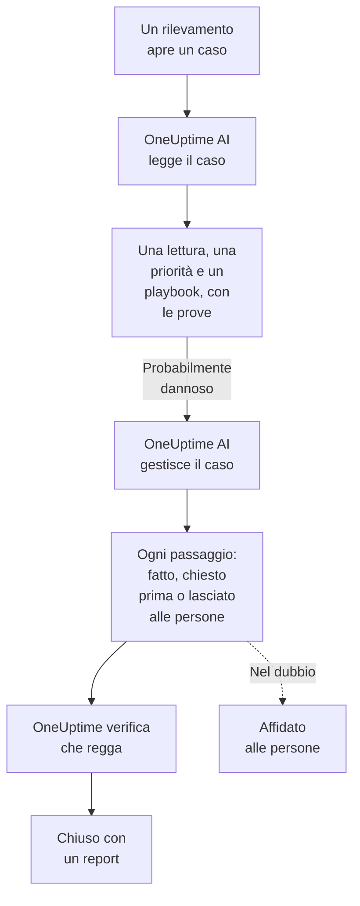

# OneUptime AI nella sicurezza

OneUptime AI legge ogni caso di sicurezza come farebbe un analista: i suoi rilevamenti, eventi, entità e la threat intelligence, e gli host e le persone che lo circondano. Dice che cosa è successo e se sembra reale, suggerisce una priorità e un playbook, e cita le prove dietro ogni affermazione. Se glielo consenti, poi gestisce il caso dall'inizio alla fine: lo prende in carico, contiene la minaccia, verifica che ciò che ha fatto regga, fa correggere il codice e chiude il caso con un report. Ogni tipo di passaggio lo esegue in autonomia, lo chiede prima a una persona o lo lascia a una persona, come imposti tu, ed esegue ogni passaggio tramite lo stesso motore dei playbook che usano le persone, così ognuno compare nella cronologia del caso come passaggio di OneUptime AI e si può annullare. Scrive anche bozze di regole di rilevamento a partire da una frase, e in Ask AI risponde alle tue domande sui dati di sicurezza.

:::cards
- [Classificare un caso](#classificare-un-caso): Che cosa legge OneUptime AI, che cosa conclude e che cosa non fa mai.
- [Classificare automaticamente i nuovi casi](#classificare-automaticamente-i-nuovi-casi): Ogni caso aperto da un rilevamento, classificato appena si apre.
- [Gestire un caso dall'inizio alla fine](#gestire-un-caso-dallinizio-alla-fine): Contenere, verificare, correggere e chiudere, con una persona che approva ciò che scegli.
- [Cosa può fare OneUptime AI su un caso](#cosa-può-fare-oneuptime-ai-su-un-caso): Disattivato, Chiedi prima o In autonomia, per ogni tipo di passaggio.
- [Quando affida un caso alle persone](#quando-affida-un-caso-alle-persone): Perché si ferma e chi ne viene informato.
- [Lascia che OneUptime AI risponda per primo](#lascia-che-oneuptime-ai-risponda-per-primo): Avvisare le persone solo quando OneUptime AI ne ha bisogno.
- [Eseguire un playbook dopo una classificazione](#eseguire-un-playbook-dopo-una-classificazione): Agire su un caso letto come Probabilmente dannoso.
- [Scrivere la bozza di una regola di rilevamento](#scrivere-la-bozza-di-una-regola-di-rilevamento): Descrivi che cosa rilevare e leggi la regola Sigma.
- [Ask AI nelle pagine di sicurezza](#ask-ai-nelle-pagine-di-sicurezza): Domande su casi ed eventi, con parole semplici.
:::

## Come funziona

Una classificazione si limita a leggere. Gestire un caso agisce, entro quanto consenti, e affida il caso alle persone appena non è sicuro. Entrambi usano l'IA del progetto stesso: **Abilita IA**, il suo provider LLM, i suoi crediti IA e i suoi limiti giornalieri di IA.

## Prima di iniziare

- **Abilita IA** attivo, in **Impostazioni del progetto → IA → Funzionalità IA**. Se è spento, la sicurezza non mostra nulla di OneUptime AI e non parte nulla.
- Un provider LLM che OneUptime AI possa usare, in **Impostazioni del progetto → IA → Provider LLM**. OneUptime Cloud ne fornisce uno.
- Un ruolo che possa lavorare i casi di sicurezza, per avviare una classificazione: Proprietario del progetto, Amministratore del progetto, Amministratore della sicurezza o Membro della sicurezza. Visualizzatore della sicurezza legge ogni classificazione, ma non può avviarne. Vedi [Ruoli](/docs/permissions/reference#ruoli).

## Classificare un caso

Apri un caso: la scheda **OneUptime AI** è in cima alla sua pagina.

| La scheda dice | Che cosa significa |
| --- | --- |
| **Non ancora classificato** | Non è stata eseguita nessuna classificazione. **Classifica con l'IA** ne avvia una. |
| **Classificazione di questo caso** | OneUptime AI sta leggendo il caso. Ogni controllo appare mentre viene eseguito. |
| Una lettura, come **Probabilmente dannoso** | La classificazione è finita. **Classifica di nuovo** rilegge il caso da capo. |
| **La classificazione non è terminata** | L'esecuzione si è interrotta. **Riprova** ne avvia un'altra. |

Un Visualizzatore della sicurezza legge la stessa scheda: **Classifica con l'IA** e **Riprova** restano in grigio accanto a una riga che dice chi può avviare una classificazione, e **Classifica di nuovo** e **Imposta la priorità** non vengono offerti.

Una classificazione legge:

- il caso: titolo, priorità, stato, entità e mappatura ATT&CK;
- i suoi rilevamenti, dal più recente, con un evento di esempio per ciascuno;
- gli eventi di sicurezza e la threat intelligence sui suoi utenti, host e indirizzi;
- il rischio dei suoi utenti, host e indirizzi, e ciò che lo ha aumentato questa settimana;
- gli host di OneUptime a cui corrispondono i suoi host e indirizzi, e chi ne è responsabile;
- l'incidente che ha dichiarato, le sue note, le sue entità protette e i playbook attivi.

Può anche leggere il resto di OneUptime come fa l'indagine di un incidente: log, tracce, metriche, host e gli strumenti in sola lettura dei server MCP del progetto.

Chiunque possa vedere il caso legge la sua classificazione, quindi una classificazione legge solo ciò che tutti loro possono leggere. Un team, un ruolo personalizzato o una chiave API che legge un tipo di record solo in base al proprietario o all'etichetta conta solo quando la chiave API, o qualcuno del team, può leggere i casi di sicurezza o il log di audit. Un tipo di record che nessuno di loro legge solo in base al proprietario o all'etichetta viene letto per intero; dove qualcuno lo fa, un host, un cluster, un servizio o un altro record che un proprietario o un'etichetta mette da parte viene escluso e non viene mai nominato né contato. Chi può leggere i casi di sicurezza viene stabilito a ogni classificazione, quindi una classificazione scritta prima che qualcuno ottenesse quell'accesso può nominare record messi da parte per quella persona. Il caso viene sempre letto, e così l'incidente che ha dichiarato, a meno che quell'incidente non sia privato. Gli incidenti e gli avvisi privati non vengono mai letti.

### Che cosa conclude

| Lettura | Significa | Suggerisce di chiudere come |
| --- | --- | --- |
| Probabilmente dannoso | Le prove indicano un'attività dannosa o non autorizzata | True Positive |
| Probabilmente innocuo | L'attività sembra reale ma prevista, come un'operazione di amministrazione o una scansione del tuo team | Benign Positive |
| Probabile falso positivo | Il rilevamento sembra aver frainteso un'attività normale | False Positive |
| Non conclusivo | Le prove non bastavano per decidere, e una persona deve guardare | Niente |

La lettura è di OneUptime AI, mai il verdetto del caso: **Chiudi caso** parte dal verdetto che suggerisce, e una persona sceglie. Sotto la lettura, la scheda mostra:

- **Priorità suggerita**, con **Imposta la priorità** quando il caso ha un'altra priorità.
- **Playbook suggerito**, con **Esegui il playbook**, che lo esegue a tuo nome, con ogni approvazione che richiede. Mentre quel playbook è già in esecuzione sul caso, lo stato della sua esecuzione, come **In attesa di approvazione**, prende il posto di **Esegui il playbook**: l'esecuzione è in **Playbook** del caso, e una seconda chiederebbe di nuovo la stessa approvazione.
- Il rapporto: che cosa è successo, quanto è sicura e che cosa fare dopo, ogni affermazione seguita da un riferimento come C1.
- **Prove controllate**: ogni query eseguita dalla classificazione. Un riferimento apre la sua query, e aprendone una la si esegue di nuovo con i tuoi permessi, sull'intervallo letto dalla classificazione.
- **Chiedi di questo caso**, che apre Ask AI sul caso.

Ogni elenco di casi mostra la lettura accanto al titolo di ogni caso, e filtra in base a essa con **Valutazione dell'IA**.

### Che cosa non fa mai

Una classificazione non cambia nulla del caso: né lo stato, né la priorità, né l'assegnatario, né il verdetto, né le note. Non esegue nessun playbook e non contiene nessuno. Un playbook che suggerisce parte quando una persona lo esegue, o tramite il trigger descritto più sotto. Agire sul caso spetta a OneUptime AI quando lo gestisce, e questo ha una sua impostazione: vedi [Gestire un caso dall'inizio alla fine](#gestire-un-caso-dallinizio-alla-fine).

### Testo scritto per manipolare un'IA

Eventi, avvisi e valori delle entità arrivano dall'esterno del progetto, e un attaccante può scriverli. OneUptime AI li legge tutti come dati, mai come istruzioni. Quando una parte dei dati di un caso sembra un insieme di istruzioni rivolte a un'IA, la scheda lo dice per prima cosa, una lettura Probabilmente innocuo o Probabile falso positivo diventa Non conclusivo, quella classificazione non avvia nessun playbook, e OneUptime AI non gestisce il caso: lo affida alle persone.

## Classificare automaticamente i nuovi casi

Apri **Prodotti → Eventi di sicurezza → IA → Impostazioni** e attiva **Classifica i nuovi casi**: da quel momento ogni caso aperto da un rilevamento viene classificato appena si apre. L'interruttore salva appena lo sposti. Proprietario del progetto e Amministratore del progetto possono cambiarlo.

I nuovi progetti partono con l'opzione attiva; un progetto creato prima la tiene spenta finché qualcuno non la attiva. Un caso aperto a mano, e il caso dell'attacco di prova di **Invia un attacco di prova**, vengono classificati quando qualcuno fa clic su **Classifica con l'IA**.

## Gestire un caso dall'inizio alla fine

Nella stessa pagina, attiva **Gestisci i casi dall'inizio alla fine**: da quel momento OneUptime AI prende in carico ogni caso che la sua classificazione legge come Probabilmente dannoso e lo gestisce, entro quanto consenti in **Cosa può fare OneUptime AI su un caso**. I nuovi progetti partono con l'opzione attiva; un progetto creato prima la tiene spenta finché qualcuno non la attiva. Proprietario del progetto e Amministratore del progetto possono cambiarla.

Mentre è attiva, una persona può anche avviarlo su un singolo caso: **Rispondi con l'IA**, nella scheda **OneUptime AI** del caso, gestisce un caso che la classificazione di OneUptime AI ha letto come Probabilmente dannoso, Probabilmente innocuo o Probabile falso positivo. Non viene offerto su un caso la cui classificazione era Non conclusivo, i cui dati sembrano istruzioni rivolte a un'IA o che ha la tua priorità più alta: quei casi spettano a una persona. Serve un ruolo che possa lavorare i casi di sicurezza.

### Che cosa fa

OneUptime AI porta avanti il **Piano di risposta** del caso, dal più urgente: **Conferma che è reale**, **Contieni la minaccia**, **Correggi ciò che l'ha permesso** e **Chiudi il caso**. Ogni passaggio viene eseguito, chiesto a una persona o lasciato a una persona, come dice la riga di **Cosa può fare OneUptime AI su un caso** per il suo tipo.

| Passaggio | Che cosa fa OneUptime AI |
| --- | --- |
| Prendere in carico il caso | Lo prende in carico e ne aumenta la priorità fino a quella suggerita dalla classificazione. Non abbassa mai una priorità, e un caso che porta alla tua priorità più alta passa alle persone |
| Escludere un falso positivo | Lo segna come completato solo quando i fatti di OneUptime non lasciano dubbi: l'indirizzo non è uno dei tuoi e nessuno ha effettuato l'accesso da lì. Altrimenti lascia il passaggio a una persona |
| Bloccare l'indirizzo | Lo blocca per 24 ore tramite la tua [Blocklist](/docs/telemetry/security-cases#blocklist), poi attende il controllo di OneUptime che il blocco regga. Se niente applica la tua blocklist, lascia il passaggio a una persona |
| Sospendere l'utente, contenere l'host | Esegue il passaggio di uno dei tuoi playbook che lo fa, tramite il tuo provider di identità o il tuo EDR. Senza un playbook del genere, lascia il passaggio a una persona |
| Dichiarare un incidente | Chiede sempre prima: un incidente avvisa le persone |
| Segnare il caso come Contenuto | Quando OneUptime ha verificato ogni passaggio che contiene la minaccia |
| Correggere la route raggiunta da un attacco | Fa aprire una pull request a «Correggi con l'IA». Una persona la unisce. Chiude il caso quando OneUptime verifica la correzione in produzione, chiede a una persona quando la correzione sembra solo fatta, e continua a gestire il caso finché non regge |
| Attivare l'MFA, rivedere le modifiche dell'account | Lasciato a una persona: nessun prodotto dice a OneUptime se reggono |
| Chiudere il caso | Quando ogni altro passaggio è completato e il rilevamento del caso è tranquillo da 24 ore, come Vero positivo, con un [report di chiusura](#il-report-di-chiusura) |

Un passaggio che la regola di rilevamento del caso aggiunge di suo, e tutto ciò che OneUptime non ha modo di fare, come bloccare un dominio nel tuo filtro DNS, viene lasciato a una persona, spiegando perché.

Ogni passaggio che OneUptime AI esegue passa per il motore dei playbook, come un'esecuzione di un solo passaggio nella pagina **Playbook** del caso, con **OneUptime AI** come trigger. Quindi attende l'approvazione, lascia stare le entità protette, compare nella cronologia del caso, resta nel log di audit e si può annullare, come un passaggio eseguito da chiunque, e la cronologia dice che era di OneUptime AI. Un passaggio su cui chiede attende l'approvazione di una persona, sul caso, nella sua pagina **Playbook** o con un tocco in Slack o Microsoft Teams.

### Il suo log sul caso

Sotto la classificazione, la scheda **OneUptime AI** dice come OneUptime AI sta gestendo il caso, in **Gestione del caso**:

| La scheda dice | Che cosa significa |
| --- | --- |
| **OneUptime AI non sta gestendo questo caso** | **Rispondi con l'IA** lo prende in carico. |
| **Gestione del caso in corso** | OneUptime AI sta portando avanti il piano. **Prendi il controllo** lo ferma, e il caso è tuo. |
| **In attesa di una persona** | Ha chiesto a qualcuno di approvare un passaggio, e prosegue appena qualcuno risponde. |
| **Affidato alle persone** | Si è fermato, e dice perché. |
| **Il caso è chiuso** | Ha chiuso il caso, oppure l'ha fatto una persona. Il suo **Report di chiusura** è sopra i suoi passaggi. |

Sotto, ogni passaggio che ha eseguito, chiesto o lasciato, dal più recente, ciascuno con il suo motivo: **Fatto in autonomia: le tue impostazioni lo consentono.**, **Secondo le tue impostazioni, questo attende l'approvazione di una persona.**, **OneUptime non ha modo di eseguire questo passaggio, quindi lo fa una persona.** Un passaggio su cui ha chiesto ha **Approva** e **Rifiuta**; un passaggio che ha eseguito rimanda alla sua esecuzione, dove si può annullare. Un passaggio che OneUptime controlla dice cosa ha trovato il controllo, e un passaggio che ha già eseguito su casi della stessa regola dice quante volte ha retto: «Ha retto in 14 su 15 casi simili.»

### Un caso che valuta come innocuo o falso positivo

**Rispondi con l'IA** su un caso che la classificazione ha letto come Probabilmente innocuo o Probabile falso positivo lo chiude come Positivo benigno o Falso positivo, nei limiti di **Chiudi il caso**. Una volta chiuso, OneUptime AI revoca i blocchi creati dal caso, sempre nei limiti di **Chiudi il caso**, e propone per la regola del caso un'eccezione per il valore che l'ha attivata. L'eccezione attende sempre una persona: **Approva** la aggiunge, a tuo nome.

## Cosa può fare OneUptime AI su un caso

In **Cosa può fare OneUptime AI su un caso**, in **Prodotti → Eventi di sicurezza → IA → Impostazioni**, ogni tipo di passaggio ha la sua riga, che si salva appena scegli:

- **Disattivato**: OneUptime AI lo lascia a una persona e lo indica sul caso.
- **Chiedi prima**: chiede a una persona, con le prove, e lo fa appena qualcuno approva.
- **In autonomia**: lo fa senza chiedere e lo indica nella cronologia del caso.

| Riga | Copre | I nuovi progetti partono con |
| --- | --- | --- |
| **Gestisci il caso** | Prendere in carico il caso, aumentarne la priorità, segnare i passaggi come completati con le loro prove, segnarlo come Contenuto | In autonomia |
| **Blocca indirizzi** | Bloccare l'indirizzo del caso sul tuo edge, per 24 ore | Chiedi prima |
| **Contieni account** | Sospendere l'utente del caso o chiuderne le sessioni | Chiedi prima |
| **Contieni host** | Contenere o isolare l'host del caso | Chiedi prima |
| **Correggi il codice** | Far aprire a «Correggi con l'IA» una pull request per la route raggiunta da un attacco | In autonomia |
| **Chiudi il caso** | Chiudere il caso con il suo report di chiusura, e revocare i blocchi del caso una volta chiuso come innocuo | Chiedi prima |

Le impostazioni hanno effetto mentre **Gestisci i casi dall'inizio alla fine** è attivo, e la scheda lo segnala mentre è disattivato. Proprietario del progetto e Amministratore del progetto possono cambiarle.

Impostare **Blocca indirizzi**, **Contieni account** o **Contieni host** su **In autonomia** richiede l'autorità di un Amministratore della sicurezza, che hanno anche i Proprietari del progetto e gli Amministratori del progetto, e OneUptime registra chi l'ha fatto e quando, come per un passaggio di playbook con l'approvazione disattivata. **Blocca indirizzi** chiede prima: **Conferma e attiva** è la conferma di un Amministratore della sicurezza, e la riga poi dice quando è stata data. Finché un Amministratore della sicurezza non lo conferma, OneUptime AI chiede prima di bloccare.

Qualunque cosa dicano le righe, OneUptime AI:

- non agisce mai su un utente, un host o un indirizzo protetto: affida il caso alle persone;
- esegue al massimo 10 azioni in autonomia all'ora, su tutti i tuoi casi, e poi affida il caso successivo alle persone;
- blocca per 24 ore al massimo;
- non unisce mai il codice: ogni pull request la unisce una persona;
- chiede sempre prima di dichiarare un incidente o aggiungere un'eccezione della regola;
- gestisce un caso con un'esecuzione alla volta, e un server che si riavvia non perde mai un'esecuzione che agisce.

## Quando affida un caso alle persone

OneUptime AI non si ritira mai in silenzio. Affida il caso alle persone, dicendo perché sulla scheda e nella cronologia, quando:

- una parte dei dati del caso sembra un insieme di istruzioni rivolte a un'IA;
- il caso ha la tua priorità più alta;
- l'obiettivo del suo prossimo passaggio è protetto;
- ha agito in autonomia tante volte quante può in un'ora;
- l'IA è disattivata per il progetto o per i casi di sicurezza, non c'è un provider LLM, o il progetto ha esaurito i crediti IA o ha raggiunto il limite giornaliero di IA;
- la sua classificazione non ha potuto stabilire se il caso è reale;
- un passaggio che ha eseguito non regge, un passaggio che ha avviato non è terminato, o una persona ha rifiutato o annullato un passaggio che ha eseguito;
- non riesce a capire cosa fare dopo, o tutto ciò che resta da fare sul caso spetta a una persona.

Le persone che seguono il caso lo sanno subito o, quando nessuno lo segue, le persone avvisate dei casi con la sua priorità: **OneUptime AI ha affidato un caso di sicurezza alle persone**, in **Impostazioni utente → Impostazioni notifiche**. Una regola di notifica del workspace per i casi di sicurezza lo pubblica nel suo canale Slack o Microsoft Teams in **Casi affidati alle persone da OneUptime AI**. **Prendi il controllo** passa il caso senza avvisare nessuno, perché la persona che l'ha premuto lo ha già.

**Rispondi con l'IA** chiede a OneUptime AI di gestire di nuovo il caso, dal punto in cui si trova.

Un caso trattenuto mentre OneUptime AI risponde per primo raggiunge le persone una sola volta, con l'avviso del nuovo caso e il motivo per cui OneUptime AI si è fermato: vedi [Lascia che OneUptime AI risponda per primo](#lascia-che-oneuptime-ai-risponda-per-primo).

## Lascia che OneUptime AI risponda per primo

In **Lascia che OneUptime AI risponda per primo**, in **Prodotti → Eventi di sicurezza → IA → Impostazioni**, attiva **Rispondi per primo**: da quel momento un nuovo caso aperto da un rilevamento al di sotto della priorità che scegli attende OneUptime AI prima che qualcuno venga avvisato. L'opzione è disponibile mentre **Classifica i nuovi casi** e **Gestisci i casi dall'inizio alla fine** sono attivi. Parte disattivata e si salva appena la cambi. Proprietario del progetto e Amministratore del progetto possono cambiarla.

- **Per i casi al di sotto di**: la priorità al di sotto della quale deve trovarsi un caso per essere trattenuto. È impostata su Alto finché non ne scegli un'altra.
- **Avvisa comunque le persone dopo**: per quanto tempo al massimo un caso viene trattenuto, 5, 10, 15, 20 o 30 minuti. Parte da 10 minuti.

Mentre un caso è trattenuto, l'avviso del nuovo caso attende, e così i passaggi **Allerta la reperibilità** dei playbook che partono da soli sul caso. Il caso mostra **OneUptime AI se ne sta occupando**, con l'ora in cui le persone vengono avvisate, e **Chiama ora** le avvisa subito. Un'esecuzione di playbook la cui chiamata attende è **In attesa di OneUptime AI**.

L'attesa finisce appena succede una di queste cose:

| Quando | Allora |
| --- | --- |
| OneUptime AI contiene il caso e OneUptime verifica ogni passaggio di contenimento, oppure il caso viene chiuso | Nessuno viene avvisato. I canali che pubblicano i nuovi casi ricevono un solo riepilogo di ciò che ha fatto OneUptime AI, e i passaggi di chiamata che attendevano vengono saltati |
| OneUptime AI ha bisogno di una persona: chiede a qualcuno di approvare un passaggio, affida il caso alle persone o non riesce a iniziare a gestirlo | Vengono avvisate subito tutte le persone il cui avviso era stato trattenuto, con il motivo e ciò che OneUptime AI ha già fatto, e i passaggi di chiamata che attendevano vengono eseguiti |
| La sua classificazione non legge il caso come Probabilmente dannoso, il caso viene segnato come Contenuto prima che OneUptime abbia potuto verificare ogni passaggio, o il tempo di attesa scade | Vengono avvisati tutti subito, con il motivo |
| Qualcuno preme **Chiama ora**, il caso sale alla priorità che hai scelto, oppure **Rispondi per primo** o **Gestisci i casi dall'inizio alla fine** viene disattivato | Vengono avvisati tutti subito |
| Una persona prende in carico il caso: con **Prendi il controllo**, assegnandolo o facendolo avanzare | Il caso è suo. Nessun altro viene avvisato, i canali vengono informati del nuovo caso e i passaggi di chiamata che attendevano vengono saltati |

Un caso non viene mai trattenuto, e le persone vengono avvisate come al solito, quando:

- ha la tua priorità più alta, o la priorità che hai scelto o una superiore;
- 3 altri casi si sono aperti nei 5 minuti precedenti, il che sembra un attacco in corso: anche i casi trattenuti in quel momento passano alle persone;
- una parte dei suoi dati sembra un insieme di istruzioni rivolte a un'IA;
- riguarda un indirizzo, un utente o un host di un caso che OneUptime AI ha risolto nelle ultime 24 ore, perché ciò che ha fatto non ha retto;
- OneUptime AI non può classificarlo o gestirlo, per esempio quando il progetto ha esaurito i crediti IA;
- l'ha aperto una persona, o è il caso dell'attacco di prova.

La cronologia del caso dice perché non è stato trattenuto, tranne per un caso con la priorità che hai scelto o una superiore, un caso aperto da una persona e il caso dell'attacco di prova. Gli avvisi di un obiettivo di risposta non vengono mai trattenuti.

Bloccare indirizzi e contenere account e host chiedono prima finché non li imposti su **In autonomia** in **Cosa può fare OneUptime AI su un caso**, e un caso raggiunge le persone appena OneUptime AI chiede. Con **Blocca indirizzi** su **In autonomia**, confermato da un Amministratore della sicurezza, può contenere uno scanner senza che nessuno venga avvisato.

### L'email settimanale

Ogni lunedì, i Proprietari del progetto e gli Amministratori della sicurezza che possono leggere i casi di sicurezza ricevono una sola email con ciò che OneUptime AI ha fatto sui casi di sicurezza del progetto nella settimana precedente: i casi a cui ha risposto per primo e come sono finiti, quanto presto sono stati contenuti i casi che ha gestito, gli indirizzi che ha bloccato e i blocchi poi revocati, i passaggi che ha chiesto alle persone di approvare e quanto presto hanno risposto, e i passaggi che le persone hanno annullato. Contiene solo numeri, e un link a **Prodotti → Eventi di sicurezza → Panoramica**. Una settimana in cui OneUptime AI non ha fatto nulla non invia nessuna email.

## Il report di chiusura

Quando OneUptime AI chiude un caso, o chiede a una persona di farlo, scrive un report di chiusura da ciò che il caso contiene, non dalle parole della classificazione: cosa è successo, l'impatto, cosa è stato fatto, cosa è stato corretto e cosa tenere d'occhio. Il report è la nota di chiusura del caso, è nella cronologia, e la scheda lo mostra in **Report di chiusura**. Con **Chiudi il caso** su **Chiedi prima**, il caso attende che una persona approvi la chiusura, con il report da leggere prima.

## Come viene misurato

**Prodotti → Eventi di sicurezza → Panoramica** mostra come OneUptime AI ha gestito i casi degli ultimi 30 giorni, appena ne ha gestito uno o ha chiesto qualcosa su uno: **Risolto da OneUptime AI**, sui casi che ha gestito; **Tempo al contenimento con l'IA** e **Tempo alla chiusura con l'IA**, ciascuno accanto al tempo senza; e **Richieste di approvazione**, quanto presto hanno risposto le persone e quanti dei suoi passaggi hanno annullato.

## Eseguire un playbook dopo una classificazione

Un playbook il cui **Trigger** è **Classificato come probabilmente dannoso** parte una volta su un caso, quando una classificazione lo legge come Probabilmente dannoso. **Per casi di almeno**, **Solo per rilevamenti da** e **Solo per queste regole di rilevamento** lo restringono come per qualsiasi trigger, e i suoi passi di contenimento attendono l'approvazione come sempre. Non parte:

- dopo una classificazione che ha trovato testo scritto per manipolare un'IA;
- una seconda volta sullo stesso caso, per quante volte il caso venga classificato;
- sul caso dell'attacco di prova, a meno che ogni passo del playbook resti dentro OneUptime.

A un nuovo playbook questo trigger viene proposto solo mentre l'IA del progetto è attiva.

## Scrivere la bozza di una regola di rilevamento

In **Regole di rilevamento**, sotto il campo **Regola Sigma (YAML)**, fai clic su **Bozza con IA** e di' che cosa deve rilevare la regola, per esempio dieci accessi falliti da uno stesso indirizzo IP in cinque minuti. **Scrivi la regola** inserisce una regola Sigma nel campo, controllata come una regola salvata. Leggila, modificala se serve e salvala come al solito: non viene salvato nulla finché non lo fai tu. Se il campo contiene già una regola, il pulsante diventa **Riscrivi con l'IA**, e la bozza sostituisce quella regola.

Per scrivere una bozza serve un ruolo che possa creare regole di rilevamento.

## Ask AI nelle pagine di sicurezza

**Chiedi all'IA** sa in quale pagina di sicurezza ti trovi. Su un caso legge prima il caso e propone domande come **È reale?**. Nelle altre pagine degli eventi di sicurezza, una domanda con parole semplici cerca nei tuoi eventi di sicurezza. Può anche confrontare valori con la tua threat intelligence, vedere quanto è stato attivo un utente, un host o un indirizzo, ed elencare i playbook adatti a un caso.

Ask AI può aggiungere una nota a un caso ed eseguire un playbook su di esso, a tuo nome, e chiede prima di ogni azione. Un playbook che esegue attende l'approvazione come qualsiasi altro.

Quando un caso dichiara un incidente, anche l'indagine IA dell'incidente legge il caso: che cosa è stato rilevato, su chi, e la classificazione di OneUptime AI.

## Costi e limiti

Una classificazione è lavoro di OneUptime AI, come l'indagine di un incidente. Su OneUptime Cloud viene pagata con i crediti IA del progetto, e conta nei limiti giornalieri di IA propri del progetto (**Limiti giornalieri**, in **Impostazioni del progetto → IA → Funzionalità IA**). I limiti giornalieri di incidenti e avvisi non si applicano. Un caso ha una sola classificazione alla volta, e i log IA (**Impostazioni del progetto → IA → Log IA**) ne elencano le chiamate.

Quando il progetto ha esaurito i crediti IA o ha raggiunto un limite giornaliero di IA, i nuovi casi non vengono classificati: la scheda dice perché, e **Classifica con l'IA** torna a funzionare appena vengono aggiunti crediti o il limite si azzera. Quando OneUptime AI gestisce un caso, legge il piano e i controlli propri del caso invece di interrogare l'LLM, e si ferma agli stessi limiti: affida il caso alle persone, dicendo perché.

## Risoluzione dei problemi

:::details Un nuovo caso non è stato classificato
Controlla che **Abilita IA** sia attivo, e anche **Classifica i nuovi casi** in **Prodotti → Eventi di sicurezza → IA → Impostazioni**. Un caso aperto a mano e il caso dell'attacco di prova vengono classificati solo quando qualcuno lo chiede. Apri il caso: quando qualcosa impedisce una classificazione, la scheda dice che cosa, e dove sistemarlo.
:::

:::details OneUptime AI non ha gestito un caso
Controlla che **Gestisci i casi dall'inizio alla fine** sia attivo in **Prodotti → Eventi di sicurezza → IA → Impostazioni**. Prende in carico un caso di sua iniziativa solo quando la classificazione lo legge come Probabilmente dannoso. Apri il caso: in **Gestione del caso**, la scheda dice perché non lo sta gestendo, e **Rispondi con l'IA** glielo chiede.
:::

:::details Chiede prima di bloccare, anche se Blocca indirizzi è In autonomia
**In autonomia** per **Blocca indirizzi** conta solo dopo che un Amministratore della sicurezza l'ha confermato: la riga dice quando, o che nessuno l'ha ancora fatto. Un indirizzo protetto, o uno dei tuoi, non viene mai bloccato: OneUptime AI affida il caso alle persone. Finché niente applica la tua blocklist, lascia il passaggio a una persona.
:::

:::details La scheda dice che il progetto ha esaurito i crediti IA, o che ha raggiunto il suo limite giornaliero di IA
Un Proprietario del progetto o qualcuno con Manage Billing può aggiungere crediti in **Impostazioni del progetto → IA → Crediti IA**, oppure alzare o togliere il limite in **Impostazioni del progetto → IA → Funzionalità IA**. Poi fai clic su **Classifica con l'IA** sul caso.
:::

:::details La scheda dice che un testo del caso sembra un insieme di istruzioni per un'IA
Una parte dei dati del caso, come il messaggio di un evento o un nome utente, è stata scritta per manipolare un'IA. OneUptime AI l'ha letta come dati e ha lasciato a te la decisione: leggi tu i rilevamenti e le prove prima di chiudere il caso.
:::

:::details Le persone sono state avvisate mentre OneUptime AI rispondeva per primo
La cronologia del caso dice perché l'attesa è finita: OneUptime AI ha chiesto a qualcuno di approvare un passaggio, ha affidato il caso alle persone o non ha finito entro il tempo di **Avvisa comunque le persone dopo**, oppure qualcuno ha premuto **Chiama ora**. Un passaggio che chiede prima raggiunge le persone appena OneUptime AI chiede: vedi **Cosa può fare OneUptime AI su un caso**.
:::

:::details Un nuovo caso non è stato trattenuto
Controlla che **Rispondi per primo** sia attivo, e che il caso sia al di sotto della priorità scelta in **Per i casi al di sotto di**. Un caso con la tua priorità più alta, un caso aperto da una persona e il caso dell'attacco di prova non vengono mai trattenuti. Per qualsiasi altro motivo, la cronologia del caso dice perché.
:::

:::details Un playbook con il trigger IA non è partito
Controlla che il playbook sia abilitato, che la classificazione abbia letto il caso come Probabilmente dannoso, e che le sue impostazioni **Per casi di almeno**, **Solo per rilevamenti da** e **Solo per queste regole di rilevamento** corrispondano al caso. Parte una volta per caso, e non dopo una classificazione che ha trovato testo scritto per manipolare un'IA.
:::

## Passi successivi

:::cards
- [Casi di sicurezza e playbook](/docs/telemetry/security-cases): Lavorare i casi, chiuderli con un verdetto e costruire playbook.
- [AI SRE](/docs/ai/ai-sre): Come OneUptime AI indaga su incidenti e avvisi, e i suoi limiti.
- [Chiedi all'IA](/docs/ai/ask-ai): Fai domande sul tuo progetto con parole semplici.
- [Provider LLM](/docs/ai/llm-provider): Scegli il modello che usa OneUptime AI.
:::
