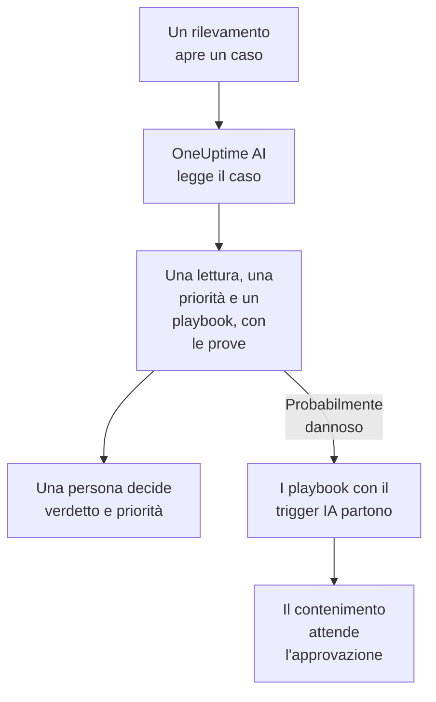

# OneUptime AI nella sicurezza

OneUptime AI legge ogni caso di sicurezza come farebbe un analista: i suoi rilevamenti, eventi, entità e la threat intelligence, e gli host e le persone che lo circondano. Dice che cosa è successo e se sembra reale, suggerisce una priorità e un playbook, e cita le prove dietro ogni affermazione. Da solo non cambia nulla: una persona decide il verdetto e la priorità, ed esegue il playbook. Scrive anche bozze di regole di rilevamento a partire da una frase, e in Ask AI risponde alle tue domande sui dati di sicurezza.

:::cards
- [Classificare un caso](#classificare-un-caso): Che cosa legge OneUptime AI, che cosa conclude e che cosa non fa mai.
- [Classificare automaticamente i nuovi casi](#classificare-automaticamente-i-nuovi-casi): Ogni caso aperto da un rilevamento, classificato appena si apre.
- [Eseguire un playbook dopo una classificazione](#eseguire-un-playbook-dopo-una-classificazione): Agire su un caso letto come Probabilmente dannoso.
- [Scrivere la bozza di una regola di rilevamento](#scrivere-la-bozza-di-una-regola-di-rilevamento): Descrivi che cosa rilevare e leggi la regola Sigma.
- [Ask AI nelle pagine di sicurezza](#ask-ai-nelle-pagine-di-sicurezza): Domande su casi ed eventi, con parole semplici.
:::

## Come funziona

Una classificazione si limita a leggere. Usa l'IA del progetto stesso: **Abilita IA**, il suo provider LLM, i suoi crediti IA e i suoi limiti giornalieri di IA.

## Prima di iniziare

- **Abilita IA** attivo, in **Impostazioni del progetto → IA → AI Features**. Se è spento, la sicurezza non mostra nulla di OneUptime AI e non parte nulla.
- Un provider LLM che OneUptime AI possa usare, in **Impostazioni del progetto → IA → Provider LLM**. OneUptime Cloud ne fornisce uno.
- Un ruolo che possa lavorare i casi di sicurezza, per avviare una classificazione: Project Owner, Project Admin, Security Admin o Security Member. Security Viewer legge ogni classificazione, ma non può avviarne. Vedi [Ruoli](/docs/permissions/reference#ruoli).

## Classificare un caso

Apri un caso: la scheda **OneUptime AI** è in cima alla sua pagina.

| La scheda dice | Che cosa significa |
| --- | --- |
| **Non ancora classificato** | Non è stata eseguita nessuna classificazione. **Classifica con l'IA** ne avvia una. |
| **Classificazione di questo caso** | OneUptime AI sta leggendo il caso. Ogni controllo appare mentre viene eseguito. |
| Una lettura, come **Probabilmente dannoso** | La classificazione è finita. **Classifica di nuovo** rilegge il caso da capo. |
| **La classificazione non è terminata** | L'esecuzione si è interrotta. **Riprova** ne avvia un'altra. |

Un Security Viewer legge la stessa scheda: **Classifica con l'IA** e **Riprova** restano in grigio accanto a una riga che dice chi può avviare una classificazione, e **Classifica di nuovo** e **Imposta la priorità** non vengono offerti.

Una classificazione legge:

- il caso: titolo, priorità, stato, entità e mappatura ATT&CK;
- i suoi rilevamenti, dal più recente, con un evento di esempio per ciascuno;
- gli eventi di sicurezza e la threat intelligence sui suoi utenti, host e indirizzi;
- il rischio dei suoi utenti, host e indirizzi, e ciò che lo ha aumentato questa settimana;
- gli host di OneUptime a cui corrispondono i suoi host e indirizzi, e chi ne è responsabile;
- l'incidente che ha dichiarato, le sue note, le sue entità protette e i playbook attivi.

Può anche leggere il resto di OneUptime come fa l'indagine di un incidente: log, tracce, metriche, host e gli strumenti in sola lettura dei server MCP del progetto.

### Che cosa conclude

| Lettura | Significa | Suggerisce di chiudere come |
| --- | --- | --- |
| Probabilmente dannoso | Le prove indicano un'attività dannosa o non autorizzata | True Positive |
| Probabilmente innocuo | L'attività sembra reale ma prevista, come un'operazione di amministrazione o una scansione del tuo team | Benign Positive |
| Probabile falso positivo | Il rilevamento sembra aver frainteso un'attività normale | False Positive |
| Non conclusivo | Le prove non bastavano per decidere, e una persona deve guardare | Niente |

La lettura è di OneUptime AI, mai il verdetto del caso: **Close Case** parte dal verdetto che suggerisce, e una persona sceglie. Sotto la lettura, la scheda mostra:

- **Priorità suggerita**, con **Imposta la priorità** quando il caso ha un'altra priorità.
- **Playbook suggerito**, con **Esegui il playbook**, che lo esegue a tuo nome, con ogni approvazione che richiede. Mentre quel playbook è già in esecuzione sul caso, lo stato della sua esecuzione, come **In attesa di approvazione**, prende il posto di **Esegui il playbook**: l'esecuzione è in **Playbooks** del caso, e una seconda chiederebbe di nuovo la stessa approvazione.
- Il rapporto: che cosa è successo, quanto è sicura e che cosa fare dopo, ogni affermazione seguita da un riferimento come C1.
- **Evidence checked**: ogni query eseguita dalla classificazione. Un riferimento apre la sua query, e aprendone una la si esegue di nuovo con i tuoi permessi, sull'intervallo letto dalla classificazione.
- **Chiedi di questo caso**, che apre Ask AI sul caso.

Ogni elenco di casi mostra la lettura accanto al titolo di ogni caso, e filtra in base a essa con **Valutazione dell'IA**.

### Che cosa non fa mai

Una classificazione non cambia nulla del caso: né lo stato, né la priorità, né l'assegnatario, né il verdetto, né le note. Non esegue nessun playbook e non contiene nessuno. Un playbook che suggerisce parte quando una persona lo esegue, o tramite il trigger descritto più sotto.

### Testo scritto per manipolare un'IA

Eventi, avvisi e valori delle entità arrivano dall'esterno del progetto, e un attaccante può scriverli. OneUptime AI li legge tutti come dati, mai come istruzioni. Quando una parte dei dati di un caso sembra un insieme di istruzioni rivolte a un'IA, la scheda lo dice per prima cosa, una lettura Probabilmente innocuo o Probabile falso positivo diventa Non conclusivo, e quella classificazione non avvia nessun playbook.

## Classificare automaticamente i nuovi casi

Apri **Prodotti → Security Events → IA → Impostazioni** e attiva **Classifica i nuovi casi**: da quel momento ogni caso aperto da un rilevamento viene classificato appena si apre. L'interruttore salva appena lo sposti. Project Owner e Project Admin possono cambiarlo.

I nuovi progetti partono con l'opzione attiva; un progetto creato prima la tiene spenta finché qualcuno non la attiva. Un caso aperto a mano, e il caso dell'attacco di prova di **Invia un attacco di prova**, vengono classificati quando qualcuno fa clic su **Classifica con l'IA**.

## Eseguire un playbook dopo una classificazione

Un playbook il cui **Trigger** è **Classificato come probabilmente dannoso** parte una volta su un caso, quando una classificazione lo legge come Probabilmente dannoso. **For Cases At Least**, **Only For Detections From** e **Only For These Detection Rules** lo restringono come per qualsiasi trigger, e i suoi passi di contenimento attendono l'approvazione come sempre. Non parte:

- dopo una classificazione che ha trovato testo scritto per manipolare un'IA;
- una seconda volta sullo stesso caso, per quante volte il caso venga classificato;
- sul caso dell'attacco di prova, a meno che ogni passo del playbook resti dentro OneUptime.

A un nuovo playbook questo trigger viene proposto solo mentre l'IA del progetto è attiva.

## Scrivere la bozza di una regola di rilevamento

In **Detection Rules**, sotto il campo **Sigma Rule (YAML)**, fai clic su **Draft with AI** e di' che cosa deve rilevare la regola, per esempio dieci accessi falliti da uno stesso indirizzo IP in cinque minuti. **Scrivi la regola** inserisce una regola Sigma nel campo, controllata come una regola salvata. Leggila, modificala se serve e salvala come al solito: non viene salvato nulla finché non lo fai tu. Se il campo contiene già una regola, il pulsante diventa **Riscrivi con l'IA**, e la bozza sostituisce quella regola.

Per scrivere una bozza serve un ruolo che possa creare regole di rilevamento.

## Ask AI nelle pagine di sicurezza

**Ask AI** sa in quale pagina di sicurezza ti trovi. Su un caso legge prima il caso e propone domande come **È reale?**. Nelle altre pagine degli eventi di sicurezza, una domanda con parole semplici cerca nei tuoi eventi di sicurezza. Può anche confrontare valori con la tua threat intelligence, vedere quanto è stato attivo un utente, un host o un indirizzo, ed elencare i playbook adatti a un caso.

Ask AI può aggiungere una nota a un caso ed eseguire un playbook su di esso, a tuo nome, e chiede prima di ogni azione. Un playbook che esegue attende l'approvazione come qualsiasi altro.

Quando un caso dichiara un incidente, anche l'indagine IA dell'incidente legge il caso: che cosa è stato rilevato, su chi, e la classificazione di OneUptime AI.

## Costi e limiti

Una classificazione è lavoro di OneUptime AI, come l'indagine di un incidente. Su OneUptime Cloud viene pagata con i crediti IA del progetto, e conta nei limiti giornalieri di IA propri del progetto (**Limiti giornalieri**, in **Impostazioni del progetto → IA → AI Features**). I limiti giornalieri di incidenti e avvisi non si applicano. Un caso ha una sola classificazione alla volta, e i registri IA (**Impostazioni del progetto → IA → Registri IA**) ne elencano le chiamate.

Quando il progetto ha esaurito i crediti IA o ha raggiunto un limite giornaliero di IA, i nuovi casi non vengono classificati: la scheda dice perché, e **Classifica con l'IA** torna a funzionare appena vengono aggiunti crediti o il limite si azzera.

## Risoluzione dei problemi

:::details Un nuovo caso non è stato classificato
Controlla che **Abilita IA** sia attivo, e anche **Classifica i nuovi casi** in **Prodotti → Security Events → IA → Impostazioni**. Un caso aperto a mano e il caso dell'attacco di prova vengono classificati solo quando qualcuno lo chiede. Apri il caso: quando qualcosa impedisce una classificazione, la scheda dice che cosa, e dove sistemarlo.
:::

:::details La scheda dice che il progetto ha esaurito i crediti IA, o che ha raggiunto il suo limite giornaliero di IA
Un proprietario del progetto o qualcuno con Manage Billing può aggiungere crediti in **Impostazioni del progetto → IA → Crediti IA**, oppure alzare o togliere il limite in **Impostazioni del progetto → IA → AI Features**. Poi fai clic su **Classifica con l'IA** sul caso.
:::

:::details La scheda dice che un testo del caso sembra un insieme di istruzioni per un'IA
Una parte dei dati del caso, come il messaggio di un evento o un nome utente, è stata scritta per manipolare un'IA. OneUptime AI l'ha letta come dati e ha lasciato a te la decisione: leggi tu i rilevamenti e le prove prima di chiudere il caso.
:::

:::details Un playbook con il trigger IA non è partito
Controlla che il playbook sia abilitato, che la classificazione abbia letto il caso come Probabilmente dannoso, e che le sue impostazioni **For Cases At Least**, **Only For Detections From** e **Only For These Detection Rules** corrispondano al caso. Parte una volta per caso, e non dopo una classificazione che ha trovato testo scritto per manipolare un'IA.
:::

## Passi successivi

:::cards
- [Casi di sicurezza e playbook](/docs/telemetry/security-cases): Lavorare i casi, chiuderli con un verdetto e costruire playbook.
- [AI SRE](/docs/ai/ai-sre): Come OneUptime AI indaga su incidenti e avvisi, e i suoi limiti.
- [Chiedi all'IA](/docs/ai/ask-ai): Fai domande sul tuo progetto con parole semplici.
- [Provider LLM](/docs/ai/llm-provider): Scegli il modello che usa OneUptime AI.
:::
