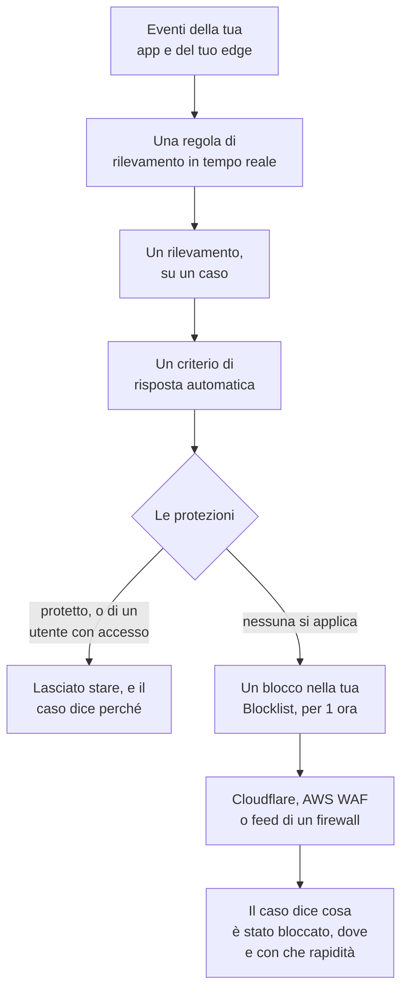

# Risposta automatica

I criteri di risposta automatica sottopongono a verifica o bloccano un indirizzo che attacca appena viene fatto il rilevamento, prima che qualcuno esamini il caso: gli scanner che sondano la tua app e i bot che provano una password dopo l'altra vengono respinti pochi minuti dopo la loro prima richiesta. Ogni progetto ha tre criteri pronti, ciascuno disattivato finché non lo attivi, e ciascuno inizia con una settimana di periodo di prova che registra soltanto cosa avrebbe fatto. Le protezioni rendono un criterio sicuro da lasciare attivo: non tocca mai i tuoi indirizzi né uno usato dai tuoi utenti con accesso effettuato, e si ferma e avvisa una persona quando un attacco è più grande di quanto dovrebbe gestire da solo.

:::cards
- [Attivare un criterio](#attivare-un-criterio): Prima una settimana di periodo di prova, poi un clic.
- [Le protezioni](#le-protezioni): Cosa un criterio non fa mai, e quando si ferma.
- [Tempo al blocco](#tempo-al-blocco): Quanto velocemente blocca ogni criterio, sulla sua scheda e sul caso.
- [Il tuo criterio](#il-tuo-criterio): Agisci sulle tecniche, sulle regole o sulla Threat Intel che scegli.
:::

## Come funziona

Un criterio agisce su un rilevamento appena viene registrato sul suo caso, pochi secondi dopo che la regola scatta. Il suo blocco va nella tua [Blocklist](/docs/telemetry/security-cases#blocklist) come fa il passaggio di playbook **Blocca l'indirizzo**, con il nome del criterio come autore: le destinazioni che applicano la tua Blocklist lo mantengono, compare nella cronologia del caso e nel log di audit, e scade da solo. Non richiede l'approvazione di nessuno: chi ha attivato il criterio ne ha approvato i blocchi.

## Prima di iniziare

- Una destinazione che applica la tua Blocklist: Cloudflare, AWS WAF, oppure un firewall o un proxy che legge un [feed della blocklist](/docs/telemetry/blocklist-feeds). Finché nulla la applica, la pagina lo dice, e i blocchi di un criterio non valgono da nessuna parte.
- Gli eventi che leggono le regole di un criterio: i log di accesso o le tracce della tua app, oppure gli eventi del tuo edge, come gli eventi firewall di Cloudflare, e i tuoi accessi. Vedi [Eventi di sicurezza](/docs/telemetry/security-events).
- Un ruolo che può attivare un criterio: Amministratore della sicurezza, Amministratore del progetto o Proprietario del progetto. Membro della sicurezza e Visualizzatore della sicurezza vedono i criteri e cosa hanno fatto. Vedi [Ruoli](/docs/permissions/reference#ruoli).

## I criteri pronti

| Criterio | Agisce su | Fa | Primo blocco |
| --- | --- | --- | --- |
| **Scanner** | Scansioni web e tentativi di exploit (ATT&CK T1595, T1190): tentativi di SQL injection, path traversal e Log4Shell, e molte corrispondenze di regole gestite di Cloudflare da un indirizzo, finché ogni richiesta dell'indirizzo è stata respinta | Verifica | 1 ora |
| **Tentativi di indovinare le password** | Forza bruta e password spraying (ATT&CK T1110): accessi non riusciti da un indirizzo, e accessi non riusciti seguiti da uno riuscito dallo stesso indirizzo | Blocca | 1 ora |
| **Indirizzi noti come dannosi** | Qualsiasi rilevamento su un indirizzo elencato dalla tua [Threat Intel](/docs/telemetry/threat-intelligence) | Blocca | 24 ore |

Le persone superano una verifica, script e bot no. Scanner sottopone a verifica un indirizzo solo finché nessuna sua richiesta ha raggiunto la tua app: un indirizzo le cui richieste sono passate è un caso per una persona.

Attivare Scanner o Tentativi di indovinare le password, nel periodo di prova o del tutto, esegue in tempo reale le regole della **Libreria di regole** su cui agisce, aggiungendo quelle che il tuo progetto non ha: una regola in tempo reale scatta pochi secondi dopo l'arrivo degli eventi, mentre una pianificata legge con minuti di ritardo. Una regola che qualcuno ha disattivato resta disattivata. Un progetto esegue al massimo 50 regole in tempo reale: oltre, una regola resta sulla sua pianificazione, e la scheda del criterio mostra **In base a una pianificazione** accanto.

## Attivare un criterio

:::steps
### Apri Risposta automatica

Apri **Prodotti → Eventi di sicurezza → Playbook → Risposta automatica**. Ogni criterio ha la sua scheda: cosa fa, un'etichetta che dice **Disattivato**, **Periodo di prova**, **Prova terminata** o **Attivato**, e il suo interruttore.

### Avvia il periodo di prova

Sposta l'interruttore del criterio. Per 7 giorni registra cosa avrebbe fatto e non tocca alcun traffico: il caso dice "Trial run: the Scanners policy would have challenged 35.205.11.131 for 1 hour." La scheda conta gli indirizzi finora, e cosa hanno lasciato stare le sue protezioni.

### Attivalo

Quando la settimana è finita, la scheda dice cosa avrebbe fatto il criterio, per esempio "In 7 giorni avrebbe sottoposto a verifica 1283 indirizzi. Nessuno aveva utenti con accesso effettuato, e nessuno era tuo. Attivarlo?", e i tuoi responsabili della sicurezza ricevono lo stesso via email. Fai clic su **Attiva**: da quel momento il criterio agisce.
:::

Per attivare un criterio senza la sua settimana di periodo di prova, apri **Altre impostazioni** sulla sua scheda e fai clic su **Attiva senza periodo di prova**. Le sue protezioni restano valide. Sposta di nuovo l'interruttore per disattivare un criterio; se lo riattivi dopo un'intera settimana di periodo di prova, agisce subito.

## Le protezioni

- **Mai i tuoi indirizzi o quelli protetti.** Le voci di **Entità protette**, e tutto ciò che OneUptime protegge da solo: i tuoi host, le risorse cloud e le sonde, gli intervalli che non sono su internet, e l'edge davanti alla tua app. Vedi [Blocklist](/docs/telemetry/security-cases#blocklist).
- **Mai un indirizzo che un utente con accesso effettuato ha usato negli ultimi 30 giorni.** La rete di un ufficio, il proxy di un cliente o la casa di una persona: OneUptime cerca l'indirizzo negli accessi del tuo provider di identità e nelle richieste che la tua app ha servito a un utente con accesso effettuato, quelle con un ID utente nelle loro tracce o nei loro log. Un indirizzo che non può verificare, perché quegli eventi non si sono potuti leggere o perché le tue regole di offuscamento nascondono gli indirizzi in un modo che non può confrontare, viene lasciato a una persona.
- **Blocchi più lunghi per un indirizzo che torna.** Il primo blocco dura 1 ora, poi 24 ore, poi 7 giorni per un indirizzo bloccato di nuovo entro 30 giorni. Indirizzi noti come dannosi parte da 24 ore.
- **Al massimo 50 blocchi automatici all'ora.** Oltre, i tuoi criteri smettono di bloccare e avvisano i tuoi responsabili della sicurezza: un attacco così grande ha bisogno di una persona. La pagina lo dice finché dura.
- **Annullamento in caso di dubbio.** Quando un utente con accesso effettuato viene visto da un indirizzo che un criterio ha bloccato, il criterio revoca il blocco e avvisa i tuoi responsabili della sicurezza.

I tuoi responsabili della sicurezza sono gli Amministratori della sicurezza del tuo progetto oppure, se non ne ha, i Proprietari del progetto. Ogni indirizzo che una protezione ha lasciato stare compare sul suo caso, con il motivo.

## Dove una destinazione non può applicare una verifica

Cloudflare e AWS WAF applicano verifiche. Un firewall che legge un feed della blocklist non può, quindi lì la verifica di un criterio è un blocco, per lo stesso tempo, e la scheda del criterio e il caso lo dicono, per esempio "FortiGate feed cannot challenge, so it blocks the address there for the same time." Una verifica che imposti tu non diventa mai un blocco.

## Tempo al blocco

Il tempo al blocco va dalla prima richiesta dell'indirizzo, l'evento più vecchio del suo rilevamento, a quando il blocco è attivo sul tuo edge. La scheda di ogni criterio mostra il 50° e il 95° percentile giorno per giorno negli ultimi 30 giorni. Un caso che una risposta automatica ha bloccato lo dice sotto **Tempo al contenimento** nella sua **Panoramica**, per esempio "Bloccato automaticamente 41s dopo la sua prima richiesta", e la sua cronologia dice cosa è stato bloccato, dove e con che rapidità: "OneUptime challenged 35.205.11.131 at Cloudflare for 1 hour (Scanners policy), 41 seconds after its first request." Il passaggio dell'indirizzo nel **Piano di risposta** del caso è fatto, con **Revoca** accanto.

## Il tuo criterio

Fai clic su **Crea criterio** sotto i criteri pronti. Un criterio tuo ha bisogno di un **Nome** e di ciò su cui agisce:

| Campo | Cosa fa |
| --- | --- |
| **Tecniche ATT&CK** | Le tecniche che un rilevamento deve avere, separate da virgole, come `T1110, T1190`. Una tecnica comprende le sue sottotecniche. |
| **Azione** | **Blocca** o **Verifica**. |
| **Il primo blocco dura** | In **Altri campi**: 1 ora, 24 ore o 7 giorni. Un indirizzo che torna viene bloccato più a lungo. |
| **Regole di rilevamento** | In **Altri campi**: oppure un rilevamento di una di queste regole. |
| **Solo indirizzi elencati dalla tua Threat Intel** | In **Altri campi**: agisce solo sugli indirizzi elencati dalla tua Threat Intel. Da sola, agisce su qualsiasi rilevamento su uno di essi. |
| **Solo finché ogni richiesta è stata respinta** | In **Altri campi**: agisce solo finché nessuna richiesta dell'indirizzo ha raggiunto la tua app. |

Un criterio tuo parte disattivato, fa una settimana di periodo di prova come uno pronto e ha le stesse protezioni. **Modifica policy** ed **Elimina policy** sono sulla sua scheda; eliminarlo lascia i suoi blocchi nella tua Blocklist finché non scadono.

## Risoluzione dei problemi

:::details Un criterio è attivo, ma non ha bloccato un indirizzo
Guarda la cronologia del caso: un criterio che ha lasciato stare un indirizzo dice perché, per esempio perché un utente con accesso effettuato lo aveva usato. Controlla che una destinazione applichi la tua Blocklist, e che le regole del criterio mostrino **Tempo reale** sulla sua scheda.
:::

:::details La pagina dice che i blocchi automatici dell'ora sono esauriti
I tuoi criteri hanno applicato 50 blocchi automatici nell'ultima ora e hanno avvisato i tuoi responsabili della sicurezza. Riprendono man mano che i blocchi di quell'ora invecchiano. Guarda i casi dell'attacco, e blocca un intervallo dalla **Blocklist** se viene da una sola rete.
:::

## Passaggi successivi

:::cards
- [Casi di sicurezza e playbook](/docs/telemetry/security-cases): Lavora i casi su cui agiscono i tuoi criteri, e blocca a mano.
- [Feed della blocklist](/docs/telemetry/blocklist-feeds): Applica la tua Blocklist su un firewall o un proxy.
- [Threat Intelligence](/docs/telemetry/threat-intelligence): I feed su cui agisce Indirizzi noti come dannosi.
:::
