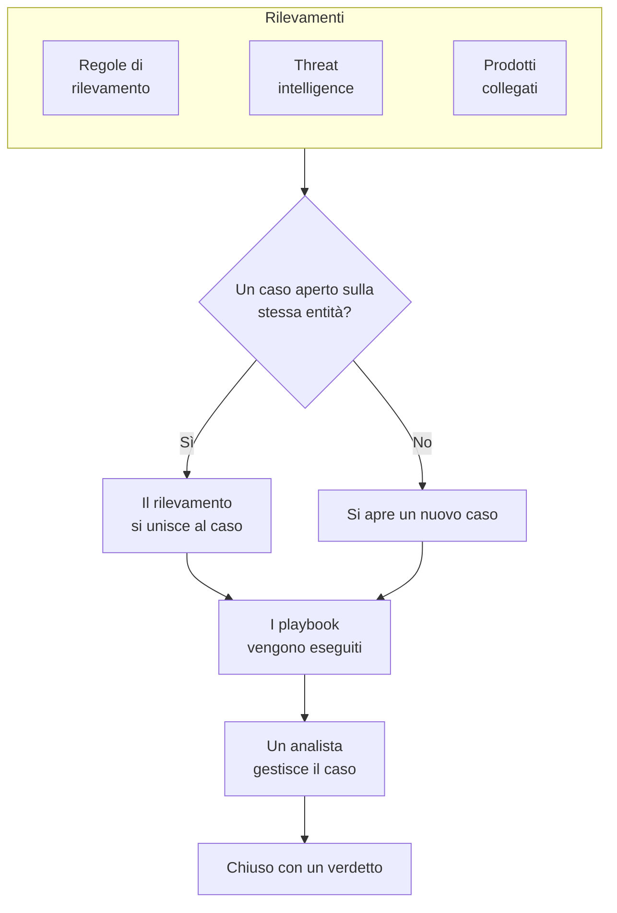

# Casi di sicurezza e playbook (SOAR)

Security Events trasforma ciò che trovano le tue regole di rilevamento, la threat intelligence e i prodotti di sicurezza collegati in casi: un caso per ogni cosa che merita un'indagine, con tutti i rilevamenti sullo stesso utente, host o indirizzo raggruppati al suo interno. Gli analisti gestiscono i casi in una coda, e i playbook vi rispondono, da soli o con un clic.

:::cards
- [Da dove arrivano i casi](#da-dove-arrivano-i-casi): Regole di rilevamento, threat intelligence, prodotti collegati e persone.
- [Gestire un caso](#gestire-un-caso): Assegnalo, indaga sulle sue entità e chiudilo con un verdetto.
- [Playbook](#playbook): Passi che vengono eseguiti su un caso, con un'approvazione dove serve.
- [La panoramica](#la-panoramica): Cosa richiede attenzione adesso, e quanto velocemente vengono gestiti i casi.
:::

## Come funziona

Apri **Prodotti → Security Events → Security Cases**. La coda si apre sui casi aperti; **Assigned to Me**, **Unassigned**, **Chiuso** e **Tutti** sono le altre viste.

## Prima di iniziare

Casi e playbook seguono i tre ruoli di sicurezza. Project Owner e Project Admin possono fare tutto.

| Ruolo | Cosa può fare |
| --- | --- |
| Security Admin | Tutto, anche eliminare i casi e configurare i playbook |
| Security Member | Aprire, assegnare, modificare e chiudere casi, scrivere note, eseguire playbook e approvarne o rifiutarne i passi |
| Security Viewer | Leggere casi, rilevamenti, note, playbook e le loro esecuzioni |

Ognuna di queste azioni si può anche concedere singolarmente, dalla creazione di un caso all'approvazione dei passi di un playbook; vedi [Riferimento dei permessi](/docs/permissions/reference).

## Da dove arrivano i casi

| Origine | Apre un caso quando | Si disattiva con |
| --- | --- | --- |
| Regole di rilevamento | Una regola corrisponde | **Open a Case on Match**, nel passo **In caso di corrispondenza** della regola |
| Threat intelligence | Un evento nomina un indicatore noto | **Open a Case on Match**, nel passo **In caso di corrispondenza** del feed |
| Prodotti collegati | Un avviso proprio del prodotto viene importato a un livello pari o superiore alla soglia della connessione | **Open Cases From** impostato su **Mai**, nel passo **Polling** della connessione |
| Persone | Qualcuno ne apre uno da **Security Cases**, o con **Open Case** nel pannello di un evento | Nessuna impostazione |

Ogni origine è attiva per impostazione predefinita. Una connessione apre casi per **High and above** a meno che tu non scelga un altro livello; gli avvisi al di sotto vengono comunque importati come eventi.

### Come vengono raggruppati i rilevamenti

Un rilevamento riguarda un'entità: il valore per cui raggruppa la sua regola, come l'indirizzo IP di una regola sugli attacchi a forza bruta, o l'indicatore nominato da una corrispondenza di threat intelligence. Un rilevamento senza entità resta a sé.

- Quando un caso aperto riguarda già quell'entità, il rilevamento vi si aggiunge. Le entità del caso e la sua mappatura ATT&CK crescono, e la sua priorità sale a quella del rilevamento, senza mai scendere.
- Quando nessun caso aperto la riguarda, si apre un nuovo caso, con il nome e la priorità del rilevamento.
- Un rilevamento che scatta di nuovo incrementa il conteggio sulla propria riga invece di aggiungerne un'altra.

La priorità di un caso deriva dalla gravità del rilevamento:

| Gravità | Priorità |
| --- | --- |
| Critical o Fatal | Critico |
| High | High |
| Medium, Unknown o Other | Medium |
| Low | Low |
| Informational | Informativi |

## Gestire un caso

Un caso attraversa quattro stati. Può saltarne uno, come un falso positivo chiuso direttamente da Nuovo, e può essere riaperto.

| Stato | Significa |
| --- | --- |
| Nuovo | Nessuno l'ha ancora guardato |
| In esame | Qualcuno sta ricostruendo cosa è successo |
| Contained | La minaccia non può più fare danni; resta da fare la bonifica |
| Chiuso | Concluso, con un verdetto su cosa fosse |

La pagina del caso ha tutto ciò che serve per gestirlo:

- In alto: **Assign to Me**, **Run Playbook**, **Dichiara incidente** e **Close Case**, i passaggi di stato e, nel menu accanto, la priorità.
- **Detections**: cosa è scattato per aprire il caso o aggiungersi a esso, quante volte, e l'ultimo evento corrispondente.
- **Entità**: gli utenti, gli host e gli indirizzi di cui tratta il caso, con la loro attività in tutti i tuoi eventi di sicurezza degli ultimi 7 giorni. Ognuno si apre in **Correla**.
- **MITRE ATT&CK**: le tattiche e le tecniche a cui corrispondono i suoi rilevamenti, ciascuna con un link alla propria pagina su attack.mitre.org.
- **Playbook Runs**: cosa ha fatto ogni playbook sul caso, passo per passo, e i passi in attesa di approvazione.
- **Note** e **Cronologia**: cosa ha scritto il team, e tutto ciò che è successo, con chi l'ha fatto.

Per gestire più casi insieme, selezionali nella coda e usa **Assign to Me**, **Change Status** o **Change Priority**.

### Chiudere un caso

**Close Case** chiede un verdetto e una nota di chiusura facoltativa:

| Verdetto | Significa |
| --- | --- |
| True Positive | Un'attività malevola o non autorizzata è avvenuta davvero |
| Benign Positive | L'attività era reale ma prevista, come un penetration test o un'operazione amministrativa |
| False Positive | Il rilevamento era sbagliato: la regola o i dati hanno frainteso un'attività normale |
| Undetermined | Non c'erano abbastanza informazioni per stabilirlo |

I verdetti vengono conteggiati nella panoramica. Una regola i cui casi continuano a chiudersi come False Positive è una regola da affinare.

### Dichiarare un incidente

**Dichiara incidente** apre un incidente di OneUptime per il caso, con la gravità che scegli, e collega i due in entrambe le direzioni: la descrizione dell'incidente nomina il caso, e l'intestazione del caso rimanda all'incidente. Da lì subentrano la reperibilità, le pagine di stato e il postmortem. Serve un ruolo che possa sia gestire i casi sia creare incidenti.

## Playbook

Un playbook è un elenco di passi che vengono eseguiti su un caso. Creane uno in **Prodotti → Security Events → Playbooks**, da un modello o da zero, e aggiungi i suoi passi nella sua pagina.

### Quando viene eseguito un playbook

| Esecuzioni | Quando |
| --- | --- |
| Case Opened | Una volta, quando si apre un caso |
| Detection Added | Ogni volta che un nuovo rilevamento si aggiunge a un caso aperto |
| Manual | Solo quando qualcuno lo esegue da un caso |

Qualsiasi playbook abilitato si può anche eseguire a mano, con **Run Playbook** su un caso. Un playbook che si esegue da solo si può restringere:

- **For Cases At Least**: solo i casi di questa priorità o superiore.
- **Only For Detections From**: solo quando il rilevamento alla base del caso proviene da questa origine.
- **Only For These Detection Rules**: solo quando proviene da una di queste regole.

Un playbook disabilitato non viene eseguito né da solo né a mano.

### Passi

| Categoria | Passo | Cosa fa |
| --- | --- | --- |
| Caso | Assign the case | Assegna il caso a una persona, a un team o a entrambi |
| Caso | Set the priority | Alza o abbassa la priorità del caso |
| Caso | Set the status | Imposta lo stato del caso su In esame, Contained o Chiuso, con il verdetto che scegli |
| Caso | Add a note | Scrive una nota sul caso, come una checklist per l'analista |
| Caso | Add labels | Aggiunge etichette al caso |
| Indagine | Check entities against threat intel | Cerca ogni entità nella tua threat intelligence, e in caso di corrispondenza può alzare la priorità |
| Indagine | Look up entity activity | Conta gli eventi di sicurezza di ogni entità in una finestra recente, e lo annota sul caso |
| Notifica | Email people | Invia per email a utenti e team un riepilogo del caso, con un link al caso |
| Notifica | Post to Slack | Pubblica un riepilogo del caso in un canale Slack |
| Notifica | Post to Microsoft Teams | Pubblica un riepilogo del caso in un canale Microsoft Teams |
| Escalation | Page on-call | Esegue una politica di reperibilità |
| Escalation | Declare an incident | Apre un incidente di OneUptime collegato al caso |
| Contenimento | Suspend the user in Okta | Sospende in Okta ogni utente del caso |
| Contenimento | End the user's Okta sessions | Disconnette da Okta ogni utente del caso e ne revoca i token |
| Contenimento | Contain the host in CrowdStrike | Applica il contenimento di rete a ogni host del caso con CrowdStrike Falcon |
| Contenimento | Isolate the device in Microsoft Defender | Isola ogni host del caso con Microsoft Defender for Endpoint |
| Automazione | Send a webhook | Invia il caso come JSON a un URL |
| Automazione | Run a workflow | Avvia un flusso di lavoro di OneUptime con il caso come input |

Un playbook ha al massimo 25 passi. Vengono eseguiti in ordine, ciascuno quando il precedente è terminato. Ogni passo può anche:

- **Needs Approval**: fermare l'esecuzione prima del passo finché qualcuno non lo approva sul caso. È attivo per impostazione predefinita nei quattro passi di contenimento, che agiscono fuori da OneUptime.
- **Only If Threat Intel Matched**: saltare il passo a meno che un precedente passo **Check entities against threat intel** della stessa esecuzione non abbia trovato un indicatore noto.
- **Carry On If It Fails**: eseguire il passo successivo anche se questo non riesce. Se è disattivato, un passo non riuscito ferma l'esecuzione.

### Contenimento

I passi di contenimento agiscono tramite una [connessione di eventi di sicurezza](/docs/telemetry/security-events#collegare-un-prodotto-di-sicurezza) al prodotto, che deve avere più del solo accesso in lettura:

| Passo | Connessione | Serve |
| --- | --- | --- |
| Suspend the user in Okta, End the user's Okta sessions | Okta System Log | Un token API autorizzato a gestire gli utenti |
| Contain the host in CrowdStrike | CrowdStrike Falcon | Un client API con lo scope Hosts in scrittura |
| Isolate the device in Microsoft Defender | Microsoft Defender XDR | Un'app con il permesso Machine.Isolate |

Un passo di contenimento agisce al massimo su 10 utenti o host del caso. Cerca ciascuno nel prodotto per nome, e riporta sul caso cosa ha fatto con ognuno: contenuto, già contenuto, non trovato o rifiutato.

### Messaggi

Una nota, un'email, un post su Slack e un post su Teams possono usare i valori del caso:

| Segnaposto | Diventa |
| --- | --- |
| `{{case.number}}` | Il numero del caso, come CASE-42 |
| `{{case.title}}` | Il titolo del caso |
| `{{case.priority}}` | Critical, High, Medium, Low o Informational |
| `{{case.status}}` | New, Investigating, Contained o Closed |
| `{{case.assignee}}` | A chi è assegnato il caso |
| `{{case.url}}` | Un link al caso in OneUptime |
| `{{case.entities}}` | Gli utenti, gli host e gli indirizzi di cui tratta il caso |
| `{{case.detections}}` | Quanti rilevamenti contiene il caso |

Un'email o un post senza un messaggio proprio invia un riepilogo del caso.

### Esecuzioni e approvazioni

Ogni esecuzione è elencata sul suo caso e in **Prodotti → Security Events → Playbooks → Playbook Runs**, passo per passo:

| Stato dell'esecuzione | Significa |
| --- | --- |
| Queued | In attesa di un worker |
| In esecuzione | Sta eseguendo i suoi passi |
| Waiting for Approval | Ferma prima di un passo che richiede approvazione |
| Riuscito | Ogni passo è stato eseguito, o saltato |
| Non riuscito | Un passo non è riuscito e l'esecuzione si è fermata |
| Annullato | Qualcuno l'ha annullata, o ha rifiutato un passo |

Un passo in attesa di approvazione mostra **Approve** e **Reject** sull'esecuzione, con un commento facoltativo. Approvare fa proseguire l'esecuzione da quel passo; rifiutare la termina. La decisione, chi l'ha presa e il suo commento restano sul passo e nella cronologia del caso. **Playbook Runs** si apre sulle esecuzioni in attesa di approvazione, e la voce di menu **Playbooks** le conta.

Un'esecuzione che smette di ricevere segnali dal suo worker, per esempio dopo un riavvio, viene ripresa: un'esecuzione in coda viene rimessa in coda dopo 2 minuti, e un'esecuzione che tace da 30 minuti viene segnata come non riuscita.

## La panoramica

**Prodotti → Security Events → Panoramica** è dove si apre il prodotto:

- I casi aperti assegnati a te, i casi aperti che nessuno ha preso in carico, e i passi dei playbook in attesa di approvazione.
- **Mean Time to Acknowledge**, **Mean Time to Contain** e **Mean Time to Close**, sui casi aperti negli ultimi 30 giorni: dall'apertura di un caso fino a quando qualcuno lo prende in carico (assegnandolo a una persona, o spostandolo fuori da Nuovo), fino a Contained e fino a Chiuso. Un caso ancora in attesa non entra nel calcolo della media.
- I casi aperti ogni giorno negli ultimi 30 giorni, per priorità, e i rilevamenti generati ogni giorno negli ultimi 14 giorni, per origine.
- I casi aperti per priorità e per stato, i verdetti degli ultimi 30 giorni, le tattiche ATT&CK alla base dei casi, i rilevamenti scattati più spesso e le entità nominate dal maggior numero di risultanze.

Sopra, una striscia mostra come è configurata la sicurezza: le sue origini, i rilevamenti, i casi e i playbook, ciascuno con i suoi numeri. Un progetto che non l'ha ancora configurata vede lì **Turn on recommended** e **Send a test attack**; vedi [Primi passi con la sicurezza](/docs/telemetry/security-getting-started). Quando nulla richiede qualcuno, la pagina dice **All quiet**, e i grafici compaiono non appena c'è qualcosa da mostrare.

## Trovare le minacce

- **Entità** classifica gli utenti, gli host, gli indirizzi e gli hash che le tue risultanze nominano più spesso, nell'ultimo giorno, nell'ultima settimana o nell'ultimo mese, e cerca qualsiasi valore in 30 giorni di eventi.
- **Rule Library** contiene regole di rilevamento pronte all'uso, per le minacce a identità, endpoint, cloud, rete, web e Kubernetes. Ognuna è una regola Sigma scritta per i campi in cui viene normalizzata ogni origine collegata. **Aggiungi regola** la crea come una tua regola di rilevamento, attiva, che apre casi anziché avvisi; modificala in **Detection Rules** come qualsiasi altra. Le regole segnate come **Consigliati** trovano minacce nei dati che OneUptime ha già, e un pulsante aggiunge quelle che non hai ancora.
- **ATT&CK Coverage** disegna la matrice MITRE ATT&CK con evidenziate le tecniche coperte dalle tue regole abilitate, e contorna quelle che coprirebbe una regola della libreria.

## Automatizzare

- **Flussi di lavoro**: la creazione, la modifica o l'eliminazione di un caso o di una nota può avviare un flusso di lavoro. Un passo **Run a workflow** avvia un flusso di lavoro il cui trigger è un webhook.
- **API**: casi, note, rilevamenti, playbook ed esecuzioni hanno la stessa API REST del resto di OneUptime, sotto `/security-case`, `/security-case-note`, `/security-detection`, `/security-playbook` e `/security-playbook-run`. Vedi [Riferimento API](/docs/api-reference/api-reference).
- Agenti IA: il server MCP ha strumenti per casi, note, rilevamenti e playbook. Vedi [Server MCP](/docs/ai/mcp-server).

## Risoluzione dei problemi

:::details Una regola corrisponde, ma non si apre nessun caso
Controlla **Open a Case on Match** nel passo **In caso di corrispondenza** della regola. Un rilevamento su un'entità che ha già un caso aperto si aggiunge a quel caso invece di aprirne un altro: cercalo in **Detections** sul caso aperto.
:::

:::details Un playbook non è stato eseguito
Controlla che sia abilitato, che la sua impostazione **Trigger** sia quella giusta (Case Opened si esegue una volta sola, all'apertura di un caso) e che il caso soddisfi le sue impostazioni **For Cases At Least**, **Only For Detections From** e **Only For These Detection Rules**. Un caso aperto a mano non ha rilevamenti, quindi un playbook limitato a un'origine o a determinate regole non viene eseguito su di esso.
:::

:::details Un passo di contenimento non è riuscito
Apri l'esecuzione sul caso: il passo dice, per ogni utente o host, se il prodotto l'ha rifiutato, non l'ha trovato o non era raggiungibile. Controlla che la credenziale della connessione possa fare la modifica, e usa **Testa la connessione** nella sua riga.
:::

## Passaggi successivi

:::cards
- [Eventi di sicurezza](/docs/telemetry/security-events): Invia eventi, scrivi regole di rilevamento e collega prodotti di sicurezza.
- [Intelligence sulle minacce](/docs/telemetry/threat-intelligence): Confronta i tuoi eventi con feed STIX/TAXII.
- [Riferimento dei permessi](/docs/permissions/reference): I ruoli di sicurezza, e cosa può fare ciascuno.
:::
