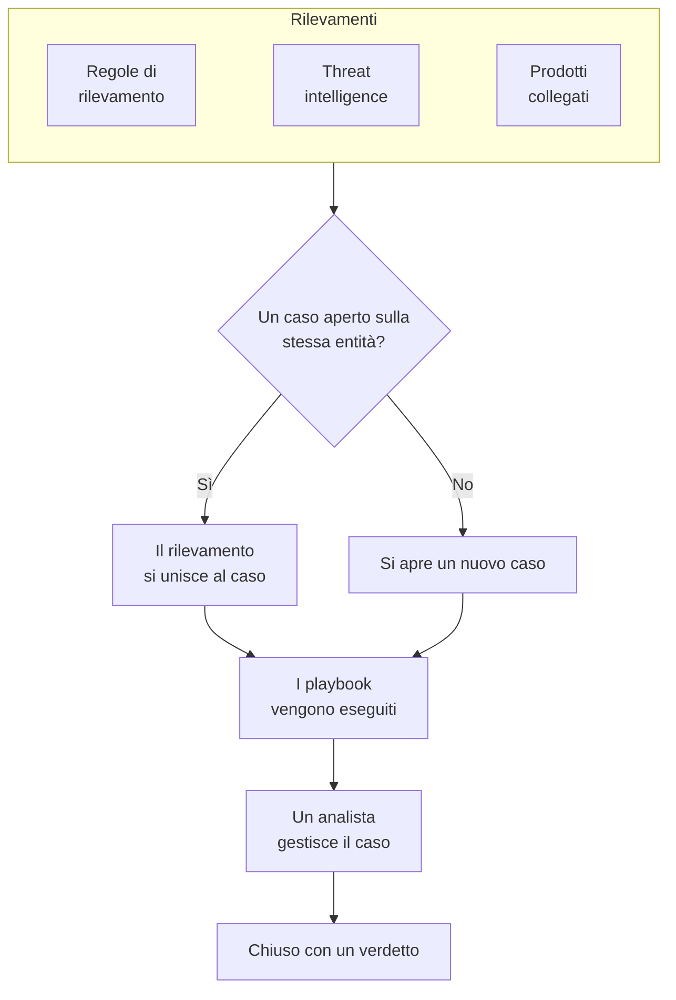

# Casi di sicurezza e playbook (SOAR)

Eventi di sicurezza trasforma ciò che trovano le tue regole di rilevamento, la threat intelligence e i prodotti di sicurezza collegati in casi: un caso per ogni cosa che merita un'indagine, con tutti i rilevamenti sullo stesso utente, host o indirizzo raggruppati al suo interno. Gli analisti gestiscono i casi in una coda, e i playbook vi rispondono, da soli o con un clic.

:::cards
- [Da dove arrivano i casi](#da-dove-arrivano-i-casi): Regole di rilevamento, threat intelligence, prodotti collegati, rischio delle entità e persone.
- [Gestire un caso](#gestire-un-caso): Assegnalo, indaga sulle sue entità e chiudilo con un verdetto.
- [Priorità e stati dei casi](#priorità-e-stati-dei-casi): Rinominali, cambiane colore e ordine, e aggiungi i tuoi.
- [Obiettivi di risposta](#obiettivi-di-risposta): Quanto in fretta un caso di ogni priorità deve essere preso in carico e contenuto.
- [Notifiche](#notifiche): Chi viene avvisato di un nuovo caso, di un'assegnazione, di un obiettivo di risposta, di un'attività e di un passo in attesa di approvazione.
- [Playbook](#playbook): Passi che vengono eseguiti su un caso, con un'approvazione dove serve.
- [La panoramica](#la-panoramica): Cosa richiede attenzione adesso, e quanto velocemente vengono gestiti i casi.
:::

## Come funziona

Apri **Prodotti → Eventi di sicurezza → Casi di sicurezza → Casi aperti** per la coda. **Assegnati a me**, **Non assegnato**, **Casi chiusi** e **Tutti i casi** sono pagine a sé accanto, ognuna con i casi che il suo nome indica.

## Prima di iniziare

Casi e playbook seguono i tre ruoli di sicurezza. Proprietario del progetto e Amministratore del progetto possono fare tutto.

| Ruolo | Cosa può fare |
| --- | --- |
| Amministratore della sicurezza | Tutto, anche eliminare i casi, rimuovere le prove e configurare i playbook |
| Membro della sicurezza | Aprire, assegnare, modificare e chiudere casi, scrivere note, svolgere attività, aggiungere prove, eseguire playbook e approvarne o rifiutarne i passi |
| Visualizzatore della sicurezza | Leggere casi, rilevamenti, note, attività, prove, playbook e le loro esecuzioni |

Ognuna di queste azioni si può anche concedere singolarmente, dalla creazione di un caso all'approvazione dei passi di un playbook; vedi [Riferimento dei permessi](/docs/permissions/reference).

## Da dove arrivano i casi

| Origine | Apre un caso quando | Si disattiva con |
| --- | --- | --- |
| Regole di rilevamento | Una regola corrisponde | **Apri un caso in caso di corrispondenza**, nel passo **In caso di corrispondenza** della regola |
| Threat intelligence | Un evento nomina un indicatore noto | **Apri un caso in caso di corrispondenza**, nel passo **In caso di corrispondenza** del feed |
| Prodotti collegati | Un avviso proprio del prodotto viene importato a un livello pari o superiore alla soglia della connessione | **Apri casi da** impostato su **Mai**, nel passo **Interrogazione** della connessione |
| Prodotti di sicurezza nei tuoi log | Una minaccia che un firewall, un IDS o un prodotto per gli endpoint scrive nei tuoi log raggiunge o supera la soglia di I tuoi log | **Apri casi a partire da** impostato su **Mai**, su **I tuoi log** |
| Rischio delle entità | Il rischio di un utente, host o indirizzo raggiunge la soglia del progetto | **Casi di rischio**, in **Impostazioni → Valutazione del rischio** |
| Persone | Qualcuno ne apre uno da **Casi di sicurezza**, o con **Apri caso** nel pannello di un evento | Nessuna impostazione |

Ogni origine apre casi per impostazione predefinita, tranne il rischio delle entità nei progetti creati prima che esistesse: lì attiva prima **Casi di rischio** ([Rischio delle entità](/docs/telemetry/security-entity-risk)). Una connessione apre casi per **Alta e superiori** a meno che tu non scelga un altro livello; gli avvisi al di sotto vengono comunque importati come eventi. **I tuoi log** fa lo stesso per le minacce nei tuoi log.

### Come vengono raggruppati i rilevamenti

Un rilevamento riguarda un'entità: il valore per cui raggruppa la sua regola, come l'indirizzo IP di una regola sugli attacchi a forza bruta, o l'indicatore nominato da una corrispondenza di threat intelligence. Un rilevamento senza entità resta a sé.

- Quando un caso aperto riguarda già quell'entità, il rilevamento vi si aggiunge. Le entità del caso e la sua mappatura ATT&CK crescono, e la sua priorità sale a quella del rilevamento, senza mai scendere.
- Quando nessun caso aperto la riguarda, si apre un nuovo caso, con il nome e la priorità del rilevamento.
- Un rilevamento che scatta di nuovo incrementa il conteggio sulla propria riga invece di aggiungerne un'altra.

La priorità di un caso deriva dalla gravità del rilevamento, alla priorità predefinita del progetto per quel livello, qualunque nome le abbiate dato:

| Gravità | Priorità |
| --- | --- |
| Critical o Fatal | Critico |
| High | High |
| Medium, Unknown o Other | Medium |
| Low | Low |
| Informational | Informativi |

## Gestire un caso

I casi di un nuovo progetto attraversano quattro stati, che puoi rinominare e a cui puoi aggiungerne altri (vedi [Priorità e stati dei casi](#priorità-e-stati-dei-casi)). Un caso può saltarne uno, come un falso positivo chiuso direttamente da Nuovo, e può essere riaperto.

| Stato | Significa |
| --- | --- |
| Nuovo | Nessuno l'ha ancora guardato |
| In esame | Qualcuno sta ricostruendo cosa è successo |
| Contained | La minaccia non può più fare danni; resta da fare la bonifica |
| Chiuso | Concluso, con un verdetto su cosa fosse |

Un caso ha un proprio menu laterale, come un incidente, e ogni parte del caso è una pagina a sé:

| Sezione del menu laterale | Pagine |
| --- | --- |
| **Panoramica** | **Panoramica**, **Cronologia** |
| **Indagine** | **Svolgimento**, **Rilevamenti**, **Entità**, **Segnali collegati**, **Prove**, **Attività**, **Playbook** |
| **Note** | **Note private** |
| **Avanzato** | **Campi personalizzati**, **Log di audit**, **Elimina caso**, chiuse finché non clicchi su **Avanzato** |

Ogni pagina tiene in alto l'intestazione del caso: numero, priorità, stato e titolo, **Assegna a me**, **Esegui il playbook**, **Dichiara incidente** e **Chiudi caso** e, nel menu ⋯ accanto, **Imposta la priorità**, **Assegna a qualcun altro**, **Cambia stato**, **Modifica caso** e **Elimina caso**. Così il caso si gestisce da qualsiasi sua pagina, e un link al caso apre ancora la sua **Panoramica**. Quando la priorità del caso ha obiettivi di risposta, l'intestazione dice anche quando scade il prossimo ([Obiettivi di risposta](#obiettivi-di-risposta)).

- **Panoramica**: la descrizione, le etichette e i passaggi di stato del caso, chi lo ha in carico e cosa lo ha aperto, e i suoi numeri: quanti rilevamenti ha, da quanto tempo è aperto e quanto ci è voluto per prenderlo in carico e per contenerlo. Sotto **Tempo al riconoscimento** e **Tempo al contenimento** indica a che punto è il caso rispetto ai suoi obiettivi di risposta.
- **Perché è stato aperto questo caso**, nella **Panoramica**: il rilevamento che ha aperto il caso e come scatta la sua regola (la sua soglia, il campo per cui raggruppa e la finestra in cui conta), quanti eventi hanno corrisposto, da dove provenivano e in quale intervallo, cosa cerca la regola e fin dove sono arrivate le richieste. Sotto **Corrispondenze**, gli eventi stessi, dal più vecchio: ciascuno con ciò che cerca la regola evidenziato, fin dove è arrivata la sua richiesta, la riga di log o il prodotto da cui proviene, e la sua **Traccia**, i suoi **Log** e la sua **Eccezione** a un clic; la riga di log da cui proviene si apre nell'esploratore dei log su quella riga. Clicca su un evento per vederlo per intero, con la riga di log da cui è stato letto. **Conserva in questo caso**, nella sua riga o nel suo pannello, conserva l'evento nella pagina **Prove** del caso, nominando il rilevamento a cui ha corrisposto; un evento che il caso conserva già lo indica, e lo apre lì. Un rilevamento conserva, quando scatta, fino a 25 degli eventi che gli hanno corrisposto, e li elenca anche quando la loro conservazione è terminata; il tuo ruolo vede quelli delle fonti che può leggere. Una regola che scatta per molti gruppi alla volta, anche una regola di correlazione, conserva eventi per ciascuno di essi: al massimo 1.000 in tutto, quindi ognuno ne conserva almeno 10, e fino a 25 quando scatta di nuovo. Per un rilevamento di prima che li conservasse, le corrispondenze di una regola sono quelle della sua stessa condizione, per il gruppo del rilevamento, nelle finestre in cui è scattata; una corrispondenza di threat intelligence elenca gli eventi che contengono il suo indicatore, e l'avviso di un prodotto collegato, l'evento così come è stato inviato. **Dove guardare dopo** apre tutto sull'indirizzo o sull'utente di cui tratta il rilevamento, gli eventi e le righe di log che lo nominano, i log dei servizi da cui provengono le sue righe di log e le tracce delle sue richieste, ciascuno nella finestra del rilevamento, oltre allo **Svolgimento** e ai **Segnali collegati** del caso. Gli altri rilevamenti del caso sono raccolti sotto **Altri rilevamenti del caso**.
- **Piano di risposta**, nella **Panoramica**: cosa fare ora per il caso, partendo dal più urgente, sotto **Conferma che è reale**, **Contieni la minaccia**, **Correggi ciò che l'ha permesso** e **Chiudi il caso**. Ogni passaggio riguarda questo caso: i suoi indirizzi, utenti e host, fin dove sono arrivate le sue richieste, ciò su cui la sua regola indica che può scattare anche, le tattiche e le tecniche ATT&CK a cui corrispondono i suoi rilevamenti e i playbook di cui dispone il progetto. I passaggi propri di una regola di rilevamento, scritti sotto **Passaggi di risposta** nel suo modulo, vengono per primi nella parte del piano a cui appartengono, e le regole della libreria delle regole includono passaggi propri. Un passaggio che OneUptime può svolgere ha un proprio pulsante: **Assegna a me**, **Aggiungi eccezione** con la regola e l'indirizzo già compilati, **Esegui il playbook** su quello che sospende l'account o applica il contenimento all'host, o su quello che suggerisce OneUptime AI, **Dichiara incidente**, **Segna come contenuto** e **Chiudi caso**. Il passaggio di un indirizzo pubblico lo blocca con un clic, **Blocca per 24 ore**, non appena una destinazione applica la tua blocklist (vedi [Bloccare un indirizzo da un caso](#bloccare-un-indirizzo-da-un-caso)). Un passaggio che OneUptime non può svolgere, come bloccare un dominio sul tuo filtro DNS, indica **Fuori da OneUptime**, con il valore a un clic dagli appunti. Dove una connessione blocca su ogni macchina (vedi [Blocklist](#blocklist)), bloccare il dominio, il file o il server di comando e controllo del caso è anch'esso un clic: **Blocca per 7 giorni**, o **Blocca file** per 30 giorni, lo mette nella blocklist, e il passaggio è fatto appena Microsoft Defender o CrowdStrike Falcon applica il blocco. Spunta un passaggio quando è completato: viene conservato come una delle **Attività** del caso, completata, con chi l'ha svolta e quando. I passaggi su cui decide il caso si spuntano da soli: è assegnato, è stato dichiarato un incidente, è stato eseguito un playbook, è contenuto o chiuso. Una volta completati tutti i passaggi che contengono la minaccia, il piano propone **Segna come contenuto**, che registra il tempo al contenimento del caso. Quando OneUptime AI ha classificato il caso, la sua valutazione apre il piano, e i passaggi che suggerisce sono raccolti sotto quelli del piano. OneUptime controlla da sé la maggior parte dei passaggi, e dice accanto a ognuno cosa ha trovato: vedi [Come OneUptime controlla un passaggio](#come-oneuptime-controlla-un-passaggio).
- **OneUptime AI**, nella **Panoramica**: che cosa OneUptime AI ha ricavato dal caso, la priorità e il playbook che suggerisce, e le prove dietro. Vedi [OneUptime AI nella sicurezza](/docs/telemetry/security-ai).
- **Impatto**, nella **Panoramica**: ciò che il caso mette a rischio: se OneUptime ha visto i suoi record raggiunti da internet, chi ne è proprietario, cosa è cambiato per ultimo su di essi, e i dati a rischio - gli archivi con dati sensibili che il caso nomina o che i suoi utenti e ruoli possono raggiungere (vedi [Integrazioni di Sicurezza dei dati](/docs/data-security/integrations#security-operations)). Aprilo per vedere cosa chiama ogni record e da cosa è chiamato, i monitor e le pagine di stato che lo osservano e le macchine con cui hanno comunicato gli indirizzi del caso.
- **MITRE ATT&CK**, nella **Panoramica**: le tattiche e le tecniche a cui corrispondono i suoi rilevamenti, ciascuna con un link alla propria pagina su attack.mitre.org.
- **Cronologia**: tutto ciò che è successo al caso, con chi l'ha fatto.
- **Svolgimento**: cosa è successo, in ordine, in tutto OneUptime: ogni rilevamento e gli eventi di sicurezza alla sua origine, fin dove sono arrivate le loro richieste, le eccezioni che hanno sollevato, le modifiche ai record che il caso nomina, gli incidenti e gli avvisi aperti su di essi e cosa ha fatto il team. Le tante sonde di uno scanner sono una sola riga, e ogni riga apre ciò che nomina, come la traccia della richiesta o l'eccezione.
- **Rilevamenti**: cosa è scattato per aprire il caso o aggiungersi a esso, quante volte, e l'ultimo evento corrispondente.
- **Entità**: gli utenti, gli host e gli indirizzi di cui tratta il caso, con la loro attività in tutti i tuoi eventi di sicurezza degli ultimi 7 giorni. Ognuno si apre in **Correla**.
- **Segnali collegati**: gli host, i cluster, i servizi e i membri che il caso nomina, come OneUptime li conosce, e cosa succedeva su ciascuno attorno ai suoi rilevamenti: i loro log, tracce e metriche, ciò che è aperto su di essi e cosa è cambiato. Vedi [Segnali collegati](/docs/telemetry/security-connected-signals).
- **Prove**: i file, i collegamenti e gli eventi di sicurezza conservati sul caso, ciascuno con chi l'ha aggiunto e quando. Il pulsante **Aggiungi file** carica un file fino a 10 MB e registra lo SHA-256 di ciò che è stato caricato, così chi lo scarica in seguito può verificare che sia ciò che è stato conservato; il pulsante **Aggiungi collegamento** rimanda a prove conservate altrove. Solo un Amministratore della sicurezza può rimuovere una prova, e la **Cronologia** del caso dice cosa è stato aggiunto e rimosso. Un evento di sicurezza viene conservato qui com'era, con **Aggiungi al caso** in **Eventi** o nella pagina di una [caccia](/docs/telemetry/security-events#cacce), oppure con **Conserva in questo caso** su un evento che ha corrisposto a un rilevamento, e **Visualizza evento** lo apre. Anche il passo **Preserve the evidence** di un playbook conserva qui gli eventi dietro i rilevamenti del caso.
- **Attività**: cosa va fatto sul caso, chi lo sta facendo e se è fatto. Aggiungi un'attività in una riga, affidala a qualcuno e spuntala quando è completata. Chi la riceve viene avvisato, a meno che non l'abbia presa da sé, e il menu mostra quante attività sono aperte accanto a **Attività**. Anche il passo **Aggiungi attività** di un playbook aggiunge attività, tralasciando quelle che il caso ha già.
- **Playbook**: cosa ha fatto ogni playbook sul caso, passo per passo, e i passi in attesa di approvazione. Finché ci sono esecuzioni in attesa, il menu ne mostra il numero accanto a **Playbook**.
- **Note private**: cosa ha scritto il team sul caso. Il menu **Modelli** dell'editor inserisce in una nota uno dei modelli di note del progetto.
- **Campi personalizzati**: i campi propri del progetto, compilati per questo caso, e **Modifica campi** per modificarli. Quando il progetto ha un campo, anche la **Panoramica** li mostra, nella sua ultima scheda. Vedi [Campi personalizzati, modelli di note e numerazione](#campi-personalizzati-modelli-di-note-e-numerazione).
- **Log di audit**: ogni modifica fatta al caso, e chi l'ha fatta. Vedi [Log di audit](/docs/configuration/audit-logs).
- **Elimina caso**: elimina per sempre il caso, con i suoi rilevamenti, le note, la cronologia e le esecuzioni dei playbook. Per conservarne la traccia, chiudilo invece con un verdetto.

### Come OneUptime controlla un passaggio

Una spunta dice che qualcuno ha fatto un passaggio. OneUptime controlla anche da sé i passaggi del **Piano di risposta** di un caso, in base a ciò che è successo davvero: ogni minuto finché il caso è aperto, e subito quando un passaggio viene spuntato, un'attività cambia o un playbook contiene qualcosa. Accanto a ogni passaggio che ha controllato, il piano dice cosa ha trovato:

| Accanto al passaggio | Significa |
| --- | --- |
| **Controllato da OneUptime** | OneUptime ha visto il passaggio fatto, e regge. Nessuno deve spuntarlo |
| **Sembra completato** | Ciò che OneUptime vede è coerente con il passaggio fatto, ma non lo dimostra. **Conferma** lo spunta a tuo nome |
| **Non ancora completato** | OneUptime vede che il passaggio è ancora da fare |
| **OneUptime non può dirlo** | OneUptime non ha nulla con cui controllare il passaggio, e dice perché, con **Come permettere a OneUptime di controllarlo** |
| **Non regge più** | Il passaggio era fatto e ha smesso di funzionare, come un indirizzo bloccato che torna a passare |
| **Per ora non necessario** | Non è successo nulla che richieda il passaggio |

**Come lo sappiamo**, accanto a ciò che OneUptime ha trovato, apre il resto: cos'altro ha visto, un link alle tracce o al prodotto che ha letto, e quando ha controllato. L'avanzamento del piano conta i passaggi che OneUptime ha controllato da sé, come in «4 su 9 completati, 3 controllati da OneUptime».

| Passaggio | Cosa legge OneUptime |
| --- | --- |
| Bloccare l'indirizzo | Se una destinazione mantiene un blocco dell'indirizzo presente nella tua [Blocklist](#blocklist) e lo ha riletto, e se le richieste dell'indirizzo raggiungono ancora la tua app, nelle sue tracce e nei log di accesso. Un blocco che una destinazione mantiene è verificato; un blocco che nulla applica no. Un indirizzo che tace senza un blocco sembra fatto: forse è stato bloccato, o forse si è semplicemente fermato |
| Controllare che non sia passato altro | Come si è conclusa ogni richiesta dell'indirizzo dal primo rilevamento del caso. Quando la tua app le ha respinte tutte, il passaggio è controllato |
| Sospendere l'account | L'account in Okta, Microsoft Entra ID o Google Workspace: sospeso, o disattivato con le sessioni terminate dopo l'apertura del caso |
| Togliere l'host dalla rete | L'host in CrowdStrike Falcon o Microsoft Defender for Endpoint: contenuto o isolato |
| Bloccare il dominio, il file o il server su ogni macchina | Il suo blocco nella blocklist: fatto finché Microsoft Defender o CrowdStrike Falcon lo applica, non fatto finché è in arrivo o è stato rifiutato, come dice il passaggio |
| Dichiarare un incidente | Se una richiesta ha superato i controlli della tua app, o se un monitor dei servizi che ha raggiunto è andato giù, mentre il caso era aperto. Fino ad allora, il passaggio per ora non è necessario |
| Escludere un falso positivo | Niente: solo tu puoi escluderlo. Il passaggio elenca ciò che OneUptime sa dell'indirizzo: se uno dei tuoi record lo ha, i feed di threat intel che lo riportano, e gli utenti che hanno effettuato l'accesso e lo hanno usato negli ultimi 30 giorni |
| Correggere la route presa di mira dall'attacco | Le richieste di attacco alla route, nelle tracce e nei log della tua app, prima e dopo il rilascio di una modifica al servizio che c'è dietro: una pull request aperta dal passo **Fix the code with AI** di un playbook, o qualsiasi deploy o nuova versione del servizio. Non appena da allora sono state respinte abbastanza richieste dello stesso attacco, o tenute fuori dal database che prima raggiungevano, il passaggio è controllato. Se da allora non ci sono stati attacchi, dice che non ci sono stati tentativi dalla correzione, e sembra fatto |
| Reimpostare la password | L'account in Okta o Microsoft Entra ID: la password cambiata e le sessioni terminate, dopo l'apertura del caso. Google Workspace non indica quando una password è cambiata, quindi OneUptime non può dirlo |
| Assicurarsi che gli account usino l'MFA | Ogni account preso di mira dall'attacco, in Okta, Microsoft Entra ID o Google Workspace: un fattore attivo, un metodo MFA o la verifica in 2 passaggi. Con l'MFA su ciascuno, il passaggio sembra fatto: nessun prodotto dice se gli accessi non riusciti portano a un blocco, quindi sei tu a confermarlo |

- Un passaggio fatto fuori da OneUptime conta lo stesso. Blocca l'indirizzo sul tuo firewall, e OneUptime vede fermarsi le sue richieste; sospendi l'account in Okta, e OneUptime lo rilegge.
- Puoi sempre spuntare un passaggio tu stesso, anche uno che OneUptime non vede fatto. Un passaggio che OneUptime ha controllato non ha bisogno di spunta.
- Quando un passaggio fatto non regge più, il piano lo dice in cima, la **Cronologia** del caso dice cosa ha visto OneUptime, e le persone che si occupano del caso vengono avvisate: vedi [Notifiche](#notifiche).
- OneUptime non può vedere le richieste di un indirizzo quando la tua app non gli invia tracce né log, quando le sue tracce non dicono da quale indirizzo arriva ogni richiesta, o quando riportano gli indirizzi di Cloudflare o di un bilanciatore di carico davanti alla tua app invece di quelli dei tuoi visitatori. Imposta l'indirizzo del client (`client.address`) sugli span server della tua app: da `CF-Connecting-IP` dietro Cloudflare, da `X-Forwarded-For` dietro un bilanciatore di carico.
- OneUptime legge account e host tramite le connessioni del progetto ai prodotti che li hanno, le stesse che usa [Rispondere con OneUptime](#rispondere-con-oneuptime). Senza nessuna, non può dirlo.
- Un prodotto che non risponde, o una lettura che non riesce, non conta mai come un passaggio non fatto: il passaggio dice che OneUptime non è riuscito a controllarlo adesso, e OneUptime riprova tra qualche minuto.
- La correzione di una route viene controllata solo quando l'attacco stesso viene respinto: un deploy da solo non è una correzione. OneUptime aspetta che, dal rilascio della correzione, siano stati respinti così tanti attacchi che, al ritmo con cui passavano prima, almeno uno sarebbe quasi certamente (95%) passato se non fosse cambiato nulla, e mai meno di 3. Il passaggio dice quanti ne aspetta, e osserva la route per 7 giorni dopo il rilascio della correzione, come in «/api/search sotto osservazione fino al 27 nov». Quando prima non ne passava quasi nessuno, gli attacchi non possono dimostrare che una correzione ha funzionato, e il passaggio resta **Sembra completato** perché tu lo confermi.
- OneUptime vede il rilascio di una correzione quando vede i deploy del servizio: inviali a OneUptime, oppure riporta `service.version` nella telemetria della tua app (vedi [Deploy e modifiche](/docs/telemetry/change-events)). Una pull request aperta da **Fix the code with AI** viene conservata nel caso, e il suo deploy viene associato al suo commit. Le richieste fermate dalla tua rete perimetrale, da Cloudflare per esempio, non hanno mai raggiunto la tua app, quindi non dicono nulla della correzione.
- Leggere l'MFA di un account in Microsoft Entra ID richiede l'autorizzazione dell'applicazione UserAuthenticationMethod.Read.All, oltre a quelle elencate in [Contenimento](#contenimento).

**Segna i casi come contenuti quando sono verificati**, in **Prodotti → Eventi di sicurezza → Impostazioni → Stati dei casi**, porta un caso a Contenuto non appena ogni passaggio che lo contiene è **Controllato da OneUptime** o **Per ora non necessario**. Il suo tempo al contenimento viene registrato, e la **Cronologia** del caso dice che OneUptime ha verificato ogni passaggio che contiene la minaccia. Un passaggio che sembra solo fatto, o una spunta, non fa mai avanzare un caso da solo. L'impostazione è attiva in ogni progetto, e un Proprietario del progetto o un Amministratore del progetto può disattivarla: un caso resta allora dov'è finché qualcuno non lo segna come Contenuto.

Chiunque possa vedere un caso vede ciò che OneUptime ha trovato. Nessuno lo modifica: chi non è d'accordo spunta il passaggio da sé, il che richiede un ruolo che possa gestire le attività del caso.

### Bloccare un indirizzo da un caso

Un indirizzo pubblico di cui tratta il caso ha un passaggio tutto suo nel **Piano di risposta**. Finché una destinazione applica la tua blocklist, come Cloudflare, AWS WAF o un firewall che legge un elenco, il passaggio la nomina, come in "Blocca 35.205.11.131 su Cloudflare." **Blocca per 24 ore** blocca lì l'indirizzo, e il menu accanto contiene **Verifica invece**, **Blocca per 7 giorni** e **Blocca fino alla revoca**, che solo un Amministratore della sicurezza, un Amministratore del progetto o un Proprietario del progetto può scegliere. Le persone superano una verifica, script e client API no. Nella pagina **Entità** del caso, **Blocca…** su un indirizzo fa lo stesso e chiede per quanto tempo.

- Un blocco passa dal motore dei playbook, come il blocco di un playbook: resta nella pagina **Playbook** del caso, nella sua **Cronologia** e nel log di audit. Attende l'approvazione di un'altra persona, a meno che tu non sia Amministratore della sicurezza, Amministratore del progetto o Proprietario del progetto.
- Viene rifiutato, spiegando perché, per un indirizzo che le richieste del caso si limitavano a dichiarare, per uno dei tuoi indirizzi o uno protetto, e per uno che un blocco copre già.
- Quando una destinazione mantiene il blocco, il passaggio è fatto e indica dove, da quando, da chi e fino a quando, con **Revoca**. Finché nessuna destinazione lo mantiene, il passaggio lo dice e non è fatto.
- Finché nulla applica la tua blocklist, il passaggio spiega come collegare Cloudflare, AWS WAF o un firewall, e **Come bloccarlo** mostra l'indirizzo nella dashboard di Cloudflare, nella AWS CLI, in nginx e in nftables.
- Chiudere un caso come **Falso positivo** o **Positivo benigno** propone di revocare i blocchi che ha creato, selezionati, nominandoli uno per uno.

### Gestire i casi dalla coda

Non serve aprire un caso per gestirlo. Negli elenchi della coda, il menu ⋯ della riga di un caso ha **Assegna a me**, **Assegna a qualcun altro**, **Cambia stato** e **Cambia priorità**. Per gestire più casi insieme, selezionali e usa le stesse azioni in **Azioni di massa**: ti dice quali casi ha cambiato, quali ha lasciato com'erano e perché.

- Per affidare un caso a qualcun altro, usa **Assegna a qualcun altro** e scegli una persona, o un team. Il caso di un team attende in **Non assegnato** finché qualcuno del team non lo prende in carico.
- Uno stato che chiude un caso chiede un verdetto e una nota di chiusura, come fa **Chiudi caso**.
- Un caso chiuso non viene assegnato a nessuno. Per gestirlo di nuovo, riaprilo con **Cambia stato**.

### Chiudere un caso

**Chiudi caso** chiede un verdetto e una nota di chiusura facoltativa:

| Verdetto | Significa |
| --- | --- |
| True Positive | Un'attività malevola o non autorizzata è avvenuta davvero |
| Benign Positive | L'attività era reale ma prevista, come un penetration test o un'operazione amministrativa |
| False Positive | Il rilevamento era sbagliato: la regola o i dati hanno frainteso un'attività normale |
| Undetermined | Non c'erano abbastanza informazioni per stabilirlo |

I verdetti vengono conteggiati nella panoramica. Una regola i cui casi continuano a chiudersi come False Positive è una regola da affinare.

Finché ci sono attività del caso ancora aperte, la finestra **Chiudi caso** dice quante.

Un caso aperto da avvisi di Google SecOps li chiude anche in Google SecOps, con il verdetto e la nota di chiusura, quando la sua connessione ha **Chiudi gli avvisi quando il loro caso viene chiuso** attivo: vedi [Google SecOps](/docs/integrations/google-secops#chiudi-gli-avvisi-quando-il-loro-caso-viene-chiuso).

### Dichiarare un incidente

**Dichiara incidente** apre un incidente di OneUptime per il caso, con la gravità che scegli, e collega i due in entrambe le direzioni: la descrizione dell'incidente nomina il caso, e l'intestazione del caso rimanda all'incidente. Da lì subentrano la reperibilità, le pagine di stato e il postmortem. Serve un ruolo che possa sia gestire i casi sia creare incidenti.

## Priorità e stati dei casi

Ogni progetto ha le sue priorità e i suoi stati dei casi, in **Prodotti → Eventi di sicurezza → Impostazioni → Priorità dei casi** e **Stati dei casi**. Rinominali, cambiane il colore, trascinali in un altro ordine e aggiungi i tuoi, come uno stato «Triage» o una priorità «Emergenza» sopra **Critico**. Un nuovo nome compare ovunque subito: nella coda, nelle pagine dei casi e nella panoramica, nelle notifiche, in Slack, Microsoft Teams e Mattermost e nei messaggi dei playbook.

Alcuni sono predefiniti, perché OneUptime legge cosa significano. Si possono rinominare e ricolorare, ma non eliminare né archiviare, e mantengono il loro ordine:

| Predefinito | Cosa ne fa OneUptime |
| --- | --- |
| Lo stato nuovo | I nuovi casi iniziano in questo stato |
| Lo stato preso in carico | Raggiungerlo registra quando il caso è stato preso in carico, e **Riapri** vi riporta un caso chiuso |
| Lo stato contenuto | Raggiungerlo registra quando il caso è stato contenuto |
| Lo stato chiuso | **Chiudi caso** vi sposta un caso, con un verdetto |
| Le priorità Critico, High, Medium, Low e Informativi | Un rilevamento apre il suo caso alla priorità della sua gravità, e un caso aperto da qualcuno parte da Medium |

- La posizione di uno stato decide come conta un caso che vi si trova, come mostra la colonna **Conta come**: dallo stato preso in carico in giù, preso in carico; dallo stato contenuto in giù, contenuto; dallo stato chiuso in giù, chiuso. Uno stato che aggiungi va subito sopra lo stato chiuso, e spostare un caso in uno stato che lo chiude chiede prima un verdetto.
- Il rango di una priorità è la sua urgenza, la più urgente prima: **Per casi di almeno**, le scelte delle notifiche e le regole di Slack, Microsoft Teams e Mattermost leggono questo ordine. Una priorità che aggiungi va in fondo, e la colonna **Gravità del rilevamento** mostra quali rilevamenti aprono i loro casi a ciascuna priorità predefinita.

Per smettere di usare uno stato o una priorità tuoi, usa **Archivia** sulla sua riga. Nessuno può più sceglierlo, e l'API, Terraform e MCP lo rifiutano, ma i casi che lo hanno lo mantengono, e puoi ancora filtrare in base a esso. I valori archiviati sono elencati nella sezione chiusa **Stati dei casi archiviati** o **Priorità dei casi archiviate** sotto la tabella, dove **Annulla archiviazione** ne ripristina uno. **Elimina** viene rifiutato finché dei casi hanno il valore o un playbook parte dalla priorità.

## Obiettivi di risposta

Un obiettivo di risposta dice quanto in fretta va lavorato un caso: **Riconoscere entro**, quanto un nuovo caso può attendere che qualcuno se ne faccia carico, e **Contenere entro**, quanto può richiedere per essere contenuto o chiuso. Ogni priorità dei casi ha i propri, in **Prodotti → Eventi di sicurezza → Impostazioni → Obiettivi di risposta**: il pulsante **Modifica** sulla riga di una priorità ne imposta i due obiettivi, in minuti, ore o giorni, fino a un anno, e un obiettivo vuoto significa nessun obiettivo. Le priorità di un nuovo progetto partono con questi:

| Priorità | Riconoscere entro | Contenere entro |
| --- | --- | --- |
| Critico | 15 minuti | 4 ore |
| High | 1 ora | 1 giorno |
| Medium | 12 ore | 3 giorni |
| Low | 1 giorno | 7 giorni |
| Informativi | Nessun obiettivo | Nessun obiettivo |

Un progetto creato prima degli obiettivi di risposta non ne ha finché qualcuno non li imposta.

- Le scadenze di un caso si fissano alla sua apertura, dagli obiettivi della sua priorità. Un obiettivo cambiato in seguito vale per i casi aperti dopo.
- Un caso è riconosciuto appena qualcuno se ne fa carico: viene assegnato a una persona o passa a uno stato che conta come riconosciuto. È contenuto appena raggiunge uno stato che conta come contenuto, o si chiude.
- Quando la priorità di un caso cambia, un obiettivo già raggiunto o mancato resta com'era. Una priorità più alta avvicina una scadenza: il nuovo obiettivo conta dal cambio, a meno che la vecchia scadenza non arrivi prima. Una priorità più bassa la sposta più avanti, mai prima: il nuovo obiettivo conta dall'apertura del caso. Una priorità senza obiettivo mantiene la scadenza di un caso alzato e cancella quella di un caso abbassato.
- Un caso chiuso che viene riaperto prima di essere mai stato contenuto riceve una nuova scadenza di contenimento, contata dalla riapertura.
- Nell'ultimo quinto di un obiettivo il caso sta per mancarlo: chi se ne occupa viene avvisato, e di nuovo quando l'obiettivo è mancato. Vedi [Notifiche](#notifiche).

Dove si vedono gli obiettivi:

- L'intestazione del caso nomina il prossimo obiettivo e quanto tempo resta, o da quanto è scaduto: grigio finché c'è tempo, ambra nell'ultimo quinto, rosso una volta mancato.
- Nella **Panoramica** del caso, sotto **Tempo al riconoscimento** e **Tempo al contenimento**: a che punto è il caso rispetto a ogni obiettivo, o di quanto l'ha superato.
- Negli elenchi della coda: la riga sotto la priorità di ogni caso e una colonna **Scadenza** che puoi attivare e usare per ordinare. Finché la colonna è attiva, la riga sotto la priorità non viene mostrata. Gli elenchi li mostrano solo quando una priorità del progetto ha un obiettivo.

## Campi personalizzati, modelli di note e numerazione

Altre tre impostazioni rendono i casi propri del tuo progetto, in **Prodotti → Eventi di sicurezza → Impostazioni**:

- **Campi personalizzati**: i campi che il tuo team compila in ogni caso, come l'unità aziendale a cui si riferisce o il suo ticket in un altro strumento. Un campo contiene testo, un numero, una data, un sì o un no, una scelta da un elenco o un file. La pagina **Campi personalizzati** di un caso, in **Avanzato**, elenca ogni campo con il valore del caso, e **Modifica campi** li modifica. Negli elenchi della coda, ogni campo è una colonna che puoi attivare in **Colonne**.
- **Modelli di note**: testo pronto per le note che il tuo team scrive caso dopo caso, come una checklist di contenimento o un passaggio di consegne al turno successivo. Nelle **Note private** di un caso, il menu **Modelli** dell'editor ne inserisce uno nella nota, da modificare prima di pubblicarla, e **Gestisci modelli** apre l'elenco.
- **Numerazione**: il testo davanti ai numeri dei casi, `CASE-` in `CASE-42` se non scegli il tuo, e il numero che riceve il prossimo caso. Arrivi da un altro strumento? Parti dopo il suo ultimo numero di caso, così un numero non indica mai due casi. Un nuovo prefisso o un nuovo inizio vale solo per i nuovi casi, e un inizio deve essere maggiore del numero più alto usato finora.

Un Amministratore della sicurezza gestisce i campi personalizzati e i modelli di note, e un Membro della sicurezza compila i campi di un caso; su OneUptime Cloud richiedono il piano Growth o superiore. La numerazione la imposta un Proprietario del progetto o un Amministratore del progetto, come per gli incidenti e gli avvisi.

## Notifiche

OneUptime avvisa le persone di sette cose su un caso. Nessuno deve configurare nulla: un progetto che ha solo fatto clic su **Attiva quanto consigliato** viene avvisato dei suoi casi con priorità Alta e Critica via email e push.

| Notifica | Chi viene avvisato | Per impostazione predefinita |
| --- | --- | --- |
| Nuovo caso di sicurezza | Tutti coloro che possono vedere i casi del progetto, quando un caso si apre o sale di priorità, a partire dalla priorità che hanno scelto | Email e push, per i casi con priorità Alta e Critica |
| Caso di sicurezza assegnato a me | La persona a cui è assegnato il caso e i membri del team a cui è assegnato | Email e push |
| Passaggio di playbook in attesa della mia approvazione | Le persone del caso che possono approvare il passo: la persona a cui è assegnato e i membri del suo team. Se nessuno di loro può approvarlo, tutti coloro nel progetto che possono farlo | Email e push |
| Obiettivo di risposta di un caso di sicurezza | Le persone che si occupano del caso: la persona a cui è assegnato e i membri del suo team. Se nessuno se ne occupa, le persone avvisate dei nuovi casi della sua priorità | Email e push |
| Attività di un caso di sicurezza assegnata a me | La persona a cui viene affidata un'attività del caso, a meno che non l'abbia presa da sé | Email e push |
| Passaggio di un caso di sicurezza che non regge più | Le persone che si occupano del caso, quando un passaggio che OneUptime ha visto fatto non regge più: la persona a cui è assegnato e i membri del suo team. Se nessuno se ne occupa, le persone avvisate dei nuovi casi con la sua priorità | Email e push |
| OneUptime AI ha affidato un caso di sicurezza alle persone | Le persone che si occupano del caso, quando OneUptime AI smette di gestirlo e dice perché: la persona a cui è assegnato e i membri del suo team. Se nessuno se ne occupa, le persone avvisate dei nuovi casi con la sua priorità | Email e push |

- Vengono avvisate solo le persone che possono vedere il caso: Proprietario del progetto, Amministratore del progetto e i ruoli Amministratore della sicurezza, Membro della sicurezza e Visualizzatore della sicurezza. Un ruolo limitato ad alcune etichette viene avvisato solo dei casi con quelle etichette.
- Nessuno viene avvisato di ciò che ha fatto: chi apre un caso a mano, lo assegna o avvia un'esecuzione non riceve una notifica al riguardo.
- Ogni persona viene avvisata di un caso una sola volta. Un caso che si apre con priorità Medium e poi sale a Critico raggiunge, quando sale, le persone che hanno scelto Alta e Critica o Solo Critica, e non di nuovo quelle che hanno scelto Media e superiori, già avvisate quando si è aperto.
- L'attacco di prova di **Invia un attacco di prova** apre un caso che non avvisa nessuno.
- Un caso Critico e un passo in attesa di approvazione vengono inviati subito, mai trattenuti in un [riepilogo email](/docs/emails/notification-rollup). Lo stesso vale per un obiettivo di risposta che sta per essere mancato, o è stato mancato, per un passaggio che non regge più e per un caso che OneUptime AI ha affidato alle persone.
- La **Cronologia** del caso indica chi è stato avvisato, e quando.

### Scegliere di cosa essere avvisati

Ognuno sceglie per sé, in **Impostazioni utente → Impostazioni notifiche → Sicurezza**: i canali di ogni notifica (email, SMS, chiamata, push, Telegram, Slack, Microsoft Teams, Mattermost o webhook) e, sotto **Nuovo caso di sicurezza**, la priorità a partire dalla quale viene avvisato:

| Scelta | Avvisa dei casi con priorità |
| --- | --- |
| Solo Critica | Critico |
| Alta e superiori | Critico e High (l'impostazione predefinita) |
| Media e superiori | Critico, High e Medium |
| Bassa e superiori | Tutte tranne Informativi |
| Ogni caso | Tutte |

Le scelte seguono le priorità dei casi del progetto, con i loro nomi: queste sono quelle di un nuovo progetto.

Per i casi di sicurezza non vengono inviati messaggi WhatsApp. Una notifica push apre il caso nell'app OneUptime On-Call (1.7.0 o successiva), dove puoi approvare o rifiutare un passo di playbook in attesa, prendere in carico il caso e chiuderlo. Il suo link apre il caso nel browser. Una notifica push su un passo in attesa della tua approvazione apre proprio quell'approvazione, con le sue prove; se nel frattempo qualcuno l'ha decisa, il caso dice chi, quando e com'è andato il passo.

Un passo in attesa della tua approvazione ti raggiunge in Slack o Microsoft Teams come un messaggio da cui puoi approvarlo, e la sua email dice cosa farà il passo e perché: vedi [Approvare da Slack e Microsoft Teams](#approvare-da-slack-e-microsoft-teams).

### Pubblicare nei canali di Slack, Microsoft Teams e Mattermost

Per pubblicare in un canale, aggiungi una regola in **Prodotti → Eventi di sicurezza → Area di lavoro → Slack** (o **Microsoft Teams** o **Mattermost**). Se nessuno è collegato, l'unica voce della sezione è **Collega un'area di lavoro**. Una regola indica i canali in cui pubblicare (e, in Microsoft Teams, le chat) e, se vuoi, i casi a cui si applica:

| Condizione | Corrisponde a |
| --- | --- |
| Priorità del caso di sicurezza | Una delle priorità dei casi del progetto, come Critico o High |
| Titolo del caso di sicurezza, Descrizione del caso di sicurezza | Un testo che il titolo o la descrizione del caso contiene, con cui inizia o con cui finisce |
| Stato del caso di sicurezza | Uno degli stati dei casi del progetto, come Nuovo o Chiuso |
| Origine del caso di sicurezza | Detection Rule, Threat Intel, Connected Product, Rischio delle entità, Sicurezza dei dati o Manual |
| Etichette del caso di sicurezza | Le etichette del caso |

Ogni notifica, tranne quella di un'attività, viene pubblicata nei canali di ogni regola a cui il caso corrisponde in quel momento. Una regola in cui **Priorità del caso di sicurezza** contiene uno tra **Critico** e **Alto** pubblica i casi con priorità High e Critico appena si aprono, e un caso Medium quando sale a High. Un caso di sicurezza non ha mai un canale tutto suo.

Il passaggio **Aggiornamenti** di una regola sceglie quali di queste notifiche pubblica: **Nuovi casi e aumenti di priorità**, **Assegnazioni**, **Approvazioni richieste**, **Obiettivi di risposta** e **Casi affidati alle persone da OneUptime AI**, una casella ciascuna sotto **Scegli gli aggiornamenti**. **Solo aggiornamenti chiave** le pubblica tutte tranne le assegnazioni, per un canale che deve sentire solo ciò su cui qualcuno deve agire. Una regola salvata prima del passaggio, come una nuova regola, pubblica ogni notifica.

## Playbook

Un playbook è un elenco di passi che vengono eseguiti su un caso. Creane uno in **Prodotti → Eventi di sicurezza → Playbook**, da un modello o da zero, e aggiungi i suoi passi nella sua pagina. Un progetto senza playbook vede i modelli al posto di un elenco vuoto; quando ci sono playbook, **Crea da modello** sull'elenco li apre, con **Aggiunto** su quelli che il progetto ha già.

### Quando viene eseguito un playbook

| Esecuzioni | Quando |
| --- | --- |
| Case Opened | Una volta, quando si apre un caso |
| Detection Added | Ogni volta che un nuovo rilevamento si aggiunge a un caso aperto |
| Classificato come probabilmente dannoso | Una volta, quando la classificazione di OneUptime AI legge il caso come Probabilmente dannoso |
| Manual | Solo quando qualcuno lo esegue da un caso |

Qualsiasi playbook abilitato si può anche eseguire a mano, con **Esegui il playbook** su un caso. Un playbook che si esegue da solo si può restringere:

- **Per casi di almeno**: solo i casi di questa priorità o superiore.
- **Solo per rilevamenti da**: solo quando il rilevamento alla base del caso proviene da questa origine.
- **Solo per queste regole di rilevamento**: solo quando proviene da una di queste regole.

Un playbook disabilitato non viene eseguito né da solo né a mano.

### Passi

| Categoria | Passo | Cosa fa |
| --- | --- | --- |
| Caso | Assign the case | Assegna il caso a una persona, a un team o a entrambi |
| Caso | Set the priority | Alza o abbassa la priorità del caso |
| Caso | Set the status | Sposta il caso in un altro stato del progetto, con il verdetto che scegli quando quello stato lo chiude |
| Caso | Add a note | Scrive una nota sul caso, come il contesto per l'analista |
| Caso | Add labels | Aggiunge etichette al caso |
| Caso | Add tasks | Aggiunge attività alla checklist del caso, per una persona o per chi segue il caso |
| Indagine | Check entities against threat intel | Cerca ogni entità nella tua threat intelligence, e in caso di corrispondenza può alzare la priorità |
| Indagine | Look up entity activity | Conta gli eventi di sicurezza di ogni entità in una finestra recente, e lo annota sul caso |
| Indagine | Preserve the evidence | Conserva gli eventi dietro i rilevamenti del caso e le registrazioni delle sessioni delle sue richieste, e annota sul caso le loro tracce ed eccezioni |
| Notifica | Email people | Invia per email a utenti e team un riepilogo del caso, con un link al caso |
| Notifica | Notify data store owners | Invia per email ai proprietari di ogni archivio dati del caso un link al caso |
| Notifica | Post to Slack | Pubblica un riepilogo del caso in un canale Slack |
| Notifica | Post to Microsoft Teams | Pubblica un riepilogo del caso in un canale Microsoft Teams |
| Notifica | Post a status page announcement | Pubblica un annuncio scritto da te sulle pagine di stato che scegli |
| Escalation | Page on-call | Esegue una politica di reperibilità |
| Escalation | Declare an incident | Apre un incidente di OneUptime collegato al caso |
| Contenimento | Suspend the user in Okta | Sospende in Okta l'utente di cui tratta il caso |
| Contenimento | End the user's Okta sessions | Disconnette da Okta l'utente di cui tratta il caso e ne revoca i token |
| Contenimento | Contain the host in CrowdStrike | Applica il contenimento di rete all'host di cui tratta il caso con CrowdStrike Falcon |
| Contenimento | Isolate the device in Microsoft Defender | Isola l'host di cui tratta il caso con Microsoft Defender for Endpoint |
| Contenimento | Disable the user in Microsoft Entra ID | Disabilita in Microsoft Entra ID l'account dell'utente di cui tratta il caso |
| Contenimento | Sign the user out of Microsoft Entra ID | Disconnette ovunque da Microsoft Entra ID l'utente di cui tratta il caso e ne revoca i token di aggiornamento |
| Contenimento | Suspend the user in Google Workspace | Sospende in Google Workspace l'utente di cui tratta il caso |
| Contenimento | Sign the user out of Google Workspace | Disconnette da Google Workspace l'utente di cui tratta il caso su ogni browser e dispositivo |
| Contenimento | Unsuspend the user in Okta | Revoca in Okta la sospensione dell'utente di cui tratta il caso |
| Contenimento | Lift containment in CrowdStrike | Rimuove il contenimento di rete di CrowdStrike Falcon dall'host di cui tratta il caso |
| Contenimento | Release the device in Microsoft Defender | Rilascia dall'isolamento in Microsoft Defender for Endpoint l'host di cui tratta il caso |
| Contenimento | Enable the user in Microsoft Entra ID | Riabilita in Microsoft Entra ID l'account dell'utente di cui tratta il caso |
| Contenimento | Unsuspend the user in Google Workspace | Riattiva in Google Workspace l'utente di cui tratta il caso |
| Contenimento | Blocca l'accesso pubblico agli archivi dati | Blocca l'accesso pubblico a ogni bucket o account di archiviazione di cui tratta il caso, tramite la sua connessione cloud |
| Contenimento | Revoca la condivisione degli archivi dati | Interrompe la condivisione al di fuori dei tuoi account degli snapshot di ogni database di cui tratta il caso, tramite la sua connessione cloud |
| Contenimento | Blocca l'indirizzo | Blocca l'indirizzo di cui tratta il caso, o lo sottopone a una verifica, su ogni destinazione che applica la tua blocklist |
| Contenimento | Revoca il blocco dell'indirizzo | Revoca il blocco dell'indirizzo di cui tratta il caso |
| Automazione | Send a webhook | Invia il caso come JSON a un URL |
| Automazione | Run a workflow | Avvia un flusso di lavoro di OneUptime con il caso come input |
| Automazione | Run a runbook | Avvia uno dei tuoi runbook di OneUptime con il caso come input |
| Automazione | Fix the code with AI | Chiede a OneUptime AI una pull request che corregga le eccezioni sollevate dalle richieste del caso |
| Controllo del flusso | Ferma l'esecuzione | Termina l'esecuzione lì, come completata: i passaggi successivi non vengono eseguiti |

Un playbook ha al massimo 25 passi. Vengono eseguiti in ordine, ciascuno quando il precedente è terminato. Ogni passo può anche:

- **Richiede approvazione**: fermare l'esecuzione prima del passo finché qualcuno non lo approva sul caso. I nove passi che tagliano fuori qualcuno si fermano sempre, a meno che un Amministratore della sicurezza non lo disattivi. **Run a runbook**, **Post a status page announcement** e i due passi degli archivi dati partono con l'approvazione attiva, perché eseguono comandi sui tuoi sistemi, parlano ai tuoi clienti o cambiano le impostazioni di un cloud; chi aggiunge il passo può disattivarla.
- **Esegui questo passaggio**: **Sempre**, o solo dopo risultati di passi precedenti, come **Controlla le entità nella threat intel** che trova un'entità nota come dannosa; vedi [Diramare in base al risultato di un passo](#diramare-in-base-al-risultato-di-un-passo).
- **Continua se fallisce**: eseguire il passo successivo anche se questo non riesce. Se è disattivato, un passo non riuscito ferma l'esecuzione. Si trova in **Altri campi**, insieme a **Esegui questo passaggio**.

### Diramare in base al risultato di un passo

**Esegui questo passaggio** fa attendere a un passo il modo in cui è finito un passo precedente. Ogni passo precedente offre i suoi risultati:

| Un passo precedente | I suoi risultati |
| --- | --- |
| Controlla le entità nella threat intel | Ha trovato un'entità nota come dannosa, o non ha trovato nulla di noto come dannoso |
| Cerca l'attività delle entità | Ha trovato attività, o non ha trovato attività |
| Qualsiasi altro passo | È riuscito, e non è riuscito quando ha **Continua se fallisce** attivo |

Due passi che attendono risultati opposti dello stesso passo sono un se e un altrimenti: sospendere un utente solo quando la threat intel lo conosce, e altrimenti aggiungere un'attività per confermare con lui l'accesso. Quando il passo atteso finisce in un altro modo, il passo che attende viene saltato, e l'esecuzione dice il perché sotto di esso; lo stesso vale per un passo che attende uno che è stato saltato. La scheda di un passo dice cosa attende, e un passo atteso da un altro non può essere spostato sotto di esso né eliminato finché quell'altro non viene eseguito in un altro modo. Il modello **Escala gli indicatori noti come dannosi** alza la priorità e lo stato di un caso solo quando la threat intel ha trovato corrispondenze, e un passo salvato con il vecchio interruttore della threat intel lo mantiene come **Solo se un controllo precedente della threat intel ha trovato un'entità nota come dannosa**.

Un passo può attendere fino a cinque risultati: scegli ciascuno in **Esegui questo passaggio**, e **Esegui quando** chiede come leggerli, **Quando sono avvenuti tutti** o **Quando ne è avvenuto uno qualsiasi**. Sospendere un utente solo quando la threat intel lo conosce e la sua attività è stata trovata, o chiamare la reperibilità quando una delle due ricerche ha trovato qualcosa. Un passo che attende tutti i suoi risultati non può attendere due risultati dello stesso passo, come trovato e non trovato nulla, perché nessuna esecuzione li ha entrambi.

### Fermare l'esecuzione

**Ferma l'esecuzione**, in **Controllo del flusso**, termina l'esecuzione dove si trova, come completata: i passi successivi vengono saltati, ciascuno dicendo dove l'esecuzione si è fermata, e l'esecuzione riesce. Con **Esegui questo passaggio**, si ferma solo dopo un risultato: fermarsi quando la threat intel non ha trovato nulla di noto come dannoso, e altrimenti lasciare che vengano eseguiti i passi di contenimento sotto di esso. Ciò che scrivi in **Motivo dell'arresto** viene indicato nella cronologia del caso quando l'esecuzione si ferma lì. Non ha nulla da approvare e non fallisce mai, quindi non ha né **Richiede approvazione** né **Continua se fallisce**, e nessun passo può attenderlo. Uno che viene sempre eseguito termina ogni esecuzione, quindi può essere solo l'ultimo passo.

### Inviare un webhook

**Invia un webhook** invia il caso come JSON al suo **URL del webhook**, firmato perché il destinatario possa verificare che arriva da OneUptime. Un destinatario il cui certificato è autofirmato, o firmato dalla tua CA, viene rifiutato finché il passo non se ne fida: non viene inviato nulla, e il passo fallisce dicendo cosa cambiare. Apri **Altri campi** e incolla il certificato che lo ha firmato in **Certificato della CA**: quello della CA, o quello del destinatario stesso se è autofirmato. Il passo controlla allora il certificato del destinatario con esso, nome host e date di validità compresi, quindi un server che si spaccia soltanto per il destinatario viene comunque rifiutato. Attiva **Consenti certificati autofirmati** solo se non puoi incollarne uno: il passo allora non controlla alcun certificato, quindi chiunque sul percorso di rete potrebbe leggere il caso e modificare la risposta. Entrambi sono disattivati per impostazione predefinita, e l'uno e l'altro valgono solo per la richiesta di questo passo, mai per un altro passo, un'altra richiesta di OneUptime o la connessione a un proxy in uscita. Un destinatario con un certificato del genere di solito è sulla tua rete, che un playbook raggiunge solo quando un amministratore self-hosted consente gli indirizzi di rete privata per i webhook: vedi [Webhook e flussi di lavoro](/docs/self-hosted/private-network-access#webhook-e-flussi-di-lavoro).

### Rispondere con OneUptime

Quattro passi agiscono attraverso il resto di OneUptime anziché tramite un prodotto collegato:

- **Run a runbook** avvia uno dei tuoi [runbook](/docs/runbooks/index) con il caso come input, che un passo Bash legge come variabili d'ambiente (vedi [Chiamare il webhook](/docs/runbooks/triggers#chiamare-il-webhook)). `ONEUPTIME_INPUT_IP`, `ONEUPTIME_INPUT_USER` e `ONEUPTIME_INPUT_HOST` sono l'indirizzo, l'utente e l'host di cui tratta il caso, scelti con la stessa regola di un passo di contenimento, e vuoti quando non ne riguarda nessuno. `ONEUPTIME_INPUT_IPS`, `ONEUPTIME_INPUT_USERS` e `ONEUPTIME_INPUT_HOSTS` elencano in JSON tutti quelli che il caso nomina, e `ONEUPTIME_INPUT_CASE_NUMBER`, `ONEUPTIME_INPUT_CASE_TITLE` e `ONEUPTIME_INPUT_CASE_URL` dicono di quale caso si tratta. Un utente o un host protetto non è mai tra questi. L'esecuzione del runbook indica che è stata avviata da **Security playbook**, per il caso.
- **Preserve the evidence** conserva nella pagina **Prove** del caso l'ultimo evento di ciascuno dei suoi rilevamenti, fino a 100, così com'è ora, conserva le registrazioni delle sessioni delle richieste dietro il caso oltre la loro conservazione, e scrive sul caso una nota che collega la traccia di ogni richiesta, ogni registrazione e ogni eccezione. Log e tracce non possono essere conservati più a lungo di quanto il progetto conservi la telemetria, quindi esporta prima ciò che ti serve.
- **Post a status page announcement** pubblica ciò che hai scritto, così come l'hai scritto, sulle pagine di stato che scegli. Non viene aggiunto nulla del caso. I loro iscritti vengono avvisati solo se **Notifica agli iscritti** è attivo.
- **Fix the code with AI** chiede a OneUptime AI, per ogni eccezione sollevata dalle richieste del caso, fino a tre, una pull request che la corregga. Richiede OneUptime AI attivo, un repository con il codice collegato tramite la GitHub App e un runner. Senza, il passo viene saltato e dice cosa manca. Ogni pull request viene conservata nel caso, e il passaggio di correzione del Piano di risposta controlla se è stata rilasciata e se da allora l'attacco viene respinto: vedi [Come OneUptime controlla un passaggio](#come-oneuptime-controlla-un-passaggio).

### Contenimento

I passi di contenimento agiscono tramite una connessione che deve avere più del solo accesso in lettura: una [connessione di eventi di sicurezza](/docs/telemetry/security-events#collegare-un-prodotto-di-sicurezza) al prodotto, oppure la [connessione cloud](/docs/telemetry/cloud-accounts) dell'archivio dati:

| Passo | Connessione | Serve |
| --- | --- | --- |
| Suspend the user in Okta, End the user's Okta sessions, Unsuspend the user in Okta | Okta System Log | Un token API autorizzato a gestire gli utenti |
| Contain the host in CrowdStrike, Lift containment in CrowdStrike | CrowdStrike Falcon | Un client API con lo scope Hosts in scrittura |
| Isolate the device in Microsoft Defender, Release the device in Microsoft Defender | Microsoft Defender XDR | Un'app con il permesso Machine.Isolate |
| Disable the user in Microsoft Entra ID, Sign the user out of Microsoft Entra ID, Enable the user in Microsoft Entra ID | Microsoft Entra ID | Un'app con le autorizzazioni dell'applicazione User.Read.All, User.EnableDisableAccount.All e User.RevokeSessions.All |
| Suspend the user in Google Workspace, Sign the user out of Google Workspace, Unsuspend the user in Google Workspace | Google Workspace | Una delega a livello di dominio con gli ambiti admin.directory.user e admin.directory.user.security, per un amministratore che gestisce l'utente |
| Blocca l'accesso pubblico agli archivi dati, Revoca la condivisione degli archivi dati | La connessione cloud dell'archivio | **Risposta di sicurezza dei dati** attivata, e il suo comando di configurazione eseguito di nuovo |

Un passo su utenti o host agisce solo sugli utenti o sugli host di cui tratta il caso, mai su tutti quelli che il caso nomina:

- Il valore in base al quale è raggruppato un rilevamento del caso, come l'account per cui raggruppa una regola sui viaggi impossibili, o l'host nominato dall'avviso di un prodotto collegato.
- Un utente o un host del caso che la tua threat intelligence conosce come indicatore.

Un caso raggruppato in base a un indirizzo, come un attacco a forza bruta contro la tua VPN, non riguarda né l'uno né l'altro: i suoi passi di contenimento vengono saltati, e l'account che ha preso di mira e il gateway che ha colpito restano intatti. Un passo agisce al massimo su 10 utenti o host. Cerca ciascuno nel prodotto per nome, e riporta sull'esecuzione cosa ha fatto con ognuno: fatto, già fatto, non trovato, rifiutato o protetto. Microsoft Entra ID trova un utente per nome di accesso o indirizzo email, e modifica l'account di un amministratore solo per un'app che ha anche il ruolo Privileged Authentication Administrator; Google Workspace lo trova per indirizzo principale o alias.

**Blocca l'indirizzo** e **Revoca il blocco dell'indirizzo** agiscono tramite la tua [Blocklist](#blocklist), che le sue destinazioni applicano, quindi non serve loro una connessione propria. Agiscono sugli indirizzi pubblici del caso in base ai quali lo ha raggruppato un rilevamento o che la tua threat intelligence conosce, al massimo 10, mai su uno che le sue richieste si limitavano a dichiarare. Uno dei tuoi indirizzi, come quello di un host o di un bilanciatore di carico, è protetto e lasciato com'è, indicando cos'è. Il blocco di un playbook scade: dopo 24 ore, a meno che il passo non indichi 1 ora, 7 giorni o 30 giorni. Un blocco che nulla applica fa fallire il passo: "Not enforced anywhere: connect Cloudflare, AWS WAF or a firewall."

I due passi degli archivi dati agiscono sugli archivi dati di cui tratta il caso, al massimo 10: quelli dei problemi di Sicurezza dei dati che ha accolto, e quelli in base ai quali lo ha raggruppato un rilevamento. Lasciano intatto un archivio contrassegnato come **Pubblico per scelta**, cambiano il modo in cui un archivio è condiviso ma mai i suoi dati, e riportano sull'esecuzione cosa hanno fatto con ogni archivio (vedi [Chiudere un'esposizione](/docs/data-security/integrations#chiudere-unesposizione)).

#### Entità protette

**Entità protette**, sotto **Playbook** nel menu, elenca gli utenti, gli host, gli indirizzi IP, i domini e i file a cui nessun playbook applica il contenimento e che la blocklist non blocca mai, come gli account di accesso di emergenza, i controller di dominio, i gateway VPN, gli indirizzi degli uffici, i tuoi domini e le tue build. Un valore corrisponde a prescindere da maiuscole e minuscole, e `*` sta per qualsiasi sequenza di caratteri: `svc-*` protegge ogni account di servizio. Una voce di indirizzo è un indirizzo o un intervallo, come `203.0.113.0/24`, che protegge ogni indirizzo al suo interno. Una voce di dominio, come `status.acme.com`, non viene mai bloccata, né lo è un dominio sopra di essa, il cui blocco bloccherebbe anche lei; scrivi `*.` prima di un dominio, come `*.acme.com`, per proteggere anche ogni nome sotto di esso. Una voce di hash di file, MD5, SHA-1 o SHA-256, protegge quel file: elenca gli hash del software che distribuisci. Un passo segnala un utente o un host protetto come protetto e non lo tocca. Sono gli Amministratori della sicurezza a gestire l'elenco.

#### Approvazione

I nove passi che tagliano fuori qualcuno attendono un'approvazione. Solo un Amministratore della sicurezza può disattivare **Richiede approvazione** per uno di essi, e OneUptime registra chi l'ha fatto. L'approvazione elenca sotto **Agisci su** gli utenti o gli host su cui agirebbe il passo, tutti selezionati: deseleziona quelli che deve lasciare intatti. Quelli protetti non vengono proposti. Chi ha avviato un'esecuzione non può approvarne i passi: lo fa qualcun altro, anche se può comunque rifiutarli.

#### Approvare da Slack e Microsoft Teams

Un passo in attesa di approvazione è un messaggio con **Approva**, **Rifiuta** e **Apri caso**; quando agisce su più di un utente o host, permette anche di approvarne solo alcuni. Va ai canali e alle chat di ogni regola dei casi di sicurezza i cui **Aggiornamenti** pubblicano le **Approvazioni richieste**, e a ogni approvatore che ha scelto Slack o Microsoft Teams per **Passaggio di playbook in attesa della mia approvazione**, nella lingua del suo account. Dice cosa farà il passo e attraverso quale connessione, ogni utente o host su cui agisce e perché, i protetti che lascia stare, chi o cosa l'ha chiesto, le prove dietro il caso (fin dove sono arrivate le richieste che lo hanno originato, cosa sa la threat intelligence, che nulla di ciò su cui agisce è protetto) e se si può annullare. L'email che chiede l'approvazione dice lo stesso; il suo pulsante apre l'approvazione sul caso e non decide mai nulla, perché gli scanner di posta seguono i link.

- Approvandone solo alcuni, compare l'elenco degli utenti o degli host su cui il passo agirebbe, tutti spuntati: togli la spunta a quelli che deve lasciare stare. Almeno uno resta, altrimenti rifiuta il passo.
- Premere un pulsante decide a tuo nome, attraverso l'account Slack o Microsoft Teams che hai collegato a OneUptime. Se non l'hai ancora collegato, ti viene chiesto di collegarlo e poi di premere di nuovo. Ti serve un ruolo che possa eseguire playbook e poter vedere il caso; chi ha avviato l'esecuzione non può approvarla, ma può rifiutarla. Un rifiuto dice perché: in Slack lo vedi solo tu.
- OneUptime verifica che ogni pressione arrivi da Slack o Microsoft Teams e decide una volta sola: una pressione ripetuta, inviata di nuovo o su un messaggio relativo a un altro passo non decide nulla, e una pressione dopo che qualcuno ha deciso dice chi e quando.
- Appena qualcuno decide, in Slack, in Microsoft Teams, sul caso o nell'app, ogni copia del messaggio dice chi l'ha approvato o rifiutato e quando, poi com'è andato il passo e cosa è successo a ogni utente o host, senza altri pulsanti che **Apri caso**. La decisione resta nella cronologia del caso, indicando che è arrivata da Slack o Microsoft Teams, e nel log di audit del progetto.

Mattermost riceve l'approvazione come testo, senza pulsanti.

#### Annullamento

I passi di annullamento agiscono sugli utenti o sugli host di cui tratta il caso, come i passi che annullano. Una volta che l'esecuzione si è fermata, un utente o un host contenuto ha anche un proprio pulsante sul suo passo: **Riattiva**, **Rimuovi il contenimento**, **Rilascia**, **Attiva** o **Revoca**. Una disconnessione non si può annullare. Ogni annullamento resta nella cronologia del caso e nel log di audit del progetto. Nell'app OneUptime On-Call, il caso elenca ciò che i suoi playbook hanno contenuto, e ciascuno si può annullare da lì.

### Blocklist

**Blocklist**, sotto **Playbook** nel menu, elenca ciò che il tuo progetto blocca, in una scheda per tipo, **Indirizzi**, **Domini e URL** e **File**: perché, fino a quando, il suo caso e chi o cosa lo ha aggiunto. **Blocca indirizzo** blocca un indirizzo o un intervallo per 24 ore, a meno che tu non scelga 1 ora, 7 giorni o 30 giorni. Solo un Amministratore della sicurezza, un Amministratore del progetto o un Proprietario del progetto può mantenere un blocco finché qualcuno non lo revoca, o bloccare un intervallo più ampio di un /24 (un /48 per IPv6), e nessuno blocca un intervallo più ampio di un /8 (un /16 per IPv6). **Revoca** termina un blocco, su una riga o su più righe insieme, e **Prolunga** ne sposta la fine.

**Blocca dominio o URL** e **Blocca file** bloccano su ogni macchina, tramite una connessione [Microsoft Defender](/docs/integrations/microsoft-defender-xdr) o [CrowdStrike Falcon](/docs/integrations/crowdstrike-falcon) con il blocco attivato: un dominio con ogni nome sotto di esso, un URL, o un file in base al suo hash MD5, SHA-1 o SHA-256, che viene anche messo in quarantena a meno che tu non disattivi **Metti in quarantena**. Un dominio o un URL viene bloccato per 7 giorni e un file per 30, a meno che tu non scelga diversamente. **Blocca anche su ogni macchina**, in **Blocca indirizzo**, blocca un indirizzo sull'edge e su ogni macchina, per un server di comando e controllo che le tue macchine contattano. Un blocco che niente di ciò che hai collegato può applicare viene rifiutato, indicando cosa attivare.

Gli indirizzi del tuo progetto non vengono mai bloccati: le voci di **Entità protette**, i tuoi host, nodi Kubernetes, risorse cloud, dispositivi di rete ed endpoint, i tuoi nomi indirizzo e le tue sonde, le sonde di OneUptime Cloud, gli intervalli che non sono su internet e la rete perimetrale davanti alla tua app. Un blocco che ne toccherebbe uno viene rifiutato, indicando che cosa è l'indirizzo, e **Entità protette** li elenca sotto **Protezione automatica**. Non vengono mai bloccati nemmeno i suoi domini: quelli di OneUptime, di Microsoft Defender e di CrowdStrike Falcon, gli host che i tuoi monitor controllano, i domini delle tue pagine di stato, i tuoi domini verificati e i nomi DNS e le zone delle tue risorse cloud, né l'hash di un file vuoto. Un blocco di uno di essi viene rifiutato allo stesso modo. Quando OneUptime non riesce a stabilire se un indirizzo, un dominio o un file è protetto, non lo blocca.

**Applicato su** mostra ogni punto in cui un blocco viene applicato e se lì regge. Un firewall o un proxy lo applica leggendo un [feed della blocklist](/docs/telemetry/blocklist-feeds), un URL segreto che recupera ogni pochi minuti. AWS WAF lo applica nelle web ACL che scegli, una volta attivato per una connessione cloud AWS: [Bloccare indirizzi in AWS WAF](/docs/telemetry/cloud-aws-waf-blocklist). Finché nulla applica la blocklist, la pagina lo dice, e un blocco viene registrato ma non blocca nulla. Ogni blocco, revoca e scadenza resta nel log di audit del progetto e, quando c'è un caso, nella cronologia del suo caso. Un blocco dell'indirizzo di un caso compare anche nel suo **Piano di risposta**, dove **Revoca** lo termina, e **Blocca indirizzo** su una riga di **Campagne** blocca l'indirizzo di quella campagna.

### Messaggi

Una nota, un'email, un post su Slack e un post su Teams possono usare i valori del caso:

| Segnaposto | Diventa |
| --- | --- |
| `{{case.number}}` | Il numero del caso, come CASE-42 |
| `{{case.title}}` | Il titolo del caso |
| `{{case.priority}}` | La priorità del caso, come la chiama il tuo progetto, per esempio High |
| `{{case.status}}` | Lo stato del caso, come lo chiama il tuo progetto, per esempio Investigating |
| `{{case.assignee}}` | A chi è assegnato il caso |
| `{{case.url}}` | Un link al caso in OneUptime |
| `{{case.entities}}` | Gli utenti, gli host e gli indirizzi di cui tratta il caso |
| `{{case.detections}}` | Quanti rilevamenti contiene il caso |

Un'email o un post senza un messaggio proprio invia un riepilogo del caso.

### Esecuzioni e approvazioni

Ogni esecuzione è elencata sul suo caso e in **Prodotti → Eventi di sicurezza → Playbook → Esecuzioni**, passo per passo:

| Stato dell'esecuzione | Significa |
| --- | --- |
| Queued | In attesa di un worker |
| In esecuzione | Sta eseguendo i suoi passi |
| Waiting for Approval | Ferma prima di un passo che richiede approvazione |
| Riuscito | Ogni passo è stato eseguito, o saltato, oppure un passo **Ferma l'esecuzione** l'ha terminata |
| Non riuscito | Un passo non è riuscito e l'esecuzione si è fermata |
| Annullato | Qualcuno l'ha annullata, o ha rifiutato un passo |

Un passo in attesa di approvazione mostra **Approva** e **Rifiuta** sull'esecuzione, con un commento facoltativo. Approvare fa proseguire l'esecuzione da quel passo; rifiutare la termina. La decisione, chi l'ha presa e il suo commento restano sul passo, nella cronologia del caso e nel log di audit del progetto. La pagina **Approvazioni**, sotto **Playbook** nel menu, elenca le esecuzioni in attesa di una decisione e le conta; **Esecuzioni** elenca ogni esecuzione. In **Esecuzioni**, nella pagina di un playbook e in **Playbook** di un caso, ogni esecuzione è una riga che dice fin dove è arrivata, o il passo in cui si è fermata; **Mostra passaggi** ne apre i passi. Un'esecuzione in attesa di approvazione si apre da sola, e così l'esecuzione più recente di un caso.

Un'esecuzione che smette di ricevere segnali dal suo worker, per esempio dopo un riavvio, viene ripresa: un'esecuzione in coda viene rimessa in coda dopo 2 minuti, e un'esecuzione che tace da 30 minuti viene segnata come non riuscita.

## La panoramica

**Prodotti → Eventi di sicurezza → Panoramica** è dove si apre il prodotto:

- I casi aperti assegnati a te, i casi aperti che nessuno ha preso in carico, e i passi dei playbook in attesa di approvazione, ognuno con un collegamento alla pagina che li elenca.
- **Tempo medio di presa in carico**, **Tempo medio di contenimento** e **Tempo medio di chiusura**, sui casi aperti negli ultimi 30 giorni: dall'apertura di un caso fino a quando qualcuno lo prende in carico (assegnandolo a una persona, o spostandolo in uno stato che conta come preso in carico), fino a uno stato che conta come contenuto e fino a uno che conta come chiuso. Un caso ancora in attesa non entra nel calcolo della media.
- I casi aperti ogni giorno negli ultimi 30 giorni, per priorità, e i rilevamenti generati ogni giorno negli ultimi 14 giorni, per origine.
- I casi aperti per priorità e per stato, le entità più a rischio per punteggio di rischio, i rilevamenti scattati più spesso, le tattiche ATT&CK alla base dei casi e i verdetti degli ultimi 30 giorni.

Sopra, una striscia mostra come è configurata la sicurezza: le sue origini, i rilevamenti, i casi e i playbook, ciascuno con i suoi numeri. Un progetto che non l'ha ancora configurata vede lì **Attiva quanto consigliato** e **Invia un attacco di prova**; vedi [Primi passi con la sicurezza](/docs/telemetry/security-getting-started). Quando nulla richiede qualcuno, la pagina dice **Tutto tranquillo**, e i grafici compaiono non appena c'è qualcosa da mostrare.

## Trovare le minacce

- **Rischio delle entità** classifica gli utenti, gli host e gli indirizzi per punteggio di rischio, i più a rischio per primi, e **Entità più a rischio** nella panoramica mostra la parte alta della stessa lista. Seleziona un'entità per vedere perché è a rischio. Sotto l'elenco, **Cerca un'entità** cerca qualsiasi valore in 30 giorni di eventi, anche un dominio o un hash di file, e lo apre in **Correla**.
- **Libreria di regole** contiene regole di rilevamento pronte all'uso, per le minacce a identità, endpoint, cloud, rete, web e Kubernetes. Ognuna è una regola Sigma scritta per i campi in cui viene normalizzata ogni origine collegata. La sua riga dice che cosa trova, le tattiche e le tecniche MITRE ATT&CK a cui è associata, gli eventi che legge e se ne sono arrivati negli ultimi 7 giorni (**Ricevuti** o **Non ricevuti**), e la sua gravità. Restringi l'elenco per categoria, per i dati che le regole leggono e in base al fatto che tu le abbia aggiunte, oppure cercalo per nome, tecnica ATT&CK o gravità; l'indirizzo della pagina conserva i filtri. Seleziona una regola per i suoi dettagli: come iniziare a inviare gli eventi che legge, come viene eseguita e la sua regola Sigma. **Aggiungi** la crea come una tua regola di rilevamento, attiva, che apre casi anziché avvisi; modificala in **Regole di rilevamento** come qualsiasi altra. Le regole segnate come **Consigliati** trovano minacce nei dati che OneUptime ha già, e un pulsante aggiunge quelle che non hai ancora.
- **Copertura ATT&CK** elenca le tattiche di MITRE ATT&CK, ciascuna con quante delle sue tecniche coprono le tue regole abilitate e per quante altre la **Libreria di regole** ha delle regole. Apri una tattica per vederne le tecniche, o passa a **Matrice** per la matrice intera. Seleziona una tecnica per vedere le regole della libreria che la coprono e aprire la **Libreria di regole** su di esse.

## Automatizzare

- **Flussi di lavoro**: la creazione, la modifica o l'eliminazione di un caso o di una nota può avviare un flusso di lavoro. Un passo **Esegui un flusso di lavoro** avvia un flusso di lavoro il cui trigger è un webhook.
- **API**: casi, note, attività, prove, rilevamenti, playbook, esecuzioni, entità protette, blocchi e priorità e stati dei casi hanno la stessa API REST del resto di OneUptime, sotto `/security-case`, `/security-case-note`, `/security-case-task`, `/security-case-evidence`, `/security-detection`, `/security-playbook`, `/security-playbook-run`, `/security-protected-entity`, `/security-block`, `/security-case-priority` e `/security-case-status`. Vedi [Riferimento API](/docs/api-reference/api-reference).
- Agenti IA: il server MCP ha strumenti per casi, note, attività, prove, rilevamenti, playbook e priorità e stati dei casi. Vedi [Server MCP](/docs/ai/mcp-server).
- Terraform: le risorse `oneuptime_security_case_priority` e `oneuptime_security_case_status` gestiscono come codice le priorità e gli stati di un progetto.

## Risoluzione dei problemi

:::details Una regola corrisponde, ma non si apre nessun caso
Controlla **Apri un caso in caso di corrispondenza** nel passo **In caso di corrispondenza** della regola. Un rilevamento su un'entità che ha già un caso aperto si aggiunge a quel caso invece di aprirne un altro: cercalo in **Rilevamenti** sul caso aperto.
:::

:::details Nessuno è stato avvisato di un caso
Guarda la **Cronologia** del caso, che indica chi è stato avvisato. Una notifica **Nuovo caso di sicurezza** va alle persone la cui priorità scelta viene raggiunta dal caso, quindi un caso Medium non avvisa nessuno che abbia mantenuto l'impostazione predefinita, **Alta e superiori**. Controlla che le persone che dovrebbero essere avvisate possano vedere i casi di sicurezza (con un ruolo di sicurezza, o come Proprietario del progetto o Amministratore del progetto) e che la notifica sia attiva per loro in **Impostazioni utente → Impostazioni notifiche → Sicurezza**.
:::

:::details Un caso non mostra alcuna scadenza
La sua priorità non ha un obiettivo di risposta, o l'ha avuto solo dopo l'apertura del caso: le scadenze di un caso si fissano alla sua apertura. Il caso dell'attacco di prova non ne ha. Vedi [Obiettivi di risposta](#obiettivi-di-risposta).
:::

:::details Un passaggio dice «OneUptime non può dirlo»
Il passaggio dice perché, accanto. Il più delle volte la tua app non invia a OneUptime tracce né log, le sue tracce non riportano l'indirizzo del client, o il progetto non ha una connessione al prodotto che ha l'account o l'host. Vedi [Come OneUptime controlla un passaggio](#come-oneuptime-controlla-un-passaggio).
:::

:::details Un playbook non è stato eseguito
Controlla che sia abilitato, che la sua impostazione **Trigger** sia quella giusta (Case Opened si esegue una volta sola, all'apertura di un caso) e che il caso soddisfi le sue impostazioni **Per casi di almeno**, **Solo per rilevamenti da** e **Solo per queste regole di rilevamento**. Un caso aperto a mano non ha rilevamenti, quindi un playbook limitato a un'origine o a determinate regole non viene eseguito su di esso.
:::

:::details Un passo di contenimento non è riuscito
Apri l'esecuzione sul caso: il passo dice, per ogni utente o host, se il prodotto l'ha rifiutato, non l'ha trovato o non era raggiungibile. Controlla che la credenziale della connessione possa fare la modifica, e usa **Testa la connessione** nella sua riga.
:::

:::details Un passo di contenimento è stato saltato
Il caso non riguarda nessun utente né host, per esempio solo un indirizzo, oppure ogni utente o host di cui tratta è protetto. Apri l'esecuzione sul caso: il passo indica il motivo.
:::

:::details È stato saltato un passo che gira solo dopo un altro
Il passo che attende è finito in un altro modo, o è stato saltato a sua volta: per esempio non ha trovato nulla di noto come dannoso, mentre il passo attende un'entità nota come dannosa. Apri l'esecuzione sul caso: il passo saltato dice quale passo attendeva, e quale risultato. Per cambiarlo, modifica il passo e apri **Altri campi**.
:::

:::details Un'esecuzione è finita prima dei suoi ultimi passi
È stato eseguito un passo **Ferma l'esecuzione**: il risultato che attende è arrivato, oppure viene sempre eseguito. Apri l'esecuzione sul caso: i passi successivi dicono dove l'esecuzione si è fermata, e il passo di arresto dice perché se gli hai dato un motivo. Per cambiare quando si ferma, modifica il passo e apri **Altri campi**.
:::

:::details Uno stato o una priorità non si può eliminare né archiviare
Uno predefinito si può rinominare e ricolorare, ma mai eliminare né archiviare: il suo **Archivia** è bloccato, con il motivo. Uno tuo non si può eliminare finché dei casi lo hanno o un playbook parte da esso: sposta prima i casi su un altro, oppure archivialo.
:::

## Passaggi successivi

:::cards
- [Eventi di sicurezza](/docs/telemetry/security-events): Invia eventi, scrivi regole di rilevamento e collega prodotti di sicurezza.
- [Intelligence sulle minacce](/docs/telemetry/threat-intelligence): Confronta i tuoi eventi con feed STIX/TAXII.
- [OneUptime AI nella sicurezza](/docs/telemetry/security-ai): Classificare i casi, scrivere bozze di regole di rilevamento e fare domande sulla sicurezza, con l'IA.
- [Riferimento dei permessi](/docs/permissions/reference): I ruoli di sicurezza, e cosa può fare ciascuno.
:::
