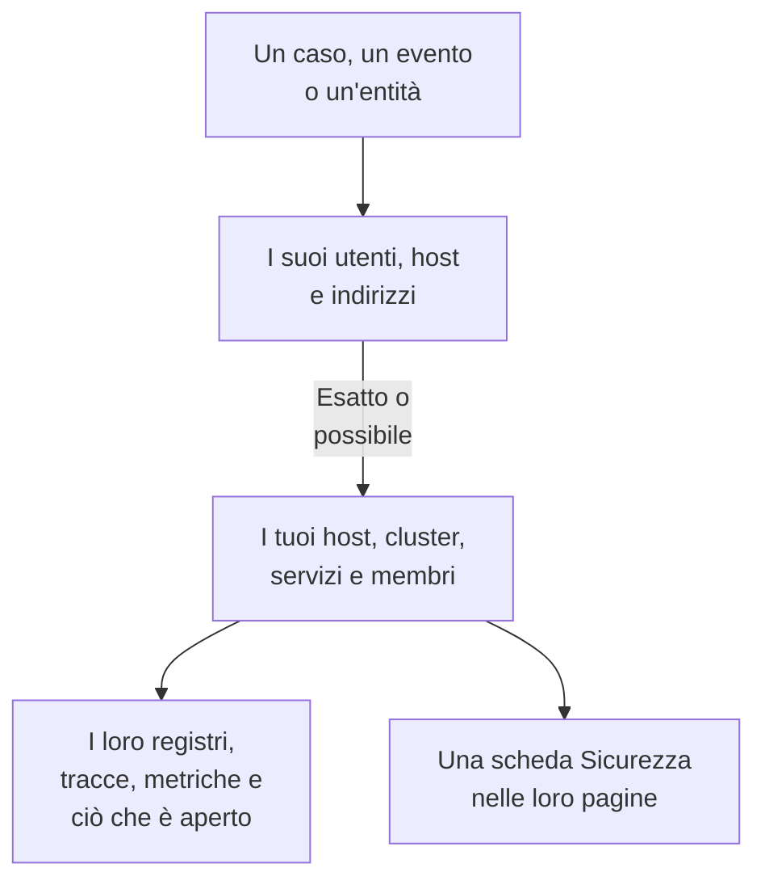

# Segnali collegati

Un caso di sicurezza dice quali utenti, host e indirizzi riguarda. Segnali collegati dice quali di questi OneUptime conosce già - i tuoi host, host di container, cluster Kubernetes, dispositivi di rete, servizi e membri - e cosa succedeva su ciascuno attorno al caso: i suoi registri, tracce e metriche, gli incidenti e gli avvisi aperti su di esso, i monitor che lo controllano e cosa vi è cambiato. Al contrario, la pagina di un host, di un cluster, di un servizio o di un membro dice cosa ha trovato Security Events su di esso.

:::cards
- [Dove lo vedi](#dove-lo-vedi): La pagina di un caso, la scheda di un evento, la pagina di un'entità e le pagine di ciò che nominano.
- [Come si abbina un valore](#come-si-abbina-un-valore): Cosa conta come lo stesso record e cosa lo è solo forse.
- [Cosa mostra ogni record](#cosa-mostra-ogni-record): I suoi segnali attorno al caso e ciò che è aperto su di esso.
- [Chi vede cosa](#chi-vede-cosa): Ogni record viene letto con il ruolo di chi legge.
:::

## Come funziona

OneUptime cerca ogni valore tra i record del progetto, dice quanto è sicura ogni corrispondenza e mostra cosa succedeva su ogni record attorno al caso.

## Prima di iniziare

- Eventi di sicurezza in arrivo, e host, cluster Kubernetes, servizi o membri del progetto che possano nominare. Vedi [Primi passi con la sicurezza](/docs/telemetry/security-getting-started).
- Un ruolo che può leggere gli eventi di sicurezza, e i tipi di record che vuoi vedere.

## Dove lo vedi

- **Segnali collegati**, una pagina di ogni caso di sicurezza: apri un caso in **Prodotti → Security Events → Casi di sicurezza → Casi aperti**, poi **Segnali collegati** dopo **Entità** nel suo menu.
- **Connesso**, una scheda di ogni evento di sicurezza: apri un evento in **Prodotti → Security Events → Eventi**. Elenca ciò che l'evento nomina, nell'ora attorno all'evento.
- La pagina di un'entità, in **Prodotti → Security Events → Rischio delle entità**: dove OneUptime conosce l'utente, l'host o l'indirizzo, attorno al suo ultimo evento di sicurezza.
- Una scheda **Sicurezza** nella pagina di ogni host, host Docker, host Podman, cluster Kubernetes, dispositivo di rete, servizio, membro ed elemento di inventario: i casi di sicurezza aperti che lo nominano, quanti eventi di sicurezza e rilevamenti lo hanno nominato negli ultimi 7 giorni, il più grave tra questi e il suo rischio. **Apri in Security Events** lo apre lì.
- Una scheda **Sicurezza** nella pagina di un incidente, quando un caso di sicurezza ha dichiarato l'incidente (**Dichiarato da**) o casi aperti nominano un host o un cluster che colpisce (**Casi aperti che nominano ciò che colpisce**).

## Come si abbina un valore

Ogni utente, host e indirizzo che un caso o un evento nomina viene cercato tra i record del progetto:

| Cosa nomina il caso o l'evento | Abbinato a | Quanto è sicuro |
| --- | --- | --- |
| Un nome di host o di dominio uguale al nome che riporta un host, un host di container, un cluster o un dispositivo di rete | Quel record | Esatto |
| Lo stesso nome, dato senza dire che è un host | Quel record | Possibile |
| Una forma breve o completa del nome di un record, come `web-1` e `web-1.acme.internal` | Quel record | Possibile |
| Un indirizzo IP pubblico che ha un solo record | Quel record | Esatto |
| Un indirizzo IP privato, o uno che hanno più record | Ogni record che lo ha | Possibile |
| L'email di un membro | Quel membro | Esatto |
| Il record con cui è stata inviata una riga di registro, per gli eventi letti dai tuoi registri | Quell'host, cluster o servizio | Esatto |
| Un semplice nome utente, un URL, un hash di file o un processo | Niente: nessun record è indicizzato in base a loro | - |

- Una possibile corrispondenza mostra **Possibile corrispondenza** accanto al suo nome e dice perché. Non viene mai contata nella pagina del record, e un incidente che il caso dichiara non viene mai collegato a essa.
- Ciò che è stato cercato e non è un record del progetto è elencato in **Non è in OneUptime**. Un valore non vi è mai elencato quando un tipo di record che potrebbe essere non è stato letto.
- Per un caso vengono elencati al massimo 10 record, prima quelli esatti.

## Cosa mostra ogni record

- I suoi segnali, ciascuno aperto sul record e sull'intervallo del caso: **Registri**, **Tracce** e **Metriche**, le **Eccezioni** di un servizio, gli **Eventi Kubernetes** di un cluster, la **Topologia** del record e il suo elemento in **Inventory** quando l'inventario ne ha uno.
- Gli incidenti e gli avvisi aperti ora su di esso e i monitor che lo controllano, ciascuno con la propria pagina.
- Cosa vi è cambiato nell'intervallo: i deploy di un servizio, i rollout di un cluster e le correzioni di un host.

| Dove | Intervallo |
| --- | --- |
| Un caso | Da 30 minuti prima del suo primo rilevamento a 30 minuti dopo l'ultimo, al massimo le sue ultime 24 ore |
| Un evento | 30 minuti prima e dopo |
| La pagina di un'entità | 30 minuti prima e dopo il suo ultimo evento di sicurezza |
| La scheda **Sicurezza** di un record | Gli ultimi 7 giorni |

## Chi vede cosa

- Segnali collegati e la scheda **Sicurezza** di un record richiedono un ruolo che può leggere gli eventi di sicurezza: Security Admin, Security Member, Security Viewer, Project Owner o Project Admin. Nessun altro vede dati di sicurezza in alcuna pagina. Vedi [Ruoli](/docs/permissions/reference#ruoli).
- La scheda **Sicurezza** di un incidente richiede un ruolo che può leggere i casi di sicurezza.
- Ogni record viene letto con il tuo ruolo. Un tipo di record che il tuo ruolo non può leggere viene omesso, e la pagina lo dice; uno che non è stato possibile leggere al momento lo dice anch'esso, con **Riprova**.
- La pagina di un record mostra la sua scheda **Sicurezza** solo in un progetto che usa Security Events: uno che ha ricevuto un evento di sicurezza negli ultimi 7 giorni.

## Incidenti che un caso dichiara

**Dichiara incidente** su un caso, o il passaggio di un playbook che ne dichiara uno, collega l'incidente agli host, agli host Docker e Podman, ai cluster Kubernetes e ai servizi a cui il caso è collegato in modo esatto. L'incidente compare nelle loro pagine e vi si applicano le regole dei loro proprietari, e il suo feed nomina il caso e ciò a cui è stato collegato. Una possibile corrispondenza non viene mai collegata.

## OneUptime AI

Il triage di un caso da parte di OneUptime AI legge i suoi segnali collegati: cosa è aperto e cosa è cambiato sugli host, sui servizi e sui membri che il caso nomina. L'indagine su un incidente legge il caso di sicurezza che lo ha dichiarato e i casi aperti che nominano ciò che colpisce. Vedi [OneUptime AI nella sicurezza](/docs/telemetry/security-ai).

## Risoluzione dei problemi

:::details Un host che il caso nomina non è elencato
Controlla che il caso nomini l'host come l'host nomina se stesso, o nomini un indirizzo pubblico che ha solo quell'host. Un nome breve, come `web-1` per `web-1.acme.internal`, è elencato come possibile corrispondenza, e un semplice nome utente, un URL, un hash di file o un processo non viene cercato affatto.
:::

:::details L'host giusto è elencato come possibile corrispondenza
Una possibile corrispondenza non viene mai contata né collegata, perché un nome che due macchine condividono non ti dica mai qualcosa su quella sbagliata. Fai nominare l'host dai tuoi registri e rilevamenti con il nome che riporta.
:::

:::details La pagina di un host non ha la scheda Sicurezza
La scheda è mostrata a un ruolo che può leggere gli eventi di sicurezza, in un progetto che ha ricevuto un evento di sicurezza negli ultimi 7 giorni. Un host che niente ha nominato in quel periodo mostra una riga che lo dice.
:::

:::details La pagina dice che il tuo ruolo non può vedere un tipo di record
Ogni record viene letto con il tuo ruolo. Chiedi a un Project Owner o a un Project Admin un ruolo che possa leggere quel tipo di record.
:::

## Passi successivi

:::cards
- [Casi di sicurezza e playbook](/docs/telemetry/security-cases): Gestire un caso e dichiararne un incidente.
- [Eventi di sicurezza (SIEM)](/docs/telemetry/security-events): Gli eventi dietro un caso e i registri da cui vengono letti.
- [Rischio delle entità (avvisi basati sul rischio)](/docs/telemetry/security-entity-risk): La pagina di un'entità, il suo rischio e dove OneUptime la conosce.
- [OneUptime AI nella sicurezza](/docs/telemetry/security-ai): Come un triage legge ciò che un caso nomina.
:::
