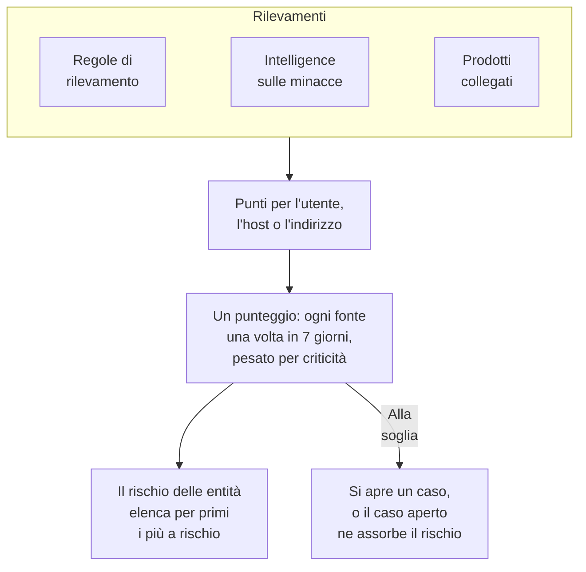

# Rischio delle entità (avvisi basati sul rischio)

Un singolo rilevamento dice raramente molto. Una raffica di accessi falliti, un primo sudo su un host e un accesso da un nuovo paese meritano ciascuno un'occhiata; lo stesso account in tutti e tre in una settimana merita un caso. Il rischio delle entità somma ciò che le tue regole di rilevamento, la tua intelligence sulle minacce e i tuoi prodotti collegati trovano su ogni utente, host e indirizzo IP, elenca per primi i più a rischio e apre un caso su quello il cui rischio raggiunge la soglia del progetto.

:::cards
- [Come si conta un punteggio](#come-si-conta-un-punteggio): Punti in base alla gravità, e ogni fonte una volta a settimana.
- [Livelli di rischio e casi](#livelli-di-rischio-e-casi): Come si legge un punteggio, e quando si apre un caso.
- [Criticità delle entità](#criticità-delle-entità): Contare di più ciò che conta di più, e di meno ciò che conta di meno.
- [La pagina di un'entità](#la-pagina-di-unentità): Perché è a rischio, il suo mese e i casi che la riguardano.
- [Punti di rischio su una regola di rilevamento](#punti-di-rischio-su-una-regola-di-rilevamento): Il peso proprio di una regola nel punteggio.
:::

## Come funziona

Apri **Prodotti → Security Events → Rischio delle entità**: ogni utente, host e indirizzo IP con un rischio ora, i più a rischio per primi, con il suo livello, quanto conta, cosa l'ha trovato e quando. Ognuno si apre su una pagina propria.

## Prima di iniziare

- Eventi di sicurezza in arrivo, e regole di rilevamento, intelligence sulle minacce o prodotti collegati che vi trovano qualcosa. Vedi [Primi passi con la sicurezza](/docs/telemetry/security-getting-started).
- Regole di rilevamento che raggruppano per un campo che nomina qualcuno: **Group By Field**, come `principalUser`, `principalHost` o `principalIp`, o i campi per cui raggruppa una correlazione. Una regola che non raggruppa per nulla non aggiunge rischio.
- Per modificare **Valutazione del rischio**: Project Owner o Project Admin per il suo interruttore e la sua soglia, e un ruolo che può creare regole di rilevamento per il suo elenco di entità. Security Viewer legge tutto. Vedi [Ruoli](/docs/permissions/reference#ruoli).

## Come si conta un punteggio

Ogni rilevamento aggiunge punti di rischio all'utente, host o indirizzo IP a cui si riferisce:

| Un rilevamento di gravità | Aggiunge |
| --- | --- |
| Bassa | 10 punti |
| Media | 25 punti |
| Alta | 50 punti |
| Critica | 75 punti |

- Un rilevamento informativo non aggiunge nulla, e un rilevamento di gravità sconosciuta conta come Media.
- I punti di una regola di rilevamento vanno al valore per cui raggruppa. Una corrispondenza di intelligence sulle minacce aggiunge all'indirizzo IP indicato dall'indicatore. L'avviso di un prodotto collegato aggiunge all'utente e all'host che nomina, altrimenti al suo indirizzo IP.
- Ogni fonte conta una volta. Una regola di rilevamento, un feed di intelligence sulle minacce o la regola di un prodotto collegato conta una volta in 7 giorni, con il massimo che ha aggiunto, per quante volte scatti: una regola rumorosa non può far sembrare un'entità peggiore di tre regole diverse.
- Una fonte che non ha trovato nulla per 7 giorni smette di contare, e il punteggio scende. I punteggi vengono controllati ogni 15 minuti, così un punteggio scende puntuale anche senza un nuovo rilevamento.

Il punteggio di un'entità è la somma delle sue fonti, pesata per la sua criticità. L'attacco di prova di **Invia un attacco di prova**, e un caso che qualcuno apre a mano, non aggiungono rischio.

## Livelli di rischio e casi

Ogni punteggio si legge come un livello rispetto alla soglia del progetto, 100 se non la cambi:

| Punteggio di rischio | Si legge come | Cosa succede |
| --- | --- | --- |
| Da 1 a 49 | Basso | Elencato in Rischio delle entità |
| Da 50 a 99 | Medio | Elencato in Rischio delle entità |
| Da 100 a 199 | Alto | Si apre un caso, ad Alto |
| 200 o più | Critico | Si apre un caso, a Critico |

Quando il rischio di un'entità raggiunge la soglia, viene generato su di essa un rilevamento della fonte Rischio delle entità. Si unisce al caso aperto sull'entità, o ne apre uno con il suo nome, come `High risk — k.morgan@acme-commerce.example`, ed elenca le fonti che hanno aggiunto più rischio, fino a 10, con i loro punti, quante volte è scattata ciascuna e quando l'ultima volta.

Una volta aperto un caso sul rischio di un'entità, ciò che c'era dietro non viene contato di nuovo: un altro caso si apre solo quando fonti nuove da allora raggiungono di nuovo la soglia. Un caso chiuso come gestito non viene riaperto dagli stessi rilevamenti.

Cambia la soglia in **Prodotti → Security Events → Impostazioni → Valutazione del rischio → Soglia di rischio**: un numero intero da 10 a 10000. Medio inizia dalla metà e Critico dal doppio, su ogni pagina.

### Attivare o disattivare i casi di rischio

**Casi di rischio**, in **Impostazioni → Valutazione del rischio**, decide se il rischio apre casi, e si salva appena lo cambi. I nuovi progetti partono con l'opzione attiva. Un progetto creato prima del rischio delle entità la tiene disattivata finché qualcuno non la attiva, e **Rischio delle entità** lo dice sopra il suo elenco. Il rischio viene valutato ed elencato in ogni caso.

## Criticità delle entità

Alcune entità contano più di altre: un domain controller, l'account di un dirigente, un server dei pagamenti. Altre contano meno, come uno scanner di vulnerabilità le cui scansioni sono previste. Elencale in **Impostazioni → Valutazione del rischio → Criticità delle entità** con **Aggiungi: Entità**:

| Criticità | Conta il suo rischio |
| --- | --- |
| Bassa | ×0.5 |
| Non elencata | ×1 |
| Alta | ×1.5 |
| Estrema | ×2 |

Una voce è un valore o un modello con `*`, senza distinzione tra maiuscole e minuscole: `dc-*` indica ogni domain controller, e `*@contractors.example` ogni collaboratore esterno. **Tipo** la limita a utenti, host o indirizzi IP; vuoto li comprende tutti. Quando più voci nominano un'entità, conta la più specifica: un valore scritto per intero prima di un modello, e un modello più lungo prima di uno più corto. Una modifica raggiunge il punteggio di ogni entità in pochi minuti.

## La pagina di un'entità

Fai clic su **Visualizza** in una riga di **Rischio delle entità**, o sul rischio accanto a un'entità nella pagina **Entità** di un caso:

| Parte | Cosa mostra |
| --- | --- |
| L'intestazione | Il suo tipo e la sua criticità, il punteggio e il livello, e come si calcola il punteggio |
| **Attività** | I suoi eventi di sicurezza e rilevamenti degli ultimi 7 giorni |
| **Cosa aumenta il suo rischio** | Ogni fonte, la sua gravità, i punti che aggiunge, quante volte è scattata e quando l'ultima volta |
| **Rischio degli ultimi 30 giorni** | Il suo punteggio alla fine di ogni giorno, colorato secondo il livello |
| **Casi che la riguardano** | I casi di sicurezza aperti su di essa, i più recenti per primi |

**Apri in Correla** disegna un grafo dei suoi eventi, e **Cerca i suoi eventi** apre **Eventi** sulla sua settimana. **Azzera il rischio** azzera il punteggio e le fonti, ad esempio dopo un test pianificato: ciò che si trova dopo conta da zero, e i suoi casi non cambiano. Azzerare richiede un ruolo che può eliminare i dati di sicurezza, e il [registro di controllo](/docs/configuration/audit-logs) lo registra.

OneUptime AI legge il rischio delle entità di un caso quando ne fa il triage. Vedi [OneUptime AI nella sicurezza](/docs/telemetry/security-ai).

## Punti di rischio su una regola di rilevamento

Una regola di rilevamento aggiunge i punti del suo livello, dal suo `level` Sigma. Per darle un peso proprio, apri il modulo della regola, vai a **In caso di corrispondenza**, apri **Altri campi** e imposta **Punti di rischio**, da 0, che non aggiunge rischio, a 100. Lascialo vuoto per i punti del suo livello.

## Risoluzione dei problemi

:::details Un'entità non compare in Rischio delle entità
Verifica che una regola di rilevamento, un feed di intelligence sulle minacce o un prodotto collegato abbia trovato qualcosa su di essa negli ultimi 7 giorni, e che la regola raggruppi per un campo che la nomina. I rilevamenti informativi non aggiungono nulla, e una fonte che non ha trovato nulla per 7 giorni smette di contare.
:::

:::details Il rischio di un'entità ha raggiunto la soglia e non si è aperto alcun caso
Verifica che **Casi di rischio** sia attivo in **Impostazioni → Valutazione del rischio**. Se si è già aperto un caso sul rischio dell'entità, per il successivo contano solo le fonti nuove da allora.
:::

:::details Una regola scatta di continuo e il punteggio dell'entità non sale
È così che si conta: una fonte conta una volta in 7 giorni, con il massimo che ha aggiunto. Abbassa i **Punti di rischio** di una regola rumorosa, o assegna una criticità bassa a un'entità i cui rilevamenti sono previsti.
:::

:::details Un punteggio non è la somma delle sue fonti
La sua criticità lo pesa. La pagina dell'entità mostra la somma delle sue fonti e il peso, ad esempio 100 dalle sue fonti × 2 = 200.
:::

## Passi successivi

:::cards
- [Casi di sicurezza e playbook](/docs/telemetry/security-cases): Gestire i casi che il rischio apre, e chiuderli con un verdetto.
- [Eventi di sicurezza (SIEM)](/docs/telemetry/security-events): Regole di rilevamento, Correla e gli eventi dietro ogni rilevamento.
- [Intelligence sulle minacce (STIX/TAXII)](/docs/telemetry/threat-intelligence): Le corrispondenze che aggiungono rischio a un indirizzo.
- [OneUptime AI nella sicurezza](/docs/telemetry/security-ai): Come un triage legge il rischio delle entità di un caso.
:::
