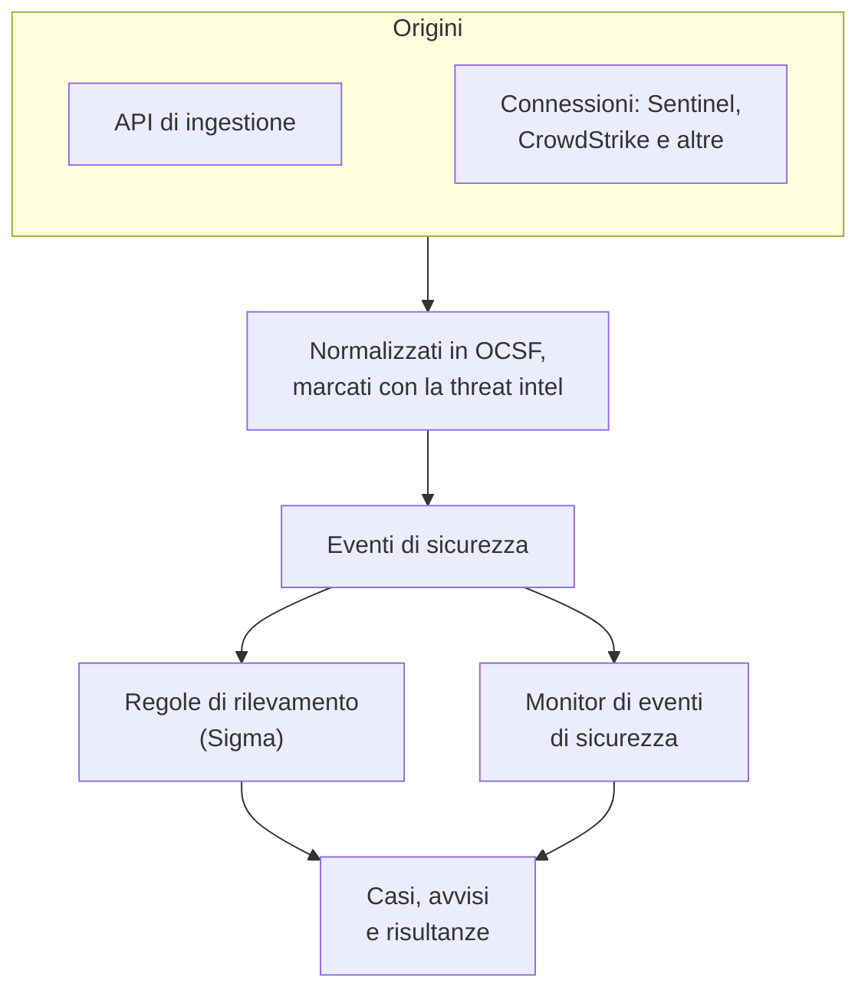
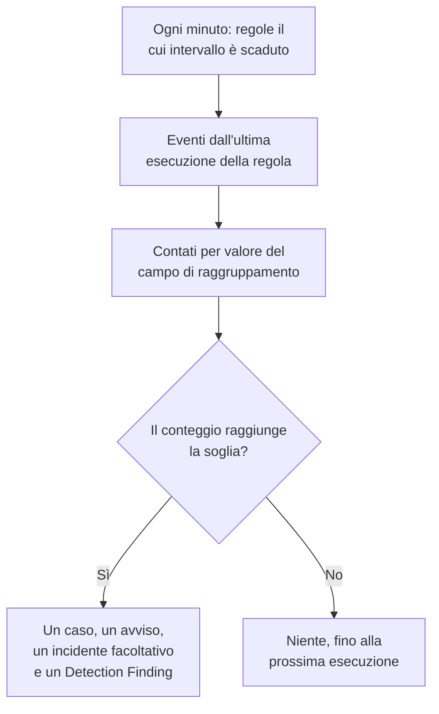

# Eventi di sicurezza (SIEM)

OneUptime conserva gli eventi di sicurezza accanto ai tuoi log, tracce e metriche, e dà a ciascuno la stessa forma, [OCSF](https://schema.ocsf.io/) (l'Open Cybersecurity Schema Framework), qualunque sia il formato in cui è arrivato. Invia eventi da qualsiasi origine, cercali e trova quelli importanti con regole di rilevamento Sigma, threat intelligence e monitor. Ciò che trovano diventa [casi](/docs/telemetry/security-cases) da gestire, e i playbook vi rispondono.

:::cards
- [Inviare eventi](#inviare-eventi-di-sicurezza): Un POST HTTPS, un output di Fluent Bit o una connessione a un prodotto di sicurezza.
- [Cercare e correlare](#esplorare-gli-eventi-di-sicurezza): L'esploratore di eventi e il grafo di correlazione.
- [Regole di rilevamento](#regole-di-rilevamento): Regole Sigma che aprono casi e avvisi.
- [Monitor](#monitor-di-eventi-di-sicurezza): Conteggi su una finestra mobile, con uno stato che si ripristina.
:::

## Come funziona



Apri **Prodotti → Security Events**, sotto **Osservabilità**. Il suo menu ha una sezione per ogni parte della sicurezza, e una pagina a sé per ogni cosa che contiene:

| Pagina | Sezione | A cosa serve |
| --- | --- | --- |
| **Panoramica** | Panoramica | Come è configurata la sicurezza, cosa richiede qualcuno adesso e quanto velocemente vengono gestiti i casi |
| **Casi aperti** | Casi di sicurezza | La coda: ogni caso non ancora chiuso, raggruppato per ciò che riguarda |
| **Assegnati a me** | Casi di sicurezza | I casi aperti assegnati a te |
| **Non assegnato** | Casi di sicurezza | I casi aperti che nessuno ha preso in carico |
| **Casi chiusi** | Casi di sicurezza | I casi chiusi con un esito, i più recenti per primi |
| **Tutti i casi** | Casi di sicurezza | Ogni caso, aperto o chiuso |
| **Eventi** | Eventi | Cercare e filtrare ogni evento, e aprirne uno per vedere tutti i suoi campi |
| **Campaigns** | Eventi | Ogni indirizzo che ha inviato richieste di attacco, e se qualcuna delle sue richieste è passata |
| **Rischio delle entità** | Eventi | Ogni utente, host e indirizzo, valutato in base a ciò che è stato trovato questa settimana, i più a rischio per primi |
| **Correla** | Eventi | Un grafo degli eventi che condividono un host, un utente o un indirizzo IP |
| **Regole di rilevamento** | Detections | Regole Sigma che girano secondo una pianificazione e aprono casi |
| **Eccezioni delle regole** | Detections | Ciò che le tue regole saltano di proposito, come uno scanner o un test pianificato, ognuno con chi l'ha aggiunto e perché |
| **Elenchi di controllo** | Detections | Gli elenchi con cui le tue regole confrontano gli eventi, come utenti VIP, host critici, hash di file malevoli noti e gli indirizzi da cui gli amministratori possono accedere |
| **Libreria di regole** | Detections | Regole di rilevamento pronte da aggiungere, ognuna con gli eventi che legge e se arrivano, con quelle consigliate segnalate |
| **Threat Intel** | Detections | Feed STIX/TAXII di indicatori malevoli noti |
| **Copertura ATT&CK** | Detections | Le tecniche MITRE ATT&CK coperte dalle tue regole |
| **Playbook** | Playbooks | Passi che vengono eseguiti sui casi, da soli o a mano |
| **Approvazioni** | Playbooks | I passi dei playbook in attesa che qualcuno li approvi o li rifiuti |
| **Esecuzioni** | Playbooks | Cosa ha fatto ogni playbook, passo per passo |
| **Entità protette** | Playbooks | Gli utenti e gli host a cui nessun playbook applica il contenimento |
| **Impostazioni** | IA | Se OneUptime AI classifica ogni nuovo caso |
| **Connessioni** | Connections | I tuoi log, i prodotti di sicurezza che OneUptime interroga e i SIEM a cui invia |
| **Guida alla configurazione** | Connections | Frammenti per inviare eventi, compilati con la tua chiave di ingestione |
| **Priorità dei casi** | Impostazioni | Quanto è urgente un caso: le priorità del progetto, la più urgente prima |
| **Obiettivi di risposta** | Impostazioni | Quanto in fretta un caso di ogni priorità deve essere preso in carico e contenuto |
| **Stati dei casi** | Impostazioni | I passaggi che un caso attraversa, e come conta un caso in ciascuno |
| **Valutazione del rischio** | Impostazioni | Se il rischio di un'entità apre un caso, a quale rischio, e quanto conta ogni entità |

**Rilevamenti**, **IA**, **Connessioni** e **Impostazioni**, che si configurano una volta, restano chiuse finché non le apri. Nuovo alla sicurezza? [Primi passi con la sicurezza](/docs/telemetry/security-getting-started) la configura in due clic.

## Prima di iniziare

I dati di sicurezza li leggono solo i ruoli Project Owner e Project Admin e i tre ruoli di sicurezza; gli altri ruoli non vedono nulla in Security Events. Vedi [Ruoli](/docs/permissions/reference#ruoli).

| Ruolo | Cosa può fare |
| --- | --- |
| Security Admin | Tutto: eventi, casi, playbook, regole di rilevamento, feed di threat intel e connessioni |
| Security Member | Leggere eventi e threat intel, gestire i casi, eseguire playbook e approvarne i passi, e creare, modificare ed eliminare regole di rilevamento e feed. Non può configurare playbook né connessioni, né eliminare dati di sicurezza. |
| Security Viewer | Leggere eventi, casi, playbook, regole, feed, indicatori e connessioni |

## Inviare eventi di sicurezza

:::steps
### Crea una chiave di ingestione

Apri **Impostazioni del progetto → Telemetria e APM → Chiavi di acquisizione** e fai clic su **Crea chiave di ingestione**. Gli eventi di sicurezza usano le stesse chiavi del resto della tua telemetria.

### Invia i tuoi eventi

Invia JSON a `/security-events/v1/ingest` con la chiave in `x-oneuptime-token`:

:::tabs
@tab OCSF
```bash
curl -X POST "https://oneuptime.com/security-events/v1/ingest?format=ocsf" \
  -H "Content-Type: application/json" \
  -H "x-oneuptime-token: YOUR_INGESTION_TOKEN" \
  -H "x-oneuptime-service-name: my-security-source" \
  -d '{ "events": [ { "class_uid": 3002, "severity_id": 4, "status": "Failure", "message": "Failed logon for alice", "actor": { "user": { "name": "alice" } }, "src_endpoint": { "ip": "203.0.113.7", "hostname": "laptop-alice" } } ] }'
```
@tab Google UDM
```bash
curl -X POST "https://oneuptime.com/security-events/v1/ingest?format=udm" \
  -H "Content-Type: application/json" \
  -H "x-oneuptime-token: YOUR_INGESTION_TOKEN" \
  -d '{ "events": [ { "metadata": { "event_type": "USER_LOGIN" }, "principal": { "hostname": "laptop-alice", "user": { "userid": "alice" }, "ip": ["203.0.113.7"] }, "security_result": [{ "severity": "HIGH", "action": ["BLOCK"] }] } ] }'
```
@tab Generic JSON
```bash
curl -X POST "https://oneuptime.com/security-events/v1/ingest" \
  -H "Content-Type: application/json" \
  -H "x-oneuptime-token: YOUR_INGESTION_TOKEN" \
  -d '{ "events": [ { "severity": "high", "event_type": "ssh_brute_force", "message": "12 failed SSH logins in 60s", "username": "root", "hostname": "web-01", "src_ip": "203.0.113.7" } ] }'
```
:::

L'endpoint risponde `200` appena gli eventi sono in coda. Un evento inviato senza orario, come questi, viene collocato nel momento in cui arriva.

### Trovali in Eventi

Apri **Prodotti → Security Events → Eventi**. Gli eventi compaiono in pochi secondi, con gravità, classe, utente, host e indirizzi IP compilati.
:::

### Formati

| `format` | Cosa legge | Accettato anche |
| --- | --- | --- |
| `ocsf` | JSON di eventi OCSF (`class_uid`, `severity_id` e così via) | Nessuno |
| `udm` | Eventi UDM di Google SecOps (Chronicle) (`metadata.event_type` e così via) | `chronicle`, `google-secops` |
| `google-secops-alert` | Rilevamenti e avvisi di Google SecOps: webhook SOAR e il flusso dei rilevamenti | `secops-alert`, `detection` |
| `generic` | Qualsiasi altro JSON, letto tramite nomi di campo comuni | Nessuno |

Indica il formato con `?format=`, con l'intestazione `x-oneuptime-security-event-format` o con un campo `"format"` di primo livello. Se lo ometti, il formato di ogni evento viene ricavato a parte, così un webhook può mescolare rilevamenti ed eventi grezzi.

- Il corpo può essere un evento, un array di eventi o `{ "events": [...] }`.
- L'intestazione `x-oneuptime-service-name` nomina il servizio di telemetria a cui appartengono gli eventi. Senza di essa, appartengono al servizio che prende il nome dal prodotto o dal fornitore del primo evento, oppure a `Security Events`.
- Nulla viene scartato perché non si è riusciti a mapparlo: ogni campo dell'origine arriva negli attributi dell'evento.

### Campi del JSON generico

Un evento generico viene letto tramite nomi di campo comuni:

| Campo dell'evento | Letto dal primo tra |
| --- | --- |
| `message` | `message`, `msg`, `summary`, `description`, `title` |
| `severityName` | `severity`, `severity_name`, `level`, `priority`, `risk_level` |
| `time` | `timestamp`, `time`, `@timestamp`, `event_time`, `created_at` |
| `principalUser` | `user`, `username`, `user_name`, `account`, `actor` |
| `principalHost` | `host`, `hostname`, `computer`, `device`, `machine` |
| `principalIp` | `source_ip`, `src_ip`, `client_ip`, `ip` |
| `targetIp` | `destination_ip`, `dest_ip`, `dst_ip`, `target_ip` |
| `className` | `event_type`, `category`, `type`, `action` |
| `ruleName` | `rule`, `rule_name`, `signature`, `detection` |
| `productName` | `product`, `product_name`, `source`, `log_source` |
| `processName` | `process_name`, `process.name`, `proc.name`, `comm` |
| `processPath` | `process_path`, `Image`, `NewProcessName`, `exe`, `process.executable` |
| `processCommandLine` | `command_line`, `CommandLine`, `cmdline`, `process.command_line`, `proc.cmdline`, `process` |
| `parentProcessName` | `parent_process_name`, `process.parent.name`, `proc.pname` |
| `parentProcessPath` | `parent_process_path`, `ParentImage`, `ParentProcessName`, `process.parent.executable` |
| `parentProcessCommandLine` | `parent_command_line`, `ParentCommandLine`, `process.parent.command_line`, `proc.pcmdline` |

Una parola di gravità diventa un livello OCSF: `info` si legge come Informational, `warning` come Low, `error` come Medium, `alert` come Critical ed `emergency` come Fatal.

### Inoltrare con Fluent Bit

Per inviare log di sicurezza che già raccogli, come quelli di auditd, syslog o Falco, aggiungi a Fluent Bit un output `http`:

```ini title="fluent-bit.conf"
[OUTPUT]
    Name             http
    Match            security.*
    Host             oneuptime.com
    Port             443
    tls              On
    URI              /security-events/v1/ingest
    Format           json
    Json_date_key    timestamp
    Json_date_format iso8601
    Header           x-oneuptime-token YOUR_INGESTION_TOKEN
    Header           x-oneuptime-service-name my-security-source
    Retry_Limit      5
```

La pagina **Guida alla configurazione**, sotto **Connessioni**, contiene questi frammenti con il tuo host e la tua chiave già compilati.

### Trovare eventi di sicurezza nei tuoi log

La scheda **I tuoi log**, in cima a **Connessioni**, rende una sorgente i log che invii già a OneUptime. Con **Trova eventi di sicurezza nei tuoi log** attivo, i nuovi log del progetto vengono letti ogni minuto, e ogni accesso SSH, comando sudo, voce di audit di Kubernetes, modifica di AWS CloudTrail e attacco web che contengono viene salvato come evento di sicurezza. Vedi [Primi passi con la sicurezza](/docs/telemetry/security-getting-started#trovare-eventi-di-sicurezza-nei-tuoi-log) per cosa copre ciascun tipo.

### Collegare un prodotto di sicurezza

**Connessioni** interroga per te un prodotto di sicurezza e ne importa i nuovi record come eventi di sicurezza. Una connessione contiene le impostazioni del prodotto e una credenziale cifrata; un worker la interroga all'intervallo che imposti e salta i record già importati.

| Prodotto | Importa | Guida alla configurazione |
| --- | --- | --- |
| Google SecOps (Chronicle) | Rilevamenti di regole, rilevamenti curati e avvisi, come Detection Findings | [Google SecOps](/docs/integrations/google-secops) |
| Microsoft Sentinel | Incidenti, come Incident Findings | [Microsoft Sentinel](/docs/integrations/microsoft-sentinel) |
| Microsoft Defender XDR | Avvisi, come Detection Findings | [Microsoft Defender XDR](/docs/integrations/microsoft-defender-xdr) |
| CrowdStrike Falcon | Avvisi, come Detection Findings | [CrowdStrike Falcon](/docs/integrations/crowdstrike-falcon) |
| Splunk Enterprise Security | Notable event, o qualsiasi ricerca, come Detection Findings | [Splunk Enterprise Security](/docs/integrations/splunk) |
| Elastic Security | Avvisi di rilevamento, come Detection Findings | [Elastic Security](/docs/integrations/elastic-security) |
| AWS Security Hub | Finding, come Detection e Compliance Findings | [AWS Security Hub](/docs/integrations/aws-security-hub) |
| Okta System Log | Eventi di accesso, MFA, account e criteri | [Okta System Log](/docs/integrations/okta) |

- Gli avvisi propri del prodotto di livello pari o superiore a **Open Cases From** (**Alta e superiori** a meno che tu non scelga un altro livello, oppure **Mai**) aprono [casi](/docs/telemetry/security-cases), raggruppati per l'utente, l'host o l'indirizzo che riguardano.
- Una connessione legge i record in base al momento in cui il prodotto li ha creati, non al momento dell'attività che descrivono. Una regola SIEM che gira ogni ora crea rilevamenti molto dopo gli eventi corrispondenti, e vengono comunque importati.
- La prima interrogazione guarda indietro di 24 ore, così una nuova connessione mostra subito i record recenti.
- **Testa la connessione**, nella riga della connessione, verifica l'accesso al prodotto e che i worker di OneUptime siano in funzione, senza importare nulla. **Esegui ora** interroga subito.

## Cosa contiene un evento

Ogni evento viene salvato con campi tipizzati e il suo payload di origine:

| Gruppo | Campi |
| --- | --- |
| Classificazione | `categoryName`, `className`, `activityName`, `statusName`, con i loro ID OCSF (`categoryUid`, `classUid`) |
| Gravità | `severityName`, uno tra Unknown, Informational, Low, Medium, High, Critical, Fatal o Other, e `severityId` |
| Chi l'ha fatto | `principalUser`, `principalHost`, `principalIp`, `principalProcess` |
| Cosa ha toccato | `targetUser`, `targetHost`, `targetIp`, `targetPort`, `targetResource` |
| Il processo | `processName`, `processPath` e `processCommandLine`: in un'attività di processo, il processo avviato, aperto, iniettato o terminato, altrimenti il processo che ha agito. `parentProcessName`, `parentProcessPath` e `parentProcessCommandLine`: il processo che lo ha avviato |
| Origine | `productName`, `vendorName`, `ruleId`, `ruleName`, `eventUid` |
| Contenuto | `message`, `mitreTactics`, `mitreTechniques` e `observables`: ogni utente, host, indirizzo IP, dominio e hash estratto dall'evento |
| Attributi | L'intero payload di origine, appiattito in chiavi con punti |

Gli eventi memorizzati prima di OneUptime 14.0.84 lasciano vuoti i campi del processo e indicano il loro processo solo come `principalProcess`, il processo che ha agito. Non vengono completati in seguito: conservano ciò con cui sono stati memorizzati fino alla fine della loro conservazione.

## Esplorare gli eventi di sicurezza

**Eventi** è un esploratore di telemetria come quelli di log e tracce: un grafico degli eventi della finestra per gravità, una barra laterale di facet, l'elenco e un pannello con ogni campo e attributo dell'evento che apri. La finestra, i filtri e la ricerca stanno tutti nell'URL, così una vista filtrata si può condividere e sopravvive a un ricaricamento.

### Ricerca

La barra di ricerca parla la stessa lingua degli altri esploratori di telemetria (vedi [Sintassi di ricerca](/docs/telemetry/search-syntax)):

| Sintassi | Significa | Esempio |
| --- | --- | --- |
| testo libero | Il messaggio lo contiene | `failed logon` |
| `"quoted phrase"` | Tenere unite le parole | `"brute force"` |
| `<field>:<value>` | Un campo tipizzato | `severity:Critical` |
| `@<attribute>:<value>` | Un attributo di origine | `@threat.matched:true` |
| `-<filter>` | Non questo | `-severity:Informational` |
| `<field>:(a OR b)` | Uno qualsiasi di questi valori | `severity:(High OR Critical)` |
| `<field>:a*` | `*` è qualsiasi testo, `?` un carattere | `host:web-*` |
| `@<attribute>:*` | L'attributo è presente | `@threat.indicator_id:*` |
| `@<attribute>:~text` | L'attributo contiene il testo | `@finding_info.title:~ransom` |

Un campo è un nome breve (`severity`, `class`, `category`, `activity`, `status`, `vendor`, `product`, `rule`, `user`, `host`, `ip`, `targetuser`, `targethost`, `targetip`, `processname`, `commandline`, `parentprocessname`, `observable`, `tactic`, `technique`, `requestoutcome`, `trace`, `session`) oppure il nome proprio del campo, come `severityName` o `principalHost`. Qualsiasi altro nome viene letto come attributo di origine. `observable:<value>` trova ogni evento che menziona un valore, da qualunque lato dell'attività si trovasse.

### Facet

La barra laterale conta gli eventi della finestra per **Origine**, **Gravità**, **Request Outcome**, **Classe di eventi**, **Categoria**, **Attività**, **Stato**, **Fornitore**, **Prodotto**, **Regola di rilevamento**, **Utente di origine**, **Host di origine**, **Processo** e **Processo padre**. Fai clic su un valore per tenere solo i suoi eventi, o sul segno meno accanto per escluderli. Fai di nuovo clic per annullare. Il grafico e ogni conteggio descrivono esattamente gli eventi dell'elenco.

### Cosa è successo dopo

Un evento letto da una riga di log scritta all'interno di una richiesta tracciata viene seguito dentro quella richiesta. Il suo pannello dice fin dove è arrivata la richiesta (**Rifiutato**, **Reached App**, **Errored** o **Reached Database**), chi l'ha inviata, e rimanda alla sua traccia, alla sua eccezione, al replay della sessione e alla riga di log stessa. Anche una riga di log, una traccia e un'eccezione che fanno parte di un attacco lo dicono nelle proprie pagine.

### Campaigns

**Campaigns** elenca ogni indirizzo che ha inviato richieste di attacco come una sola riga, con i tipi di attacco, gli strumenti e le richieste che ha inviato, e quante sono passate. Prima vengono gli indirizzi le cui richieste hanno raggiunto la tua app.

### Correla

**Correla** disegna gli eventi intorno a un host, un utente o un indirizzo IP: le loro classi di eventi intorno a ciò che hai cercato, marcate con la gravità peggiore, e gli altri valori visti negli stessi eventi sull'anello esterno. Fai clic su una classe per elencarne gli eventi, o su un valore per correlare su di esso. Ogni observable nel pannello di un evento in **Eventi** apre **Correla** su di esso.

## Regole di rilevamento

Una regola di rilevamento è una regola [Sigma](https://sigmahq.io/), un formato YAML aperto per descrivere attività sospette, che OneUptime esegue secondo una pianificazione sui tuoi eventi. Quando corrisponde, apre un [caso](/docs/telemetry/security-cases) o si aggiunge a uno già aperto, apre un avviso, facoltativamente un incidente, e scrive un Detection Finding negli eventi. La **Libreria di regole** offre regole pronte da cui partire.



### Creare una regola

:::steps
1. Apri **Prodotti → Security Events → Rilevamenti → Regole di rilevamento** e fai clic su **Crea: Regola di rilevamento**.
2. In **Regola Sigma**, incolla lo YAML della regola in **Regola Sigma (YAML)**. Viene analizzato al salvataggio, così un errore compare nel modulo.
3. Il **Nome** si compila dal `title` della regola: scrivici sopra per chiamarla in un altro modo. Una nuova regola gira; **Abilitato** è nel suo modulo di modifica.
4. In **In caso di corrispondenza**, lascia attivo **Apri un caso in caso di corrispondenza** per raggruppare le sue corrispondenze in casi, in base al valore per cui raggruppa la regola.
5. In **Avvisi e incidenti**, scegli cos'altro genera una corrispondenza: **Crea un avviso** (predefinito), **Dichiara un incidente**, **Entrambi** o **Nessuno dei due**, con una **Gravità avviso** o una **Gravità incidente** facoltativa.
6. **Altri campi** contiene la **Descrizione**, **Scrivi un Detection Finding in caso di corrispondenza** (attivo) e il modo in cui si contano le corrispondenze; vedi [Impostazioni di valutazione](#impostazioni-di-valutazione).
:::

Una prima regola, che corrisponde agli accessi falliti da fuori `10.x.x.x`:

```yaml title="failed-logon-burst.yml"
title: Failed logon burst
description: Repeated authentication failures from one source.
level: high
tags:
  - attack.t1110
  - attack.ta0006
detection:
  selection:
    className: Authentication
    statusName: Failure
  filter_internal:
    principalIp|startswith: '10.'
  condition: selection and not filter_internal
```

### Cosa può esprimere una regola

OneUptime esegue il nucleo booleano di Sigma:

- Le selezioni sono mappe di campi (ogni campo deve corrispondere; una lista di valori corrisponde a uno qualsiasi) o liste di parole chiave, che corrispondono in qualsiasi punto del messaggio.
- Le condizioni combinano le selezioni con `and`, `or`, `not` e parentesi, oppure con `1 of selection_*`, `all of selection_*`, `any of them` e `all of them`.
- Modificatori di campo: `contains`, `startswith`, `endswith`, `all`, `re`, `cased`, `gt`, `gte`, `lt`, `lte`, `cidr`, `exists`, `windash` e `expand`, che legge un [elenco di controllo](#elenchi-di-controllo). Il testo si confronta senza distinguere maiuscole e minuscole, a meno che tu non aggiunga `cased`.
- Un campo è un campo tipizzato (`principalUser`), una grafia Sigma comune di uno di essi (`CommandLine`, `src_ip`, `Hostname`) o qualsiasi chiave di attributo, scritta come nell'evento (`threat.matched`).
- `Image` e `CommandLine` leggono il processo di cui parla l'evento, quello avviato nell'avvio di un processo (`processPath`, `processCommandLine`), e `ParentImage` e `ParentCommandLine` il processo che lo ha avviato (`parentProcessPath`, `parentProcessCommandLine`). `principalProcess` è il processo che ha agito, che in un avvio è il processo padre.
- `level` imposta la gravità: `informational`, `low`, `medium`, `high` o `critical`, e `medium` se manca. Gli ID ATT&CK in `tags` (`attack.t1110`, `attack.ta0006`) compilano i campi MITRE della risultanza.

Le aggregazioni come `| count() by principalIp > 5` vengono rifiutate al salvataggio: usa invece una [regola di correlazione](#regole-di-correlazione), oppure **Campo di raggruppamento** e **Soglia di corrispondenze**. `logsource` è solo informativo e non restringe nulla: metti quel filtro in una selezione, come `className: Authentication`. Un `timeframe` viene ignorato, perché la finestra la fissa l'intervallo della regola.

### Regole di correlazione

Una [correlazione Sigma](https://sigmahq.io/docs/meta/correlations.html) scatta su più eventi insieme invece che su uno solo. Incollala in **Regola Sigma (YAML)** con le regole che legge, come documenti YAML separati da `---`, oppure indica regole che il progetto ha già con il loro `name` o `id` Sigma. La **Libreria di regole** ne ha di pronte, come accessi falliti seguiti da uno riuscito.

| Tipo | Scatta quando | Mostrato come |
| --- | --- | --- |
| `event_count` | Un gruppo raggiunge un numero di eventi entro il `timespan` | Numero di eventi |
| `value_count` | Un gruppo mostra un numero di valori diversi di un campo entro il `timespan` | Valori distinti |
| `temporal` | Ogni regola corrisponde per lo stesso gruppo entro il `timespan`, in qualsiasi ordine | Eventi insieme |
| `temporal_ordered` | Le regole corrispondono nel loro ordine per lo stesso gruppo entro il `timespan` | Sequence |
| `new_value` | Un gruppo mostra un valore di un campo che non ha mostrato entro il `timespan` | First seen |

```yaml title="failed-then-success.yml"
title: Failed sign-ins, then a success from the same address
level: high
correlation:
  type: temporal_ordered
  rules:
    - failed_sign_ins
    - successful_sign_in
  group-by:
    - principalIp
  timespan: 10m
---
title: Five failed sign-ins
name: failed_sign_ins
correlation:
  type: event_count
  rules:
    - failed_sign_in
  group-by:
    - principalIp
  timespan: 10m
  condition:
    gte: 5
---
title: Failed sign-in
name: failed_sign_in
detection:
  selection:
    className: Authentication
    statusName: Failure
  condition: selection
---
title: Successful sign-in
name: successful_sign_in
detection:
  selection:
    className: Authentication
    statusName: Success
  condition: selection
```

- Un gruppo è il valore dei campi di `group-by`, come un indirizzo. I conteggi sono mobili: una raffica che due esecuzioni si dividono viene comunque contata per intero nel suo `timespan`, che dura al massimo 24 ore.
- `new_value` è un tipo proprio di OneUptime, perché Sigma non ha una correlazione «visto per la prima volta»: confronta con fino a 30 giorni di storico. `value_sum`, `value_avg`, `value_percentile` e `value_median` vengono rifiutati al salvataggio.
- La colonna **Tipo** di **Regole di rilevamento** indica il genere di ogni regola, e il modulo dice in una frase che cosa cerca la regola.

### Impostazioni di valutazione

| Campo | Cosa fa |
| --- | --- |
| **Intervallo di valutazione (minuti)** | Ogni quanto gira la regola: minuti interi, da 1 a 1440. Il modulo di una nuova regola parte da 5. |
| **Campo di raggruppamento** | Facoltativo. Le corrispondenze che condividono il valore di questo campo, come `principalHost`, vengono contate, avvisate e deduplicate insieme: un avviso per host invece di centinaia. |
| **Campo di conteggio distinto** | Facoltativo. Conta i valori diversi di questo campo invece degli eventi corrispondenti. I valori vuoti non contano. |
| **Soglia di corrispondenze** | Un gruppo scatta solo quando il suo conteggio raggiunge questo numero in un'esecuzione: da 1 a 1000000, e 1 scatta a qualsiasi corrispondenza. |

Il raggruppamento e il conteggio distinto accettano gli stessi nomi di campo della regola. Con essi, la soglia dice «tanti, dalla stessa cosa, in un'esecuzione», senza un monitor sopra:

| Obiettivo | Group By Field | Distinct Count Field | Soglia |
| --- | --- | --- | --- |
| Avvisare a qualsiasi corrispondenza | Vuoto | Vuoto | 1 |
| Un avviso per host | `principalHost` | Vuoto | 1 |
| Forza bruta: 5 accessi falliti da un IP | `principalIp` | Vuoto | 5 |
| Password spraying: un IP che fallisce su 5 account diversi | `principalIp` | `principalUser` | 5 |
| Scansione di porte: un IP che raggiunge 20 porte diverse | `principalIp` | `targetPort` | 20 |

### Quando gira una regola

OneUptime controlla ogni minuto quali regole abilitate hanno superato il loro intervallo dall'ultima esecuzione. Ogni esecuzione legge gli eventi il cui orario dell'evento cade tra l'esecuzione precedente e due minuti fa, poi va avanti. I due minuti lasciano tempo agli eventi ancora in arrivo, come una riga di log letta un minuto dopo essere stata scritta:

- Le finestre sono una dopo l'altra, non scorrono. Con un intervallo di 10 minuti, errori alle 09:58 e alle 10:01 possono cadere in esecuzioni diverse e vengono contati separatamente, quindi lascia margine quando scegli una soglia.
- Dopo un'interruzione, come un worker fermo o una regola riattivata, l'esecuzione successiva copre l'intera interruzione, fino alle ultime 24 ore.
- Un evento che arriva con più di due minuti di ritardo, quando un'esecuzione ha già coperto il suo orario, viene salvato ed è ricercabile, ma quella regola non lo legge mai.
- Ogni gruppo che raggiunge la soglia diventa un Detection Finding, fino a 10.000 per esecuzione. Avvisi, incidenti e casi si aprono per i 100 con i conteggi più alti; gli altri condividono un caso sulla regola, e l'**Ultimo errore** della regola dice quanti gruppi hanno corrisposto.

### Gravità

Il `level` di una regola è la gravità delle sue risultanze: `informational`, `low`, `medium`, `high` e `critical` diventano Informational, Low, Medium, High e Critical. I suoi avvisi e incidenti prendono una delle gravità del tuo progetto, in quest'ordine:

1. La **Gravità avviso** (o **Gravità incidente**) della regola, se impostata.
2. La tua gravità che prende il nome dal livello, come High, a prescindere da maiuscole e minuscole.
3. Per rango: le regole `critical` e `high` prendono la tua gravità più alta, le altre la più bassa.

> [!TIP]
> Dai alle tue gravità di avviso i nomi dei livelli Sigma (Critical, High, Medium, Low, Informational), e ogni regola finisce su quella giusta senza un'impostazione per regola.

### Avvisi e risultanze

Ogni gruppo che scatta apre un avviso intitolato `[Detection] <rule name> — <group value>`, oppure `[Detection] <rule name>` per una regola senza campo di raggruppamento. Finché è aperto, altre corrispondenze di quel gruppo non ne aprono un altro. Una regola vede solo corrispondenze e non può capire che un attacco è finito, quindi i suoi avvisi restano aperti finché qualcuno non li risolve.

Un Detection Finding è un evento di sicurezza di classe `Detection Finding` (classe OCSF 2004) del prodotto `OneUptime Detections`, con i tag MITRE della regola, il valore del gruppo per primo in `observables` e questi attributi:

| Attributo | Valore |
| --- | --- |
| `oneuptime.detection.rule_id` | L'ID della regola che è scattata |
| `oneuptime.detection.rule_name` | Il nome della regola |
| `oneuptime.detection.match_count` | Quanti eventi ci sono dietro la risultanza |
| `oneuptime.detection.distinct_count` | Quanti valori diversi ci sono dietro, per una regola con conteggio distinto |
| `oneuptime.detection.group_value` | Il valore del gruppo, per una regola con campo di raggruppamento |
| `oneuptime.detection.sigma_id` | L'`id` proprio della regola Sigma |

Le risultanze sono eventi normali: cercale in **Eventi** e fai pivot su di esse in **Correla**. Per provare una nuova regola in silenzio, disattiva ogni azione tranne la risultanza finché non ti fidi di lei.

### Eccezioni

Un'eccezione è qualcosa che una regola salta perché te lo aspetti, come uno scanner di vulnerabilità, un job di backup notturno o un penetration test pianificato. Mette a tacere la regola per quella sola cosa senza spegnerla, e le altre corrispondenze della regola scattano ancora. Ogni eccezione è elencata in **Prodotti → Security Events → Rilevamenti → Eccezioni delle regole**: aggiungine una lì con **Aggiungi: Eccezione della regola**, con **Aggiungi eccezione** nella riga di una regola, oppure con **Aggiungi eccezione** nella riga di un rilevamento di un caso, che parte dalla regola del rilevamento e da ciò per cui è scattato.

| Cosa salta la regola | Con cosa corrisponde |
| --- | --- |
| **Un'entità** | Un utente, un host o un indirizzo IP, ovunque un evento lo nomini: come chi ha agito (`principalUser`, `principalHost`, `principalIp`), come chi ha subito l'azione (`targetUser`, `targetHost`, `targetIp`), o tra i suoi `observables` |
| **Un valore** | Il valore di un campo, con il campo nominato come lo nomina una regola: `processName`, `principalUser` o una chiave di attributo come `http.user_agent` |
| **Una finestra temporale** | Ogni evento da **Inizia il** a **Termina il**, a non più di 30 giorni di distanza |

- I valori corrispondono senza badare a maiuscole e minuscole, e `*` sta per qualunque sequenza di caratteri: `svc-*` salta ogni account di servizio, e `*.lab.example.com` ogni host di un dominio. Un indirizzo IP può essere un intervallo, come `10.20.0.0/16`. Un valore fatto solo di `*` viene rifiutato: per fermare una regola, spegnila.
- Ogni eccezione dice perché nel suo **Motivo**, che vede chiunque legga l'elenco, e conserva chi l'ha aggiunta e quando. Un'entità o un valore può avere una data in **Scade il**, dopo la quale la regola lo vede di nuovo; una finestra temporale finisce da sé.
- **Stato** dice a che punto è ciascuna: **Attivo**, **In arrivo** per una finestra non ancora iniziata, **Scaduto** o **Terminato**. Sotto il nome di una regola in **Regole di rilevamento**, una riga conta le sue eccezioni attive, e **Visualizza eccezioni** nella riga della regola apre l'elenco filtrato su di essa.
- Gli eventi saltati vengono tolti prima che la regola conti qualcosa, quindi non contano mai per la sua **Soglia di corrispondenze** e non aprono casi, avvisi, incidenti né risultanze. Le eccezioni valgono per ogni esecuzione della regola, correlazioni comprese, e per **Esegui su eventi passati**, ma mai per un attacco di prova, che verifica che gli eventi arrivino.
- Una regola ha al massimo 100 eccezioni. Chi può modificare le regole di rilevamento le aggiunge, le cambia e le rimuove, ogni ruolo Security può leggerle, e ogni modifica resta nel registro di audit del progetto.

### Elenchi di controllo

Un elenco di controllo è un elenco che il tuo team gestisce una volta sola e che ogni regola può leggere, come utenti VIP, host critici, hash di file malevoli noti o gli indirizzi da cui gli amministratori possono accedere. Ogni elenco si trova in **Prodotti → Security Events → Rilevamenti → Elenchi di controllo**: creane uno lì con **Crea: Elenco di controllo**, che chiede il suo nome e cosa contiene, oppure aggiungine uno comune da **Inizia con un elenco comune**. La pagina di un elenco mostra i suoi valori, e **Usalo in una regola** dà una selezione che legge l'elenco, da copiare in una regola.

Una regola legge un elenco con `expand` e il nome dell'elenco tra due segni `%`. Questa regola scatta quando un amministratore accede da un indirizzo che non è nell'elenco consentito:

```yaml title="admin-sign-in-from-outside.yml"
title: Admin sign-in from outside the allowed addresses
detection:
  admin_sign_in:
    className: Authentication
    principalUser|expand: '%admins%'
  allowed:
    principalIp|expand: '%admin_addresses%'
  condition: admin_sign_in and not allowed
level: high
```

- Un elenco contiene utenti, host, indirizzi IP, hash di file, domini, URL, processi o altri valori, scelti alla sua creazione. Un valore corrisponde senza badare a maiuscole e minuscole, e `*` sta per qualunque sequenza di caratteri: `svc-*` corrisponde a ogni account di servizio. Un elenco di indirizzi IP accetta anche intervalli, come `10.20.0.0/16`, e un elenco di hash di file accetta hash MD5, SHA-1, SHA-256 e SHA-512.
- Aggiungi i valori uno alla volta con **Aggiungi: Valore**, o molti insieme con **Importa valori**: incollali, oppure scegli un file `.txt` o `.csv`, un valore per riga, con una nota facoltativa dopo una virgola. **Aggiungi all'elenco** tiene i valori già presenti, e **Sostituisci l'elenco** rimuove quelli che l'importazione non contiene.
- Invece di gestire valori, un elenco di indirizzi IP, hash di file, domini o URL può seguire un feed di threat intel: i suoi valori sono allora gli indicatori attivi del feed del tipo dell'elenco, aggiornati man mano che il feed viene letto.
- `expand` si usa da solo, perché sono i valori dell'elenco a dire come corrispondono. Un campo che contiene più valori, come `observables`, corrisponde quando uno di essi è nell'elenco. **Letto da** nomina le regole che leggono ogni elenco, e sotto lo YAML di una regola il suo modulo nomina gli elenchi che la regola legge.
- Una regola nomina un elenco senza badare a maiuscole e minuscole. Una regola che nomina un elenco che il progetto non ha viene rifiutata al salvataggio, e un elenco letto da regole non può essere rinominato né eliminato finché una regola lo legge.
- Una modifica a un elenco raggiunge ogni regola che lo legge alla prossima esecuzione della regola. Anche le regole di correlazione e **Esegui su eventi passati** leggono gli elenchi.
- Un elenco contiene al massimo 5.000 valori, di cui al massimo 100 con `*` e 100 intervalli, e un progetto ha al massimo 200 elenchi: per un elenco più lungo, segui un feed di threat intel. Chi può creare, modificare o eliminare le regole di rilevamento può fare lo stesso con gli elenchi, e chi può modificare le regole di rilevamento aggiunge, cambia e rimuove i loro valori. Ogni ruolo Security può leggerli, e ogni modifica resta nel registro di audit del progetto.

### Esegui su eventi passati

**Esegui su eventi passati** mostra cosa avrebbe trovato una regola se fosse stata in esecuzione, senza aprire, inviare o scrivere nulla. Si trova nella riga di una regola, per la regola così come è salvata, e sotto **Regola Sigma (YAML)** nel modulo della regola, per la regola così come è lì, prima che tu la salvi. Scegli **Ultime 24 ore**, **Ultimi 7 giorni** o **Ultimi 30 giorni**.

- Una regola viene contata come la contano le sue esecuzioni: in finestre lunghe quanto il suo **Intervallo di valutazione (minuti)**, e un gruppo scatta in una finestra quando il suo conteggio lì raggiunge la **Soglia di corrispondenze**. Una correlazione viene letta sull'intero periodo, ed elenca i gruppi con cui avrebbe corrisposto, ognuno con ciò che è successo.
- La risposta dice quante volte la regola sarebbe scattata, quante volte al giorno, per quanti utenti, host o indirizzi, e quanti eventi hanno corrisposto. Sono elencati i 50 gruppi che sono scattati di più, ognuno con i suoi eventi e l'ultima volta che è scattato.
- Le eccezioni di una regola salvata si applicano, e la risposta dice quanti eventi hanno saltato e quanti scatti hanno evitato. Una regola che non sarebbe scattata dice quanto ci è andata vicino: quanti eventi hanno corrisposto, e la soglia che nessun gruppo ha raggiunto in una finestra.
- Una regola che scatterebbe più di 20 volte al giorno scatta più di quanto una persona possa esaminare, e la risposta lo dice, con modi per renderla più silenziosa.
- Legge solo le fonti che puoi leggere. Un'esecuzione che dura più di 45 secondi viene fermata e lo dice: scegli un periodo più breve.

## Monitor di eventi di sicurezza

Un monitor di eventi di sicurezza conta gli eventi che corrispondono ai suoi filtri su una finestra mobile e applica al conteggio i soliti criteri dei monitor: cambia lo stato del monitor, apre avvisi o incidenti e chiama la reperibilità. Creane uno in **Monitor → Crea monitor**, con **Eventi di sicurezza** come tipo; viene elencato lì insieme agli altri tuoi monitor.

Il suo modulo mostra **Monitor events that include this text**, **Monitor Security Events for (time)**, **Event Severity** e **Classe di eventi**. **Filtra per servizio di telemetria** e **Filtra per attributi** aspettano in **Altri campi**, la cui intestazione mostra quelli che un monitor usa. I suoi criteri controllano **Security Event Count**.

| | Regola di rilevamento | Monitor di eventi di sicurezza |
| --- | --- | --- |
| Corrisponde a | Una regola Sigma | Filtri su gravità, classe, messaggio, servizio e attributi |
| Finestra | Una dopo l'altra, una per esecuzione | Mobile: dagli ultimi 5 secondi alle ultime 24 ore |
| Conta per gruppo | Sì, con **Campo di raggruppamento** | No: un unico conteggio per tutto ciò che corrisponde |
| Apre | Avvisi, incidenti e risultanze | Uno stato, avvisi e incidenti |
| Si ripristina | No: gli avvisi restano aperti finché non vengono risolti | Sì: lo stato torna quando torna il conteggio |

Scrivi il rilevamento vero e proprio come regola, con la sua soglia. Usa un monitor quando vuoi una finestra mobile, uno stato che si ripristina da solo, una pagina di stato o politiche di reperibilità diverse per criterio.

### Sorveglia i tuoi rilevamenti

Le risultanze sono eventi, quindi un monitor può sorvegliare le regole stesse:

- Tempeste: un monitor sulla classe `Detection Finding`, che conta ogni risultanza. Venti regole diverse che scattano in un'ora sono un segnale che nessuna regola da sola può vedere.
- Cambi di ritmo: filtra sul `oneuptime.detection.rule_id` di una regola. Una regola che scatta ogni settimana e all'improvviso cinquanta volte l'ora richiede un'altra risposta.
- Silenzio: risultanze che scendono a zero, quando di solito ne vedi alcune, di solito significano che un'origine ha smesso di inviare. Usa un criterio che controlla un conteggio sotto un numero.

L'azione **Crea monitor** nella riga di una regola apre un nuovo monitor già configurato così: la classe `Detection Finding`, l'ID della regola (mai il suo nome, che una ridenominazione cambierebbe) e l'ultima ora. Un monitor così conta le risultanze, una per gruppo per esecuzione, non gli eventi che ci sono dietro. Per richiedere un numero di eventi prima che scatti qualcosa, usa la **Soglia di corrispondenze** della regola.

## Intelligence sulle minacce

**Threat Intel** si abbona a feed STIX/TAXII di indirizzi IP, domini, URL, indirizzi email e hash di file malevoli noti. Gli eventi che ne menzionano uno vengono marcati all'arrivo con attributi `threat.*`, su cui regole e monitor possono filtrare, e ogni minuto gli eventi recenti vengono confrontati con i feed, aprendo avvisi e risultanze come fa una regola. Vedi [Intelligence sulle minacce](/docs/telemetry/threat-intelligence).

## Conservazione e fatturazione

Gli eventi di sicurezza vengono fatturati per GB acquisito, come il resto della tua telemetria, e conservati secondo la tua conservazione della telemetria: la **Conservazione predefinita (giorni)** del progetto, in **Impostazioni del progetto → Telemetria e APM → Conservazione dei dati**, oppure una conservazione impostata sul servizio di telemetria a cui appartengono. Quando la conservazione di un evento termina, l'evento viene eliminato.

## Risoluzione dei problemi

:::details Gli eventi non compaiono
Controlla la chiave in `x-oneuptime-token` e il percorso, `/security-events/v1/ingest`. Poi controlla la finestra in **Eventi**, l'ultimo giorno a meno che tu non la cambi: un evento viene collocato al suo orario, quindi uno con un timestamp più vecchio ne resta fuori.
:::

:::details Una regola non corrisponde mai
Controlla il suo **Stato**: con **Disabilitato** la regola non viene eseguita, e con **Esecuzione non riuscita**, **Visualizza errore** nella sua riga mostra il motivo. Apri un evento che ti aspettavi corrispondesse e confrontalo con la regola, campo per campo: un valore semplice deve essere uguale all'intero campo, quindi usa `contains` o `*` per una parte. Un attributo si nomina come nell'evento (`threat.matched`, non `attributes.threat.matched`). Con una soglia maggiore di 1, le corrispondenze devono cadere in una sola esecuzione.
:::

:::details Una regola ha corrisposto, ma non si è aperto nessun avviso
**Avvisi e incidenti** è impostato su **Dichiara un incidente** o **Nessuno dei due**, oppure è ancora aperto un avviso per la stessa regola e lo stesso valore di gruppo, e le corrispondenze successive confluiscono in esso. Un progetto ha bisogno di almeno una gravità di avviso perché le regole aprano avvisi.
:::

:::details Una regola apre troppi avvisi
Ogni valore del **Campo di raggruppamento** riceve il proprio avviso: raggruppa per qualcosa di più ampio, alza la soglia o aggiungi un conteggio distinto. Se ti interessa il ritmo più di ogni corrispondenza, imposta **Avvisi e incidenti** su **Nessuno dei due** e metti un monitor sulle risultanze della regola.
:::

:::details Una regola scatta per qualcosa che ti aspetti
Aggiungi un'eccezione invece di spegnere la regola: **Aggiungi eccezione** nella riga del rilevamento del suo caso parte dalla regola e da ciò per cui è scattata. Per cambiare la regola stessa, **Esegui su eventi passati** sotto il suo YAML mostra cosa avrebbe trovato la modifica prima che tu salvi.
:::

:::details Un'eccezione non salta ciò che dovrebbe
Controlla il suo **Stato** in **Eccezioni delle regole**: un'eccezione nello stato **Scaduto** non salta nulla, e una finestra temporale salta solo gli eventi tra i suoi due orari. Un'entità viene cercata come chi ha agito, come chi ha subito l'azione e tra gli `observables` dell'evento; per saltare un valore di un altro campo, aggiungi un'eccezione **Un valore** che nomini quel campo. Senza `*`, un valore deve essere uguale all'intero campo: `svc-*` salta `svc-backup`, e `svc-` no.
:::

:::details Una regola che legge un elenco di controllo non corrisponde
Apri l'elenco e controlla i suoi valori: un valore senza `*` deve essere uguale all'intero campo, senza badare a maiuscole e minuscole, e un elenco che segue un feed di threat intel contiene solo gli indicatori attivi del feed del suo tipo. Controlla che la regola legga il campo che i tuoi eventi riempiono: **Usalo in una regola** parte dal campo in cui di solito si trova un elenco del suo tipo. Una modifica a un elenco raggiunge una regola alla sua prossima esecuzione.
:::

:::details Un elenco di controllo non si può rinominare né eliminare
Alcune regole lo leggono ancora per nome, e il messaggio le nomina. Cambia il nome in quelle regole, o togli l'elenco da esse, poi rinominalo o eliminalo.
:::

:::details Eseguire una regola su eventi passati non trova nulla
Legge solo il periodo che scegli e le fonti che puoi leggere. Quando degli eventi hanno corrisposto ma nessun gruppo ha raggiunto la **Soglia di corrispondenze** in una finestra, la risposta dice quanti hanno corrisposto: abbassa la soglia, oppure conta su un **Intervallo di valutazione (minuti)** più lungo.
:::

## Passaggi successivi

:::cards
- [Intelligence sulle minacce](/docs/telemetry/threat-intelligence): Confronta i tuoi eventi con feed STIX/TAXII.
- [Casi di sicurezza e playbook](/docs/telemetry/security-cases): Gestisci ciò che trovano le tue regole, e rispondi con i playbook.
- [Google SecOps](/docs/integrations/google-secops): Porta dentro i rilevamenti e gli eventi di Chronicle.
- [Sintassi di ricerca](/docs/telemetry/search-syntax): Tutto ciò che capisce la barra di ricerca.
- [Riferimento dei permessi](/docs/permissions/reference): I ruoli di sicurezza, e cosa può fare ciascuno.
:::
