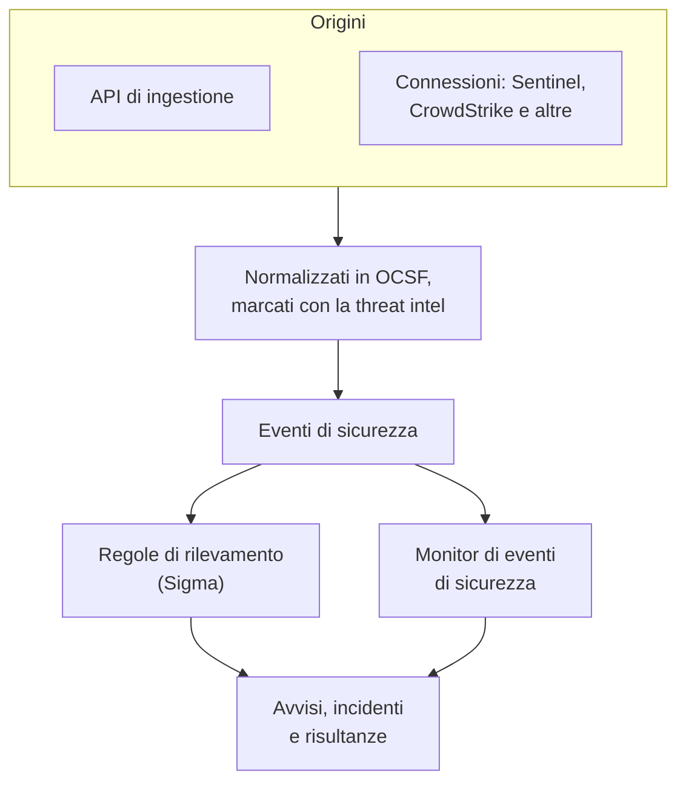
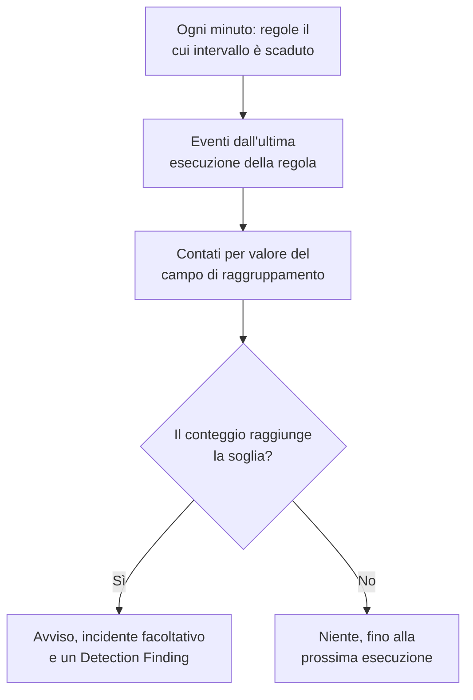

# Eventi di sicurezza (SIEM)

OneUptime conserva gli eventi di sicurezza accanto ai tuoi log, tracce e metriche, e dà a ciascuno la stessa forma, [OCSF](https://schema.ocsf.io/) (l'Open Cybersecurity Schema Framework), qualunque sia il formato in cui è arrivato. Invia eventi da qualsiasi origine, cercali e trasforma quelli importanti in avvisi con regole di rilevamento Sigma, threat intelligence e monitor.

:::cards
- [Inviare eventi](#inviare-eventi-di-sicurezza): Un POST HTTPS, un output di Fluent Bit o una connessione a un prodotto di sicurezza.
- [Cercare e correlare](#esplorare-gli-eventi-di-sicurezza): L'esploratore di eventi e il grafo di correlazione.
- [Regole di rilevamento](#regole-di-rilevamento): Regole Sigma che aprono avvisi.
- [Monitor](#monitor-di-eventi-di-sicurezza): Conteggi su una finestra mobile, con uno stato che si ripristina.
:::

## Come funziona



Apri **Prodotti → Security Events**, sotto **Osservabilità**. Le sue schede:

| Scheda | A cosa serve |
| --- | --- |
| **Eventi** | Cercare e filtrare ogni evento, e aprirne uno per vedere tutti i suoi campi |
| **Correla** | Un grafo degli eventi che condividono un host, un utente o un indirizzo IP |
| **Detection Rules** | Regole Sigma che girano secondo una pianificazione e aprono avvisi |
| **Threat Intel** | Feed STIX/TAXII di indicatori malevoli noti |
| **Monitor** | I monitor di eventi di sicurezza del progetto |
| **Connections** | Prodotti di sicurezza che OneUptime interroga per i nuovi record |
| **Guida alla configurazione** | Frammenti per inviare eventi, compilati con la tua chiave di ingestione |

## Prima di iniziare

I dati di sicurezza li leggono solo i ruoli Project Owner e Project Admin e i tre ruoli di sicurezza; gli altri ruoli non vedono nulla in Security Events. Vedi [Ruoli](/docs/permissions/reference#ruoli).

| Ruolo | Cosa può fare |
| --- | --- |
| Security Admin | Tutto: eventi, regole di rilevamento, feed di threat intel e connessioni |
| Security Member | Leggere eventi e threat intel, e creare, modificare ed eliminare regole di rilevamento e feed. Non può configurare connessioni né eliminare dati di sicurezza. |
| Security Viewer | Leggere eventi, regole, feed, indicatori e connessioni |

## Inviare eventi di sicurezza

:::steps
### Crea una chiave di ingestione

Apri **Impostazioni del progetto → Telemetria e APM → Chiavi di acquisizione** e fai clic su **Crea chiave di ingestione**. Gli eventi di sicurezza usano le stesse chiavi del resto della tua telemetria.

### Invia i tuoi eventi

Invia JSON a `/security-events/v1/ingest` con la chiave in `x-oneuptime-token`:

:::tabs
@tab OCSF
```bash
curl -X POST "https://oneuptime.com/security-events/v1/ingest?format=ocsf" \
  -H "Content-Type: application/json" \
  -H "x-oneuptime-token: YOUR_INGESTION_TOKEN" \
  -H "x-oneuptime-service-name: my-security-source" \
  -d '{ "events": [ { "class_uid": 3002, "severity_id": 4, "time": 1755770400000, "status": "Failure", "message": "Failed logon for alice", "actor": { "user": { "name": "alice" } }, "src_endpoint": { "ip": "203.0.113.7" } } ] }'
```
@tab Google UDM
```bash
curl -X POST "https://oneuptime.com/security-events/v1/ingest?format=udm" \
  -H "Content-Type: application/json" \
  -H "x-oneuptime-token: YOUR_INGESTION_TOKEN" \
  -d '{ "events": [ { "metadata": { "event_type": "USER_LOGIN", "event_timestamp": "2026-08-21T10:00:00Z" }, "principal": { "user": { "userid": "alice" }, "ip": ["203.0.113.7"] }, "security_result": [{ "severity": "HIGH", "action": ["BLOCK"] }] } ] }'
```
@tab Generic JSON
```bash
curl -X POST "https://oneuptime.com/security-events/v1/ingest" \
  -H "Content-Type: application/json" \
  -H "x-oneuptime-token: YOUR_INGESTION_TOKEN" \
  -d '{ "events": [ { "timestamp": "2026-08-21T10:00:00Z", "severity": "high", "event_type": "ssh_brute_force", "message": "12 failed SSH logins in 60s", "username": "root", "hostname": "web-01", "src_ip": "203.0.113.7" } ] }'
```
:::

L'endpoint risponde `200` appena gli eventi sono in coda.

### Trovali in Eventi

Apri **Prodotti → Security Events → Eventi**. Gli eventi compaiono in pochi secondi, con gravità, classe, utente, host e indirizzi IP compilati.
:::

### Formati

| `format` | Cosa legge | Accettato anche |
| --- | --- | --- |
| `ocsf` | JSON di eventi OCSF (`class_uid`, `severity_id` e così via) | Nessuno |
| `udm` | Eventi UDM di Google SecOps (Chronicle) (`metadata.event_type` e così via) | `chronicle`, `google-secops` |
| `google-secops-alert` | Rilevamenti e avvisi di Google SecOps: webhook SOAR e il flusso dei rilevamenti | `secops-alert`, `detection` |
| `generic` | Qualsiasi altro JSON, letto tramite nomi di campo comuni | Nessuno |

Indica il formato con `?format=`, con l'intestazione `x-oneuptime-security-event-format` o con un campo `"format"` di primo livello. Se lo ometti, il formato di ogni evento viene ricavato a parte, così un webhook può mescolare rilevamenti ed eventi grezzi.

- Il corpo può essere un evento, un array di eventi o `{ "events": [...] }`.
- L'intestazione `x-oneuptime-service-name` nomina il servizio di telemetria a cui appartengono gli eventi. Senza di essa, appartengono al servizio che prende il nome dal prodotto o dal fornitore del primo evento, oppure a `Security Events`.
- Nulla viene scartato perché non si è riusciti a mapparlo: ogni campo dell'origine arriva negli attributi dell'evento.

### Campi del JSON generico

Un evento generico viene letto tramite nomi di campo comuni:

| Campo dell'evento | Letto dal primo tra |
| --- | --- |
| `message` | `message`, `msg`, `summary`, `description`, `title` |
| `severityName` | `severity`, `severity_name`, `level`, `priority`, `risk_level` |
| `time` | `timestamp`, `time`, `@timestamp`, `event_time`, `created_at` |
| `principalUser` | `user`, `username`, `user_name`, `account`, `actor` |
| `principalHost` | `host`, `hostname`, `computer`, `device`, `machine` |
| `principalIp` | `source_ip`, `src_ip`, `client_ip`, `ip` |
| `targetIp` | `destination_ip`, `dest_ip`, `dst_ip`, `target_ip` |
| `className` | `event_type`, `category`, `type`, `action` |
| `ruleName` | `rule`, `rule_name`, `signature`, `detection` |
| `productName` | `product`, `product_name`, `source`, `log_source` |

Una parola di gravità diventa un livello OCSF: `info` si legge come Informational, `warning` come Low, `error` come Medium, `alert` come Critical ed `emergency` come Fatal.

### Inoltrare con Fluent Bit

Per inviare log di sicurezza che già raccogli, come quelli di auditd, syslog o Falco, aggiungi a Fluent Bit un output `http`:

```ini title="fluent-bit.conf"
[OUTPUT]
    Name             http
    Match            security.*
    Host             oneuptime.com
    Port             443
    tls              On
    URI              /security-events/v1/ingest
    Format           json
    Json_date_key    timestamp
    Json_date_format iso8601
    Header           x-oneuptime-token YOUR_INGESTION_TOKEN
    Header           x-oneuptime-service-name my-security-source
    Retry_Limit      5
```

La scheda **Guida alla configurazione** contiene questi frammenti con il tuo host e la tua chiave già compilati.

### Collegare un prodotto di sicurezza

**Connections** interroga per te un prodotto di sicurezza e ne importa i nuovi record come eventi di sicurezza. Una connessione contiene le impostazioni del prodotto e una credenziale cifrata; un worker la interroga all'intervallo che imposti e salta i record già importati.

| Prodotto | Importa | Guida alla configurazione |
| --- | --- | --- |
| Google SecOps (Chronicle) | Rilevamenti di regole, rilevamenti curati e avvisi, come Detection Findings | [Google SecOps](/docs/integrations/google-secops) |
| Microsoft Sentinel | Incidenti, come Incident Findings | [Microsoft Sentinel](/docs/integrations/microsoft-sentinel) |
| Microsoft Defender XDR | Avvisi, come Detection Findings | [Microsoft Defender XDR](/docs/integrations/microsoft-defender-xdr) |
| CrowdStrike Falcon | Avvisi, come Detection Findings | [CrowdStrike Falcon](/docs/integrations/crowdstrike-falcon) |
| Splunk Enterprise Security | Notable event, o qualsiasi ricerca, come Detection Findings | [Splunk Enterprise Security](/docs/integrations/splunk) |
| Elastic Security | Avvisi di rilevamento, come Detection Findings | [Elastic Security](/docs/integrations/elastic-security) |
| AWS Security Hub | Finding, come Detection e Compliance Findings | [AWS Security Hub](/docs/integrations/aws-security-hub) |
| Okta System Log | Eventi di accesso, MFA, account e criteri | [Okta System Log](/docs/integrations/okta) |

- Una connessione legge i record in base al momento in cui il prodotto li ha creati, non al momento dell'attività che descrivono. Una regola SIEM che gira ogni ora crea rilevamenti molto dopo gli eventi corrispondenti, e vengono comunque importati.
- La prima interrogazione guarda indietro di 24 ore, così una nuova connessione mostra subito i record recenti.
- **Testa la connessione**, nella riga della connessione, verifica l'accesso al prodotto e che i worker di OneUptime siano in funzione, senza importare nulla. **Run now** interroga subito.

## Cosa contiene un evento

Ogni evento viene salvato con campi tipizzati e il suo payload di origine:

| Gruppo | Campi |
| --- | --- |
| Classificazione | `categoryName`, `className`, `activityName`, `statusName`, con i loro ID OCSF (`categoryUid`, `classUid`) |
| Gravità | `severityName`, uno tra Unknown, Informational, Low, Medium, High, Critical, Fatal o Other, e `severityId` |
| Chi l'ha fatto | `principalUser`, `principalHost`, `principalIp`, `principalProcess` |
| Cosa ha toccato | `targetUser`, `targetHost`, `targetIp`, `targetPort`, `targetResource` |
| Origine | `productName`, `vendorName`, `ruleId`, `ruleName`, `eventUid` |
| Contenuto | `message`, `mitreTactics`, `mitreTechniques` e `observables`: ogni utente, host, indirizzo IP, dominio e hash estratto dall'evento |
| Attributi | L'intero payload di origine, appiattito in chiavi con punti |

## Esplorare gli eventi di sicurezza

**Eventi** è un esploratore di telemetria come quelli di log e tracce: un grafico degli eventi della finestra per gravità, una barra laterale di facet, l'elenco e un pannello con ogni campo e attributo dell'evento che apri. La finestra, i filtri e la ricerca stanno tutti nell'URL, così una vista filtrata si può condividere e sopravvive a un ricaricamento.

### Ricerca

La barra di ricerca parla la stessa lingua degli altri esploratori di telemetria (vedi [Sintassi di ricerca](/docs/telemetry/search-syntax)):

| Sintassi | Significa | Esempio |
| --- | --- | --- |
| testo libero | Il messaggio lo contiene | `failed logon` |
| `"quoted phrase"` | Tenere unite le parole | `"brute force"` |
| `<field>:<value>` | Un campo tipizzato | `severity:Critical` |
| `@<attribute>:<value>` | Un attributo di origine | `@threat.matched:true` |
| `-<filter>` | Non questo | `-severity:Informational` |
| `<field>:(a OR b)` | Uno qualsiasi di questi valori | `severity:(High OR Critical)` |
| `<field>:a*` | `*` è qualsiasi testo, `?` un carattere | `host:web-*` |
| `@<attribute>:*` | L'attributo è presente | `@threat.indicator_id:*` |
| `@<attribute>:~text` | L'attributo contiene il testo | `@finding_info.title:~ransom` |

Un campo è un nome breve (`severity`, `class`, `category`, `activity`, `status`, `vendor`, `product`, `rule`, `user`, `host`, `ip`, `targetuser`, `targethost`, `targetip`, `observable`, `tactic`, `technique`) oppure il nome proprio del campo, come `severityName` o `principalHost`. Qualsiasi altro nome viene letto come attributo di origine. `observable:<value>` trova ogni evento che menziona un valore, da qualunque lato dell'attività si trovasse.

### Facet

La barra laterale conta gli eventi della finestra per **Origine**, **Gravità**, **Classe di eventi**, **Category**, **Attività**, **Stato**, **Fornitore**, **Prodotto**, **Detection Rule**, **Utente di origine** e **Host di origine**. Fai clic su un valore per tenere solo i suoi eventi, o sul segno meno accanto per escluderli. Il grafico e ogni conteggio descrivono esattamente gli eventi dell'elenco.

### Correla

**Correla** disegna gli eventi intorno a un host, un utente o un indirizzo IP: le loro classi di eventi intorno a ciò che hai cercato, marcate con la gravità peggiore, e gli altri valori visti negli stessi eventi sull'anello esterno. Fai clic su una classe per elencarne gli eventi, o su un valore per correlare su di esso. Ogni observable nel pannello di un evento in **Eventi** apre **Correla** su di esso.

## Regole di rilevamento

Una regola di rilevamento è una regola [Sigma](https://sigmahq.io/), un formato YAML aperto per descrivere attività sospette, che OneUptime esegue secondo una pianificazione sui tuoi eventi. Quando corrisponde, apre un avviso, facoltativamente un incidente, e scrive un Detection Finding negli eventi.



### Creare una regola

:::steps
1. Apri **Prodotti → Security Events → Detection Rules** e fai clic su **Crea: Detection Rule**.
2. In **Informazioni di base**, compila il **Nome** e lascia attivo **Abilitato**.
3. In **Sigma Rule**, incolla lo YAML della regola in **Sigma Rule (YAML)**. Viene analizzato al salvataggio, così un errore compare nel modulo.
4. In **Valutazione**, imposta ogni quanto gira e quante corrispondenze le servono; vedi [Impostazioni di valutazione](#impostazioni-di-valutazione).
5. In **In caso di corrispondenza**, scegli cosa fa una corrispondenza: **Create Alert on Match** (attivo), **Create Incident on Match** (disattivato) e **Write Detection Finding on Match** (attivo), con una **Gravità avviso** e una **Gravità incidente** facoltative.
:::

Una prima regola, che corrisponde agli accessi falliti da fuori `10.x.x.x`:

```yaml title="failed-logon-burst.yml"
title: Failed logon burst
description: Repeated authentication failures from one source.
level: high
tags:
  - attack.t1110
  - attack.ta0006
detection:
  selection:
    className: Authentication
    statusName: Failure
  filter_internal:
    principalIp|startswith: '10.'
  condition: selection and not filter_internal
```

### Cosa può esprimere una regola

OneUptime esegue il nucleo booleano di Sigma:

- Le selezioni sono mappe di campi (ogni campo deve corrispondere; una lista di valori corrisponde a uno qualsiasi) o liste di parole chiave, che corrispondono in qualsiasi punto del messaggio.
- Le condizioni combinano le selezioni con `and`, `or`, `not` e parentesi, oppure con `1 of selection_*`, `all of selection_*`, `any of them` e `all of them`.
- Modificatori di campo: `contains`, `startswith`, `endswith`, `all`, `re`, `cased`, `gt`, `gte`, `lt`, `lte`, `cidr`, `exists` e `windash`. Il testo si confronta senza distinguere maiuscole e minuscole, a meno che tu non aggiunga `cased`.
- Un campo è un campo tipizzato (`principalUser`), una grafia Sigma comune di uno di essi (`CommandLine`, `src_ip`, `Hostname`) o qualsiasi chiave di attributo, scritta come nell'evento (`threat.matched`).
- `level` imposta la gravità: `informational`, `low`, `medium`, `high` o `critical`, e `medium` se manca. Gli ID ATT&CK in `tags` (`attack.t1110`, `attack.ta0006`) compilano i campi MITRE della risultanza.

Le aggregazioni come `| count() by principalIp > 5` vengono rifiutate al salvataggio: usa invece **Group By Field** e **Match Count Threshold**. `logsource` è solo informativo e non restringe nulla: metti quel filtro in una selezione, come `className: Authentication`. Un `timeframe` viene ignorato, perché la finestra la fissa l'intervallo della regola.

### Impostazioni di valutazione

| Campo | Cosa fa |
| --- | --- |
| **Evaluation Interval (Minutes)** | Ogni quanto gira la regola: minuti interi, da 1 a 1440. Il modulo di una nuova regola parte da 5. |
| **Group By Field** | Facoltativo. Le corrispondenze che condividono il valore di questo campo, come `principalHost`, vengono contate, avvisate e deduplicate insieme: un avviso per host invece di centinaia. |
| **Distinct Count Field** | Facoltativo. Conta i valori diversi di questo campo invece degli eventi corrispondenti. I valori vuoti non contano. |
| **Match Count Threshold** | Un gruppo scatta solo quando il suo conteggio raggiunge questo numero in un'esecuzione: da 1 a 1000000, e 1 scatta a qualsiasi corrispondenza. |

Il raggruppamento e il conteggio distinto accettano gli stessi nomi di campo della regola. Con essi, la soglia dice «tanti, dalla stessa cosa, in un'esecuzione», senza un monitor sopra:

| Obiettivo | Group By Field | Distinct Count Field | Soglia |
| --- | --- | --- | --- |
| Avvisare a qualsiasi corrispondenza | Vuoto | Vuoto | 1 |
| Un avviso per host | `principalHost` | Vuoto | 1 |
| Forza bruta: 5 accessi falliti da un IP | `principalIp` | Vuoto | 5 |
| Password spraying: un IP che fallisce su 5 account diversi | `principalIp` | `principalUser` | 5 |
| Scansione di porte: un IP che raggiunge 20 porte diverse | `principalIp` | `targetPort` | 20 |

### Quando gira una regola

OneUptime controlla ogni minuto quali regole abilitate hanno superato il loro intervallo dall'ultima esecuzione. Ogni esecuzione legge gli eventi il cui orario dell'evento cade tra l'esecuzione precedente e adesso, poi va avanti:

- Le finestre sono una dopo l'altra, non scorrono. Con un intervallo di 10 minuti, errori alle 09:58 e alle 10:01 possono cadere in esecuzioni diverse e vengono contati separatamente, quindi lascia margine quando scegli una soglia.
- Dopo un'interruzione, come un worker fermo o una regola riattivata, l'esecuzione successiva copre l'intera interruzione, fino alle ultime 24 ore.
- Un evento che arriva in ritardo, con un orario precedente all'ultima esecuzione della regola, viene salvato ed è ricercabile, ma quella regola non lo legge mai.
- Al massimo 100 gruppi scattano per esecuzione: quelli con i conteggi più alti.

### Gravità

Il `level` di una regola è la gravità delle sue risultanze: `informational`, `low`, `medium`, `high` e `critical` diventano Informational, Low, Medium, High e Critical. I suoi avvisi e incidenti prendono una delle gravità del tuo progetto, in quest'ordine:

1. La **Gravità avviso** (o **Gravità incidente**) della regola, se impostata.
2. La tua gravità che prende il nome dal livello, come High, a prescindere da maiuscole e minuscole.
3. Per rango: le regole `critical` e `high` prendono la tua gravità più alta, le altre la più bassa.

> [!TIP]
> Dai alle tue gravità di avviso i nomi dei livelli Sigma (Critical, High, Medium, Low, Informational), e ogni regola finisce su quella giusta senza un'impostazione per regola.

### Avvisi e risultanze

Ogni gruppo che scatta apre un avviso intitolato `[Detection] <rule name> — <group value>`, oppure `[Detection] <rule name>` per una regola senza campo di raggruppamento. Finché è aperto, altre corrispondenze di quel gruppo non ne aprono un altro. Una regola vede solo corrispondenze e non può capire che un attacco è finito, quindi i suoi avvisi restano aperti finché qualcuno non li risolve.

Un Detection Finding è un evento di sicurezza di classe `Detection Finding` (classe OCSF 2004) del prodotto `OneUptime Detections`, con i tag MITRE della regola, il valore del gruppo per primo in `observables` e questi attributi:

| Attributo | Valore |
| --- | --- |
| `oneuptime.detection.rule_id` | L'ID della regola che è scattata |
| `oneuptime.detection.rule_name` | Il nome della regola |
| `oneuptime.detection.match_count` | Quanti eventi ci sono dietro la risultanza |
| `oneuptime.detection.distinct_count` | Quanti valori diversi ci sono dietro, per una regola con conteggio distinto |
| `oneuptime.detection.group_value` | Il valore del gruppo, per una regola con campo di raggruppamento |
| `oneuptime.detection.sigma_id` | L'`id` proprio della regola Sigma |

Le risultanze sono eventi normali: cercale in **Eventi** e fai pivot su di esse in **Correla**. Per provare una nuova regola in silenzio, disattiva ogni azione tranne la risultanza finché non ti fidi di lei.

## Monitor di eventi di sicurezza

Un monitor di eventi di sicurezza conta gli eventi che corrispondono ai suoi filtri su una finestra mobile e applica al conteggio i soliti criteri dei monitor: cambia lo stato del monitor, apre avvisi o incidenti e chiama la reperibilità. Creane uno in **Monitor → Crea monitor**, con **Security Events** come tipo; **Security Events → Monitor** li elenca tutti.

Il suo modulo mostra **Monitor events that include this text**, **Monitor Security Events for (time)**, **Event Severity** e **Classe di eventi**. **Filtra per servizio di telemetria** e **Filtra per attributi** aspettano in **Altri campi**, la cui intestazione mostra quelli che un monitor usa. I suoi criteri controllano **Security Event Count**.

| | Regola di rilevamento | Monitor di eventi di sicurezza |
| --- | --- | --- |
| Corrisponde a | Una regola Sigma | Filtri su gravità, classe, messaggio, servizio e attributi |
| Finestra | Una dopo l'altra, una per esecuzione | Mobile: dagli ultimi 5 secondi alle ultime 24 ore |
| Conta per gruppo | Sì, con **Group By Field** | No: un unico conteggio per tutto ciò che corrisponde |
| Apre | Avvisi, incidenti e risultanze | Uno stato, avvisi e incidenti |
| Si ripristina | No: gli avvisi restano aperti finché non vengono risolti | Sì: lo stato torna quando torna il conteggio |

Scrivi il rilevamento vero e proprio come regola, con la sua soglia. Usa un monitor quando vuoi una finestra mobile, uno stato che si ripristina da solo, una pagina di stato o politiche di reperibilità diverse per criterio.

### Sorveglia i tuoi rilevamenti

Le risultanze sono eventi, quindi un monitor può sorvegliare le regole stesse:

- Tempeste: un monitor sulla classe `Detection Finding`, che conta ogni risultanza. Venti regole diverse che scattano in un'ora sono un segnale che nessuna regola da sola può vedere.
- Cambi di ritmo: filtra sul `oneuptime.detection.rule_id` di una regola. Una regola che scatta ogni settimana e all'improvviso cinquanta volte l'ora richiede un'altra risposta.
- Silenzio: risultanze che scendono a zero, quando di solito ne vedi alcune, di solito significano che un'origine ha smesso di inviare. Usa un criterio che controlla un conteggio sotto un numero.

L'azione **Crea monitor** nella riga di una regola apre un nuovo monitor già configurato così: la classe `Detection Finding`, l'ID della regola (mai il suo nome, che una ridenominazione cambierebbe) e l'ultima ora. Un monitor così conta le risultanze, una per gruppo per esecuzione, non gli eventi che ci sono dietro. Per richiedere un numero di eventi prima che scatti qualcosa, usa la **Match Count Threshold** della regola.

## Intelligence sulle minacce

**Threat Intel** si abbona a feed STIX/TAXII di indirizzi IP, domini, URL, indirizzi email e hash di file malevoli noti. Gli eventi che ne menzionano uno vengono marcati all'arrivo con attributi `threat.*`, su cui regole e monitor possono filtrare, e ogni minuto gli eventi recenti vengono confrontati con i feed, aprendo avvisi e risultanze come fa una regola. Vedi [Intelligence sulle minacce](/docs/telemetry/threat-intelligence).

## Conservazione e fatturazione

Gli eventi di sicurezza vengono fatturati per GB acquisito, come il resto della tua telemetria, e conservati secondo la tua conservazione della telemetria: la **Conservazione predefinita (giorni)** del progetto, in **Impostazioni del progetto → Telemetria e APM → Conservazione dei dati**, oppure una conservazione impostata sul servizio di telemetria a cui appartengono. Quando la conservazione di un evento termina, l'evento viene eliminato.

## Risoluzione dei problemi

:::details Gli eventi non compaiono
Controlla la chiave in `x-oneuptime-token` e il percorso, `/security-events/v1/ingest`. Poi controlla la finestra in **Eventi**, l'ultimo giorno a meno che tu non la cambi: un evento viene collocato al suo orario, quindi uno con un timestamp più vecchio ne resta fuori.
:::

:::details Una regola non corrisponde mai
Controlla che sia **Abilitato**, e leggi **Last Evaluated** e **Last Error** nella sua riga. Apri un evento che ti aspettavi corrispondesse e confrontalo con la regola, campo per campo: un valore semplice deve essere uguale all'intero campo, quindi usa `contains` o `*` per una parte. Un attributo si nomina come nell'evento (`threat.matched`, non `attributes.threat.matched`). Con una soglia maggiore di 1, le corrispondenze devono cadere in una sola esecuzione.
:::

:::details Una regola ha corrisposto, ma non si è aperto nessun avviso
**Create Alert on Match** è disattivato, oppure è ancora aperto un avviso per la stessa regola e lo stesso valore di gruppo, e le corrispondenze successive confluiscono in esso. Un progetto ha bisogno di almeno una gravità di avviso perché le regole aprano avvisi.
:::

:::details Una regola apre troppi avvisi
Ogni valore del **Group By Field** riceve il proprio avviso: raggruppa per qualcosa di più ampio, alza la soglia o aggiungi un conteggio distinto. Se ti interessa il ritmo più di ogni corrispondenza, disattiva **Create Alert on Match** e metti un monitor sulle risultanze della regola.
:::

## Passaggi successivi

:::cards
- [Intelligence sulle minacce](/docs/telemetry/threat-intelligence): Confronta i tuoi eventi con feed STIX/TAXII.
- [Google SecOps](/docs/integrations/google-secops): Porta dentro i rilevamenti e gli eventi di Chronicle.
- [Sintassi di ricerca](/docs/telemetry/search-syntax): Tutto ciò che capisce la barra di ricerca.
- [Riferimento dei permessi](/docs/permissions/reference): I ruoli di sicurezza, e cosa può fare ciascuno.
:::
