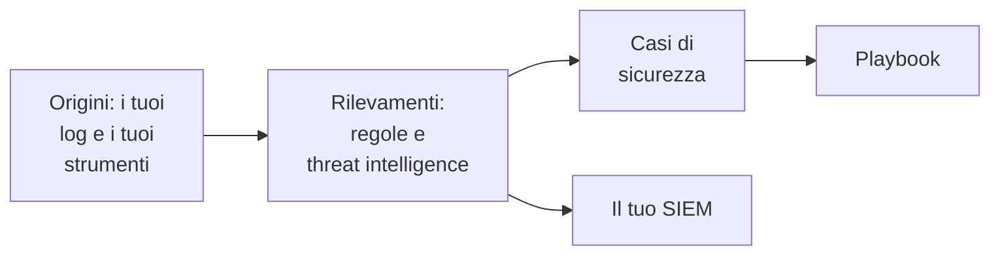

# Primi passi con la sicurezza

OneUptime trova le minacce nei dati che hai già - i tuoi log, gli strumenti di sicurezza che usi e tutto ciò che gli invii -, raggruppa ciò che trova in casi e risponde con i playbook. Bastano due clic per configurarlo, e non c'è niente da installare.

:::cards
- [Configurarlo](#configurarlo): Attiva ciò che serve alla maggior parte dei team, poi guarda un attacco di prova aprire un caso.
- [Come funziona](#come-funziona): Origini, rilevamenti, casi e playbook, e cosa fa ciascuno.
- [I tuoi log](#trovare-eventi-di-sicurezza-nei-tuoi-log): Gli eventi di sicurezza già presenti nei log che invii a OneUptime.
- [Il tuo SIEM](#inviare-al-tuo-siem-ciò-che-oneuptime-trova): Invia a Google SecOps ciò che OneUptime trova.
:::

## Prima di iniziare

Configurare la sicurezza richiede il ruolo Project Owner, Project Admin o Security Admin. I ruoli Security Member e Security Viewer leggono ciò che viene trovato; vedi [Ruoli](/docs/permissions/reference#ruoli).

## Configurarlo

:::steps
### Attivare ciò che serve alla maggior parte dei team

Apri **Prodotti → Security Events**. In **Panoramica**, fai clic su **Attiva quanto consigliato**. Si attivano tre cose in una volta: **Trova eventi di sicurezza nei tuoi log**, le regole di rilevamento consigliate e **Arricchisci i nuovi casi**, un playbook che confronta ogni nuovo caso con la threat intelligence e vi lascia una checklist per lo smistamento.

### Inviare un attacco di prova

Fai clic su **Invia un attacco di prova**. Una dozzina di accessi falliti da un indirizzo di documentazione attraversa l'elaborazione reale: vengono memorizzati, la regola di forza bruta li rileva e si apre un caso. Nessuno viene allertato e nessun SIEM li riceve.

### Aprire il caso

Fai clic su **Apri il caso**. Ecco come appare un vero risultato: gli eventi che lo motivano, l'indirizzo a cui si riferisce e ciò che **Arricchisci i nuovi casi** ha trovato. Chiudilo come test quando hai finito.
:::

Da quel momento, **Panoramica** si apre su ciò che richiede qualcuno, sotto **Richiede attenzione**: i tuoi casi aperti, quelli che nessuno ha preso in carico e i passaggi dei playbook in attesa di approvazione. Quando non ce ne sono, mostra **Tutto tranquillo**.

## Come funziona

| Parte | Dove | Cosa fa |
| --- | --- | --- |
| **Fonti** | **Connessioni** | I tuoi log, i prodotti di sicurezza che OneUptime interroga e tutto ciò che invii |
| **Rilevamenti** | **Rilevamenti** | Regole Sigma e feed di threat intelligence che cercano minacce in ogni evento |
| **Casi di sicurezza** | **Casi di sicurezza** | Ciò che è stato trovato, raggruppato per l'utente, l'host o l'indirizzo a cui si riferisce |
| **Playbook** | **Playbook** | Passaggi che vengono eseguiti sui nuovi casi: arricchirli, avvisare, aprire un incidente o contenere |

In cima a **Panoramica**, sotto ciò che richiede qualcuno, ogni parte mostra i suoi numeri: le origini e i loro eventi delle ultime 24 ore, le regole attive, i casi aperti e i playbook che rispondono. Una parte non configurata lo dice e apre la pagina in cui configurarla.

## Trovare eventi di sicurezza nei tuoi log

La scheda **I tuoi log**, in cima a **Connessioni**, non richiede installazioni. Con **Trova eventi di sicurezza nei tuoi log** attivo, OneUptime legge ogni minuto i nuovi log del progetto e trasforma in eventi di sicurezza le righe che riconosce:

| Log | Cosa diventa un evento di sicurezza |
| --- | --- |
| Accessi SSH | Accessi SSH falliti e riusciti dal log di autenticazione, dal journal o dal syslog di un server |
| sudo | Comandi eseguiti come un altro utente, password di sudo errate e persone che non possono usare sudo |
| Eventi Windows | Accessi, nuovi processi, account e gruppi modificati, servizi installati e log cancellati, da Windows, Sysmon e Microsoft Defender |
| AWS CloudTrail | Accessi alla console, modifiche nei tuoi account AWS e chiamate che AWS ha rifiutato |
| Log di audit di Google Cloud | Modifiche nei tuoi progetti Google Cloud, chiamate che Google ha rifiutato e accessi a Google Workspace condivisi con Google Cloud |
| Log di attività di Azure e di Entra ID | Modifiche nelle tue sottoscrizioni Azure, avvisi di Defender for Cloud, e accessi e modifiche alla directory di Microsoft Entra ID |
| CEF | Minacce, connessioni bloccate e accessi da firewall, IDS, WAF e altri prodotti di sicurezza che inviano Common Event Format |
| LEEF | Lo stesso dai prodotti che inviano Log Event Extended Format, come molti fanno per IBM QRadar |
| Log di audit di Kubernetes | Modifiche al cluster, shell aperte nei pod, secret letti e richieste rifiutate |
| Attacchi web | Richieste nel log di accesso di un server web che tentano SQL injection, path traversal o Log4Shell |

I tuoi log restano come sono. Solo le righe che contano per la sicurezza diventano eventi: mai ogni pagina servita da un server web, né ogni lettura di un'API.

## Inviare al tuo SIEM ciò che OneUptime trova

Se il tuo team lavora già in un SIEM, OneUptime invia lì anche ciò che trova. In **Connessioni → Invia al tuo SIEM**, fai clic su **Aggiungi destinazione**, inserisci la regione, l'istanza e la chiave dell'account di servizio del tuo Google SecOps e fai clic su **Invia un evento di prova** prima di salvare. Vedi [Inviare eventi di sicurezza a Google SecOps](/docs/integrations/google-secops#inviare-eventi-di-sicurezza-a-google-secops).

## Risoluzione dei problemi

:::details Turn on recommended è disattivato
Il tuo ruolo non può aggiungere regole di rilevamento, playbook o l'origine dei log. Chiedi a un Project Owner, a un Project Admin o a un Security Admin, oppure fatti assegnare da loro il ruolo Security Admin.
:::

:::details Turn on recommended non è riuscito ad attivare tutto
La scheda indica ogni elemento che non è riuscita ad attivare, e il motivo: il tuo ruolo, il tuo piano o un errore da parte di OneUptime. Tutto il resto è attivo. Correggi ciò che indica, poi fai clic su **Riprova**: attiva solo ciò che manca ancora e non aggiunge nulla due volte.
:::

:::details L'attacco di prova non ha aperto alcun caso
Di solito il caso si apre prima che il pulsante risponda; quando la regola è ancora in ritardo, lo dice e il caso si apre entro un minuto. Controlla di nuovo **Casi di sicurezza** e verifica in **Rilevamenti** che la regola di forza bruta sia attiva.
:::

:::details Dai miei log non arriva alcun evento di sicurezza
Verifica che **Trova eventi di sicurezza nei tuoi log** sia attivo e che la scheda **I tuoi log** indichi quando è avvenuto l'ultimo controllo. Solo i tipi di righe della tabella qui sopra diventano eventi: un server che non invia log SSH, sudo, Windows, di audit, CEF, LEEF o di accesso non ha niente da trovare. Incolla una delle sue righe in **Verifica una riga di log**, su **I tuoi log**, per vedere se OneUptime la legge.
:::

:::details Panoramica dice che l'ultimo evento di sicurezza è arrivato giorni fa
Da allora a Security non è arrivato niente. Apri **Connessioni** e verifica che **I tuoi log** e ogni connessione siano ancora attivi, e quando ognuno ha controllato l'ultima volta.
:::

:::details La scheda che attiva Security è sparita
Qualcuno l'ha tolta con **Chiudi**. Finché ancora nulla viene sorvegliato in cerca di minacce, **Panoramica** offre **Configura Security**, che la riporta.
:::

## Passaggi successivi

:::cards
- [Eventi di sicurezza (SIEM)](/docs/telemetry/security-events): Inviare eventi, cercarli e scrivere regole di rilevamento.
- [Casi di sicurezza e playbook (SOAR)](/docs/telemetry/security-cases): Gestire i casi e rispondere con i playbook.
- [Intelligence sulle minacce (STIX/TAXII)](/docs/telemetry/threat-intelligence): Confrontare i tuoi eventi con indicatori malevoli noti.
- [Google SecOps](/docs/integrations/google-secops): Importare i rilevamenti di Google SecOps e inviargli ciò che OneUptime trova.
:::
