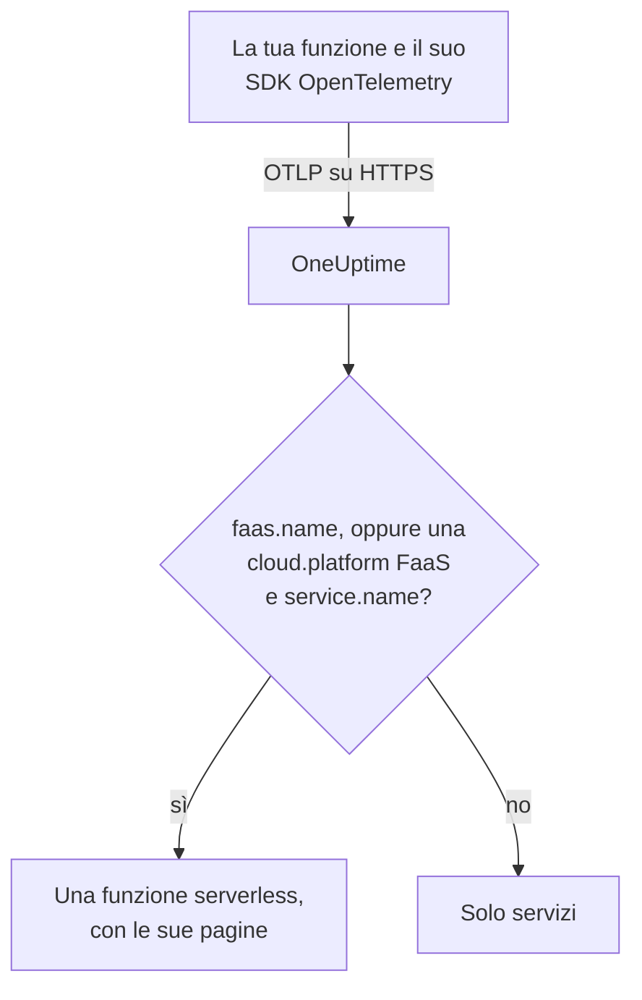

# Funzioni serverless

OneUptime riconosce una funzione serverless nel momento in cui riceve da essa dati OpenTelemetry, e la elenca in **Funzioni serverless** con le sue tracce, i suoi log e le sue metriche. Funziona per AWS Lambda, Google Cloud Functions, Azure Functions, Cloudflare Workers e qualsiasi altro runtime FaaS in grado di inviare OpenTelemetry. Non c'è nulla da creare a mano: strumenta la funzione con l'SDK OpenTelemetry del suo runtime e punta il suo exporter OTLP verso OneUptime.

:::cards
- [Come OneUptime identifica una funzione](#come-oneuptime-identifica-una-funzione): `faas.name`, oppure una `cloud.platform` FaaS con un `service.name`.
- [Inviare la telemetria di una funzione](#inviare-la-telemetria-di-una-funzione): Le impostazioni dell'exporter e il layer Lambda.
- [Azure Functions](#azure-functions): Una funzione per Function App, dall'host di Functions.
- [Risoluzione dei problemi](#risoluzione-dei-problemi): Una funzione che non compare, o le cui pagine sono vuote.
:::

## Come funziona

OneUptime legge gli attributi di risorsa di ogni batch man mano che arriva. Una risorsa con un `faas.name`, oppure con una `cloud.platform` FaaS come `aws_lambda` o `azure_functions` insieme a un `service.name`, è una funzione serverless: OneUptime la crea con i suoi primi dati e archivia la telemetria sotto di essa.



## Prima di iniziare

- Una chiave di acquisizione. Creane una in **Impostazioni del progetto → Telemetria e APM → Chiavi di acquisizione** e copiane il valore.
- L'SDK OpenTelemetry, o un layer di strumentazione automatica, per il linguaggio della tua funzione.

## Come OneUptime identifica una funzione

OneUptime identifica ogni funzione tramite l'attributo di risorsa `faas.name`. I rilevatori di risorse di alcune piattaforme non lo impostano mai ([Azure Functions](#azure-functions) è il caso comune), quindi quando una risorsa non ha un `faas.name` ma la sua `cloud.platform` è una piattaforma FaaS, OneUptime usa invece il suo `service.name` come identità della funzione, e scrive quel valore come `faas.name` su ogni span, log, metrica e profilo che memorizza, così che le pagine della funzione trovino tutta la sua telemetria:

| Attributo | Obbligatorio | Scopo |
| --- | --- | --- |
| `faas.name` | **sì**, a meno che non siano impostati i due successivi | Identità della funzione (ad esempio `checkout-handler`) |
| `cloud.platform` | con `service.name`, quando non c'è `faas.name` | `aws_lambda`, `gcp_cloud_functions`, `azure_functions`, `tencent_cloud_scf` o `alibaba_cloud_fc` |
| `service.name` | su una `cloud.platform` FaaS senza `faas.name` | Identità della funzione, scritta sulla telemetria come `faas.name` |
| `faas.version` | no | Mostrato nella panoramica |
| `faas.instance` | no | Tracciato per istanza nella pagina **Istanze** |
| `cloud.provider` / `cloud.region` / `cloud.account.id` | no | Mostrato nella panoramica |
| `process.runtime.name` / `process.runtime.version` | no | Mostrato come runtime nella panoramica |

Un `faas.name` che imposti non viene mai sostituito. Il valore di `cloud.platform` deve essere scritto come nell'elenco (è accettato anche `azure.functions` con il punto, che inviano alcuni rilevatori Azure), e `service.name` deve essere un attributo di risorsa: l'header `x-oneuptime-service-name` dà il nome a un servizio, non a una funzione.

> [!NOTE]
> Una funzione che imposta anche `service.name` compare comunque anche in **Servizi**. **Funzioni serverless** è la vista pensata per le funzioni, delimitata da `faas.name`.

## Inviare la telemetria di una funzione

:::steps
### Imposta le variabili d'ambiente dell'exporter OTLP

La maggior parte delle strumentazioni automatiche dei linguaggi legge le variabili d'ambiente standard di OpenTelemetry:

```bash
OTEL_EXPORTER_OTLP_ENDPOINT="https://oneuptime.com/otlp"
OTEL_EXPORTER_OTLP_HEADERS="x-oneuptime-token=YOUR_TELEMETRY_INGESTION_TOKEN"
OTEL_RESOURCE_ATTRIBUTES="faas.name=checkout-handler,faas.version=1.4.2"
```

Se ospiti OneUptime in proprio, sostituisci l'endpoint con `https://YOUR-ONEUPTIME-HOST/otlp`. Su Azure Functions, lascia `faas.name` fuori da `OTEL_RESOURCE_ATTRIBUTES`: vedi [Azure Functions](#azure-functions).

> [!WARNING]
> La chiave di acquisizione è un segreto. Usa una chiave di acquisizione di tipo **Server**, impostata come variabile d'ambiente della funzione. Una chiave che raggiunge un browser può essere letta da chiunque guardi il sorgente della pagina.

### Aggiungi il layer Lambda di OpenTelemetry (AWS Lambda)

Su AWS Lambda, la strada più semplice è il [layer Lambda di OpenTelemetry](https://opentelemetry.io/docs/faas/lambda-auto/). Collega il layer per il runtime della tua funzione e imposta:

```bash
AWS_LAMBDA_EXEC_WRAPPER=/opt/otel-handler
OTEL_EXPORTER_OTLP_ENDPOINT=https://oneuptime.com/otlp
OTEL_EXPORTER_OTLP_HEADERS=x-oneuptime-token=YOUR_TELEMETRY_INGESTION_TOKEN
```

Il layer imposta `faas.name` dal nome della funzione, e il suo rilevatore di risorse compila `cloud.platform`, `cloud.region` e `cloud.account.id`. Su un'altra piattaforma, salta questo passaggio.

### Invoca la funzione e verifica che arrivi

Verifica che OneUptime accetti la chiave:

```bash
curl -i https://oneuptime.com/otlp/v1/validate \
  -H "x-oneuptime-token: YOUR_TELEMETRY_INGESTION_TOKEN"
```

`200` con `"valid": true` significa che OneUptime accetta la chiave; `401` significa che è sconosciuta, revocata, disattivata o scaduta. Poi invoca la funzione. Appena invia uno span, un log o una metrica, compare in **Prodotti → Infrastruttura → Serverless → Tutte le funzioni**.
:::

## Azure Functions

L'host di Azure Functions può inviare OpenTelemetry da solo, quindi una Function App riporta le sue invocazioni (tracce, log e metriche) senza modifiche al codice, in qualunque linguaggio sia scritta. La guida di Microsoft è [Use OpenTelemetry with Azure Functions](https://learn.microsoft.com/en-us/azure/azure-functions/opentelemetry-howto).

### Come compare una Function App

I rilevatori di risorse di Azure (quello dell'host di Functions stesso, quello del worker isolato .NET in `Microsoft.Azure.Functions.Worker.OpenTelemetry` e quello per Node.js in `@opentelemetry/resource-detector-azure`) descrivono la **Function App**, non una singola funzione, e nessuno di essi imposta `faas.name`:

| Attributo | Valore |
| --- | --- |
| `service.name` | Il nome della Function App, da `WEBSITE_SITE_NAME` |
| `cloud.provider` | `azure` |
| `cloud.platform` | `azure_functions`; il rilevatore Node.js scrive `azure.functions`, che OneUptime riscrive |
| `cloud.region` | La regione dell'app, da `REGION_NAME` |
| `cloud.resource_id` | `/subscriptions/<subscription>/resourceGroups/<group>/providers/Microsoft.Web/sites/<app>` |
| `faas.instance` | L'istanza, da `WEBSITE_INSTANCE_ID`: solo il rilevatore Node.js |

Quindi OneUptime identifica la funzione tramite `service.name`, compila `faas.name` con il nome della Function App e mostra **una funzione serverless per Function App**. La risorsa descrive l'app, non una delle sue funzioni: ogni istanza riporta gli stessi attributi a livello di app, qualunque funzione dell'app esegua, e nel piano Flex Consumption alcune funzioni scalano persino su istanze proprie. Le singole funzioni si trovano nella telemetria stessa:

- L'host avvia uno span per ogni invocazione, con il nome della funzione che ha eseguito: cerca quel nome nella pagina **Tracce** della funzione.
- L'host registra `faas.invoke_duration`, un istogramma in secondi, con il nome della funzione nell'attributo di data point `faas.name`: raggruppa la metrica in base a esso nella pagina **Metriche** o in una dashboard per la latenza di ogni funzione.

Non aggiungere `faas.name` a `OTEL_RESOURCE_ATTRIBUTES` su una Function App, come fa l'esempio generico del [primo passaggio](#imposta-le-variabili-dambiente-dellexporter-otlp). Le impostazioni dell'applicazione raggiungono ogni processo dell'app, quindi la telemetria di tutte le sue funzioni porterebbe quell'unico nome, e OneUptime non sostituisce mai un `faas.name` che riceve. La guida di Microsoft dice lo stesso: non mettere sulla risorsa valori specifici di una funzione. Lascialo non impostato, e la funzione prende il nome dell'app.

L'host e il worker isolato .NET usano `OTEL_SERVICE_NAME` al posto del nome dell'app quando è impostato. Mantieni ogni processo di un'app sullo stesso `service.name`: l'host e il worker del linguaggio inviano entrambi telemetria, e un worker che riporta un secondo nome crea una seconda funzione serverless. Un worker la cui risorsa non ha una `cloud.platform` FaaS non entra in nessuna funzione serverless: vedi [Strumenta il codice della tua funzione](#strumenta-il-codice-della-tua-funzione-facoltativo).

:::steps
### Attiva OpenTelemetry nell'host di Functions

Aggiungi `"telemetryMode": "OpenTelemetry"` alla radice del file `host.json` dell'app:

```json title="host.json"
{
  "version": "2.0",
  "telemetryMode": "OpenTelemetry"
}
```

L'host invia quindi, qualunque sia il linguaggio dell'app, le proprie tracce (uno span per invocazione, più gli span dei processori di Service Bus ed Event Hubs dietro le funzioni attivate da trigger), i propri log e metriche, tra cui `faas.invoke_duration`.

### Punta l'host verso OneUptime

Imposta l'exporter come impostazioni dell'applicazione:

```bash
az functionapp config appsettings set \
  --name my-function-app \
  --resource-group my-rg \
  --settings \
    OTEL_EXPORTER_OTLP_ENDPOINT=https://oneuptime.com/otlp \
    OTEL_EXPORTER_OTLP_PROTOCOL=http/protobuf \
    "OTEL_EXPORTER_OTLP_HEADERS=x-oneuptime-token=YOUR_TELEMETRY_INGESTION_TOKEN"
```

Se ospiti OneUptime in proprio, sostituisci l'endpoint con `https://YOUR-ONEUPTIME-HOST/otlp`. `OTEL_EXPORTER_OTLP_PROTOCOL=http/protobuf` è importante: l'exporter .NET dell'host usa gRPC per impostazione predefinita, e con `http/protobuf` invia a `/otlp/v1/traces`, `/otlp/v1/metrics` e `/otlp/v1/logs` sotto l'endpoint. L'host invia OTLP solo finché `OTEL_EXPORTER_OTLP_ENDPOINT` è impostato.

> [!WARNING]
> Questo token è un segreto: usa una chiave di acquisizione di tipo **Server**. Le impostazioni dell'applicazione sono cifrate a riposo; per tenere invece il token in Key Vault, imposta `OTEL_EXPORTER_OTLP_HEADERS` su un riferimento Key Vault come `@Microsoft.KeyVault(SecretUri=https://my-vault.vault.azure.net/secrets/oneuptime-otlp-headers/)` e assegna all'identità gestita dell'app il ruolo **Key Vault Secrets User** sul vault. Il riferimento si risolve nel valore del segreto così come è memorizzato, quindi memorizza l'intero header, `x-oneuptime-token=YOUR_TELEMETRY_INGESTION_TOKEN`, non solo il token.

Mantieni `APPLICATIONINSIGHTS_CONNECTION_STRING` se vuoi ancora Application Insights: con entrambi impostati, l'host invia gli stessi dati OpenTelemetry ad Application Insights e a OneUptime. Rimuovilo per inviare solo a OneUptime.

### Strumenta il codice della tua funzione (facoltativo)

L'host traccia già ogni invocazione. Per aggiungere span e log dal tuo codice, collegati a quelli dell'host, attiva OpenTelemetry anche nel worker del linguaggio. Invia con le stesse impostazioni `OTEL_EXPORTER_OTLP_*`:

- **C# (isolated worker)**: aggiungi i pacchetti NuGet `Microsoft.Azure.Functions.Worker.OpenTelemetry`, `OpenTelemetry.Extensions.Hosting` e `OpenTelemetry.Exporter.OpenTelemetryProtocol`, poi in `Program.cs`: `builder.Services.AddOpenTelemetry().UseFunctionsWorkerDefaults().UseOtlpExporter();`
- **JavaScript / TypeScript**: `npm install @azure/functions-opentelemetry-instrumentation` insieme all'SDK OpenTelemetry per Node.js e ai suoi exporter OTLP, e registra `AzureFunctionsInstrumentation` in un file incluso dal campo `main` di `package.json`.
- **Java**: aggiungi la dipendenza Maven `com.microsoft.azure.functions:azure-functions-java-opentelemetry`.
- **Python**: imposta l'impostazione dell'applicazione `PYTHON_ENABLE_OPENTELEMETRY=true`, aggiungi i pacchetti OpenTelemetry elencati da Microsoft (tra cui `opentelemetry-sdk` e `opentelemetry-exporter-otlp`) a `requirements.txt` e configura gli exporter in `function_app.py`.
- **PowerShell**: imposta l'impostazione dell'applicazione `OTEL_FUNCTIONS_WORKER_ENABLED=True` e carica il modulo `AzureFunctions.PowerShell.OpenTelemetry.SDK` da `profile.ps1`.

La guida di Microsoft contiene il codice completo per ogni linguaggio. Il worker .NET (tramite `UseFunctionsWorkerDefaults()`) e il worker Python (tramite `PYTHON_ENABLE_OPENTELEMETRY`) dicono all'host di lasciare a loro i propri log, così quei log non vengono inviati due volte.

Gli span e i log di un worker raggiungono le pagine della funzione solo quando la sua risorsa descrive l'app come quella dell'host: lo stesso `service.name` e una `cloud.platform` FaaS. Il worker isolato .NET (tramite `UseFunctionsWorkerDefaults()`) e l'esempio Node.js di Microsoft (tramite i rilevatori Azure inclusi da `getResourceDetectors()`) riportano entrambi. L'esempio Python di Microsoft costruisce la sua risorsa senza un rilevatore Azure, quindi di base non riporta nessuno dei due e la sua telemetria non raggiunge mai la funzione. Per Python, o per qualsiasi worker configurato senza un rilevatore di risorse di Azure Functions, aggiungi altre due impostazioni dell'applicazione. Ogni processo dell'app le legge, host compreso, quindi tutti riportano la stessa identità:

```bash
az functionapp config appsettings set \
  --name my-function-app \
  --resource-group my-rg \
  --settings \
    OTEL_SERVICE_NAME=my-function-app \
    "OTEL_RESOURCE_ATTRIBUTES=cloud.provider=azure,cloud.platform=azure_functions"
```

Imposta `OTEL_SERVICE_NAME` sul nome proprio della Function App. È il nome che l'host e il rilevatore Node.js riportano senza di essa, quindi la funzione mantiene l'identità che ha già.
:::

### Limitazioni

- Le **app C# in-process** non possono usare OpenTelemetry: spostale prima sul modello a worker isolato.
- Lo **streaming dei log** nel portale di Azure non funziona mentre l'host è in modalità OpenTelemetry, e l'elenco _Recent function invocations_ del portale richiede la telemetria in Application Insights. Usa invece le pagine **Registri** e **Tracce** della funzione in OneUptime.
- La sezione `logging.applicationInsights` di `host.json` non si applica più quando `telemetryMode` è `OpenTelemetry`.
- **Istanze** elenca i valori di `faas.instance`. Dei rilevatori qui sopra, solo quello per Node.js lo imposta, quindi la pagina resta vuota per la telemetria dell'host e del worker .NET.

## Che cosa ottieni

Appena la funzione invia uno span, un log o una metrica, compare in **Funzioni serverless**. La sua **Panoramica** mostra:

- **Invocazioni**, **tasso di errore** e **durata p95**, calcolati dalle tue tracce su un intervallo di tempo a tua scelta, con grafici di tendenza.
- **Istanze**: un elenco in tempo reale dei valori di `faas.instance` che la funzione riporta.
- Pagine **Registri**, **Tracce** e **Metriche** complete, limitate a questa funzione.

## Etichettare le funzioni e assegnare i proprietari

Un attributo di risorsa che inizia con `oneuptime.label.` diventa un'etichetta di progetto sulla funzione: `oneuptime.label.team=payments` aggiunge l'etichetta `team:payments`. Aggiungi gli attributi a `OTEL_RESOURCE_ATTRIBUTES`:

```bash
OTEL_RESOURCE_ATTRIBUTES="faas.name=checkout-handler,oneuptime.label.team=payments,oneuptime.label.env=production"
```

Per etichettare le funzioni o assegnare i proprietari in base ai nomi, apri **Prodotti → Infrastruttura → Serverless** e usa **Regole etichette** e **Regole del proprietario** nel menu laterale. Le regole vengono eseguite quando si crea una funzione, comprese quelle rilevate automaticamente. Per applicare una regola alle funzioni che hai già, usa il suo **Run Now** (vedi [Eseguire le regole sulle risorse esistenti](/docs/configuration/run-rules-now)).

## Risoluzione dei problemi

:::details La funzione non compare in Funzioni serverless
Controlla, in quest'ordine:

1. La funzione è stata invocata da quando hai impostato le variabili: invia telemetria solo mentre è in esecuzione.
2. Su AWS Lambda, il layer è collegato per il runtime della funzione e `AWS_LAMBDA_EXEC_WRAPPER` è `/opt/otel-handler`: senza il wrapper, la strumentazione del layer non parte mai.
3. Altrove, il codice della funzione carica l'SDK OpenTelemetry o la strumentazione automatica: le sole variabili non inviano nulla.
4. La risorsa riporta `faas.name`, oppure una `cloud.platform` FaaS e un `service.name`. Senza di essi la telemetria finisce invece in **Servizi**, come un servizio.
5. La funzione raggiunge il tuo URL di OneUptime. Una funzione su una rete privata ha bisogno di una via d'uscita verso di esso, come un gateway NAT.
:::

:::details La funzione è elencata, ma le sue pagine sono vuote
**Panoramica**, **Registri**, **Tracce** e **Metriche** della funzione mostrano la telemetria il cui `faas.name` è esattamente uguale al nome della funzione, maiuscole comprese. Una funzione identificata da una `cloud.platform` FaaS e dal suo `service.name` non ha bisogno di un proprio `faas.name`: OneUptime scrive il `service.name` sulla telemetria come `faas.name` man mano che arriva. La telemetria memorizzata prima che OneUptime iniziasse a compilare `faas.name` non viene aggiornata e resta fuori dalle pagine: invoca la funzione per inviare nuova telemetria. Controlla anche l'intervallo di tempo in cima alla pagina.
:::

:::details La funzione risulta disconnessa
Una funzione risulta disconnessa quando OneUptime non ha ricevuto nulla da essa per 15 minuti; OneUptime controlla ogni 5 minuti, e il tempo in cui era OneUptime stesso a non ricevere dati non conta. Una funzione che viene eseguita solo di tanto in tanto è disconnessa tra un'esecuzione e l'altra: torna connessa con la sua telemetria successiva.
:::

## Passaggi successivi

:::cards
- [OpenTelemetry](/docs/telemetry/open-telemetry): Invia tracce, log e metriche da qualsiasi applicazione.
- [Code](/docs/telemetry/queues): Le code e i topic su cui le tue funzioni pubblicano e da cui consumano.
- [Monitor tracce](/docs/monitor/traces-monitor): Ricevi avvisi sulle invocazioni non riuscite o lente di una funzione.
:::
