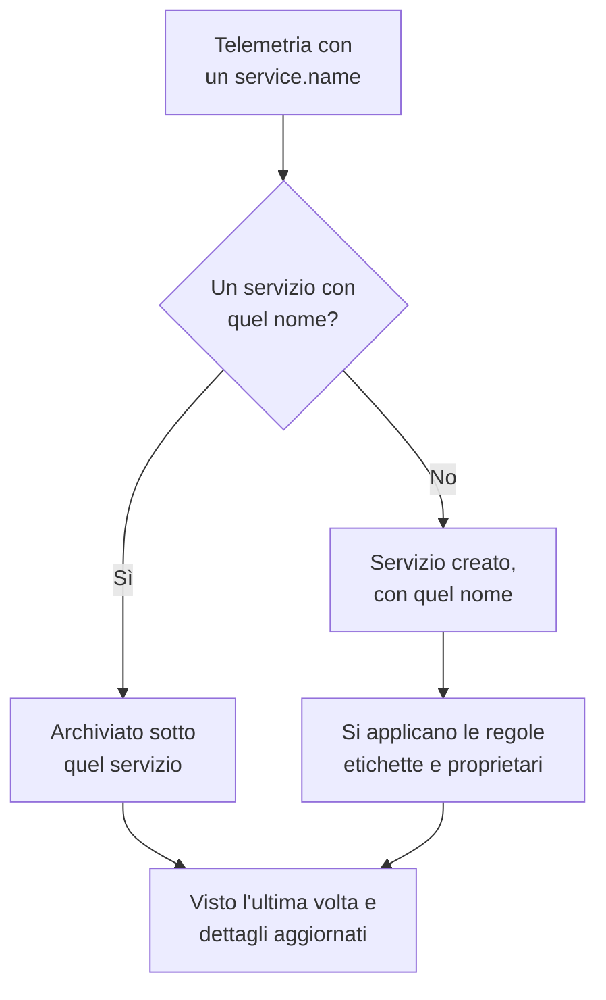

# Catalogo servizi

Il catalogo servizi elenca le applicazioni e i microservizi che gestite. OneUptime aggiunge un servizio la prima volta che ne arriva la telemetria, poi riunisce su un'unica pagina i suoi log, le tracce, le metriche, le eccezioni, gli incidenti e i proprietari, così chiunque può scoprire che cosa fa un servizio, a chi appartiene e come sta andando.

:::cards
- [Come un servizio entra nel catalogo](#come-un-servizio-entra-nel-catalogo): Il suo `service.name`, alla prima telemetria.
- [Trovare un servizio](#trovare-un-servizio): L'elenco, i suoi filtri e le sue colonne.
- [Le pagine di un servizio](#le-pagine-di-un-servizio): Tutto su un singolo servizio.
- [Archiviare o eliminare un servizio](#archiviare-o-eliminare-un-servizio): Conservarne la cronologia o rimuoverlo.
:::

## Come un servizio entra nel catalogo

Non dovete creare i servizi. Ogni lotto di telemetria indica il servizio che l'ha inviato nel suo attributo di risorsa `service.name`. OneUptime archivia il lotto sotto il servizio con quel nome e crea il servizio quando il progetto non ne ha ancora uno.

- **Il nome è l'identità del servizio.** Il confronto ignora maiuscole e minuscole, quindi `Checkout-API` e `checkout-api` sono un solo servizio. Un nuovo `service.name` avvia un nuovo servizio.
- **I container si danno un nome da soli.** La telemetria degli agenti Docker e Podman dà a un servizio il nome del suo container quando non ha un `service.name`.
- **Una chiave di acquisizione può fissare il servizio.** I dati OpenTelemetry inviati con una chiave che ha un **Nome del servizio fissato** finiscono sotto quel nome, qualunque sia il loro `service.name`. Vedere [Chiavi di acquisizione](/docs/telemetry/ingestion-keys#proteggere-una-chiave-browser).
- **Browser e telefoni non sono servizi.** La telemetria di un browser o di un'app mobile appartiene invece a un'[applicazione RUM](/docs/rum/applications).
- **Le etichette possono arrivare con la telemetria.** Un attributo di risorsa chiamato `oneuptime.label.<name>` aggiunge al servizio l'etichetta `<name>:<value>`, ad esempio `oneuptime.label.team=payments` per `team:payments`.

Ogni volta che arriva telemetria, **Visto l'ultima volta** del servizio avanza e i suoi dettagli vengono aggiornati dagli attributi di risorsa che la accompagnano:

| Dettaglio | Dall'attributo |
| --- | --- |
| Versione del servizio | `service.version` |
| Ambiente di distribuzione | `deployment.environment.name`, oppure `deployment.environment` |
| Namespace del servizio | `service.namespace` |
| Runtime | `process.runtime.name` e `process.runtime.version` |
| Tecnologia | `telemetry.sdk.language`, oppure il runtime |
| Cloud | `cloud.provider`, `cloud.platform`, `cloud.region` e `cloud.account.id` |

## Prima di iniziare

- **Telemetria in arrivo** con un `service.name`. Vedere [OpenTelemetry](/docs/telemetry/open-telemetry): `OTEL_SERVICE_NAME` lo imposta.
- **Un ruolo che può leggere i servizi.** Project Owner, Project Admin, Project Member, Viewer, Settings Admin, Settings Member o Settings Viewer, oppure un ruolo personalizzato con il permesso Read Service. Creare, modificare ed eliminare i servizi richiede Project Owner, Project Admin, Project Member, Settings Admin o Settings Member, oppure i permessi corrispondenti sui servizi.

## Trovare un servizio

Aprite **Prodotti → Risorse → Servizi**. **Tutti i servizi** elenca ogni servizio con **Nome**, **Descrizione**, **Technology**, **Visto l'ultima volta**, **Etichette** e **Proprietari**.

- Cercate per nome o descrizione, e filtrate per proprietario o etichetta con la barra sopra l'elenco.
- Selezionate più servizi per aggiungere a tutti etichette o proprietari in una volta, oppure per archiviarli.
- Fate clic su un servizio per aprirne le pagine.

Per aggiungere un servizio prima che ne arrivi la telemetria, ad esempio per definire prima i proprietari, fate clic su **Crea: Servizio** e inserite il **Nome** esattamente come sarà il suo `service.name`. Le regole per etichette e proprietari si applicano anche a lui, come a un servizio rilevato. Una volta salvato, si apre la guida di configurazione di OpenTelemetry con quel nome in ogni snippet, e il suo ultimo passaggio, **Attendi che si connetta**, indica quando arrivano i primi dati del servizio.

## Le pagine di un servizio

Il menu laterale di un servizio ha cinque sezioni:

| Sezione | Pagine |
| --- | --- |
| **Base** | **Panoramica**: richieste, tasso di errore e latenza p95 dai suoi span, grafici e dettagli. **Raccomandazioni**: monitor pronti all'uso per il servizio, scelti in base al suo linguaggio. **Proprietari**: le persone e i team che ne sono responsabili. **Feed**: tutto ciò che gli è successo, da come è stato creato a ogni modifica successiva. |
| **Telemetria** | I suoi **Registri**, **Tracce**, **Metriche**, **Profili di prestazioni**, **Eccezioni** e **Source Maps**, già filtrati su questo servizio. |
| **Attività** | Gli **Incidenti**, gli **Avvisi** e gli eventi di **Manutenzione programmata** che lo riguardano. |
| **Sviluppatori** | **Terraform**, **API** e **Assistenti IA**: il servizio gestito dal codice. All'inizio è chiusa. |
| **Avanzato** | **Impostazioni**, **Registri di audit** ed **Elimina servizio**. **Avanzato** è inizialmente compresso: espandetelo prima. |

I proprietari contano anche oltre la pagina: un ruolo con ambito Owned legge la telemetria dei servizi che appartengono a voi o ai vostri team. Vedere [Telemetria](/docs/permissions/index#telemetria).

## Modificare un servizio

:::steps
### Aprire le sue impostazioni

Aprite il servizio, espandete **Avanzato** nel menu laterale e fate clic su **Impostazioni**.

### Rinominarlo o descriverlo

In **Dettagli del servizio**, fate clic su **Modifica dettagli** per cambiarne **Nome**, **Descrizione** o **Etichette**. Il nome deve continuare a corrispondere al `service.name` che la sua telemetria riporta: cambiatelo anche nella configurazione di OpenTelemetry, altrimenti la telemetria successiva crea un nuovo servizio.

### Sceglierne colore e stack tecnologico

In **Impostazioni del servizio**, fate clic su **Modifica impostazioni**. Il **Colore del servizio** contrassegna il servizio nei grafici e negli elenchi; un nuovo servizio ne riceve uno suo. **Stack tecnologico** è facoltativo: lasciatelo vuoto per mostrare il linguaggio rilevato dalla sua telemetria.
:::

La stessa pagina contiene la conservazione del servizio. Le schede **Conservazione dei dati di telemetria** e **Conservazione per tipo di telemetria** conservano la sua telemetria più o meno a lungo della conservazione predefinita del progetto. Fanno parte dell'[Enterprise Edition](/docs/self-hosted/enterprise), e del piano Scale su OneUptime Cloud; senza di esse la pagina mostra ciò che aggiungono, e il servizio mantiene la conservazione del progetto.

## Impostare etichette e proprietari automaticamente

Le regole danno ai nuovi servizi le loro etichette e i loro proprietari alla creazione, compresi quelli rilevati. Le trovate in **Servizi → Impostazioni → Regole del proprietario** e **Servizi → Impostazioni → Regole etichette**; **Impostazioni** è inizialmente compresso nel menu laterale. Vedere [Regole per etichette e proprietari](/docs/configuration/label-and-owner-rules).

## Archiviare o eliminare un servizio

Archiviate un servizio che non osservate più ma di cui volete conservare la cronologia. Un servizio archiviato è nascosto in **Tutti i servizi**, ma continua a raccogliere telemetria. Archiviatelo dalla sua pagina **Impostazioni**, oppure selezionatene più di uno nell'elenco. Per recuperarne uno, aprite **Servizi → Avanzato → Archiviato**.

> [!WARNING]
> Eliminare un servizio elimina anche le sue source map, e le regole della pipeline delle metriche e i budget di costo LLM impostati per esso. Se OneUptime riceve ancora la sua telemetria, il servizio viene ricreato, senza le etichette, i proprietari e le impostazioni che gli avevate dato. Per toglierlo dall'elenco conservando tutto, archiviatelo invece.

## Risoluzione dei problemi

:::details Un servizio compare due volte
Due valori di `service.name` hanno raggiunto OneUptime, ad esempio da due versioni della vostra configurazione o dopo una ridenominazione da una parte sola. La telemetria viene associata per nome: fate in modo che ogni istanza riporti lo stesso `service.name`, poi archiviate o eliminate il servizio che non vi serve più.
:::

:::details Il mio servizio non è nel catalogo
Verificate che la sua telemetria porti un `service.name`. La telemetria di un browser o di un'app mobile va invece in Real User Monitoring, e un host o un cluster senza nome di servizio viene archiviato sotto quell'host o quel cluster.
:::

:::details Visto l'ultima volta è in ritardo
**Visto l'ultima volta** viene aggiornato circa una volta al minuto, non a ogni lotto, quindi può restare indietro di un minuto circa rispetto alla telemetria in tempo reale.
:::

## Passaggi successivi

:::cards
- [Esploratore log](/docs/telemetry/logs-explorer): Cercare nei log di un servizio.
- [Esploratore tracce](/docs/telemetry/traces-explorer): Seguire le sue richieste.
- [Tracciamento delle eccezioni](/docs/telemetry/exceptions): Smistare gli errori che solleva.
- [Regole per etichette e proprietari](/docs/configuration/label-and-owner-rules): Dare etichette e proprietari ai nuovi servizi.
:::
