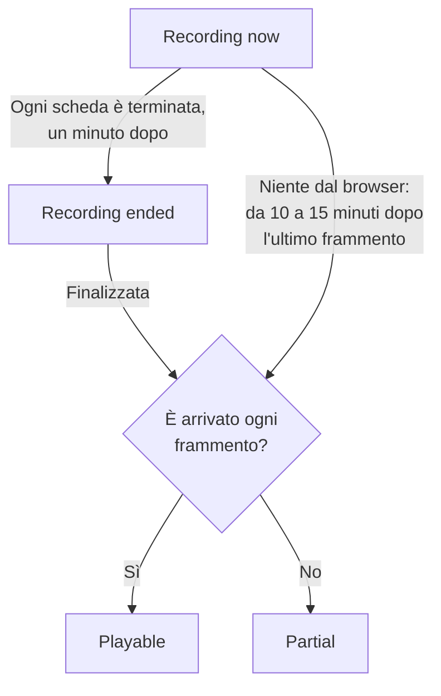
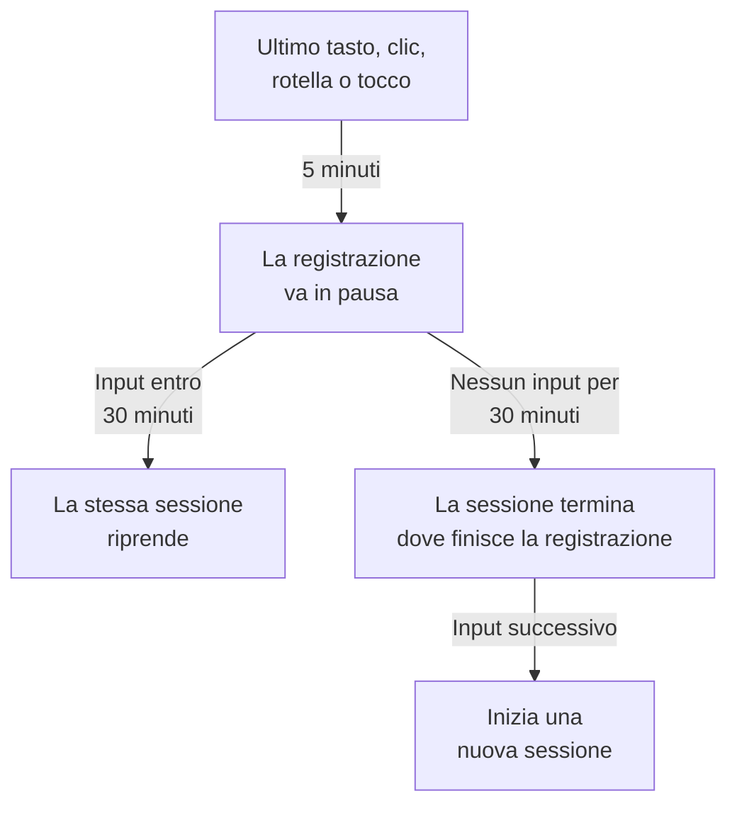

# Riproduzione delle sessioni

La riproduzione delle sessioni registra ciò che gli utenti reali hanno visto nella tua app web o React Native, e lo riproduce accanto agli errori, alle tracce e ai log della stessa sessione. Aggiungi un tag script, scegli cosa viene mascherato e guardi qualsiasi sessione dalla sua applicazione RUM.

:::cards
- [Come funziona](#come-funziona): Un loader, una policy e un registratore che invia man mano.
- [Installazione](#installazione): Un tag script su ogni pagina, oppure l'SDK React Native.
- [Privacy](#privacy): Cosa viene mascherato, il consenso e chi può inviare registrazioni.
- [Correlare con il resto della tua telemetria](#correlare-con-il-resto-della-tua-telemetria): Tracce, log ed errori del backend, collegati senza codice.
- [Guardare una sessione](#guardare-una-sessione): L'elenco delle sessioni, la pagina Utenti, i flussi utente e il lettore.
- [Stato della registrazione](#stato-della-registrazione): Perché non arriva nulla, e avvisi prima che un budget si esaurisca.
:::

## Come funziona

Lo script sulla tua pagina è un piccolo loader. Controlla i segnali di privacy del browser, recupera da OneUptime la policy dell'applicazione e solo allora carica il registratore, che maschera la pagina mentre la registra e la invia in frammenti mentre l'utente è attivo.

```mermaid title="Dal caricamento di una pagina a una registrazione da guardare"
flowchart TB
    page["La tua pagina carica<br/>il tag script"] --> dnt{"Segnale Do Not Track<br/>o GPC?"}
    dnt -->|"Sì"| none["Non viene<br/>registrato nulla"]
    dnt -->|"No"| policy["Il loader recupera<br/>la policy"]
    policy --> recorder["Il registratore maschera<br/>e registra la pagina"]
    recorder -->|"Frammenti mentre<br/>l'utente è attivo"| ingest["OneUptime"]
    ingest --> player["Elenco delle sessioni<br/>e lettore"]
```

Per impostazione predefinita, ogni sessione viene registrata e inviata mentre accade, non solo quelle andate storte. Le sessioni in cui nulla è andato storto sono quelle in cui trovi il checkout che nessuno ha completato, il modulo che tutti hanno abbandonato e la pagina che, secondo un cliente, «aveva un aspetto strano».

Per archiviare meno, due impostazioni della policy dell'applicazione lavorano insieme:

| Impostazione | Predefinito | Cosa cambia |
| --- | --- | --- |
| **Percentuale di campionamento** | 100 | Quante sessioni sono idonee. Dimezzalo e dimezzi sia i byte archiviati sia i dati degli utenti finali a riposo. La decisione viene presa una volta per sessione a partire da un hash dell'id di sessione, quindi una sessione non viene mai registrata a metà. |
| **Quando caricare una registrazione** | _Always_ | Con _On error or frustration_, il registratore mantiene un buffer circolare in memoria e invia solo quando qualcosa va storto. Esiste allora una registrazione di quasi ogni sessione fallita, a un costo circa 15 volte inferiore rispetto a registrare tutti, ma non puoi guardare una sessione che non è andata storta. |

## Prima di iniziare

- Un'applicazione RUM. Creane una in **Prodotti → Risorse → Monitoraggio degli utenti reali**, oppure lascia che sia la tua telemetria a crearla: vedi [Gestire le applicazioni](/docs/rum/applications).
- Una chiave di acquisizione **Browser**, da **Impostazioni del progetto → Telemetria e APM → Chiavi di acquisizione**. Una chiave Browser funziona solo dalle origini che vi elenchi: vedi [Impostare le origini consentite in produzione](#impostare-le-origini-consentite-in-produzione).

La riproduzione delle sessioni è attiva per impostazione predefinita. Le sue impostazioni si trovano in tre posti:

| Dove | Cosa c'è |
| --- | --- |
| La pagina **Replay Policy** dell'applicazione | La policy (registrazione, mascheramento, consenso, tracciamento e limiti), un riepilogo di **Stato della registrazione**, la scheda **Cosa contiene una registrazione**, il pannello **Test your installation** e **Record a specific user's next session**. |
| La pagina **Integrità** dell'applicazione | Se le registrazioni arrivano, e perché non arrivano quando non arrivano. Vedi [Stato della registrazione](#stato-della-registrazione). |
| **Monitoraggio degli utenti reali → Impostazioni → Riproduzione delle sessioni** | L'interruttore dell'intero progetto che ferma tutte le applicazioni insieme, e un elenco in sola lettura della policy di ogni applicazione. |

## Installazione

Aggiungi un tag script a ogni pagina che vuoi registrare.

:::steps
### Creare una chiave Browser

In **Impostazioni del progetto → Telemetria e APM → Chiavi di acquisizione**, fai clic su **Crea chiave di ingestione**, scegli **Browser** come **Tipo di chiave** ed elenca le origini del tuo sito in **Origini consentite**. Poi copia la **Chiave segreta** della chiave. [Configurazione browser](/docs/rum/browser-setup#configurazione) mostra ogni schermata.

### Aggiungere il tag script

Metti il tag su ogni pagina, con la tua chiave e l'identificatore della tua applicazione:

```html
<script
  src="https://oneuptime.com/telemetry/session-replay/v1/recorder.js"
  data-oneuptime-token="YOUR_TELEMETRY_INGESTION_KEY"
  data-oneuptime-app-identifier="storefront-web"
  crossorigin="anonymous"
  async
></script>
```

`data-oneuptime-app-identifier` deve corrispondere all'identificatore dell'applicazione RUM, lo stesso valore che usi per `service.name`. La pagina **Documentazione** dell'applicazione, nella sezione **Riproduzione delle sessioni** del suo menu laterale, mostra questo snippet con entrambi i valori già compilati, insieme alle sue versioni per Next.js / React e Google Tag Manager.

### Verificare che le registrazioni arrivino

Apri una delle tue pagine e fai clic qua e là per qualche secondo. Entro circa un minuto, la sessione compare nella pagina **Riproduzione delle sessioni** dell'applicazione, contrassegnata come **Registrazione in corso**. Se non compare, la pagina **Integrità** dell'applicazione dice perché: vedi [Stato della registrazione](#stato-della-registrazione).
:::

Lo script in `/v1/recorder.js` è un piccolo loader. Controlla Do Not Track, recupera la policy della tua applicazione e solo allora carica `/latest/recorder.js`. La policy e il registratore vengono serviti con `no-store`, quindi una modifica a uno dei due arriva al caricamento di pagina successivo senza attendere che scada una cache del browser.

### Attributi del tag script

| Attributo | Obbligatorio | Cosa fa |
| --- | --- | --- |
| `data-oneuptime-token` | Sì | Il tuo token di acquisizione della telemetria. |
| `data-oneuptime-app-identifier` | Sì | L'identificatore dell'applicazione RUM. |
| `data-oneuptime-host` | No | L'origine OneUptime. Se omesso, viene ricavato dal `src` dello script stesso, quindi ti serve solo quando servi lo script tramite il tuo dominio. |
| `data-oneuptime-user-ref` | No | Il riferimento dell'utente finale noto al caricamento della pagina (un id utente, mai un'email che non vuoi archiviare). Lo stesso che `identify()` imposta più tardi; è l'unica forma che funziona per [Registrare la prossima sessione di un utente specifico](#registrare-la-prossima-sessione-di-un-utente-specifico). |
| `data-oneuptime-respect-do-not-track` | No | Per impostazione predefinita rispetta Do Not Track e Global Privacy Control. Impostalo su `"false"` per registrare indipendentemente dal segnale; vedi [Do Not Track](#do-not-track). |
| `data-oneuptime-debug` | No | `"true"` stampa le decisioni del registratore nella console. Vedi [Risoluzione dei problemi della riproduzione delle sessioni](/docs/rum/session-replay-troubleshooting). |
| `data-oneuptime-offline-storage` | No | Impostalo su `"false"` per tenere solo in memoria i frammenti registrati mentre il visitatore è offline, invece di salvarli anche nell'IndexedDB del browser. Vedi [Modalità offline](#modalità-offline). |

Le stesse opzioni si possono fornire in un global invece che sul tag, ed è ciò che usano i tag manager e le installazioni in bundle:

```js
window.__ONEUPTIME_SESSION_REPLAY__ = {
  host: "https://oneuptime.com",
  token: "YOUR_TELEMETRY_INGESTION_KEY",
  appIdentifier: "storefront-web",
  userRef: "user-123", // optional
  respectDoNotTrack: true, // optional
  debug: false, // optional
  offlineStorage: true, // optional; false keeps offline chunks in memory only
};
```

### Com'è un'installazione sana

Apri DevTools → Network e filtra per `session-replay`. Una pagina funzionante produce:

1. **Un `GET .../session-replay/v1/config`** per ogni caricamento di pagina — il recupero della policy.
2. **Un `POST .../session-replay/v1/chunk` circa ogni 15 secondi mentre l'utente fa qualcosa**, o prima quando si accumulano 256 KB di eventi. Una scheda inattiva non produce eventi e quindi nessun POST: muovi il mouse o fai clic prima di giudicare un'installazione dalla scheda Network.
3. Quando la scheda viene nascosta, e di nuovo quando la pagina se ne va, un `POST` inviato con `keepalive`. L'uscita dalla pagina — la scheda chiusa, ricaricata o portata su un'altra pagina, oppure la pagina messa nella cache back/forward del browser (ogni `pagehide`) — lo contrassegna come finale, il che dice a OneUptime che la registrazione di quella scheda è terminata; una pagina che l'utente recupera dalla cache back/forward continua a registrare come una nuova scheda della stessa sessione. Una scheda che viene solo nascosta resta aperta, quindi la registrazione continua quando l'utente ci torna. Il suo corpo intero resta sotto i 56 KB — la parte del registratore nella quota keepalive di 64 KB per origine del browser — e può portare più frammenti come frame di quell'unica richiesta: il frammento di chiusura, i pezzi in cui è stato diviso un frammento di chiusura grande (al massimo 48 KB di eventi ciascuno, così che l'intestazione del frame entri ancora) e qualsiasi frammento che attendeva ancora un nuovo tentativo. Un frammento che è già più grande di quel budget quando la scheda viene solo nascosta parte invece per la via ordinaria, mentre la pagina è ancora viva per inviarlo.

Con il trigger _On error or frustration_, il passo 2 non avviene finché non scatta un trigger — vedi [Risoluzione dei problemi](#risoluzione-dei-problemi).

## Installazione in React Native

L'SDK React Native registra la gerarchia delle viste native come eventi sintetici compatibili con rrweb, quindi le registrazioni mobile si aprono nello stesso elenco delle sessioni e nello stesso lettore delle registrazioni web. Non fa screenshot. Il lettore contrassegna ogni registrazione come un'app React Native, e la sua scheda **Fidelity** spiega le superfici native che non è stato possibile rappresentare.

:::steps
### Installare l'SDK

L'SDK supporta le app React Native per iOS e Android. Installalo con la sua dipendenza peer per la outbox persistente:

```bash
npm install @oneuptime/react-native-replay @react-native-async-storage/async-storage
```

In un progetto iOS senza Expo, esegui la tua installazione CocoaPods abituale dopo aver aggiunto i pacchetti; le versioni attuali di React Native collegano Android automaticamente senza registrazione manuale. Il registratore ha un proprio modulo nativo per l'albero delle viste oltre ad Async Storage, quindi i progetti Expo devono usare una build personalizzata di sviluppo o di produzione (per esempio EAS Build o un prebuild). Expo Go non può eseguire questo SDK perché nessuno dei due moduli nativi può essere aggiunto al binario fisso di Expo Go.

### Avviare il registratore e avvolgere la tua app

Avvia il singleton una volta e metti il provider sopra la parte dell'app che vuoi registrare:

```tsx
import {
  OneUptimeReplay,
  OneUptimeReplayProvider,
} from "@oneuptime/react-native-replay";

OneUptimeReplay.start({
  host: "https://oneuptime.com",
  token: "YOUR_TELEMETRY_INGESTION_KEY",
  appIdentifier: "storefront-mobile",
  mobileAppIdentifier: "com.example.storefront",
  appName: "Storefront", // optional, shown in session details
  appVersion: "4.2.0", // optional, shown in session details
});

export default function App() {
  return (
    <OneUptimeReplayProvider>
      <Navigation />
    </OneUptimeReplayProvider>
  );
}
```

`appIdentifier` è l'identificatore dell'applicazione RUM. `mobileAppIdentifier` è l'application id Android o il bundle identifier iOS distribuito nel binario, non un nome visualizzato. Usa lo stesso valore negli [elenchi delle origini consentite `app://`](#impostare-le-origini-consentite-in-produzione). L'SDK recupera da `host` la policy di riproduzione dell'applicazione; campionamento, trigger, consenso, conservazione e budget di invio restano controllati dal server.
:::

Il provider ha una radice nativa non comprimibile e registra il suo albero delle viste e gli eventi di inizio, movimento e fine dei tocchi. Se costruisci già tu le istanze del registratore, passane una con `<OneUptimeReplayProvider recorder={recorder}>`. Anche `MobileReplayRecorder` viene esportato per integrazioni isolate o multi-client; la maggior parte delle app dovrebbe usare il singleton.

### API React Native

Importa `OneUptimeReplay` direttamente, oppure chiama `useOneUptimeReplay()` sotto il provider. Il singleton espone:

| Metodo | Cosa fa |
| --- | --- |
| `start(options)` | Recupera la policy e avvia la cattura. Le opzioni obbligatorie sono `host`, `token`, `appIdentifier` e `mobileAppIdentifier`; `appName` e `appVersion` sono metadati di visualizzazione facoltativi, e `connectivity` è una fonte facoltativa dello stato della rete per la [modalità offline](#modalità-offline). |
| `stop()` | Svuota ciò che può essere inviato, ferma la cattura e scollega i gestori del ciclo di vita. |
| `identify(userRef, traits?)` | Associa l'utente che ha effettuato l'accesso e attributi facoltativi, soggetto a **Acquisisci l'identità dell'utente finale**. |
| `setTags(tags)` / `addTag(key, value)` | Sostituisce tutti i tag ricercabili della sessione, oppure aggiunge un tag senza sostituire gli altri. |
| `track(name, properties?)` | Mette un evento dell'app sulla cronologia della riproduzione. |
| `setRoute(route)` | Registra una schermata o una route logica ripulita dopo una navigazione. Chiamalo dal callback di cambio route del tuo navigatore. |
| `captureSession(reason?)` | Con _On error or frustration_, invia il buffer circolare per un motivo proprio dell'app, come un utente che tocca «Segnala un problema». |
| `captureError(error)` | Registra un errore JavaScript gestito e attiva la cattura scatenata dagli errori. |
| `grantConsent()` / `revokeConsent()` | Consente gli invii, oppure cancella subito il buffer in memoria, la outbox archiviata, la sessione e l'id visitatore. Un consenso successivo inizia con nuovi identificatori. |
| `getSessionId()` / `onSessionChange(listener)` | Legge l'id della sessione di riproduzione corrente con consenso, o si iscrive ad esso, per correlare tracce e log. Il listener riceve anche `null` quando la cattura o il consenso terminano. |
| `getDiagnostics()` | Restituisce lo stato del registratore e le sue decisioni recenti, senza restituire il contenuto delle viste catturate. |

L'SDK ascolta `AppState` di React Native: il passaggio in background chiude e svuota gli eventi con consenso, mentre la registrazione precedente al consenso resta solo in memoria. Prima che la cattura in primo piano riprenda, l'SDK aggiorna la policy senza usare una risposta in cache. Aggiorna la policy anche periodicamente mentre è attivo, così che disattivazione, consenso, campionamento, targeting e cambi di identità abbiano effetto in un'app che resta aperta a lungo. Chiama `stop()` quando la tua integrazione viene smontata in modo permanente; la normale navigazione tra le schermate deve usare `setRoute()` invece di fermare e riavviare il registratore.

**Quando una sessione mobile termina per inattività.** Cinque minuti senza input mettono già in pausa la cattura (vedi [Tempo di inattività](#tempo-di-inattività)). Trenta minuti senza alcun tocco e senza alcuna chiamata dell'SDK registrata (`track()`, `setTags()`, `identify()` e simili, fatte mentre la cattura era in corso) terminano la sessione. Termina a quell'ultima attività, o per una sessione in pausa alla pausa, dove è finita la sua registrazione — non quando l'app torna o il registratore se ne accorge — quindi il tempo passato in background o in pausa non viene mai aggiunto alla fine di una sessione. Un'app lasciata aperta in primo piano non avvia una nuova sessione ogni mezz'ora. La sessione successiva inizia quando l'utente torna: il suo primo tocco, la tastiera virtuale che compare o scompare, l'app che torna in primo piano, oppure una chiamata a `captureSession()`. Si apre con un nuovo snapshot dello schermo. Fino ad allora, `getSessionId()` restituisce `null` e `onSessionChange()` viene chiamato con `null`. Errori, navigazione e chiamate a `track()` nel frattempo non vengono registrati.

Per correlare la telemetria mobile con una riproduzione, iscriviti con `onSessionChange()` e imposta il valore restituito come attributo `session.id` nella tua strumentazione OpenTelemetry. Sostituisci quell'attributo ogni volta che il callback scatta, cancellandolo anche quando il valore è `null`. L'SDK di riproduzione non modifica la rete nativa né altera da solo un provider OpenTelemetry.

### Privacy e mascheramento in React Native

La cattura mobile è deliberatamente più rigida delle modalità di mascheramento web. Il testo dell'interfaccia nativa, i valori di accessibilità, i valori di input e i pixel delle immagini non vengono mai serializzati; il server riceve una struttura wireframe anche quando la modalità di mascheramento web dell'applicazione permetterebbe testo leggibile. I metadati forniti dal chiamante, come riferimenti utente, nomi di eventi, route e tag ricercabili, seguono il contratto dell'API, quindi non mettere segreti in quei campi. Avvolgi un sottoalbero particolarmente sensibile in `<ReplayMask>` per sostituire quella zona con un segnaposto di privacy mantenendo il layout circostante.

Il consenso non viene dedotto da un permesso del sistema operativo né dal tuo banner di consenso. Con _Require explicit_, chiama `grantConsent()` solo quando la tua app ha il consenso necessario. Chiamare `revokeConsent()` scarta sia i dati non inviati in coda e persistiti sia gli identificatori che potrebbero collegare una sessione successiva a quella revocata.

Il registratore mobile cattura i limiti e i tipi delle viste, le posizioni dei tocchi, le route logiche, gli eventi personalizzati e gli errori JavaScript. Questi limiti sono sempre indicati nella scheda Fidelity del lettore:

- I pixel di `Image` nativa sono opachi; viene rappresentata solo la cornice.
- Il contenuto di `WebView` è fuori dall'albero di React Native. Installa il registratore web dentro la pagina ospitata se ha bisogno di una propria registrazione.
- Canvas, Skia, OpenGL, mappe, anteprime della fotocamera, video e altre superfici disegnate su misura sono opachi.
- I percorsi dei tocchi dentro `ReplayMask` o una superficie opaca non vengono registrati. Il bridge nativo controlla la destinazione reale del tocco e i suoi antenati, e sopprime il gesto se quel controllo di privacy non può essere completato.
- Le animazioni Reanimated, native-driver e del thread UI vengono campionate negli snapshot dell'albero delle viste, non riprodotte fotogramma per fotogramma.
- I crash nativi che terminano JavaScript prima che possa svuotare richiedono un SDK nativo per i crash; `captureError()` copre gli errori JavaScript gestiti, non i crash dump a livello di processo.

## Identificare i tuoi utenti

Ogni sessione è anonima finché la tua pagina non dice a chi appartiene. Senza questo, l'elenco può comunque raggruppare le sessioni di un browser sotto un id visitatore anonimo (vedi [Visitatori anonimi](#visitatori-anonimi) più sotto), ma nulla indica la persona né collega il suo secondo browser al primo. Chiama `identify()` non appena lo sai, oppure mettilo in coda prima che lo script si carichi — in entrambi i casi viene applicato prima dell'invio del primo frammento, quindi la sessione è ricercabile per utente dal momento in cui compare:

```js
// After the script has loaded:
OneUptimeReplay.identify("user-123", { plan: "pro", tenant: "acme" });

// Or at any time, whether or not the script has loaded yet:
(window.OneUptimeReplayQueue = window.OneUptimeReplayQueue || []).push([
  "identify",
  "user-123",
  { plan: "pro", tenant: "acme" },
]);
```

- Il riferimento è ciò che mostra l'elenco delle sessioni e ciò con cui corrispondono le ricerche `user:`. Gli attributi vengono mostrati nell'intestazione del lettore e nel pannello dei dettagli della sessione.
- **L'identità appartiene alla sessione, non solo alla pagina.** Una sessione copre ogni caricamento di pagina e ogni scheda della visita, e non appena una qualsiasi delle sue pagine chiama `identify()`, l'intera sessione è di quell'utente — comprese le pagine precedenti all'accesso, perché sono la stessa visita. Anche ogni pagina e scheda successiva della sessione indica l'utente, persino una che non chiama mai `identify()` da sola: la pagina di destinazione del reindirizzamento dopo l'accesso, un link aperto in una nuova scheda. Finché **Acquisisci l'identità dell'utente finale** è attivo, il registratore ricorda di chi è la sessione corrente in `localStorage` sotto `oneuptime.replay.user` — l'id di sessione e il riferimento, nient'altro, e con il consenso _Require explicit_ solo dopo che il consenso è stato dato — e solo per quella sessione: la sessione successiva (dopo 30 minuti di inattività o il limite di 4 ore) inizia anonima finché una pagina non la identifica, a meno che la pagina che l'ha avviata non abbia identificato lei stessa l'utente. Quindi chiama `identify()` a ogni caricamento di pagina in cui la tua app conosce l'utente, non solo subito dopo l'accesso.
- **Un altro utente ottiene la propria sessione.** Quando `identify()` indica qualcuno diverso dall'utente a cui la sessione appartiene già — una persona è uscita e un'altra è entrata nello stesso browser, in questa scheda o in un'altra —, la sessione corrente termina, ancora archiviata sotto il primo utente, e ne inizia una nuova per il secondo. I listener di `onSessionChange` vengono avvisati, e il lettore mostra il cambio come la fine di una registrazione e l'inizio della successiva. Identificare di nuovo lo stesso utente non cambia nulla; i riferimenti vengono confrontati dopo aver tolto gli spazi alle estremità e distinguendo maiuscole e minuscole, esattamente come li confronta il server.
- Ciò che `identify()` fornisce al registratore viene inviato con la registrazione solo mentre **Acquisisci l'identità dell'utente finale** è attivo per l'applicazione (il valore predefinito). Se è disattivato, il registratore lascia il riferimento e gli attributi fuori dal frammento, e il server non archivia **assolutamente nulla** sulla persona — né il riferimento, né un suo hash con chiave, né attributi. Quelle sessioni sono davvero pseudonime, e il prezzo è che non si possono cancellare _per utente_: una richiesta di cancellazione non ha nulla con cui fare corrispondenza, quindi usa invece `BySessionId`, `ByDateRange` o `ByRumApplication` (vedi [Cancellare le sessioni](#cancellare-le-sessioni)). Se poter soddisfare una richiesta di eliminazione per utente conta per te più del non archiviare alcun identificatore, lascia l'interruttore attivo — la chiave archiviata è un hash con chiave unidirezionale, che si può confrontare ma non leggere, e solo l'etichetta separata porta il riferimento stesso.
- Un riferimento lascia comunque il browser qualunque sia quell'interruttore, per progettazione: quello che la tua pagina fornisce **al caricamento** tramite `data-oneuptime-user-ref` o `userRef` nel global di inizializzazione viaggia come intestazione di richiesta nel recupero della policy di ogni caricamento di pagina, perché è così che [Registrare la prossima sessione di un utente specifico](#registrare-la-prossima-sessione-di-un-utente-specifico) riconosce un visitatore prima che esista qualsiasi registratore. Il server lo confronta con il target armato e lo scarta; non viene scritto nella sessione a meno che la cattura dell'identità sia attiva e il registratore lo invii di nuovo con la registrazione. Un riferimento passato a `identify()` non viene mai inviato in questo modo.
- Gli attributi sono limitati a 20 chiavi, 40 caratteri per chiave e 200 per valore, vengono convertiti in stringhe e passano per la modalità di mascheramento dell'applicazione: con _Mask all text_ vengono mascherati prima dell'invio.
- Rileggere l'identità nella dashboard richiede la stessa autorizzazione necessaria per guardare la registrazione (vedi [Chi può guardare una registrazione](#chi-può-guardare-una-registrazione)); gli altri ruoli vedono «Identity hidden».

### Visitatori anonimi

Una pagina che non chiama mai `identify()` ha comunque bisogno che le sue sessioni si possano raggruppare, altrimenti un elenco di quaranta righe _Anonymous_ non ti dirà se una persona ha avuto lo stesso errore quaranta volte o se quaranta persone lo hanno avuto una volta. Il registratore crea quindi un id visitatore casuale per profilo del browser e per origine — 32 caratteri esadecimali minuscoli, salvati in `localStorage` sotto `oneuptime.replay.visitor`, accanto al record della sessione, così che un sito servito da due nomi host o porte compare come due visitatori e solo `identify()` li unisce — e lo invia come `meta.visitorId` in ogni frammento che porta metadati: il primo frammento, il frammento di chiusura e il frammento successivo a una chiamata a `identify()` o `setTags()`. Il server ne verifica la forma e lo archivia sulla sessione con le stesse regole di accesso del resto dell'intestazione della sessione. Sopravvive all'id di sessione di proposito: il cambio dopo 30 minuti di inattività e il limite di 4 ore avviano una nuova sessione, e la nuova sessione porta lo stesso id visitatore, quindi due visite dallo stesso browser a una settimana di distanza compaiono insieme nella [pagina Utenti](#la-pagina-utenti) e nel menu delle altre sessioni del lettore (vedi [Il lettore](#il-lettore)).

Sii preciso su ciò che non è:

- **Non è un'identità.** È casuale, viene creato nel browser e non deriva da nulla che la tua pagina abbia fornito né da nulla del dispositivo. Due browser sullo stesso portatile, o la stessa persona su un telefono e su un computer, sono due visitatori; solo `identify()` li unisce. Una finestra privata riceve un nuovo id che scompare con la finestra, e dove non si può scrivere nulla nello storage (modalità privata di Safari, dati del sito bloccati) l'id dura un caricamento di pagina.
- **Non dipende da Capture end-user identity.** Quell'interruttore decide se il riferimento e gli attributi lasciano il browser; l'id visitatore viene inviato in ogni caso, perché non indica nessuno. Se non vuoi che venga creato alcun id, la risposta è non avere alcun registratore: disattiva la riproduzione delle sessioni per l'applicazione, oppure lascia che [Do Not Track](#do-not-track) venga rispettato.
- **Segue le regole di consenso dell'id di sessione.** `revokeConsent()` lo rimuove dallo storage insieme alla sessione, non viene scritto nulla mentre il consenso è revocato, e un `grantConsent()` successivo ne crea uno nuovo — quindi un utente che revoca il consenso e torna non viene ricollegato alle sessioni che ti ha chiesto di dimenticare. Con Do Not Track o Global Privacy Control non viene eseguito alcun registratore, quindi non viene creato alcun id.
- **Non viaggia mai nelle tue richieste.** Il contesto di traccia che il registratore aggiunge alle richieste della tua pagina verso la sua origine indica la sessione, mai il visitatore (vedi [Cosa portano le tue richieste](#cosa-portano-le-tue-richieste)); l'id visitatore va solo a OneUptime, con la registrazione.
- **Non può essere il target di una richiesta di cancellazione.** I tipi di richiesta non sono cambiati (vedi [Cancellare le sessioni](#cancellare-le-sessioni)); una ricerca `visitor:` riduce l'elenco alle sessioni di un browser, da cui prendi gli id di sessione da cancellare.

`OneUptimeReplay.getVisitorId()` restituisce l'id corrente, oppure una stringa vuota prima che il registratore si avvii, dopo `stop()` e tra un `revokeConsent()` e il `grantConsent()` successivo. I registratori compilati prima che questo esistesse non ne inviavano alcuno, quindi le sessioni che hanno registrato hanno un `visitorId` vuoto: l'elenco le mostra come _Anonymous_ e la pagina Utenti le archivia in **Unlinked sessions**. Un registratore che ne crea uno elenca `visitor-id` tra le sue `capabilities` in `getDiagnostics()` e nella pagina **Integrità**.

## API JavaScript

Il registratore pubblica `window.OneUptimeReplay`. Poiché si carica in modo asincrono, qualsiasi cosa la tua pagina chiami prima che sia arrivato deve passare dalla coda dei comandi — `window.OneUptimeReplayQueue` è un semplice array di voci `[command, ...arguments]` che il registratore svuota non appena si avvia, e accetta per nome tutti i comandi qui sotto:

```js
(window.OneUptimeReplayQueue = window.OneUptimeReplayQueue || []).push(
  ["grantConsent"],
  ["identify", "user-123", { plan: "pro" }],
  ["setTags", { build: "1.4.2" }],
  ["onSessionChange", (sessionId, tabId) => console.log(sessionId)],
);
```

`grantConsent`, `revokeConsent`, `stop`, `identify`, `setTags` e `addTag` vengono applicati prima che il registratore si avvii, quindi una decisione di consenso in coda decide se viene inviato qualcosa, e un'identità in coda viaggia già nel primo frammento. `track`, `captureSession` e `onSessionChange` vengono eseguiti subito dopo l'avvio.

| Metodo | Cosa fa |
| --- | --- |
| `identify(userRef, traits?)` | Associa l'utente finale alla sessione — a ogni sua pagina e scheda, dal suo inizio (vedi [Identificare i tuoi utenti](#identificare-i-tuoi-utenti)). `traits` è un oggetto di valori stringa, numero o booleano (≤ 20 chiavi, chiave ≤ 40 caratteri, valore ≤ 200 caratteri), mascherato con _Mask all text_ e inviato solo quando **Acquisisci l'identità dell'utente finale** è attivo. Chiamarlo di nuovo per lo stesso utente reinvia l'identità (e qualsiasi nuovo attributo) nel frammento successivo; indicare un altro utente termina la sessione e ne avvia una nuova per lui. |
| `track(name, properties?)` | Registra un evento di business (`"checkout_failed"`) sulla cronologia. `name` ≤ 64 caratteri, ≤ 20 chiavi di proprietà con gli stessi limiti di valore degli attributi. Fino a 50 per frammento di 15 secondi; oltre, il frammento porta un unico marcatore «events dropped» con il conteggio. |
| `setTags(tags)` / `addTag(key, value)` | Tag per sessione (`{ build: "1.4.2", experiment: "new-checkout" }`), ≤ 20 tag, chiave ≤ 32 caratteri, valore ≤ 128. Ricercabili dall'elenco delle sessioni con `tag:key=value` e mostrati nei dettagli della sessione. `setTags` **sostituisce** l'intera mappa, quindi un secondo `setTags({ experiment })` elimina un tag `build` impostato dal primo; `addTag` imposta una chiave e mantiene le altre. Costruisci la mappa in una sola chiamata a `setTags`, oppure usa `addTag` man mano che conosci ogni valore. |
| `captureSession(reason?)` | Con _On error or frustration_, forza questa sessione a inviare dal suo buffer circolare in avanti; con _Always_ non cambia nulla nell'invio, ma la `reason` (≤ 80 caratteri) viene comunque segnata sulla cronologia. Usalo dal tuo pulsante «segnala un problema». |
| `onSessionChange(listener)` | `listener(sessionId, tabId)` viene chiamato subito se esiste una sessione e di nuovo ogni volta che l'id cambia — quando l'utente torna dopo 30 minuti di inattività, al limite di 4 ore, quando `identify()` indica un altro utente, o quando un'altra scheda dello stesso visitatore ha cambiato sessione per prima. Restituisce una funzione per annullare l'iscrizione. **Facoltativo**: le richieste verso la tua origine collegano alla registrazione gli span, i log e le eccezioni del tuo backend anche senza di esso (vedi [Correlare con il resto della tua telemetria](#correlare-con-il-resto-della-tua-telemetria)). Usalo per mettere `session.id` sulla telemetria prodotta dalla pagina stessa, come gli span dell'SDK OpenTelemetry per browser; vedi [La telemetria del browser della tua pagina](#la-telemetria-del-browser-della-tua-pagina). |
| `grantConsent()` | Con la modalità di consenso _Require explicit_, consente gli invii. Prima di questo non viene inviato nulla. |
| `revokeConsent()` | Scarta tutto ciò che è nel buffer e ferma gli invii. Il registratore continua a funzionare solo in memoria, quindi un `grantConsent()` successivo prosegue con un nuovo id di sessione. |
| `getSessionId()` | L'id di sessione corrente, oppure `null` quando non viene registrato nulla. Preferisci `onSessionChange()`, che segue anche i cambi di sessione. |
| `getVisitorId()` | L'[id visitatore anonimo](#visitatori-anonimi) — 32 caratteri esadecimali, uno per profilo del browser, lo stesso in tutti i cambi di sessione — oppure `""` prima che il registratore si avvii, dopo `stop()` e mentre il consenso è revocato. Casuale e non un'identità; non dipende da **Acquisisci l'identità dell'utente finale**. |
| `stop()` | Invia l'ultimo frammento, chiude la sessione e si ferma per il resto della vita della pagina. |
| `setDebug(enabled)` | Da ora in poi stampa le decisioni del registratore nella console. |
| `getDiagnostics()` | Tutto ciò che il registratore ha deciso, che la diagnostica fosse attiva o no. Vedi sotto. |

### `getDiagnostics()`

È la prima cosa da incollare in un ticket di supporto. Per costruzione non contiene alcun contenuto della pagina (vedi [Cosa la diagnostica non contiene mai](/docs/rum/session-replay-troubleshooting#cosa-la-diagnostica-non-contiene-mai)).

```js
copy(JSON.stringify(OneUptimeReplay.getDiagnostics(), null, 2));
```

| Campo | Significato |
| --- | --- |
| `state` | `none` (non è stato costruito alcun registratore), `not-started`, `recording` (solo in memoria), `uploading`, `paused` (nessuno ha toccato la pagina per cinque minuti, quindi non viene catturato nulla fino all'input successivo — vedi [Tempo di inattività](#tempo-di-inattività)), `not-sampled` o `stopped`. |
| `stopReason` | Perché si è fermato, se lo ha fatto: `api` (il tuo `stop()`), `server-directive`, `transport-failure` o `chunk-cap`. |
| `bootstrapDecision` | Perché l'artefatto ha costruito o meno un registratore: `started`, `privacy-signal`, `directive-stop`, `already-started`, `cancelled-before-start` (un `revokeConsent`/`stop` in coda) o `not-started`. |
| `decisions` | La risposta di ogni barriera: `isSampled`, `captureTrigger`, `consentMode`, `consentState`, `uploadsAllowed`, `uploadBlockedBy` (`consent`, `transport` o `null`), `lastDirective` e il suo motivo, e `startDecision` (`recording-and-uploading`, `recording-into-memory`, `not-sampled`, `not-started`). |
| `capabilities` | Ciò che questa build del registratore cattura: `click-events`, `web-vitals`, `custom-events`, `traits`, `tags`, `visibility`, `visitor-id`. La pagina **Integrità** della dashboard mostra lo stesso elenco per la sessione più recente, quindi è facile individuare una registrazione da una vecchia pagina aperta da molto tempo. |
| `tags`, `hasTraits`, `triggerReason`, `isRecording`, `isUploading`, `sessionId`, `tabId`, `visitorId`, `version` | Lo stato attuale della sessione. `isRecording` è true solo mentre il registratore sta davvero registrando. `visitorId` è `null` finché non esiste un registratore e `""` mentre il consenso è revocato. |
| `records` | Le ultime 250 decisioni con codici stabili — comprese quelle del loader, di prima che l'artefatto esistesse. Ogni codice è spiegato in [Risoluzione dei problemi della riproduzione delle sessioni](/docs/rum/session-replay-troubleshooting#codici). |

## Privacy

**Il mascheramento avviene alla cattura, sul dispositivo dell'utente finale, prima che venga inviato qualsiasi cosa.** Il server non riceve mai ciò che è stato mascherato, quindi una decisione di mascheramento non si può annullare a posteriori, né applicare retroattivamente. Sul web, ciò che viene mascherato dipende dalla modalità; React Native invia sempre la struttura wireframe più rigida descritta in [Privacy e mascheramento in React Native](#privacy-e-mascheramento-in-react-native). La scheda **Cosa contiene una registrazione** nella pagina **Replay Policy** dell'applicazione riformula queste decisioni in frasi semplici per ciò che hai configurato.

Le impostazioni di privacy della policy, con il nome che dà loro **Modifica policy**:

| Impostazione | Predefinito | Cosa fa |
| --- | --- | --- |
| **Registra le sessioni di questa applicazione** | Attivo | L'interruttore proprio dell'applicazione. Disattivalo per smettere di registrare questa applicazione. |
| **Modalità di mascheramento** | _Mask sensitive inputs only_ | Vengono mascherati password, campi della carta e campi dei codici monouso. Il resto della pagina, il suo testo statico e i valori di input normali, viene registrato come appariva. Vedi [Scegliere con cura una modalità di mascheramento](#scegliere-con-cura-una-modalità-di-mascheramento). |
| **Consenso** | _Not required_ | Gli invii iniziano subito. Scegli _Require explicit_ se ti serve uno scambio di consenso per ogni sessione, come farà la maggior parte dei deployment nell'UE. |
| **Quando caricare una registrazione** | _Always_ | Ogni sessione campionata viene inviata dal suo primo evento. Scegli _On error or frustration_ per inviare solo quando qualcosa va storto. |
| **Percentuale di campionamento** | 100% | La quota delle sessioni idonee a essere registrate, e la leva del costo. 0% insieme ad _Always_ non registra nulla, e la pagina della policy avvisa quando lo imposti. |
| **Origini consentite** | Vuoto: qualsiasi origine | Elenca i tuoi domini per limitare chi può inviare registrazioni. Vedi [Impostare le origini consentite in produzione](#impostare-le-origini-consentite-in-produzione). |
| **Acquisisci l'identità dell'utente finale** | Attivo | Vengono archiviati il riferimento e gli attributi dell'utente finale forniti dalla tua pagina, così puoi trovare la sessione di un cliente con nome. Disattivalo per mantenere le registrazioni pseudonime: disattivato, non viene archiviato nulla sulla persona, nemmeno la chiave con cui dovrebbe corrispondere una richiesta di cancellazione per utente ([Identificare i tuoi utenti](#identificare-i-tuoi-utenti)). Non riguarda l'[id visitatore anonimo](#visitatori-anonimi), che è casuale, non indica nessuno e viene inviato in ogni caso. |
| **Propagazione delle tracce stessa origine** | Attivo | Mentre una sessione invia, le richieste della tua pagina verso la sua origine portano un `traceparent` W3C e un `tracestate` che indica la sessione, quindi la telemetria del tuo backend si collega alla registrazione senza codice. L'OpenTelemetry del tuo backend inoltra entrambi a ogni servizio che chiama. Vedi [Cosa portano le tue richieste](#cosa-portano-le-tue-richieste). |
| **Acquisisci il paese** | Attivo | Solo il paese, mai un indirizzo IP. |
| **Registra il contenuto dei canvas** | Disattivato | Canvas e WebGL non vengono registrati. |
| **Conservazione** | 7 giorni | Più breve di quella del resto della telemetria, di proposito. Sono disponibili anche 1, 14, 30 e 90 giorni. |
| **Budget mensile (GB)** | Vuoto | Un limite facoltativo ai byte inviati per mese di calendario per questa applicazione. Vuoto o 0 significa nessun limite. |

### Scegliere con cura una modalità di mascheramento

> [!WARNING]
> Il valore predefinito registra una pagina leggibile, perché un wireframe raramente basta per il debug. Tutto ciò che è mostrato sulla tua pagina è nella registrazione: un numero d'ordine, un indirizzo email in un'intestazione, un banner di errore che cita dati dell'utente. E anche tutto ciò che viene digitato in un campo che il tuo markup non dichiara sensibile. Il mascheramento avviene nel browser prima dell'invio, quindi rendere la modalità più rigida in seguito non ripulisce le registrazioni già fatte.

Le tre modalità, dalla meno alla più privata:

| Modalità | Testo statico della pagina | Valori di input normali | Campi password, carta e OTP |
| --- | --- | --- | --- |
| Mask sensitive inputs only *(predefinita)* | registrato | registrati | mascherati |
| Mask inputs only | registrato | mascherati | mascherati |
| Mask all text | mascherato | mascherati | mascherati |

Con _Mask all text_ la riproduzione è un wireframe: i nodi di testo, le etichette che il registratore associa ai clic, gli attributi di `identify()` e le proprietà di `track()` vengono mascherati prima dell'invio, e il lettore non carica nessuna delle immagini né dei font web della pagina dai loro indirizzi. La registrazione conserva comunque quegli indirizzi, e una sessione registrata in questa modalità si riproduce senza di essi, con un'eccezione: un'immagine che la pagina conteneva come URL `data:` fa parte della registrazione stessa, e viene comunque mostrata. Blocca gli elementi che possono mostrare così un'immagine personale, come l'anteprima di un documento caricato dall'utente. I fogli di stile si caricano comunque, quindi il layout mantiene la sua forma (vedi [Immagini, stili e font durante la riproduzione](#immagini-stili-e-font-durante-la-riproduzione)).

Se le tue pagine mostrano dati personali, alza la modalità o aggiungi selettori di mascheramento o di blocco per gli elementi specifici: vedi [Contrassegnare i tuoi contenuti](#contrassegnare-i-tuoi-contenuti). I selettori sono lo strumento giusto quando solo poche zone sono sensibili; una modalità più rigida è lo strumento giusto quando non puoi elencarle.

### Impostare le origini consentite in produzione

La riproduzione delle sessioni funziona subito con un elenco di origini consentite vuoto, che accetta registrazioni da qualsiasi origine. È comodo per iniziare e sbagliato per la produzione.

Il tuo token di acquisizione viene consegnato al client — nel JavaScript della pagina o nel binario mobile — quindi ci sono due barriere, e si combinano:

- **Sulla chiave.** Crea la chiave di acquisizione con **Browser** come **Tipo di chiave**. Per il web, elenca i suoi **Origini consentite** (`https://app.example.com`, o `https://*.example.com` per un livello di sottodominio). Per React Native, aggiungi l'identità esatta dell'app come `app://com.example.storefront`. Dai alla chiave anche un **Scade il**: così un token copiato smette di funzionare in una data che scegli tu invece che mai.
- **Sull'applicazione.** **Replay Policy → Origini consentite** limita chi può scrivere registrazioni in questa applicazione, qualunque chiave presenti. Aggiungi qui le stesse origini web e le identità mobile `app://` esatte.

Una voce `app://` è il prefisso letterale più l'application id Android o il bundle identifier iOS normalizzato fornito come `mobileAppIdentifier`. Il confronto non distingue maiuscole e minuscole, dopo aver tolto gli spazi e convertito in minuscolo un identificatore reverse-DNS valido. Le identità mobile **non** accettano caratteri jolly: `app://*.example.com` non è valido. L'SDK mobile non invia alcun `Origin` del browser; invia il suo tipo di registratore e l'identità dell'app in intestazioni dedicate. Se una richiesta porta un vero `Origin`, quell'origine vince sempre — le intestazioni mobile non possono mai essere usate per aggirare il controllo dell'origine del browser.

Quell'identità mobile è un metadato HTTP autodichiarato, non un'attestazione di piattaforma Apple/Google né una prova che la richiesta provenga dal tuo binario firmato. Chi estrae il token dal client può inviare una richiesta non proveniente da un browser con la stessa intestazione di identità dell'app. Le voci `app://` esatte evitano comunque l'uso accidentale tra app e separano le identità mobile che vuoi accettare, ma non chiamarle un confine di autenticità. Imposta una scadenza, ruota le chiavi esposte e mantieni attivi i budget di frequenza e di byte per contenere gli abusi; non mettere mai un segreto del server nell'app considerandolo una protezione, perché può essere estratto.

Una richiesta deve superare entrambi gli elenchi delle origini consentite. Sulle richieste web, il controllo dell'`Origin`, gestito dal browser, impedisce a un sito web di riutilizzare la chiave di un altro sito; sulle richieste native, i controlli sopra limitano e compartimentano un'identità autodichiarata. Imposta entrambi gli elenchi prima di indirizzare traffico reale a uno dei due registratori; gli invii rifiutati compaiono nella pagina **Integrità** come `origin-not-allowed`.

### Sempre mascherato

Sempre mascherato qualunque sia la modalità, e non configurabile:

- **Password**, anche dopo un pulsante «mostra password». Un campo che è stato una volta un campo password resta mascherato, e il cambio di tipo stesso viene soppresso.
- **Campi della carta**, rilevati tramite `autocomplete` (`cc-number`, `cc-csc`, `cc-exp`), perché gli input della carta sono `type="text"` e altrimenti sarebbero invisibili al mascheramento basato sul tipo.
- **Codici monouso** (`autocomplete="one-time-code"`).
- **Valori dei campi file** — il browser espone il vero nome del file, e i nomi dei file sono spesso personali.
- **Query string e frammenti**: vengono tolti dagli URL di pagina conservati dalla registrazione e dall'URL di ogni richiesta di rete, e i segmenti di percorso con forma di identificatore (UUID, email, lunghe sequenze di cifre, lunghi token opachi) vengono sostituiti. È l'unico canale che il mascheramento del testo non copre: altrimenti un link di reimpostazione della password finirebbe nell'elenco delle sessioni. Gli indirizzi dentro la pagina sono un'altra cosa. La destinazione di un link viene ripulita in questo modo solo con _Mask all text_; nelle altre due modalità viene registrata come il resto della pagina. Gli indirizzi di immagini, fogli di stile e font vengono conservati come li ha scritti la pagina in tutte le modalità, query string compresa, perché la riproduzione li carica da lì (con _Mask all text_, solo i fogli di stile; vedi [Immagini, stili e font durante la riproduzione](#immagini-stili-e-font-durante-la-riproduzione)). Blocca un elemento il cui indirizzo di immagine porti qualcosa di sensibile, come un token firmato.
- **Eventi degli appunti**: mai registrati.
- **Il ritmo di battitura** viene quantizzato, perché gli intervalli tra i tasti rivelano il contenuto digitato anche quando il valore è mascherato.
- **Corpi e intestazioni di richieste e risposte**: mai registrati. Una riga di rete del lettore porta il metodo, l'URL, lo stato, i tempi, i conteggi di byte e l'id di traccia — nient'altro. (Il registratore _aggiunge_ invece il contesto di traccia alle richieste verso la tua origine; vedi [Cosa portano le tue richieste](#cosa-portano-le-tue-richieste).)
- **Etichette dei clic**: provengono dall'`aria-label` o dal testo visibile di un elemento, mai dal valore di un controllo di modulo, e vengono scartate del tutto dentro le zone mascherate.

I valori mascherati non conservano la lunghezza. Un campo mascherato è un segnaposto a larghezza fissa, quindi non può essere usato per dedurre la lunghezza di una password o di un numero di carta.

### Contrassegnare i tuoi contenuti

```html
<!-- Not recorded at all: the element and its subtree are omitted. -->
<div class="oneuptime-block">...</div>

<!-- Recorded, but all text inside is masked. -->
<div class="oneuptime-mask">...</div>

<!-- Recorded, but input events inside are dropped. -->
<div class="oneuptime-ignore">...</div>
```

Puoi anche aggiungere **Selettori di mascheramento aggiuntivi** e **Selettori di blocco** nella pagina **Replay Policy** della tua applicazione, senza cambiare il tuo markup. Con la modalità di mascheramento predefinita, sono lo strumento principale per proteggere contenuti che il tuo markup non dichiara sensibili.

### Cosa portano le tue richieste

Il registratore non registra mai le intestazioni né il corpo di una richiesta, ma **aggiunge** il contesto di traccia ad alcune delle richieste della tua pagina, e questo va al tuo backend invece che a OneUptime. È ciò che collega la telemetria del backend a una registrazione (vedi [Correlare con il resto della tua telemetria](#correlare-con-il-resto-della-tua-telemetria)):

```text
traceparent: 00-<32 hex trace id>-<16 hex parent id>-01
tracestate:  oneuptime=sid:<32 hex session id>;p:<16 hex parent id>
```

- **Quali richieste.** Le chiamate `fetch` e `XMLHttpRequest` verso l'**origine propria** della pagina, fatte mentre la sessione sta **inviando**, tranne le esportazioni OpenTelemetry della pagina stessa (richieste `POST` verso percorsi che terminano con `/v1/traces`, `/v1/logs` o `/v1/metrics`). Non viene aggiunto nulla prima del consenso con _Require explicit_, dopo `revokeConsent()`, con _On error or frustration_ finché non scatta un trigger, in una sessione non campionata, mentre la registrazione è [in pausa perché non c'è nessuno sulla pagina](#tempo-di-inattività), né dopo `stop()`. Un `traceparent` o un `tracestate` che la richiesta porta già non viene mai sostituito: mantiene il suo, e il registratore aggiunge solo ciò che manca. `;p:` compare solo quando il registratore ha creato lui stesso il `traceparent`. Le richieste verso altre origini non ricevono nulla a meno che tu non elenchi l'origine in **Origini di propagazione delle tracce**, e allora solo un `traceparent`, che non porta alcun id di sessione.
- **Cos'è l'id di sessione.** Lo stesso id casuale di 32 caratteri esadecimali sotto cui viene archiviata la registrazione. Non dice nulla della persona e resta uguale per tutta la visita, finché 30 minuti di inattività o il limite di 4 ore non terminano la sessione, `identify()` non indica un altro utente, o un `revokeConsent()` seguito da `grantConsent()` non ne crea uno nuovo. Una sessione terminata per inattività non invia alcun id finché l'utente non torna, il che avvia la sessione successiva. L'[id visitatore anonimo](#visitatori-anonimi), il riferimento dell'utente e gli attributi non viaggiano mai in questo modo.
- **Dove va.** L'OpenTelemetry del tuo backend conserva `tracestate` con la traccia e lo inoltra a ogni chiamata che fa, ai tuoi altri servizi e a qualsiasi API di terze parti che chiama con il contesto di traccia, esattamente come l'id di traccia. OneUptime legge il membro su ogni span all'acquisizione, salva l'id di sessione nella colonna dell'id di sessione dello span e toglie il membro dal trace state che archivia.
- **Cosa collega.** Uno span, un log o un'eccezione del backend che indica l'utente (un attributo `enduser.id`, un'email in una riga di log) è ora a un clic dalla registrazione, anche con **Acquisisci l'identità dell'utente finale** disattivato: quell'interruttore decide ciò che conserva la registrazione, non ciò che registra il tuo backend. Se le registrazioni non devono poter essere collegate a chi era l'utente, disattiva anche **Propagazione delle tracce stessa origine**.
- **Chi può dichiararlo.** Come qualsiasi contesto di traccia, il membro è scritto dal client. Chi conoscesse un id di sessione potrebbe inviarlo alla tua API e far archiviare sotto quella sessione gli span delle proprie richieste. Gli id di sessione sono valori casuali a 128 bit, quindi prima gli servirebbe l'id. Lo stesso vale per la traccia indicata da un client: una richiesta che invia un `traceparent` di una traccia che conosce, insieme al membro della propria sessione, porta le righe del backend di quella traccia nel pannello eventi della sua sessione e nella portata della cancellazione di quella sessione. La cancellazione rimuove un'intera traccia solo quando appartiene unicamente alle sessioni cancellate; da una traccia condivisa con altre sessioni rimuove solo le righe marcate con gli id cancellati (vedi [Cancellare le sessioni](#cancellare-le-sessioni)).

Disattivalo per applicazione con **Propagazione delle tracce stessa origine** nella pagina **Replay Policy**; vedi [Disattivare il collegamento automatico](#disattivare-il-collegamento-automatico).

### Consenso

```js
// After the user accepts. Nothing is uploaded before this.
window.OneUptimeReplay.grantConsent();

// Drops everything buffered and stops uploading. A later grantConsent()
// continues on a fresh session.
window.OneUptimeReplay.revokeConsent();
```

Il tuo banner di solito si risolve prima che lo script del registratore si carichi, quindi metti in coda la decisione invece di aspettare il global:

```js
(window.OneUptimeReplayQueue = window.OneUptimeReplayQueue || []).push(["grantConsent"]);
```

Con _Require explicit_ il registratore registra in memoria dal primo evento e invia l'intero buffer non appena arriva il consenso, quindi i secondi precedenti all'accettazione del banner non vanno persi. Finché non arriva, la pagina **Integrità** dice «waiting for consent», che è una risposta della policy e non un guasto.

`revokeConsent()` dimentica tre cose, e un `grantConsent()` successivo ricrea le prime due:

- L'id di sessione, così che un utente che revoca il consenso e torna non venga ricollegato alla stessa sessione.
- L'[id visitatore anonimo](#visitatori-anonimi), rimosso dallo storage insieme alla sessione. Non viene scritto nulla mentre il consenso è revocato, e `getVisitorId()` risponde `""` fino al consenso successivo — quindi le sessioni registrate dopo un nuovo consenso si raggruppano tra loro, mai con quelle che l'utente ti ha chiesto di dimenticare.
- Di chi era la sessione (`oneuptime.replay.user`), rimosso dallo storage insieme alla sessione. Una pagina che ha chiamato `identify()` conserva il riferimento in memoria, e la sessione avviata da un consenso successivo appartiene di nuovo a quell'utente; non resta nulla dell'utente della sessione revocata che una pagina successiva possa raccogliere.

La stessa barriera regola il [contesto di traccia che il registratore aggiunge alle tue richieste](#cosa-portano-le-tue-richieste): non viene inviato alcun id di sessione prima di `grantConsent()` né dopo `revokeConsent()`, e dopo un nuovo consenso le richieste portano l'id della nuova sessione, mai quello revocato.

### Do Not Track

`navigator.doNotTrack` e `navigator.globalPrivacyControl` vengono rispettati prima della richiesta di configurazione: una pagina che non dice nulla nel suo tag script si ritira per un utente che invia uno dei due segnali, senza che venga fatta alcuna richiesta su di lui solo per sapere se sarebbe stato registrato. Il loader registra `privacy-signal` e non succede nient'altro.

La regola ha un'unica eccezione. Imposta `data-oneuptime-respect-do-not-track="false"` (o `respectDoNotTrack: false` nel global di inizializzazione) per registrare indipendentemente dal segnale, se la tua base giuridica davvero non dipende da esso. Solo il markup della pagina può dirlo: nulla nella policy della dashboard lo allenta, e una pagina che non dice nulla rispetta il segnale.

## Content Security Policy

> [!IMPORTANT]
> Se il tuo sito invia una Content Security Policy, il registratore fallisce in silenzio finché non lo consenti. Dai browser dei tuoi utenti non arriva alcun errore a OneUptime, quindi è la prima cosa da controllare quando non compaiono registrazioni.

Aggiungi l'origine OneUptime alle direttive che hai già. Non sostituirle, altrimenti escluderai i tuoi script dalla tua pagina:

```text
script-src  'self' https://oneuptime.com;
connect-src 'self' https://oneuptime.com;
```

Se ospiti OneUptime in autonomia, usa invece il tuo host.

Un ultimo dettaglio legato alla CSP, che riguarda i fogli di stile e non la tua policy: il registratore può conservare solo un foglio di stile che riesce a leggere. Un foglio di stile di un'altra origine è leggibile solo quando il suo server invia un'intestazione `Access-Control-Allow-Origin` che consente il tuo sito **e** il tuo `<link>` porta `crossorigin="anonymous"`. Altrimenti la registrazione conserva solo il suo indirizzo, e la riproduzione lo carica da lì nel browser di chi guarda; vedi [Immagini, stili e font durante la riproduzione](#immagini-stili-e-font-durante-la-riproduzione). Aggiungi l'attributo solo quando l'intestazione è al suo posto: `crossorigin` senza l'intestazione fa sì che la tua pagina rifiuti il foglio di stile.

Usa il pannello **Test your installation** nella pagina **Replay Policy** dell'applicazione per confermare dal lato server il token, gli interruttori della policy e gli elenchi delle origini consentite. Non può verificare la tua CSP: una CSP è un'intestazione che il tuo sito invia ai tuoi visitatori, e nulla dal lato server la vede mai. Un blocco della CSP si nota lì solo in modo indiretto: `script-src` blocca il registratore, quindi la riga _Recorder loaded on your site_ del pannello resta in attesa; `connect-src` blocca l'invio, quindi quella riga passa mentre la riga della registrazione ricevuta, sotto, resta in attesa. In entrambi i casi la console del browser sulla pagina bloccata registra il rifiuto, ed è l'unica prova certa.

## Correlare con il resto della tua telemetria

Installare il registratore basta per collegare una registrazione alle tracce, ai log e alle eccezioni del tuo backend. Non c'è codice da aggiungere alla pagina né ai tuoi servizi.

```mermaid title="Come uno span del backend viene archiviato sotto la registrazione"
flowchart TB
    recorder["Registratore"] -->|"Una richiesta con<br/>traceparent e tracestate"| backend["Il tuo backend e ogni<br/>servizio che chiama"]
    backend -->|"Span e log<br/>via OTLP"| oneuptime["OneUptime"]
    oneuptime --> filed["Gli span ricevono l'id<br/>di sessione, i log si uniscono<br/>per id di traccia"]
```

Mentre una sessione invia, ogni `fetch` e `XMLHttpRequest` che la tua pagina fa **verso la sua origine** porta il contesto di traccia W3C della sessione:

- un `traceparent`, creato dal registratore, a meno che la richiesta non ne abbia già uno o un altro agente di tracciamento sulla pagina non sia configurato per tracciarla, nel qual caso il registratore lo lascia all'agente;
- un membro `tracestate`, `oneuptime=sid:<session id>`, a meno che la richiesta non porti già un `tracestate`.

Il registratore lascia il `traceparent` a un altro agente solo quando quell'agente è configurato per tracciare la richiesta: la strumentazione fetch o XMLHttpRequest dell'SDK OpenTelemetry per browser; Datadog RUM, una volta avviato e mentre traccia la sessione, quando la prima voce del suo `allowedTracingUrls` che corrisponde all'URL della richiesta usa il propagatore `tracecontext` (una voce senza `propagatorTypes` lo usa); un agente RUM di Elastic APM attivo con il tracciamento distribuito attivo e il suo nome di intestazione `traceparent` predefinito (`distributedTracingHeaderName`); oppure New Relic con il tracciamento distribuito attivo. Aggiunge comunque il suo membro `tracestate`. Con i primi tre, la richiesta si collega solo se quell'agente invia davvero un `traceparent` W3C con essa, e Datadog ne invia uno solo in una sessione Datadog tracciata e campionata per le tracce. New Relic invia il proprio `tracestate` con il suo `traceparent`, e questo prende il posto del membro, quindi le richieste di New Relic non vengono mai marcate con la sessione e si collegano solo per id di traccia (vedi [Cosa non viene collegato automaticamente](#cosa-non-viene-collegato-automaticamente)). Un agente che è semplicemente caricato non impedisce al registratore di crearne uno: Datadog RUM senza una voce `allowedTracingUrls` per la tua origine, prima che si sia avviato o che sia concesso il suo `trackingConsent`, o in una sessione che non traccia.

Le richieste della stessa origine non fanno richiesta preliminare CORS, quindi queste intestazioni non attivano le regole CORS della tua API; l'unica eccezione è un [reindirizzamento verso un'altra origine](#reindirizzamenti-verso-unaltra-origine).

L'SDK OpenTelemetry del tuo backend estrae entrambe le intestazioni, ogni span che registra per la richiesta eredita il trace state, e ogni chiamata che fa a un altro servizio lo inoltra. Così, all'acquisizione, OneUptime marca con l'id di sessione gli span di **ogni servizio che prosegue il contesto di traccia W3C**, e le eccezioni registrate su quegli span. I record di log OTLP non portano trace state, quindi i log del backend, e le eccezioni segnalate tramite log, si uniscono alla registrazione **per id di traccia** quando la apri. Quando il registratore ha creato il `traceparent`, il membro porta anche il suo id padre (`;p:<parent id>`): quello span del browser non viene mai esportato, e l'acquisizione usa l'id per mantenere lo span di ingresso del tuo backend come span radice invece che come uno a cui manca il padre. Uno span che porta sia il membro sia un attributo `session.id` viene archiviato sotto l'id del membro, perché `session.id` è anche la chiave di conversazione di diversi SDK per LLM.

Le schede **Registri**, **Tracce** ed **Errori** del lettore mostrano allora quelle righe sull'orologio della registrazione, e la riga di ogni richiesta nella scheda **Rete** porta alla sua traccia del backend. Cosa significano queste intestazioni per la privacy è in [Cosa portano le tue richieste](#cosa-portano-le-tue-richieste).

### API su un'altra origine

Una richiesta verso un'altra origine non riceve nulla per impostazione predefinita: aggiungere qualsiasi intestazione trasforma una semplice richiesta cross-origin in una con richiesta preliminare, e un'API che non consente l'intestazione comincerebbe a fallire perché hai installato un registratore. Per collegarne una, aggiungi la sua origine a **Origini di propagazione delle tracce** nella pagina **Replay Policy**, al passaggio **Prestazioni e tracciamento** di **Modifica policy**. Elenca solo un'origine la cui API consenta `traceparent` in `Access-Control-Allow-Headers`; è proprio questo il motivo per cui si tratta di un elenco esplicito.

Le richieste verso un'origine dell'elenco ricevono solo un `traceparent`, senza `tracestate` e quindi senza id di sessione, e la telemetria del loro backend viene associata alla registrazione **per id di traccia**, tramite gli id di traccia osservati dalla registrazione. Le richieste che portano già un `traceparent`, e le chiamate `fetch` fatte con un oggetto `Request` invece che con un URL, non vengono toccate su questo percorso.

### Campionamento delle tracce avviate nel browser

Il registratore crea il suo `traceparent` con il flag di campionamento attivo (`-01`), perché un backend che segue la decisione del padre scarterebbe altrimenti tutti gli span della richiesta. Il rovescio della medaglia è che i campionatori `ParentBased` predefiniti conservano ogni traccia avviata dal registratore, anche se il tuo backend campiona le proprie tracce radice al, per esempio, 10%: le richieste della stessa origine di ogni sessione che invia, e le richieste verso le origini di **Origini di propagazione delle tracce** di ogni sessione in cui il registratore è in esecuzione, registrata o no. Il volume delle tracce e il costo di acquisizione possono aumentare quando le tue pagine eseguono il registratore. `OTEL_TRACES_SAMPLER=parentbased_traceidratio` si comporta allo stesso modo: la sua proporzione si applica solo agli span radice.

Per mantenere il campionamento proporzionale sulle tracce avviate nel browser, dai un campionatore proporzionale per i padri remoti campionati **solo al servizio o ai servizi chiamati direttamente dalle tue pagine**. Lascia il campionatore `ParentBased` predefinito su ogni servizio che questi chiamano, così seguono la decisione del primo hop:

:::tabs
@tab Node.js
```js
import {
  ParentBasedSampler,
  TraceIdRatioBasedSampler,
} from "@opentelemetry/sdk-trace-base";

const sampler = new ParentBasedSampler({
  root: new TraceIdRatioBasedSampler(0.1),
  remoteParentSampled: new TraceIdRatioBasedSampler(0.1),
});
```
@tab Java
```java
Sampler sampler = Sampler.parentBasedBuilder(Sampler.traceIdRatioBased(0.1))
    .setRemoteParentSampled(Sampler.traceIdRatioBased(0.1))
    .build();
```
@tab Python
```python
from opentelemetry.sdk.trace.sampling import ParentBased, TraceIdRatioBased

sampler = ParentBased(
    root=TraceIdRatioBased(0.1),
    remote_parent_sampled=TraceIdRatioBased(0.1),
)
```
@tab Go
```go
sampler := sdktrace.ParentBased(
    sdktrace.TraceIDRatioBased(0.1),
    sdktrace.WithRemoteParentSampled(sdktrace.TraceIDRatioBased(0.1)),
)
```
:::

Non mettere questo delegato sui servizi più a valle. `TraceIdRatioBased` calcola l'hash dell'id di traccia in modo diverso nell'SDK di ogni linguaggio: JavaScript fa uno XOR delle sue parole a 32 bit, Go e Python usano i suoi 64 bit bassi, e Java usa il valore assoluto dei 64 bit bassi con segno. Un servizio a valle in un altro linguaggio scarterebbe span di tracce che il primo hop ha conservato, e ricampionerebbe anche le tracce che iniziano nel tuo backend. La specifica OpenTelemetry raccomanda questo campionatore solo per gli span radice. Per una frequenza di campionamento coerente tra i servizi, usa invece il tail sampling in un OpenTelemetry Collector.

Una traccia che il tuo backend scarta non arriva mai a OneUptime, quindi non viene nemmeno collegata. Oppure disattiva il [collegamento automatico](#disattivare-il-collegamento-automatico). Un `traceparent` impostato dalla strumentazione della pagina stessa porta la decisione di quella strumentazione, non quella del registratore.

### Disattivare il collegamento automatico

**Propagazione delle tracce stessa origine**, nella pagina **Replay Policy** accanto a **Origini di propagazione delle tracce**, è attivo per impostazione predefinita su ogni applicazione. Se lo disattivi, il registratore non aggiunge nulla alle richieste della stessa origine a partire dal caricamento di pagina successivo, e **Origini di propagazione delle tracce** continua a funzionare come prima, per ogni origine che contiene. Quindi, se avevi inserito lì la tua origine (le versioni precedenti di questa pagina lo indicavano), toglila anche da lì, altrimenti le tue richieste continueranno a ricevere un `traceparent`. Con la diagnostica attiva, il registratore dice quale si applica all'avvio: `same-origin-propagation`, con `enabled` e una `reason` (vedi [Risoluzione dei problemi della riproduzione delle sessioni](/docs/rum/session-replay-troubleshooting#codici)).

### Reindirizzamenti verso un'altra origine

Una richiesta della stessa origine che il tuo server reindirizza a un'altra origine (un download reindirizzato a un URL prefirmato di S3, GCS o Azure Blob, un avatar servito da una CDN) si porta dietro le intestazioni aggiunte, e il browser deve allora prima chiedere il permesso a quell'origine con una richiesta preliminare CORS. Se quell'origine non consente `traceparent` e `tracestate`, la richiesta fallisce.

Il registratore se ne accorge. Quando una richiesta a cui ha aggiunto intestazioni fallisce a livello di rete, smette di aggiungerle per il resto del caricamento di pagina e registra `same-origin-propagation-tripped`. Un `fetch` `GET` o `HEAD` senza corpo viene ritentato una volta, esattamente come lo aveva fatto la tua pagina, e la tua pagina riceve il risultato del nuovo tentativo. Nient'altro viene ritentato: un `XMLHttpRequest` non può essere ritentato, né un `fetch` con qualsiasi altro metodo o con un corpo, quindi quella richiesta fallisce. Per risolvere in modo definitivo, consenti `traceparent` e `tracestate` nella configurazione CORS dell'altra origine (gli `AllowedHeaders` del bucket su S3), oppure disattiva **Propagazione delle tracce stessa origine** e togli la tua origine da **Origini di propagazione delle tracce** se l'avevi inserita lì.

### Cosa non viene collegato automaticamente

- **Richieste che il registratore non vede:** navigazioni di documento e invii di moduli, il rendering lato server di una pagina, WebSocket e server-sent events, `navigator.sendBeacon`, e le richieste fatte da Web Worker o Service Worker.
- **Richieste fatte prima che il registratore si avvii** a ogni caricamento di pagina. Il registratore si carica in modo asincrono, spesso dopo che le prime richieste della pagina sono partite.
- **Richieste fatte mentre la sessione non sta inviando:** prima del consenso con _Require explicit_, dopo `revokeConsent()`, prima di un trigger con _On error or frustration_ (i secondi del buffer precedenti al trigger si collegano solo tramite un `traceparent` impostato dalla tua pagina), e in una sessione non campionata.
- **Richieste che portano già un `tracestate`**, da Datadog RUM, Elastic RUM o dalla tua strumentazione, e ogni richiesta tracciata da New Relic. Il registratore non scrive nell'intestazione di un altro fornitore. Queste richieste si collegano comunque per id di traccia quando la registrazione ha osservato il loro `traceparent`. New Relic, con il tracciamento distribuito attivo, invia il proprio `tracestate` con ogni `traceparent` che aggiunge, al posto del membro, quindi nessuna delle sue richieste viene marcata con la sessione. Le sue chiamate `XMLHttpRequest` e le sue chiamate `fetch` fatte con un oggetto `Request` si collegano comunque per id di traccia. Un `fetch` chiamato con un URL non si collega affatto quando New Relic si carica per primo (il suo snippet va nel `<head>` della pagina), perché New Relic aggiunge allora le sue intestazioni a una copia delle opzioni della richiesta che il registratore non vede mai.
- **Richieste senza `traceparent`.** Il trace state viaggia solo con una traccia, quindi una richiesta che la tua strumentazione lascia di proposito non tracciata (un URL nel suo `ignoreUrls`) non si collega.
- **Richieste che un altro agente di tracciamento doveva tracciare ma ha inviato senza un `traceparent` W3C.** Quando Datadog RUM traccia la sessione e include l'URL in `allowedTracingUrls`, o un agente RUM di Elastic APM è attivo con il tracciamento distribuito attivo, il registratore lascia il `traceparent` a quell'agente e aggiunge solo il suo membro `tracestate`. Se l'agente poi non invia alcun `traceparent`, il tuo backend scarta il `tracestate` isolato e non viene collegato nulla. Datadog ne invia uno solo nelle sessioni che campiona per le tracce: con un `traceSampleRate` sotto 100 e il `traceContextInjection: "sampled"` predefinito, le richieste delle sue altre sessioni non si collegano. `traceSampleRate: 100` collega ogni sessione tracciata da Datadog. `traceContextInjection: "all"` fa inviare a Datadog un `traceparent` anche in quelle altre sessioni, ma marcato come non campionato, quindi si collegano solo se il tuo backend conserva quelle tracce (il campionatore `ParentBased` predefinito le scarta). Con la diagnostica attiva, `same-origin-propagation` con `reason: "agent-stand-down"` indica l'agente la prima volta che il registratore si ritira in un caricamento di pagina. Se l'agente ha saltato la richiesta per un altro motivo (su Elastic, `fetch` o `xmlhttprequest` nel suo `disableInstrumentations`), configuralo perché invii un `traceparent` W3C verso la tua origine.
- **Le esportazioni OpenTelemetry della tua pagina.** Un `POST` della stessa origine il cui percorso termina con `/v1/traces`, `/v1/logs` o `/v1/metrics` (l'exporter del browser che invia tramite un proxy sulla tua origine) non riceve nulla dal percorso della stessa origine del registratore, quindi esportare la telemetria del browser non aggiunge alla registrazione una traccia del backend per ogni batch. Le altre richieste verso quei percorsi, come un `GET /api/v1/logs` sulla tua API, si collegano come sempre. Se la tua origine è anche in **Origini di propagazione delle tracce** (le versioni precedenti di questa pagina dicevano di inserirla), quelle esportazioni ricevono comunque il `traceparent` di quell'elenco, quindi togli la tua origine dall'elenco.
- **Backend che non proseguono il contesto di traccia W3C:** un servizio i cui propagatori omettono il `tracecontext` W3C (l'SDK OpenTelemetry per Go non propaga nulla finché non chiami `otel.SetTextMapPropagator(propagation.TraceContext{})`; configurazioni solo B3 o solo X-Ray), e i proxy o le CDN che rimuovono `traceparent` e `tracestate` prima che il tuo backend li veda.
- **API su un'altra origine** che non hai inserito in [Trace propagation origins](#api-su-unaltra-origine).
- **Pagine senza una vera origine propria:** iframe in sandbox, `about:blank`, `srcdoc` e pagine `file:`.
- **React Native.** L'SDK non strumenta la rete, quindi collega tu la telemetria mobile con `onSessionChange()` (vedi [API React Native](#api-react-native)).

### La telemetria del browser della tua pagina

La telemetria del backend non ha bisogno di nulla di tutto questo. Se la pagina esegue anche l'[SDK OpenTelemetry per browser](/docs/rum/browser-setup), i suoi span (caricamenti di documento, cambi di route, gli errori che segnali) sono una telemetria separata che le intestazioni non toccano. Per archiviare anche quelli sotto la registrazione, marca ogni span con `session.id` al suo avvio, usando `onSessionChange`, che scatta subito quando esiste una sessione e di nuovo a ogni cambio di sessione:

```js
let replaySessionId = null;

(window.OneUptimeReplayQueue = window.OneUptimeReplayQueue || []).push([
  "onSessionChange",
  (sessionId) => {
    replaySessionId = sessionId;
  },
]);

// Add to the spanProcessors of your WebTracerProvider.
const replaySessionSpanProcessor = {
  onStart: (span) => {
    if (replaySessionId) {
      span.setAttribute("session.id", replaySessionId);
    }
  },
  onEnd: () => {},
  forceFlush: () => Promise.resolve(),
  shutdown: () => Promise.resolve(),
};
```

Un processore di span marca ogni span con l'id in vigore quando è iniziato. Scrivere invece l'id in `resource.attributes` rietichetterebbe gli span ancora in attesa nel batch di esportazione quando la sessione cambia. A differenza delle intestazioni automatiche, il listener riceve l'id non appena il registratore si avvia, prima del consenso o di un trigger, quindi subordina la marcatura al tuo stato di consenso se è importante. [Configurazione browser](/docs/rum/browser-setup#unire-le-tracce-alla-riproduzione-delle-sessioni) mostra dove va questo codice in una configurazione completa.

### Dove sono i collegamenti

Un'eccezione nella dashboard mostra una scheda **Watch what the user saw** quando esiste una registrazione di una sessione che ha avuto quell'errore, e apre il lettore dieci secondi prima dell'eccezione con la scheda Errors selezionata. I dettagli di uno span offrono **Watch session at this span**; i dettagli di una riga di log offrono **View session replay** al momento della riga quando il log stesso porta l'id di sessione, e un log collegato per id di traccia raggiunge la registrazione tramite la sua traccia. Nell'altra direzione, ogni riga di rete, log, traccia ed errore del lettore porta alla vista della traccia, all'esploratore dei log limitato alla sessione in quel momento, o al gruppo di eccezioni.

## Guardare una sessione

### L'elenco delle sessioni

La pagina **Riproduzione delle sessioni** dell'applicazione elenca le sessioni dell'intervallo di tempo selezionato (le ultime 24 ore per impostazione predefinita), dalla più recente alla più vecchia. Se le registrazioni stanno arrivando in questo momento, e perché no se non arrivano, è nella pagina **Integrità** dell'applicazione (vedi [Stato della registrazione](#stato-della-registrazione)); quando l'elenco è vuoto, il suo stato vuoto indica la stessa causa.

Ogni riga mostra:

| Colonna | Cosa mostra |
| --- | --- |
| **Sessione** | Il percorso di ingresso e, sotto, fino a tre delle pagine visitate dopo («→ /cart → /checkout → /pay +2»), poi quando è iniziata e, dove c'è spazio, l'id breve della sessione. Un punto pulsante segna una sessione che è ancora in registrazione. |
| **User & device** | Un avatar e un nome: il riferimento dell'utente identificato; _Visitor a1b2c3_ (i primi sei caratteri dell'[id visitatore anonimo](#visitatori-anonimi)) per una sessione non identificata di un registratore attuale; _Anonymous_ quando la sessione non porta nessuno dei due; oppure _Hidden_ quando il tuo ruolo non può leggere l'identità. Poi il browser, il sistema operativo, il tipo di dispositivo e il paese. Fai clic sul nome per ridurre l'elenco a quella persona: un token `user:` per un utente identificato (compare nella casella di ricerca), un token `visitor:` per un visitatore, e un filtro per chiave pseudonima quando l'etichetta è nascosta per te. |
| **Durata** | Durata, pagine, clic e la quota di inattività («idle 40%»). I conteggi vengono mostrati solo una volta misurati; una sessione non ancora finalizzata dice «counting». |
| **Segnali** | Errori, rage click / dead click / error click, rage reload, tracce, gruppi di eccezioni e _Slow_ (è scattato un budget di prestazioni). Ogni badge apre il lettore sulla scheda corrispondente del pannello eventi. Una sessione finalizzata senza nulla da segnalare dice _Clean_; una non ancora finalizzata, _Not counted yet_. |
| **Registrazione** | Un badge che dice onestamente se c'è una registrazione da guardare, più il motivo del trigger («Always-on», «Sampled (25%)», «Error», «Frustration», «Slow page», «Manual»). |
| **Azioni** | **Watch** è il pulsante della riga. Il suo menu **⋯** ha **Mostra ID**, l'ID completo della sessione da copiare, e, quando la sessione ha avuto un errore, **Watch from first error**, che apre il lettore al primo errore con la scheda Errors selezionata. **Watch** viene offerto solo dove esiste una registrazione; altrimenti la riga dice _Signals only_. Fai clic in qualsiasi punto di una riga per aprirla; Cmd/Ctrl-clic apre una nuova scheda. |

Gli stati del badge Registrazione:

| Badge | Significato |
| --- | --- |
| **Registrazione in corso** | La sessione potrebbe essere ancora in registrazione; la registrazione si riproduce man mano che arriva e il lettore si aggiorna ogni 30 secondi. Passa a _Recording ended_ circa un minuto dopo la fine di ogni scheda della sessione. Durata, pagine e segnali vengono contati quando la sessione viene finalizzata (vedi sotto). |
| **Registrazione terminata** — finalizing | Tutte le schede della sessione sono terminate, quindi non viene più registrato nulla. La registrazione si riproduce già; durata, pagine e segnali vengono contati poco dopo, quando la sessione viene finalizzata e la riga passa a _Playable_ o _Partial_. |
| **Riproducibili** — expires in 6d | La registrazione è archiviata, con la data in cui esce dalla conservazione. |
| **Parziale** — about 45s missing | Alcuni frammenti non sono mai arrivati. Il lettore salta i vuoti e li segna sulla cronologia. |
| **Solo metadati** | Restano solo i metadati della sessione — i segnali, il dispositivo e l'elenco delle pagine — e la registrazione non è più archiviata. |
| **Registrazione persa** | Una sessione è stata aperta ma la sua registrazione non è mai arrivata, oppure è scaduta prima di poter essere elaborata. I segnali e i conteggi restano esatti; non c'è nulla da riprodurre. |



**Quando una sessione termina per inattività.** Trenta minuti senza tasto, clic, movimento del mouse, rotella o tocco in nessuna scheda della sessione la terminano — dove è finita la sua registrazione, non quando il registratore se n'è accorto —, quindi una pagina lasciata aperta su un desktop compare nell'elenco con il tempo che qualcuno ci ha passato davvero, e la sua durata corrisponde alla registrazione che puoi riprodurre. La registrazione era già [in pausa](#tempo-di-inattività) per 25 di quei minuti, quindi non è stato catturato né archiviato nulla di essi. Dopo, la scheda non registra nulla finché l'utente non torna; il suo primo clic, scorrimento o pressione di un tasto avvia una nuova sessione su uno snapshot nuovo, con lo stesso id visitatore. Una scheda lasciata aperta tutta la notte produce quindi una sessione, non una ogni mezz'ora.

**Quando una sessione viene finalizzata.** Durata, pagine e segnali di una sessione vengono contati, e il suo badge si assesta su _Playable_ o _Partial_, non appena non arriverà più nulla per essa. Una scheda è terminata quando la sua pagina se n'è andata — chiusa, ricaricata, lasciata per un'altra pagina o messa nella cache back/forward — oppure quando ha raggiunto il limite di frammenti (480 frammenti, circa due ore di registrazione continua), oltre il quale OneUptime non accetta più nulla da essa. Quando tutte le schede di una sessione sono terminate, OneUptime attende circa un minuto nel caso in cui la pagina successiva della stessa app riprenda la sessione; se nessuna lo fa, la riga dice **Registrazione terminata**, e la sessione di solito viene finalizzata in circa un altro minuto. Quando il browser non dice mai che la scheda è terminata — un browser mobile chiuso con un gesto, un browser andato in crash o che ha scartato una scheda in background —, la sessione viene invece finalizzata tra 10 e 15 minuti dopo il suo ultimo frammento, e fino ad allora dice **Registrazione in corso**. Lo stesso vale per una pagina che esegue ancora un registratore più vecchio di quello pubblicato da questa versione di OneUptime quando entra nella cache back/forward: i vecchi registratori non lo segnavano come una fine.

Mentre la pagina dell'elenco su cui ti trovi mostra una sessione non finalizzata, l'elenco si aggiorna da solo ogni 30 secondi, mantenendo i tuoi filtri e la tua pagina — solo mentre la sua scheda del browser è visibile, e fino a 10 minuti dopo l'ultima volta che hai caricato l'elenco o sei tornato alla sua scheda; dopo, **Aggiorna** nel menu **⋯** lo rilegge e riavvia i 10 minuti. Un aggiornamento attende mentre il puntatore è sopra l'elenco o una riga ha il focus, così la riga che stai per aprire non si sposta sotto la tua mano.

Una fila di chip sopra l'elenco lo restringe, ciascuno su un campo. **Segnale** tiene un tipo di sessione: Errors, Frustration, Identified (la pagina ha chiamato `identify()`), Playable, Slow (trigger di prestazioni), Live (non ancora finalizzata: ancora in registrazione, o terminata e ancora in conteggio) o Traced (porta almeno un id di traccia del backend). **Browser**, **Sistema operativo**, **Dispositivo**, **Paese**, **Trigger** e **Durata** tengono un valore ciascuno; **Cancella tutto** in fondo alla fila li svuota tutti. La sezione **Ordina** del menu **⋯** accanto alla casella di ricerca ordina l'elenco per Più recenti, La più lunga, Più errori o Più frustrazione. La dimensione della pagina è 20, 50 o 100.

**Ricerca.** La casella di ricerca è il campo **Cerca…** nell'intestazione dell'elenco; `/` la apre da qualsiasi punto della pagina e, finché è vuota, elenca i token che accetta. Accetta testo libero e token, che si combinano:

| Token | Corrisponde a |
| --- | --- |
| `user:jane@acme.com` | Il riferimento dell'utente identificato. Non viene mai scritto nell'URL. |
| `visitor:<id>` | Ogni sessione di un browser, tramite il suo [id visitatore anonimo](#visitatori-anonimi) completo. Fare clic su un nome _Visitor_, o su **Sessioni** in una riga della pagina Utenti, lo imposta per te; viene scritto nell'URL come `visitor`. |
| `url:/checkout` o `page:/checkout` | Le sessioni il cui URL di ingresso o qualsiasi route visitata inizia con quel percorso (funziona anche un URL `https://` completo). |
| `tag:build=1.4.2` | Un tag impostato con `setTags()` / `addTag()`. Ripeti il token per più tag. |
| `browser:Chrome` `os:macOS` `device:mobile` `country:DE` | Dati del dispositivo. `device:` è `desktop`, `mobile` o `tablet`. |
| `trigger:error` | Il motivo del trigger: `error`, `frustration` (o `rage`), `slow` (o `performance`), `sampled` (o `always`), `manual`. |
| `min:2m` | Durata minima: `90`, `90s`, `2m`, `1h30m` o `1:30`. |
| `id:<sessionId>` | Riduce l'elenco agli id con quel prefisso; premere `Enter` apre direttamente la sessione. |

Il testo senza token viene interpretato in base alla sua forma: ciò che inizia con `/` o `http` è un prefisso di URL, ciò che contiene `@` è un riferimento utente, e tutto il resto è una ricerca a testo libero nel prefisso dell'id di sessione, negli URL di ingresso e di uscita, nelle route visitate, negli id di traccia esatti e — quando il tuo ruolo può leggerla — nell'etichetta dell'utente. Il testo libero è limitato a 200 caratteri e a una finestra di 30 giorni; un intervallo più ampio risponde «narrow the range» invece che con un elenco vuoto. Metti tra virgolette un valore che contiene spazi. La casella tiene ciò che cerchi e i chip mostrano il resto: un token `browser:`, `os:`, `device:`, `country:`, `trigger:` o `min:` restringe l'elenco mentre scrivi, e `Enter` lo sposta nel suo chip. **Filtro** nel menu **⋯** apre gli stessi campi come modulo, più un filtro di route esatta che la casella non copre.

L'URL dell'elenco porta tutto lo stato — `signal`, `browser`, `os`, `device`, `country`, `route`, `urlPrefix`, `tag` (ripetibile), `minDuration`, `trigger`, `sort`, `q`, `visitor`, `userKey`, `range` o una coppia assoluta `startTime`/`endTime`, e `page` —, quindi una vista filtrata può essere collegata da un incidente. Il riferimento dell'utente è l'unico filtro che non viene mai scritto nell'URL. I due filtri di persona che vengono scritti non indicano nessuno di per sé: `visitor` è l'id casuale del registratore, e `userKey` è la chiave pseudonima con cui il server archivia un utente identificato — il filtro che l'elenco applica quando fai clic su un nome che il tuo ruolo vede come _Hidden_. La chiave grezza non viene mai mostrata; l'etichetta del suo filtro dice «pseudonymous key».

Se il tuo ruolo non può leggere l'identità dell'utente finale, il server scarta un filtro `user:` e l'elenco mostra un avviso **User filter ignored** invece di rispondere in silenzio per tutti. I filtri `visitor:` e per chiave pseudonima non hanno questa barriera, perché nessuno di quei token dice chi è la persona.

**Quando tutte le sessioni sono anonime.** Se ogni riga della pagina non è identificata, una nota discreta sopra l'elenco lo dice — _No session here is linked to a signed-in user_ — e spiega che chiamare `OneUptimeReplay.identify()` quando la tua pagina sa chi ha effettuato l'accesso raggruppa le sessioni per persona qui e nel lettore, e che fino ad allora le sessioni di uno stesso browser vengono raggruppate per id visitatore. Rimanda alla guida di configurazione e alla pagina Utenti, e chiuderla la silenzia per quella scheda. Le servono almeno tre righe per comparire, e non compare quando l'identità di qualche riga è semplicemente nascosta per il tuo ruolo, perché quella riga potrebbe benissimo essere una persona identificata.

### La pagina Utenti

La pagina Utenti è una pagina a sé accanto all'elenco delle sessioni: **Replay Users** nella sezione **Riproduzione delle sessioni** del menu laterale dell'applicazione, in `.../session-replay-users`, e raggiungibile dal banner di `identify()` sopra l'elenco delle sessioni. Mostra lo stesso intervallo di tempo raggruppato per persona. Dove l'elenco delle sessioni risponde a «cosa è successo», la pagina Utenti risponde a «chi ha avuto problemi, e quanto spesso»: una riga per utente identificato, una per [visitatore anonimo](#visitatori-anonimi), e al massimo una riga **Unlinked sessions** per le registrazioni fatte da un registratore che non inviava un id visitatore. Le righe sono ordinate in base all'ultima volta in cui la persona è stata vista. La pagina non ha controlli di ricerca, ordinamento o filtro perché il raggruppamento non ne supporta nessuno; si applica solo l'intervallo di tempo, ed è l'unica cosa che le due pagine condividono — l'URL lo porta con le stesse chiavi `range` o `startTime`/`endTime`, quindi un link a una delle due pagine apre l'altra sulla stessa finestra.

Una riga visitatore conta solo le sessioni in cui nessuno è stato identificato; aprire le sue sessioni mostra ogni sessione di quel browser, comprese quelle registrate dopo che la persona ha effettuato l'accesso, quindi l'elenco può avere più righe del conteggio.

| Colonna | Cosa mostra |
| --- | --- |
| **Utente** | L'avatar e il nome con le stesse regole dell'elenco delle sessioni — il riferimento, _Visitor a1b2c3_ o _Hidden_ —, con il browser, il sistema operativo e il paese della sessione più recente della persona e, per un utente identificato, quanti attributi portava. |
| **Sessioni** | Quante sessioni ci sono nell'intervallo, e quante sono ancora in registrazione («2 live») o, quando non ce n'è nessuna, quando la persona è stata vista per la prima volta. |
| **Ultima volta visto** | Quando è iniziata la sua sessione più recente. |
| **Ora** | Il tempo registrato sommato sulle sue sessioni, e il numero totale di pagine. |
| **Segnali** | I totali di errori e frustrazione nelle sue sessioni (il badge degli errori dice in quante sessioni si sono verificati); _Clean_ quando non ce ne sono. |
| **Azioni** | **Sessioni** apre l'elenco delle sessioni filtrato su quella persona, con lo stesso intervallo — per un utente identificato l'elenco mostra `user:<reference>` nella casella di ricerca, per un visitatore `visitor:`, e la chiave pseudonima quando l'etichetta è nascosta per te. Il riferimento stesso non viaggia mai nell'URL: il link porta solo la chiave pseudonima, e l'elenco cerca il nome dalla tua scheda del browser. **Watch latest** apre la sua sessione più recente nel lettore — dal menu **⋯** della riga quando viene offerto **Sessioni**, o come link della riga stessa quando no. |

Gli utenti identificati vengono raggruppati per la chiave pseudonima con cui il server archivia il riferimento, quindi il raggruppamento funziona per i ruoli che non possono leggere l'identità; l'etichetta e gli attributi vengono inviati solo ai ruoli che possono farlo, e altrimenti la riga dice _Hidden_. I visitatori vengono raggruppati per id visitatore. Questo è anche il limite onesto della pagina: una persona che ha navigato in modo anonimo e poi ha effettuato l'accesso nello stesso browser viene contata nella sua riga visitatore per le sessioni precedenti a `identify()` e nella sua riga utente dopo. Il menu delle altre sessioni del lettore unisce entrambe; il raggruppamento no. La riga **Unlinked sessions** non offre il filtro **Sessioni** — nulla in quelle sessioni permette di selezionarle come gruppo —, anche se **Watch latest** apre comunque la più recente.

Il raggruppamento viene calcolato sul server (`POST /telemetry/rum/session-replay/users`, con le stesse autorizzazioni dell'elenco) invece che raggruppando l'elenco delle sessioni nel browser, perché l'elenco è paginato per keyset: una pagina di 20 sessioni direbbe «3 sessions» di una persona che ne ha avute 30, con le altre 27 su pagine che non avevi recuperato. Il server raggruppa l'intero intervallo e pagina invece le persone.

### Flussi utente

**User Flows** si trova nella sezione **Riproduzione delle sessioni** del menu laterale dell'applicazione, in `.../user-flows`. Disegna come le persone si spostano nella tua app da una pagina all'altra, a partire dalle registrazioni dell'intervallo di tempo selezionato (una settimana per impostazione predefinita): dove atterrano, a quale pagina vanno dopo, dove se ne vanno e dove girano in tondo.

La mappa dei flussi ha una colonna per passaggio. Una pagina è un riquadro la cui altezza è il numero di sessioni in quel passaggio, e una banda tra due riquadri è spessa quanto il numero di sessioni che hanno fatto quel movimento. Un moncone rosso che esce da un riquadro sono le sessioni che hanno lasciato l'app lì; una sfumatura grigia significa che il percorso continua oltre l'ultima colonna. Una banda disegnata in ambra è una in cui la maggior parte delle sessioni tornava a una pagina che aveva già visto. Un punto rosso su un riquadro significa che alcune sessioni hanno avuto un errore su quella pagina. Passa il puntatore su un riquadro o una banda per seguire il suo traffico nella mappa; fai clic per il pannello dei dettagli.

| Controllo | Cosa fa |
| --- | --- |
| **From session start** | Il passaggio 1 è la pagina di atterraggio di ogni sessione. |
| **After a page** | Ancora la mappa a una pagina e segue le sessioni dalla prima volta che l'hanno raggiunta — «dove va la gente dopo `/pricing`?» |
| **Before a page** | Segue le sessioni all'indietro dalla prima volta che hanno raggiunto una pagina — «come arriva la gente a `/checkout`?» L'ancora viene disegnata a destra. |
| **Passaggi** / **Pages per step** | Quante colonne disegnare e quante pagine una colonna nomina prima che il resto venga raggruppato in **Other pages** (fai clic per vedere cosa contiene). |
| **Sessioni** | Tutte le sessioni, solo le sessioni con errori, o solo le sessioni con segnali di frustrazione (rage click, dead click, error click, rage reload). |
| **Dispositivo** | Solo sessioni desktop, mobile o tablet. |
| **Group IDs in URLs** | Attivo per impostazione predefinita: `/orders/1042` e `/orders/1043` sono un'unica pagina, `/orders/:id`. Vengono raggruppati numeri, id esadecimali e lunghi token di lettere e cifre, così come ogni segmento che il registratore ha già sostituito con `[redacted]`. |
| **Hide this page** | Nel pannello dei dettagli di una pagina. Toglie la pagina da tutti i percorsi, così una pagina intermedia di accesso o di consenso smette di spezzare i percorsi in due; le pagine nascoste sono elencate sopra la mappa e si possono mostrare di nuovo. |

Il pannello dei dettagli di una pagina mostra quante sessioni l'hanno raggiunta in quel passaggio, quante se ne sono andate da lì, quante hanno avuto un errore lì, da dove venivano i visitatori e dove sono andati dopo nell'intero intervallo, fino a cinque sessioni da guardare, e un link all'elenco delle sessioni filtrato su ogni sessione che ha visitato la pagina. Per una banda mostra la quota di ciascun lato e le sessioni che hanno fatto esattamente quel movimento.

Sopra la mappa, alcuni risultati indicano le pagine da guardare per prime: la pagina in cui la quota più alta di visitatori ha avuto un errore, la pagina in cui terminano più percorsi che stavano andando da qualche parte (le pagine da cui quasi nessuno prosegue, come una conferma d'ordine, sono trattate come fini naturali e non vengono mai indicate), la pagina con più frustrazione, e la coppia di pagine tra cui le persone vanno avanti e indietro (A → B → A). Ogni risultato richiede almeno tre sessioni. Fai clic su uno per orientare la mappa su quella pagina. Sotto la mappa, **Top paths** elenca i percorsi completi in base a quante sessioni li hanno fatti, **Pages** ha ingressi, uscite, tasso di uscita, errori e frustrazione di ogni pagina, e **Back and forth** elenca i cicli.

Ogni controllo resta nell'URL, quindi una mappa è un link che puoi condividere.

Di cosa è fatta la mappa: ogni frammento di registrazione porta, in ordine, le pagine visitate mentre era aperto, e i frammenti vengono ordinati nel tempo tra le schede (il registratore avvia una nuova scheda a ogni caricamento completo di pagina). Una pagina ripetuta di seguito — un ricaricamento, o due frammenti sulla stessa pagina — conta una volta, e anche due visite alla stessa pagina dentro un unico frammento contano una volta, quindi la mappa mostra percorsi invece di conteggi esatti delle visualizzazioni di pagina. Errori e frustrazione vengono attribuiti alla pagina da cui è stato svuotato un frammento. La pagina legge le 5000 sessioni registrate più recenti dell'intervallo, e lo dice quando l'intervallo ne aveva di più; compaiono solo le sessioni registrate, quindi il campionamento e i trigger di cattura la modellano come modellano l'elenco delle sessioni. La pagina è servita da `POST /telemetry/rum/session-replay/user-flow` con le stesse autorizzazioni e lo stesso piano dell'elenco delle sessioni.

### Il lettore

Il lettore si apre in modalità larga per impostazione predefinita — il menu laterale RUM si sposta perché la scena e il pannello eventi abbiano la larghezza; premi `W` o usa **Wide** nell'intestazione per riaverlo. L'intestazione è una barra compatta invece di una scheda di riepilogo, perché ogni riga che non occupa è una riga che va alla registrazione. La sua prima riga porta **All recordings** (ritorno all'elenco con i tuoi filtri intatti), l'utente (o _Visitor a1b2c3_ per una sessione anonima che porta un [id visitatore](#visitatori-anonimi), _Anonymous_ quando non lo porta, _Identity hidden_ quando il tuo ruolo non può leggere l'identità), le altre sessioni di questa persona, e i pulsanti **Copia link**, **Dettagli della sessione**, **Wide** e **Theater**. La sua seconda riga porta il browser, il sistema operativo, il viewport e il paese, quando è stata registrata la sessione, l'id breve della sessione e la testina come offset e come ora reale, così puoi confrontare i pannelli a colpo d'occhio.

Da 1280px di larghezza in su, il lettore si adatta alla finestra: la scena occupa ogni pixel non occupato dall'intestazione, dalla cronologia e dai controlli, quindi la registrazione viene disegnata grande quanto lo schermo permette invece che dentro un riquadro fisso. Non è mai alto meno di 720px, quindi su una finestra di portatile bassa la pagina scorre un po' invece di schiacciare la registrazione nella striscia lasciata dalla cornice — nascondere le corsie dei segnali della cronologia dal menu dei controlli restituisce all'immagine circa altri 90px. Sotto quella larghezza, la pagina torna a un flusso normale — la scena mantiene il rapporto d'aspetto della registrazione, al massimo il 70% dell'altezza della finestra, e il pannello eventi si sposta sotto.

**Le altre sessioni di questa persona.** Accanto all'identità, l'intestazione dice quante sessioni ci sono, per esempio _3 sessions_: ogni sessione della stessa persona nei 30 giorni precedenti a questa, fino a ora — associata tramite la chiave utente pseudonima per un utente identificato, altrimenti tramite l'id visitatore, e tramite entrambi quando la sessione li porta tutti e due, quindi sono incluse le sessioni che un utente ha registrato prima di accedere nello stesso browser. Trenta giorni sono una finestra fissa che mantiene la ricerca economica; la conservazione può arrivare a 90 giorni, e le sessioni più vecchie restano raggiungibili con i filtri `user:` e `visitor:` dell'elenco. Il conteggio apre un menu a tendina che le elenca dalla più recente alla più vecchia — quando, la pagina di ingresso, il browser e il dispositivo, la durata, un conteggio degli errori, un punto rosso per quella ancora in registrazione e _Watching_ su quella sullo schermo —, e i pulsanti **Older** / **Newer** accanto le scorrono; `{` e `}` fanno lo stesso da tastiera e sono nel foglio delle scorciatoie `?`. Una sessione senza altre nella finestra dice _Only session in 30 days_. Una sessione che non porta né una chiave utente né un id visitatore — registrata da un vecchio registratore per una pagina che non ha mai identificato nessuno — dice _Not linked to other sessions_, perché non c'è nulla con cui cercare le sue altre sessioni. Quando una registrazione finisce di essere riprodotta e la stessa persona ha una sessione più recente, la scheda di fine sopra la scena offre **Next session by this user** accanto a **Watch again**, che apre la stessa registrazione che aprirebbe `}`.

Sopra la scena, una barra dell'URL mostra la pagina in cui si trovava l'utente alla posizione della testina, con pulsanti per copiare e aprire, e un'etichetta mostra il viewport registrato e la scala a cui viene disegnato. Accanto, l'adattamento della scena ha tre opzioni: **Fit** adatta l'intera pagina alla scena, **Larghezza** riempie la larghezza della scena e fa scorrere la registrazione in verticale — che è il modo di leggere una pagina alta nel dettaglio invece che in miniatura — e **1:1** la disegna in pixel registrati e la fa scorrere in entrambe le direzioni (lì l'etichetta omette la percentuale, poiché 1:1 è il 100% per definizione). `Z` alterna le tre, e la scelta viene ricordata per la prossima registrazione che apri. Le registrazioni mobile vengono disegnate in una cornice a forma di telefono.

Usa **Select text** in quella barra per mettere in pausa la riproduzione e copiare il testo visibile della pagina registrata in una segnalazione di bug, una ricerca o un terminale. La pagina resta in sola lettura: i link non navigano, i controlli e i media non funzionano, e modifica, incolla, taglia, trascinamento e invio dei moduli sono bloccati. Qualsiasi scorrimento fatto durante l'ispezione viene ripristinato all'uscita; avviare la riproduzione, saltare nel tempo o cambiare scheda registrata esce prima dalla modalità di selezione. Copiare non può rivelare contenuti che sono stati mascherati o bloccati alla cattura; le registrazioni con _Mask all text_ contengono comunque segnaposto invece delle parole originali.

Mentre la riproduzione è in pausa, un dock di screenshot nell'angolo in basso a destra della scena offre **Copy image** e **Scarica**. Entrambi prendono il fotogramma della scena come PNG — alla dimensione del viewport registrato, o fino al doppio su uno schermo ad alta densità, con il puntatore dove lo disegna la scena — e una miniatura conferma ciò che è stato preso. **Copy image** lo mette negli appunti, pronto da incollare in una issue o in una chat; **Scarica** lo salva come `session-replay-<session>-<offset>.png`, con il nome della sessione e della testina (e della scheda, quando la sessione ne ha più di una). L'immagine viene ridisegnata nel tuo browser a partire dalla riproduzione stessa e non viene recuperato nulla per crearla, quindi può essere più semplice della scena: la maggior parte delle immagini che la scena ha caricato da altri siti viene disegnata come riquadri grigi della stessa dimensione, perché il browser non permette a una pagina di leggerne i pixel; le immagini di sfondo CSS e i font web vengono omessi, quindi il testo viene disegnato con un font di riserva; e vengono omesse le regole di un foglio di stile di un altro sito che il browser non permette alla pagina di leggere, tranne che ciò che nasconde con `display: none` o `visibility` resta nascosto. Per questo il testo solo per lettori di schermo, e qualsiasi altra cosa quel foglio di stile ritagli, trasformi o sposti fuori dallo schermo, può comparire nell'immagine anche se la scena non lo mostra. Un'immagine che la scena non è riuscita a caricare viene disegnata rotta; una ancora in caricamento resta vuota, compresa una il cui indirizzo è appena cambiato mentre la scena mostra ancora l'immagine precedente; e il contenuto mascherato o bloccato alla cattura resta mascherato. I browser permettono di copiare immagini solo a una pagina sicura (`https`); su un'installazione in semplice http, **Copy image** lo dice e offre invece **Scarica**. Il dock si sposta mentre **Select text** è attivo.

I controlli sotto la scena sono su una riga: riproduci/pausa, il tempo corrente e la durata, −10s / +10s, un menu di velocità (da 0,25× a 8×), **Skip idle**, errore precedente / successivo, frustrazione successiva, un pulsante **?** che elenca tutte le scorciatoie da tastiera, e un menu per la scia del mouse, il seguimento del pannello eventi, le corsie dei segnali della cronologia e se la riproduzione continua tra le schede.

**La cronologia** mostra quale registrazione esiste e cosa è successo in essa:

- La traccia è colorata in base a ciò che è caricato e a ciò che è ancora sul server. I **Gaps** — tratti che il registratore non ha mai consegnato — sono tratteggiati in ambra ed etichettati («18s missing»); la riproduzione li salta con un avviso di due secondi invece di riprodurre mutazioni sopra un buco. I tratti **Inattivo** (cinque secondi o più senza mouse, scorrimento, input o clic) sono tratteggiati in grigio ed etichettati; **Skip idle** li salta, e un'etichetta sopra la scena offre lo stesso salto ogni volta che la testina si trova in uno di essi. Un tratto di scheda in background (l'utente ha cambiato scheda) è disegnato punteggiato. Un tratto **Recording paused**, in cui il registratore si è fermato perché nessuno ha toccato la pagina (vedi [Tempo di inattività](#tempo-di-inattività)), è disegnato con barre verticali e un bordo tratteggiato. La riproduzione lo salta sempre, con un avviso come _Skipped 23m: recording paused while the page was idle_, perché lì non è stato registrato nulla, e il pannello eventi segna dove la registrazione si è messa in pausa e dove è ripresa.
- La corsia dell'attività mostra quanto accadeva in ogni segmento. Tre corsie di marcatori mostrano Errors (errori del client, eccezioni del server e log di errore), Network / Traces (richieste 4xx, 5xx e fallite, richieste lente, span con errore) e Navigation / Frustration (cambi di route, rage click, dead click ed error click, rage reload). I marcatori sovrapposti vengono raggruppati in una pillola con conteggio. I marcatori disegnati vuoti sono approssimativi — il segmento a cui appartengono non è ancora stato decodificato — e si riempiono quando viene caricato. **Hide signal lanes** nel menu dei controlli toglie le tre corsie e la legenda e restituisce quell'altezza alla registrazione; la traccia mantiene i suoi colori e i marcatori che avvisano che un tratto non può essere riprodotto, e la scelta viene ricordata.
- Passa il puntatore per un'anteprima del tempo, della route più vicina e dei segnali entro due secondi; fai clic su un marcatore per saltare a un secondo prima e selezionarlo nel pannello eventi; trascina per spostarti; usa la rotella per avanzare di un secondo alla volta.

**Schede.** Una sessione ha una registrazione per scheda, e il registratore avvia un nuovo id di scheda a ogni caricamento di pagina — quindi un visitatore che ha visitato quattro pagine arriva come quattro «schede» di una sessione, e un visitatore con due finestre aperte ne aggiunge altre. Il selettore nell'intestazione elenca prima le schede ancora aperte, ognuna con un punto verde che indica che è ancora in registrazione, poi quelle chiuse; ogni pillola indica la pagina su cui si trovava e quanto è durata («Tab 3 · /checkout · 30s»), e una riga sopra le conta («3 tabs · 1 open · 2 closed»). Cambiare scheda mantiene la testina dov'è sull'orologio della sessione. Le pillole vanno a capo su righe aggiuntive invece di scorrere in orizzontale, e una scheda senza registrazione archiviata è disattivata e lo dice.

Oltre sei schede, la striscia smette di crescere: mostra le schede aperte e quella che stai guardando, e _All 11 tabs_ apre un selettore che le elenca tutte. Il selettore le raggruppa in aperte, chiuse o senza registrazione, con un conteggio su ogni titolo, filtra mentre digiti una pagina o un numero di scheda, e dà a ogni riga la pagina, quando la scheda è stata aperta, quanto è durata, i suoi errori e segnali di frustrazione, una barra che colloca la scheda sull'orologio della sessione così che «quella aperta quando si è rotto» si trovi dalla sua posizione, e **Watching** sulla scheda sullo schermo. Quando una sessione è terminata non c'è più nulla di aperto, quindi i titoli si riducono a un unico elenco.

**Riprodurre una visita intera.** Poiché ogni caricamento di pagina è un'altra scheda, la riproduzione altrimenti si fermerebbe a ogni pagina di una visita. Non lo fa: quando la scheda che stai guardando termina e un'altra ha una registrazione successiva, il lettore passa a quella scheda e continua a riprodurre, dicendo a quale è passato. Così una visita di quattro pagine si riproduce dall'inizio alla fine con un solo clic su Riproduci. Il percorso segue l'orologio della sessione, entra in ogni scheda al massimo una volta e si ferma quando non c'è nulla dopo — dove la scheda di fine offre **Watch again** e, quando la stessa persona ne ha una, **Next session by this user**.

Non si impone mai a te. Una scheda che hai messo in pausa alla fine resta in pausa, e scegliere tu una scheda nel selettore ti restituisce il controllo del percorso per quel tratto. Per guardare un caricamento di pagina alla volta, disattivalo con **Stop at the end of each tab** nel menu a tendina dei controlli; la scelta viene ricordata, e l'etichetta _Continue in Tab 2_ nell'intestazione e nella scheda di fine è allora il modo di andare avanti — un solo clic cambia scheda e riprende. Quell'etichetta è anche ciò che ottieni ovunque il percorso si rifiuti di spostarti — la fermata in pausa di cui sopra, e una scheda in cui è già entrato una volta. Una pagina a cui l'utente è tornato tramite la cache back/forward del browser compare come una scheda a sé.

**Sessioni live.** Mentre una sessione è ancora in registrazione, l'intestazione mostra una pillola rossa **In diretta** e il lettore recupera nuova registrazione ogni 30 secondi senza scrivere voci aggiuntive nel registro degli accessi. La pillola si spegne circa un minuto dopo la fine di ogni scheda della sessione; il lettore continua a controllare ogni 30 secondi finché la sessione non viene finalizzata, così i suoi conteggi compaiono senza ricaricare.

**Modalità teatro e link.** `F` o **Theater** passa a schermo intero con il pannello eventi a lato; `Esc` esce. **Copia link** (o `C`) copia un URL del momento attuale, compresi la riga e la scheda del pannello eventi selezionate, così un collega apre esattamente ciò che stai guardando. I parametri dell'URL sono `t` (secondi dall'inizio), `at` (un'ora assoluta in millisecondi Unix — ciò che usano i link dai log e dalle eccezioni; ha la precedenza su `t`), `tab`, `rail`, `signal` e `q` (una ricerca nel pannello eventi).

**Dettagli della sessione** (`I`) apre un pannello laterale con tre schede: **Sessione** (i dati, gli id di traccia e i gruppi di eccezioni osservati, i tag e gli attributi della sessione), **Privacy** (la modalità di mascheramento, lo stato del consenso e la versione del registratore con cui è stata catturata la sessione) e **Fidelity** (ogni avviso su ciò che la registrazione non ha potuto catturare — un foglio di stile di un'altra origine, un canvas, un iframe, uno snapshot troppo grande per essere archiviato, errori del registratore —, con il significato di ciascuno per la riproduzione, e in **Missing assets** le immagini e i fogli di stile che non si sono caricati nel tuo browser mentre guardavi).

### Il pannello eventi

Accanto alla scena, il pannello elenca tutto ciò che è successo, sull'orologio della registrazione, con un separatore «now» fisso che segue la testina. Fai clic su una riga per saltare a un secondo prima; espandila per il dettaglio. Ogni scheda mostra un conteggio non appena è stato recuperato — mai uno zero presunto. `R` nasconde e mostra di nuovo il pannello, a qualsiasi larghezza; quando è nascosto, lascia sul bordo una sottile striscia **Eventi** che lo riapre. (Il pulsante di compressione nell'intestazione del pannello stesso è un'opzione per desktop, quindi su uno schermo stretto si usa `R`.)

| Scheda | Cosa elenca |
| --- | --- |
| **Tutti** | Tutto ciò che segue, unito. |
| **Console** | L'output di `console.error` e `console.warn`, con argomenti serializzati in modo superficiale e mascherati. |
| **Rete** | Ogni `fetch` e XHR: metodo, URL, stato, durata, byte di richiesta e di risposta, iniziatore. Quando esiste una traccia del backend per la richiesta, la riga la mostra in linea: span radice, servizio, durata, stato, numero di span e qualsiasi log di errore di quella traccia. Il registratore cattura al massimo 500 richieste per sessione. |
| **Nav** | Cambi di route, caricamenti completi di pagina e ripristini dalla cache back/forward, con l'LCP della pagina quando è stato misurato. |
| **Interazioni** | Clic con il selettore e l'etichetta dell'elemento, più rage click, dead click ed error click, e rage reload. Le registrazioni fatte prima che esistessero le etichette dei clic mostrano solo le coordinate. |
| **Perf** | Web vitals (LCP, CLS, INP, FCP, TTFB con le loro valutazioni) e gli eventi di budget di prestazioni che sono scattati. |
| **Errori** | Gli errori lato client della registrazione uniti alle eccezioni lato server collegate alla sessione, marcate con il suo id o in una delle sue tracce; un errore del client e un'eccezione del server con lo stesso messaggio a meno di due secondi di distanza vengono messi in relazione, mai uniti. |
| **Registri** | I log del tuo backend nelle tracce di questa sessione, uniti per id di traccia, più qualsiasi log che porti esso stesso l'id di sessione, dall'esploratore dei log. Vedi [Correlare con il resto della tua telemetria](#correlare-con-il-resto-della-tua-telemetria). |
| **Tracce** | Le tracce del tuo backend collegate a questa sessione: gli span marcati con il suo id all'acquisizione, e le tracce portate dalle sue richieste. Una riga per traccia con una piccola cascata nel dettaglio. |

Logs, Traces e la metà server di Errors vengono letti con le stesse autorizzazioni delle pagine Logs, Traces ed Exceptions; un ruolo senza di esse vede una scheda bloccata che indica l'autorizzazione. Le righe marcate dal server vengono collocate sull'orologio della registrazione ancorandole alle tracce che la registrazione stessa ha osservato; il pannello dice se quell'ancoraggio ha funzionato («server times anchored via 6 traces») o se l'ora della riga è approssimativa.

La casella di ricerca del pannello (`/`) accetta testo libero e token: `status:500`, `status:>=400`, `status:5xx`, `status:failed`, `level:error`, `kind:network`, `trace:<id>`, `method:post`, `url:/api/orders`, `service:payment`. Un selettore di portata limita qualsiasi scheda a ±30 secondi intorno alla testina. Il pannello segue la testina finché non lo scorri; un'etichetta **Resume following** (o `M`) riattiva il seguimento.

### Scorciatoie da tastiera

Premi `?` nel lettore per questo elenco. Le scorciatoie non si attivano mai mentre scrivi in un campo.

| Tasti | Azione |
| --- | --- |
| `Space`, `K` | Riproduci o metti in pausa |
| `J` / `L` | Indietro / avanti di 10 secondi |
| `ArrowLeft` / `ArrowRight` | Indietro / avanti di 5 secondi |
| `Shift + ArrowLeft` / `Shift + ArrowRight` | Indietro / avanti di 30 secondi |
| `,` / `.` | Indietro / avanti di 1 secondo |
| `0` … `9` | Salta dallo 0% al 90% della sessione |
| `Home` / `End` | Salta all'inizio / alla fine |
| `<` / `>` | Più lento / più veloce |
| `S` | Salta il tratto inattivo corrente |
| `Shift + S` | Attiva o disattiva il salto dei tempi inattivi |
| `E` / `Shift + E` | Errore successivo / precedente |
| `N` | Frustrazione successiva |
| `[` / `]` | Riga precedente / successiva nella scheda corrente del pannello |
| `{` / `}` | Sessione precedente / più recente di questo utente |
| `J` / `K` (pannello con il focus) | Riga successiva / precedente del pannello |
| `Enter` (pannello con il focus) | Salta alla riga selezionata del pannello |
| `Escape` | Cancella la selezione, o chiude una finestra modale |
| `F` | Modalità teatro |
| `W` | Layout largo |
| `M` | Segui la testina nel pannello |
| `R` | Mostra o nascondi il pannello eventi |
| `Z` | Alterna l'adattamento della scena (Fit, Width, 1:1) |
| `/` | Cerca nel pannello |
| `C` | Copia un link a questo momento |
| `I` | Dettagli della sessione |
| `?` | Foglio delle scorciatoie |

## Stato della registrazione

La pagina **Integrità** dell'applicazione, nella sezione **Riproduzione delle sessioni** del suo menu laterale, risponde dal lato server a «viene registrato qualcosa e, se no, perché?», e la pagina **Replay Policy** ripete la sua diagnosi di una riga sopra la policy. La diagnosi indica una causa, la quantifica e offre un'azione; non dice mai «disconnected» senza un motivo. Gli stati, nell'ordine in cui vengono verificati:

| Stato | Cosa significa | Cosa fare |
| --- | --- | --- |
| `disabled-project` | L'interruttore generale dell'intero progetto è spento. | Attivalo in **Monitoraggio degli utenti reali → Impostazioni → Riproduzione delle sessioni**. |
| `disabled-app` | La riproduzione delle sessioni è disattivata per questa applicazione. | Attivala in **Replay Policy**. |
| `budget-paused` | Il budget mensile dell'applicazione o il limite giornaliero di byte del deployment è esaurito; ai registratori attivi è stato detto di fermarsi. | Aumenta il budget, oppure attendi il giorno / mese successivo. Configura gli [avvisi sul budget di archiviazione](#avvisi-sul-budget-di-archiviazione) per saperlo prima che accada. |
| `refusing` | Stanno arrivando invii che vengono rifiutati — la diagnosi indica il motivo principale e il conteggio nelle ultime 24 ore, per esempio `origin-not-allowed` (212 invii da un'origine che non è tra le tue origini consentite) o `not-sampled`. | Segui il motivo: modifica le origini consentite, aumenta la percentuale di campionamento e così via. |
| `never-loaded` | Nessun browser ha mai recuperato la policy di questa applicazione. Il tag script non è sulla pagina, oppure l'identificatore non corrisponde. | La guida di configurazione nella pagina **Documentazione** dell'applicazione, nella sua sezione **Riproduzione delle sessioni**, ti guida passo dopo passo. |
| `loaded-never-uploaded` | Il registratore ha recuperato la sua policy di recente ma non è mai arrivato alcun frammento. Il dettaglio lo spiega a partire dalla policy: il campionamento è allo 0%, la modalità di consenso è _Require explicit_ e la pagina non l'ha concesso, il trigger è _On error or frustration_ e non è scattato nulla — oppure, con una policy sana, una CSP o un blocco annunci rifiuta l'URL di acquisizione. | L'azione corrisponde alla causa. |
| `stale` | I registratori continuano a recuperare la policy ma non arriva alcun frammento da più di sei ore. | Le stesse cause di sopra, su una pagina che prima funzionava: controlla cosa è cambiato. |
| `healthy-quiet` | Nessun frammento da più di sei ore **e** nessuna pagina ha recuperato la policy nelle ultime 24 ore, senza nulla di disattivato, fuori budget o rifiutato. Nessun registratore è in esecuzione su questa applicazione in questo momento — un'app a basso traffico o di staging, oppure uno snippet che non è più sulla pagina. La pagina quantifica entrambi i silenzi. | Se le tue pagine vengono servite, verifica che il tag script sia ancora su di esse; altrimenti nulla. |
| `healthy` | I frammenti stanno arrivando: la diagnosi mostra l'età dell'ultimo frammento, le sessioni di oggi e la percentuale di campionamento. | Nulla. |
| `unknown` | Non è stato possibile leggere l'endpoint di stato. | Riprova; controlla l'errore di autorizzazione mostrato dalla pagina. |

Sotto la diagnosi, la pagina presenta una registrazione in quattro fasi — **Recorder loaded**, **Recording allowed**, **Chunks received** e **Sessions in 24h** —, ciascuna segnata in verde, ambra o rosso in base a ciò che il server ne sa, quindi la prima fase ambra o rossa è il punto in cui le registrazioni si fermano. Sotto, elenca per motivo gli invii rifiutati alla barriera e i frammenti scartati dopo l'accettazione, i byte usati oggi e questo mese rispetto ai loro limiti, la policy come la riceve il registratore, l'etichetta dell'artefatto del registratore pubblicato e le capacità del registratore più recente che ha riportato dati. I contatori che provengono da Valkey mostrano **sconosciuto** — mai 0 — quando Valkey non è raggiungibile. In fondo, **Ask the browser** prende l'output di `getDiagnostics()` e spiega ogni codice che contiene.

### Avvisi sul budget di archiviazione

I due budget di archiviazione — il limite giornaliero di invio del progetto e il **Budget mensile (GB)** facoltativo di un'applicazione — vengono applicati senza avvisare: non appena uno è esaurito, ai registratori viene detto di fermarsi e le registrazioni semplicemente smettono di arrivare. Perché qualcuno lo sappia, idealmente prima che accada, OneUptime scrive ogni 5 minuti, come metriche, quanto di ciascuno è stato usato, e normali [monitor metriche](/docs/monitor/metrics-monitor) inviano avvisi su di esse.

**Configurarli.** Quattro avvisi pronti all'uso sorvegliano questi budget, nella scheda **Raccomandazioni** dell'applicazione, sotto **Riproduzione delle sessioni**:

| Raccomandazione | Gravità | Avvisa quando |
| --- | --- | --- |
| **Session Replay Daily Budget Nearly Spent** | Avviso | Il progetto ha usato l'80% del limite di oggi. |
| **Session Replay Daily Budget Spent** | Critico | Il limite giornaliero del progetto è esaurito: a ogni registratore del progetto è stato detto di fermarsi fino alle 00:00 UTC. |
| **Session Replay Monthly Budget Nearly Spent** | Avviso | L'applicazione ha usato l'80% del suo budget mensile. |
| **Session Replay Monthly Budget Spent** | Critico | Il budget mensile dell'applicazione è esaurito: ai suoi registratori è stato detto di fermarsi fino al giorno 1 del mese successivo (UTC) o finché il budget non viene aumentato. |

Finché la riproduzione delle sessioni è attiva per l'applicazione, la coppia giornaliera viene offerta non appena l'applicazione ha registrato una riproduzione, e la coppia mensile non appena ha anche un **Budget mensile (GB)** nella sua pagina **Replay Policy**; se ne manca una su un'applicazione in cui usi la riproduzione delle sessioni, la scheda dice perché. Non appena viene offerta la coppia giornaliera, **Configura gli avvisi** nel pannello **Storage budget** della pagina **Integrità** apre la scheda filtrata sugli avvisi di budget, compresi quelli che hai già creato. Ognuno che crei è un normale monitor metriche sull'applicazione, e l'incidente e l'avviso che apre dicono cosa fare. Per far durare un budget, abbassa la **Percentuale di campionamento**, invia solo _On error or frustration_ o restringi gli **Origini consentite** in **Replay Policy** — ognuno ferma un invio prima che venga contato — oppure aumenta il **Budget mensile (GB)**. Il limite giornaliero non si può aumentare dalla dashboard; su un'installazione self-hosted è `SESSION_REPLAY_MAX_BYTES_PER_PROJECT_PER_DAY` (vedi [Note per l'installazione self-hosted](#note-per-linstallazione-self-hosted)).

**Un solo monitor giornaliero copre il progetto.** Il limite giornaliero appartiene al progetto, non a un'applicazione: tutte le sue applicazioni lo consumano insieme, e ogni applicazione che registra porta il valore del progetto, quindi la coppia giornaliera viene offerta su ciascuna di esse, e un monitor giornaliero su una qualsiasi le copre tutte. Crea la coppia giornaliera su una sola applicazione, una che mantiene attiva la riproduzione delle sessioni (il suo monitor vede solo i punti scritti per quell'applicazione), e ignora le schede giornaliere sulle altre; altrimenti un giorno esaurito genera un avviso per applicazione. La coppia mensile è propria di ogni applicazione: creala ovunque imposti un budget.

**Le metriche.**

| Metrica | Unità | Aggregazione | Cosa contiene |
| --- | --- | --- | --- |
| `oneuptime.rum.session.replay.budget.project.daily.used.bytes` | `By` | Max | I byte di invio della riproduzione delle sessioni contati sul limite giornaliero del progetto dalle 00:00 UTC, tutte le sue applicazioni insieme, come li hanno inviati i registratori (di solito compressi). |
| `oneuptime.rum.session.replay.budget.project.daily.used.percent` | `%` | Max | Lo stesso, come percentuale del limite giornaliero. A 100 o più, a ogni registratore del progetto viene detto di fermarsi fino alle 00:00 UTC. |
| `oneuptime.rum.session.replay.budget.application.monthly.used.bytes` | `By` | Max | I byte di invio della riproduzione delle sessioni contati sul budget mensile dell'applicazione dal giorno 1 del mese (UTC). |
| `oneuptime.rum.session.replay.budget.application.monthly.used.percent` | `%` | Max | Lo stesso, come percentuale del suo **Budget mensile (GB)**. A 100 o più, ai suoi registratori viene detto di fermarsi fino al giorno 1 del mese successivo (UTC) o finché il budget non viene aumentato. |

Le percentuali sono arrotondate per difetto a 0,01, quindi 100 o più significa esattamente ciò che la barriera degli invii intende per esaurito. Non hanno un tetto: l'invio che supera un limite viene rifiutato ma resta contato, quindi un budget esaurito può segnare poco più di 100, e un budget mensile abbassato sotto quanto già usato segna molto di più.

Ogni punto è archiviato sotto l'applicazione RUM per cui è stato scritto, ed è così che un monitor creato da una raccomandazione sorveglia solo la propria applicazione. Il valore giornaliero del progetto viene quindi scritto una volta per ogni applicazione che registra, con lo stesso valore su ciascuna: aggregalo con Max, non sommarlo mai.

| Attributo | Su | Valore |
| --- | --- | --- |
| `projectId` | Tutte e quattro | ID del progetto. |
| `rumApplicationId` | La coppia mensile | ID dell'applicazione. Filtra su questo: non cambia mai. |
| `rumApplicationName` | La coppia mensile | Nome dell'applicazione quando il punto è stato scritto; omesso quando è vuoto. |

La coppia giornaliera porta solo `projectId`: il suo valore è quello del progetto, e nulla in un punto giornaliero dice quale applicazione l'ha consumato.

**Quando non viene scritto alcun punto.** Un punto mancante è un vuoto nel grafico, mai uno 0:

- Non è ancora stato contato alcun invio oggi, o questo mese per la coppia mensile — per esempio tra le 00:00 UTC e il primo invio della giornata.
- I contatori di utilizzo non possono essere letti da Valkey. Un valore sconosciuto non viene mai scritto come 0, così come la pagina Health mostra **sconosciuto** invece di 0. Gli avvisi aperti si risolvono non appena la loro finestra non contiene più punti, e si riaprono, notificando di nuovo, quando i contatori possono essere letti e il budget è ancora oltre la soglia.
- La riproduzione delle sessioni è disattivata per l'applicazione (**Replay Policy**) o per l'intero progetto (**Monitoraggio degli utenti reali → Impostazioni → Riproduzione delle sessioni**).
- L'applicazione non ha mai registrato una riproduzione.
- L'applicazione non ha un budget mensile: non viene contato nulla su un budget che non è impostato, quindi non c'è alcuna coppia mensile. Rimuovere il budget silenzia i suoi monitor mensili, e il valore mensile conta solo gli invii fatti mentre un budget è impostato: uno impostato per la prima volta a metà mese conta da quel momento, non dal giorno 1, mentre uno rimosso e impostato di nuovo nello stesso mese riprende il conteggio precedente di quel mese.

**Creare il tuo monitor.** Un [monitor metriche](/docs/monitor/metrics-monitor) che crei tu stesso ha bisogno delle stesse impostazioni usate dalle raccomandazioni:

- Trova le metriche nell'esploratore delle metriche del progetto (**Metriche** nella navigazione principale), e nel selettore delle metriche di un monitor, una volta scritto il loro primo punto. Non sono elencate nella scheda **Metriche** propria dell'applicazione.
- Imposta la [finestra temporale mobile](/docs/monitor/metrics-monitor#finestra-di-tempo-mobile) su 15 minuti o più. Un punto arriva ogni 5 minuti, quindi una finestra più corta può contenere un punto o nessuno, e una finestra vuota risolve l'avviso: un solo passaggio in ritardo lo farebbe oscillare.
- Imposta l'aggregazione della query su **Max** e quella del criterio su **Maximum Value**. **Somma** somma le letture — le copie del valore giornaliero, una per applicazione che registra, e, nel criterio, ogni lettura della finestra — e **Conteggio** conta le letture invece di usarne i valori.
- Filtra la coppia mensile su `rumApplicationId` per sorvegliare un'applicazione, oppure [raggruppa per](/docs/monitor/metrics-monitor#avvisi-per-serie-group-by) esso per un avviso per applicazione. La coppia giornaliera non ha bisogno di filtri: un solo monitor copre il progetto.
- Lascia **Se nessun dato** (sotto **Altri campi** del criterio) su **Ignore**. I vuoti qui sono normali — non viene scritto nulla prima del primo invio del giorno o del mese, né mentre i contatori non possono essere letti — e **Trigger** genererebbe un avviso per ognuno di essi.
- Imposta gli avvisi sulla percentuale, non sui byte. I limiti sono contati in unità binarie — il «GB» della pagina Health vale 1024³ byte — mentre i grafici scalano i byte in unità decimali, quindi un giorno che esaurisce il limite predefinito di 1 GB compare nel grafico come circa 1,07 GB.

**Quando gli avvisi si aprono e si risolvono.** Un superamento viene scritto al passaggio di 5 minuti successivo, quindi un avviso si apre entro circa 6 minuti. Si risolve 10–15 minuti dopo che il valore è tornato sotto la soglia, quando l'ultima lettura pari o superiore a essa ha lasciato la finestra di 15 minuti: gli avvisi giornalieri da soli verso le 00:10–00:15 UTC, quelli mensili alla stessa ora il giorno 1 del mese, oppure 10–15 minuti dopo l'aumento del budget. Un limite giornaliero esaurito negli ultimi minuti prima delle 00:00 UTC può non generare alcun avviso: il giorno finisce prima che il passaggio successivo possa scriverlo.

**Conservazione e utilizzo.** Queste serie vengono conservate quanto le metriche dei monitor: **30 giorni** per impostazione predefinita, impostati su un'installazione self-hosted da **Conservazione delle metriche del monitor (giorni)** nelle impostazioni di **Conservazione dei dati** dell'Admin Dashboard. Non contano come utilizzo della telemetria. I nomi di metrica che iniziano con `oneuptime.rum.session.replay.`, in qualsiasi combinazione di maiuscole e minuscole, sono riservati a esse: le metriche che le tue applicazioni inviano con un nome del genere, o che rinominano così con una regola di pipeline delle metriche, vengono scartate all'acquisizione, e una regola di registrazione non può essere salvata con un nome del genere come output.

## Trigger di cattura sulle prestazioni

Con il trigger _Always_ predefinito ogni sessione campionata viene inviata, quindi questi budget non cambiano nulla di ciò che viene registrato — segnano solo, sulla cronologia e nella scheda **Perf**, gli eventi che li hanno superati. Quando il trigger è _On error or frustration_, estendono i trigger alle sessioni che sono state semplicemente *lente*. Impostali nella pagina **Replay Policy**, al passaggio **Prestazioni e tracciamento** di **Modifica policy**:

| Budget | Scatta quando | Punto di partenza suggerito |
| --- | --- | --- |
| **Budget di Largest Contentful Paint (ms)** | L'LCP della pagina supera il budget | 4000 — la soglia di un LCP «poor» |
| **Budget dei long task (ms)** | Un singolo task del thread principale blocca per almeno il budget | 200+ — i browser segnalano solo i task oltre i 50 ms |
| **Budget delle richieste lente (ms)** | Un `fetch`/XHR va a buon fine ma impiega almeno il budget | I timeout che ti aspetti dalla tua API |

Ogni budget è disattivato a `0` (il valore predefinito). Le sessioni catturate in questo modo compaiono con il motivo del trigger `performance` (_Slow_ nell'elenco). Le richieste fallite e annullate non vengono contate qui — un 5xx o un errore di rete fa già scattare il trigger tramite il percorso degli errori.

Indipendentemente dai budget, il registratore segnala i Core Web Vitals di ogni pagina — LCP, CLS, INP, FCP e TTFB con la loro valutazione good / needs-improvement / poor — come righe **Perf**. I vitals non fanno mai scattare un invio da soli. CLS e INP coprono l'intera vita della pagina: se uno dei due cresce dopo che il visitatore è tornato alla scheda, viene segnalato di nuovo come una nuova riga, e i dettagli di ciascuna delle due righe rimandano all'altra.

Il registratore misura ogni vital come fa la libreria `web-vitals` di Google, quindi una registrazione riporta gli stessi numeri della tua telemetria web-vitals per la stessa visita. Tre tipi di caricamento di pagina sono misurati in modo diverso da uno ordinario:

- Una pagina che il browser ha pre-renderizzato prima che il visitatore la aprisse, come fa Chrome con una pagina che si aspetta venga aperta dalla barra degli indirizzi, è misurata dal momento in cui è stata aperta: i suoi FCP, LCP e TTFB escludono il tempo in cui ha atteso senza essere vista, e così fa il budget LCP. Ciascuno dei suoi vitals lo indica nei propri dettagli.
- Una pagina aperta in una scheda in background non riporta né FCP, né LCP, né CLS. Il browser disegna una pagina nascosta solo quando viene mostrata, quindi quei numeri misurerebbero la scheda, non la pagina.
- Una pagina ripristinata dalla cache back/forward riporta valori propri: TTFB 0, FCP e LCP fino al suo primo fotogramma di nuovo sullo schermo, poi CLS e INP per quella visita. Ciascuno di essi lo indica nei propri dettagli.

L'INP viene segnalato per vista, non per caricamento di pagina. In un'app a pagina singola ogni cambio di route (`pushState`, `replaceState`, indietro/avanti, o una route hash `#/`) chiude la vista corrente e ne avvia una nuova, quindi una visita attraverso cinque route riceve fino a cinque righe INP, ciascuna etichettata con la sua route. Un'interazione appartiene alla vista in cui è iniziata: il clic che ha navigato da `/products` a `/cart` conta per `/products`, che è la pagina lenta a rispondere. Ogni riga INP dice anche quale è stata l'interazione lenta — puntatore o tastiera, l'elemento (un selettore strutturale come `div#checkout > button.pay`, costruito come quello di un clic e che non contiene mai testo né valori di attributi), e come il suo tempo si è suddiviso tra ritardo dell'input, elaborazione e presentazione. Una vista viene segnalata circa un secondo dopo che l'utente la lascia, o quando la scheda viene nascosta.

Gli errori possono essere un trigger troppo rumoroso: uno script di terze parti che genera un'eccezione su ogni pagina invierebbe ogni sessione. Elenca i loro messaggi in **Pattern di errori ignorati**, al passaggio **Registrazione** di **Modifica policy**, che lo mostra solo con _On error or frustration_, l'unico trigger su cui agisce: un array JSON di fino a 20 espressioni regolari, di fino a 200 caratteri ciascuna, confrontate con il messaggio e l'URL di origine di un errore non gestito, per esempio `["ResizeObserver loop"]`. Un errore corrispondente viene comunque registrato nella sessione; semplicemente non avvia più un invio. Il rumore `Script error.` senza stack di altre origini viene ignorato automaticamente.

## Registrare la prossima sessione di un utente specifico

Quando un cliente con nome segnala un problema che non riesci a riprodurre, arma un target monouso invece di attendere un errore.

:::steps
### Aprire la policy

Apri la pagina **Replay Policy** dell'applicazione e trova **Record a specific user's next session**.

### Armare il target

Inserisci lo stesso riferimento dell'utente finale che fornisce la tua pagina, e fai clic su **Record next session**.

### Attendere la visita

La prossima visita di quell'utente viene registrata dal suo primo evento, con il motivo del trigger `manual`.
:::

I suoi limiti, così che «armato» non venga letto come «garantito»:

- La tua pagina deve fornire il riferimento **al caricamento** — l'attributo `data-oneuptime-user-ref` o `userRef` nel global di inizializzazione —, perché il target viene confrontato quando la policy viene recuperata, prima che esista l'artefatto del registratore. Un riferimento impostato più tardi tramite `identify()` arriva troppo tardi per quel caricamento di pagina, anche se rende comunque la sessione ricercabile con `user:`.
- Il consenso si applica comunque. Una sessione target in modalità _Require explicit_ non invia nulla finché la tua pagina non concede il consenso.
- Il target scade dopo 24 ore, viene consumato dal primo caricamento di pagina corrispondente, e sul server viene archiviato solo un hash con chiave del riferimento.

## Tempo di inattività

Una scheda che nessuno usa smette di costare qualsiasi cosa dopo cinque minuti.



- **Cosa conta come presenza di qualcuno.** La pressione di un tasto, un pulsante del mouse, il movimento del mouse, la rotella o un tocco sulla pagina. Ciò che la pagina fa da sola non conta, per quanto cambi la pagina: una dashboard che si ridisegna a ogni polling, un orologio che avanza, un carosello che scorre da solo, un framework che scrive in un campo, un'animazione, un video in riproduzione.
- **I primi cinque minuti vengono registrati come al solito.** Nessuno può sapere che un utente se n'è andato finché non è via da un po', quindi fino ad allora la pagina viene registrata come in qualsiasi altro momento. Una pagina che non cambia non invia nulla in quel tempo, perché il registratore invia solo ciò che è cambiato; una che cambia da sola invia quei cambiamenti.
- **Dopo cinque minuti senza input, la registrazione va in pausa.** Il registratore mette un marcatore _Recording paused_ alla fine della registrazione, invia ciò che teneva in memoria e smette di osservare la pagina: nessun cambiamento del DOM, nessuno snapshot, nessuna cattura di console, rete o errori, nessun invio, nulla di archiviato e nessun lavoro sulla tua pagina. Le richieste che la tua pagina fa verso la sua origine non portano alcun id di sessione durante la pausa. Un errore o un 5xx in background non conta per la sessione né, con _On error or frustration_, avvia un invio, e una chiamata a `track()` viene scartata. Prima di mettersi in pausa, il registratore segnala i web vitals della pagina come farebbe quando la scheda viene nascosta, così una scheda chiusa più tardi da qualcuno che se n'era andato li ha comunque.
- **L'input successivo riprende la stessa sessione.** Entro 30 minuti dall'ultimo input, il tasto, il clic, lo scorrimento o il tocco successivo dell'utente riprende la registrazione nella stessa sessione e nella stessa scheda, su uno snapshot nuovo della pagina com'è in quel momento, seguito da un marcatore _Recording resumed_. Dopo 30 minuti la sessione è terminata, alla fine della sua registrazione, e quell'input avvia una nuova sessione con lo stesso id visitatore. In entrambi i casi il primo snapshot dopo la pausa mostra la pagina come l'utente l'ha trovata al suo ritorno. Ciò che è cambiato mentre non c'era nessuno non viene registrato.
- **La durata conta la registrazione, non l'assenza.** Una sessione che termina durante la pausa termina al suo marcatore _Recording paused_, che la scheda venga chiusa, che venga chiamato `stop()` o che i 30 minuti si esauriscano, quindi una scheda lasciata aperta durante la pausa pranzo non viene elencata come lunga un'ora. Una sessione che riprende viene elencata dalla sua prima registrazione all'ultima, con il tratto in pausa all'interno, e la quota di inattività dell'elenco conta quel tratto come inattivo.
- **La riproduzione salta il tratto in pausa.** Il lettore lo disegna sulla cronologia come _Recording paused_ e lo scavalca da solo, con un avviso, qualunque sia l'impostazione di **Skip idle**, perché non c'è nulla di registrato da guardare. I normali tratti inattivi, che sono registrazione in cui non è successo nulla, seguono **Skip idle** come prima.
- **Archiviazione e costo.** Durante la pausa non viene inviato nulla, quindi il tempo di inattività oltre i primi cinque minuti non aggiunge nulla ai byte archiviati, ai tuoi budget giornaliero e mensile né ai dati inviati dai browser dei tuoi utenti. La conservazione decorre dall'inizio della sessione e non dipende dal tempo di inattività.
- **Non è un'impostazione.** I cinque minuti e i 30 minuti sono fissi. Cinque minuti sono ben oltre il tempo più lungo che chiunque passa a leggere una schermata senza scorrere né muovere il mouse, e ciò che una pagina fa dopo, senza nessuno che la guardi, non è ciò a cui serve una riproduzione. Per registrare un momento mentre non c'è nessuno sulla pagina, chiama `OneUptimeReplay.captureSession()`. Riprende subito la registrazione, e la registrazione torna in pausa al controllo successivo se non c'è ancora nessuno.
- **React Native** va in pausa allo stesso modo. Dopo cinque minuti senza un tocco, il campionamento dell'albero delle viste si ferma (`getDiagnostics().status` indica `paused`) finché il tocco successivo, la tastiera virtuale che compare o scompare, o il ritorno dell'app in primo piano non lo riprende nella stessa sessione. Non va mai in pausa mentre la tastiera virtuale è visibile, perché la digitazione su di essa non raggiunge alcuna vista che l'SDK possa vedere.

Le pagine applicano questo comportamento al caricamento successivo. Una scheda aperta da prima che il tuo OneUptime fosse aggiornato continua a registrare il tempo di inattività finché non viene ricaricata.

## Modalità offline

Entrambi i registratori continuano a registrare quando il dispositivo perde la connessione, e inviano tutto ciò che hanno registrato, in ordine e nella stessa sessione, quando torna. Non c'è nulla da configurare.

- **Un'interruzione non è un errore.** Una richiesta che non raggiunge mai OneUptime non conta per l'interruttore automatico del registratore né per il frammento, per quanto duri l'interruzione. Allo stesso modo si attende la fine delle limitazioni del server. (Il registratore del browser conta comunque un errore prima del suo primissimo invio riuscito, perché è anche così che appare un blocco annunci che rifiuta l'URL di invio.)
- **Invia appena può.** Il registratore del browser non invia nulla mentre il browser si dichiara offline e svuota l'arretrato all'evento `online` del browser; l'SDK React Native riprova con un backoff graduale, di nuovo quando l'app torna in primo piano, e subito se gli passi una fonte `connectivity` come NetInfo: `connectivity: { subscribe: (listener) => NetInfo.addEventListener((state) => listener(state.isConnected)) }`.
- **Una scheda chiusa o un'app terminata non perde nulla.** Il registratore del browser scrive anche ciò che ha in coda nell'IndexedDB del browser (database `oneuptime-session-replay`), compresi gli ultimi secondi di una scheda chiusa mentre era offline, e la pagina successiva della tua app che si carica con una connessione lo invia. L'SDK React Native tiene la sua coda in AsyncStorage, compressa, e la invia all'avvio successivo. Un'app avviata senza connessione registra con l'ultima policy ricevuta (vecchia al massimo tre giorni) e ne recupera una nuova quando può.
- **Le registrazioni mantengono la loro ora reale.** Una sessione registrata durante un volo e inviata all'atterraggio compare nell'elenco delle sessioni all'ora in cui è avvenuta, non all'ora in cui è arrivata.
- **Limitata e privata.** La coda del browser contiene fino a 240 frammenti o 4 MB, la outbox mobile 240 frammenti o 3 MB compressi; oltre, i frammenti più vecchi vengono scartati e il lettore mostra il vuoto. Ciò che viene archiviato è lo stesso contenuto mascherato che sarebbe stato inviato, viene eliminato dopo tre giorni se non è mai stato inviato, e viene eliminato subito da `revokeConsent()`. Una pagina a cui non è stato dato il consenso non invia nulla di ciò che una pagina precedente ha archiviato. Imposta `data-oneuptime-offline-storage="false"` per tenere i frammenti in coda solo in memoria.

Una pagina web _caricata_ mentre si è offline non registra: il registratore deve recuperare la policy della tua applicazione da OneUptime prima di avviarsi.

## Cosa non viene registrato

La maggior parte di questi elementi è indicata nella scheda **Fidelity** del lettore invece di restare vuota senza avviso, e l'elenco **Missing assets** della stessa scheda indica le immagini e i fogli di stile che non si sono caricati mentre guardavi:

| Non catturato | Perché |
| --- | --- |
| Canvas / WebGL | Disattivato per impostazione predefinita. Si attiva per applicazione; è costoso e può catturare dati utente disegnati. |
| Iframe di altre origini | Gli iframe di pagamento restano scatole nere. È voluto. |
| Shadow root chiusi | Non percorribili, quindi non registrati invece che registrati senza mascheramento. |
| Immagini | Conservate come indirizzi invece che come file, e caricate dal sito originale mentre guardi — mai con _Mask all text_. Un'immagine incorporata come URL `data:` fa parte della registrazione, e viene mostrata in ogni modalità. Vedi [Immagini, stili e font durante la riproduzione](#immagini-stili-e-font-durante-la-riproduzione). |
| Font web | Troppo grandi per essere registrati. La riproduzione li carica dai loro indirizzi originali quando il server del font lo consente — mai con _Mask all text_ — e ripiega su un font di sistema quando non lo consente. Vedi [Immagini, stili e font durante la riproduzione](#immagini-stili-e-font-durante-la-riproduzione). |
| `<video>` / `<audio>` | Non vengono riprodotti nella riproduzione: le loro sorgenti sono spesso URL firmati che scadono, e la posizione di riproduzione non può essere sincronizzata. Un'immagine poster viene mostrata dove la pagina ne ha impostata una (non con _Mask all text_); un indirizzo poster che la pagina ha scritto in forma relativa viene prima risolto rispetto all'indirizzo della pagina registrata, quindi viene richiesto al tuo sito, mai a OneUptime. |
| Fogli di stile di altre origini | Non registrati a meno che non siano serviti con `Access-Control-Allow-Origin` e collegati con `crossorigin`. La riproduzione li carica invece dai loro indirizzi originali, e un avviso lo dice. Vedi [Registrare un foglio di stile da un'altra origine](#registrare-un-foglio-di-stile-da-unaltra-origine). |
| Uno snapshot del DOM molto grande | Uno snapshot che il registratore non è riuscito ad archiviare viene segnalato, e la riproduzione parte dal successivo. |
| I segnali oltre un limite | L'output della console, le richieste di rete e i clic hanno un limite per sessione o per frammento; il pannello eventi segna dove la cattura si è fermata. |
| Pixel delle immagini React Native | La cornice dell'immagine viene conservata come segnaposto opaco; le foto degli utenti e i pixel scaricati non vengono copiati. |
| WebView React Native | Fuori dall'albero delle viste nativo. Se serve, registra a parte la pagina ospitata con il registratore web. |
| Canvas e disegno personalizzato React Native | Skia, OpenGL, mappe, anteprime di fotocamera/video e superfici simili sono segnaposto opachi. |
| Fotogrammi di animazione React Native | Il movimento nativo e del thread UI viene campionato negli snapshot invece di essere riprodotto fotogramma per fotogramma. |

## Immagini, stili e font durante la riproduzione

Una registrazione conserva la struttura, il testo e gli stili della pagina, ma non i file che la pagina ha caricato. Di un'immagine conserva l'indirizzo — `src`, `srcset`, il `poster` di un video, un `url()` nel CSS della pagina — e mai l'immagine stessa. Un foglio di stile che il registratore può leggere viene copiato per intero nella registrazione; uno che non può leggere, un foglio di stile di un'altra origine non condiviso con la tua pagina tramite CORS, viene conservato solo come indirizzo. I font web vengono conservati come gli indirizzi indicati dalle loro regole `@font-face`. Il registratore non scarica mai un'immagine o un font per archiviarlo (un'immagine che la tua pagina incorpora come URL `data:` fa parte del markup, e viene registrata con esso).

**La riproduzione carica quei file dai loro indirizzi originali, nel tuo browser, mentre guardi.** Le immagini (compresi i candidati `srcset`, i poster dei video e le immagini di sfondo CSS), i fogli di stile che il registratore non ha potuto leggere e i font web vengono richiesti ai siti da cui la tua pagina li ha caricati, come li ha richiesti il browser del tuo utente, tranne che la richiesta viene dal tuo browser e dall'origine OneUptime. Un poster video il cui indirizzo la tua pagina ha scritto in forma relativa (`poster="/media/hero.jpg"`) viene registrato così, quindi prima della riproduzione il lettore lo risolve rispetto all'indirizzo della pagina registrata, come lo conserva la registrazione (origine e percorso): anch'esso va al tuo sito, mai a OneUptime, e dove il lettore non ha un indirizzo di pagina rispetto a cui risolverlo, il poster viene omesso. Funziona per le registrazioni che hai già, comprese quelle fatte prima che OneUptime caricasse questi file durante la riproduzione: nulla in una registrazione deve cambiare, perché è il lettore a caricarli.

Tutto il resto resta bloccato dentro la riproduzione: gli script, le connessioni `fetch`, XHR e WebSocket, il caricamento di una pagina in un frame, `<object>` e `<embed>`, video e audio, e l'invio di moduli. Una pagina registrata non può eseguire codice, aprire una connessione, incorporare un'altra pagina né inviare un modulo mentre la guardi.

Con _Mask all text_ il lettore non carica né immagini né font web dai loro indirizzi. La registrazione conserva quegli indirizzi, ma la riproduzione resta il wireframe promesso da quella modalità, e una nota di cattura sotto il lettore dice _Images and web fonts are not loaded_. I fogli di stile si caricano comunque, così il layout mantiene la sua forma, e il tuo browser contatta comunque i siti da cui provengono (vedi [Cosa rivela guardare una riproduzione](#cosa-rivela-guardare-una-riproduzione)). Un'immagine che la tua pagina conteneva come URL `data:` è l'eccezione: fa parte della registrazione invece di essere un indirizzo, quindi viene comunque mostrata, in questa modalità come nelle altre. Blocca un elemento che può mostrare così un'immagine personale, come l'anteprima di un documento caricato dall'utente (vedi [Contrassegnare i tuoi contenuti](#contrassegnare-i-tuoi-contenuti)).

Anche una sessione la cui modalità di mascheramento non è stata segnalata, o non è una che questa dashboard riconosce, si riproduce senza le sue immagini e i suoi font web, per sicurezza; il suo testo si riproduce come è stato registrato. Il lettore si basa sulla modalità di mascheramento segnalata dalla sessione, che è quella del suo caricamento di pagina più recente: una sessione la cui policy è stata allentata mentre veniva registrata si riproduce con la modalità allentata, e carica le sue immagini.

### Cosa serve a un file per comparire nella riproduzione

Poiché la richiesta viene dal tuo browser invece che da quello del tuo utente, e dall'origine OneUptime invece che da quella del tuo sito, un file compare solo quando:

- **Non richiede l'accesso.** Il tuo browser non ha nulla della sessione del tuo utente, quindi un file che solo un utente che ha effettuato l'accesso può recuperare — un avatar privato, un allegato, un'immagine dietro un login — non si carica.
- **Non pretende un `Referer` dal tuo sito.** Le richieste di immagini e fogli di stile della riproduzione non portano alcun `Referer`, e le richieste fatte dal CSS della pagina (immagini di sfondo, font) portano la tua origine OneUptime in Chrome ed Edge, quindi una protezione contro l'hotlinking che accetta solo l'indirizzo del tuo sito le rifiuta. Falle accettare le richieste senza `Referer` e quelle il cui `Referer` è la tua origine OneUptime.
- **Il suo server permette ad altri siti di usarlo.** `Cross-Origin-Resource-Policy: same-origin` o `same-site` rifiuta qualsiasi altro sito, riproduzione compresa; invia `cross-origin` sui file statici, oppure nessuna intestazione del genere. I font web, e le immagini che la tua pagina carica con un attributo `crossorigin`, hanno bisogno anche di `Access-Control-Allow-Origin` impostato su `*` o sulla tua origine OneUptime.
- **Esiste ancora.** La riproduzione chiede il file com'è adesso. Un deploy che ha rinominato i suoi file con hash, un'immagine eliminata o un link firmato scaduto lascia un vuoto dove il tuo utente ha visto il file. Mantenere online i file del deploy precedente per tutto il tempo in cui conservi le registrazioni lo evita.
- **Il tuo browser può raggiungerlo.** I file su una intranet, dietro una VPN o dietro un elenco di IP consentiti si caricano solo su una rete che può raggiungerli.
- **È servito in `https` quando lo è la dashboard.** Su una dashboard in `https` il browser blocca come contenuto misto fogli di stile, font, candidati `srcset` e immagini dentro `<picture>` in `http://`, e promuove le altre immagini `http://` (un semplice ``, un poster video, uno sfondo CSS) a `https://`, il che fallisce dove l'host non risponde in `https`.
- **Nulla nel tuo browser lo rifiuta.** Un blocco annunci o tracker, o un'altra estensione, rifiuta i file degli host nei suoi elenchi in una riproduzione come altrove, anche dove il tuo utente li ha visti.

Le icone disegnate da un file sprite SVG (`<use href="/icons.svg#close">`) non vengono mai mostrate. I browser consentono a `<use>` di puntare solo a un file dell'origine propria della pagina, e l'origine della riproduzione è quella di OneUptime, quindi anche uno sprite sul tuo dominio è fuori portata. Uno sprite incorporato nella pagina (`<use href="#close">`) funziona.

**Self-hosted:** se un reverse proxy davanti a OneUptime aggiunge un'intestazione `Content-Security-Policy` alla dashboard, quella policy si applica anche dentro la riproduzione. I suoi `img-src`, `style-src` e `font-src` devono consentire i siti da cui le tue pagine registrate caricano file (`https:` li copre), altrimenti quei file non compaiono.

### Registrare un foglio di stile da un'altra origine

Un foglio di stile che il registratore ha potuto leggere fa parte della registrazione, quindi le sue regole si riproducono qualunque cosa il browser di chi guarda possa raggiungere (le immagini e i font che indica si caricano comunque dai loro indirizzi). Per far registrare un foglio di stile di un'altra origine, servilo con un'intestazione `Access-Control-Allow-Origin` che consenta il tuo sito (`*`, o l'origine del tuo sito) **e** aggiungi `crossorigin="anonymous"` al suo `<link>`:

```html
<link rel="stylesheet" href="https://cdn.example.com/app.css" crossorigin="anonymous" />
```

Configura prima l'intestazione, e non aggiungere mai l'attributo da solo: con `crossorigin` e senza intestazione, la tua pagina rifiuta il foglio di stile, per i tuoi utenti come nella riproduzione.

### Cosa rivela guardare una riproduzione

Caricare questi file fa contattare al tuo browser i siti usati dalla pagina registrata:

- Quei siti vedono il tuo indirizzo IP e il tuo user agent, e quando hai guardato.
- Le richieste di immagini e fogli di stile non portano alcun `Referer`. Il lettore toglie anche dalla registrazione, prima della riproduzione, le impostazioni di referrer proprie della pagina registrata — un attributo `referrerpolicy`, un tag `<meta name="referrer">` —, così nulla nella pagina può rimetterne uno. Le richieste fatte dal CSS della pagina registrata — le sue immagini di sfondo e i suoi font — portano la tua origine OneUptime (`https://oneuptime.com/`, o il tuo host) in Chrome ed Edge, e le richieste fatte da un foglio di stile caricato dal suo indirizzo portano al massimo l'indirizzo di quel foglio di stile, come sul tuo sito. Nessuna richiesta verso un altro sito porta l'URL della riproduzione o l'id di sessione. Una richiesta che il CSS della pagina fa verso l'host OneUptime stesso è l'eccezione: Chrome ed Edge la inviano con l'indirizzo completo del lettore.
- Un `` i cui attributi `width` e `height` valgono entrambi 1 o meno, come di solito i pixel di tracciamento e di conversione, non viene mai richiesto durante la riproduzione. Qualsiasi altra immagine che la tua pagina usa come tracker (una dimensionata o nascosta con CSS, per esempio) viene richiesta di nuovo, dal tuo browser, ogni volta che la riproduzione viene guardata, e può contare un'altra visualizzazione di pagina, conversione o vendita in quel servizio, inviata con i cookie che il tuo browser conserva per esso. Tieni quegli elementi fuori dalla registrazione con **Selettori di blocco** o `.oneuptime-block`.
- Gli indirizzi vengono caricati come la pagina li ha scritti, query string compresa, quindi un link firmato ancora valido funziona. Per tenere del tutto gli indirizzi di un elemento fuori dalla registrazione, bloccalo con `.oneuptime-block` o con una voce di **Selettori di blocco** (vedi [Contrassegnare i tuoi contenuti](#contrassegnare-i-tuoi-contenuti)): un elemento bloccato non viene registrato affatto. Il blocco non raggiunge un indirizzo scritto in un foglio di stile: fa parte del foglio di stile, non dell'elemento.

### Quando un file non si carica

Il lettore te lo dice. Quando immagini o fogli di stile non si caricano nel tuo browser, la prima nota di cattura sotto il lettore lo dice — _2 images didn't load in this replay_, con i siti da cui provenivano e ciò che può fermare un file, dall'accesso del tuo utente a un blocco annunci o tracker nel tuo browser — e **Dettagli della sessione** (`I`) → **Fidelity** → **Missing assets** elenca ogni indirizzo. Entrambi coprono ogni scheda che il lettore ha riprodotto da quando hai aperto la sessione, non solo la pagina sulla scena. L'elenco conserva i primi 200 indirizzi: oltre, la nota lo dice, per esempio _At least 200 images didn't load in this replay_, e l'elenco termina con _More failed than this; only the first 200 are listed._ Entrambi rimandano a [Mancano immagini, icone o stili nella riproduzione](/docs/rum/session-replay-troubleshooting#mancano-immagini-icone-o-stili-nella-riproduzione), che passa in rassegna le cause e cosa cambiare. L'elenco copre le immagini `` e i fogli di stile `<link>`. Un'immagine di sfondo CSS o un font che fallisce non è elencato, e nemmeno nulla che si trovi dentro uno shadow root o un frame, quindi cercali negli strumenti per sviluppatori del browser. Un'immagine che la tua pagina ha creato nel browser (un indirizzo `blob:`, come spesso le anteprime dei caricamenti e le immagini recuperate con un token) non si carica mai in una riproduzione, perché l'indirizzo ha senso solo dentro la scheda del tuo utente, e non è elencata nemmeno lei.

## Conservazione ed eliminazione

Le registrazioni vengono conservate per 7 giorni per impostazione predefinita; per ogni applicazione sono disponibili anche 1, 14, 30 e 90 giorni. La scadenza viene calcolata dall'inizio della sessione, non da quando è arrivato ogni frammento, quindi una sessione scade per intero invece di perdere prima i suoi ultimi minuti. L'elenco delle sessioni mostra la scadenza su ogni riga («expires in 6d»).

Tieni presente che la riga della sessione scade con la sua registrazione: i conteggi degli errori, i segnali di frustrazione, i dati del dispositivo e il resto dei metadati condividono la conservazione della registrazione e spariscono con essa. Gli span e le eccezioni marcati con l'id della sessione seguono invece la conservazione della telemetria dell'applicazione e restano ricercabili per id di sessione nei loro esploratori; i log del backend collegati per id di traccia restano ricercabili per quell'id di traccia. La rimozione avviene in background, quindi per un breve periodo dopo la scadenza una sessione può essere ancora elencata mentre il lettore spiega che la sua registrazione è scaduta; quando la riga non c'è più, un link salvato risponde «expired on ⟨date⟩ under the application's N-day retention».

### Cancellare le sessioni

Per soddisfare una richiesta di eliminazione, presenta una richiesta di cancellazione tramite l'API di OneUptime — la risorsa `/rum-session-erasure-request`; non c'è ancora un modulo nella dashboard per farlo. Una richiesta richiede `CreateRumSessionErasureRequest` (o un proprietario / amministratore del progetto) e accetta:

| Campo | Valori |
| --- | --- |
| `requestType` | `BySessionId`, `ByIdentifiedUserKey`, `ByDateRange` o `ByRumApplication`. |
| `targetValue` | L'id di sessione, la chiave dell'utente finale come archiviata sulla sessione (la derivazione unidirezionale del riferimento — il riferimento grezzo non viene mai accettato, per progettazione), o l'id dell'applicazione. Non usato per un intervallo di date. |
| `startDate` / `endDate` | La finestra per `ByDateRange`. |
| `rumApplicationId` | L'applicazione a cui si applica la richiesta. |

Due limiti onesti di `ByIdentifiedUserKey`. La chiave non viene mostrata da nessuna parte nella dashboard: torna come `identifiedUserKey` su ogni riga dell'API dell'elenco delle sessioni (`POST /telemetry/rum/session-replay/list`), quindi oggi una cancellazione per utente inizia con una ricerca `user:` lì e una copia di quel campo. E una sessione registrata mentre **Acquisisci l'identità dell'utente finale** era disattivato non ha alcuna chiave — non è stato archiviato nulla sulla persona —, quindi può essere raggiunta solo per id di sessione, intervallo di date o applicazione.

Ogni richiesta registra il suo `status` (`Pending`, `InProgress`, `Completed`, `Failed`), i conteggi `sessionsDeleted` e `chunksDeleted` e un eventuale `failureReason`; `ReadRumSessionErasureRequest` permette a qualcuno di esaminarle. La cancellazione rimuove la registrazione e la telemetria collegata a quelle sessioni, e qualsiasi registrazione ancora in transito quando la richiesta si completa viene scartata invece che scritta. Un link a una sessione cancellata risponde «erased» invece di «not found». La telemetria collegata è:

- ogni span ed eccezione marcati con l'id della sessione, compresi gli span del backend marcati [automaticamente](#correlare-con-il-resto-della-tua-telemetria) in ogni servizio che ha inoltrato il contesto di traccia, e qualsiasi log che porta esso stesso l'id;
- i log, le eccezioni e gli span di ogni traccia che appartiene solo alle sessioni cancellate: ogni span marcato della traccia porta uno dei loro id, e nulla nella traccia è iniziato più di dieci minuti prima del primo o dopo l'ultimo di quegli span. Questo copre i log del backend delle richieste che le tue pagine hanno fatto verso la propria origine, che condividono un id di traccia con quegli span marcati.

La cancellazione non segue un id di traccia oltre, quindi lascia al loro posto:

- la telemetria che il lettore ha associato alla registrazione solo tramite un id di traccia osservato dalla registrazione, perché nulla in quella traccia porta l'id di sessione: le richieste verso API di un'altra origine elencate in [Trace propagation origins](#api-su-unaltra-origine), le richieste che portavano già un `tracestate`, e altri id di traccia che la tua pagina ha impostato su richieste che non portavano alcun id di sessione;
- il resto di una traccia condivisa con altre sessioni, o di una iniziata più di dieci minuti prima del suo primo span marcato o proseguita più di dieci minuti dopo l'ultimo (un id di traccia che la tua pagina riutilizza tra visitatori, una traccia di lunga durata a cui la richiesta si è unita): vengono rimosse solo le sue righe marcate con un id cancellato, perché le altre possono appartenere ad altre persone;
- il resto di una traccia condivisa solo da sessioni cancellate che la cancellazione elabora in batch diversi. La cancellazione giudica l'appartenenza per batch di fino a 1000 sessioni, quindi in una cancellazione che copre più sessioni di così (per applicazione o per intervallo di date, di solito), una traccia condivisa da due di esse può contare come condivisa in ciascun batch, e vengono rimosse solo le sue righe marcate con un id cancellato.

Elimina tu stesso quella telemetria per id di traccia, oppure lascia che la conservazione della telemetria la rimuova. La cancellazione rimuove solo righe di questo progetto. E una scheda ancora aperta quando la sua sessione viene cancellata continua a inviare l'id cancellato sulle sue richieste finché quella sessione non termina (30 minuti di inattività, o il limite di 4 ore), quindi gli span del backend marcati dopo la cancellazione non vengono rimossi; li rimuove la conservazione della telemetria.

Poiché la marcatura raggiunge ogni servizio attraversato da una richiesta del browser, una cancellazione per applicazione o per intervallo di date rimuove anche gli span, i log e le eccezioni del backend di quel traffico del browser, entro i limiti di sopra, il che su un'applicazione molto trafficata significa molte righe. La cancellazione per chiave utente, intervallo di date o applicazione trova le sue sessioni tramite l'elenco delle sessioni, che scade con la registrazione (vedi sopra); una volta scaduta una registrazione, cancella la sua telemetria con `BySessionId`, poiché l'id è sugli span marcati, oppure lascia che la conservazione della telemetria la rimuova.

## Chi può guardare una registrazione

Guardare una registrazione è un'autorizzazione separata da quella di elencare le sessioni, e nessuna delle due è concessa dal ruolo Viewer dell'intero progetto. I proprietari e gli amministratori del progetto le hanno tutte.

| Autorizzazione | Sblocca |
| --- | --- |
| `ReadRumSessionReplay` (_List Session Replays_) | L'elenco delle sessioni, la pagina Utenti e i metadati di ogni sessione: conteggi, segnali, dispositivo, l'id visitatore — ma non la registrazione, e non chi era l'utente. Un tecnico del supporto può smistare le sessioni che hanno avuto errori senza riprodurre lo schermo di nessuno. |
| `ReadRumSessionReplayPayload` (_Watch Session Replays_) | Riprodurre una registrazione, e leggere il riferimento e gli attributi dell'utente identificato nell'elenco, nel lettore e nel filtro `user:`. |
| `ReadRumSessionReplayAudit` (_Read Session Replay Audit_) | Il **Registro degli accessi alle riproduzioni** — chi ha guardato cosa. |
| `DeleteRumSessionReplay` (_Delete Session Replays_) | Eliminare le registrazioni. |
| `CreateRumSessionErasureRequest` / `ReadRumSessionErasureRequest` | Presentare ed esaminare richieste di cancellazione. |

Si applica l'accesso basato sulle etichette: un membro limitato a un insieme di etichette può raggiungere solo le applicazioni che ne portano una, e la barriera dell'identità rispetta la stessa portata. Un membro la cui autorizzazione è limitata a **Owned** raggiunge le applicazioni di cui lui o uno dei suoi team è proprietario, e un blocco con etichette su una di queste autorizzazioni toglie le applicazioni che portano quelle etichette, qualunque altra cosa il membro abbia. Vedi [Telemetria](/docs/permissions/index) in Utenti, team e autorizzazioni.

Ogni riproduzione viene registrata in un audit trail nella pagina **Registro degli accessi alle riproduzioni** dell'applicazione: chi ha guardato quale sessione, quando, da quale indirizzo IP e user agent, per quanto tempo (riportato in blocchi di 15 secondi mentre il lettore sta effettivamente riproducendo, quindi «< 15s» significa che è stato aperto e chiuso), e il motivo — l'incidente o l'eccezione da cui è arrivato chi guardava, quando c'era. Aggiornare una sessione live non aggiunge voci; ogni apertura del lettore ne aggiunge una.

## Risoluzione dei problemi

Con il trigger _Always_ predefinito, una pagina funzionante invia un frammento circa ogni 15 secondi mentre l'utente fa qualcosa; una pagina inattiva non invia nulla, quindi interagisci con essa prima di decidere che l'installazione è rotta. Con _On error or frustration_, una pagina sana fa esattamente una richiesta a OneUptime per caricamento di pagina, il recupero della configurazione, e non invia nient'altro finché non si verifica un errore, un 5xx, un segnale di frustrazione o il superamento di un budget di prestazioni. Dalla scheda Rete, questo sembra esattamente un'installazione che non funziona.

Due cose ti dicono quale delle due hai davanti:

- **Dal lato server**, la pagina **Integrità** dell'applicazione (vedi [Stato della registrazione](#stato-della-registrazione)) e il pannello **Test your installation** di **Replay Policy**.
- **Dal lato browser**, la diagnostica del registratore stesso. Attivala e ricarica:

  ```js
  localStorage.setItem("oneuptime.sessionReplay.debug", "true");
  // then reload the page
  ```

  Ogni decisione presa dal registratore viene allora stampata con un codice stabile, e `OneUptimeReplay.getDiagnostics()` restituisce le ultime 250 con lo `state`, le `decisions` e le `capabilities` del registratore, che la diagnostica fosse attiva o no quando sono avvenute. Non porta alcun contenuto della pagina, quindi si può incollare senza rischi in un ticket di supporto, e la pagina **Integrità** ha una casella che te la spiega.

[Risoluzione dei problemi della riproduzione delle sessioni](/docs/rum/session-replay-troubleshooting) spiega ogni codice e cosa fare. Se le registrazioni arrivano e si riproducono ma mancano immagini, icone o stili, vedi [Mancano immagini, icone o stili nella riproduzione](/docs/rum/session-replay-troubleshooting#mancano-immagini-icone-o-stili-nella-riproduzione).

## Note per l'installazione self-hosted

- La riproduzione delle sessioni è attiva per impostazione predefinita a livello di deployment. Imposta `SESSION_REPLAY_ENABLED_BY_DEFAULT=false` per disattivarla per l'intera istanza — i registratori già in esecuzione sulle pagine dei clienti smettono allora di registrare, non solo di inviare.
- Imposta `SESSION_REPLAY_MAX_BYTES_PER_PROJECT_PER_DAY` per limitare l'uso del disco. La riproduzione è la tabella più grande del sistema, e una configurazione senza limiti può spingere ClickHouse in un pruning per capacità. Quando il limite è esaurito la pagina **Integrità** dice «Uploads paused for today». L'app applica il limite, e il worker in background calcola le percentuali alla base degli [avvisi sul budget di archiviazione](#avvisi-sul-budget-di-archiviazione) dalla propria copia della variabile, quindi entrambi hanno bisogno dello stesso valore. Con Docker Compose, impostala in `config.env`: un unico container `app` esegue entrambi. Con Helm, impostala nell'`extraEnv` globale del chart, e anche in `app.extraEnv` o `worker.extraEnv` se ne imposti uno dei due, perché un componente che imposta il proprio `extraEnv` sostituisce l'elenco globale del chart invece di aggiungersi a esso. I contatori di utilizzo sono conservati in Valkey, che per impostazione predefinita funziona senza persistenza, quindi un riavvio di Valkey li azzera: l'utilizzo del giorno, e il mese di ogni applicazione, ripartono da 0.
- Le registrazioni sono archiviate in ClickHouse. Non è necessario alcun object storage.
- Un'intestazione `Content-Security-Policy` che un reverse proxy aggiunge alla dashboard OneUptime si applica anche dentro la riproduzione, quindi i suoi `img-src`, `style-src` e `font-src` devono consentire i siti da cui le tue pagine registrate caricano immagini, fogli di stile e font. Vedi [Immagini, stili e font durante la riproduzione](#immagini-stili-e-font-durante-la-riproduzione).
- `SESSION_REPLAY_DEBUG=true` fa stampare a ogni registratore servito da questo deployment le sue decisioni nella console del browser. È l'unico interruttore di diagnostica che non richiede qualcuno davanti al browser che ha il problema, quindi è utile quando un cliente segnala «non succede nulla» su una pagina in cui non puoi aprire una console. Non cambia alcuna policy — né il campionamento, né il mascheramento, né il consenso —, ma registra su ogni pagina in cui gira un registratore, quindi attivalo, raccogli un ricaricamento e disattivalo.

## Passaggi successivi

:::cards
- [Risoluzione dei problemi della riproduzione delle sessioni](/docs/rum/session-replay-troubleshooting): Ogni codice del registratore, e cosa fare.
- [Configurazione browser](/docs/rum/browser-setup): Aggiungi tracce, log e Core Web Vitals OpenTelemetry alle stesse pagine.
- [Gestire le applicazioni](/docs/rum/applications): Conservazione, etichette e chi può guardare le registrazioni.
- [Monitor metriche](/docs/monitor/metrics-monitor): Ricevi avvisi sulle metriche del budget di archiviazione, o su qualsiasi altra cosa invii la tua app.
:::
