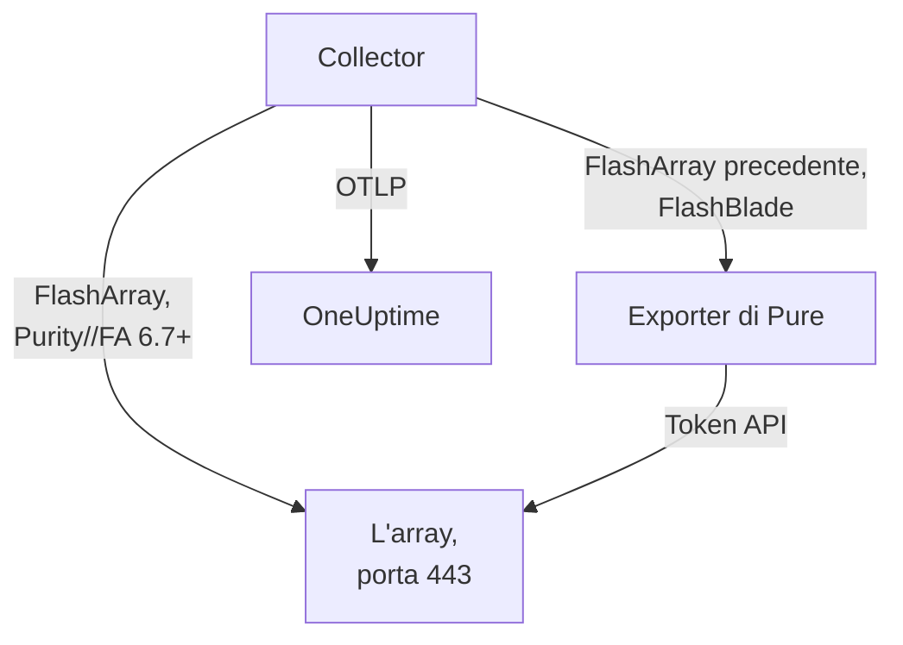

# Agent per array di storage

L'agent Storage Array di OneUptime monitora gli array di storage: capacità e riduzione dei dati, latenza, IOPS e larghezza di banda, volumi, host, pod e replica, stato dell'hardware, file system e bucket. È un OpenTelemetry Collector standard che raccoglie gli endpoint OpenMetrics dell'array con il token API di un utente in sola lettura, applica a ogni metrica l'identità del tuo array e la invia a OneUptime. I [monitor degli array di storage](/docs/monitor/storage-array-monitor) inviano avvisi su ciò che arriva.

:::cards
- [Installare l'agent](#installa-lagent): Un utente in sola lettura, poi lo script di installazione o Docker Compose.
- [Cosa raccoglie l'agent](#cosa-raccoglie-lagent): Ogni endpoint e le pagine costruite a partire da esso.
- [Monitorare più array](#monitorare-più-array): Un agent per array, su una sola macchina.
- [Risoluzione dei problemi](#risoluzione-dei-problemi): Uno script di diagnostica, e i problemi più comuni.
:::

## Come funziona

Storage Arrays è un prodotto che funziona allo stesso modo per ogni produttore. Supporta:

| Array | Come l'agent lo legge | Configurazione del collector |
| --- | --- | --- |
| **Pure Storage FlashArray**, Purity//FA 6.7 e successivi | L'endpoint OpenMetrics proprio dell'array (`https://<array>/metrics/...?namespace=purefa`): accanto al collector non gira nulla | `otel-collector-config.yaml` (quella predefinita) |
| **Pure Storage FlashArray**, Purity//FA precedente | L'exporter OpenMetrics per FlashArray di Pure, che lo stesso file Compose esegue come servizio `pure-fa-exporter` | `otel-collector-config.flasharray-exporter.yaml` |
| **Pure Storage FlashBlade** | L'exporter OpenMetrics per FlashBlade di Pure, che lo stesso file Compose esegue come servizio `pure-fb-exporter` | `otel-collector-config.flashblade.yaml` |

Pure Storage ha cambiato nome in **Everpure** a febbraio 2026. FlashArray, FlashBlade e Purity hanno mantenuto il loro nome, così come le metriche `purefa_*` e `purefb_*`, quindi tutto ciò che c'è in questa pagina vale per gli array venduti con l'uno o l'altro nome.



Un agent monitora un array: esegui un agent per array (vedi [Monitorare più array](#monitorare-più-array)). L'array si registra con i suoi primi dati, con il nome che l'agent applica a ogni metrica come `storage.array.name`.

## Prima di iniziare

- Docker Engine 20.10 o successivo con il plugin Docker Compose v2, su una macchina che raggiunge l'interfaccia di gestione dell'array via HTTPS (TCP 443).
- Un account amministratore sull'array, per creare un utente con il ruolo integrato **readonly** e un token API per esso.
- Una chiave di acquisizione. Creane una in **Impostazioni del progetto → Telemetria e APM → Chiavi di acquisizione** e copiane il valore.

### Dove eseguire l'agent

L'agent comunica con l'interfaccia di gestione dell'array via HTTPS, quindi può girare su qualsiasi macchina con Docker e un percorso verso la rete di gestione su TCP 443: un host di monitoraggio o una piccola VM di gestione. Preferisci una macchina il cui storage non risieda sull'array che sorveglia: se l'array cade, il tuo monitoraggio non dovrebbe cadere con lui. Il listener syslog facoltativo richiede anche che l'array raggiunga l'agent sulla porta syslog (vedi [Inviare il syslog dell'array](#facoltativo-inviare-il-syslog-dellarray)).

## Installa l'agent

:::steps
### Creare l'utente in sola lettura e il token API

L'agent legge e basta. Dagli un utente dedicato con il ruolo integrato **readonly**, mai un amministratore, e un token API per quell'utente. Crea il token **senza scadenza**, altrimenti l'agent si ferma il giorno in cui il token scade.

:::tabs
@tab Purity CLI
Collegati via SSH alla FlashArray come amministratore. Il primo comando chiede la password del nuovo utente; il secondo stampa il suo token API, un UUID:

```bash
pureadmin create --role readonly oneuptime
pureadmin create --api-token oneuptime
```
@tab FlashArray GUI
1. Apri _Settings → Users and Policies_ (_Settings → Access_ nelle release precedenti).
2. Dal menu ⋮ del pannello **Users**, scegli **Create User…**, chiama l'utente `oneuptime` e assegnagli il ruolo readonly.
3. Dal menu ⋮ del nuovo utente, scegli **Create API Token…**, lascia vuoto **Expires In** e copia il token.
@tab FlashBlade
Crea allo stesso modo un utente con il ruolo **readonly** e un token API per esso: nelle impostazioni utente della GUI di FlashBlade, oppure con `pureadmin` nella CLI di Purity//FB. In una release senza utenti locali, usa un account di un servizio di directory (LDAP o Active Directory) il cui gruppo corrisponde al ruolo readonly. I token API di FlashBlade iniziano con `T-`.
:::

### Verificare se la FlashArray serve le proprie metriche

Pure documenta l'endpoint OpenMetrics nativo per **Purity//FA 6.7.0 e successivi** (l'avviso di deprecazione dell'exporter per FlashArray di Pure indica 6.6.11 e successivi). Il modo più rapido per saperlo è chiederlo all'array, dalla macchina su cui girerà l'agent:

```bash
curl -k 'https://<array>/metrics/array?namespace=purefa' --header 'Authorization: Bearer <api-token>' | grep purefa_info
```

Una riga `purefa_info{...} 1` significa che l'array serve le sue metriche in modo nativo: usa la configurazione predefinita. Un `404` significa di no: usa la configurazione con exporter, che esegue l'exporter di Pure accanto al collector. Pure ha deprecato quell'exporter, quindi passa alla configurazione nativa una volta aggiornato l'array. Una FlashBlade passa sempre dall'exporter per FlashBlade di Pure, quindi in quel caso salta questo passaggio.

### Installa e avvia l'agent

:::tabs
@tab install.sh
Scarica lo script di installazione ed eseguilo sulla macchina che ospiterà l'agent:

```bash
curl -sSL https://raw.githubusercontent.com/OneUptime/oneuptime/master/agents/StorageArrayAgent/install.sh -o install.sh
bash install.sh
```

Lo script chiede di che array si tratta (una FlashArray che serve metriche native, una FlashArray con un Purity//FA precedente o una FlashBlade), poi il tuo URL di OneUptime, la chiave di acquisizione, un nome per l'array, l'indirizzo di gestione dell'array e il token API dell'utente in sola lettura (letto senza eco). Si installa in `/opt/oneuptime-storage-array-agent`, scarica il file Compose e tutte e tre le configurazioni del collector, scrive un file con permessi `0600` chiamato `.env` con la configurazione e il profilo Compose corrispondenti e avvia l'agent con Docker Compose. Mette tra virgolette ogni valore per Docker Compose così come l'hai digitato. Eseguirlo di nuovo riutilizza tutto ciò che c'è in un `.env` esistente invece di chiedere di nuovo, e conserva un file che hai modificato come `<file>.bak.<timestamp>` prima di sostituirlo.
@tab Docker Compose
Scarica `docker-compose.yml` e i tre file `otel-collector-config*.yaml` dalla [directory StorageArrayAgent](https://github.com/OneUptime/oneuptime/tree/master/agents/StorageArrayAgent) in una nuova cartella:

```bash
curl -fsSLO https://raw.githubusercontent.com/OneUptime/oneuptime/master/agents/StorageArrayAgent/docker-compose.yml
curl -fsSLO https://raw.githubusercontent.com/OneUptime/oneuptime/master/agents/StorageArrayAgent/otel-collector-config.yaml
curl -fsSLO https://raw.githubusercontent.com/OneUptime/oneuptime/master/agents/StorageArrayAgent/otel-collector-config.flasharray-exporter.yaml
curl -fsSLO https://raw.githubusercontent.com/OneUptime/oneuptime/master/agents/StorageArrayAgent/otel-collector-config.flashblade.yaml
```

Crea un file `.env` accanto a essi. Contiene il token API, quindi tienilo privato con `chmod 600 .env`. Per una FlashArray che serve metriche native:

```bash title=".env"
ONEUPTIME_URL=YOUR_ONEUPTIME_URL
ONEUPTIME_TELEMETRY_INGESTION_KEY=YOUR_TELEMETRY_INGESTION_TOKEN
STORAGE_ARRAY_NAME=my-storage-array
STORAGE_SYSTEM=purestorage.flasharray
STORAGE_ARRAY_COLLECTOR_CONFIG=otel-collector-config.yaml
COMPOSE_PROFILES=
PURE_FA_ENDPOINT=fa-prod-01.example.com
PURE_FA_API_TOKEN=YOUR_READ_ONLY_API_TOKEN
PURE_FB_ENDPOINT=
PURE_FB_API_TOKEN=
STORAGE_ARRAY_INSECURE_SKIP_VERIFY=true
```

Per una FlashArray con un Purity//FA precedente, imposta `STORAGE_ARRAY_COLLECTOR_CONFIG=otel-collector-config.flasharray-exporter.yaml` e `COMPOSE_PROFILES=flasharray-exporter`. Per una FlashBlade, imposta `STORAGE_SYSTEM=purestorage.flashblade`, `STORAGE_ARRAY_COLLECTOR_CONFIG=otel-collector-config.flashblade.yaml` e `COMPOSE_PROFILES=flashblade`, e compila `PURE_FB_ENDPOINT` e `PURE_FB_API_TOKEN` al posto della coppia `PURE_FA_*`. Avvia l'agent:

```bash
docker compose up -d
```
:::

### Verifica che l'agent sia in esecuzione

```bash
docker compose ps
docker logs -f oneuptime-storage-array-agent
```

`docker compose ps` elenca il collector (`oneuptime-storage-array-agent`) e, con una configurazione con exporter, l'exporter (`pure-fa-exporter` o `pure-fb-exporter`). Una volta avviato, i log del collector dovrebbero mostrare questa riga:

```text
Everything is ready. Begin running and processing data.
```

### Trovare l'array in OneUptime

Apri **Prodotti → Infrastruttura → Storage Arrays → All Storage Arrays**. Dopo la prima raccolta (circa un minuto) l'array è lì con capacità, prestazioni, avvisi aperti e hardware. Volumi, host e pod arrivano entro 2 minuti, i file system e i bucket di una FlashBlade entro 5, e le directory della FlashArray entro 30.
:::

## Variabili d'ambiente

Lo script di installazione le scrive in `/opt/oneuptime-storage-array-agent/.env`; un'installazione con Docker Compose le legge dal `.env` accanto a `docker-compose.yml`. Dopo averne cambiata una, esegui `docker compose up -d` in quella cartella.

| Variabile | Obbligatoria | Descrizione |
| --- | --- | --- |
| `ONEUPTIME_URL` | Sì | Il tuo URL di OneUptime, come `https://oneuptime.com` o la tua istanza self-hosted. Usa `http://` e la sua porta se l'istanza usa solo HTTP. |
| `ONEUPTIME_TELEMETRY_INGESTION_KEY` | Sì | La chiave di acquisizione da **Impostazioni del progetto → Telemetria e APM → Chiavi di acquisizione**. |
| `STORAGE_ARRAY_NAME` | Sì | Il nome con cui l'array si registra in OneUptime, applicato a ogni metrica come attributo di risorsa `storage.array.name`. Mantienilo stabile: cambiarlo in seguito registra un secondo array. Senza di esso il collector rifiuta di avviarsi. |
| `STORAGE_SYSTEM` | No | La piattaforma, applicata come attributo di risorsa `storage.system`: `purestorage.flasharray` o `purestorage.flashblade`. Il valore predefinito è `purestorage.flasharray`. |
| `STORAGE_ARRAY_COLLECTOR_CONFIG` | No | Quale configurazione fornita del collector viene eseguita: `otel-collector-config.yaml` (FlashArray, nativa: quella predefinita), `otel-collector-config.flasharray-exporter.yaml` (FlashArray precedente) o `otel-collector-config.flashblade.yaml` (FlashBlade). |
| `COMPOSE_PROFILES` | No | Avvia l'exporter che la configurazione scelta raccoglie: vuoto per la configurazione nativa della FlashArray, `flasharray-exporter` o `flashblade` per le altre due. |
| `PURE_FA_ENDPOINT` | FlashArray | L'indirizzo di gestione della FlashArray: un nome host o un IP, senza `https://`. |
| `PURE_FA_API_TOKEN` | FlashArray | Il token API dell'utente della FlashArray con il ruolo readonly. |
| `PURE_FB_ENDPOINT` | FlashBlade | L'indirizzo di gestione della FlashBlade: un nome host o un IP, senza `https://`. |
| `PURE_FB_API_TOKEN` | FlashBlade | Il token API dell'utente della FlashBlade con il ruolo readonly. |
| `STORAGE_ARRAY_INSECURE_SKIP_VERIFY` | No | `true` accetta il certificato autofirmato dell'array sull'endpoint nativo; `false` lo verifica. Il valore predefinito è `true`. Gli exporter di Pure non verificano mai il certificato dell'array, quindi non si applica a loro. |

## Come raccoglie l'agent

- **Un job di raccolta per endpoint, ciascuno letto con la frequenza che merita.** FlashArray: `/metrics/array` ogni 60 secondi; `/metrics/volumes`, `/metrics/hosts` e `/metrics/pods` ogni 2 minuti; `/metrics/directories` ogni 30 minuti, come consiglia la stessa Pure, perché per l'array lo spazio delle directory è costoso da calcolare. FlashBlade: `/metrics/array` ogni 60 secondi; `/metrics/filesystems` e `/metrics/objectstore` ogni 5 minuti, sempre secondo il consiglio di Pure di leggere gli endpoint dei file system e dell'object store meno spesso dell'array.
- **Ogni job etichetta le sue serie con `scrape_endpoint: <endpoint>`.** Ogni endpoint esporta anche `purefa_info` o `purefb_info`, così OneUptime sa di quali famiglie un batch è l'elenco completo: è così che un volume, un host, un pod, un file system o un bucket eliminato esce dall'inventario invece di restarci. Mantieni le etichette come fornite.
- **La latenza per volume e per host mantiene tre dimensioni.** Ogni volume e ogni host esporta la sua latenza in un massimo di sedici `dimension`. Una regola `metric_relabel_configs` mantiene `usec_per_read_op`, `usec_per_write_op` e `usec_per_mirrored_write_op` e scarta la suddivisione per limite di velocità QoS, coda, SAN e tempo di servizio, che moltiplica le serie di un array grande. La suddivisione a livello di array su `purefa_array_performance_latency_usec` viene mantenuta. Elimina la regola per mantenere anche la suddivisione per volume.
- **Il token API è un token Bearer.** La configurazione nativa lo invia all'array stesso; le configurazioni con exporter lo inviano all'exporter solo sulla rete Compose, e le porte degli exporter non vengono mai pubblicate.
- **Nessun `send_batch_max_size`.** OneUptime ricostruisce l'inventario da un'intera raccolta per richiesta, quindi il processor `batch` fornito non divide mai una raccolta tra più esportazioni. Mantieni le impostazioni del batch come fornite.

## Cosa raccoglie l'agent

Le convenzioni semantiche di Pure sono condivise dall'endpoint nativo della FlashArray e da entrambi gli exporter. Ogni valore è un gauge che l'array calcola da sé (latenze in microsecondi per operazione, throughput al secondo), quindi non c'è da calcolare nessun tasso, e gli oggetti sono nominati da **etichette dei datapoint**: `name` per volumi, pod, directory, file system e bucket, `host` per gli host, `component_name` per l'hardware della FlashArray. L'agent aggiunge gli attributi di risorsa `storage.array.name` e `storage.system`, così OneUptime archivia tutto sotto il tuo array:

| Endpoint | Famiglie di metriche | Cosa OneUptime ne costruisce |
| --- | --- | --- |
| FlashArray `/metrics/array` | `purefa_info`, `purefa_alerts_open`, `purefa_array_space_*`, `purefa_array_performance_*`, `purefa_hw_component_status`, `purefa_hw_component_temperature_celsius`, `purefa_hw_controller_info`, `purefa_drive_capacity_bytes`, `purefa_network_interface_*` | Il nome, la versione di Purity e l'ID di sistema dell'array; capacità, spazio usato e riduzione dei dati; numero di avvisi aperti; lo stato dell'array; la pagina **Hardware** (componenti, unità, controller, interfacce di rete) |
| FlashArray `/metrics/volumes` | `purefa_volume_performance_*`, `purefa_volume_space_*`, `purefa_volume_qos_*` | La pagina **Volumi**: dimensione allocata e fisica, riduzione dei dati, latenza di lettura e scrittura, IOPS e larghezza di banda per volume |
| FlashArray `/metrics/hosts` | `purefa_host_connectivity_info`, `purefa_host_connections_info`, `purefa_host_performance_*`, `purefa_host_space_*` | La pagina **Host**: connettività (percorsi ridondanti o no), volumi connessi, latenza, IOPS e larghezza di banda per host |
| FlashArray `/metrics/pods` | `purefa_pod_performance_*`, `purefa_pod_space_*`, `purefa_pod_replica_links_*`, `purefa_pod_mediator_status` | La pagina **Replication**: pod ActiveCluster e ActiveDR, stato e ritardo dei collegamenti di replica |
| FlashArray `/metrics/directories` | `purefa_directory_performance_*`, `purefa_directory_space_*` | La pagina **Directories** (FlashArray File Services) |
| FlashBlade `/metrics/array` | `purefb_info`, `purefb_alerts_open`, `purefb_array_space_*`, `purefb_array_performance_*`, `purefb_hardware_health` | Il nome, la versione di Purity e l'ID di sistema della FlashBlade; capacità e riduzione dei dati; numero di avvisi aperti; lo stato dell'array; la pagina **Hardware** |
| FlashBlade `/metrics/filesystems` | `purefb_file_systems_space_*`, `purefb_file_systems_performance_*` | La pagina **File Systems**: spazio allocato e usato, riduzione dei dati, latenza, IOPS e larghezza di banda per file system |
| FlashBlade `/metrics/objectstore` | `purefb_buckets_space_*`, `purefb_buckets_quota_space_bytes`, `purefb_buckets_object_count`, `purefb_buckets_performance_*`, `purefb_object_store_accounts_*` | La pagina **Buckets**: spazio, quota, numero di oggetti e prestazioni per bucket, raggruppati per account |

Lo stato dell'array nella sua pagina **Panoramica** è **Critico** finché segnala un avviso critico aperto, o un componente hardware, un'unità o un controller critico, guasto, mancante o non integro; **Warning** finché segnala un avviso di avvertimento aperto, o un componente degradato o sconosciuto; e **OK** altrimenti. Nei criteri dei monitor gli attributi dell'array prendono il prefisso `resource.` (`resource.storage.array.name`, `resource.storage.system`), mentre le etichette dei datapoint restano senza prefisso (`name`, `host`, `dimension`, `space`).

## Facoltativo — Inviare il syslog dell'array

Per impostazione predefinita l'agent invia solo metriche, quindi la pagina **Registri** dell'array resta vuota. Gli array inoltrano i loro avvisi e gli eventi di audit come syslog, e ogni configurazione fornita del collector contiene una coppia di receiver `syslog` commentati (TCP e UDP sulla porta 5514, RFC 3164), collegati a una pipeline `logs` commentata che applica `storage.array.name` così che i log arrivino al tuo array.

:::steps
### Attivare i receiver

Togli il commento ai due receiver `syslog/*` e alla pipeline `logs` nella configurazione del collector che usi. I timestamp RFC 3164 non hanno fuso orario: imposta `location` sul fuso orario dell'array, a meno che il suo orologio non sia in UTC.

### Aprire la porta

Togli il commento al blocco `ports:` in `docker-compose.yml`, così che la macchina pubblichi `5514/tcp` e `5514/udp`, poi esegui `docker compose up -d`. Apri la porta nel firewall della macchina per la rete di gestione dell'array.

### Puntare l'array all'agent

Fallo come amministratore, non come utente di monitoraggio in sola lettura. Su una FlashArray, apri _Settings → System → Syslog Servers_, aggiungi `udp://<agent-host>:5514` (o `tcp://<agent-host>:5514`) e invia un messaggio di prova. Su una FlashBlade, aggiungi un server syslog con lo stesso URI nelle sue impostazioni syslog. Entrambi gli array accettano la forma `PROTOCOL://HOST:PORT`, anche tramite le loro API REST (`syslog-servers`).
:::

Un receiver syslog è in ascolto su un solo trasporto, ed è per questo che TCP e UDP sono due receiver: lasciane uno commentato se ti serve solo l'altro. L'immagine standard del collector legge il syslog così com'è: non serve un'immagine personalizzata.

## Etichettare l'array con le etichette di progetto

Un attributo di risorsa che inizia con `oneuptime.label.` diventa un'etichetta di progetto sull'array di storage: `oneuptime.label.<dimension>=<value>` è l'etichetta `<dimension>:<value>`. Aggiungi gli attributi al processor `resource` nella configurazione del collector che usi, accanto a `storage.array.name`:

```yaml
processors:
  resource:
    attributes:
      # ...existing attributes...
      - key: oneuptime.label.team
        value: storage
        action: upsert
      - key: oneuptime.label.env
        value: production
        action: upsert
```

Il collector legge la sua configurazione solo all'avvio: esegui `docker compose restart oneuptime-storage-array-agent`. L'array mostra quindi le etichette `team:storage` e `env:production`. Le etichette vengono confrontate senza distinguere maiuscole e minuscole, quindi un'etichetta `Production` esistente viene riutilizzata invece che duplicata, e l'agent non rimuove mai un'etichetta che qualcuno ha aggiunto in OneUptime.

## Monitorare più array

Un agent legge un array. Per monitorarne diversi dalla stessa macchina, installa ciascuno nella propria cartella con il proprio `.env`, come `INSTALL_DIR=/opt/oneuptime-storage-array-agent-fa02 bash install.sh`, e dai a ciascuno il proprio `container_name` nel suo `docker-compose.yml` (come `oneuptime-storage-array-agent-fa02`): due container non possono condividere un nome. Passa la cartella allo script di diagnostica con `-d`.

## Eseguire come servizio systemd

Per avviare l'agent insieme alla macchina e riavviarlo quando si blocca, installa la sua unità systemd. Presuppone che l'agent si trovi in `/opt/oneuptime-storage-array-agent`, dove lo mette lo script di installazione:

```bash
sudo curl -fsSL https://raw.githubusercontent.com/OneUptime/oneuptime/master/agents/StorageArrayAgent/systemd/oneuptime-storage-array-agent.service -o /etc/systemd/system/oneuptime-storage-array-agent.service
sudo systemctl daemon-reload
sudo systemctl enable --now oneuptime-storage-array-agent
```

## Aggiornare l'agent

L'agent riporta come sua **Versione dell'agente** la versione del collector fissata dai suoi file. Quando è più vecchia della versione fissata da questa release di OneUptime, compare un segnale di avviso accanto a essa nella pagina **Panoramica** dell'array. Selezionalo per vedere questi comandi. Un agent installato prima che i suoi file riportassero una versione non ne mostra nessuna finché non viene aggiornato in questo modo.

L'immagine del collector è fissata in `docker-compose.yml` e le sue configurazioni sono file accanto, quindi scaricare le immagini da solo non porta avanti l'agent. Esegui di nuovo `install.sh`: riutilizza ogni valore del tuo `.env` esistente (non viene chiesto nulla di nuovo), aggiorna `docker-compose.yml` e le tre configurazioni del collector (un file che hai modificato viene conservato come `<file>.bak.<timestamp>`) e ricrea l'agent così che il collector legga la sua nuova configurazione. Un agent installato fuori da `/opt/oneuptime-storage-array-agent` ha bisogno della sua cartella: `INSTALL_DIR=<folder> bash install.sh`.

```bash
curl -sSL https://raw.githubusercontent.com/OneUptime/oneuptime/master/agents/StorageArrayAgent/install.sh -o install.sh
bash install.sh
```

L'hai installato invece con Docker Compose? Nella cartella dell'agent, scarica di nuovo il file Compose e le tre configurazioni del collector (e rifai le eventuali modifiche che ci avevi apportato), poi scarica le immagini e ricrea l'agent:

```bash
curl -fsSLO https://raw.githubusercontent.com/OneUptime/oneuptime/master/agents/StorageArrayAgent/docker-compose.yml
curl -fsSLO https://raw.githubusercontent.com/OneUptime/oneuptime/master/agents/StorageArrayAgent/otel-collector-config.yaml
curl -fsSLO https://raw.githubusercontent.com/OneUptime/oneuptime/master/agents/StorageArrayAgent/otel-collector-config.flasharray-exporter.yaml
curl -fsSLO https://raw.githubusercontent.com/OneUptime/oneuptime/master/agents/StorageArrayAgent/otel-collector-config.flashblade.yaml
docker compose pull
docker compose up -d --force-recreate
```

## Disinstallare l'agent

```bash
cd /opt/oneuptime-storage-array-agent
docker compose down
```

Poi elimina l'utente in sola lettura e il suo token API sull'array, se non ti servono più.

## Risoluzione dei problemi

:::details Esegui prima lo script di diagnostica
L'agent include uno script, [`troubleshoot.sh`](https://github.com/OneUptime/oneuptime/blob/master/agents/StorageArrayAgent/troubleshoot.sh), che controlla l'intera catena: il runtime dei container; l'endpoint dell'array esattamente come lo raggiunge il collector (l'endpoint nativo o l'exporter di Pure: DNS, TLS, se una FlashArray ha davvero l'endpoint nativo e se l'array accetta il token API, che lo script passa a curl su stdin); il nome dell'array applicato a ogni metrica; la forma del token; le metriche proprie del collector; e se OneUptime accetta la chiave di acquisizione. Quest'ultimo controllo è il più importante. OneUptime rifiuta una chiave errata con `401` (`422` per una chiave disattivata o una chiave del browser), e il collector tratta entrambi come definitivi: scarta il batch e registra un unico errore `Exporting failed`, facile da non notare mentre il container resta in salute. Lo script interroga `GET <url>/otlp/v1/validate` dall'interno della rete dell'agent per ottenere direttamente `200` (valida) o `401` (non valida), e sui server più vecchi ripiega su `POST /fluentd/v1/logs`.

```bash
curl -sSL https://raw.githubusercontent.com/OneUptime/oneuptime/master/agents/StorageArrayAgent/troubleshoot.sh -o troubleshoot.sh
bash troubleshoot.sh    # add -d <dir> if you installed outside /opt/oneuptime-storage-array-agent
```

Termina con un verdetto che indica la causa più probabile.
:::

:::details Non compare alcun array in OneUptime
1. Leggi i log del collector: `docker logs oneuptime-storage-array-agent`. `server returned HTTP status 401` indica che l'array ha rifiutato il token API, `404` che la FlashArray non ha un endpoint nativo, `x509` che la verifica TLS è attiva contro il certificato autofirmato dell'array, `no such host` o `connection refused` un `PURE_FA_ENDPOINT` o `PURE_FB_ENDPOINT` errato, e un `401` in esportazione una chiave di acquisizione errata.
2. Interroga l'array dalla rete dell'agent. L'immagine del collector non ha né shell né curl, quindi chiedi da un container nella sua rete: `docker run --rm --network container:oneuptime-storage-array-agent curlimages/curl -sk -H 'Authorization: Bearer <api-token>' 'https://<array>/metrics/array?namespace=purefa'` dovrebbe stampare righe `purefa_*`.
3. Verifica che `STORAGE_ARRAY_NAME` sia impostato: l'array viene trovato tramite il suo attributo di risorsa `storage.array.name`, e senza di esso il collector rifiuta di avviarsi.
:::

:::details L'array risulta disconnesso
Un array risulta disconnesso quando OneUptime non ha ricevuto nulla da esso per 15 minuti; OneUptime controlla ogni 5 minuti, e il tempo in cui era OneUptime stesso a non ricevere dati non conta. Verifica che il collector sia in esecuzione (`docker compose ps`), che i suoi log non mostrino errori di raccolta o di esportazione, e che la macchina raggiunga ancora l'array e il tuo URL di OneUptime. L'array torna connesso con i dati successivi.
:::

:::details La FlashArray risponde 404
Il suo Purity//FA non ha un endpoint OpenMetrics nativo. Esegui di nuovo `install.sh` e scegli l'opzione per Purity precedente, oppure imposta `STORAGE_ARRAY_COLLECTOR_CONFIG=otel-collector-config.flasharray-exporter.yaml` e `COMPOSE_PROFILES=flasharray-exporter` in `.env` ed esegui `docker compose up -d`. Dopo aver aggiornato l'array a Purity//FA 6.7 o successivo, torna alla configurazione nativa e rimuovi il profilo.
:::

:::details L'array rifiuta il token API
Verifica di aver incollato il token API e non la password dell'utente, che l'utente esista ancora e abbia il ruolo readonly, e che il token non sia scaduto. Crea un nuovo token (`pureadmin create --api-token oneuptime` su una FlashArray), inseriscilo in `.env` ed esegui `docker compose up -d`. Tramite gli exporter di Pure, un token rifiutato compare nel log del collector come un HTTP `400` dall'exporter, il cui corpo riporta `failed to login`.
:::

:::details Errori x509 o TLS
Gli array presentano per impostazione predefinita un certificato autofirmato, di cui nessuna immagine Docker si fida. Imposta `STORAGE_ARRAY_INSECURE_SKIP_VERIFY=true` (la scelta pratica su una rete di gestione privata), oppure installa sull'array un certificato di una CA di cui l'immagine del collector si fida.
:::

:::details pure-fa-exporter o pure-fb-exporter non viene risolto
L'exporter non è in esecuzione: `COMPOSE_PROFILES` deve corrispondere a `STORAGE_ARRAY_COLLECTOR_CONFIG` (`flasharray-exporter` per la configurazione con l'exporter per FlashArray, `flashblade` per la configurazione FlashBlade). Correggi `.env` ed esegui `docker compose up -d`; `docker compose ps` elencherà allora l'exporter.
:::

:::details Volumi o host eliminati restano nell'inventario
OneUptime rimuove un oggetto quando una raccolta completa del suo endpoint non lo contiene più, cosa che riconosce dall'etichetta `scrape_endpoint`. Se hai sostituito la configurazione fornita del collector con la tua, mantieni le etichette `scrape_endpoint` sui suoi job di raccolta; altrimenti gli oggetti escono dall'inventario solo quando diventano obsoleti.
:::

:::details Le metriche finiscono sotto l'array sbagliato
OneUptime registra un array di storage tramite il suo `storage.array.name`, che l'agent prende da `STORAGE_ARRAY_NAME`. Cambiarlo dopo i primi dati crea un secondo array invece di rinominare il primo.
:::

:::details Inviare metriche senza l'agent
L'agent è un'unica configurazione standard del collector, quindi i collector che esegui già possono fare lo stesso lavoro: copia i job di raccolta e il processor `resource` dalla configurazione fornita nella tua. L'attributo di risorsa `storage.array.name` è ciò che registra l'array in OneUptime, e le eliminazioni di `service.name` / `service.instance.id` evitano che i dati vengano archiviati sotto un servizio: mantieni entrambi, e mantieni le etichette `scrape_endpoint`.
:::

## Passaggi successivi

:::cards
- [Monitor array di storage](/docs/monitor/storage-array-monitor): Avvisi su avvisi, capacità, latenza, hardware, percorsi degli host, replica e file system.
- [Agent VMware](/docs/telemetry/vmware): Usi VMware sull'array? Vedi anche i suoi datastore e le sue VM.
- [Collector OpenTelemetry sull'host](/docs/telemetry/host-otel-collector): La vista del sistema operativo delle macchine che usano l'array.
:::
