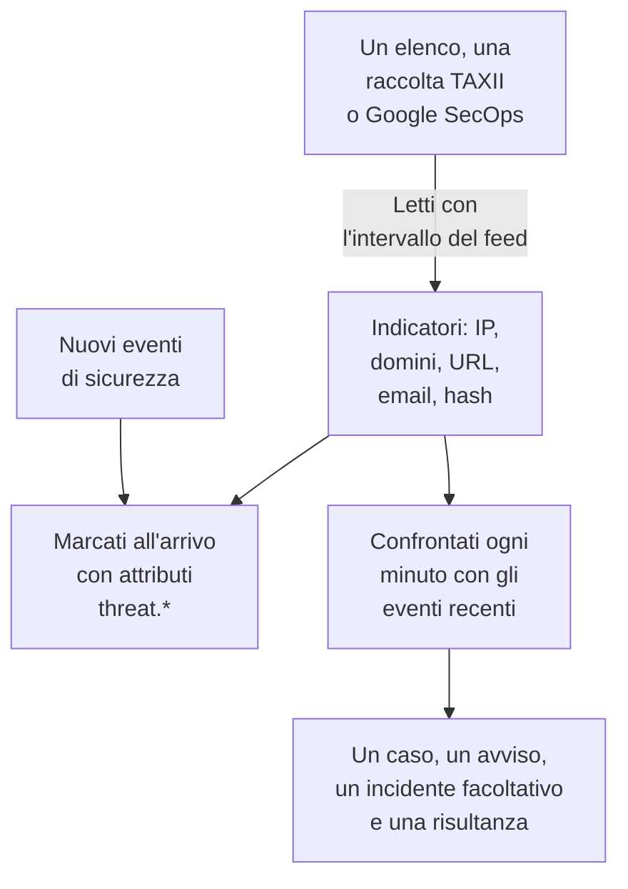

# Intelligence sulle minacce (STIX/TAXII)

Un feed di threat intelligence porta in OneUptime indirizzi IP, domini, URL, indirizzi email e hash di file malevoli noti, e ti avvisa quando i tuoi [eventi di sicurezza](/docs/telemetry/security-events) ne menzionano uno. Un feed legge una sola origine: un elenco di indicatori a un indirizzo https, come gli elenchi gratuiti che OneUptime aggiunge con un clic, una raccolta TAXII 2.1 di indicatori STIX 2.1 dal tuo server MISP, OpenCTI o OpenTAXII o da un fornitore, oppure gli indicatori che Google SecOps ha trovato nei tuoi eventi.

:::cards
- [Aggiungere un elenco gratuito](#aggiungere-un-elenco-gratuito): Feodo Tracker, Emerging Threats e i nodi di uscita Tor, con un clic.
- [Abbonarsi a un feed](#abbonarsi-a-un-feed): L'indirizzo di un elenco, una raccolta TAXII o una connessione Google SecOps.
- [Cosa viene acquisito](#cosa-viene-acquisito): I pattern di indicatori che OneUptime conserva, e per quanto tempo.
- [Come si trovano le corrispondenze](#come-si-trovano-le-corrispondenze): Marcate all'arrivo degli eventi e confrontate ogni minuto.
- [Livelli di minaccia](#livelli-di-minaccia): Come la confidenza di un indicatore diventa una gravità.
:::

## Come funziona



## Prima di iniziare

- Per un elenco, un indirizzo `https` che scarichi un file di testo con un indicatore per riga.
- Per un feed TAXII, un server TAXII 2.1 che pubblichi oggetti STIX 2.1 di tipo `indicator`, e l'ID della raccolta da interrogare. Un feed TAXII accede in modo anonimo, con un token bearer o con l'autenticazione HTTP basic.
- Per un feed Google SecOps, una [connessione Google SecOps](/docs/integrations/google-secops#configurare-il-connettore-gestito) il cui account di servizio possa cercare le corrispondenze degli indicatori: il ruolo `roles/chronicle.viewer` può farlo.
- I server che richiedono un certificato client TLS (TLS reciproco), come CISA AIS, non sono supportati. Il server ATT&CK pubblico di MITRE pubblica tecniche e gruppi invece di indicatori, quindi un feed puntato su di esso resta vuoto.
- Un ruolo che possa creare feed: Project Owner, Project Admin, Security Admin o Security Member. Security Viewer può leggere feed e indicatori. Vedi [Ruoli](/docs/permissions/reference#ruoli).

## Aggiungere un elenco gratuito

La scheda **Elenchi gratuiti** in **Threat Intel** aggiunge un elenco di blocco gratuito con un clic: fai clic su **Aggiungi elenco** su un elenco, e OneUptime crea un feed che lo scarica secondo la pianificazione dell'elenco. Un elenco che il progetto legge già mostra **Aggiunto**.

| Elenco | Pubblicato da | Lettura | Confidenza | Una corrispondenza apre |
| --- | --- | --- | --- | --- |
| Server C2 di botnet di Feodo Tracker | abuse.ch | Ogni ora | 90, Critical | Un caso e un avviso |
| Host compromessi di Emerging Threats | Proofpoint Emerging Threats | Ogni giorno | 70, High | Un caso e un avviso |
| Nodi di uscita Tor | The Tor Project | Ogni ora | 30, Low | Un caso |

Il riquadro di un elenco rimanda ai suoi termini: Feodo Tracker è libero per qualsiasi uso (CC0), e l'elenco di Emerging Threats ha licenza BSD. Un feed aggiunto da un elenco si modifica e si elimina come qualsiasi altro.

## Abbonarsi a un feed

:::steps
### Apri Threat Intel

Apri **Prodotti → Security Events → Rilevamenti → Threat Intel**.

### Crea il feed

Fai clic su **Crea: Feed di threat intel** e scegli la sua **Origine**: **Elenco di indicatori**, **Raccolta TAXII** o **Google SecOps**. Il passo successivo chiede solo quella origine: l'**URL dell'elenco** per un elenco, il **Server TAXII** e l'**Accesso** per una raccolta, oppure la **Connessione Google SecOps**. **In caso di corrispondenza** viene per ultimo. I campi sono nella tabella qui sotto.

### Controlla la prima interrogazione

Entro un paio di minuti la riga del feed mostra **Ultima interrogazione**, e **Riepilogo dell'ultima interrogazione** dice cosa ha recuperato l'interrogazione. Gli indicatori compaiono nella tabella **Indicatori**, sotto i feed.
:::

| Campo | Cosa inserire |
| --- | --- |
| **Origine** | Da dove arrivano gli indicatori. Si imposta quando il feed viene creato: un feed di un'altra origine è un nuovo feed. |
| **URL dell'elenco** | Per un elenco: l'indirizzo `https` di un file di testo con un indirizzo IP, un dominio, un URL o un hash di file per riga. |
| **Confidenza** | Per un elenco: quanto è sicuro l'elenco, da 1 a 100. Ogni indicatore dell'elenco lo riceve, e stabilisce il [livello di minaccia](#livelli-di-minaccia); vuoto vale Medium. |
| **Connessione Google SecOps** | Per Google SecOps: la connessione la cui chiave legge gli indicatori che Google SecOps ha trovato. **Connetti Google SecOps** apre **Connessioni** quando non ce n'è nessuna. |
| **URL radice dell'API TAXII** | La radice dell'API TAXII 2.1 del server, come `https://taxii.example.com/api1/`. Le raccolte si indirizzano sotto di essa. |
| **ID della raccolta** | La raccolta che pubblica gli indicatori. |
| **Intervallo di interrogazione (minuti)** | Ogni quanto leggere l'origine: da 1 a 1440 minuti, 60 per impostazione predefinita. Un elenco si legge al massimo ogni 15 minuti. |
| **Confidenza minima** | Per una raccolta TAXII o Google SecOps: gli indicatori con una confidenza più bassa vengono saltati, da 0 a 100, e 0 tiene tutto. Gli indicatori senza confidenza passano sempre. |
| **Accesso** | Come accede OneUptime: **Nessun accesso** per una raccolta pubblica, **Token bearer** per un token fornito dall'operatore del server, o **Nome utente e password** per l'autenticazione HTTP basic. |
| **Token API**, **Nome utente Basic Auth** e **Password Basic Auth** | Richiesti solo per l'accesso scelto. |
| **Apri un caso in caso di corrispondenza** | Attivo per impostazione predefinita: ogni evento che nomina un indicatore apre un [caso](/docs/telemetry/security-cases) su di esso, o si aggiunge al caso aperto che già lo riguarda. |
| **Avvisi e incidenti** | **Crea un avviso** per impostazione predefinita: ogni indicatore corrispondente apre un avviso. |
| **Gravità avviso** | La gravità di ogni avviso aperto da questo feed. Lasciala vuota per prendere il livello di minaccia di ogni indicatore. |
| **Dichiara un incidente** o **Entrambi** | In **Avvisi e incidenti**. Gli incidenti guidano l'escalation della reperibilità, gli SLA e le pagine di stato, e per le corrispondenze di indicatori di solito bastano gli avvisi. |
| **Gravità incidente** | Come **Gravità avviso**, per gli incidenti. |
| **Scrivi un Detection Finding in caso di corrispondenza** | Attivo per impostazione predefinita: ogni corrispondenza scrive una risultanza nel flusso di eventi. |

Token e password di un feed TAXII vengono cifrati e non sono più mostrati dopo il salvataggio. Per cambiarli, scegli **Aggiorna le credenziali** nella riga del feed e poi **Token bearer**, **Nome utente e password** o **Nessun accesso**, che cancella quanto salvato: la tua scelta sostituisce l'accesso del feed, quindi salvare un token cancella una password salvata, e viceversa.

### Come viene interrogato un feed

Ogni interrogazione chiede gli oggetti aggiunti dalla precedente, tramite il cursore TAXII `added_after`, e legge fino a 10 pagine da 500 oggetti. Una raccolta grande si sincronizza quindi in più interrogazioni: **Riepilogo dell'ultima interrogazione** dice quando restano pagine. Per finire prima una grande prima sincronizzazione, abbassa il **Intervallo di interrogazione (minuti)**, fino a 1, finché non si mette in pari.

Le interrogazioni si identificano con lo user agent `OneUptime/<version> (+https://oneuptime.com)`. Se il firewall del fornitore risponde `403`, chiedigli di consentirlo: molti firewall bloccano le richieste che sembrano uno script senza nome.

Un feed disattivato non viene né interrogato né confrontato. Gli indicatori che ha già continuano a marcare i nuovi eventi finché non scadono.

### Come viene letto un elenco

- Ogni interrogazione scarica l'intero elenco e lo legge una riga alla volta: il primo valore di una riga, fino a uno spazio, una tabulazione, una virgola o un punto e virgola. Le righe che iniziano con `#`, `;` o `//` sono commenti, la porta dopo un indirizzo o un dominio viene tolta, e un intervallo di indirizzi come `198.51.100.0/24` viene saltato.
- Un valore resta un indicatore attivo per 2 giorni dopo l'interrogazione che l'ha letto per ultima, e un valore che l'elenco toglie smette di corrispondere all'interrogazione successiva. Un elenco che non è cambiato viene riscritto una volta al giorno.
- Un elenco contiene al massimo 50.000 indicatori. **Riepilogo dell'ultima interrogazione** dice quanti ne sono stati letti, quante righe sono state saltate e quanti sono stati lasciati fuori.
- L'indirizzo deve usare `https` e segue le stesse regole in uscita di una connessione: su OneUptime Cloud un indirizzo privato viene rifiutato.

### Come viene letto Google SecOps

- Ogni interrogazione legge le corrispondenze degli indicatori che Google SecOps ha registrato dall'interrogazione precedente, con gli attributi di Mandiant: il dominio, l'indirizzo o l'hash di file corrispondente, la sua confidenza, la sua categoria e le campagne e gli attori a cui è legato. La prima interrogazione legge gli ultimi 7 giorni.
- Un indicatore resta attivo per 30 giorni dopo l'ultima volta che Google SecOps l'ha visto, o finché la sua origine non dice che smette di essere attivo, e uno che un analista ha silenziato in Google SecOps smette di corrispondere anche qui.
- Una corrispondenza che Google SecOps segna come violazione attiva è Critical, e una ad alta priorità è almeno High.

## Cosa viene acquisito

Da una raccolta TAXII, OneUptime conserva gli oggetti STIX di tipo `indicator` il cui pattern è una semplice uguaglianza su uno di questi tipi. Un elenco e Google SecOps danno gli stessi tipi:

| Tipo | Pattern di esempio |
| --- | --- |
| Indirizzo IPv4 (`ipv4-addr`) | `[ipv4-addr:value = '198.51.100.7']` |
| Indirizzo IPv6 (`ipv6-addr`) | `[ipv6-addr:value = '2001:db8::7']` |
| Nome di dominio (`domain-name`) | `[domain-name:value = 'evil.example']` |
| URL (`url`) | `[url:value = 'http://evil.example/payload']` |
| Indirizzo email (`email-addr`) | `[email-addr:value = 'billing@evil.example']` |
| Hash di file, SHA-256 (`file-hash-sha256`) | `[file:hashes.'SHA-256' = 'e3b0…b855']` |
| Hash di file, SHA-1 (`file-hash-sha1`) | `[file:hashes.'SHA-1' = 'da39…0709']` |
| Hash di file, MD5 (`file-hash-md5`) | `[file:hashes.MD5 = 'd41d…427e']` |

I confronti uniti con `OR`, dentro un `[...]` o tra più di essi, vanno bene, e ogni valore diventa un indicatore a sé:

```text
[domain-name:value = 'evil.example' OR domain-name:value = 'evil2.example']
[ipv4-addr:value = '198.51.100.7'] OR [url:value = 'http://evil.example/x']
```

Qualsiasi altro pattern, con `AND`, `FOLLOWEDBY`, `NOT`, `LIKE`, `MATCHES`, un qualificatore temporale come `WITHIN` o un altro tipo di oggetto, viene saltato per intero e contato come non supportato in **Riepilogo dell'ultima interrogazione**. Tradurre solo una parte di un pattern `AND` corrisponderebbe a molto più di quanto intendesse l'autore del feed.

### Per quanto tempo un indicatore resta attivo

- Un indicatore corrisponde dal suo `valid_from` al suo `valid_until`. Senza `valid_until`, resta attivo 365 giorni da `valid_from`, e interrogarlo di nuovo non lo prolunga.
- Un indicatore revocato, o aggiornato con un `valid_until` nel passato, smette di corrispondere appena l'aggiornamento viene interrogato. Lo stesso vale per un valore che il fornitore toglie da un pattern aggiornato.
- I valori vengono salvati in minuscolo e confrontati senza badare a maiuscole e minuscole.

La tabella **Indicatori** elenca gli indicatori come sono salvati, con uno **Stato** **Attivo**, **Scaduto** o **Revocato**. Un indicatore interrogato di nuovo può comparire due volte per un po', e una riga scaduta o revocata resta in elenco finché la pulizia dello spazio di archiviazione non la rimuove, fino a circa un mese dopo la scadenza. Il confronto controlla sempre validità e revoca, quindi una riga così non corrisponde mai.

## Come si trovano le corrispondenze

### Marcati all'arrivo

Ogni evento di sicurezza in arrivo, dall'API di ingestione o da una connessione, viene confrontato con i tuoi indicatori attivi prima di essere salvato. Quando uno dei suoi observable (gli IP, gli host, i domini, gli hash e gli utenti estratti dall'evento) è uguale al valore di un indicatore, l'evento riceve questi attributi:

| Attributo | Valore |
| --- | --- |
| `threat.matched` | Sempre `"true"` su un evento marcato |
| `threat.indicator_id` | L'ID dell'indicatore STIX, oppure `list` o `google-secops` per quelle origini |
| `threat.indicator_type` | Il tipo dell'indicatore, come `ipv4-addr` o `file-hash-sha256` |
| `threat.indicator_value` | Il valore corrispondente, in minuscolo |
| `threat.feed` / `threat.feed_id` | Il feed da cui viene l'indicatore |
| `threat.confidence` | La confidenza STIX dell'indicatore |
| `threat.match_count` | Quanti observable dell'evento hanno corrisposto a un indicatore |

Quando più indicatori corrispondono a un evento, quello con la confidenza più alta compila questi valori. Sono attributi normali, quindi puoi cercarli in **Eventi**, filtrare con essi i monitor di eventi di sicurezza e usarli nelle regole di rilevamento:

```yaml title="threat-intel-logon.yml"
title: High-confidence indicator in a successful logon
level: critical
detection:
  selection:
    threat.matched: 'true'
    threat.confidence|gte: 80
    className: Authentication
    statusName: Success
  condition: selection
```

La marcatura conosce solo gli indicatori che esistono quando arriva un evento: gli eventi non vengono mai marcati di nuovo in seguito.

### Confrontati ogni minuto

Ogni minuto, gli indicatori attivi di ogni feed abilitato vengono confrontati con gli eventi il cui orario dell'evento cade dopo il controllo precedente del feed. Così si cattura la threat intelligence arrivata dopo che un evento è stato marcato.

- Il primo controllo copre gli ultimi 15 minuti. Dopo un'interruzione, il controllo successivo recupera al massimo le ultime 24 ore.
- Ogni finestra viene controllata una volta. La threat intelligence che arriva dopo il controllo della sua finestra vale solo per gli eventi successivi.
- Un evento che arriva in ritardo, con un orario precedente al controllo precedente, viene comunque marcato all'arrivo, ma non confrontato.
- Ogni controllo registra ogni valore di indicatore corrispondente come Detection Finding, fino a 10.000 per feed. Avvisi, incidenti e casi si aprono per i 100 valori visti nel maggior numero di eventi; gli altri condividono un caso sul feed, e il **Ultimo errore di corrispondenza** del feed dice quanti hanno corrisposto.

### Cosa fa una corrispondenza

- Un avviso, intitolato `[Threat Intel] <feed name> — <indicator value>`, uno per feed e valore finché resta aperto. Una volta risolto, la corrispondenza successiva ne apre uno nuovo. Gli avvisi non si risolvono automaticamente.
- Un incidente, solo con **Dichiara un incidente** o **Entrambi** in **Avvisi e incidenti**, deduplicato allo stesso modo.
- Una risultanza di threat intelligence, con **Scrivi un Detection Finding in caso di corrispondenza**: un evento `Detection Finding` (classe OCSF 2004) del prodotto `OneUptime Threat Intel`, con il livello di minaccia dell'indicatore come gravità e questi attributi:

| Attributo | Valore |
| --- | --- |
| `oneuptime.threat.feed_id` / `oneuptime.threat.feed_name` | Il feed |
| `oneuptime.threat.indicator_id` | L'ID dell'indicatore STIX, oppure `list` o `google-secops` per quelle origini |
| `oneuptime.threat.indicator_type` / `oneuptime.threat.indicator_value` | Cosa ha corrisposto |
| `oneuptime.threat.confidence` | La confidenza dell'indicatore |
| `oneuptime.threat.match_count` | Quanti eventi ci sono dietro questa risultanza |

Le risultanze non vengono mai confrontate a loro volta, quindi una corrispondenza non può scatenarne un'altra.

## Livelli di minaccia

Gli indicatori non hanno un livello Sigma: è la loro `confidence` STIX a fissare invece un livello di minaccia.

| Confidenza dell'indicatore | Livello di minaccia |
| --- | --- |
| Da 90 a 100 | Critical |
| Da 70 a 89 | High |
| Da 40 a 69 | Medium |
| Da 1 a 39 | Low |
| Non valutato (0 o assente) | Medium |

Un indicatore non valutato conta come Medium: qualcuno ha comunque scelto di metterlo in un feed. Il livello di minaccia è la gravità della risultanza, e sceglie la gravità dell'avviso tra le gravità del tuo progetto, in quest'ordine:

1. La **Gravità avviso** (o **Gravità incidente**) del feed, se impostata: vale per ogni corrispondenza del feed.
2. La tua gravità che prende il nome dal livello di minaccia, come High, a prescindere da maiuscole e minuscole.
3. Per rango: Critical e High prendono la tua gravità più alta, Medium e Low la più bassa.

Il livello di minaccia appartiene a ogni indicatore, non al feed, quindi uno stesso feed può aprire un avviso Critical e uno Low nello stesso minuto. **Confidenza minima** filtra sullo stesso numero: un minimo di 70 tiene solo gli indicatori High e Critical, più quelli non valutati, che passano sempre.

## Sorveglia le corrispondenze di un feed

L'azione **Crea monitor** nella riga di un feed apre un nuovo monitor di eventi di sicurezza che conta le risultanze del feed: classe di eventi `Detection Finding`, filtrata per l'ID del feed in `oneuptime.threat.feed_id` (mai per il suo nome, che una ridenominazione cambierebbe), sull'ultima ora. Usalo per un'improvvisa raffica di corrispondenze, o per un feed di solito attivo che tace.

## Conservazione e fatturazione

Gli indicatori sono configurazione, non telemetria, e non vengono fatturati come dati acquisiti. Le risultanze scritte da una corrispondenza sono normali eventi di sicurezza, fatturati e conservati come gli altri: vedi [Eventi di sicurezza](/docs/telemetry/security-events#conservazione-e-fatturazione).

## Risoluzione dei problemi

:::details Dopo un'interrogazione è impostato Last Error
`401` o `403`: le credenziali sono sbagliate o mancano; sostituiscile con **Aggiorna le credenziali**. Un `403` può anche essere il firewall del fornitore che blocca lo user agent. `404`: controlla la **URL radice dell'API TAXII**, che di solito termina con un percorso come `/api1/`, e il **ID della raccolta**. L'errore sparisce alla successiva interrogazione riuscita.
:::

:::details Il feed viene interrogato, ma non compaiono indicatori
Leggi **Riepilogo dell'ultima interrogazione**. Nessun oggetto recuperato: la raccolta è vuota o non pubblica indicatori. Pattern non supportati: il fornitore usa funzioni di pattern che questa pagina elenca come saltate. Sotto la confidenza minima: abbassa la **Confidenza minima**. Già inattivi: il fornitore ha inviato indicatori già revocati o scaduti.
:::

:::details Gli indicatori ci sono, ma non corrisponde nulla
Il confronto paragona il valore di un indicatore agli observable di un evento, non a ogni campo: apri in **Eventi** un evento che ti aspettavi corrispondesse e controlla che i suoi observable contengano il valore. Corrispondono solo gli indicatori con lo stato **Attivo**. Se lo **Stato** del feed indica **Confronto non riuscito**, **Visualizza errore** nella sua riga mostra il motivo.
:::

:::details L'Ultimo errore di un feed di elenco dice che l'indirizzo ha risposto con una pagina web
L'**URL dell'elenco** apre una pagina, come una pagina di accesso o di errore, e non l'elenco: aprila in un browser e copia l'indirizzo del file stesso. Un elenco il cui testo non contiene nessun indirizzo IP, dominio, URL o hash di file viene rifiutato allo stesso modo, e gli indicatori del feed restano com'erano.
:::

:::details L'Ultimo errore di un feed Google SecOps dice HTTP 403
L'account di servizio della connessione non può cercare le corrispondenze degli indicatori: concedigli `roles/chronicle.viewer`. Se la connessione è stata eliminata, il feed lo dice: modificalo e scegli un'altra **Connessione Google SecOps**.
:::

:::details Una corrispondenza non ha aperto un avviso
**Avvisi e incidenti** è impostato su **Dichiara un incidente** o **Nessuno dei due**, oppure è ancora aperto un avviso per lo stesso feed e valore, e le corrispondenze successive confluiscono in esso. Un progetto ha bisogno di almeno una gravità di avviso perché un feed apra avvisi.
:::

## Passaggi successivi

:::cards
- [Eventi di sicurezza](/docs/telemetry/security-events): Invia eventi, cercali e scrivi regole di rilevamento.
- [Google SecOps](/docs/integrations/google-secops): Porta dentro i rilevamenti e gli eventi di Chronicle.
- [Riferimento dei permessi](/docs/permissions/reference): I ruoli di sicurezza, e cosa può fare ciascuno.
:::
