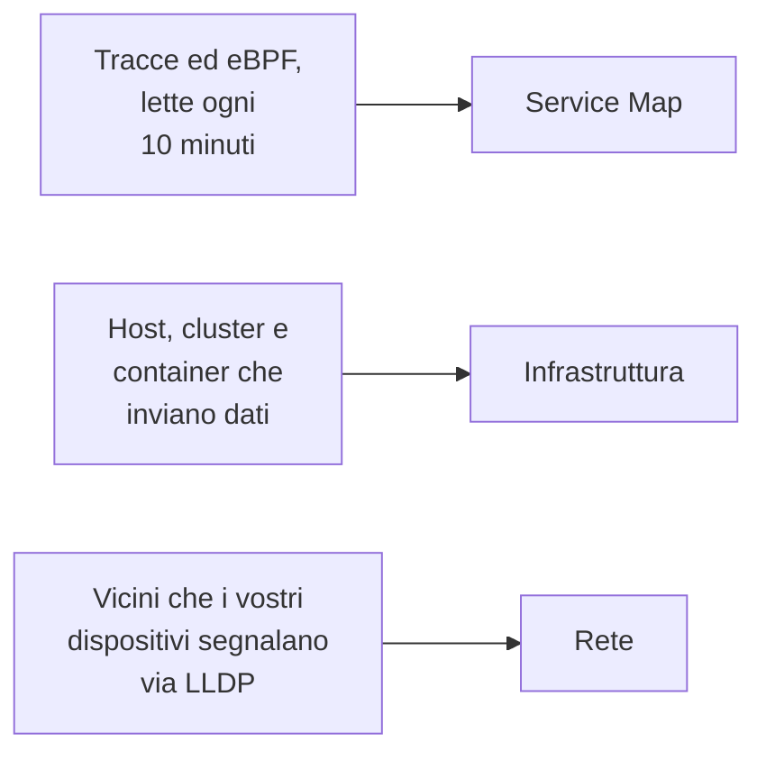

# Topologia

La topologia disegna come sono collegati i vostri sistemi: quali servizi ne chiamano altri, che cosa gira dove e come sono cablati i vostri dispositivi di rete. OneUptime la costruisce dalla telemetria che già inviate, quindi non c'è nulla da disegnare a mano, e mostra a colpo d'occhio dove si trovano errori e incidenti.

:::cards
- [Aprire la topologia](#aprire-la-topologia): Tre viste di un'unica pagina.
- [Leggere la mappa dei servizi](#leggere-la-mappa-dei-servizi): Chi chiama chi, e quanto sono sane le chiamate.
- [Esplorare la vostra infrastruttura](#esplorare-la-vostra-infrastruttura): Dove gira ogni servizio.
- [Aprire la mappa di una risorsa](#aprire-la-mappa-di-una-risorsa): Un vCenter, un cluster o un host nel dettaglio.
- [Vedere la vostra rete](#vedere-la-vostra-rete): I dispositivi e i loro collegamenti, in tempo reale.
:::

## Come viene costruita la mappa

Ogni vista della topologia è costruita da un tipo diverso di telemetria:

- **Viene disegnato solo ciò che era attivo.** Una vista mostra i servizi e le risorse che hanno inviato dati nell'intervallo di tempo, e le connessioni viste in esso. Attivate **Mostra inattivi** per disegnare anche quelli rimasti in silenzio.
- **Le chiamate sono contate su una finestra recente.** OneUptime cerca le chiamate tra servizi ogni 10 minuti, e i dati di traffico coprono gli ultimi 15 minuti, non l'intero intervallo di tempo.
- **La vista di rete è in tempo reale.** Mostra i vostri dispositivi come sono collegati adesso, quindi non ha un intervallo di tempo.

## Prima di iniziare

- **Telemetria in arrivo.** La mappa dei servizi ha bisogno di tracce: vedete [OpenTelemetry](/docs/telemetry/open-telemetry). La vista dell'infrastruttura ha bisogno di un host o di un cluster che invii dati: vedete l'[agent Kubernetes](/docs/telemetry/kubernetes-agent). La vista di rete ha bisogno di dispositivi di rete: vedete [Monitor dispositivi di rete](/docs/monitor/network-device-monitor).
- **Un ruolo che legge la telemetria.** Project Owner, Project Admin, Project Member, Viewer, Telemetry Admin, Telemetry Member o Telemetry Viewer, oppure un ruolo personalizzato con il permesso Read Telemetry Service.

## Aprire la topologia

Andate in **Prodotti → Osservabilità → Topologia**. **Inventario → Topology Map** apre la stessa pagina. Si apre sulla **Service Map**, per il periodo **Ultimo giorno**.

| Vista | La domanda a cui risponde |
| --- | --- |
| **Service Map** | Quali servizi dipendono l'uno dall'altro? |
| **Infrastruttura** | Che cosa gira dove nella vostra infrastruttura? |
| **Rete** | Come sono collegati i vostri dispositivi di rete? |

Accanto al selettore del tempo, **Mostra inattivi** aggiunge ciò che non ha inviato dati nell'intervallo, e il pulsante di aggiornamento ricarica la vista. **Cosa viene mostrato · Informazioni su questi dati** spiega che cosa disegna la vista e ogni quanto viene calcolata. La barra degli indirizzi mantiene la vista in cui vi trovate, quindi un link che condividete apre la stessa vista.

## Leggere la mappa dei servizi

La **Service Map** disegna ogni servizio che ha inviato dati, e i database, le API e i message broker che chiama, anche quando questi non inviano telemetria propria. Le frecce vanno dal chiamante al chiamato, e le linee più spesse portano più richieste. I conteggi in alto dicono quanti servizi, dipendenze e connessioni disegna, e quanti richiedono attenzione.

Ogni servizio mostra il suo stato, calcolato dalle chiamate ricevute negli ultimi 15 minuti:

| Stato | Quando |
| --- | --- |
| **Integro** | Al massimo l'1% delle chiamate ricevute è fallito. |
| **Some errors** | È fallito più dell'1% e meno del 5%. |
| **High error rate** | È fallito il 5% o più. |
| **Entry point** | Non ha ricevuto chiamate, ma ne ha fatte: un frontend web o un job pianificato. |
| **No calls observed** | Non ha né fatto né ricevuto chiamate. |

Un servizio con un incidente o un avviso attivi ne mostra invece il numero e, come un servizio con **Some errors** o con un **High error rate**, conta come uno che richiede attenzione.

:::steps
### Trovare i servizi che richiedono attenzione

Fate clic su **Richiede attenzione** per tenere solo quei servizi e le loro connessioni dirette, oppure cercate per nome nella casella sopra la mappa.

### Aprire un servizio

Fate clic su un servizio per vederne le richieste, gli errori e la latenza media degli ultimi 15 minuti, i suoi **Incidenti attivi** e **Avvisi attivi**, e i link a **Tracce di questo servizio** e ai suoi **Dettagli dell'inventario**.

### Aprire una connessione

Fate clic su una freccia per vederne la frequenza delle richieste, il tasso di errore e la latenza media. Tra due servizi che strumentate, ha anche una **History** di chiamate, errori e latenza.
:::

**Etichette delle connessioni** scrive un valore su ogni freccia: **Frequenza delle richieste**, **Tasso di errore** o **Latenza media**, oppure nessuno finché non ci passate sopra con il mouse. **Tabella** elenca gli stessi servizi con le loro **Richieste**, **Tasso di errore**, **Latenza media** e **Connessioni**, e **Mostra sulla mappa** ne disegna uno.

## Esplorare la vostra infrastruttura

**Infrastruttura** mostra dove girano i vostri servizi: cluster, host, pod, container e le altre risorse che inviano dati. Le repliche di uno stesso carico di lavoro sono raggruppate in una sola voce, e potete aprire qualsiasi cosa per guardarci dentro.

- **Sfogliatela a modo vostro.** Mostratela come **Elenco** o come **Mappa**, da tutta la vostra infrastruttura fino a un singolo pod. I conteggi in alto dicono quante risorse e quanti carichi di lavoro disegna, quanti servizi riesce a collocare e quante risorse silenziose lascia fuori.
- **Trovate una risorsa.** Cercatela per nome e fate clic su **Visualizza dettagli** per aprirne la pagina.
- **Passate da una vista all'altra.** Un servizio elencato su una risorsa si apre sulla **Service Map**, e le risorse su cui gira un servizio si aprono su **Infrastruttura**.

## Aprire la mappa di una risorsa

Un vCenter, un cluster Kubernetes, un host, un host Docker o Podman, un cluster Docker Swarm, Proxmox o Ceph e uno storage array hanno ciascuno una propria pagina **Topologia**. Disegna quella risorsa nel dettaglio, dal suo inventario: cosa sta dentro cosa, ogni parte colorata in base al suo stato, e ogni incidente e avviso aperto sulla parte che riguarda.

- **Leggetela come un albero.** La risorsa è in alto, e le parti di ogni parte sono disegnate alla sua destra, collegate a essa da una linea che diventa rossa o ambra dove qualcosa richiede attenzione. Le parti con problemi al loro interno si aprono da sole, il pulsante rotondo di una parte la apre o la chiude, e i tasti freccia si muovono nella mappa.
- **Trovate ciò che richiede attenzione.** **Richiede attenzione** tiene solo le parti con problemi e il percorso fino a ciascuna, e la ricerca trova una parte ovunque nella risorsa.
- **Guardate più da vicino.** Fate clic su una parte per vedere cos'è e un link alla sua pagina, e su **Concentrati su questo** per disegnare solo quella parte, ciò che contiene e ciò a cui è collegata.
- **In entrambe le direzioni.** **Apri in Topologia** apre la risorsa in **Infrastruttura**, e il suo pulsante **Apri la topologia del vCenter**, **Apri la topologia del cluster**, **Apri la topologia dell'host** o **Apri la topologia dello storage array** riporta indietro.

## Vedere la vostra rete

**Rete** è la mappa in tempo reale dei vostri dispositivi di rete, costruita dai vicini che segnalano via LLDP, e via CDP sui dispositivi Cisco. Non ha un selettore del tempo: le connessioni si aggiornano da sole.

Se raggruppate i dispositivi in siti, la vista si apre sui vostri siti: sceglietene uno, oppure passate ad **All devices**. **Map options** dispone la mappa e sceglie che cosa include, ed **Esporta PDF** salva la mappa che vedete. Le pagine dei dispositivi di rete disegnano la stessa mappa: vedete [Topologia di rete](/docs/monitor/network-device-monitor#topologia-della-rete).

## Risoluzione dei problemi

:::details La mappa dei servizi mostra servizi ma nessuna connessione
OneUptime cerca le chiamate tra servizi nelle vostre tracce ogni 10 minuti. Ne vede una quando una richiesta porta il contesto di traccia, l'intestazione `traceparent`, da un servizio strumentato al successivo, come fanno le strumentazioni HTTP e gRPC di OpenTelemetry; quando un servizio segnala span client per i database e le API che chiama; oppure quando l'agent Kubernetes gira con eBPF.
:::

:::details Un servizio che ho rimosso è ancora sulla mappa
Ha inviato dati entro l'intervallo di tempo. Scegliete un intervallo più breve, o aspettate che la sua ultima telemetria esca dall'intervallo. Con **Mostra inattivi** attivo, la mappa disegna anche ciò che ha smesso di inviare dati.
:::

:::details La mappa dice che ne è mostrata solo una parte
Un progetto molto grande raggiunge i limiti della mappa, e un avviso dice quante risorse o connessioni mostra. Cercate un servizio, oppure usate **Mostra sulla mappa** nella tabella, per disegnarne una parte leggibile.
:::

## Passaggi successivi

:::cards
- [Catalogo servizi](/docs/telemetry/services): Tutto su un singolo servizio.
- [Esploratore tracce](/docs/telemetry/traces-explorer): Le richieste dietro ogni freccia.
- [Panoramica dell'inventario](/docs/inventory/overview): Ogni risorsa che la mappa disegna.
- [Monitor dispositivi di rete](/docs/monitor/network-device-monitor): Mettete la vostra rete sulla mappa.
:::
