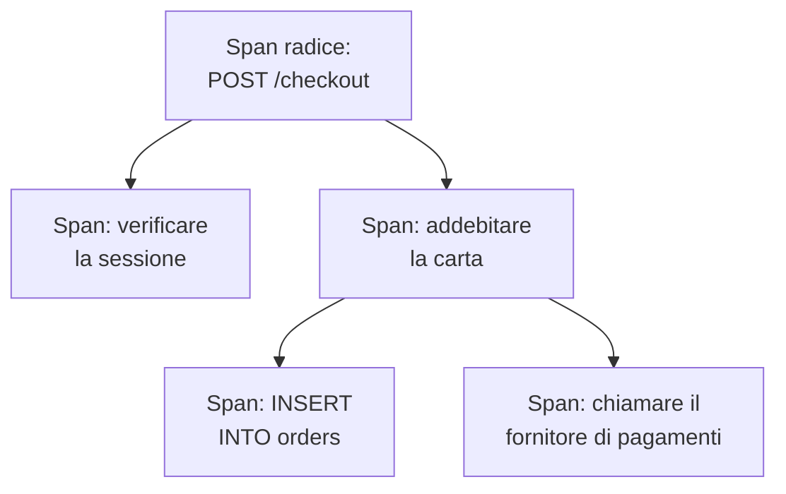

# Esploratore tracce

L'esploratore tracce trova le richieste che sono passate per i vostri servizi: quelle lente, quelle fallite, quelle che hanno toccato l'account di un determinato cliente. Cercate e filtrate gli span che i vostri servizi inviano, poi aprite una traccia per vedere ogni passaggio della richiesta come waterfall, flame graph o mappa dei servizi.

:::cards
- [Trovare una richiesta](#trovare-una-richiesta): Cercare span, poi filtrare per servizio, stato o tipo.
- [Leggere una traccia](#leggere-una-traccia): Dove è andato il tempo e quale passaggio è fallito.
- [Rappresentare gli span in grafici](#rappresentare-gli-span-in-grafici): Numero di richieste e tempi di risposta, raggruppati a modo vostro.
- [Informazioni sulle tracce](#informazioni-sulle-tracce): Tassi di errore, latenza e le richieste più lente.
:::

## Tracce e span

Una traccia è una richiesta nel suo percorso attraverso il vostro sistema. Ogni passaggio che compie, come un handler HTTP, una query al database o una chiamata a un altro servizio, è uno span, e gli span si annidano dentro gli span che li hanno avviati. Il primo span di una traccia, senza padre, è il suo span radice: il punto di ingresso della richiesta.

Ogni riga dell'esploratore è uno span, quindi un servizio molto attivo riempie l'elenco con le sue query al database e le sue chiamate interne. Per elencare una riga per richiesta, scegliete **Root spans** sotto **Categoria di span** nella barra laterale.

L'esploratore ha quattro schede:

| Scheda | A cosa serve |
| --- | --- |
| **Visualizzatore** | Cercare e filtrare gli span, e aprire le loro tracce. Si apre sull'ultima ora, prima i più recenti, 50 span per pagina. |
| **Informazioni** | Frequenza delle richieste, tassi di errore e latenza per servizio, e le richieste che meritano uno sguardo. |
| **Guida alla configurazione** | Come inviare tracce con OpenTelemetry, usando una delle vostre [chiavi di ingestione](/docs/telemetry/ingestion-keys). |
| **Impostazioni** | Che cosa succede agli span quando arrivano: **Pipeline**, **Filtri di scarto**, **Regole di mascheramento** e **Regole di registrazione**. |

## Prima di iniziare

- **Tracce in arrivo.** Strumentate i vostri servizi con [OpenTelemetry](/docs/telemetry/open-telemetry). La scheda **Guida alla configurazione** mostra il codice per il vostro linguaggio.
- **Un ruolo che può leggere la telemetria.** Project Owner, Project Admin, Project Member, Viewer, Telemetry Admin, Telemetry Member o Telemetry Viewer, oppure un ruolo personalizzato con il permesso Read Telemetry Service Traces. Il suo ambito decide di chi sono gli span che vedete: vedere [Telemetria](/docs/permissions/index#telemetria).

## Trovare una richiesta

:::steps
### Aprire il Visualizzatore

Aprite **Prodotti → Osservabilità → Tracce**. Il **Visualizzatore** elenca gli span dell'ultima ora, prima i più recenti, ciascuno con stato, servizio, nome e durata.

### Scegliere l'intervallo di tempo

Scegliete un intervallo nel selettore del tempo, oppure trascinate sul grafico sopra l'elenco per ingrandire un picco. Fate doppio clic sul grafico per tornare indietro. Vedere [Ingrandire un intervallo di tempo](/docs/telemetry/charts-and-time-ranges).

### Cercare

Digitate una query e premete Invio, ad esempio `service:checkout status:error duration:>500`. Le parole semplici cercano nei nomi degli span, e `@key:value` cerca in un attributo come `@http.route:/orders`. Vedere [Sintassi di ricerca](/docs/telemetry/search-syntax#tracce).

### Restringere con i filtri

Fate clic su un valore nella barra laterale **Filtri** per aggiungerlo come chip. La barra laterale filtra per **Servizio**, per l'host, il cluster o l'altra risorsa che ha inviato lo span, per **Stato**, **Categoria di span**, **Ha eccezione**, **Tipo di span**, **Nome dello span**, **Service Instance** e **Nome dell'host**.

### Aprire uno span

Fate clic su una riga per espanderla: i suoi attributi, e i log e le eccezioni che ha registrato. Fate clic su **See full trace** per aprire la sua traccia completa.
:::

La ricerca, i chip e l'intervallo di tempo restano nell'indirizzo della pagina, quindi un aggiornamento, un segnalibro o un link condiviso apre gli stessi span.

## Leggere una traccia

La pagina di una traccia inizia con i numeri della richiesta:

| Numero | Che cos'è |
| --- | --- |
| Durata | Quanto è durata l'intera richiesta. |
| Span | Quanti span ha la traccia. |
| Servizi | Per quanti servizi è passata la richiesta. |
| Errori | Quanti span sono terminati con uno stato di errore. Fateci clic per mostrare solo quelli. |
| Profondità | La catena più lunga di span annidati. |

Sotto, scegliete una di quattro viste:

| Vista | Cosa mostra |
| --- | --- |
| **Waterfall** | Ogni span su una linea temporale, annidato sotto lo span che lo ha avviato. Attivate **Critical path** per evidenziare la catena di span che ha deciso quanto è durata la richiesta. |
| **Flame graph** | Lo stesso albero come barre impilate, dove le barre più larghe hanno impiegato più tempo. |
| **Service map** | I servizi per cui è passata la richiesta e le chiamate tra di loro. |
| **Operations** | Una riga per servizio e nome di span, con chiamate, errori, tempo proprio e tempo totale. Un'operazione chiamata 10 o più volte da uno stesso span padre viene segnalata: spesso una query N+1 o un ciclo che si potrebbe raggruppare. |

Fate clic su uno span in qualsiasi vista per aprirne il pannello, con schede per attributi, eventi, log, eccezioni e link, e per il suo profilo o la sua chiamata LLM quando ne ha uno. Cercate tra gli span della traccia per nome, ID o servizio con la casella di ricerca accanto alle viste (premete `/`), e attivate **Errors only** per tenere solo gli span falliti.

Una traccia grande carica 500 span alla volta. Fate clic sul pulsante in fondo alla traccia per caricarne altri, o tutti.

> [!TIP]
> **Fix performance with AI** cerca nella traccia uno schema di prestazioni noto: una query N+1, uno span che occupa la maggior parte del tempo, o chiamate fatte una dopo l'altra che potrebbero procedere in parallelo. Quando ne trova uno, avvia un'attività di IA che apre una pull request per correggerlo. Vedere [Attività di correzione](/docs/ai/ai-agent).

## Rappresentare gli span in grafici

Il grafico sopra l'elenco mostra il numero di span nel tempo, suddiviso per stato. Scegliete un'altra misura nell'intestazione del grafico per mostrare invece il loro tempo di risposta medio, mediano (P50) o P95.

Per altro, passate l'elenco da **Span** ad **Analytics**. Scegliete una serie temporale, una classifica o una tabella; misurate il numero di richieste, il numero di errori o i tempi di risposta (media, P50, P90, P95, P99, minimo o massimo); e raggruppate per nome di span, servizio, stato, tipo di span o qualsiasi attributo, poi per un secondo campo. Una classifica o una tabella mostra da 5 a 100 gruppi.

## Seguire, salvare e condividere

- Fate clic su **In pausa** sopra l'elenco per attivare gli aggiornamenti in diretta. Il pulsante mostra poi **Live**, e l'elenco cerca nuovi span ogni 10 secondi. Fate di nuovo clic per mettere in pausa.
- **Saved Views** conserva una ricerca, i suoi filtri e l'intervallo di tempo sotto un nome, per tutti nel progetto. Le viste salvate funzionano come nell'[Esploratore log](/docs/telemetry/logs-explorer#salvare-una-vista).
- I pulsanti **Registri** e **Metriche** aprono quegli esploratori per la stessa finestra di tempo, con tutto il vostro filtraggio che possono usare. Puntate un pulsante per vedere che cosa non può riportare.

## Informazioni sulle tracce

La scheda **Informazioni** riassume le richieste di un intervallo di tempo:

- il numero di richieste, il tasso di errore e la latenza P50, P95 e P99;
- una tabella sullo stato dei vostri servizi, ordinata per tasso di errore, così i servizi che richiedono attenzione vengono per primi;
- le richieste fallite più recenti, e le più lente.

Limitatela ad alcuni servizi con il menu a discesa accanto al selettore del tempo.

## Che cosa succede agli span quando arrivano

La scheda **Impostazioni** contiene le regole che OneUptime applica agli span quando arrivano, come fa per i log. Agiscono sugli span che arrivano dopo, non su quelli già memorizzati. Anche per quanto tempo viene conservato ogni span si decide al suo arrivo: vedere [Conservazione dei dati](/docs/telemetry/data-retention).

| Regola | Cosa fa |
| --- | --- |
| **Filtri di scarto** | Scartare gli span che non volete conservare, o conservarne solo un campione. Vedere [Scartare o campionare i record](/docs/telemetry/drop-filters-and-scrub-rules#scartare-o-campionare-i-record). |
| **Regole di mascheramento** | Mascherare i dati sensibili negli attributi degli span. Vedere [Mascherare i dati sensibili](/docs/telemetry/drop-filters-and-scrub-rules#mascherare-i-dati-sensibili). |
| **Pipeline** | Modificare e arricchire gli span: ogni pipeline seleziona gli span con un filtro, poi esegue i suoi processori in ordine. |
| **Regole di registrazione** | Trasformare ogni minuto conteggi di span, conteggi di errori e durate in nuove metriche. Vedere [Regole di registrazione dei log](/docs/telemetry/log-recording-rules). |

## Risoluzione dei problemi

:::details Una traccia dice che non sono stati trovati span
Gli span arrivano di solito entro un minuto dalla fine della richiesta. Fate clic su **Aggiorna** nella pagina della traccia per ricontrollare.
:::

:::details Alcuni span stanno al livello più alto del waterfall
Indicano uno span padre che OneUptime non ha ricevuto, spesso perché il servizio che ha scritto il padre non invia ancora tracce a OneUptime. Strumentate anche quel servizio.
:::

:::details L'elenco mostra molte più righe che richieste
Ogni riga è uno span, non una richiesta. Scegliete **Root spans** sotto **Categoria di span** nella barra laterale per elencare una riga per richiesta.
:::

## Passaggi successivi

:::cards
- [Sintassi di ricerca](/docs/telemetry/search-syntax): Ogni filtro che la casella di ricerca comprende.
- [Monitor tracce](/docs/monitor/traces-monitor): Ricevere un avviso per richieste fallite o lente.
- [Tracciamento delle eccezioni](/docs/telemetry/exceptions): Smistare gli errori che i vostri span registrano.
- [Esploratore log](/docs/telemetry/logs-explorer): Leggere le righe di log scritte da una richiesta.
:::
