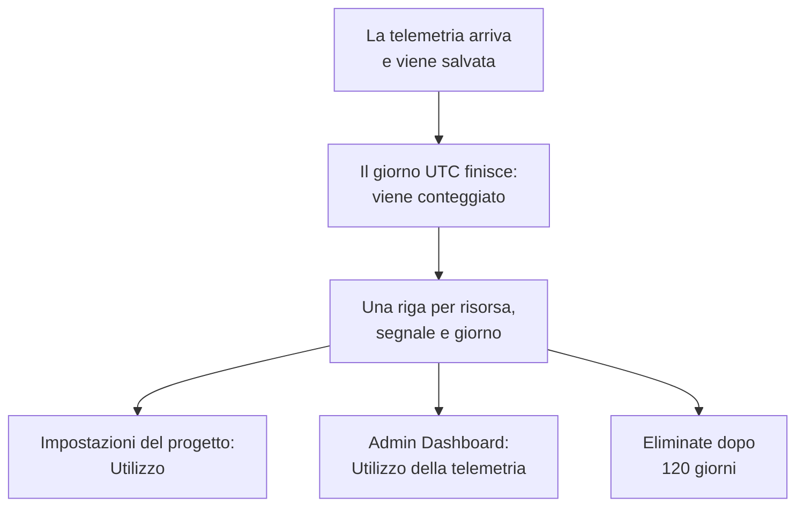

# Utilizzo della telemetria

Vedete quanta telemetria invia ogni progetto, e ogni servizio o risorsa al suo interno: log, metriche, tracce, eccezioni, profili, riproduzioni delle sessioni ed eventi di sicurezza. L'utilizzo viene conteggiato su ogni installazione di OneUptime, con o senza fatturazione, così potete trovare ciò che riempie il vostro storage senza interrogare ClickHouse.

:::cards
- [Come viene conteggiato l'utilizzo](#come-viene-conteggiato-lutilizzo): Una volta al giorno, per ogni risorsa e ogni segnale.
- [Vedere l'utilizzo di un progetto](#vedere-lutilizzo-di-un-progetto): Impostazioni del progetto → Telemetria e APM → Utilizzo.
- [Vedere l'utilizzo di tutti i progetti](#vedere-lutilizzo-di-tutti-i-progetti): L'Admin Dashboard, per l'amministratore dell'istanza.
- [Per quanto tempo viene conservato l'utilizzo](#per-quanto-tempo-viene-conservato-lutilizzo): 120 giorni, a meno che non lo cambiate.
:::

## Come viene conteggiato l'utilizzo

Una volta al giorno, dopo che un giorno è finito in UTC, OneUptime conteggia ciò che ogni risorsa di ogni progetto ha inviato quel giorno, per ogni segnale, e conserva il conteggio come una riga per risorsa, segnale e giorno.



- **Un giorno viene conteggiato quando è finito.** Ogni giorno viene conteggiato entro le 08:00 UTC circa del giorno dopo, quindi l'utilizzo di oggi compare domani. Un giorno che non è stato possibile conteggiare viene ritentato per una settimana.
- **La dimensione è quella salvata.** Ogni segnale viene conteggiato come la dimensione delle righe in cui è salvato, prima della compressione. Le riproduzioni delle sessioni vengono conteggiate come i byte caricati dai registratori.
- **Le eccezioni vengono mostrate a parte.** Le eccezioni registrate negli span e nei log hanno un proprio totale, una propria colonna e una propria parte del grafico, e **Tracce** conteggia gli span. Non hanno una riga propria: ogni riga delle tracce indica quanta parte di essa era costituita da eccezioni. Un giorno conteggiato prima che le eccezioni venissero mostrate a parte le include ancora in **Tracce**, come prima.
- **I profili includono i loro campioni.**
- **La telemetria propria di OneUptime non viene conteggiata.** Le letture di monitor, avvisi, incidenti e SLO, le letture di Osservabilità dei dati e le metriche del budget delle riproduzioni delle sessioni sono scritte da OneUptime stesso.
- **Su OneUptime Cloud, la telemetria si paga in base a queste righe.** Su un'installazione senza fatturazione, l'utilizzo viene conteggiato senza costi, e non viene addebitato nulla, nemmeno se la fatturazione viene attivata in seguito.
- **Le eccezioni si pagano come parte delle tracce.** Su OneUptime Cloud, le tracce si pagano per i loro span e le loro eccezioni insieme, al prezzo delle tracce, come è sempre stato. Mostrare le eccezioni a parte non cambia nulla di ciò che vi viene addebitato, e non vengono mai addebitate due volte.
- **Un budget viene conteggiato a parte rispetto all'utilizzo.** Un [budget di acquisizione](/docs/telemetry/ingestion-budgets) conteggia la telemetria man mano che arriva, decompressa, quindi può fermare la telemetria di un giorno il giorno stesso. Finché ne è impostato uno, questa pagina si apre con i budget di oggi. Le eccezioni non hanno un budget proprio: contano nel budget delle tracce o dei log con cui arrivano.

## Prima di iniziare

- **Un ruolo che legge la telemetria del progetto.** Proprietario del progetto, Amministratore del progetto, Membro del progetto, Visualizzatore, Amministratore della telemetria, Membro della telemetria o Visualizzatore della telemetria, oppure uno dei ruoli di fatturazione. Il ruolo deve coprire l'intero progetto: uno limitato ad alcune etichette non mostra l'utilizzo.
- **Telemetria nel progetto.** L'utilizzo viene conteggiato per la telemetria che inviano le [chiavi di acquisizione](/docs/telemetry/ingestion-keys) del progetto.

## Vedere l'utilizzo di un progetto

:::steps
### Aprire Utilizzo

Andate in **Impostazioni del progetto → Telemetria e APM → Utilizzo**. **Telemetria e APM** parte compresso nel menu laterale: fateci clic per aprirlo.

### Scegliere un intervallo

La pagina si apre su **Ultimi 30 giorni**. Scegliete **Ultimi 7 giorni** o **Ultimi 90 giorni** nella casella in alto a destra della scheda **Utilizzo della telemetria**. Un intervallo finisce con ieri, il giorno più recente che è stato conteggiato.

### Trovare che cosa è cresciuto

La scheda **Utilizzo per risorsa** elenca ogni servizio e risorsa che ha inviato qualcosa nell'intervallo, prima i più pesanti. Fate clic sul titolo di una colonna per ordinare in base a essa, e sul nome di una risorsa per aprirne la pagina.
:::

La pagina ha tre schede:

| Scheda | Che cosa mostra |
| --- | --- |
| **Utilizzo della telemetria** | Il **Totale** dell'intervallo, un totale per ogni segnale e un grafico di ogni giorno, con i suoi segnali impilati. |
| **Utilizzo per risorsa** | Ogni **Risorsa** con il suo tipo, una colonna per ogni segnale, il **Totale** e, in **Conservazione**, per quanto tempo viene conservata la sua telemetria. |
| **Cronologia di utilizzo della telemetria** | Una riga per prodotto, risorsa e giorno, con filtri per **Prodotto**, **Giorno** e **Servizio**. Una riga di **Tracce** contiene insieme i suoi span e le sue eccezioni, così come si pagano le tracce, e indica in **Dati acquisiti (in GB)** quanta parte era costituita da eccezioni. |

La telemetria che non indicava un servizio viene elencata come **Servizio sconosciuto**. Una risorsa eliminata nel frattempo, o il cui tipo il vostro ruolo non legge, viene elencata con il suo tipo e l'inizio del suo ID.

## Chi vede che cosa

| Ruolo | Vede |
| --- | --- |
| Proprietario del progetto, Amministratore del progetto, Amministratore della fatturazione, Membro della fatturazione, Visualizzatore della fatturazione, Manage Billing | Quanto ha inviato ogni risorsa e per quanto tempo viene conservato, e su OneUptime Cloud quanto è costato |
| Membro del progetto, Visualizzatore, Amministratore della telemetria, Membro della telemetria, Visualizzatore della telemetria | Quanto ha inviato ogni risorsa e per quanto tempo viene conservato |

Il costo dell'utilizzo viene mostrato solo su OneUptime Cloud: un'installazione senza fatturazione non addebita nulla. Vedete [Fatturazione e utilizzo](/docs/configuration/billing#cronologia-utilizzo) per i prezzi.

## Vedere l'utilizzo di tutti i progetti

Su un'installazione self-hosted, l'amministratore dell'istanza vede l'utilizzo di tutti i progetti nell'Admin Dashboard:

:::steps
### Aprire Utilizzo della telemetria

Nell'Admin Dashboard, aprite il menu e fate clic su **Utilizzo della telemetria**. L'elenco mostra ogni progetto che ha inviato qualcosa nell'intervallo, prima i più pesanti, con una colonna per ogni segnale e il **Totale**.

### Trovare i progetti più pesanti

Scegliete un intervallo in alto a destra della scheda, e fate clic sul titolo di una colonna per ordinare in base a essa: **Totale**, un segnale, o **Progetto** per il nome.

### Aprire un progetto

Fate clic sul nome di un progetto. La sua pagina **Utilizzo della telemetria**, in **Progetti** nell'Admin Dashboard, mostra il suo utilizzo per giorno, segnale e risorsa, come lo vedono i suoi membri.
:::

## Per quanto tempo viene conservato l'utilizzo

L'utilizzo viene conservato per 120 giorni, a meno che non lo cambiate, con la fatturazione attiva o no. È per quanto tempo vengono conservati i conteggi dell'utilizzo, non la telemetria stessa: per quella, vedete [Conservazione dei dati](/docs/telemetry/data-retention).

:::steps
### Aprire la conservazione dei dati

Nell'Admin Dashboard, andate in **Impostazioni → Conservazione dati**.

### Impostare il numero di giorni

Nella scheda **Conservazione dell'utilizzo della telemetria**, fate clic su **Modifica conservazione dell'utilizzo della telemetria**, inserite **Conservazione dell'utilizzo della telemetria (giorni)** da 30 a 1095, e fate clic su **Salva modifiche**. Lasciatelo vuoto per 120 giorni.
:::

L'utilizzo più vecchio viene eliminato una volta al giorno. La conservazione non è mai inferiore a 30 giorni: un giorno conteggiato non viene mai eliminato e poi conteggiato di nuovo.

## Leggere l'utilizzo con l'API

`GET /api/telemetry-usage/project` risponde con l'utilizzo di un progetto su un intervallo di giorni UTC, come lo mostra la pagina. Chiamatelo con una [chiave API](/docs/permissions/index#chiavi-api) che abbia uno dei ruoli sopra:

```bash
curl 'https://oneuptime.com/api/telemetry-usage/project?startDay=2026-10-01&endDay=2026-10-31' \
  -H "ApiKey: $ONEUPTIME_API_KEY"
```

`startDay` ed `endDay` sono giorni scritti `YYYY-MM-DD`, entrambi inclusi, e un intervallo può durare fino a 1095 giorni. La risposta contiene i totali, ogni giorno per segnale e ogni risorsa per segnale, in GB, con il costo solo dove la fatturazione è attiva e la chiave legge la fatturazione. Le eccezioni si trovano in `Exceptions`, separate da `Traces`, e un giorno conteggiato prima che le eccezioni venissero mostrate a parte le include in `Traces`.

## Risoluzione dei problemi

:::details La pagina Utilizzo dice «Ancora nessun utilizzo della telemetria»
Un giorno viene conteggiato quando è finito in UTC, entro le 08:00 UTC circa del giorno dopo: un progetto che ha iniziato a inviare oggi mostra il suo primo giorno domani. Controllate che il progetto riceva telemetria negli explorer.
:::

:::details I numeri sono più grandi del mio disco ClickHouse
L'utilizzo è la dimensione delle righe prima della compressione. ClickHouse comprime ciò che salva, quindi il disco che usa è diverse volte più piccolo.
:::

:::details Una risorsa viene elencata con il suo tipo e un ID
La risorsa è stata eliminata dopo aver inviato la telemetria, oppure il vostro ruolo non legge quel tipo di risorsa. Il suo utilizzo viene comunque conteggiato.
:::

:::details Le Tracce sono scese il giorno in cui sono comparse le Eccezioni
Prima le eccezioni venivano conteggiate dentro **Tracce**. Dal primo giorno conteggiato con le eccezioni a parte, **Tracce** conteggia gli span ed **Eccezioni** conteggia le eccezioni. Insieme corrispondono a ciò che era **Tracce**, e a ciò per cui si pagano le tracce.
:::

## Passaggi successivi

:::cards
- [Filtri di scarto e regole di mascheramento](/docs/telemetry/drop-filters-and-scrub-rules): Smettete di salvare la telemetria che non vi serve.
- [Conservazione dei dati](/docs/telemetry/data-retention): Conservate la telemetria per tutto il tempo che vi serve, e non di più.
- [Fatturazione e utilizzo](/docs/configuration/billing): Quanto costa la telemetria su OneUptime Cloud.
- [Chiavi di acquisizione](/docs/telemetry/ingestion-keys): Inviate telemetria al vostro progetto.
- [Budget di acquisizione](/docs/telemetry/ingestion-budgets): Limitate quanto di ogni segnale un progetto invia in un giorno.
:::
