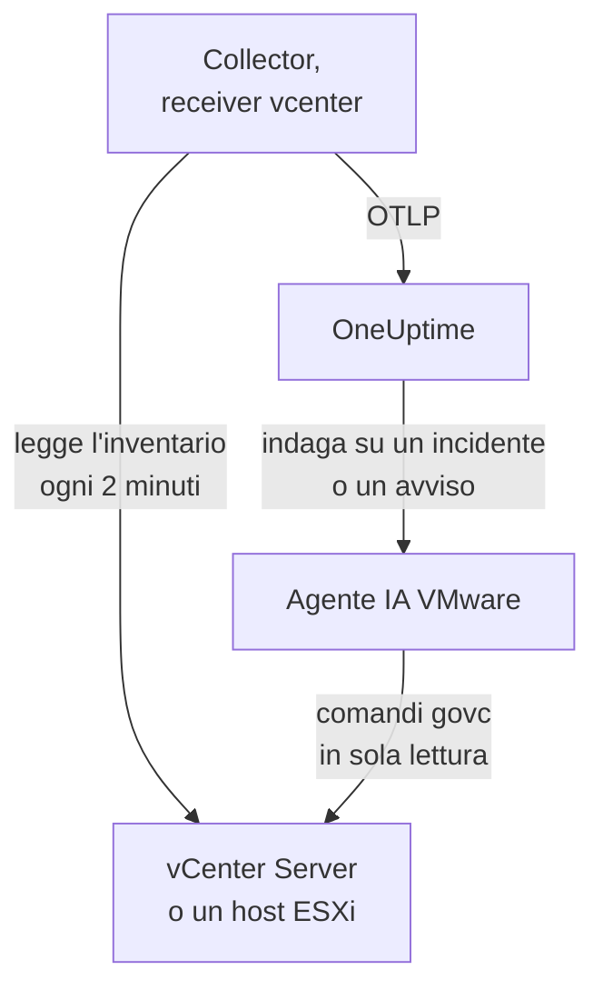

# Agent VMware

L'agent VMware di OneUptime monitora VMware vSphere: vCenter Server, host ESXi, macchine virtuali, datastore, cluster, resource pool e vSAN. È un OpenTelemetry Collector standard il cui [receiver `vcenter`](https://github.com/open-telemetry/opentelemetry-collector-contrib/tree/main/receiver/vcenterreceiver) legge l'API di vSphere con un utente in sola lettura, applica a ogni metrica il nome del tuo vCenter e la invia a OneUptime: nessun plugin su vCenter e niente all'interno delle VM. I [monitor VMware](/docs/monitor/vmware-monitor) inviano avvisi su ciò che arriva.

:::cards
- [Installare l'agent](#installa-lagent): Un utente in sola lettura, poi lo script di installazione, Docker Compose o systemd.
- [Cosa raccoglie l'agent](#cosa-raccoglie-lagent): Ogni oggetto vSphere, la sua identità e le sue metriche.
- [Agente IA](#agente-ia): Lascia che OneUptime AI legga il vCenter mentre indaga.
- [Risoluzione dei problemi](#risoluzione-dei-problemi): Uno script di diagnostica, e i problemi più comuni.
:::

## Come funziona

Un agent monitora un endpoint vSphere: un **vCenter Server**, che copre ogni datacenter, cluster e host che gestisce, oppure un **host ESXi autonomo** non gestito da alcun vCenter. Esegui un agent per vCenter. Il collector percorre l'intero inventario una volta per raccolta (ogni 2 minuti per impostazione predefinita) e invia una risorsa per oggetto. Lo stesso file Compose esegue accanto l'agente IA VMware, per OneUptime AI. Preferisci non usare Docker? Lo stesso collector, con la stessa configurazione, gira anche come servizio systemd su qualsiasi macchina Linux.



Il vCenter si registra con i suoi primi dati, con il nome che l'agent applica a ogni metrica come `vmware.vcenter.name`. Per monitorare un vCenter senza eseguire l'agent, vedi [VMware senza agent](/docs/telemetry/vmware-agentless): una delle tue probe raccoglie gli stessi dati con un account in sola lettura.

## Prima di iniziare

- Docker Engine 20.10 o successivo con il plugin Docker Compose v2 oppure, per installare senza Docker, una macchina Linux (x86_64 o arm64) con systemd 235 o successivo. In entrambi i casi la macchina deve raggiungere vCenter via HTTPS (TCP 443).
- vCenter Server o ESXi 7.0 o successivo: il receiver supporta vSphere 7 e 8.
- Un account che possa creare un utente vSphere e assegnargli un ruolo sull'oggetto vCenter di primo livello.
- Una chiave di acquisizione. Creane una in **Impostazioni del progetto → Telemetria e APM → Chiavi di acquisizione** e copiane il valore.

### Dove eseguire l'agent

L'agent comunica con vCenter via HTTPS, quindi non deve girare vicino a esso, e idealmente non dovrebbe girare né sulla vCenter Server Appliance né in una VM del cluster che sorveglia: se quel cluster cade, il tuo monitoraggio cade con lui. Una piccola VM di gestione su hardware separato, un host di monitoraggio o qualsiasi macchina che esegua Docker (o, senza Docker, qualsiasi macchina Linux con systemd) e raggiunga vCenter su TCP 443 è il posto giusto. Il listener syslog facoltativo richiede anche che gli host ESXi raggiungano l'agent sulla porta syslog (vedi [Inviare il syslog di ESXi](#facoltativo-inviare-il-syslog-di-esxi)).

## Installa l'agent

:::steps
### Creare l'utente vSphere in sola lettura

L'agent legge e basta: l'inventario, i contatori delle prestazioni e le statistiche vSAN. Dagli un account dedicato con il ruolo integrato **Read-Only**, mai un amministratore.

:::tabs
@tab vSphere Client
1. Crea l'account: apri _Menu → Administration → Single Sign On → Users and Groups_, scegli il dominio `vsphere.local` (o la tua origine di identità), fai clic su **Add**, chiama l'utente `oneuptime` e imposta una password. L'utente è quindi `oneuptime@vsphere.local`.
2. Assegna il ruolo: seleziona l'oggetto **vCenter Server** di primo livello nell'inventario _Hosts and Clusters_, apri la scheda **Permissions**, fai clic su **Add**, scegli l'utente, imposta il ruolo su **Read-Only** e spunta **Propagate to children**.
@tab govc
Da una macchina con credenziali di amministratore:

```bash
govc sso.user.create -p 'a-strong-password' -R ReadOnly oneuptime
govc permissions.set -principal oneuptime@vsphere.local -role ReadOnly -propagate=true /
```
@tab PowerCLI
Da una sessione connessa a vCenter come amministratore:

```powershell
New-SsoPersonUser -UserName oneuptime -Password 'a-strong-password'
New-VIPermission -Entity (Get-Folder -NoRecursion) -Principal 'VSPHERE.LOCAL\oneuptime' -Role ReadOnly -Propagate:$true
```
@tab ESXi Host Client
Per un host ESXi autonomo (senza vCenter), crea l'utente in _Host → Manage → Security & Users → Users_ e assegnagli il ruolo Read-Only in _Host → Manage → Security & Users → Permissions_. Oppure, nella shell dell'host, esegui `esxcli system account add`, poi `esxcli system permission set --id oneuptime --role ReadOnly`.
:::

> [!IMPORTANT]
> La propagazione è la parte che si dimentica. Il receiver percorre datacenter, cluster, host, VM, datastore e resource pool, e ogni oggetto che l'utente non può vedere viene escluso senza avvisi. Un ruolo Read-Only assegnato sull'oggetto vCenter _senza_ propagazione dà un inventario vuoto e una dashboard piena di zeri.

### Installa e avvia l'agent

:::tabs
@tab install.sh
Scarica lo script di installazione ed eseguilo sulla macchina che ospiterà l'agent:

```bash
curl -sSL https://raw.githubusercontent.com/OneUptime/oneuptime/master/agents/VMwareAgent/install.sh -o install.sh
bash install.sh
```

Lo script chiede il tuo URL di OneUptime, la chiave di acquisizione, un nome per il vCenter, l'endpoint di vCenter e le credenziali in sola lettura (legge la password senza mostrarla), e se l'agente IA può applicare correzioni (in tal caso, un utente vSphere tutto suo e le VM che non deve mai modificare). Si installa in `/opt/oneuptime-vmware-agent`, scrive un file con permessi `0600` chiamato `.env` e avvia l'agent con Docker Compose. Mette tra virgolette ogni valore per Docker Compose così come l'hai digitato, quindi una password con `$`, `#`, spazi o virgolette funziona così come l'hai digitata. Eseguire di nuovo lo script riutilizza tutto ciò che c'è in un `.env` esistente invece di chiedere di nuovo, ed è così che [aggiorni l'agent](#aggiornare-lagent).
@tab Docker Compose
Scarica `docker-compose.yml` e `otel-collector-config.yaml` dalla [directory VMwareAgent](https://github.com/OneUptime/oneuptime/tree/master/agents/VMwareAgent) in una nuova cartella, poi crea un file `.env` accanto a essi. Contiene una password, quindi tienilo privato con `chmod 600 .env`:

```bash title=".env"
ONEUPTIME_URL=YOUR_ONEUPTIME_URL
ONEUPTIME_TELEMETRY_INGESTION_KEY=YOUR_TELEMETRY_INGESTION_TOKEN
VMWARE_VCENTER_NAME=my-vcenter
VCENTER_ENDPOINT=https://vcsa.example.com
VCENTER_USERNAME=oneuptime@vsphere.local
VCENTER_PASSWORD=a-strong-password
VCENTER_INSECURE_SKIP_VERIFY=true
VCENTER_COLLECTION_INTERVAL=2m
```

Una password con `$`, `#`, spazi o virgolette va tra virgolette singole (vedi [vCenter rifiuta l'accesso](#risoluzione-dei-problemi)). Avvia l'agent:

```bash
docker compose up -d
```
@tab systemd
L'agent non ha bisogno di Docker: è un binario OpenTelemetry Collector e un file di configurazione. Su una macchina Linux (x86_64 o arm64) con systemd 235 o successivo (Ubuntu 18.04, Debian 10, RHEL 8 o più recenti), esegui la release di `otelcol-contrib` fissata dall'agent, con lo stesso `otel-collector-config.yaml`, come servizio systemd. L'unità che l'agent fornisce a questo scopo, [`oneuptime-vmware-agent-native.service`](https://github.com/OneUptime/oneuptime/blob/master/agents/VMwareAgent/systemd/oneuptime-vmware-agent-native.service), esegue il collector come un utente effimero non privilegiato, senza capabilities e senza nulla su cui possa scrivere.

Scarica il collector, la configurazione e l'unità, e installali in `/opt/oneuptime-vmware-agent`:

```bash
cd "$(mktemp -d)"
VERSION=0.161.0   # the collector release the agent pins
ARCH=$(uname -m | sed 's/x86_64/amd64/;s/aarch64/arm64/')
curl -fL -o otelcol-contrib.tar.gz \
  https://github.com/open-telemetry/opentelemetry-collector-releases/releases/download/v${VERSION}/otelcol-contrib_${VERSION}_linux_${ARCH}.tar.gz
curl -fsSLO https://raw.githubusercontent.com/OneUptime/oneuptime/master/agents/VMwareAgent/otel-collector-config.yaml
curl -fsSL -o oneuptime-vmware-agent.service \
  https://raw.githubusercontent.com/OneUptime/oneuptime/master/agents/VMwareAgent/systemd/oneuptime-vmware-agent-native.service

sudo install -d -m 0755 /opt/oneuptime-vmware-agent
sudo tar --no-same-owner --preserve-permissions -xzf otelcol-contrib.tar.gz -C /opt/oneuptime-vmware-agent otelcol-contrib
sudo install -m 0644 otel-collector-config.yaml /opt/oneuptime-vmware-agent/otel-collector-config.yaml
sudo install -m 0644 oneuptime-vmware-agent.service /etc/systemd/system/oneuptime-vmware-agent.service
```

Le impostazioni vanno in `/opt/oneuptime-vmware-agent/.env`: le stesse variabili del `.env` dell'installazione con Docker. Contiene una password, quindi rendilo leggibile solo da root prima di aprirlo:

```bash
sudo touch /opt/oneuptime-vmware-agent/.env
sudo chmod 600 /opt/oneuptime-vmware-agent/.env
sudoedit /opt/oneuptime-vmware-agent/.env
```

Inserisci questo:

```bash
ONEUPTIME_URL=YOUR_ONEUPTIME_URL
ONEUPTIME_TELEMETRY_INGESTION_KEY=YOUR_TELEMETRY_INGESTION_TOKEN
VMWARE_VCENTER_NAME=my-vcenter
VCENTER_ENDPOINT=https://vcsa.example.com
VCENTER_USERNAME="oneuptime@vsphere.local"
VCENTER_PASSWORD="a-strong-password"
VCENTER_INSECURE_SKIP_VERIFY=true
VCENTER_COLLECTION_INTERVAL=2m
```

systemd legge questo file, non una shell: tieni nome utente e password tra virgolette doppie, scrivendo ogni `\` come `\\` e ogni `"` come `\"` — `DOMAIN\user` diventa `"DOMAIN\\user"` —, mentre `$`, `#`, `'` e gli spazi vanno inseriti così come sono. È la forma che tutte le versioni di systemd leggono allo stesso modo; quelle più vecchie (per esempio quella di RHEL 8) eliminano un backslash anche tra virgolette singole. Poi avvia l'agent e fallo partire a ogni avvio:

```bash
sudo systemctl daemon-reload
sudo systemctl enable oneuptime-vmware-agent
sudo systemctl restart oneuptime-vmware-agent
```

Questa installazione esegue solo il collector: l'[agente IA](#agente-ia) viene distribuito solo come immagine container. Esegui un agent per vCenter: se stai abbandonando l'installazione con Docker, esegui prima `docker compose down` lì, altrimenti ogni metrica arriva due volte.
:::

### Verificare l'installazione

Verifica che l'agent sia in esecuzione e leggi i log del collector:

```bash
docker compose ps
docker logs -f oneuptime-vmware-agent
```

Installato con systemd? Controlla invece il servizio e il suo journal:

```bash
systemctl status oneuptime-vmware-agent --no-pager
sudo journalctl -u oneuptime-vmware-agent -f
```

Una volta avviato, i log del collector dovrebbero mostrare questa riga:

```text
Everything is ready. Begin running and processing data.
```

### Trovare il vCenter in OneUptime

Non viene inviato nulla finché non termina il primo giro completo dell'inventario, quindi attendi un intervallo di raccolta (2 minuti per impostazione predefinita). Poi apri **Prodotti → Infrastruttura → VMware → Tutti i vCenter**: il vCenter è lì, con i suoi datacenter, cluster, host ESXi, macchine virtuali, datastore e resource pool.
:::

## Variabili d'ambiente

Docker Compose le legge dal `.env` accanto a `docker-compose.yml`; l'installazione con systemd le legge da `/opt/oneuptime-vmware-agent/.env`, e la sua unità fornisce gli stessi valori predefiniti.

| Variabile | Obbligatoria | Descrizione |
| --- | --- | --- |
| `ONEUPTIME_URL` | Sì | Il tuo URL di OneUptime, come `https://oneuptime.com` o la tua istanza self-hosted. Usa `http://` e la sua porta se l'istanza usa solo HTTP. |
| `ONEUPTIME_TELEMETRY_INGESTION_KEY` | Sì | La chiave di acquisizione da **Impostazioni del progetto → Telemetria e APM → Chiavi di acquisizione**. |
| `VMWARE_VCENTER_NAME` | Sì | Il nome del vCenter in OneUptime, applicato a ogni metrica come attributo di risorsa `vmware.vcenter.name`. Mantienilo stabile: cambiarlo in seguito registra un secondo vCenter. Il valore predefinito è `vmware-vcenter`. |
| `VCENTER_ENDPOINT` | Sì | Lo schema e l'host del vCenter Server o di un host ESXi autonomo, **senza** `/sdk`, come `https://vcsa.example.com`. |
| `VCENTER_USERNAME` | Sì | L'utente vSphere con il ruolo Read-Only, come `oneuptime@vsphere.local` (o `DOMAIN\user` per un'origine di identità Active Directory). |
| `VCENTER_PASSWORD` | Sì | La password di quell'utente. Se contiene `$`, `#`, spazi o virgolette, mettila tra virgolette singole nel `.env` dell'installazione con Docker (`install.sh` lo fa per te), e tra virgolette doppie in quello dell'installazione con systemd (vedi [Risoluzione dei problemi](#risoluzione-dei-problemi)). |
| `VCENTER_INSECURE_SKIP_VERIFY` | No | `true` accetta il certificato autofirmato (VMCA) predefinito di vCenter; `false` mantiene attiva la verifica TLS. Il valore predefinito è `false`. |
| `VCENTER_COLLECTION_INTERVAL` | No | Ogni quanto viene letto l'intero inventario. Portalo a `5m` o `10m` per vCenter molto grandi. Il valore predefinito è `2m`. |

Le impostazioni proprie dell'agente IA sono in [Agente IA](#agente-ia).

## Cosa raccoglie l'agent

A ogni `VCENTER_COLLECTION_INTERVAL`, il receiver percorre l'intero inventario vSphere e invia una risorsa OpenTelemetry per oggetto. L'identità di ogni oggetto è nei suoi **attributi di risorsa** — `vcenter.datacenter.name`, `vcenter.cluster.name`, `vcenter.host.name`, `vcenter.vm.name` / `vcenter.vm.id`, `vcenter.datastore.name`, `vcenter.resource_pool.name` / `vcenter.resource_pool.inventory_path` — e l'agent aggiunge in più `vmware.vcenter.name`, così OneUptime archivia tutto sotto il tuo vCenter:

| Oggetto vSphere | Identità (attributi di risorsa) | Metriche |
| --- | --- | --- |
| Datacenter | `vcenter.datacenter.name` | `vcenter.datacenter.cluster.count`, `vcenter.datacenter.host.count`, `vcenter.datacenter.vm.count`, `vcenter.datacenter.datastore.count`, `vcenter.datacenter.disk.space`, `vcenter.datacenter.cpu.limit`, `vcenter.datacenter.memory.limit` |
| Cluster | + `vcenter.cluster.name` | `vcenter.cluster.cpu.effective`, `vcenter.cluster.cpu.limit`, `vcenter.cluster.memory.effective`, `vcenter.cluster.memory.limit`, `vcenter.cluster.host.count`, `vcenter.cluster.vm.count`, `vcenter.cluster.vm_template.count`, `vcenter.cluster.vsan.*` (throughput, operazioni, latenza, congestioni) |
| Host ESXi | + `vcenter.host.name` (e `vcenter.cluster.name` quando l'host è in un cluster) | `vcenter.host.cpu.usage` / `.capacity` / `.utilization` / `.reserved`, `vcenter.host.memory.usage` / `.utilization` / `.capacity`, `vcenter.host.disk.latency.avg` / `.latency.max` / `.throughput`, `vcenter.host.network.usage` / `.throughput` / `.packet.rate` / `.packet.drop.rate` / `.packet.error.rate`, `vcenter.host.vsan.*` |
| Macchina virtuale | + `vcenter.host.name`, `vcenter.vm.name`, `vcenter.vm.id` (UUID dell'istanza); `vcenter.resource_pool.*` o `vcenter.virtual_app.*` | `vcenter.vm.disk.usage`, `vcenter.vm.disk.utilization`, `vcenter.vm.memory.usage` / `.utilization` / `.ballooned` / `.swapped` / `.swapped_ssd`; solo VM accese: `vcenter.vm.cpu.usage`, `vcenter.vm.cpu.readiness`, `vcenter.vm.cpu.utilization`, `vcenter.vm.disk.latency.avg` / `.latency.max` / `.throughput`, `vcenter.vm.network.*`, `vcenter.vm.vsan.*` |
| Template di VM | `vcenter.vm_template.name`, `vcenter.vm_template.id` | solo `vcenter.vm.disk.usage` |
| Datastore | + `vcenter.datastore.name` | `vcenter.datastore.disk.usage`, `vcenter.datastore.disk.utilization` |
| Resource pool | + `vcenter.resource_pool.name`, `vcenter.resource_pool.inventory_path` | `vcenter.resource_pool.cpu.usage` / `.cpu.shares`, `vcenter.resource_pool.memory.usage` / `.memory.shares` / `.memory.ballooned` / `.memory.swapped` / `.memory.granted` |

Le metriche di conteggio e di capacità si suddividono per **attributi dei datapoint**, che sono esattamente ciò per cui filtri e raggruppi nei criteri dei monitor:

| Attributo | Valori | Presente su |
| --- | --- | --- |
| `direction` | `read` / `write` per il disco, `transmitted` / `received` per la rete | Latenza e throughput del disco, throughput della rete e tassi dei pacchetti |
| `disk_state` | `available` / `used` | `vcenter.datastore.disk.usage`, `vcenter.vm.disk.usage`, `vcenter.datacenter.disk.space` |
| `status` | `red` / `yellow` / `green` / `gray` (lo stato complessivo dell'oggetto in vSphere) | `vcenter.datacenter.cluster.count` / `.host.count` / `.vm.count` |
| `power_state` | Host: `on` / `off` / `standby` / `unknown`; VM: `on` / `off` / `suspended` / `unknown` | `vcenter.datacenter.host.count` / `.vm.count`, `vcenter.cluster.vm.count` |
| `effective` | `true` / `false` (memorizzati come stringhe) | `vcenter.cluster.host.count` |
| `object` | L'istanza di NIC, disco o vCPU (come `vmnic0`) | Serie di disco e rete per dispositivo di host e VM |
| `cpu_reservation_type` | `total` / `used` | `vcenter.host.cpu.reserved` |
| `type` | Memoria: `guest` / `host` / `overhead`, `private` / `shared`; vSAN: `read` / `write` / `unmap` | Serie di memoria dei resource pool, latenza e operazioni vSAN |

Le unità sono le unità OTLP del receiver, che OneUptime scala per la visualizzazione: `MHz` per uso e capacità della CPU, `%` per utilizzo e CPU ready, `MiBy` per la memoria di host, VM e resource pool, `By` per la memoria di cluster e datacenter e per tutto lo spazio su disco, `ms` per la latenza del disco di host e VM, e `us` (microsecondi) per la latenza vSAN. Nei criteri dei monitor gli attributi di identità prendono il prefisso `resource.` (`resource.vcenter.host.name`, `resource.vmware.vcenter.name`), mentre gli attributi dei datapoint restano senza prefisso (`disk_state`, `power_state`, `status`).

`vcenter.host.memory.capacity` è disattivata per impostazione predefinita upstream; la configurazione fornita la attiva, perché OneUptime divide per essa per l'utilizzo della memoria degli host. Un commento in `otel-collector-config.yaml` elenca le altre metriche facoltative (`vcenter.vm.cpu.time`, `vcenter.vm.memory.granted`, `vcenter.host.memory.active`, `vcenter.host.memory.ballooned`, `vcenter.host.memory.granted`, `vcenter.vm.network.broadcast.packet.rate`, `vcenter.vm.network.multicast.packet.rate`): attivane una qualsiasi allo stesso modo.

### Stato di alimentazione delle VM

Il receiver non invia alcuna metrica sullo stato di alimentazione di una VM. Invia `vcenter.vm.cpu.*` **solo per le VM accese**, quindi OneUptime ricava lo stato da ciò che è arrivato in ogni raccolta: una VM che ha riportato metriche della CPU è **Powered on**; una che ha riportato solo l'uso di memoria e disco è **Powered off** (o sospesa: qui vSphere non distingue i due casi). I template di VM non hanno uno stato di alimentazione. Questo legge **un'intera raccolta alla volta**, ed è per questo che il processor `batch` fornito ha un `send_batch_size` grande e, di proposito, nessun `send_batch_max_size`: una raccolta divisa tra due esportazioni azzererebbe i conteggi dell'inventario e "spegnerebbe" le VM. Mantieni le impostazioni del batch come fornite.

## Il vCenter in OneUptime


La pagina **Panoramica** risponde prima di tutto alla domanda "questo vCenter è in salute?": gli host effettivi, CPU e memoria degli host pesate per capacità, il datastore più pieno e il peggior tempo di CPU ready di una VM. Quando qualcosa è degradato, nomina l'oggetto responsabile, così non devi andare a cercarlo.

### Host ESXi


### Macchine virtuali


Anche le macchine virtuali spente e i template sono elencati. vCenter riporta i contatori della CPU solo per le VM accese, quindi le loro colonne CPU mostrano N/A invece di uno zero fuorviante.

### Datastore


## Facoltativo — Inviare il syslog di ESXi

Per impostazione predefinita l'agent invia solo metriche, quindi la pagina **Registri** del vCenter resta vuota. Gli host ESXi (e vCenter stesso) possono inoltrare il loro syslog a qualsiasi listener, e l'`otel-collector-config.yaml` fornito contiene una coppia di receiver `syslog` commentati (TCP e UDP sulla porta 5514, RFC 3164: il formato proprio di ESXi), collegati a una pipeline `logs` commentata che applica `vmware.vcenter.name` così che i log arrivino al tuo vCenter.

:::steps
### Attivare i receiver

Togli il commento ai due receiver `syslog/*` e alla pipeline `logs` in `otel-collector-config.yaml`.

### Aprire la porta

Togli il commento al blocco `ports:` in `docker-compose.yml`, così che la macchina pubblichi `5514/tcp` e `5514/udp`, poi esegui `docker compose up -d`. Con systemd non c'è nessuna porta da pubblicare, poiché il collector è in ascolto sulla macchina stessa: esegui invece `sudo systemctl restart oneuptime-vmware-agent`. Apri la porta nel firewall della macchina per la rete di gestione ESXi.

### Puntare ogni host ESXi all'agent

Nel vSphere Client, seleziona l'host, apri _Configure → System → Advanced System Settings_, modifica `Syslog.global.logHost` e impostalo su `udp://<agent-host>:5514` (o `tcp://<agent-host>:5514`; separa più destinazioni con virgole). Poi consenti il traffico in uscita in _Configure → System → Firewall → Edit → syslog_. Oppure, su ogni host, con `esxcli`:

```bash
esxcli system syslog config set --loghost='udp://<agent-host>:5514'
esxcli system syslog reload
esxcli network firewall ruleset set --ruleset-id=syslog --enabled=true
```

Con PowerCLI, su un intero cluster: `Get-VMHost | Get-AdvancedSetting -Name Syslog.global.logHost | Set-AdvancedSetting -Value 'udp://<agent-host>:5514' -Confirm:$false`.
:::

Un receiver syslog è in ascolto su un solo trasporto, ed è per questo che TCP e UDP sono due receiver: lasciane uno commentato se ti serve solo l'altro. Per il syslog su TLS (`ssl://`), termina il TLS davanti all'agent; il receiver stesso parla TCP e UDP in chiaro. L'immagine standard del collector legge il syslog così com'è: non serve un'immagine personalizzata.

## Etichettare il vCenter con le etichette di progetto

Un attributo di risorsa che inizia con `oneuptime.label.` diventa un'etichetta di progetto sul vCenter: `oneuptime.label.<dimension>=<value>` è l'etichetta `<dimension>:<value>`. Aggiungi gli attributi al processor `resource` in `otel-collector-config.yaml`, accanto a `vmware.vcenter.name`:

```yaml
processors:
  resource:
    attributes:
      # ...existing attributes...
      - key: oneuptime.label.team
        value: platform
        action: upsert
      - key: oneuptime.label.env
        value: production
        action: upsert
```

Il collector legge la sua configurazione solo all'avvio: esegui `docker compose restart oneuptime-vmware-agent`, oppure `sudo systemctl restart oneuptime-vmware-agent` con systemd. Il vCenter mostra quindi le etichette `team:platform` e `env:production`. Le etichette vengono confrontate senza distinguere maiuscole e minuscole, quindi un'etichetta `Production` esistente viene riutilizzata invece che duplicata, e l'agent non rimuove mai un'etichetta che qualcuno ha aggiunto in OneUptime.

## Eseguire come servizio systemd

Anche l'installazione con Docker può girare sotto systemd, così che parta con la macchina e si riavvii quando si blocca. La sua unità racchiude Docker Compose e presuppone che l'agent si trovi in `/opt/oneuptime-vmware-agent`, dove lo mette lo script di installazione:

```bash
sudo curl -fsSL https://raw.githubusercontent.com/OneUptime/oneuptime/master/agents/VMwareAgent/systemd/oneuptime-vmware-agent.service -o /etc/systemd/system/oneuptime-vmware-agent.service
sudo systemctl daemon-reload
sudo systemctl enable --now oneuptime-vmware-agent
```

L'installazione senza Docker è già un servizio systemd, con una propria unità.

## Aggiornare l'agent

L'agent riporta come sua **Versione dell'agente** la versione del collector fissata dai suoi file. Quando è più vecchia della versione fissata da questa release di OneUptime, compare un segnale di avviso accanto a essa, nella pagina **Panoramica** del vCenter e nell'elenco **Tutti i vCenter**. Selezionalo per vedere questi comandi. Un agent installato prima che i suoi file riportassero una versione non ne mostra nessuna finché non viene aggiornato in questo modo.

Il collector è fissato in `docker-compose.yml` (o, senza Docker, dalla release che hai scaricato) e la sua configurazione è un file accanto, quindi scaricare le immagini da solo non porta avanti l'agent:

:::tabs
@tab install.sh
Esegui di nuovo `install.sh`: riutilizza ogni valore del tuo `.env` esistente (non viene chiesto nulla di nuovo), aggiorna `docker-compose.yml` e `otel-collector-config.yaml` e ricrea l'agent così che il collector legga la sua nuova configurazione.

```bash
curl -sSL https://raw.githubusercontent.com/OneUptime/oneuptime/master/agents/VMwareAgent/install.sh -o install.sh
bash install.sh
```
@tab Docker Compose
Nella cartella dell'agent, scarica di nuovo entrambi i file (e rifai le eventuali modifiche che ci avevi apportato), poi scarica le immagini e ricrea l'agent:

```bash
curl -fsSLO https://raw.githubusercontent.com/OneUptime/oneuptime/master/agents/VMwareAgent/docker-compose.yml
curl -fsSLO https://raw.githubusercontent.com/OneUptime/oneuptime/master/agents/VMwareAgent/otel-collector-config.yaml
docker compose pull
docker compose up -d --force-recreate
```
@tab systemd
Esegui di nuovo i comandi di installazione: scaricano la release fissata da questo OneUptime con l'`otel-collector-config.yaml` e l'unità più recenti, e lasciano il tuo `.env` com'è (rifai le eventuali modifiche apportate alla configurazione). Poi riavvia il servizio:

```bash
cd "$(mktemp -d)"
VERSION=0.161.0   # the collector release the agent pins
ARCH=$(uname -m | sed 's/x86_64/amd64/;s/aarch64/arm64/')
curl -fL -o otelcol-contrib.tar.gz \
  https://github.com/open-telemetry/opentelemetry-collector-releases/releases/download/v${VERSION}/otelcol-contrib_${VERSION}_linux_${ARCH}.tar.gz
curl -fsSLO https://raw.githubusercontent.com/OneUptime/oneuptime/master/agents/VMwareAgent/otel-collector-config.yaml
curl -fsSL -o oneuptime-vmware-agent.service \
  https://raw.githubusercontent.com/OneUptime/oneuptime/master/agents/VMwareAgent/systemd/oneuptime-vmware-agent-native.service

sudo install -d -m 0755 /opt/oneuptime-vmware-agent
sudo tar --no-same-owner --preserve-permissions -xzf otelcol-contrib.tar.gz -C /opt/oneuptime-vmware-agent otelcol-contrib
sudo install -m 0644 otel-collector-config.yaml /opt/oneuptime-vmware-agent/otel-collector-config.yaml
sudo install -m 0644 oneuptime-vmware-agent.service /etc/systemd/system/oneuptime-vmware-agent.service
sudo systemctl daemon-reload
sudo systemctl restart oneuptime-vmware-agent
```
:::

## Disinstallare l'agent

:::tabs
@tab Docker Compose
```bash
cd /opt/oneuptime-vmware-agent
docker compose down
```
@tab systemd
```bash
sudo systemctl disable --now oneuptime-vmware-agent
sudo rm /etc/systemd/system/oneuptime-vmware-agent.service
sudo systemctl daemon-reload
sudo rm -r /opt/oneuptime-vmware-agent
```
:::

Poi rimuovi il permesso dell'utente `oneuptime` in vCenter se non ti serve più, e l'utente dell'agente IA se ne hai creato uno.

## Agente IA

Il `docker-compose.yml` dell'agent esegue anche l'**Agente IA VMware**, `oneuptime-vmware-ai-agent` (immagine `oneuptime/resource-ai-agent:release`). Mentre OneUptime AI indaga su un incidente o un avviso in questo vCenter, esegue tramite esso comandi `govc` in sola lettura — `govc vm.info web-01`, `govc events -n 50 /DC/vm/web-01`, `govc metric.sample -n 12 /DC/vm/web-01 cpu.usage.average` — e, solo se lo consenti, applica correzioni come la riaccensione di una VM. Si registra come il vCenter chiamato `VMWARE_VCENTER_NAME`, come il collector, e compare nella pagina **IA → Agente IA** del vCenter in OneUptime.

- **Le indagini IA sono attive per impostazione predefinita.** Appena l'agent si connette, OneUptime AI lo usa per indagare sugli incidenti e sugli avvisi di questo vCenter, e la pagina **Panoramica** del vCenter mostra lo stato dell'agent. Per fermarlo, imposta `ONEUPTIME_AI_INVESTIGATION=false` dove viene eseguito l'agent (**Cambia** sotto **Cosa può fare l'IA**, nella pagina dell'agente IA, mostra come), oppure ometti l'agent.
- **Il ruolo vSphere è il limite invalicabile.** Le indagini accedono come l'utente **Read-Only** del collector (`VCENTER_USERNAME` / `VCENTER_PASSWORD`), che può leggere e nient'altro. Le correzioni richiedono un utente dell'agente IA il cui ruolo possa accendere, spegnere e reimpostare le VM (`VirtualMachine.Interact.PowerOn`, `PowerOff` e `Reset`), assegnato solo sulle cartelle che l'IA può correggere e impostato come `ONEUPTIME_AI_VCENTER_USERNAME` / `ONEUPTIME_AI_VCENTER_PASSWORD`.
- È in **sola lettura** a meno che tu non imposti `ONEUPTIME_AI_ALLOW_WRITES=true`; `ONEUPTIME_AI_WRITE_TARGETS` (nomi di VM e host o percorsi dell'inventario) limita ciò che una correzione può toccare. Non modifica mai la VM che ha il nome dell'host in `VCENTER_ENDPOINT` — di solito l'appliance vCenter — e riconosce l'appliance solo con quel nome: quando `VCENTER_ENDPOINT` è un indirizzo IP, o la VM dell'appliance ha un altro nome, inserisci quella VM in `ONEUPTIME_AI_PROTECTED_TARGETS`, insieme alla VM su cui gira l'agent. `ONEUPTIME_AI_FIXES` nello stesso `.env` indica come vengono eseguite le correzioni — `ask-for-approval` (una persona approva ciascuna), `automatic` o `bypass-approval` — e la pagina dell'agente IA lo mostra in sola lettura ([Cosa può fare l'IA, impostato dall'agent](/docs/ai/infrastructure-ai-agents#what-ai-may-do-set-by-the-agent)).
- Per verificare il certificato di vCenter invece di saltare la verifica, monta la sua CA nel container e imposta `VCENTER_CA_FILE`; su un vCenter con più datacenter, imposta `GOVC_DATACENTER`.
- Gira come UID 1000 senza capabilities e non esegue mai operazioni guest, snapshot, `esxcli` o qualsiasi cosa crei o distrugga una VM. Elimina il servizio `oneuptime-vmware-ai-agent` da `docker-compose.yml` se non usi OneUptime AI.
- L'installazione senza Docker non ha un agente IA: viene distribuito solo come immagine container. Per aggiungerne uno, eseguilo con Docker su una qualsiasi macchina che raggiunga vCenter — scarica `docker-compose.yml`, scrivi accanto un `.env` con le impostazioni di `/opt/oneuptime-vmware-agent/.env`, tra virgolette singole come le vuole Docker Compose, e avvia l'agente IA da solo con `docker compose up -d oneuptime-vmware-ai-agent` (non il collector, che è già in esecuzione).

Cosa può eseguire, come funzionano le correzioni e come risolverne i problemi: [Infrastructure AI Agents](/docs/ai/infrastructure-ai-agents#vmware-vcenter). Il README dell'agent contiene i comandi esatti per il ruolo delle correzioni.

## Risoluzione dei problemi

:::details Esegui prima lo script di diagnostica
L'agent include uno script, [`troubleshoot.sh`](https://github.com/OneUptime/oneuptime/blob/master/agents/VMwareAgent/troubleshoot.sh), che controlla l'intera catena: il runtime dei container, se vCenter risponde e accetta le credenziali, il nome del vCenter applicato a ogni metrica, la forma del token, le metriche proprie del collector, e se OneUptime accetta la chiave di acquisizione. Quest'ultimo controllo è il più importante. OneUptime rifiuta una chiave errata con `401` (`422` per una chiave disattivata o una chiave del browser), e il collector tratta entrambi come definitivi: scarta il batch e registra un unico errore `Exporting failed`, facile da non notare mentre il container resta in salute. Lo script interroga `GET <url>/otlp/v1/validate` dall'interno della rete dell'agent per ottenere direttamente `200` (valida) o `401` (non valida), ripiega su `POST /fluentd/v1/logs` sui server più vecchi, e richiede `<VCENTER_ENDPOINT>/sdk/vimServiceVersions.xml` allo stesso modo, così gli errori di DNS, firewall e TLS si presentano esattamente come li incontra il collector.

```bash
curl -sSL https://raw.githubusercontent.com/OneUptime/oneuptime/master/agents/VMwareAgent/troubleshoot.sh -o troubleshoot.sh
bash troubleshoot.sh    # add -d <dir> if you installed outside /opt/oneuptime-vmware-agent
```

Termina con un verdetto che indica la causa più probabile.
:::

:::details Installato senza Docker
Lo script di diagnostica richiede Docker. Senza Docker il collector gira sulla macchina stessa, quindi controlla direttamente la stessa catena: il servizio e il suo log, l'API di vCenter sul percorso di rete del collector, se OneUptime accetta la chiave di acquisizione (`"valid":true` con `"keyType":"Server"`) e i contatori propri del collector, che espone su `127.0.0.1:8890` invece che su `8888` per poter girare accanto a un altro collector:

```bash
systemctl status oneuptime-vmware-agent --no-pager
sudo journalctl -u oneuptime-vmware-agent -n 100 --no-pager
curl -sk https://<vcenter-host>/sdk/vimServiceVersions.xml
curl -s -H "x-oneuptime-token: <key>" https://<oneuptime-host>/otlp/v1/validate
curl -s http://127.0.0.1:8890/metrics | grep -E 'otelcol_(receiver_accepted|exporter_sent|exporter_send_failed)_metric_points'
```

Il log si legge come quello del container, quindi valgono le voci qui sotto. Un servizio che continua a riavviarsi registra il perché: `Failed with result 'resources'` significa che systemd non riesce a leggere `/opt/oneuptime-vmware-agent/.env`, e `cannot unmarshal the configuration` o `requires positive value` significa che un valore al suo interno non è accettato dal collector. systemd legge `.env` con regole proprie, e le versioni più vecchie (per esempio quella di RHEL 8) eliminano un backslash anche tra virgolette singole: tieni nome utente e password tra virgolette doppie, scrivendo ogni `\` come `\\` e ogni `"` come `\"`, l'unica forma che ogni versione legge così come è scritta. Poiché il collector si fida dell'archivio CA della macchina, puoi lasciare attiva la verifica TLS: aggiungi il certificato radice di vCenter (i file `.0` sotto `certs/lin/` in `https://<vcenter>/certs/download.zip`) a `/usr/local/share/ca-certificates/` con un nome `.crt` ed esegui `update-ca-certificates` su Debian e Ubuntu, oppure a `/etc/pki/ca-trust/source/anchors/` ed esegui `update-ca-trust` su RHEL, poi riavvia il servizio.
:::

:::details Non compare alcun vCenter in OneUptime
1. Leggi i log del collector: `docker logs oneuptime-vmware-agent`. Un errore di accesso (`incorrect user name or password`, `InvalidLogin`) indica credenziali errate, `x509: certificate signed by unknown authority` indica che la verifica TLS è attiva contro un certificato autofirmato, `connection refused` o `no such host` indica un `VCENTER_ENDPOINT` errato, e un `401` in esportazione indica una chiave di acquisizione errata.
2. Verifica che vCenter risponda dalla rete dell'agent. L'immagine del collector non ha né shell né curl, quindi chiedi da un container nella sua rete: `docker run --rm --network container:oneuptime-vmware-agent curlimages/curl -sk https://<vcenter-host>/sdk/vimServiceVersions.xml` dovrebbe stampare un documento XML che nomina `urn:vim25`.
3. Verifica che `VMWARE_VCENTER_NAME` sia impostato: il vCenter viene trovato tramite il suo attributo di risorsa `vmware.vcenter.name`.
4. Attendi un intervallo di raccolta: non viene inviato nulla finché non termina il primo giro completo dell'inventario.
:::

:::details Il vCenter risulta disconnesso
Un vCenter risulta disconnesso quando OneUptime non ha ricevuto nulla da esso per 15 minuti; OneUptime controlla ogni 5 minuti, e il tempo in cui era OneUptime stesso a non ricevere dati non conta. Verifica che il collector sia in esecuzione, che i suoi log non mostrino errori di esportazione e che una raccolta termini entro `VCENTER_COLLECTION_INTERVAL` (vedi la voce sui grandi inventari più sotto). Il vCenter torna connesso con i dati successivi.
:::

:::details Errori x509 o TLS
Le appliance vCenter presentano un certificato emesso dalla propria VMCA, di cui nessuna immagine Docker si fida. Imposta `VCENTER_INSECURE_SKIP_VERIFY=true` (la scelta pratica su una rete di gestione privata), oppure sostituisci il certificato macchina di vCenter con uno di una CA di cui l'immagine del collector si fida. **Non** puntare l'endpoint a un URL `http://`: vCenter espone la sua API solo via HTTPS.
:::

:::details vCenter rifiuta l'accesso (401 o InvalidLogin)
Usa il principal completo — `oneuptime@vsphere.local`, oppure `DOMAIN\user` / `user@domain.example` per un'origine di identità Active Directory — e controlla come è scritta la password in `.env`. Docker Compose v2 espande i riferimenti `$VAR` nei valori senza virgolette e tra virgolette doppie, e legge uno spazio seguito da `#` come l'inizio di un commento, quindi una password che contiene `$`, `#`, spazi o virgolette deve stare tra virgolette singole — `VCENTER_PASSWORD='p@ss$word'` — ed è ciò che scrive `install.sh`. Una password che contiene essa stessa una virgoletta singola va tra virgolette doppie, con ogni `$` scritto come `$$` e `"` / `\` preceduti da un backslash. Un account bloccato (troppi tentativi falliti) rifiuta anche una password corretta: controlla _Administration → Single Sign On → Users and Groups_.
:::

:::details Compaiono gli host ma nessuna VM, datastore o cluster (NoPermission)
Il ruolo Read-Only è stato assegnato sull'oggetto vCenter senza **Propagate to children**, oppure su un oggetto più ristretto della radice di vCenter. Gli oggetti che l'utente non può vedere vengono esclusi senza avvisi. Correggi il permesso sull'oggetto vCenter di primo livello con la propagazione attiva; la raccolta successiva riempie l'inventario.
:::

:::details Ogni VM risulta spenta
Lo stato di alimentazione di una VM viene ricavato dai datapoint `vcenter.vm.cpu.*` che arrivano nella stessa raccolta dei suoi datapoint di memoria e disco (vedi [Stato di alimentazione delle VM](#stato-di-alimentazione-delle-vm)). Se hai modificato il processor `batch` e aggiunto un `send_batch_max_size`, un inventario grande viene diviso tra più esportazioni e i datapoint della CPU finiscono in una richiesta diversa dal resto: ripristina le impostazioni del batch fornite.
:::

:::details Inventari grandi: raccolte lente, errori vpxd.stats.maxQueryMetrics
Ogni raccolta percorre l'intero inventario ed esegue una query delle prestazioni per ogni batch di oggetti. Per vCenter con migliaia di VM:

- Porta `VCENTER_COLLECTION_INTERVAL` a `5m` o `10m`. Una raccolta che dura più dell'intervallo viene saltata, non sovrapposta, quindi un intervallo troppo breve lascia solo dei vuoti.
- Il receiver chiede fino a `max_query_metrics: 256` entità per query delle prestazioni. vCenter lo limita con `vpxd.stats.maxQueryMetrics` (256 per impostazione predefinita in vCenter 7 e 8). Se un amministratore lo ha abbassato, il collector registra `The maximum number of performance metrics per query exceeded`: abbassa `max_query_metrics` in `otel-collector-config.yaml` di conseguenza, oppure alza l'impostazione di vCenter in _vCenter → Configure → Advanced Settings_.
- Tieni d'occhio la memoria del collector: il `memory_limiter` fornito consente 512 MiB. Se il log dice che il limiter sta scartando dati, alza `limit_mib` (e dai più memoria al container).
:::

:::details Monitorare un host ESXi autonomo (senza vCenter)
Punta `VCENTER_ENDPOINT` all'host stesso (`https://esxi01.example.com`), con un utente ESXi locale che abbia il ruolo Read-Only. Viene raccolto tutto ciò che un host conosce: l'host, le sue VM, i datastore e i resource pool. Un host autonomo non ha oggetti datacenter o cluster, quindi quelle pagine restano vuote, e non ha l'API REST di vCenter, quindi lo script di diagnostica segnala il controllo delle credenziali come non conclusivo (lì la risposta è nel log del collector).
:::

:::details Le metriche finiscono sotto il vCenter sbagliato
OneUptime registra un vCenter tramite il suo `vmware.vcenter.name`, che l'agent prende da `VMWARE_VCENTER_NAME`. Cambiarlo dopo i primi dati crea un secondo vCenter invece di rinominare il primo.
:::

:::details Inviare metriche senza l'agent
vSphere non ha un push OpenTelemetry proprio, quindi l'agent (o qualsiasi OpenTelemetry Collector con il receiver `vcenter`) è la via d'ingresso. Se esegui già dei collector, aggiungi il receiver `vcenter` a uno di essi invece di eseguire questo agent: copia il receiver `vcenter` e il processor `resource` dall'`otel-collector-config.yaml` fornito nella tua configurazione. L'attributo di risorsa `vmware.vcenter.name` è ciò che registra il vCenter in OneUptime, e le eliminazioni di `service.name` / `service.instance.id` evitano che i dati vengano archiviati sotto un servizio: mantieni entrambi.
:::

## Passaggi successivi

:::cards
- [Monitor VMware](/docs/monitor/vmware-monitor): Avvisi su host, VM, datastore, cluster, datacenter e vSAN.
- [VMware senza agent](/docs/telemetry/vmware-agentless): Lascia invece che una probe raccolga il vCenter.
- [Infrastructure AI Agents](/docs/ai/infrastructure-ai-agents): Cosa può eseguire l'agente IA VMware e come funzionano le correzioni.
- [Collector OpenTelemetry sull'host](/docs/telemetry/host-otel-collector): La vista del sistema operativo all'interno delle VM, o della macchina dell'agent.
:::
