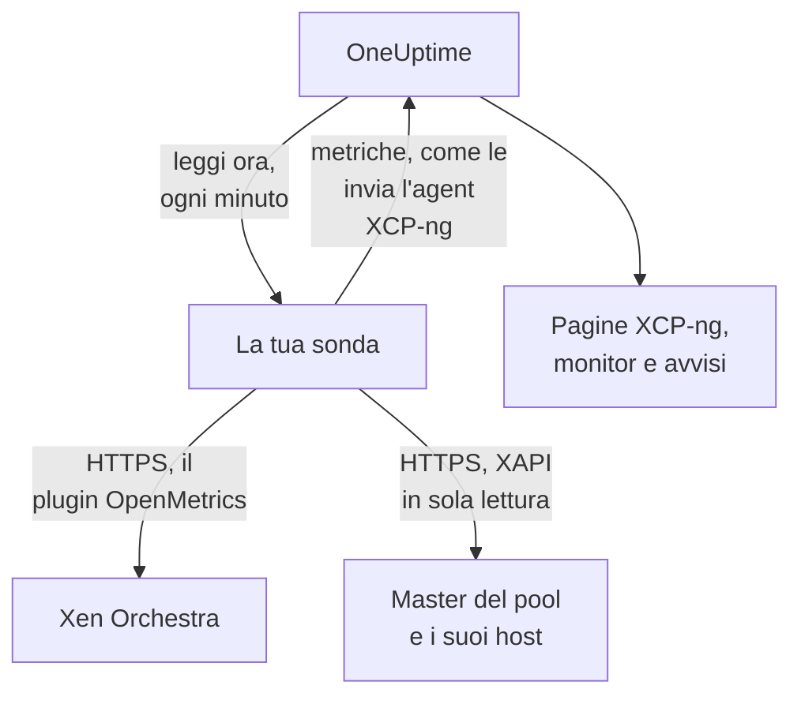

# XCP-ng senza agent

Monitora i pool XCP-ng senza installare nulla: una sonda OneUptime li legge, tramite lo Xen Orchestra che li gestisce oppure, per un pool senza Xen Orchestra, direttamente dalla XAPI sul master del pool. Ogni pool ottiene le stesse pagine, gli stessi [monitor XCP-ng](/docs/monitor/xcp-ng-monitor) e gli stessi modelli di un pool inviato dall'[agent XCP-ng](/docs/telemetry/xcp-ng). Non c'è alcun agent da installare, aggiornare o mantenere in esecuzione.

:::cards
- [Prima di iniziare](#prima-di-iniziare): una sonda che raggiunge Xen Orchestra o il pool, e un accesso in sola lettura.
- [Connettere Xen Orchestra](#connettere-xen-orchestra): tutti i pool che gestisce, tramite una sola connessione.
- [Connettere un pool senza Xen Orchestra](#connettere-un-pool-senza-xen-orchestra): un solo pool, letto dal suo master.
- [Allarmi, HA e backup](#allarmi-ha-e-backup): cosa legge una sonda oltre alle metriche, e gli avvisi che offre.
- [Risoluzione dei problemi](#risoluzione-dei-problemi): cosa significa ogni messaggio e cosa lo risolve.
:::

## Come funziona

Ogni minuto la sonda legge ogni connessione e invia a OneUptime ciò che ha letto:

- **Xen Orchestra**: la sonda legge il plugin OpenMetrics di Xen Orchestra con il segreto del plugin, esattamente come l'agent XCP-ng, così ogni pool gestito da Xen Orchestra arriva con le stesse serie. Con un token API legge anche gli allarmi, l'HA e i backup di ogni pool dalla REST API di Xen Orchestra.
- **La XAPI di un pool**: la sonda accede al master del pool ed esegue le letture che il plugin di Xen Orchestra esegue da sé: i record del pool e le metriche di ogni host in esecuzione, lette da quell'host. Ne ricava le stesse serie che il plugin serve, così il pool viene letto esattamente come tramite Xen Orchestra. Inoltre pubblica nel feed del pool i messaggi XAPI del pool, come una VM andata in crash o un host perso dall'HA.

Ogni pool si registra con il suo UUID alla prima lettura, come i pool dell'agent, e compare in **XCP-ng → Tutti i pool**.

## Quale modo di connettersi scegliere

| | Xen Orchestra, da una sonda | La XAPI di un pool, da una sonda | L'agent XCP-ng |
|---|---|---|---|
| Cosa esegui | Una sonda che esegui già, o una nuova | Una sonda che esegui già, o una nuova | L'agent, su una macchina dedicata |
| Cosa legge | Tutti i pool che Xen Orchestra gestisce | Un solo pool | Tutti i pool che Xen Orchestra gestisce |
| Cosa serve | Il segreto del plugin OpenMetrics e, facoltativo, un token API in sola lettura | Un account del pool: root, oppure un utente di Active Directory con il ruolo read-only | Il segreto del plugin OpenMetrics |
| Dove sono conservati i segreti | Cifrati in OneUptime, inviati solo alla sonda | Cifrati in OneUptime, inviati solo alla sonda | Nel file `.env` dell'agent |
| Allarmi, HA e backup | Tutti e tre, e le patch mancanti, con un token API | Allarmi e HA, senza backup | Non inclusi |

Tutti e tre inviano le stesse serie. Un pool viene letto da uno solo di essi alla volta, così la sua cronologia resta una sola linea, chiunque lo legga.

## Prima di iniziare

- **Una sonda che raggiunge l'indirizzo su TCP 443.** Di solito è una [sonda personalizzata](/docs/probe/custom-probe) nella stessa rete. Su OneUptime Cloud le sonde condivise non ricevono mai segreti XCP-ng, quindi aggiungi una sonda tua. Su un'istanza self-hosted possono leggere anche le sonde dell'istanza.
- **Per Xen Orchestra:** Xen Orchestra 6.9 o successivo con il plugin OpenMetrics attivo: segui [Attivare il plugin OpenMetrics](/docs/telemetry/xcp-ng#attivare-il-plugin-openmetrics) e copia il suo segreto. Facoltativo: un token API di un utente di Xen Orchestra con il ruolo predefinito **Read only**: OneUptime verifica che legga soltanto e ti avvisa prima che scada.
- **Per un pool senza Xen Orchestra:** XCP-ng 8.2 o successivo, e l'indirizzo del suo master. I ruoli di XAPI valgono solo per gli utenti di Active Directory, quindi il suo unico account locale, `root`, può modificare tutto nel pool. Per un accesso in sola lettura, unisci il pool ad Active Directory e assegna a un utente il ruolo `read-only`.

> [!IMPORTANT]
> Connetti un pool tramite Xen Orchestra o tramite la sua XAPI, non entrambi: la seconda connessione che legge un pool lo lascia alla prima.

## Connettere Xen Orchestra

:::steps
### Aprire le connessioni
In OneUptime, apri **XCP-ng → Connessioni** e fai clic su **Connetti XCP-ng**.

### Scegliere Xen Orchestra
In **Cosa leggere**, scegli **Xen Orchestra**. Inserisci l'**Indirizzo di Xen Orchestra**, quello a cui lo apri in un browser, ad esempio `https://xo.example.com`, e scegli la sonda che lo raggiunge.

### Inserire il segreto del plugin
Incolla il **Segreto OpenMetrics**. Aggiungi un **Token API** dell'utente in sola lettura, se ne hai uno.

### Testare la connessione e considerare attendibile il certificato
Fai clic su **Testa la connessione**. Xen Orchestra firma il proprio certificato, quindi il test lo mostra: verifica la sua impronta digitale, poi fai clic su **Considera attendibile questo certificato**. Il risultato elenca i pool che Xen Orchestra serve, con i loro host, VM e repository di storage.

### Dare un nome e connettere
Il nome predefinito è il nome host di Xen Orchestra, e ogni pool che legge lo mostra. Fai clic su **Connetti XCP-ng**, e si apre la pagina della connessione.
:::

## Connettere un pool senza Xen Orchestra

:::steps
### Partire dalle connessioni
In OneUptime, apri **XCP-ng → Connessioni** e fai clic su **Connetti XCP-ng**.

### Scegliere il pool
In **Cosa leggere**, scegli **Un pool senza Xen Orchestra**. Inserisci l'**Indirizzo del master del pool**, ad esempio `https://10.0.0.10`, e scegli la sonda che lo raggiunge.

### Inserire l'account
Inserisci **Nome utente** e **Password**: `root`, oppure un utente di Active Directory con il ruolo read-only, scritto con il suo dominio, ad esempio `EXAMPLE\oneuptime`.

### Testare la connessione e considerare attendibile il certificato del master
Fai clic su **Testa la connessione**. Ogni host XCP-ng firma il proprio certificato, quindi il test mostra quello del master: verifica la sua impronta digitale, poi fai clic su **Considera attendibile questo certificato**. Il risultato indica quale versione di XCP-ng esegue il master e cosa può leggere l'account, e ti avvisa quando l'account può modificare il pool.

### Dare un nome al pool e connettere
Fai clic su **Connetti XCP-ng**, e si apre la pagina della connessione.
:::

La pagina della connessione mostra a che punto è la sua lettura. Mostra **Verifica in corso** fino alla prima lettura, che inizia entro un minuto, poi **In raccolta**, e i pool letti compaiono in **Pool letti**.

Se nessuna sonda arriva per la connessione per 20 minuti, perché è offline o troppo vecchia, la pagina mostra **Nessuna raccolta** e lo dice. Quando nessuna sonda può leggere la connessione, mostra subito **Nessuna raccolta** e dice cosa cambiare: manca un segreto, un nome utente o una password, nessuna sonda è impostata per leggerla, la sua sonda non può leggerla (una sonda condivisa su OneUptime Cloud, o quella di un altro progetto), oppure la sua sonda è disconnessa.

## I pool che l'agent invia già

Un pool registrato dall'agent XCP-ng viene preso in carico dalla prima connessione che lo legge: la sua cronologia prosegue come una sola linea, e il feed del pool indica che l'agent può essere arrestato.

> [!WARNING]
> Arresta l'agent XCP-ng appena una sonda legge i suoi pool. Finché sono in esecuzione entrambi, ogni metrica arriva due volte.

Per tornare indietro, apri la pagina **Impostazioni** del pool. La sua scheda **Raccolta dati** offre **Usa l'agent XCP-ng** per un pool letto da una sonda, e **Raccogli con una sonda** per un pool inviato dall'agent. Un pool riportato all'agent resta all'agent, qualunque cosa legga la connessione.

## Certificati

La sonda non salta mai la verifica dei certificati. Ogni connessione completa un handshake TLS completo, e poi:

- senza un certificato attendibile, il certificato deve provenire da un'autorità di cui la macchina della sonda si fida, per l'indirizzo inserito;
- con un certificato attendibile, l'indirizzo deve presentare esattamente quel certificato, identificato dalla sua impronta digitale SHA-256, qualunque nome riporti il certificato. Il certificato di Xen Orchestra non nomina alcun indirizzo, e viene considerato attendibile in questo modo.

Per verificare un'impronta digitale, esegui `openssl s_client -connect xo.example.com:443 </dev/null | openssl x509 -noout -fingerprint -sha256` dalla macchina della sonda e confrontala con il certificato stesso: su un master di pool, `openssl x509 -noout -fingerprint -sha256 -in /etc/xensource/xapi-ssl.pem`.

Per un pool, consideri attendibile il certificato del master. Il pool elenca da sé il certificato che serve ciascuno dei suoi host, e la sonda legge ogni altro host vincolandolo a quel certificato. Quando un altro host diventa master, la sonda lo segue solo verso un host di cui il pool si è fatto garante all'ultima lettura. Quando un certificato cambia, la lettura si ferma con **Il certificato è cambiato** e il nuovo certificato viene mostrato: non viene inviato nulla finché non lo consideri attendibile, nella pagina della connessione.

## I segreti salvati

Il segreto, il token e la password sono cifrati e di sola scrittura: nessuno può rileggerli, e l'API non li restituisce mai. Vengono inviati solo alla sonda che legge la connessione, che li tiene in memoria.

Un segreto salvato viene inviato solo all'indirizzo, tramite la sonda e al certificato per cui è stato inserito. Cambiare l'indirizzo, la sonda o il certificato attendibile in **Modifica connessione** richiede di inserirlo di nuovo, così nessuno che possa modificare la connessione può inviarlo altrove, e un token API salvato che non viene reinserito viene dimenticato. Considerare attendibile il certificato che la sonda ha trovato all'indirizzo salvato li conserva. **Rimuovi il token API** elimina il token da OneUptime: revocalo anche in Xen Orchestra.

## Il token API

Un token API è facoltativo: le metriche arrivano tramite il segreto del plugin, e il token legge gli allarmi, l'HA e i backup di ogni pool. Con un token, ogni lettura lo verifica al massimo una volta all'ora:

- **Legge soltanto.** Un token il cui utente è amministratore, o il cui ruolo può modificare qualcosa, non supera il test e compare come problema nella pagina della connessione. OneUptime conserva solo token in sola lettura.
- **Legge ciò che serve a OneUptime.** Xen Orchestra risponde con un elenco vuoto a un elenco che un utente non può leggere, quindi il token deve leggere allarmi, messaggi e log dei backup. Il ruolo predefinito **Read only** li legge tutti e tre.
- **Quando scade.** Xen Orchestra dimentica un token nel momento in cui scade. Due settimane prima, la pagina della connessione e il feed di ogni pool che legge lo segnalano. Crea un nuovo token per lo stesso utente e inseriscilo in **Modifica connessione**.

## Allarmi, HA e backup

Oltre alle metriche, una sonda legge ciò che XCP-ng e Xen Orchestra riportano su ogni pool. Cosa legge dipende dalla connessione:

| | Xen Orchestra, con un token API | La XAPI di un pool |
|---|---|---|
| Messaggi e allarmi XAPI | Letti | Letti |
| L'HA e il master del pool | Letti | Letti, con il piano dell'HA stessa |
| Job di backup e le loro esecuzioni | Letti | Non letti: i backup sono di Xen Orchestra |
| Patch mancanti | Lette ogni sei ore, se l'abbonamento a Xen Orchestra le include | Non lette: le determina Xen Orchestra |

Una connessione a Xen Orchestra senza token API legge solo le metriche, come l'agent XCP-ng.

- **Sulle pagine del pool.** La **Panoramica** del pool mostra lo stato dell'HA e le ultime esecuzioni di ogni job di backup, la pagina di un host le sue patch mancanti e la pagina di una VM il suo ultimo backup. I messaggi con priorità da 1 a 4, un cambio di master, l'HA attivata, disattivata o non più in grado di tollerare il guasto di un host, e le esecuzioni di backup non riuscite finiscono nel **Feed** del pool, e ogni messaggio ed esecuzione di backup è un record nella pagina **Log** del pool.
- **Come avvisi.** Le **Raccomandazioni** del pool offrono, sotto **Allarmi XCP-ng** e **Backup**, un modello per ciascuno: VM Crashed, HA Host Failed, HA State File Lost, HA Protected VM Restart Failed, Storage Failed to Plug, Storage GC Out of Space, XAPI Alarm, Pool Master Changed e Backup Job Failed. Il [monitor XCP-ng](/docs/monitor/xcp-ng-monitor) aggiunge HA Cannot Tolerate a Host Failure e VM Not Backed Up.
- **Dalla prima lettura in poi.** Ciò che XAPI ha detto prima che un pool venisse letto la prima volta non viene segnalato, e ogni messaggio viene segnalato una sola volta. La prima lettura dei log dei backup guarda indietro di una settimana e un giorno, così le ultime esecuzioni di ogni job compaiono subito.

## Riferimento

| Impostazione | Predefinito | Note |
|---|---|---|
| Leggi ogni | 1 minuto | Da 1 a 60 minuti. Ogni minuto corrisponde all'agent XCP-ng; leggi uno Xen Orchestra grande meno spesso per alleggerirlo. |
| Letture contemporanee | 4 per sonda | Una lettura più lenta del suo intervallo viene saltata, mai accodata. |
| Lettura più grande | Circa 48 MiB | Gli Xen Orchestra più grandi richiedono l'agent XCP-ng. |
| Messaggi XAPI | 200 per lettura | Dal momento in cui il pool è connesso, ognuno consegnato una volta, il più vecchio per primo. |
| Esecuzioni di backup | 20 per lettura | La prima lettura guarda indietro di una settimana e un giorno. Un'esecuzione che Xen Orchestra indica ancora come in sospeso dopo tre giorni non viene più attesa. |
| Patch mancanti | Ogni 6 ore | Tramite Xen Orchestra, fino a 100 host per controllo. |
| Test di connessione | 90 secondi per iniziare | Un test che nessuna sonda prende in carico in tempo, o che dura più di 150 secondi, risulta fallito. |

## Risoluzione dei problemi

:::details Il certificato non è attendibile
Xen Orchestra e gli host XCP-ng firmano i propri certificati per impostazione predefinita. Confronta l'impronta digitale mostrata con il certificato, poi fai clic su **Considera attendibile questo certificato**.
:::

:::details Il certificato è cambiato
Non viene inviato nulla finché non consideri attendibile il nuovo certificato. Se lo hai rinnovato, verifica la nuova impronta digitale, consideralo attendibile e inserisci di nuovo i segreti in **Modifica connessione**.
:::

:::details Xen Orchestra ha rifiutato il segreto
Copia di nuovo il segreto da **Settings → Plugins → openmetrics** in Xen Orchestra e inseriscilo in **Modifica connessione**.
:::

:::details Il plugin OpenMetrics non risponde
Carica **openmetrics** in **Settings → Plugins** in Xen Orchestra e attiva **Auto-load** perché si ricarichi dopo un riavvio.
:::

:::details Questo Xen Orchestra non ha il plugin OpenMetrics
Il plugin richiede Xen Orchestra 6.9 o successivo e, su una Xen Orchestra Appliance, una licenza Premium. Senza, connetti invece ogni pool tramite la sua XAPI.
:::

:::details Nessun pool è connesso
Xen Orchestra non riporta alcun pool connesso. Aggiungi o riconnetti i tuoi pool in Xen Orchestra, poi testa di nuovo.
:::

:::details Il token API può modificare Xen Orchestra
OneUptime conserva solo token in sola lettura. Creane uno per un utente con una copia del ruolo predefinito **Read only** e nessun altro ruolo.
:::

:::details Il token API non può leggere allarmi, messaggi o backup
Assegna all'utente del token una copia del ruolo predefinito **Read only** di Xen Orchestra, che li legge tutti e tre.
:::

:::details Il token API è scaduto
Crea in Xen Orchestra un nuovo token per l'utente in sola lettura e inseriscilo in **Modifica connessione**. Nel frattempo le metriche continuano ad arrivare.
:::

:::details XAPI ha rifiutato l'accesso
Controlla nome utente e password. Un utente di Active Directory si scrive con il suo dominio, ad esempio `EXAMPLE\oneuptime`.
:::

:::details Questo host non è il master del pool
Un membro del pool risponde con l'indirizzo del suo master, che il messaggio indica. Inserisci quell'indirizzo e testa di nuovo.
:::

:::details L'account non può leggere il pool
Assegna all'utente di Active Directory il ruolo read-only sul pool, oppure usa un account che lo abbia.
:::

:::details La sonda non riceve risposta
La rete della sonda non riesce a raggiungere l'indirizzo su TCP 443. Consentilo nel firewall, oppure scegli una sonda nella stessa rete.
:::

:::details La sonda non ha preso in carico questa richiesta
La sonda è offline, oppure esegue una versione di OneUptime precedente alla lettura di XCP-ng. Verifica che sia connessa nella tabella **Sonde personalizzate** e aggiornala.
:::

:::details Questa connessione è troppo grande per essere letta da una sonda
Le sue metriche superano le dimensioni consentite per un caricamento della sonda. Usa l'[agent XCP-ng](/docs/telemetry/xcp-ng) per questa connessione.
:::

## Prossimi passi

:::cards
- [Monitor XCP-ng](/docs/monitor/xcp-ng-monitor): avvisi su pool, host, VM e repository di storage.
- [Sonda personalizzata](/docs/probe/custom-probe): esegui una sonda nella rete dei pool.
- [Agent XCP-ng](/docs/telemetry/xcp-ng): leggi invece Xen Orchestra con l'agent.
:::
