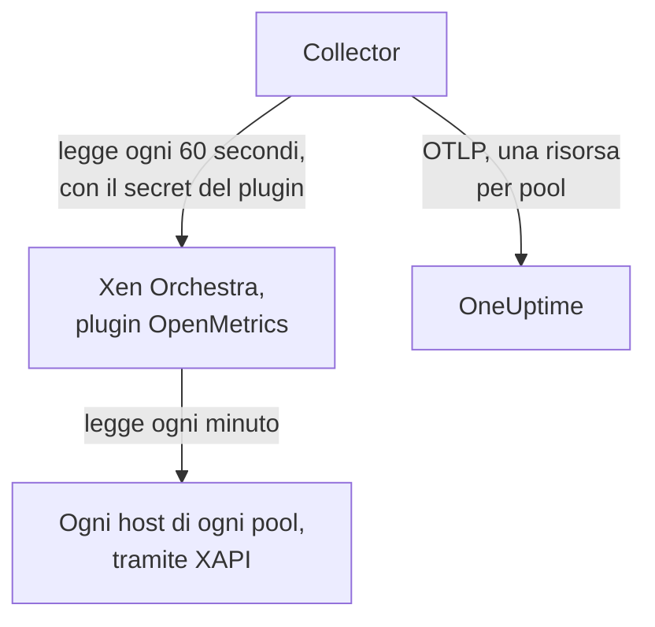

# Agent XCP-ng

L'agent XCP-ng di OneUptime monitora i pool XCP-ng gestiti da un Xen Orchestra: i loro host, le VM, i repository di storage e i dischi virtuali. È un OpenTelemetry Collector standard che legge il plugin OpenMetrics di Xen Orchestra con il secret del plugin e invia ciò che legge a OneUptime, dove ogni pool compare con il suo inventario. Nessuna password di un pool o di Xen Orchestra raggiunge mai l'agent. I [monitor XCP-ng](/docs/monitor/xcp-ng-monitor) generano avvisi su ciò che arriva. Per leggere gli stessi pool senza installare nulla, da una sonda di OneUptime, vedi [XCP-ng senza agent](/docs/telemetry/xcp-ng-agentless).

:::cards
- [Installa l'agent](#installa-lagent): Attiva il plugin, poi lo script di installazione o Docker Compose.
- [Il certificato di Xen Orchestra](#il-certificato-di-xen-orchestra): Come l'agent si fida di Xen Orchestra, mai saltando la verifica.
- [Cosa raccoglie l'agent](#cosa-raccoglie-lagent): Ogni serie del plugin, e i contatori che in realtà sono tassi.
- [Risoluzione dei problemi](#risoluzione-dei-problemi): Uno script di diagnostica, e i problemi più comuni.
:::

## Cosa ottieni

- **Ogni pool per conto suo.** Ogni pool gestito dal Xen Orchestra diventa un pool XCP-ng in OneUptime, riconosciuto dal suo UUID XAPI e chiamato come lo chiama Xen Orchestra. Due pool dietro un solo Xen Orchestra sono due pool, e rinominare un pool in OneUptime è sicuro: la telemetria gli viene associata tramite il suo UUID.
- **Il suo inventario.** Gli host, le VM, i repository di storage e i dischi virtuali del pool, con il loro stato e le loro metriche. I domini di controllo (dom0) si presentano come VM, e le pagine del pool li nascondono a meno che tu non li chieda.
- **Un agent per Xen Orchestra.** Il plugin serve ogni pool a cui il suo Xen Orchestra è connesso, quindi un solo agent li legge tutti, e un pool connesso in seguito compare alla lettura successiva.

## Come funziona

L'agent è un container che esegui con Docker Compose su una macchina: un OpenTelemetry Collector standard, senza un'immagine propria di OneUptime. Ogni 60 secondi chiede a Xen Orchestra `/openmetrics/metrics`, con il secret del plugin come token Bearer, sull'indirizzo e con il certificato di Xen Orchestra stesso. Il plugin legge le metriche di ogni host tramite XAPI con una risoluzione di 60 secondi. Il collector tiene le serie dei pool, le raggruppa per pool e le invia a OneUptime tramite OTLP.



Ogni pool si registra con i suoi primi dati, sotto l'UUID che l'agent appone sulle sue serie come `xcp_ng.pool.id`, e il nome che gli dà Xen Orchestra, `xcp_ng.pool.name`. Un pool senza nome in Xen Orchestra si chiama "Pool" seguito dall'inizio del suo UUID, finché non lo rinomini.

## Prima di iniziare

- Xen Orchestra 6.9 o successivo, connesso ai pool che vuoi monitorare, con il suo plugin OpenMetrics. Su una Xen Orchestra Appliance (XOA) il plugin richiede una licenza Premium; un Xen Orchestra compilato dai sorgenti lo include.
- Docker Engine 20.10 o successivo con il plugin Docker Compose v2, `curl` e `openssl`, su una macchina che raggiunge Xen Orchestra via HTTPS.
- Un certificato su Xen Orchestra che indichi l'indirizzo a cui l'agent si connette. Il certificato autofirmato che Xen Orchestra crea per sé non ne indica nessuno, quindi nessun client TLS attuale può verificarlo, e un Xen Orchestra compilato dai sorgenti serve HTTP semplice finché non gliene dai uno: vedi [Il certificato di Xen Orchestra](#il-certificato-di-xen-orchestra).
- Una chiave di acquisizione. Creane una in **Impostazioni del progetto → Telemetria e APM → Chiavi di acquisizione** e copiane il valore.
- HTTPS in uscita da quella macchina verso il tuo URL di OneUptime.

### Versioni supportate

| | Supportato | Perché |
| --- | --- | --- |
| Xen Orchestra | 6.9 o successivo, con il plugin OpenMetrics `xo-server-openmetrics` 1.9 | Il suo plugin conserva il secret quando Xen Orchestra si riavvia, contiene le correzioni delle perdite di memoria della lettura e serve ogni serie che leggono le pagine del pool: lo stato degli host e delle VM, i repository di storage e i dischi virtuali. Un plugin più vecchio poteva creare un nuovo secret a un riavvio, bloccando l'agent finché qualcuno non lo copiava di nuovo. |
| XCP-ng | 8.3 LTS | Supportato da Vates fino al 30 novembre 2028. XCP-ng 8.2 ha raggiunto la fine del ciclo di vita il 16 settembre 2025. |
| XenServer | Non ancora provato | Xen Orchestra riporta un pool XenServer che gestisce con le stesse serie, quindi dovrebbe funzionare, ma nessuno ne ha ancora provato uno con OneUptime. |

### Dove eseguire l'agent

L'agent parla con Xen Orchestra via HTTPS, quindi può girare su qualsiasi macchina con Docker e un percorso fino a esso: la macchina stessa di Xen Orchestra, un host di monitoraggio o una piccola VM di gestione. Preferisci una macchina la cui VM non giri sui pool che sorveglia: se un pool cade, il tuo monitoraggio non deve cadere con lui. Un agent legge un Xen Orchestra; per più di uno, vedi [Leggere più Xen Orchestra](#leggere-più-xen-orchestra).

## Attivare il plugin OpenMetrics

L'agent legge ogni pool tramite il plugin OpenMetrics di Xen Orchestra, con il secret del plugin.

:::steps
### Attiva il plugin

In Xen Orchestra, apri *Settings → Plugins*, trova **openmetrics** e attivalo. Al primo avvio crea un secret, e Xen Orchestra lo conserva tra un riavvio e l'altro.

### Copia il suo secret

Apri le impostazioni del plugin e copia il suo **Prometheus secret**: lo darai all'agent al passaggio successivo. Puoi anche digitarvi un secret a tua scelta e salvarlo. Tienilo riservato: chi lo possiede può leggere le metriche di ogni pool.

### Verifica che risponda

Il plugin risponde sull'indirizzo e con il certificato di Xen Orchestra stesso, su `/openmetrics/metrics`, e solo a una richiesta che porta il suo secret. Il suo controllo di salute non ne richiede alcuno, quindi questa sola richiesta può saltare la verifica del certificato con `-k`; l'agent non lo fa mai:

```bash
curl -k https://xo.example.com/openmetrics/health
```

Risponde `{"status":"ok"}` finché il plugin è in esecuzione. Un `404` significa che il plugin non è attivo.
:::

## Installa l'agent

:::steps
### Installa e avvia l'agent

Ogni istanza di OneUptime serve lo script di installazione e i file dell'agent della propria release: i comandi qui sotto li scaricano da `https://oneuptime.com`, quindi su un'istanza self-hosted sostituisci questo indirizzo con il tuo URL. Lo script di installazione viene prima salvato come `install.sh`, così puoi leggerlo prima di eseguirlo.

:::tabs
@tab install.sh
Scarica lo script di installazione ed eseguilo sulla macchina che ospiterà l'agent:

```bash
curl -fsSL https://oneuptime.com/install/xcp-ng-agent -o install.sh
bash install.sh
```

Lo script chiede il tuo URL di OneUptime, la chiave di acquisizione, l'indirizzo di Xen Orchestra come lo apri nel browser (come `https://xo.example.com` o `https://10.0.0.5:8443`), il secret del plugin (non mostrato mentre lo digiti) e come chiamare questo Xen Orchestra in OneUptime. Poi legge il certificato di Xen Orchestra: un certificato di cui questa macchina si fida già viene verificato con il suo bundle di CA; qualsiasi altro viene mostrato con la sua impronta SHA-256, e rispondi **y** per fidarti di quel certificato e di nient'altro, dopo aver confrontato l'impronta con quella sulla macchina di Xen Orchestra. Non disattiva mai la verifica. Infine chiede al plugin le sue metriche con il secret e dice quali pool riporta Xen Orchestra, prima di installare qualsiasi cosa. Si installa in `/opt/oneuptime-xcp-ng-agent`, scrive con i permessi `0600` un file `.env` e `xo-ca.pem`, i certificati di cui l'agent si fida per Xen Orchestra, e avvia l'agent con Docker Compose. Eseguire di nuovo lo script riusa tutto ciò che c'è in quel `.env` invece di chiedere di nuovo, ed è così che [aggiorni l'agent](#aggiornare-lagent).
@tab Docker Compose
Scarica `docker-compose.yml` e `otel-collector-config.yaml` dal tuo OneUptime in una nuova cartella:

```bash
mkdir oneuptime-xcp-ng-agent && cd oneuptime-xcp-ng-agent
curl -fsSLO https://oneuptime.com/install/xcp-ng-agent/docker-compose.yml
curl -fsSLO https://oneuptime.com/install/xcp-ng-agent/otel-collector-config.yaml
```

Crea un file `.env` accanto a essi. Contiene il secret del plugin, quindi tienilo riservato con `chmod 600 .env`:

```bash title=".env"
ONEUPTIME_URL=YOUR_ONEUPTIME_URL
ONEUPTIME_TELEMETRY_INGESTION_KEY=YOUR_TELEMETRY_INGESTION_TOKEN
XO_SCHEME=https
XO_ADDRESS=xo.example.com
XO_OPENMETRICS_SECRET='your-plugin-secret'
XO_NAME='Xen Orchestra'
XO_TLS_SERVER_NAME=
```

`XO_ADDRESS` è l'`host` o l'`host:port` di Xen Orchestra, senza `https://`. Metti il secret del plugin tra apici singoli e scrivi ogni `$` che contiene come `$$`: il collector rilegge il valore un'altra volta e prenderebbe un `$` per l'inizio di una variabile. Un secret che contiene un `'` non può stare tra apici singoli: lascia che lo scriva lo script di installazione, oppure scegli un altro secret in Xen Orchestra.

Poi salva il certificato di Xen Orchestra come `xo-ca.pem` accanto a `docker-compose.yml`: l'agent verifica Xen Orchestra con questo file e nient'altro. Per fidarti del certificato di Xen Orchestra stesso, leggilo e confronta la sua impronta con quella sulla macchina di Xen Orchestra prima di usarlo:

```bash
openssl s_client -connect xo.example.com:443 -servername xo.example.com </dev/null 2>/dev/null \
  | openssl x509 -out xo-ca.pem
openssl x509 -in xo-ca.pem -noout -fingerprint -sha256
```

Se il certificato l'ha emesso una tua CA, copia invece il certificato di quella CA in `xo-ca.pem`; se l'ha emesso una CA pubblica, copia il bundle di CA di questa macchina (`cp /etc/ssl/certs/ca-certificates.crt xo-ca.pem`). Avvia l'agent:

```bash
docker compose up -d
```
:::

### Verifica che l'agent sia in esecuzione

```bash
docker compose ps
docker logs -f oneuptime-xcp-ng-agent
```

`docker compose ps` elenca il collector, `oneuptime-xcp-ng-agent`. I suoi log dovrebbero mostrare questa riga una volta avviato:

```text
Everything is ready. Begin running and processing data.
```

### Trova i pool in OneUptime

Apri **Prodotti → Infrastruttura → XCP-ng → Tutti i pool**. Ogni pool che Xen Orchestra riporta compare circa un minuto dopo la prima lettura, con il nome che gli dà Xen Orchestra, con i suoi host, le VM e lo storage. La sua pagina **Topologia** li disegna come un'unica mappa: vedi [Topologia](/docs/telemetry/topology#aprire-la-mappa-di-una-risorsa).
:::

## Il certificato di Xen Orchestra

L'agent verifica il certificato di Xen Orchestra a ogni lettura, con `xo-ca.pem` e nient'altro, e non salta mai la verifica: il secret del plugin viaggia in ogni richiesta. `xo-ca.pem` contiene una di tre cose:

- **Il certificato di Xen Orchestra stesso**, fissato tramite la sua impronta SHA-256 (`XO_TLS_FINGERPRINT`): l'agent si fida di quel certificato e di nessun altro.
- **La CA che lo ha emesso** (`XO_CA_FILE`), per un certificato di una tua CA.
- **Il bundle di CA di questa macchina**, per un certificato di cui questa macchina si fida già, come uno di una CA pubblica.

In ogni caso, il certificato deve indicare l'indirizzo a cui l'agent si connette. L'agent verifica i nomi per cui un certificato è emesso, i suoi subject alternative name, come fa ogni client TLS attuale, e mai il suo subject. Il certificato autofirmato che Xen Orchestra crea per sé non ne indica nessuno, quindi l'agent non può fidarsene, fissato o no, e fallisce con `x509: certificate is not valid for any names`; lo script di installazione si ferma davanti a un certificato del genere e spiega perché.

### Dare a Xen Orchestra un certificato che indichi il suo indirizzo

Usa un certificato della tua CA o di una CA pubblica, oppure creane uno autofirmato che indichi l'indirizzo di Xen Orchestra, sulla macchina di Xen Orchestra, con il suo nome e il suo indirizzo nei suoi subject alternative name:

```bash
sudo mkdir -p /etc/ssl/xo
sudo openssl req -x509 -newkey rsa:2048 -nodes -days 825 \
  -subj "/CN=xo.example.com" \
  -addext "subjectAltName=DNS:xo.example.com,IP:10.0.0.5" \
  -keyout /etc/ssl/xo/key.pem -out /etc/ssl/xo/cert.pem
```

Punta il listener HTTPS di xo-server sui due file, che l'utente con cui gira xo-server (root per impostazione predefinita) deve poter leggere, in un file di configurazione a sé: `/etc/xo-server/config.httpscert.toml` su una XOA, oppure accanto al `config.toml` di xo-server per un Xen Orchestra compilato dai sorgenti. I listener di Xen Orchestra sono numerati, e il secondo, `http.listen.1`, è quello HTTPS:

```toml
[http.listen.1]
port = 443
cert = '/etc/ssl/xo/cert.pem'
key = '/etc/ssl/xo/key.pem'
```

Poi riavvia xo-server con `systemctl restart xo-server` e installa l'agent, oppure esegui di nuovo lo script di installazione: legge il nuovo certificato e mostra la sua impronta da verificare. Oppure lascia che Xen Orchestra richieda da sé un certificato Let's Encrypt, come sa fare una XOA (vedi la documentazione di Xen Orchestra): è riconosciuto pubblicamente, quindi l'agent non ha bisogno di alcuna impostazione. Con un certificato che indica Xen Orchestra con un nome diverso dall'indirizzo in `XO_ADDRESS`, imposta `XO_TLS_SERVER_NAME` su quel nome; lo script di installazione lo compila dal certificato quando può.

Quando un certificato fissato viene rinnovato, l'agent smette di leggere Xen Orchestra finché non si fida del nuovo. Esegui di nuovo lo script di installazione: mostra la nuova impronta e si ferma, senza cambiare nulla. Verifica quell'impronta sulla macchina di Xen Orchestra, poi esegui lo script ancora una volta con essa: `XO_TLS_FINGERPRINT=<new fingerprint> bash install.sh`. Con un'installazione Docker Compose, riscrivi `xo-ca.pem` ed esegui `docker compose up -d --force-recreate`.

## Variabili d'ambiente

Lo script di installazione le scrive in `/opt/oneuptime-xcp-ng-agent/.env`; un'installazione Docker Compose le legge dal `.env` accanto a `docker-compose.yml`. Dopo averne cambiata una, esegui `docker compose up -d` in quella cartella.

| Variabile | Obbligatoria | Descrizione |
| --- | --- | --- |
| `ONEUPTIME_URL` | Sì | Il tuo URL di OneUptime, come `https://oneuptime.com` o la tua istanza self-hosted. Usa `http://` e la sua porta se l'istanza usa solo HTTP. |
| `ONEUPTIME_TELEMETRY_INGESTION_KEY` | Sì | La chiave di acquisizione da **Impostazioni del progetto → Telemetria e APM → Chiavi di acquisizione**. |
| `XO_URL` | Script di installazione | L'indirizzo di Xen Orchestra come lo apri nel browser, come `https://xo.example.com` o `https://10.0.0.5:8443`. Lo script di installazione ne ricava `XO_SCHEME` e `XO_ADDRESS`. |
| `XO_SCHEME` | No | `https`, il valore predefinito. `http` solo in laboratorio: il secret attraversa allora la rete in chiaro. |
| `XO_ADDRESS` | Sì | L'`host` o l'`host:port` di Xen Orchestra, senza schema. |
| `XO_OPENMETRICS_SECRET` | Sì | Il secret del plugin OpenMetrics, inviato come token Bearer. Ogni `$` che contiene va scritto come `$$`. |
| `XO_NAME` | No | Come chiamare questo Xen Orchestra in OneUptime, apposto come `xen_orchestra.name` su ogni pool che legge e mostrato nelle **Impostazioni** di ogni pool. Predefinito: l'indirizzo di Xen Orchestra. |
| `XO_TLS_FINGERPRINT` | Script di installazione | L'impronta SHA-256 del certificato di Xen Orchestra stesso, come la stampa `openssl x509 -fingerprint -sha256`, due punti facoltativi, quando l'agent si fida di quel certificato e di nient'altro. Lo script di installazione rifiuta un certificato che non le corrisponde. |
| `XO_CA_FILE` | Script di installazione | Un bundle di CA che ha emesso il certificato di Xen Orchestra; lo script di installazione verifica il certificato con esso e lo copia in `xo-ca.pem`. |
| `XO_TLS_SERVER_NAME` | No | Il nome con cui viene verificato il certificato di Xen Orchestra, quando `XO_ADDRESS` è un indirizzo che il certificato non elenca. Vuoto: l'host di `XO_ADDRESS`. |
| `ONEUPTIME_AI_XO_READ_TOKEN` | No | Un token di un utente Xen Orchestra con una copia del ruolo integrato **Read only** e nient'altro: l'[agente IA](#agente-ia) viene eseguito quando è impostato, e legge con esso. |
| `ONEUPTIME_AI_XO_WRITE_TOKEN` | No | Solo per le correzioni: un token di un altro utente, il cui ruolo le consente. Senza di esso, l'agente IA non modifica nulla. |
| `XCP_NG_POOL_ID` | No | L'UUID XAPI del pool servito dall'agente IA. Vuoto: l'unico pool che il suo token di lettura può vedere. |
| `ONEUPTIME_AI_AGENT_RESOURCE_NAME` | No | Sostituisce `XCP_NG_POOL_ID` come pool con cui si registra l'agente IA. |
| `ONEUPTIME_AI_INVESTIGATION` | No | `true` o `false`: se OneUptime AI può eseguire i comandi in sola lettura dell'agente IA mentre indaga. Vuoto: attivo. |
| `ONEUPTIME_AI_FIXES` | No | `off`, `ask-for-approval`, `automatic` o `bypass-approval`: come OneUptime AI può applicare una correzione. Vuoto: `ask-for-approval` quando le scritture sono consentite, altrimenti `off`. |
| `ONEUPTIME_AI_ALLOW_WRITES` | No | `true` consente all'agente IA di applicare correzioni, con il token per le modifiche. Qualsiasi altro valore lo lascia in sola lettura. |
| `ONEUPTIME_AI_WRITE_TARGETS` | No | I `vm/<uuid>`, `host/<uuid>`, `pbd/<uuid>` o `schedule/<uuid>` che una correzione può toccare, separati da virgole, `*` per qualsiasi sequenza di caratteri. Vuoto: tutti. |
| `ONEUPTIME_AI_PROTECTED_TARGETS` | No | Lo stesso, per ciò che OneUptime AI non deve mai modificare, chiunque lo approvi: la VM in cui gira l'agente IA, e quella di Xen Orchestra. |
| `LOG_LEVEL` | No | Il livello di log dell'agente IA: `debug`, `info` (il predefinito), `warn` o `error`. |
| `COMPOSE_PROFILES` | No | `xcp-ng-ai-agent` avvia l'agente IA. Lo script di installazione lo scrive quando il token di lettura è impostato, e lo toglie quando non lo è. |

## Cosa raccoglie l'agent

Ogni minuto l'agent legge il plugin, che legge tramite XAPI i database round-robin di ogni host con una risoluzione di 60 secondi. Tiene le serie `xcp_*` e sposta il pool di ogni serie sulla risorsa con cui le invia, come `xcp_ng.pool.id` (l'UUID del pool, che non cambia mai) e `xcp_ng.pool.name`:

| Categoria | Serie |
| --- | --- |
| Pool | `xcp_pool_connected`, presente finché Xen Orchestra è connesso al pool |
| Host | `xcp_host_status` (il suo stato di alimentazione e se è abilitato), `xcp_host_uptime_seconds`, `xcp_host_cpu_average`, `xcp_host_cpu_core_usage`, `xcp_host_load`, `xcp_host_load_average`, `xcp_host_memory_*`, `xcp_host_running_vcpus`, `xcp_host_network_*` per interfaccia fisica, `xcp_host_disk_*` per repository di storage, `xcp_host_power_consumption_watts` |
| VM | `xcp_vm_status`, `xcp_vm_uptime_seconds`, `xcp_vm_cpu_usage`, `xcp_vm_cpu_core_usage`, `xcp_vm_runstate_*` (contesa della CPU), `xcp_vm_memory_*`, `xcp_vm_network_*` per interfaccia, `xcp_vm_disk_*` per disco, `xcp_vm_power_consumption_watts` |
| Storage | `xcp_sr_physical_size_bytes`, `xcp_sr_physical_usage_bytes`, `xcp_sr_virtual_size_bytes`, `xcp_vdi_virtual_size_bytes`, `xcp_vdi_physical_usage_bytes` |
| XOSTOR | `xcp_xostor_*`, sui pool che eseguono XOSTOR |

I domini di controllo si presentano come VM con `is_control_domain="true"`. Ogni serie di Xen Orchestra conserva il suo nome e le sue etichette, come `uuid`, `host_name`, `vm_name`, `sr_name` e `tags`; il [Monitor XCP-ng](/docs/monitor/xcp-ng-monitor#metriche-raccolte) le elenca tutte.

### I contatori che sono tassi

Xen Orchestra tipizza otto serie di throughput come contatori e le chiama `_total`, anche se ognuna contiene il tasso al secondo di XAPI: `xcp_host_network_receive_bytes_total`, `xcp_host_network_transmit_bytes_total`, `xcp_vm_network_receive_bytes_total`, `xcp_vm_network_transmit_bytes_total`, `xcp_vm_network_receive_errors_total`, `xcp_vm_network_transmit_errors_total`, `xcp_vm_disk_read_bytes_total` e `xcp_vm_disk_write_bytes_total`. Lette come contatori, tutti i grafici di throughput di rete e disco sarebbero sbagliati: un tasso che scende si legge come un azzeramento del contatore. Il processore `transform/xcp-ng-rates` dell'agent le trasforma in gauge con nomi e valori invariati, così OneUptime le memorizza come i tassi che sono, in byte o errori al secondo. OneUptime converte anche quelle che arrivano ancora come contatori, da un collector che hai configurato tu.

### Cosa aggiunge OneUptime

OneUptime ricava per ogni pool quattro serie 0/1 man mano che arrivano i suoi dati, che i modelli di avviso leggono:

| Serie | 1 finché |
| --- | --- |
| `xcp_ng.host.running` | Xen Orchestra riporta l'host Running; 0 finché è Halted, o il suo stato è Unknown |
| `xcp_ng.host.enabled` | l'host è abilitato; 0 in modalità manutenzione o mentre viene evacuato, quando XAPI non avvia alcuna VM su di esso |
| `xcp_ng.vm.running` | la VM è Running; 0 finché è Halted, Paused o Suspended |
| `xcp_ng.vm.stopped_after_running` | una VM che ha girato nelle ultime 24 ore è Halted o Paused |

Appone inoltre su ogni punto `xcp_ng.scope` (`pool`, `host`, `vm`, `sr`, `vdi` o `xostor`) e `xcp_ng.id` (l'UUID di quell'oggetto), su cui filtrano monitor e dashboard: vedi [Identità delle risorse](/docs/monitor/xcp-ng-monitor#identità-delle-risorse).

### Cosa l'agent non tiene

- Le serie di processo di Xen Orchestra stesso (`xo_*`), che non appartengono a nessun pool, e le serie di lettura del collector stesso.
- La potenza di un host che Xen Orchestra legge via IPMI: il plugin invia quella lettura senza il suo pool, quindi non appartiene nemmeno lei a nessun pool. La quota stimata di ogni VM, `xcp_vm_power_consumption_watts`, viene tenuta.

## Cosa mostrano le pagine di un pool

Apri un pool da **Prodotti → Infrastruttura → XCP-ng → Tutti i pool**. Il suo menu contiene:

| Pagina | Cosa mostra |
| --- | --- |
| **Panoramica** | La salute del pool e ciò che richiede attenzione, i suoi host, le VM e lo storage, le VM e gli host più carichi, e il Xen Orchestra da cui viene letto, con la versione dell'agent. |
| **Host**, **VM**, **Archiviazione** | Ogni host, VM e repository di storage, ciascuno con una pagina propria e i suoi grafici. **VM** nasconde i domini di controllo a meno che tu non li chieda, e la pagina di un repository di storage elenca i suoi dischi virtuali. |
| **Topologia** | Il pool, i suoi host, le VM di ciascuno e i repository di storage che usano, come un'unica mappa. |
| **Uso delle risorse** | Grafici di host, VM, storage, dischi e rete del pool nel tempo, una linea per host, VM o repository di storage. |
| **Raccomandazioni** | I [modelli di avviso](/docs/monitor/xcp-ng-monitor#modelli-di-avviso-pronti) da attivare, un monitor ciascuno. |
| **Metriche**, **Log** | Ogni serie del pool negli explorer, limitata a esso. L'agent invia solo metriche, quindi **Log** elenca solo i log che invii con lo `xcp_ng.pool.id` del pool. |
| **Incidenti**, **Avvisi**, **Manutenzione programmata** | Quelli che nominano il pool. |
| **Feed** | Cosa è successo al pool in OneUptime: quando è stato aggiunto, modificato, archiviato o ripristinato, chi sono i suoi proprietari e le regole di proprietario e di etichetta applicate su di esso. |
| **Proprietari** | Chi viene avvisato al riguardo, a mano o tramite regole di proprietario. |
| **Impostazioni** | Il suo nome, il Xen Orchestra da cui viene letto, il suo nome lì e la versione dell'agent, con quanto a lungo viene conservata la sua telemetria. |
| **Documentazione** | Questa configurazione, con il tuo URL e la tua chiave già compilati. |

La **Panoramica** del pool indica la sua salute, **Integro**, **Degradato** o **Non integro**, in base a ciò che richiede attenzione, e lo elenca sotto **Richiede attenzione**, il più urgente per primo:

- **Critico:** un host Halted, o in uno stato che Xen Orchestra non sa determinare (Unknown); un repository di storage pieno oltre il 95%, dove le VM smettono di scrivere.
- **Da controllare:** un host disabilitato, in modalità manutenzione o in evacuazione; una VM Halted o Paused che ha girato nelle ultime 24 ore; un repository di storage pieno oltre il 90%, dove scatta l'avviso Storage Repository Near Full, o allocato oltre la sua dimensione con il thin provisioning.

Una VM sospesa (Suspended) lo è stata di proposito e non conta mai, né una VM che nessuno ha visto girare da un giorno, né un dominio di controllo. Le librerie ISO e i supporti rimovibili non contengono dischi di VM, quindi i dati di storage del pool li escludono.

Quando Xen Orchestra smette di riportare un pool per 15 minuti, il pool diventa **Disconnesso**, e le sue pagine conservano ciò che ha riportato per ultimo. Un host, una VM, un repository di storage o un disco virtuale che non compare più nei rapporti di Xen Orchestra lascia l'inventario 15 minuti dopo; arrestare una VM non la rimuove mai.

## Etichettare i pool con le etichette di progetto

Un attributo di risorsa che inizia con `oneuptime.label.` diventa un'etichetta di progetto su ogni pool che l'agent legge: `oneuptime.label.<dimension>=<value>` è l'etichetta `<dimension>:<value>`. Aggiungi gli attributi al processore `resource` in `otel-collector-config.yaml`, accanto a `oneuptime.agent.version`:

```yaml
processors:
  resource:
    attributes:
      # ...existing attributes...
      - key: oneuptime.label.team
        value: platform
        action: upsert
      - key: oneuptime.label.env
        value: production
        action: upsert
```

Il collector legge la sua configurazione solo all'avvio: esegui `docker compose restart oneuptime-xcp-ng-agent`. I pool mostrano allora le etichette `team:platform` e `env:production`. Le etichette vengono confrontate senza badare a maiuscole e minuscole, quindi un'etichetta `Production` esistente viene riusata anziché duplicata, e l'agent non rimuove mai un'etichetta che qualcuno ha aggiunto in OneUptime. Eseguire di nuovo lo script di installazione sostituisce un `otel-collector-config.yaml` modificato e conserva il tuo accanto come `otel-collector-config.yaml.bak.<timestamp>`.

## Leggere più Xen Orchestra

Un agent legge un Xen Orchestra e ogni pool che gestisce. Per leggere un secondo Xen Orchestra dalla stessa macchina, installa un secondo agent nella sua cartella con il suo `.env`, come `INSTALL_DIR=/opt/oneuptime-xcp-ng-agent-lab bash install.sh`, e dagli il suo `container_name` nel suo `docker-compose.yml` (come `oneuptime-xcp-ng-agent-lab`): due container non possono condividere un nome. Dai a ciascuno il suo `XO_NAME`, così le **Impostazioni** di ogni pool dicono quale Xen Orchestra lo legge, e passa la cartella allo script di diagnostica con `-d`.

Non lasciare mai che due agent leggano lo stesso pool, tramite due Xen Orchestra che lo gestiscono entrambi: è un solo pool in OneUptime, per il suo UUID, e verrebbe riportato due volte.

## Agente IA

Il `docker-compose.yml` dell'agent contiene anche l'**Agente IA XCP-ng**, `oneuptime-xcp-ng-ai-agent` (immagine `oneuptime/resource-ai-agent:release`), nel profilo `xcp-ng-ai-agent`. Mentre OneUptime AI indaga su un incidente o un avviso su un pool, esegue tramite esso comandi REST `xo-cli` in sola lettura, come `xo-cli rest get vms fields=name_label,power_state filter=power_state:Halted` o `xo-cli rest get pbds fields=attached,host,SR filter=!attached?`, e, solo se lo consenti, applica correzioni come l'avvio di una VM o il collegamento del PBD di un repository di storage. Non contiene alcun binario `xo-cli`: ogni comando diventa esattamente una chiamata alla REST API di Xen Orchestra, all'indirizzo e con il file `xo-ca.pem` che usa il collector. Compare nella pagina **Agente IA** del pool in OneUptime.

- **Ha bisogno di un token tutto suo, in sola lettura.** Il secret OpenMetrics legge solo metriche, quindi l'agente IA legge la REST API di Xen Orchestra (Xen Orchestra 6.9 o successivo) con `ONEUPTIME_AI_XO_READ_TOKEN`, un token di un utente Xen Orchestra con una copia del ruolo integrato **Read only** e nient'altro. Esegui `install.sh` con il token impostato, oppure digitalo quando una prima installazione lo chiede: lo script chiede a Xen Orchestra se conosce il token, lo conserva nel `.env` con modalità 600 e avvia l'agente IA. Prima che l'agente esegua qualsiasi cosa, e ogni 5 minuti, verifica che il token possa solo leggere: il token di un amministratore, o uno i cui ruoli consentono una modifica, non esegue nulla.
- **Un pool per agente IA.** `XCP_NG_POOL_ID` è il pool che serve, il suo UUID XAPI come lo mostrano le **Impostazioni** del pool. Se resta vuoto, serve l'unico pool che il suo token può vedere. Per uno Xen Orchestra con più pool, il README dell'agent mostra come eseguirne uno in più per ogni pool. Un pool letto da una sonda non ha bisogno dell'agent XCP-ng: il README mostra anche come eseguire da solo l'agente IA per quel pool, dallo stesso `docker-compose.yml`.
- **Le indagini IA sono attive per impostazione predefinita.** Appena l'agente si connette, OneUptime AI lo usa per indagare sugli incidenti e sugli avvisi del pool, e la **Panoramica** del pool mostra lo stato dell'agente. Per fermarlo, imposta `ONEUPTIME_AI_INVESTIGATION=false` dove viene eseguito l'agente (**Cambia** sotto **Cosa può fare l'IA**, nella pagina dell'agente IA, mostra come), oppure ometti il token.
- **Le correzioni richiedono un secondo token.** L'agente è in sola lettura a meno che tu non imposti `ONEUPTIME_AI_ALLOW_WRITES=true` e `ONEUPTIME_AI_XO_WRITE_TOKEN`, un token di un altro utente il cui ruolo consente le correzioni (una copia del ruolo **VMs power state manager**, con l'aggiunta dei privilegi elencati nel README dell'agent). Viene usato per la modifica stessa e per nient'altro. `ONEUPTIME_AI_WRITE_TARGETS` (`vm/<uuid>`, `host/<uuid>`, `pbd/<uuid>`, `schedule/<uuid>`) limita ciò che una correzione può toccare; metti gli UUID della VM in cui gira l'agente, e della VM di Xen Orchestra stesso, in `ONEUPTIME_AI_PROTECTED_TARGETS`. `ONEUPTIME_AI_FIXES` nello stesso `.env` indica come vengono eseguite le correzioni — `ask-for-approval` (una persona approva ciascuna), `automatic` o `bypass-approval` — e la pagina dell'agente IA lo mostra in sola lettura ([Cosa può fare l'IA, impostato dall'agent](/docs/ai/infrastructure-ai-agents#cosa-può-fare-lia-deciso-dallagente)).
- **Verifica il certificato di Xen Orchestra come fa il collector**, tramite il suo subjectAltName e soltanto con `xo-ca.pem`, quindi anche qui il certificato che Xen Orchestra crea per sé viene rifiutato ([Il certificato di Xen Orchestra](#il-certificato-di-xen-orchestra)). Non legge mai Xen Orchestra tramite `http://`: i suoi token attraverserebbero la rete in chiaro.
- Gira come UID 1000 senza capability e con un file system radice in sola lettura, e non legge mai utenti, ruoli, server, plugin o remote di Xen Orchestra, non filtra mai su una proprietà che contiene secret, e non modifica, elimina, ripristina o clona mai nulla.

Cosa può eseguire, come funzionano le correzioni e come risolverne i problemi: [Agenti IA per l'infrastruttura](/docs/ai/infrastructure-ai-agents#pool-xcp-ng). Il README dell'agent riporta i ruoli e i privilegi per entrambi i token.

## Eseguire come servizio systemd

Per avviare l'agent insieme alla macchina e riavviarlo quando si blocca, installa la sua unità systemd. Presuppone che l'agent si trovi in `/opt/oneuptime-xcp-ng-agent`, dove lo mette lo script di installazione:

```bash
sudo curl -fsSL https://oneuptime.com/install/xcp-ng-agent/systemd/oneuptime-xcp-ng-agent.service -o /etc/systemd/system/oneuptime-xcp-ng-agent.service
sudo systemctl daemon-reload
sudo systemctl enable --now oneuptime-xcp-ng-agent
```

## Aggiornare l'agent

L'agent riporta come **Versione dell'agente** la versione del collector fissata dai suoi file, nella **Panoramica** e nelle **Impostazioni** di ogni pool. Quando è più vecchia della versione fissata da questa release di OneUptime, accanto compare un segnale di avviso. Selezionalo per vedere questi comandi.

L'immagine del collector è fissata in `docker-compose.yml` e la sua configurazione è un file accanto, quindi il solo pull non fa avanzare l'agent. Esegui di nuovo `install.sh`: riusa ogni valore del tuo `.env` esistente (non viene chiesto di nuovo nulla), verifica il certificato di Xen Orchestra allo stesso modo, aggiorna `docker-compose.yml` e `otel-collector-config.yaml` (un file che hai modificato viene conservato come `<file>.bak.<timestamp>`), scarica l'immagine e ricrea l'agent perché il collector legga la sua nuova configurazione. Un agent installato fuori da `/opt/oneuptime-xcp-ng-agent` ha bisogno della sua cartella: `INSTALL_DIR=<folder> bash install.sh`.

```bash
curl -fsSL https://oneuptime.com/install/xcp-ng-agent -o install.sh
bash install.sh
```

L'hai installato invece con Docker Compose? Nella cartella dell'agent, scarica di nuovo entrambi i file (e rifai ogni modifica che vi avevi apportato), poi scarica l'immagine e ricrea l'agent. Il tuo `.env` e `xo-ca.pem` restano:

```bash
curl -fsSLO https://oneuptime.com/install/xcp-ng-agent/docker-compose.yml
curl -fsSLO https://oneuptime.com/install/xcp-ng-agent/otel-collector-config.yaml
docker compose pull
docker compose up -d --force-recreate
```

## Disinstallare l'agent

```bash
cd /opt/oneuptime-xcp-ng-agent
docker compose down
```

Poi disattiva il plugin OpenMetrics in Xen Orchestra se nient'altro lo legge.

## Risoluzione dei problemi

:::details Esegui prima lo script di diagnostica
L'agent include uno script, [`troubleshoot.sh`](https://oneuptime.com/install/xcp-ng-agent/troubleshoot.sh), che verifica l'intera catena nell'ordine in cui viaggiano i dati: il container; l'indirizzo di Xen Orchestra dalla rete dell'agent stesso; il controllo di salute del plugin; il certificato di Xen Orchestra con `xo-ca.pem`, e se uno fissato è ancora quello che presenta; il secret del plugin; i pool che Xen Orchestra riporta; la forma della chiave di acquisizione; le metriche del collector stesso; e se OneUptime accetta la chiave di acquisizione. Quest'ultimo controllo è il più importante. OneUptime rifiuta una chiave errata con `401` (`422` per una chiave disattivata o una chiave del browser), e il collector tratta entrambi come definitivi: scarta il batch e registra un solo errore `Exporting failed`, facile da non notare mentre il container resta in salute. Lo script interroga `GET <url>/otlp/v1/validate` dall'interno della rete dell'agent per ottenere direttamente `200` (valida) o `401` (non valida), e ripiega su `POST /fluentd/v1/logs` sui server più vecchi. Non stampa mai il secret né la chiave.

```bash
curl -fsSL https://oneuptime.com/install/xcp-ng-agent/troubleshoot.sh -o troubleshoot.sh
bash troubleshoot.sh    # add -d <dir> if you installed outside /opt/oneuptime-xcp-ng-agent
```

Termina con un verdetto che indica la causa più probabile.
:::

:::details Xen Orchestra rifiuta il secret (401)
Il collector registra `server returned HTTP status 401 Unauthorized`. Copia di nuovo il secret da *Settings → Plugins → openmetrics*, imposta `XO_OPENMETRICS_SECRET` su di esso in `.env`, tra apici singoli e con ogni `$` scritto come `$$`, ed esegui `docker compose up -d` nella cartella dell'agent. Prima della 6.8, Xen Orchestra poteva creare un nuovo secret a un riavvio: aggiornalo.
:::

:::details Il plugin non risponde (404, 500, 502 o 503)
Xen Orchestra risponde, ma il suo plugin OpenMetrics no. Attiva il plugin in *Settings → Plugins → openmetrics* e verifica che Xen Orchestra sia alla 6.9 o successiva. Una XOA ha bisogno di una licenza Premium per il plugin. `/openmetrics/health` risponde `{"status":"ok"}` senza secret finché il plugin è in esecuzione.
:::

:::details Errori di certificato
- `x509: certificate is not valid for any names`: il certificato non indica alcun indirizzo, come quello autofirmato di Xen Orchestra stesso. [Dai a Xen Orchestra un certificato che indichi il suo indirizzo](#dare-a-xen-orchestra-un-certificato-che-indichi-il-suo-indirizzo).
- `x509: certificate is valid for <names>, not <address>`: connettiti a uno di quei nomi, oppure imposta `XO_TLS_SERVER_NAME` su uno di essi.
- `x509: cannot validate certificate for <IP> because it doesn't contain any IP SANs`: `XO_ADDRESS` è un indirizzo IP che il certificato non elenca. Imposta `XO_TLS_SERVER_NAME` su un nome che elenca, oppure esegui di nuovo lo script di installazione, che lo fa.
- `x509: certificate signed by unknown authority`: `xo-ca.pem` non contiene né questo certificato né la CA che lo ha emesso. Il certificato è stato rinnovato, oppure il file ne contiene un altro: verifica la nuova impronta sulla macchina di Xen Orchestra ed esegui lo script di installazione con essa, `XO_TLS_FINGERPRINT=<new fingerprint> bash install.sh`, oppure riscrivi il file.
- `unable to read CA cert`: `xo-ca.pem` manca o non può essere letto. Esegui di nuovo lo script di installazione.
:::

:::details La lettura va in timeout (context deadline exceeded)
Xen Orchestra ha impiegato più di 50 secondi, il limite dell'agent, per raccogliere le metriche, quindi quella lettura non invia nulla: di solito un host di uno dei suoi pool non gli risponde. Controlla gli host dei pool in Xen Orchestra; l'agent legge di nuovo un minuto dopo.
:::

:::details Un pool risulta Disconnesso
OneUptime segna un pool come Disconnesso quando per 15 minuti non è stato letto nulla per esso; OneUptime controlla ogni 5 minuti, e il tempo in cui non riceveva dati esso stesso non conta.

1. Se tutti i pool di questo Xen Orchestra sono disconnessi, controlla l'agent: `docker compose ps` e `docker logs oneuptime-xcp-ng-agent`, nella cartella dell'agent.
2. Se lo è uno solo, Xen Orchestra ha smesso di riportarlo: in *Settings → Servers* in Xen Orchestra, il server del pool deve essere connesso. Gli host, le VM e lo storage del pool restano come Xen Orchestra li ha riportati per ultimo.
:::

:::details Manca un pool
Xen Orchestra riporta solo i pool a cui è connesso, e l'agent legge solo quel Xen Orchestra. Connetti il server del pool in *Settings → Servers* in Xen Orchestra; il pool compare in OneUptime alla lettura successiva. Un pool gestito da un altro Xen Orchestra ha bisogno di un suo agent, accanto a quel Xen Orchestra.
:::

:::details I grafici di throughput sembrano sbagliati
Le otto serie `_total` che contengono tassi devono arrivare a OneUptime come gauge. Se hai sostituito l'`otel-collector-config.yaml` fornito con il tuo, mantieni il suo processore `transform/xcp-ng-rates`. Leggile così come sono, in byte o errori al secondo: un tasso al secondo di queste sarebbe un tasso di un tasso.
:::

:::details Inviare metriche senza l'agent
L'agent è una sola configurazione standard del collector, quindi un collector che già esegui può fare lo stesso lavoro: copia il job di lettura e i processori dalla configurazione fornita nella tua. L'attributo di risorsa `xcp_ng.pool.id` è ciò che registra ogni pool in OneUptime, il processore `groupbyattrs` fa di ogni pool una risorsa, e le eliminazioni di `service.name` e `service.instance.id` evitano che i dati finiscano sotto un servizio: mantieni tutti e tre, e `transform/xcp-ng-rates`.
:::

## Cosa il plugin non copre ancora

Il plugin OpenMetrics di Xen Orchestra serve metriche, quindi una parte di ciò che sorvegli in un pool XCP-ng non c'è ancora:

- Gli **allarmi**, tranne quelli di XOSTOR, lo **stato HA**, il **master del pool**, le **patch mancanti**, i **backup** e gli **snapshot**, e lo **stato del collegamento** delle interfacce fisiche di un host (PIF). Arriveranno dalla REST API di Xen Orchestra, in [#10997](https://github.com/OneUptime/oneuptime/issues/10997).
- I **pool senza Xen Orchestra**, o dietro una XOA senza la licenza Premium che il plugin richiede: una sonda di OneUptime li legge direttamente tramite XAPI ([#10999](https://github.com/OneUptime/oneuptime/issues/10999)), vedi [XCP-ng senza agent](/docs/telemetry/xcp-ng-agentless).
- **Connettersi senza agent**: una sonda di OneUptime legge da sé il plugin di Xen Orchestra, come per VMware ([#10996](https://github.com/OneUptime/oneuptime/issues/10996)), nella stessa pagina.

## Passaggi successivi

:::cards
- [Monitor XCP-ng](/docs/monitor/xcp-ng-monitor): Avvisi su pool, host, VM e repository di storage.
- [Agent Proxmox](/docs/telemetry/proxmox): Monitora i cluster Proxmox VE allo stesso modo.
- [Collector OpenTelemetry sull'host](/docs/telemetry/host-otel-collector): La vista del sistema operativo dentro le tue VM.
:::
