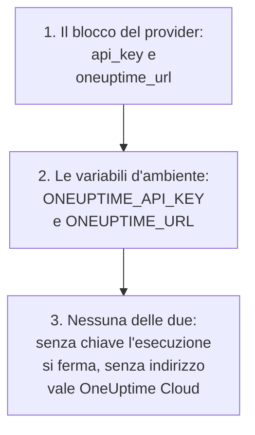
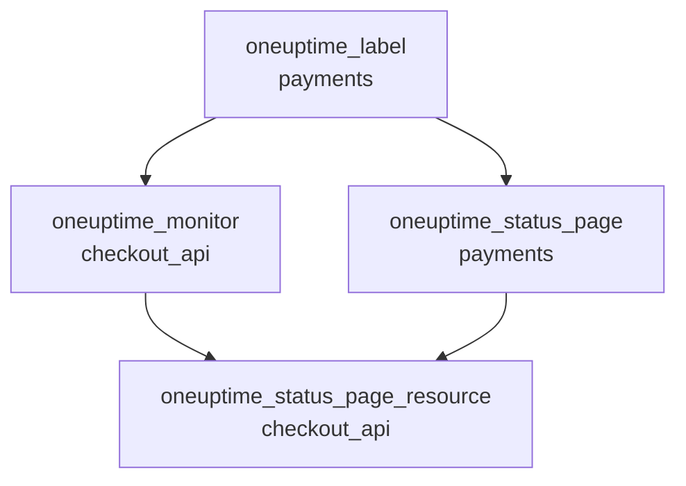

# Guida completa

Questa guida copre ciò che viene dopo il tuo primo apply: come il provider trova la sua chiave API, come organizzare una configurazione per uno o più progetti, come le risorse si riferiscono l'una all'altra, come leggere record che non gestisci, come proteggere lo stato e come aggiornare. Nuovo al provider? Inizia dall'[Avvio rapido](/docs/terraform/quick-start).

:::cards
- [Configurare il provider](#configurare-il-provider): La chiave API e l'indirizzo, e dove il provider li legge.
- [Organizzare una configurazione](#organizzare-una-configurazione): File, progetti e molte risorse da un solo blocco.
- [Leggere ciò che esiste già](#leggere-ciò-che-esiste-già): Le sorgenti dati, e come corrisponde una ricerca.
- [Proteggere lo stato](#proteggere-lo-stato): Un backend remoto, e cosa non committare mai.
:::

## Configurare il provider

Il provider prende due impostazioni. Ognuna viene dal blocco del provider, altrimenti da una variabile d'ambiente:

| Impostazione | Variabile d'ambiente | Quando nessuna delle due è impostata |
| --- | --- | --- |
| `api_key` | `ONEUPTIME_API_KEY` | Il provider si ferma prima di pianificare qualsiasi cosa: `Missing API Key` |
| `oneuptime_url` | `ONEUPTIME_URL` | `https://oneuptime.com`, cioè OneUptime Cloud |



`oneuptime_url` è l'indirizzo della tua istanza OneUptime, senza `/api`: il provider aggiunge `https://` quando l'indirizzo non ha uno schema, e `/api` alla fine. `api_key` è sensibile, quindi Terraform non lo stampa mai.

La chiave deve essere una chiave API del progetto che gestisci, autorizzata a creare, leggere, modificare ed eliminare ogni tipo di record della tua configurazione: vedi [Creare una chiave API del progetto](/docs/terraform/quick-start#creare-una-chiave-api-del-progetto). La chiave API master di un'istanza OneUptime self-hosted non appartiene a nessun progetto, quindi una creazione fatta con essa fallisce con `ProjectId required`.

### Dare al provider la sua chiave

:::tabs
@tab Variabile d'ambiente
```bash
export ONEUPTIME_API_KEY="<your-api-key>"
# Only on a self-hosted OneUptime:
export ONEUPTIME_URL="https://oneuptime.example.com"
```

```hcl title="main.tf"
provider "oneuptime" {}
```
@tab Variabile Terraform
```hcl title="variables.tf"
variable "oneuptime_api_key" {
  description = "API key of the OneUptime project"
  type        = string
  sensitive   = true
}

provider "oneuptime" {
  api_key = var.oneuptime_api_key
}
```

```hcl title="terraform.tfvars"
oneuptime_api_key = "<your-api-key>"
```
:::

Una variabile d'ambiente tiene la chiave fuori da ogni file. Un file di variabili è comodo sulla tua macchina: aggiungi `terraform.tfvars` a `.gitignore`. In una pipeline, imposta `TF_VAR_oneuptime_api_key` invece di scrivere il file.

### Eseguirlo in CI/CD

Dai la chiave al job come segreto, nella variabile d'ambiente `ONEUPTIME_API_KEY`:

:::tabs
@tab GitHub Actions
```yaml title=".github/workflows/oneuptime.yml"
name: OneUptime
on:
  push:
    branches: [main]

jobs:
  apply:
    runs-on: ubuntu-latest
    env:
      ONEUPTIME_API_KEY: ${{ secrets.ONEUPTIME_API_KEY }}
    steps:
      - uses: actions/checkout@v4
      - uses: hashicorp/setup-terraform@v3
      - run: terraform init -input=false
      - run: terraform plan -input=false -out=tfplan
      - run: terraform apply -input=false tfplan
```
@tab GitLab CI
```yaml title=".gitlab-ci.yml"
apply:
  image:
    name: hashicorp/terraform:latest
    entrypoint: [""]
  rules:
    - if: $CI_COMMIT_BRANCH == $CI_DEFAULT_BRANCH
  script:
    - terraform init -input=false
    - terraform plan -input=false -out=tfplan
    - terraform apply -input=false tfplan
```
:::

In GitHub, aggiungi il segreto in **Settings → Secrets and variables → Actions**; in GitLab, aggiungi una variabile CI/CD mascherata con lo stesso nome. Tieni lo stato in un [backend remoto](#proteggere-lo-stato), così ogni esecuzione parte dallo stato lasciato dalla precedente.

## Organizzare una configurazione

Un'organizzazione che funziona bene:

```text
oneuptime/
├── main.tf          # the terraform and provider blocks
├── variables.tf     # input variables
├── outputs.tf       # the IDs other configurations need
├── shared.tf        # labels, teams and monitor statuses
├── monitors.tf      # monitors and monitor groups
├── status-pages.tf  # status pages and their domains
└── on-call.tf       # on-call policies and escalation rules
```

- **Una configurazione per ogni progetto.** Una chiave API appartiene a un progetto, quindi una configurazione ne gestisce naturalmente uno.
- **I record condivisi una volta sola.** Definisci etichette, team e stati del monitor in un file, e riferisciti a essi con il loro indirizzo ovunque.

### Gestire più progetti

Per gestire più di un progetto da una configurazione, dai al provider un alias per ciascuno, ognuno con la chiave di quel progetto. Una risorsa nomina l'alias che usa con `provider`:

```hcl
provider "oneuptime" {
  alias   = "production"
  api_key = var.production_api_key
}

provider "oneuptime" {
  alias   = "staging"
  api_key = var.staging_api_key
}

resource "oneuptime_label" "staging_critical" {
  provider = oneuptime.staging

  name  = "critical"
  color = "#FF5733"
}
```

Dichiara `production_api_key` e `staging_api_key` come variabili marcate `sensitive`, come sopra.

### Molte risorse da un solo blocco

`for_each` crea una risorsa per ogni voce di una map. Questi monitor condividono i loro criteri e differiscono solo per nome e indirizzo:

```hcl
variable "websites" {
  type = map(string)
  default = {
    homepage = "https://example.com"
    docs     = "https://docs.example.com"
  }
}

resource "oneuptime_monitor" "website" {
  for_each = var.websites

  name                = "Website: ${each.key}"
  monitor_type        = "Website"
  monitoring_interval = "*/5 * * * *"

  monitor_steps = [{
    monitor_destination      = each.value
    monitor_destination_type = "URL"

    criteria = [
      {
        name                  = "Offline"
        filter_condition      = "Any"
        change_monitor_status = true
        monitor_status_id     = data.oneuptime_monitor_status.offline.id

        filters = [
          {
            check_on    = "Is Online"
            filter_type = "False"
          }
        ]
      }
    ]
  }]
}
```

Aggiungi un sito alla map, e l'apply successivo crea il suo monitor. Togline uno, e lo elimina.

## Riferirsi ad altre risorse

Una risorsa che nomina un attributo di un'altra dipende da essa, e Terraform ordina il lavoro secondo questi riferimenti. Qui l'etichetta viene creata per prima ed eliminata per ultima, perché il monitor e la pagina di stato la nominano:



```hcl
resource "oneuptime_label" "payments" {
  name        = "payments"
  description = "Payment infrastructure"
  color       = "#2ECC71"
}

resource "oneuptime_monitor" "checkout_api" {
  name         = "Checkout API"
  description  = "Availability of the checkout API"
  monitor_type = "Manual"
  labels       = [oneuptime_label.payments.id]
}

resource "oneuptime_status_page" "payments" {
  name                  = "Payments Status"
  page_title            = "Payments Status"
  is_public_status_page = true
  labels                = [oneuptime_label.payments.id]
}

resource "oneuptime_status_page_resource" "checkout_api" {
  status_page_id = oneuptime_status_page.payments.id
  monitor_id     = oneuptime_monitor.checkout_api.id
  display_name   = "Checkout API"
}
```

Raramente ti serve `depends_on`: aggiungilo solo per un ordine che Terraform non può vedere dagli attributi. Gli elenchi di ID come `labels` sono insiemi, quindi cambiarne l'ordine non cambia nulla.

## Leggere ciò che esiste già

Ogni risorsa ha una sorgente dati con lo stesso nome. Una sorgente dati legge un record che questa configurazione non gestisce, creato nella dashboard o da un'altra configurazione, così puoi riferirti a esso senza prenderne il controllo.

```hcl
data "oneuptime_label" "critical" {
  name = "critical"
}

data "oneuptime_monitor_status" "offline" {
  is_offline_state = true
}

data "oneuptime_status_page" "main" {
  id = "5f8a1b2c-3d4e-4f6a-8b9c-0d1e2f3a4b5c"
}

resource "oneuptime_monitor" "database" {
  name         = "Database Health"
  monitor_type = "Manual"
  labels       = [data.oneuptime_label.critical.id]
}
```

Come corrisponde una ricerca:

| Imposti | Trova | Errori |
| --- | --- | --- |
| `id` | Il record con quell'ID | `Not Found` quando nessun record ce l'ha |
| Qualsiasi altro argomento semplice, uno o più | L'unico record che corrisponde a tutti | `Not Found` quando nessuno corrisponde, `Ambiguous Match` quando ne corrisponde più di uno |
| `id` e un altro argomento, oppure niente | Niente | `Invalid Lookup` |

Gli argomenti semplici sono testo, numeri e vero o falso: un nome, una priorità, un flag come `is_offline_state`. Non si può cercare per elenchi, valori JSON, timestamp o segreti. Per prendere il controllo di un record invece di limitarti a leggerlo, [importalo](/docs/terraform/importing-resources).

## Proteggere lo stato

Lo stato di Terraform contiene gli ID e gli attributi di tutto ciò che gestisce, segreti compresi. Tienilo in un backend remoto che lo blocca, così un team condivide un solo stato e due esecuzioni non lo scrivono mai insieme. Va bene qualsiasi backend standard, per esempio un bucket S3:

```hcl
terraform {
  backend "s3" {
    bucket       = "my-terraform-state"
    key          = "oneuptime/production.tfstate"
    region       = "us-east-1"
    encrypt      = true
    use_lockfile = true
  }
}
```

`use_lockfile` richiede Terraform 1.10 o OpenTofu 1.10, o successivi. Prima di questi, il backend S3 blocca con una tabella DynamoDB (`dynamodb_table`).

- **Non modificare mai lo stato a mano.** Usa `terraform state mv` e `terraform state rm`.
- **Non committare mai `terraform.tfstate`, né un file `.tfvars` che contiene un segreto.**

## La deriva, e cosa non la causa

`terraform plan` confronta OneUptime con la tua configurazione ed elenca ciò che differisce. Alcune differenze non vengono mai mostrate:

- **Gli orari si confrontano come istanti.** `2030-06-01T02:00:00Z` e il modo in cui il server scrive lo stesso istante sono uguali.
- **I valori predefiniti che il server aggiunge** ai passaggi di un monitor o a un valore JSON non sono una differenza rispetto a ciò che hai scritto.
- **Ciò che il server tiene aggiornato**, come lo stato attuale di un monitor, non è una differenza neppure lui.

Un valore che calcoli a ogni esecuzione invece lo è: `timestamp()` dà un orario nuovo a ogni esecuzione, quindi un piano lo mostra sempre. Scrivi invece orari fissi:

```hcl
resource "oneuptime_scheduled_maintenance_event" "database_upgrade" {
  title       = "Database upgrade"
  description = "Planned PostgreSQL upgrade"
  starts_at   = "2030-06-01T02:00:00Z"
  ends_at     = "2030-06-01T04:00:00Z"
}
```

## Aggiornare il provider

:::steps
### Leggere le note di rilascio

Il [Terraform Registry](https://registry.terraform.io/providers/oneuptime/oneuptime) e le [release del provider su GitHub](https://github.com/OneUptime/terraform-provider-oneuptime/releases) elencano cosa è cambiato.

### Alzare il vincolo di versione

`{{TERRAFORM_PROVIDER_VERSION}}` prende già ogni release {{TERRAFORM_PROVIDER_MAJOR}}.x. Una nuova versione major richiede un nuovo vincolo.

### Scaricare la nuova versione

```bash
terraform init -upgrade
```

### Pianificare prima di applicare

Esegui `terraform plan`, e applica solo quando il piano è vuoto o mostra le modifiche che ti aspetti.
:::

Su un'istanza OneUptime self-hosted, aggiorna prima OneUptime e poi il provider: il provider non deve essere più nuovo della tua istanza OneUptime. Vedi la [Configurazione self-hosted](/docs/terraform/self-hosted).

## Prossimi passi

:::cards
- [Passaggi del monitor](/docs/terraform/monitor-steps): Decidere cosa controlla un monitor e cosa significa ogni risultato.
- [Esempi](/docs/terraform/examples): Configurazioni pronte all'uso per le risorse più comuni.
- [Importare risorse](/docs/terraform/importing-resources): Portare sotto Terraform ciò che hai creato nella dashboard.
- [Risoluzione dei problemi](/docs/terraform/troubleshooting): Gli errori comuni e come risolverli.
:::
