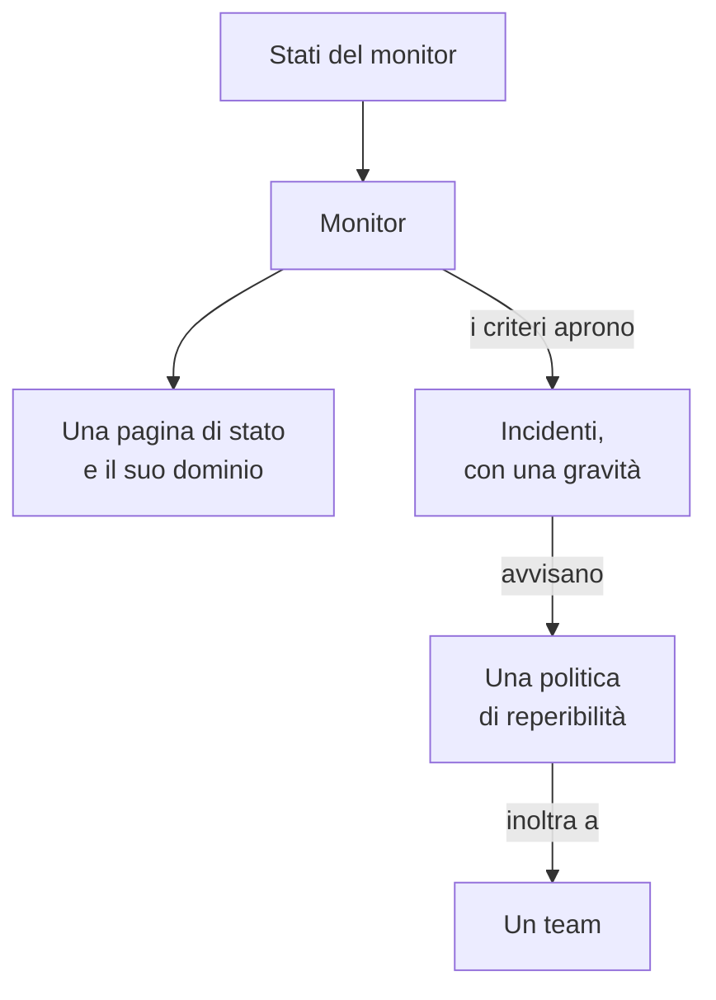

# Esempi

Configurazioni pronte all'uso per le risorse con cui inizia la maggior parte dei progetti. Ogni blocco si applica così com'è sopra la configurazione del provider qui sotto, e la maggior parte viene dai test end-to-end del provider, che le applicano a una vera istanza OneUptime a ogni modifica.

:::cards
- [Monitor](#monitor): Monitor di sito web, API, ping, porta, certificato SSL, heartbeat e manuali.
- [Pagine di stato](#pagine-di-stato): Una pagina di stato con un gruppo e un monitor, e un dominio personalizzato.
- [Team e reperibilità](#team-e-reperibilità): Un team, e una politica di reperibilità che lo avvisa.
- [Incidenti e manutenzione](#incidenti-e-manutenzione): Gravità, stati, un incidente dichiarato e una finestra di manutenzione.
:::



## Configurazione del provider

Ogni esempio presuppone questa configurazione, con la chiave API nella variabile d'ambiente `ONEUPTIME_API_KEY`:

```hcl title="main.tf"
terraform {
  required_providers {
    oneuptime = {
      source  = "oneuptime/oneuptime"
      version = "{{TERRAFORM_PROVIDER_VERSION}}"
    }
  }
}

provider "oneuptime" {
  # On a self-hosted OneUptime, add your OneUptime's address:
  # oneuptime_url = "https://oneuptime.example.com"
}
```

## Etichette

Le etichette ordinano e filtrano i record. La maggior parte delle risorse accetta un insieme di ID di etichette in `labels`:

```hcl
resource "oneuptime_label" "production" {
  name        = "production"
  description = "Production infrastructure"
  color       = "#FF5733"
}
```

## Monitor

I monitor qui sotto impostano il loro stato con tre degli stati con cui ogni progetto inizia, letti con sorgenti dati:

```hcl
data "oneuptime_monitor_status" "operational" {
  name = "Operational"
}

data "oneuptime_monitor_status" "degraded" {
  name = "Degraded"
}

data "oneuptime_monitor_status" "offline" {
  name = "Offline"
}
```

I `monitor_steps` di ogni monitor dicono cosa controlla e come viene giudicato ogni risultato: [Passaggi del monitor](/docs/terraform/monitor-steps) spiega ogni attributo.

### Monitor di sito web

Offline quando il sito non risponde, online quando risponde con 200. Il test end-to-end `35-monitor-with-steps` applica un monitor con questi controlli:

```hcl
resource "oneuptime_monitor" "website" {
  name                = "Website"
  description         = "Homepage availability and status code"
  monitor_type        = "Website"
  monitoring_interval = "*/5 * * * *"
  labels              = [oneuptime_label.production.id]

  monitor_steps = [{
    monitor_destination      = "https://example.com"
    monitor_destination_type = "URL"
    request_type             = "GET"

    criteria = [
      {
        name                  = "Offline"
        description           = "The website does not respond"
        filter_condition      = "Any"
        change_monitor_status = true
        monitor_status_id     = data.oneuptime_monitor_status.offline.id

        filters = [
          {
            check_on    = "Is Online"
            filter_type = "False"
          }
        ]
      },
      {
        name                  = "Online"
        description           = "The website responds with 200"
        filter_condition      = "All"
        change_monitor_status = true
        monitor_status_id     = data.oneuptime_monitor_status.operational.id

        filters = [
          {
            check_on    = "Is Online"
            filter_type = "True"
          },
          {
            check_on    = "Response Status Code"
            filter_type = "Equal To"
            value       = "200"
          }
        ]
      }
    ]
  }]
}
```

### Monitor di API

Un `POST` con intestazioni e un corpo JSON, degradato quando la risposta è lenta. Il test end-to-end `35-monitor-with-steps` applica un monitor di API simile:

```hcl
resource "oneuptime_monitor" "orders_api" {
  name         = "Orders API"
  description  = "Health check of the orders API"
  monitor_type = "API"

  monitor_steps = [{
    monitor_destination      = "https://api.example.com/v1/health"
    monitor_destination_type = "URL"
    request_type             = "POST"
    request_headers = {
      "Content-Type" = "application/json"
      "Accept"       = "application/json"
    }
    request_body = jsonencode({ check = "health" })

    criteria = [
      {
        name                  = "Offline"
        description           = "The API does not answer, or answers with an error"
        filter_condition      = "Any"
        change_monitor_status = true
        monitor_status_id     = data.oneuptime_monitor_status.offline.id

        filters = [
          {
            check_on    = "Is Online"
            filter_type = "False"
          },
          {
            check_on    = "Response Status Code"
            filter_type = "Greater Than Or Equal To"
            value       = "500"
          }
        ]
      },
      {
        name                  = "Slow"
        description           = "The API takes more than two seconds"
        filter_condition      = "All"
        change_monitor_status = true
        monitor_status_id     = data.oneuptime_monitor_status.degraded.id

        filters = [
          {
            check_on    = "Response Time (in ms)"
            filter_type = "Greater Than"
            value       = "2000"
          }
        ]
      },
      {
        name                  = "Online"
        description           = "The API answers in time"
        filter_condition      = "All"
        change_monitor_status = true
        monitor_status_id     = data.oneuptime_monitor_status.operational.id

        filters = [
          {
            check_on    = "Is Online"
            filter_type = "True"
          }
        ]
      }
    ]
  }]
}
```

### Monitor Ping

Un monitor Ping accetta un nome host o un indirizzo IP invece di un URL:

```hcl
resource "oneuptime_monitor" "gateway" {
  name         = "Gateway"
  description  = "The gateway answers ping"
  monitor_type = "Ping"

  monitor_steps = [{
    monitor_destination      = "gateway.example.com"
    monitor_destination_type = "Hostname"

    criteria = [
      {
        name                  = "Unreachable"
        filter_condition      = "Any"
        change_monitor_status = true
        monitor_status_id     = data.oneuptime_monitor_status.offline.id

        filters = [
          {
            check_on    = "Is Online"
            filter_type = "False"
          }
        ]
      },
      {
        name                  = "Reachable"
        filter_condition      = "All"
        change_monitor_status = true
        monitor_status_id     = data.oneuptime_monitor_status.operational.id

        filters = [
          {
            check_on    = "Is Online"
            filter_type = "True"
          }
        ]
      }
    ]
  }]
}
```

### Monitor di porta

Un monitor di porta aggiunge la `port` da controllare, come numero:

```hcl
resource "oneuptime_monitor" "database_port" {
  name         = "Database port"
  description  = "PostgreSQL accepts connections"
  monitor_type = "Port"

  monitor_steps = [{
    monitor_destination      = "db.example.com"
    monitor_destination_type = "Hostname"
    port                     = 5432

    criteria = [
      {
        name                  = "Closed"
        filter_condition      = "Any"
        change_monitor_status = true
        monitor_status_id     = data.oneuptime_monitor_status.offline.id

        filters = [
          {
            check_on    = "Is Online"
            filter_type = "False"
          }
        ]
      },
      {
        name                  = "Open"
        filter_condition      = "All"
        change_monitor_status = true
        monitor_status_id     = data.oneuptime_monitor_status.operational.id

        filters = [
          {
            check_on    = "Is Online"
            filter_type = "True"
          }
        ]
      }
    ]
  }]
}
```

### Monitor di certificato SSL

Offline quando il certificato non è valido, degradato quando scade entro 14 giorni o meno, come un nuovo monitor di certificato SSL nella dashboard:

```hcl
resource "oneuptime_monitor" "certificate" {
  name         = "example.com certificate"
  description  = "The TLS certificate of example.com"
  monitor_type = "SSL Certificate"

  monitor_steps = [{
    monitor_destination      = "https://example.com"
    monitor_destination_type = "URL"

    criteria = [
      {
        name                  = "Not valid"
        description           = "Expired, self-signed, untrusted or not reachable"
        filter_condition      = "Any"
        change_monitor_status = true
        monitor_status_id     = data.oneuptime_monitor_status.offline.id

        filters = [
          {
            check_on    = "Is Not A Valid Certificate"
            filter_type = "True"
          }
        ]
      },
      {
        name                  = "Expires soon"
        description           = "Valid, and expires in 14 days or less"
        filter_condition      = "All"
        change_monitor_status = true
        monitor_status_id     = data.oneuptime_monitor_status.degraded.id

        filters = [
          {
            check_on    = "Is Valid Certificate"
            filter_type = "True"
          },
          {
            check_on    = "Expires In Days"
            filter_type = "Less Than Or Equal To"
            value       = "14"
          }
        ]
      },
      {
        name                  = "Valid"
        filter_condition      = "All"
        change_monitor_status = true
        monitor_status_id     = data.oneuptime_monitor_status.operational.id

        filters = [
          {
            check_on    = "Is Valid Certificate"
            filter_type = "True"
          }
        ]
      }
    ]
  }]
}
```

### Monitor manuale

Un monitor manuale non controlla nulla: il suo stato lo imposti tu. Non ha bisogno di `monitor_steps`:

```hcl
resource "oneuptime_monitor" "payment_provider" {
  name         = "Payment provider"
  description  = "Set by hand during the provider's incidents"
  monitor_type = "Manual"
}
```

### Monitor heartbeat

Un monitor di richieste in arrivo aspetta richieste invece di inviarle: qui, un job di backup che si fa vivo ogni notte. Va offline quando non arriva nessuna richiesta per 25 ore:

```hcl
resource "oneuptime_monitor" "nightly_backup" {
  name         = "Nightly backup"
  description  = "The backup job sends a heartbeat when it finishes"
  monitor_type = "Incoming Request"

  monitor_steps = [{
    criteria = [
      {
        name                  = "No heartbeat"
        filter_condition      = "Any"
        change_monitor_status = true
        monitor_status_id     = data.oneuptime_monitor_status.offline.id

        filters = [
          {
            check_on    = "Incoming Request"
            filter_type = "Not Recieved In Minutes"
            value       = "1500"
          }
        ]
      },
      {
        name                  = "Heartbeat received"
        filter_condition      = "All"
        change_monitor_status = true
        monitor_status_id     = data.oneuptime_monitor_status.operational.id

        filters = [
          {
            check_on    = "Incoming Request"
            filter_type = "Recieved In Minutes"
            value       = "1500"
          }
        ]
      }
    ]
  }]
}

output "nightly_backup_heartbeat_key" {
  value     = oneuptime_monitor.nightly_backup.incoming_request_secret_key
  sensitive = true
}
```

Il job invia la sua richiesta a `https://oneuptime.com/heartbeat/YOUR_SECRET_KEY`, con la chiave che stampa `terraform output -raw nightly_backup_heartbeat_key`: vedi [Monitor richieste in arrivo](/docs/monitor/incoming-request-monitor). L'agente di un monitor server si identifica allo stesso modo, con `server_monitor_secret_key`.

### Gruppo di monitor

Un gruppo di monitor mostra un insieme di monitor con un solo stato:

```hcl
resource "oneuptime_monitor_group" "storefront" {
  name        = "Storefront"
  description = "Everything the shop needs"
}

resource "oneuptime_monitor_group_resource" "website" {
  monitor_group_id = oneuptime_monitor_group.storefront.id
  monitor_id       = oneuptime_monitor.website.id
}

resource "oneuptime_monitor_group_resource" "orders_api" {
  monitor_group_id = oneuptime_monitor_group.storefront.id
  monitor_id       = oneuptime_monitor.orders_api.id
}
```

## Pagine di stato

### Una pagina di stato con un gruppo e un monitor

Una pagina di stato mostra delle risorse, e può ordinarle in gruppi. Il test end-to-end `42-status-page-resources` applica questa configurazione:

```hcl
resource "oneuptime_status_page" "public" {
  name                  = "Public Status"
  description           = "Customer-facing status page"
  page_title            = "System Status"
  page_description      = "Check our system status and incident history"
  is_public_status_page = true
}

resource "oneuptime_status_page_group" "services" {
  status_page_id = oneuptime_status_page.public.id
  name           = "Services"
}

resource "oneuptime_status_page_resource" "website" {
  status_page_id       = oneuptime_status_page.public.id
  status_page_group_id = oneuptime_status_page_group.services.id
  monitor_id           = oneuptime_monitor.website.id
  display_name         = "Website"
}
```

### Un dominio personalizzato

Tre risorse lavorano insieme: un dominio del tuo progetto, la pagina di stato e il dominio della pagina di stato che li unisce. Il server compila `full_domain` e il token di verifica CNAME: non impostarli. I test end-to-end `12-status-page-domain` e `25-status-page-with-domain` applicano questa configurazione:

```hcl
resource "oneuptime_domain" "company" {
  domain = "example.com"
}

resource "oneuptime_status_page_domain" "status" {
  domain_id      = oneuptime_domain.company.id
  status_page_id = oneuptime_status_page.public.id
  subdomain      = "status"
}

output "status_page_address" {
  # The subdomain and the domain, such as status.example.com.
  value = oneuptime_status_page_domain.status.full_domain
}
```

Un nuovo dominio deve superare la verifica DNS prima che la pagina di stato risponda su di esso.

## Team e reperibilità

### Un team e i suoi membri

```hcl
resource "oneuptime_team" "sre" {
  name        = "SRE"
  description = "Site reliability engineering"
}

variable "alice_user_id" {
  description = "Alice's user ID, the last part of the address of her page under Users"
  type        = string
}

resource "oneuptime_team_member" "alice" {
  team_id = oneuptime_team.sre.id
  user_id = var.alice_user_id
}
```

Una persona che è già nel progetto entra subito nel team. Chiunque altro viene invitato, ed è nel team non appena accetta. Il test end-to-end `33-team-crud` applica il team.

### Una politica di reperibilità che avvisa un team

La prima regola della politica avvisa il team, e la politica ricomincia, fino a due volte, quando nessuno conferma:

```hcl
resource "oneuptime_on_call_policy" "primary" {
  name                                             = "Primary on-call"
  description                                      = "First line for production incidents"
  repeat_policy_if_no_one_acknowledges             = true
  repeat_policy_if_no_one_acknowledges_no_of_times = 2
}

resource "oneuptime_escalation_rule" "first_line" {
  on_call_duty_policy_id    = oneuptime_on_call_policy.primary.id
  name                      = "Page the SRE team"
  description               = "Moves on after 5 minutes without an acknowledgement"
  order                     = 1
  escalate_after_in_minutes = 5
}

resource "oneuptime_team_on_call_duty_escalation_rule" "sre" {
  on_call_duty_policy_id                 = oneuptime_on_call_policy.primary.id
  on_call_duty_policy_escalation_rule_id = oneuptime_escalation_rule.first_line.id
  team_id                                = oneuptime_team.sre.id
}
```

I criteri di un monitor avvisano la politica tramite `on_call_policy_ids` negli incidenti che aprono: vedi [Incidenti e avvisi](/docs/terraform/monitor-steps#incidenti-e-avvisi).

## Incidenti e manutenzione

### Gravità e stati

Le gravità classificano l'impatto di un incidente, e gli stati sono le tappe della sua vita. `order` è la posizione in cui compare ciascuno:

```hcl
resource "oneuptime_incident_severity" "sev1" {
  name        = "SEV-1"
  description = "Full outage, all hands"
  color       = "#E74C3C"
  order       = 1
}

resource "oneuptime_incident_state" "mitigated" {
  name        = "Mitigated"
  description = "Impact contained, fix in progress"
  color       = "#F39C12"
  order       = 3
}
```

`oneuptime_alert_severity` e `oneuptime_alert_state` funzionano allo stesso modo per gli avvisi. I test end-to-end `03-incident-severity` e `04-incident-state` li applicano.

### Dichiarare un incidente

Di solito sono i monitor ad aprire gli incidenti, ma anche un incidente è una risorsa, il che torna utile per un game day. È un incidente vero, quindi tieni un'esercitazione fuori dalle tue pagine di stato:

```hcl
resource "oneuptime_incident" "drill" {
  title                     = "Disaster recovery drill"
  description               = "A game day: we fail over the database"
  incident_severity_id      = oneuptime_incident_severity.sev1.id
  is_visible_on_status_page = false

  should_status_page_subscribers_be_notified_on_incident_created = false
}
```

Il test end-to-end `28-incident-crud` applica un incidente.

### Manutenzione programmata

Una finestra di manutenzione con orari fissi, mostrata sulle tue pagine di stato:

```hcl
resource "oneuptime_scheduled_maintenance_event" "database_upgrade" {
  title                       = "Database maintenance"
  description                 = "Planned PostgreSQL upgrade: writes pause briefly"
  starts_at                   = "2030-06-01T02:00:00Z"
  ends_at                     = "2030-06-01T04:00:00Z"
  is_visible_on_status_page   = true
  monitors                    = [oneuptime_monitor.website.id]
  change_monitor_status_to_id = data.oneuptime_monitor_status.degraded.id
}
```

Gli orari seguono RFC 3339, e lo stesso istante scritto in un altro modo non è una modifica. Il test end-to-end `30-scheduled-maintenance-crud` applica eventi di manutenzione.

Per mettere i monitor dell'evento in uno stato mentre è in corso, collegali con `monitors` e imposta `change_monitor_status_to_id` su uno dei tuoi stati del monitor: i monitor passano a quello stato quando l'evento inizia, e tornano operativi quando finisce. Terraform modifica `change_monitor_status_to_id` sul posto finché l'evento non inizia. Una volta iniziato l'evento, i suoi monitor sono già in quello stato, e un apply che lo cambia fallisce con «Change Monitor Status to can no longer be changed: this event has already started.»

## Sonde

Una sonda tua esegue i controlli dalla tua rete. La sua chiave è il segreto con cui la sonda si identifica, quindi passala in una variabile:

```hcl
variable "probe_key" {
  description = "The key the probe signs in with"
  type        = string
  sensitive   = true
}

resource "oneuptime_probe" "eu_west" {
  key           = var.probe_key
  name          = "EU West"
  description   = "Probe in our eu-west-1 network"
  probe_version = "1.0.0"

  should_auto_enable_probe_on_new_monitors = true
}
```

Esegui la sonda con `PROBE_ID` impostato sull'`id` della sonda e `PROBE_KEY` sulla chiave: vedi [Sonde personalizzate](/docs/probe/custom-probe). Il test end-to-end `23-probe-crud` applica le sonde.

## Prossimi passi

:::cards
- [Passaggi del monitor](/docs/terraform/monitor-steps): Ogni attributo dei controlli e dei criteri di un monitor.
- [Importare risorse](/docs/terraform/importing-resources): Portare sotto Terraform ciò che hai creato nella dashboard.
- [Guida completa](/docs/terraform/complete-guide): Sorgenti dati, stato, CI/CD e aggiornamenti.
:::
