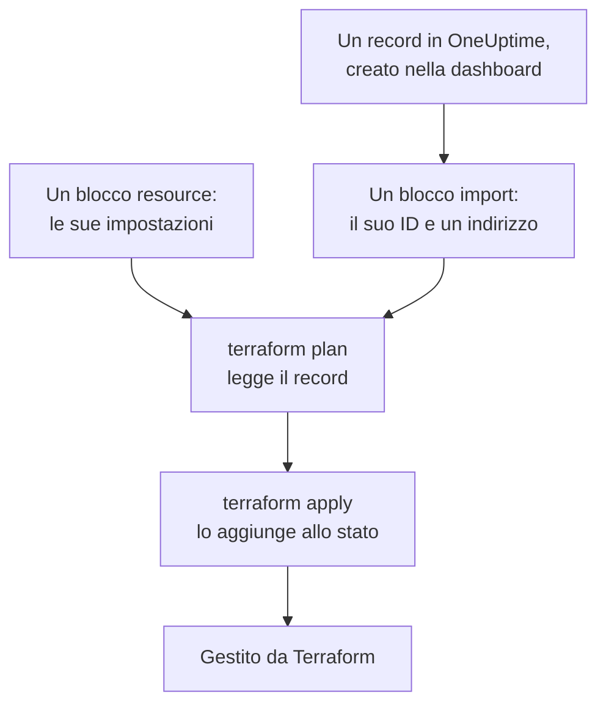

# Importare risorse

Non devi ricominciare da capo per gestire OneUptime con Terraform. Importa i monitor, le pagine di stato, i team e gli altri record che hai già, e Terraform li gestisce da quel momento, così come sono. Un'importazione si limita a leggere: in OneUptime non cambia nulla finché non applichi una modifica che hai pianificato.

:::cards
- [Come funziona un'importazione](#come-funziona-unimportazione): Cosa legge un'importazione, e cosa scrivi tu.
- [Importare una risorsa](#importare-una-risorsa): Dalla sua pagina nella dashboard, in quattro passi.
- [Importare molte risorse](#importare-molte-risorse): Blocchi di importazione per un intero elenco, e la configurazione che Terraform scrive per te.
- [Smettere di gestire una risorsa](#smettere-di-gestire-una-risorsa): Restituiscila alla dashboard senza eliminarla.
:::

## Come funziona un'importazione

Un'importazione collega un record che esiste già in OneUptime a un blocco `resource` della tua configurazione. Scrivi un blocco `import` con l'ID del record e l'indirizzo a cui va. Il `terraform plan` successivo legge il record tramite il suo ID e mostra che verrà importato, insieme a ogni differenza tra il record e la tua configurazione. `terraform apply` lo aggiunge allo stato di Terraform, e da quel momento il record è gestito come qualunque cosa Terraform abbia creato.



Scrivi il blocco `resource` in modo che dica ciò che il record è già. Dove differiscono, il piano mostra l'importazione e una modifica, e applicarlo modifica il record in OneUptime.

### Cosa si può importare

Ogni risorsa del provider si può importare tramite il suo ID, tranne `oneuptime_file`: l'API di OneUptime non può rileggere un file, quindi il provider risponde `Import Not Supported`. Le sorgenti dati non si importano mai. Per usare un record nella tua configurazione senza gestirlo, leggilo invece con una [sorgente dati](/docs/terraform/complete-guide#leggere-ciò-che-esiste-già).

## Prima di iniziare

- **Terraform 1.5 o successivo, oppure OpenTofu 1.6 o successivo.** I blocchi `import` di questa pagina richiedono queste versioni. Un Terraform più vecchio importa dalla [riga di comando](#importare-dalla-riga-di-comando).
- **Una chiave API che possa leggere ciò che importi.** L'importazione legge ogni record con la chiave del provider, e gestirlo in seguito richiede anche le autorizzazioni per modificarlo ed eliminarlo. Vedi [Creare una chiave API del progetto](/docs/terraform/quick-start#creare-una-chiave-api-del-progetto).
- **Il provider nella tua configurazione**, preparato come nell'[Avvio rapido](/docs/terraform/quick-start#indirizzare-terraform-a-oneuptime).

## Importare una risorsa

La dashboard scrive la configurazione della risorsa che stai guardando, con il suo blocco `import`, quindi raramente ne scrivi uno a mano.

:::steps
### Aprire la pagina Terraform della risorsa

Apri il monitor, la pagina di stato o un'altra risorsa nella dashboard. Nel suo menu laterale, apri **Sviluppatori**, poi **Terraform**.

### Copiarne la configurazione

La pagina scrive il blocco `resource` della risorsa a partire dalle sue impostazioni attuali, e un blocco `import` con il suo ID. Metti entrambi in un file `.tf`:

```hcl title="status-pages.tf"
resource "oneuptime_status_page" "public_status" {
  name       = "Public Status"
  page_title = "Acme Status"

  # Secrets are not shown here: master_password, embedded_overall_status_token.
  # Terraform leaves them as they are in OneUptime.
}

import {
  to = oneuptime_status_page.public_status
  id = "68a1b2c3-d4e5-4f6a-8b9c-0d1e2f3a4b02"
}
```

Scrive le impostazioni che differiscono dai valori predefiniti, e un commento dopo ogni ID nomina il record a cui punta. I segreti non vengono mai mostrati: quelli di cui la risorsa ha bisogno vengono letti da variabili contrassegnate come `sensitive`, e il commento nomina quelli che lascia fuori.

### Pianificare

Esegui `terraform plan`. Termina con `Plan: 1 to import, 0 to add, 0 to change, 0 to destroy.`: Terraform ha trovato il record, e la tua configurazione corrisponde.

### Applicare

Esegui `terraform apply`. La pagina di stato è ora nello stato di Terraform, e il piano successivo risponde `No changes.` Poi puoi eliminare il blocco `import`, o conservarlo come nota di dove è arrivata la risorsa: non fa più nulla una volta che la risorsa è gestita.
:::

### Scrivere i blocchi da solo

Senza la dashboard, scrivi da solo entrambi i blocchi. Inizia il blocco `resource` con gli attributi di cui la risorsa ha bisogno, ed esegui `terraform plan`. Dove la tua configurazione differisce dal record, il piano mostra la modifica accanto all'importazione:

```text
  # oneuptime_label.critical will be updated in-place
  # (imported from "68a1b2c3-d4e5-4f6a-8b9c-0d1e2f3a4b03")
  ~ resource "oneuptime_label" "critical" {
      ~ color = "#FF5733" -> "#000000"
    }

Plan: 1 to import, 0 to add, 1 to change, 0 to destroy.
```

Copia il valore del record nella tua configurazione (qui `color = "#FF5733"`), e pianifica di nuovo finché il piano mostra l'importazione e nessuna modifica. L'ID del record si trova in tre punti:

| Dove | Come |
| --- | --- |
| La pagina della risorsa | La sua scheda dei dettagli termina con una riga **ID**. Fai clic sull'ID, o sul pulsante di copia accanto, per copiare l'ID intero. |
| La barra degli indirizzi | L'ID segue il nome dell'elenco: `/dashboard/<project-id>/monitors/<monitor-id>`. |
| L'API | Ogni record porta il suo ID in `_id`. |

## Importare molte risorse

Per importare ogni monitor, pagina di stato o altra risorsa di uno stesso tipo, parti dal suo elenco.

:::steps
### Aprire la pagina Terraform dell'elenco

Apri l'elenco, poi **Sviluppatori** e **Terraform** nel suo menu laterale, per esempio **Monitor → Sviluppatori → Terraform**.

### Copiare i blocchi di importazione

La pagina scrive un blocco `import` per ogni record (i primi 100), con un indirizzo ricavato dal nome del record. Mettili in un file a parte, come `imports.tf`:

```hcl title="imports.tf"
import {
  to = oneuptime_monitor.homepage
  id = "68a1b2c3-d4e5-4f6a-8b9c-0d1e2f3a4b01"
}

import {
  to = oneuptime_monitor.checkout_api
  id = "68a1b2c3-d4e5-4f6a-8b9c-0d1e2f3a4b05"
}
```

### Lasciare che Terraform scriva la configurazione

Esegui il piano con un nome di file per la configurazione che Terraform scrive. Il file non deve esistere ancora: Terraform scrive solo in un file nuovo.

```bash
terraform plan -generate-config-out=monitors.tf
```

Terraform legge ogni record e scrive un blocco `resource` per ogni blocco `import` che non ne ha uno. Avverte che la generazione della configurazione è sperimentale, quindi rileggi ciò che ha scritto.

### Rivedere e applicare

Nel nuovo file, sostituisci gli ID degli altri record con riferimenti alle loro risorse, come `labels = [oneuptime_label.critical.id]`, così Terraform sa in quale ordine lavorare. Esegui `terraform plan` finché mostra solo le importazioni, poi `terraform apply`.
:::

### Un intero progetto

Importa un progetto elenco per elenco, iniziando dai record a cui gli altri fanno riferimento. Così ogni blocco di risorsa può fare riferimento a quelli che lo precedono tramite l'indirizzo anziché l'ID:

```mermaid title="Importare prima i record a cui gli altri fanno riferimento"
flowchart TB
    S["Etichette, team,<br/>stati dei monitor<br/>e gravità degli incidenti"] --> M["Monitor, pagine di stato<br/>e politiche di reperibilità"]
    M --> L["Ciò che li collega:<br/>risorse delle pagine di stato,<br/>regole di escalation<br/>e membri dei team"]
```

I record con cui ogni progetto inizia, come i suoi stati dei monitor e le sue gravità degli incidenti, spesso è meglio leggerli con sorgenti dati che importarli: Terraform può così farvi riferimento, ma non li modifica né li elimina mai. Il progetto è importato quando `terraform plan` risponde `No changes.`

## Importare dalla riga di comando

`terraform import` importa una risorsa alla volta, e funziona con ogni versione di Terraform e di OpenTofu. Scrivi prima il blocco `resource`, poi esegui il comando con l'indirizzo del blocco e l'ID del record:

```bash
terraform import oneuptime_status_page.public_status 68a1b2c3-d4e5-4f6a-8b9c-0d1e2f3a4b02
terraform import oneuptime_label.critical 68a1b2c3-d4e5-4f6a-8b9c-0d1e2f3a4b03
terraform import oneuptime_team.sre 68a1b2c3-d4e5-4f6a-8b9c-0d1e2f3a4b04
```

Ciascuno termina con `Import successful!`. A differenza di un blocco `import`, il comando scrive subito lo stato, senza un piano da rivedere prima: esegui poi `terraform plan`, e modifica la tua configurazione finché il piano risponde `No changes.`

## Smettere di gestire una risorsa

Per restituire una risorsa alla dashboard senza eliminarla, sostituisci il suo blocco `resource` con un blocco `removed` che conserva il record:

```hcl
removed {
  from = oneuptime_team.sre

  lifecycle {
    destroy = false
  }
}
```

Il piano dice che il team non sarà più gestito da Terraform, e non distrugge nulla. Applicalo, poi elimina il blocco `removed`. Un blocco `removed` con `destroy = false` richiede Terraform 1.7 o successivo, oppure OpenTofu 1.10 o successivo. Con una versione più vecchia, esegui invece `terraform state rm oneuptime_team.sre`.

> [!WARNING]
> Eliminare un blocco `resource` elimina il suo record in OneUptime al prossimo apply. Con Terraform, lo fa anche un blocco `removed` senza `destroy = false`: scrivi sempre il blocco `lifecycle`.

## Buono a sapersi

- **Un'importazione non cambia nulla, ma il prossimo apply sì.** Applicare un piano che mostra una modifica accanto a un'importazione modifica il record in OneUptime. Prima fai in modo che il piano mostri solo l'importazione.
- **I segreti non vengono riletti.** Un segreto che OneUptime non restituisce mai, come il `secret_value` di un segreto del monitor, non è nello stato dopo un'importazione. Se la tua configurazione lo imposta, il primo piano lo mostra come una modifica, e applicarlo scrive di nuovo il segreto.
- **Una configurazione per ogni record.** Un record importato in due configurazioni viene riportato, a ogni apply, a ciò che dice ciascuna di esse.
- **I record importati sono record gestiti.** `terraform destroy` li elimina da OneUptime, come i record che Terraform ha creato.

## Risoluzione dei problemi

:::details Messaggio «Cannot import non-existent remote object»
Nessun record ha quell'ID, oppure la chiave API del provider non può leggerlo: OneUptime risponde allo stesso modo in entrambi i casi. Controlla l'ID, e che la chiave possa leggere quel tipo di record.
:::

:::details Messaggio «Import Not Supported»
`oneuptime_file` è l'unica risorsa che non si può importare. Lasciala fuori, e lascia invece che Terraform crei un nuovo file.
:::

:::details Messaggio «Invalid ID format»
L'ID non è quello di un record, per esempio è un nome. Un'importazione prende l'ID, un UUID come `68a1b2c3-d4e5-4f6a-8b9c-0d1e2f3a4b02`: copialo dalla pagina della risorsa.
:::

:::details Messaggio «Target generated file already exists»
`-generate-config-out` nomina un file che esiste già. Nomina un file nuovo, oppure sposta altrove ciò che il file contiene ed eliminalo.
:::

:::details Messaggio «Resource already managed by Terraform»
`terraform import` ha ricevuto un indirizzo che è già nello stato. Importa il record a un altro indirizzo, oppure controlla con `terraform state list` cosa contiene l'indirizzo.
:::

## Prossimi passi

:::cards
- [Guida completa](/docs/terraform/complete-guide): Sorgenti dati, riferimenti tra risorse, e stato.
- [Passaggi del monitor](/docs/terraform/monitor-steps): Leggere e modificare ciò che controlla un monitor importato.
- [Esempi](/docs/terraform/examples): Configurazioni pronte all'uso per le risorse più comuni.
- [Risoluzione dei problemi](/docs/terraform/troubleshooting): Gli errori comuni e come correggerli.
:::
