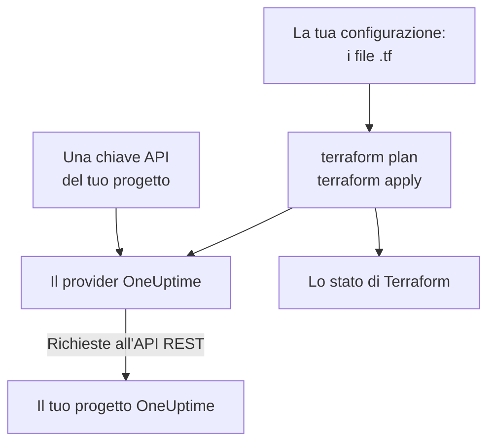

# Panoramica di Terraform

Il provider Terraform di OneUptime gestisce il tuo progetto OneUptime come codice. Descrivi monitor, pagine di stato, politiche di reperibilità, team, etichette e gli altri record del progetto in file `.tf`, vedi cosa cambierà con `terraform plan` e applica la modifica con `terraform apply`. Funziona con OneUptime Cloud e con un'istanza OneUptime self-hosted, e con OpenTofu come con Terraform.

:::cards
- [Come funziona il provider](#come-funziona-il-provider): La tua configurazione, il piano e le richieste all'API che ci sono dietro.
- [Installare il provider](#installare-il-provider): Il blocco del provider e la versione da scegliere.
- [Lasciala scrivere alla dashboard](#lasciala-scrivere-alla-dashboard): Configurazione e blocchi di import per quello che hai già.
- [Cosa puoi gestire](#cosa-puoi-gestire): Risorse, sorgenti dati e come si scrivono i loro attributi.
:::

## Come funziona il provider

Il provider è un plugin che Terraform scarica da un registry. Con `terraform apply` trasforma ogni modifica del piano in una richiesta all'API REST di OneUptime, fatta con una chiave API del tuo progetto. Terraform conserva nel suo stato ciò che ha creato, così il piano successivo mostra solo ciò che è cambiato da allora.



Una chiave API appartiene a un progetto e decide cosa Terraform può leggere e modificare al suo interno, quindi una configurazione gestisce un progetto. Per gestirne diversi, dai al provider un [alias](/docs/terraform/complete-guide#gestire-più-progetti) per ciascuno.

## Prima di iniziare

- **Terraform 1.5 o successivo, oppure OpenTofu 1.6 o successivo.** I blocchi `import` che la dashboard scrive richiedono queste versioni.
- **Una chiave API del tuo progetto.** L'[Avvio rapido](/docs/terraform/quick-start#creare-una-chiave-api-del-progetto) mostra come crearne una in **Impostazioni del progetto → Avanzato → Chiavi API**.
- **Su OneUptime Cloud, il piano Growth o superiore.** Le chiavi API di un progetto funzionano solo con quello.

## Installare il provider

Aggiungi il provider a un file `.tf`. `terraform init` lo scarica dal Terraform Registry, e `tofu init` dall'OpenTofu Registry:

```hcl title="main.tf"
terraform {
  required_providers {
    oneuptime = {
      source  = "oneuptime/oneuptime"
      version = "{{TERRAFORM_PROVIDER_VERSION}}"
    }
  }
}

provider "oneuptime" {
  # The API key comes from the ONEUPTIME_API_KEY environment variable.
  # On a self-hosted OneUptime, add your OneUptime's address:
  # oneuptime_url = "https://oneuptime.example.com"
}
```

Tieni la chiave fuori dai tuoi file: esportala prima di eseguire Terraform, oppure passala in una variabile marcata `sensitive`. La [Guida completa](/docs/terraform/complete-guide#configurare-il-provider) elenca tutti i modi per dare al provider la sua chiave e il suo indirizzo.

### Scegliere una versione

Le versioni del provider seguono quelle di OneUptime: il provider {{TERRAFORM_PROVIDER_MAJOR}}.x è generato da OneUptime {{TERRAFORM_PROVIDER_MAJOR}}.x. Il vincolo qui sopra, `{{TERRAFORM_PROVIDER_VERSION}}`, prende la release {{TERRAFORM_PROVIDER_MAJOR}}.x più recente, che è quella giusta per OneUptime Cloud. Su un'istanza OneUptime self-hosted, usa il provider più recente che non sia più nuovo della tua istanza: la [Configurazione self-hosted](/docs/terraform/self-hosted) mostra come fissarlo.

## Lasciala scrivere alla dashboard

Non devi scrivere a mano una risorsa che hai già. Ogni risorsa della dashboard OneUptime (un monitor, una pagina di stato, un workflow, una politica di reperibilità e le altre) ha una sezione **Sviluppatori** nel menu laterale, chiusa finché non la apri. La sua pagina **Terraform** scrive la configurazione al posto tuo, compilata con il tuo progetto.

:::steps
### Aprire la risorsa

Apri il monitor, la pagina di stato o l'altra risorsa che vuoi far gestire a Terraform.

### Aprire la sua pagina Terraform

Nel menu laterale, apri **Sviluppatori** e poi **Terraform**.

### Copiare la configurazione

La pagina scrive la configurazione della risorsa dalle sue impostazioni attuali, con un blocco `import`. Un commento dopo ogni ID nomina il record a cui punta (`incident_severity_id = "..." # Critical Incident`).

### Pianificare e applicare

Esegui `terraform plan`: il piano mostra la risorsa che viene importata e niente da modificare. Applicalo, e da quel momento Terraform gestisce la risorsa.
:::

Sotto la configurazione, **Per andare oltre** propone ciò che spesso si aggiunge accanto alla risorsa, riferendosi a essa con il suo indirizzo: un team proprietario per un incidente, un gruppo di monitor per una pagina di stato, una regola di escalation per una politica di reperibilità.

Le pagine di elenco (per esempio **Incidenti** o **Monitor**) hanno la stessa sezione. Lì la pagina **Terraform** scrive una nuova risorsa con i campi che la maggior parte delle persone compila, usando i record del tuo progetto: un incidente con una delle tue gravità, un monitor con i criteri che un nuovo monitor riceve nella dashboard, collegato ai tuoi stati. Offre **Configurazioni comuni** già pronte (una pagina di stato con un gruppo e un monitor, una politica di reperibilità che avvisa un team, una rotazione di reperibilità settimanale) e un blocco `import` per ogni risorsa che hai già (le prime 100), pronto per `terraform plan -generate-config-out`. Entrambe le pagine danno anche il blocco del provider per la tua istanza OneUptime: la `oneuptime_url` giusta e un vincolo di versione adatto alla tua istanza.

I segreti non vengono mai mostrati su queste pagine. Quando la configurazione ne ha bisogno (per esempio l'intestazione `Authorization` di un monitor), lo legge da una variabile Terraform marcata `sensitive`. I segreti che non le servono restano fuori, e Terraform li lascia come sono in OneUptime.

La stessa sezione ha una pagina **API**, con comandi `curl` per la risorsa, e una pagina **Assistenti IA**, che collega Claude, GitHub Copilot o Cursor al [server MCP](/docs/ai/mcp-server).

## Cosa puoi gestire

Il provider ha una risorsa per ogni tipo di record che puoi creare tramite l'API di OneUptime, chiamata `oneuptime_<name>`. Queste sono quelle con cui inizia la maggior parte delle configurazioni:

| Risorsa | Che cos'è |
| --- | --- |
| `oneuptime_monitor` | Un monitor: sito web, API, ping, porta, certificato SSL, server, richiesta in arrivo, manuale e ogni altro tipo |
| `oneuptime_monitor_status` | Uno stato del monitor, come Operational, Degraded o Offline |
| `oneuptime_monitor_group` | Un gruppo di monitor, mostrato con un solo stato |
| `oneuptime_status_page` | Una pagina di stato pubblica o privata |
| `oneuptime_status_page_domain` | Un dominio personalizzato di una pagina di stato |
| `oneuptime_domain` | Un dominio del tuo progetto, verificato per le pagine di stato |
| `oneuptime_label` | Un'etichetta, per ordinare e filtrare i record |
| `oneuptime_team`, `oneuptime_team_member` | Un team, e chi ne fa parte |
| `oneuptime_on_call_policy`, `oneuptime_escalation_rule` | Una politica di reperibilità, e le regole che avvisa in ordine |
| `oneuptime_incident`, `oneuptime_incident_severity`, `oneuptime_incident_state` | Gli incidenti, le loro gravità e i loro stati |
| `oneuptime_alert`, `oneuptime_alert_severity`, `oneuptime_alert_state` | Gli avvisi, le loro gravità e i loro stati |
| `oneuptime_scheduled_maintenance_event` | Una finestra di manutenzione programmata |
| `oneuptime_probe` | Una sonda tua, che controlla dalla tua rete |

Il [Terraform Registry](https://registry.terraform.io/providers/oneuptime/oneuptime/latest/docs) elenca ogni risorsa con ciascuno dei suoi attributi.

### Leggere ciò che esiste già

Ogni risorsa ha una sorgente dati con lo stesso nome, come `data "oneuptime_label"`. Una sorgente dati legge un record che questa configurazione non gestisce, per esempio uno creato nella dashboard. Cercalo con il suo `id`, oppure con i suoi altri argomenti semplici: ognuno che imposti deve corrispondere, ed esattamente un record può corrispondere a tutti.

```hcl
data "oneuptime_monitor_status" "offline" {
  name = "Offline"
}

# Any plain argument works. Set several, and all of them must match.
data "oneuptime_monitor_status" "offline_state" {
  is_offline_state = true
}
```

Nessuna corrispondenza, o più di una, è un errore e non una risposta vuota o arbitraria. La [Guida completa](/docs/terraform/complete-guide#leggere-ciò-che-esiste-già) riporta le regole.

### Risorse rinominate

I nomi delle risorse tengono interi parole come IoT e vCenter: `oneuptime_iot_fleet` e `oneuptime_vcenter`, dove i provider più vecchi avevano `oneuptime_io_t_fleet` e `oneuptime_v_center` (e lo stesso per le loro regole delle etichette, i proprietari e i feed). I vecchi nomi funzionano ancora come alias deprecati, e un piano che ne usa uno lo segnala. Per cambiare, rinomina la risorsa nella tua configurazione e aggiungi un blocco `moved`: Terraform mantiene la risorsa esistente invece di sostituirla:

```hcl
# Was: resource "oneuptime_io_t_fleet" "factory"
resource "oneuptime_iot_fleet" "factory" {
  name = "Factory floor"
}

moved {
  from = oneuptime_io_t_fleet.factory
  to   = oneuptime_iot_fleet.factory
}
```

Spostare una risorsa su un altro tipo richiede Terraform 1.8 o successivo. Con un motore più vecchio, tieni per ora il vecchio nome: continua a funzionare.

## Come si scrivono gli attributi

Gli attributi seguono l'API di OneUptime, in snake_case:

| Tipo di valore | Come si scrive | Esempio |
| --- | --- | --- |
| Testo, numeri, vero o falso | Così come sono | `is_public_status_page = false` |
| Un riferimento a un altro record | Il suo ID, di solito l'`id` di un'altra risorsa | `incident_severity_id = oneuptime_incident_severity.sev1.id` |
| Un elenco di riferimenti | Un insieme di ID, il cui ordine non cambia nulla | `labels = [oneuptime_label.critical.id]` |
| Un colore, un dominio e altri valori incapsulati | Il loro valore semplice | `color = "#FF5733"` |
| Una data e un'ora | Testo nel formato RFC 3339 | `starts_at = "2030-06-01T02:00:00Z"` |
| I controlli di un monitor | Attributi annidati tipizzati: vedi [Passaggi del monitor](/docs/terraform/monitor-steps) | `monitor_steps = [{ ... }]` |
| Altre impostazioni strutturate | JSON, scritto con `jsonencode()` | `log_monitor = jsonencode({ ... })` |

Due tipi di valori appartengono al server, e li lasci fuori:

- **Gli ID dentro una risorsa.** I passaggi e i criteri di un monitor, e i loro modelli di incidente e di avviso, hanno ID che il server assegna e conserva a ogni apply, così gli incidenti continuano a puntare ai criteri che li hanno generati.
- **Ciò che il server tiene aggiornato.** Lo stato attuale di un monitor, o quando ha ricevuto l'ultimo heartbeat, può cambiare tra `terraform plan` e la fine di `terraform apply`. Il provider mantiene il valore pianificato per tutto ciò che non hai impostato, e il refresh successivo legge quello del server, così questo non fa mai fallire un apply né compare come modifica.

## Ottenere aiuto

- Bug e richieste di funzionalità: [github.com/OneUptime/oneuptime/issues](https://github.com/OneUptime/oneuptime/issues).
- Il provider è generato dalla specifica OpenAPI di OneUptime nel [repository principale di OneUptime](https://github.com/OneUptime/oneuptime). Il repository pubblicato del provider è in sola lettura, quindi segnala i problemi nel repository principale.

## Prossimi passi

:::cards
- [Avvio rapido](/docs/terraform/quick-start): Creare una chiave API e applicare le prime risorse in dieci minuti.
- [Guida completa](/docs/terraform/complete-guide): Autenticazione, struttura del progetto, sorgenti dati, stato e aggiornamenti.
- [Passaggi del monitor](/docs/terraform/monitor-steps): Decidere cosa controlla un monitor e cosa significa ogni risultato.
- [Esempi](/docs/terraform/examples): Configurazioni pronte all'uso per le risorse più comuni.
- [Importare risorse](/docs/terraform/importing-resources): Portare sotto Terraform ciò che hai creato nella dashboard.
:::
