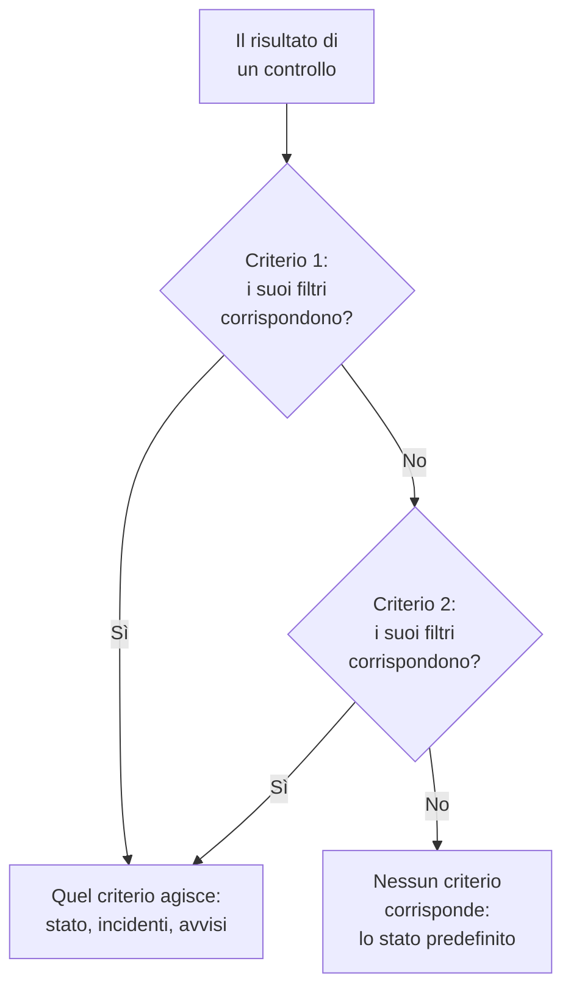
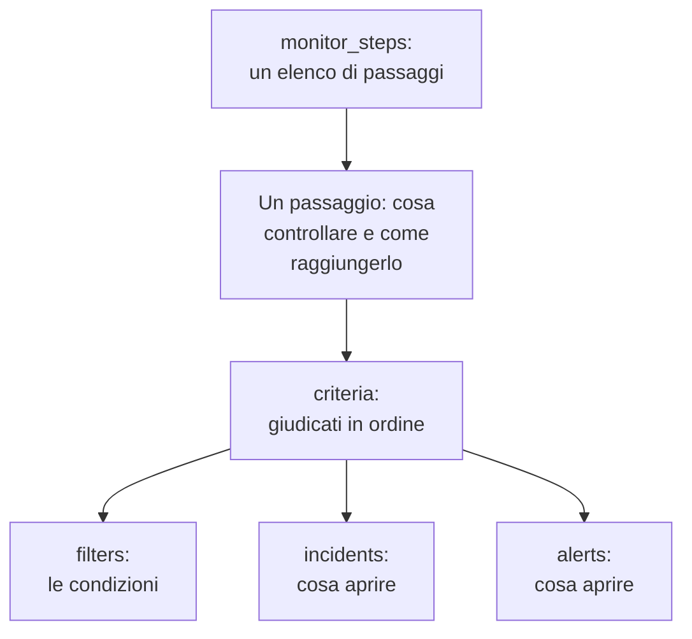

# Passaggi del monitor

`monitor_steps` è l'attributo di `oneuptime_monitor` che dice cosa controlla un monitor e come viene giudicato ogni risultato: l'indirizzo da controllare, la richiesta da inviare e i criteri che trasformano un risultato in uno stato del monitor, un incidente o un avviso. Questa pagina ne spiega ogni parte.

:::cards
- [Come viene giudicato un controllo](#come-viene-giudicato-un-controllo): I criteri in ordine, e il primo che corrisponde.
- [Scrivere i passaggi](#scrivere-i-passaggi): La loro forma, un esempio completo e le due regole per i valori.
- [Riferimento dei filtri](#riferimento-dei-filtri): Cosa può controllare un filtro, e come confronta.
- [Errori comuni](#errori-comuni): Ciò che va storto più spesso, e la soluzione.
:::

## Come viene giudicato un controllo

Ogni controllo dà un risultato: la risposta di una sonda, il valore restituito da uno script o la telemetria che il controllo legge. I criteri del passaggio lo giudicano poi nel loro ordine. Il primo criterio i cui filtri corrispondono decide cosa succede: può cambiare lo stato del monitor, aprire incidenti e aprire avvisi. I criteri che lo seguono non vengono considerati per quel controllo.



L'ordine dei criteri conta, quindi: metti per primi i criteri che avvisano, il più grave per primo, e quello di buona salute per ultimo. [Attributi di un criterio](#attributi-di-un-criterio) spiega perché, e l'unica eccezione.

## Scrivere i passaggi

`monitor_steps` è un elenco di oggetti tipizzati scritti direttamente in HCL. Non ci sono `jsonencode()`, involucri `{_type, value}`, chiavi in camelCase né ID da scrivere: il provider trasforma il tuo HCL nel formato dell'API, e il server dà il suo ID a ogni passaggio, a ogni criterio, a ogni modello di incidente e a ogni modello di avviso. Conserva questi ID a ogni apply, abbinando ogni criterio e ogni modello a quello che sostituisce per nome, altrimenti per posizione, così i risultati delle sonde restano con il loro passaggio e gli incidenti continuano a puntare ai criteri che li hanno generati.



Il passaggio utile più piccolo controlla un indirizzo e ha un criterio con un filtro:

```hcl
resource "oneuptime_monitor" "example" {
  name         = "Example"
  description  = "The smallest monitor_steps"
  monitor_type = "Website"

  monitor_steps = [{
    monitor_destination      = "https://example.com"
    monitor_destination_type = "URL"
    request_type             = "GET"

    criteria = [
      {
        name             = "Check if online"
        description      = "The website responds"
        filter_condition = "All"

        filters = [
          {
            check_on    = "Is Online"
            filter_type = "True"
          }
        ]
      }
    ]
  }]
}
```

Due regole valgono ovunque in `monitor_steps`:

- **Lascia fuori ciò che non usi.** Un attributo che non imposti non viene inviato all'API. Non scrivere mai `[]`, `{}` o `""` come segnaposto: il provider rifiuta stringhe, elenchi e map vuoti, così un valore mancante significa sempre «non impostato».
- **I valori dei filtri sono stringhe.** Il `value` di un filtro è una stringa, anche per un numero: `value = "200"`, non `value = 200`. Le impostazioni numeriche come `port` sono numeri.

:::details Passare dal provider 1.x, dove monitor_steps era JSON
Nel provider 1.x, `monitor_steps` era una stringa JSON scritta con `jsonencode({ _type = "MonitorSteps", value = { ... } })`. Riscrivila con gli attributi tipizzati di questa pagina: togli gli involucri `_type` e `value`, scrivi le chiavi in camelCase in snake_case (`monitorDestination` diventa `monitor_destination` e `monitor_destination_type`, `filterCondition` diventa `filter_condition`, `checkOn` diventa `check_on`) ed elimina ogni `id`. Ora il server assegna tutti gli ID, il che mette fine anche agli ID casuali fissi della issue [#2291](https://github.com/OneUptime/oneuptime/issues/2291). Lo stato salvato come stringa JSON non viene aggiornato da solo: applica la nuova configurazione.
:::

### Un esempio completo

Questo monitor di sito web controlla ciò che controlla il monitor di sito web dei test end-to-end del provider (test `35-monitor-with-steps`): offline quando il sito non risponde, online quando risponde con 200.

```hcl
resource "oneuptime_monitor_status" "operational" {
  name                 = "Operational"
  description          = "Monitor is operational"
  color                = "#2ecc71"
  priority             = 1
  is_operational_state = true
}

resource "oneuptime_monitor_status" "offline" {
  name                 = "Offline"
  description          = "Monitor is offline"
  color                = "#e74c3c"
  priority             = 3
  is_operational_state = false
}

resource "oneuptime_monitor" "website" {
  name         = "Website"
  description  = "Website monitor with explicit steps"
  monitor_type = "Website"

  monitor_steps = [{
    monitor_destination      = "https://example.com" # what to check
    monitor_destination_type = "URL"                 # URL, Hostname or IP
    request_type             = "GET"                 # the HTTP method

    criteria = [ # judged in order: the first match decides
      {
        name                  = "Offline"
        description           = "Check if website is offline"
        filter_condition      = "Any"
        change_monitor_status = true
        create_incidents      = false
        create_alerts         = false
        monitor_status_id     = oneuptime_monitor_status.offline.id

        filters = [
          {
            check_on    = "Is Online"
            filter_type = "False"
          }
        ]
      },
      {
        name                  = "Online"
        description           = "Check if website is online"
        filter_condition      = "All" # All: every filter, Any: at least one
        change_monitor_status = true
        create_incidents      = false
        create_alerts         = false
        monitor_status_id     = oneuptime_monitor_status.operational.id

        filters = [
          {
            check_on    = "Is Online"
            filter_type = "True"
          },
          {
            check_on    = "Response Status Code"
            filter_type = "Equal To"
            value       = "200" # a string, even for a number
          }
        ]
      }
    ]
  }]
}
```

Un criterio si riferisce a uno stato tramite la sua risorsa, come fa qui `oneuptime_monitor_status.offline.id`, oppure a uno che il tuo progetto ha già tramite una [sorgente dati](/docs/terraform/complete-guide#leggere-ciò-che-esiste-già).

## Attributi di un passaggio

Ogni elemento di `monitor_steps` è una cosa da controllare:

| Attributo | Tipo | Usato da | Note |
| --- | --- | --- | --- |
| `monitor_destination` | string | Sito web, API, Ping, IP, Porta, Certificato SSL, NTP | L'URL, il nome host o l'indirizzo IP da controllare. Richiede `monitor_destination_type`. |
| `monitor_destination_type` | string | gli stessi | `URL`, `Hostname` o `IP`, secondo ciò che accetta il tipo di monitor: un URL per i monitor di sito web, API e certificato SSL; un nome host o un indirizzo IP per i monitor Ping, IP, Porta e NTP. |
| `port` | number | Porta, NTP | La porta TCP da controllare, come `443`. Per NTP, la porta UDP su cui risponde il server dell'ora: `123` se non impostata. |
| `request_type` | string | Sito web, API | Il metodo HTTP: `GET`, `POST`, `PUT`, `DELETE`, `HEAD` o `PATCH`. Il server usa `GET` se non è impostato. |
| `request_headers` | map(string) | Sito web, API | Le intestazioni da inviare: `{ "Accept" = "application/json" }`. |
| `request_body` | string | API | Il corpo della richiesta, come testo. |
| `do_not_follow_redirects` | bool | Sito web, API | Fermarsi alla prima risposta invece di seguire i reindirizzamenti. |
| `allow_self_signed_certificates` | bool | Sito web, API | Accettare un certificato TLS autofirmato. |
| `tls_client_certificate` | string | Sito web, API | Un certificato client per il TLS reciproco: PEM, oppure un riferimento `{{monitorSecrets.name}}`. |
| `tls_client_key` | string (sensibile) | Sito web, API | La chiave privata del certificato client. Impostala insieme al certificato. |
| `tls_client_key_passphrase` | string (sensibile) | Sito web, API | La passphrase della chiave privata. |
| `request_timeout_in_ms` | number | Controlli fatti da una sonda | Quanto può durare un tentativo, in millisecondi. La sonda riduce qualsiasi valore sopra 60000 a 60000. |
| `retry_count` | number | Controlli fatti da una sonda | I nuovi tentativi dopo un primo tentativo fallito: `0` controlla una volta, `3` fino a quattro volte. La sonda riduce qualsiasi valore sopra 3 a 3. |
| `custom_code` | string | Custom JavaScript Code, Synthetic | Lo script che il passaggio esegue. |
| `screen_size_types` | list(string) | Synthetic | `Mobile`, `Tablet` e `Desktop`. |
| `browser_types` | list(string) | Synthetic | `Chromium` e `Firefox`. |
| `retry_count_on_error` | number | Synthetic | I nuovi tentativi quando lo script fallisce: `0` lo esegue una volta. |
| `criteria` | list (obbligatorio) | Tutti | Come viene giudicato ogni risultato: vedi [Attributi di un criterio](#attributi-di-un-criterio). |

### Impostazioni di ogni tipo di monitor

I tipi di monitor con più da impostare di un indirizzo tengono le loro impostazioni (una query sui log, una connessione a un database, un cluster da sorvegliare) in un attributo proprio, come JSON grezzo scritto con `jsonencode()`: `log_monitor`, `trace_monitor`, `llm_monitor`, `metric_monitor`, `exception_monitor`, `profile_monitor`, `dns_monitor`, `domain_monitor`, `dnssec_monitor`, `sql_monitor`, `database_monitor`, `external_status_page_monitor`, `network_device_monitor`, `kubernetes_monitor`, `docker_monitor`, `docker_swarm_monitor`, `host_monitor`, `podman_monitor`, `proxmox_monitor`, `vmware_monitor`, `ceph_monitor`, `storage_array_monitor`, `iot_monitor` e `probe_status_monitor`.

Il loro JSON è lo stesso della dashboard, con le chiavi in camelCase. Un ID al suo interno si scrive come lo scrive l'API: `{ _type = "ObjectID", value = "..." }`. Un monitor Logs che conta gli errori di un servizio:

```hcl
resource "oneuptime_service" "checkout" {
  name = "checkout"
}

resource "oneuptime_monitor" "checkout_errors" {
  name         = "Checkout errors"
  monitor_type = "Logs"

  monitor_steps = [{
    log_monitor = jsonencode({
      attributes          = {}
      body                = "error"
      severityTexts       = ["Error"]
      telemetryServiceIds = [{ _type = "ObjectID", value = oneuptime_service.checkout.id }]
      lastXSecondsOfLogs  = 300
    })

    criteria = [
      {
        name             = "Errors found"
        filter_condition = "Any"

        filters = [
          {
            check_on    = "Log Count"
            filter_type = "Greater Than"
            value       = "0"
          }
        ]
      }
    ]
  }]
}
```

> [!TIP]
> Il modo più facile per avere questo JSON giusto: configura il monitor nella dashboard, poi apri la sua sezione **Sviluppatori** e **Terraform**. La pagina scrive i `monitor_steps` del monitor, `jsonencode()` compreso.

## Attributi di un criterio

Ogni elemento di `criteria` è una regola: quando i suoi filtri corrispondono, fai ciò che dice.

I criteri vengono giudicati dall'alto, e il primo che corrisponde decide, quindi metti per primi i criteri che avvisano, il più grave per primo (critico, poi avviso), e quello di buona salute per ultimo. Un criterio di buona salute in cima è il modo più comune di costruire un monitor che non avvisa mai: una regola ampia come `Is Online` è `True`, o un valore di metrica `Greater Than` `0`, corrisponde a quasi ogni controllo, e i criteri sotto non vengono mai considerati. Messo per ultimo, corrisponde solo quando non ha corrisposto niente sopra, ed è proprio ciò che vuoi.

I monitor di metriche raggruppati sono l'unica eccezione. Quando la query di un monitor di metriche è raggruppata (`groupByAttributeKeys` impostato nel JSON di `metric_monitor`, in `metricViewConfig.queryConfigs[].metricQueryData.groupByAttributeKeys`), il monitor genera un avviso o un incidente per ogni gruppo (ogni host, container o punto di montaggio), e ogni criterio viene giudicato, così un criterio critico e uno di avviso possono scattare per host diversi nello stesso controllo. Un host che li viola entrambi viene comunque avvisato una sola volta, dal primo criterio che corrisponde, quindi il più grave va ancora per primo. Vedi [Monitor metriche](/docs/monitor/metrics-monitor).

| Attributo | Tipo | Che cos'è |
| --- | --- | --- |
| `name` | string (obbligatorio) | Il nome che mostra la dashboard. |
| `description` | string | La descrizione che mostra la dashboard. |
| `filter_condition` | string (obbligatorio) | `All`: ogni filtro deve corrispondere. `Any`: ne basta uno. |
| `filters` | list (obbligatorio) | Le condizioni, almeno una: vedi [Riferimento dei filtri](#riferimento-dei-filtri). |
| `change_monitor_status` | bool | Se una corrispondenza cambia lo stato del monitor. |
| `monitor_status_id` | string | L'ID del `oneuptime_monitor_status` a cui passare. Impostalo quando `change_monitor_status` è `true`. |
| `create_incidents` | bool | Se una corrispondenza apre incidenti. |
| `incidents` | list | Gli incidenti da aprire. Lascialo fuori, tranne con `create_incidents = true`. |
| `create_alerts` | bool | Se una corrispondenza apre avvisi. |
| `alerts` | list | Gli avvisi da aprire. Lascialo fuori, tranne con `create_alerts = true`. |
| `is_enabled` | bool | `true` sul server se non impostato. Imposta `false` per tenere un criterio senza giudicare con esso. |
| `incident_grouping` | string (JSON) | Solo monitor di richieste in arrivo: un incidente per ogni valore trovato nella richiesta, come `jsonencode({ groupByJSONPath = "..." })`. |
| `open_for_every_email` | bool | Solo monitor email in arrivo: `true` apre un incidente (e un avviso) per ogni email che corrisponde, invece di uno alla volta. |

### Incidenti e avvisi

Un elemento di `incidents` accetta `title` e `description` (entrambi obbligatori), `incident_severity_id`, `auto_resolve_incident`, `remediation_notes`, `on_call_policy_ids`, `label_ids`, `owner_team_ids`, `owner_user_ids`, `show_incident_on_status_page` e `is_private`. Un elemento di `alerts` accetta gli stessi, con `alert_severity_id` e `auto_resolve_alert`, e senza `show_incident_on_status_page`.

Questo criterio mette il monitor offline, apre un incidente che avvisa la politica di reperibilità e lo risolve quando il sito torna:

```hcl
criteria = [
  {
    name                  = "Offline"
    description           = "The site is unreachable"
    filter_condition      = "Any"
    change_monitor_status = true
    monitor_status_id     = oneuptime_monitor_status.offline.id
    create_incidents      = true

    filters = [
      {
        check_on    = "Is Online"
        filter_type = "False"
      }
    ]

    incidents = [
      {
        title                 = "Website is down"
        description           = "The website did not respond to the probe."
        incident_severity_id  = oneuptime_incident_severity.critical.id
        auto_resolve_incident = true
        on_call_policy_ids    = [oneuptime_on_call_policy.primary.id]
      }
    ]
  }
]
```

## Riferimento dei filtri

Un filtro ha `check_on` (cosa guarda), `filter_type` (come confronta) e `value` (con cosa confronta, come stringa; lascialo fuori per i controlli vero-o-falso come `True` e `False`).

Un filtro può anche giudicare una finestra di tempo invece dell'ultimo controllo: imposta `evaluate_over_time = true`, la durata della finestra in `evaluate_over_time_minutes` e, in `evaluate_over_time_type`, come si legge la finestra: `Average`, `Sum`, `Maximum Value`, `Minimum Value`, `All Values` o `Any Value`.

`All Values` significa che ogni controllo nella finestra ha violato la regola, quindi corrisponde solo quando la finestra è coperta di dati: un monitor appena creato aspetta che la sua finestra si riempia invece di corrispondere al primo controllo. Dagli una finestra di almeno il doppio del `monitoring_interval` del monitor; altrimenti la finestra contiene un solo controllo, e «tutti i valori» significa lo stesso di «un valore qualsiasi». `Any Value` corrisponde, per scelta, a un solo controllo che viola la regola.

`evaluate_over_time_no_data_policy` dice cosa fa il filtro finché la finestra non contiene abbastanza dati: `Ignore` (il valore predefinito) non corrisponde, `Trigger` tratta i dati mancanti come il guasto, come fa un heartbeat, e `Treat As Zero` confronta la finestra come un unico zero.

### Cosa può controllare un filtro

I valori di `check_on` che ogni tipo di monitor usa di più. L'editor dei criteri della dashboard offre gli stessi, e li elenca tutti:

| Tipo di monitor | Valori di `check_on` |
| --- | --- |
| Sito web / API | `Is Online`, `Response Time (in ms)`, `Response Status Code`, `Response Body`, `Response Header`, `Response Header Value`, `JavaScript Expression`, `Is Request Timeout` |
| Ping / IP | `Is Online`, `Response Time (in ms)`, `Packet Loss (in %)`, `Jitter (in ms)`, `Is Request Timeout` |
| Porta | `Is Online`, `Response Time (in ms)` (il tempo di connessione totale della dashboard), `Port DNS Lookup Time (in ms)`, `Port TCP Connect Time (in ms)`, `Is Request Timeout` |
| Certificato SSL | `Is Valid Certificate`, `Is Not A Valid Certificate`, `Is Self Signed Certificate`, `Is Expired Certificate`, `Expires In Days`, `Expires In Hours` |
| Richiesta in arrivo | `Incoming Request`, `Request Body`, `Request Header`, `Request Header Value`, `JavaScript Expression` |
| Email in arrivo | `Email Received`, `Email Subject`, `Email From Address`, `Email To Address`, `Email Body` |
| Server | `Is Online`, `CPU Usage (in %)`, `Memory Usage (in %)`, `Disk Usage (in %)` (con `disk_path`), `Server Process Name` |
| Log | `Log Count` |
| Tracce | `Span Count` |
| Eccezioni | `Exception Count` |
| Profili | `Profile Count`, `Function Share (in %)` |
| IA / LLM | `Bad AI Answers (in %)`, `Bad AI Answers`, `AI Answers` |
| Metriche | `Metric Value` (i filtri delle metriche possono avere JSON in `metric_monitor_options`) |
| Codice personalizzato / Synthetic | `Result Value` (può confrontare un campo dei dati restituiti, indicato nel JSON di `custom_code_monitor_options`, ad es. `jsonencode({ resultValuePath = "status" })` — vedi sotto), `Error`, `Execution Time (in ms)` |
| DNS | `DNS Is Online`, `DNS Response Time (in ms)`, `DNS Record Value`, `DNS Record Exists` |
| Dominio | `Domain Expires In Days`, `Domain Is Expired`, `Domain Registrar`, `Domain Name Server` |
| DNSSEC | `DNSSEC Chain Is Valid`, `DNSSEC DS Record Exists At Parent`, `DNSSEC Signature Expires In Days` |
| Query SQL | `SQL Is Online`, `SQL Query Row Count`, `SQL Query Scalar Value` |
| Salute del database | `Database Is Online`, `Database Metric` (con JSON in `database_monitor_options` che indica la serie, ad es. `jsonencode({ metricType = "oneuptime.monitor.database.connections.used.percent" })`), `Database Collection Error` |
| Pagina di stato esterna | `External Status Page Is Online`, `External Status Page Active Incidents`, `External Status Page Component Status` |
| NTP | `NTP Is Online`, `NTP Is Synchronized`, `NTP Stratum`, `NTP Clock Offset (in ms)`, `NTP Response Time (in ms)`, `NTP Root Dispersion (in ms)` (`NTP Is Online` e `NTP Is Synchronized` non prendono un `value`) |
| Dispositivo di rete (SNMP) | `SNMP Device Is Online` (risponde a ping o SNMP), `SNMP Walk Is Succeeding` (false quando risponde ma non può essere percorso), `SNMP OID Value` (i filtri SNMP possono avere JSON in `snmp_monitor_options`) |

### Come confronta un filtro

| Tipo | Valori di `filter_type` |
| --- | --- |
| Vero o falso | `True`, `False` |
| Numeri | `Equal To`, `Not Equal To`, `Greater Than`, `Less Than`, `Greater Than Or Equal To`, `Less Than Or Equal To` |
| Testo | `Contains`, `Not Contains`, `Starts With`, `Ends With`, `Is Empty`, `Is Not Empty` |
| Heartbeat | `Recieved In Minutes`, `Not Recieved In Minutes` (scritti come li scrive l'API) |
| Processi del server | `Is Executing`, `Is Not Executing` |
| Script | `Evaluates To True` |
| Anomalie, per metriche, log e tracce | `Anomalously High`, `Anomalously Low`, `Anomalous` |

Un filtro che corrisponde quando un certificato SSL scade entro 14 giorni o meno:

```hcl
filters = [
  {
    check_on    = "Expires In Days"
    filter_type = "Less Than Or Equal To"
    value       = "14"
  }
]
```

Il provider controlla `check_on`, `filter_type` e gli altri elenchi fissi quando pianifica, così un errore di battitura fallisce prima che venga inviato qualcosa all'API. I valori sono i nomi che l'API dà alle opzioni dell'editor dei criteri della dashboard.

### Confrontare un campo del risultato di uno script

Lo script di un monitor di codice personalizzato o di un monitor Synthetic restituisce `data`, e un filtro `Result Value` lo confronta. Quando `data` è un oggetto o un array, `custom_code_monitor_options` indica il campo da confrontare: il **Percorso del campo** del filtro Result Value della dashboard. Usa i punti per i campi annidati e `[n]` per gli elementi di un array, e lascia fuori l'attributo per confrontare l'intero valore:

```hcl
monitor_steps = [{
  custom_code = <<-EOT
    const response = await axios.get("https://api.example.com/health");
    // For example { status: "UP", checks: [{ name: "db", latency: 12 }] }
    return { data: response.data };
  EOT

  criteria = [
    {
      name             = "Unhealthy"
      filter_condition = "Any"
      filters = [
        {
          check_on                    = "Result Value"
          filter_type                 = "Not Equal To"
          value                       = "UP"
          custom_code_monitor_options = jsonencode({ resultValuePath = "status" })
        },
        {
          check_on                    = "Result Value"
          filter_type                 = "Greater Than"
          value                       = "500"
          custom_code_monitor_options = jsonencode({ resultValuePath = "checks[0].latency" })
        }
      ]
    }
  ]
}]
```

`Greater Than` e le altre condizioni numeriche corrispondono solo a un campo che è un numero, e un campo che manca dai dati restituiti corrisponde solo a `Is Empty`. Vedi [Avvisare in base ai dati restituiti](/docs/monitor/custom-code-monitor#avvisi-sui-dati-restituiti) per come funzionano percorsi e condizioni.

## Errori comuni

1. **Segnaposto vuoti.** `incidents = []`, `request_headers = {}` e `description = ""` vengono rifiutati: lascia invece fuori l'attributo.
2. **Un numero dove va una stringa.** Il `value` di un filtro è una stringa, anche per un numero: `value = "200"`. Le impostazioni numeriche come `port`, `retry_count`, `request_timeout_in_ms` e `evaluate_over_time_minutes` prendono numeri.
3. **Il tipo di destinazione sbagliato.** `monitor_destination_type = "URL"` con un semplice nome host, o `Hostname` con un URL completo, fa fallire il controllo. I monitor di sito web e di API prendono URL; i monitor Ping, IP e Porta prendono nomi host o indirizzi IP.
4. **Un cambio di stato senza stato.** `change_monitor_status = true` senza `monitor_status_id` corrisponde, e non ha nessuno stato a cui passare.
5. **Gli ID.** Nessun elemento di `monitor_steps` ha un attributo `id`. Se passi dal vecchio JSON, eliminali: il server assegna gli ID.
6. **JSON scritto a mano.** Scrivi `log_monitor` e le altre impostazioni con `jsonencode()`, così Terraform li mette tra virgolette e scrive il JSON sempre allo stesso modo. Per `metric_monitor`, dai l'intero oggetto che scrive la dashboard: il server lo normalizza.

## Quando nessun criterio corrisponde

Un controllo a cui non corrisponde nessun criterio mette il monitor nel suo stato predefinito: lo stato operativo del progetto, quello che la dashboard sceglie per un nuovo monitor. I suoi incidenti aperti i cui criteri hanno scelto la risoluzione automatica vengono risolti anch'essi. Per decidere tu ogni esito, chiudi l'elenco con un ampio criterio di buona salute, come fanno gli esempi di questa pagina.

## Un monitor senza passaggi

`monitor_steps` è facoltativo, ma un monitor creato senza di esso non ha criteri con cui giudicare un risultato: le sonde saltano un monitor senza passaggi, e resta nello stato in cui è partito. Il tuo stato lascia l'attributo vuoto, e il piano resta pulito. Un monitor manuale non ha mai bisogno di passaggi: il suo stato lo imposti tu. Ogni altro tipo ha bisogno di almeno un passaggio per controllare qualcosa.

## Il formato di trasferimento

Dietro il provider, l'API parla ancora il suo JSON, in cui ogni oggetto ricco è incapsulato come `{_type, value}`:

```json
{
  "_type": "MonitorSteps",
  "value": {
    "monitorStepsInstanceArray": [
      {
        "_type": "MonitorStep",
        "value": {
          "monitorDestination": { "_type": "URL", "value": "https://example.com" },
          "requestType": "GET",
          "monitorCriteria": {
            "_type": "MonitorCriteria",
            "value": { "monitorCriteriaInstanceArray": [ { "_type": "MonitorCriteriaInstance", "value": { "...": "..." } } ] }
          }
        }
      }
    ]
  }
}
```

Il provider costruisce questo dal tuo HCL quando scrive, e lo rilegge in HCL, lasciando fuori ciò che gestisce il server (gli ID e i valori predefiniti che aggiunge). Lo incontri solo quando leggi tu stesso le risposte dell'API, per esempio in uno script che legge `monitorSteps`.

## Prossimi passi

:::cards
- [Esempi](/docs/terraform/examples): Monitor Ping, di porta, di certificato SSL e di API, pronti all'uso.
- [Guida completa](/docs/terraform/complete-guide): Sorgenti dati, stato e aggiornamenti.
- [Monitor metriche](/docs/monitor/metrics-monitor): Query delle metriche, raggruppamento e anomalie.
- [Risoluzione dei problemi](/docs/terraform/troubleshooting): Compreso un risultato incoerente dopo un apply su un monitor.
:::
