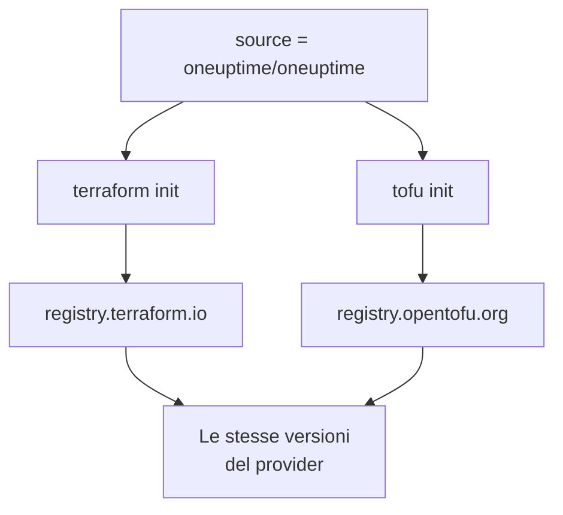

# OpenTofu

Il provider OneUptime funziona con [OpenTofu](https://opentofu.org) come funziona con Terraform. È pubblicato nell'[OpenTofu Registry](https://search.opentofu.org/provider/oneuptime/oneuptime/latest), e ogni release supera gli stessi test end-to-end con entrambi prima di essere pubblicata. La tua configurazione non cambia: esegui `tofu` ovunque questa documentazione esegue `terraform`.

:::cards
- [Usare il provider con OpenTofu](#usare-il-provider-con-opentofu): La stessa configurazione, eseguita con `tofu`.
- [Cosa cambia rispetto a Terraform](#cosa-cambia-rispetto-a-terraform): I registri, i file di lock, i file `.tofu` e le versioni.
- [Passare una configurazione a OpenTofu](#passare-una-configurazione-a-opentofu): Sposta una configurazione esistente in quattro passi.
- [Un modulo riutilizzabile](#un-modulo-riutilizzabile): Monitor, una politica di reperibilità e una pagina di stato per un servizio.
:::

## Usare il provider con OpenTofu

Ti serve OpenTofu 1.6 o successivo. Dichiara il provider come faresti per Terraform:

```hcl title="main.tf"
terraform {
  required_providers {
    oneuptime = {
      source  = "oneuptime/oneuptime"
      version = "{{TERRAFORM_PROVIDER_VERSION}}"
    }
  }
}

provider "oneuptime" {
  # The API key comes from the ONEUPTIME_API_KEY environment variable.
  # On a self-hosted OneUptime, add your OneUptime's address:
  # oneuptime_url = "https://oneuptime.example.com"
}
```

Poi eseguilo con `tofu`:

```bash
export ONEUPTIME_API_KEY="<your-api-key>"
tofu init
tofu plan
tofu apply
```

`tofu init` scarica il provider dall'OpenTofu Registry. Tutto ciò che si trova nell'[Avvio rapido](/docs/terraform/quick-start), nella [Guida completa](/docs/terraform/complete-guide), in [Passaggi del monitor](/docs/terraform/monitor-steps), negli [Esempi](/docs/terraform/examples) e in [Importare risorse](/docs/terraform/importing-resources) vale così com'è, e la configurazione che scrivono le pagine **Terraform** della dashboard funziona senza modifiche.

### Lasciare il registro fuori dall'indirizzo sorgente

`source = "oneuptime/oneuptime"` non nomina nessun registro, quindi ogni motore lo legge nel proprio:



Lascia fuori il nome host. Con un nome host, ogni motore usa quel registro: con `registry.terraform.io/oneuptime/oneuptime`, anche OpenTofu scarica dal Terraform Registry, e Terraform rifiuta la copia dell'OpenTofu Registry con `authentication signature from unknown issuer`.

## Cosa cambia rispetto a Terraform

| Argomento | Con OpenTofu |
| --- | --- |
| Il registro | `oneuptime/oneuptime` è `registry.opentofu.org/oneuptime/oneuptime`, che pubblica le stesse versioni del Terraform Registry. |
| Firme | `tofu init` dice che la convalida della firma è stata saltata: l'OpenTofu Registry non ha nessuna chiave di firma per questo provider, quindi OpenTofu verifica il download con i checksum del registro. |
| Il blocco `terraform` | Resta `terraform`: fa parte del linguaggio, e OpenTofu lo legge così com'è. |
| File `.tofu` | OpenTofu 1.8 e successivi leggono anche i file `.tofu`, e saltano un file `.tf` accanto al quale c'è un file `.tofu` con lo stesso nome. Terraform legge solo i file `.tf`. |
| `required_version` | Le versioni di OpenTofu partono da 1.6.0, quindi `>= 1.5.0`, scritto per Terraform, ammette qualsiasi OpenTofu. |
| Il file di lock | Nomina `registry.opentofu.org/oneuptime/oneuptime`. Cambiare motore riscrive quella voce: esegui il commit della modifica. |
| Stato | OpenTofu legge così com'è uno stato scritto da Terraform. |
| Variabili | `TF_VAR_name` imposta una variabile anche con OpenTofu. |
| Il file di configurazione della CLI | `~/.tofurc` o `~/.terraformrc`, oppure il file che `TF_CLI_CONFIG_FILE` indica. |
| Un blocco `removed` | Il suo blocco `lifecycle` richiede OpenTofu 1.10 o successivo. Senza di esso, OpenTofu dimentica la risorsa e conserva il record, mentre Terraform lo distrugge. |
| Passare a un tipo di risorsa rinominato | Un blocco `moved` da `oneuptime_io_t_fleet` a `oneuptime_iot_fleet`, o tra gli altri tipi rinominati, richiede OpenTofu 1.12 o successivo. |

## Passare una configurazione a OpenTofu

Una configurazione che Terraform gestisce passa a OpenTofu così com'è, con il suo stato:

:::steps
### Installare OpenTofu

Installa OpenTofu: la 1.6 basta per il provider, e la 1.12 o successiva sposta anche una risorsa a un tipo rinominato, come `oneuptime_io_t_fleet` a `oneuptime_iot_fleet`.

### Inizializzare con tofu

Nella cartella della configurazione, esegui `tofu init`. Scarica il provider dall'OpenTofu Registry, e dice di aver modificato il file di lock: la voce del provider ora nomina l'OpenTofu Registry.

### Pianificare

Esegui `tofu plan`. Legge lo stato lasciato da Terraform, e risponde `No changes.`

### Eseguire il commit del file di lock

Esegui il commit di `.terraform.lock.hcl`, e da ora in poi esegui la configurazione con `tofu`, anche in CI.
:::

## Un modulo riutilizzabile

[`Examples/opentofu/`](https://github.com/OneUptime/oneuptime/tree/master/Examples/opentofu) nel repository di OneUptime contiene configurazioni pronte da eseguire, e un modulo che prepara un servizio: un monitor del sito web per ogni indirizzo che gli dai, un'etichetta su tutto ciò che crea, una politica di reperibilità con una regola di escalation, e una pagina di stato che elenca i monitor. È HCL semplice, quindi funziona anche con Terraform.

```hcl title="main.tf"
module "storefront" {
  source = "github.com/OneUptime/terraform-provider-oneuptime//modules/monitoring-and-incident-response?ref=vX.Y.Z"

  service_name          = "storefront"
  status_page_is_public = true

  monitors = {
    homepage = { url = "https://example.com" }
    checkout = { url = "https://example.com/checkout" }
    api      = { url = "https://api.example.com/health", expected_status_code = "204" }
  }
}
```

Sostituisci `vX.Y.Z` con una versione pubblicata del provider, come la più recente tra le [release del provider](https://github.com/OneUptime/terraform-provider-oneuptime/releases): il modulo è pubblicato con il provider, e il suo repository cambia a ogni release.

Il modulo non crea stati dei monitor né gravità degli incidenti. Cerca per nome quelli con cui ogni progetto inizia: `Operational`, `Offline` e `Critical Incident`. Se il tuo progetto li ha rinominati, imposta `operational_monitor_status_name`, `offline_monitor_status_name` o `incident_severity_name`.

La sua regola di escalation non avvisa nessuno finché non dici chi: aggiungile un team con gli output del modulo:

```hcl title="main.tf"
resource "oneuptime_team" "storefront" {
  name = "Storefront"
}

resource "oneuptime_team_on_call_duty_escalation_rule" "storefront" {
  on_call_duty_policy_id                 = module.storefront.on_call_policy_id
  on_call_duty_policy_escalation_rule_id = module.storefront.escalation_rule_id
  team_id                                = oneuptime_team.storefront.id
}
```

## Prossimi passi

:::cards
- [Avvio rapido](/docs/terraform/quick-start): Crea una chiave API e applica le tue prime risorse.
- [Utilizzo del registro](/docs/terraform/registry): Come sono numerate le versioni, e il file di lock.
- [Configurazione self-hosted](/docs/terraform/self-hosted): La tua istanza OneUptime, e un mirror per le macchine offline.
- [Risoluzione dei problemi](/docs/terraform/troubleshooting): Gli errori comuni e come correggerli.
:::
